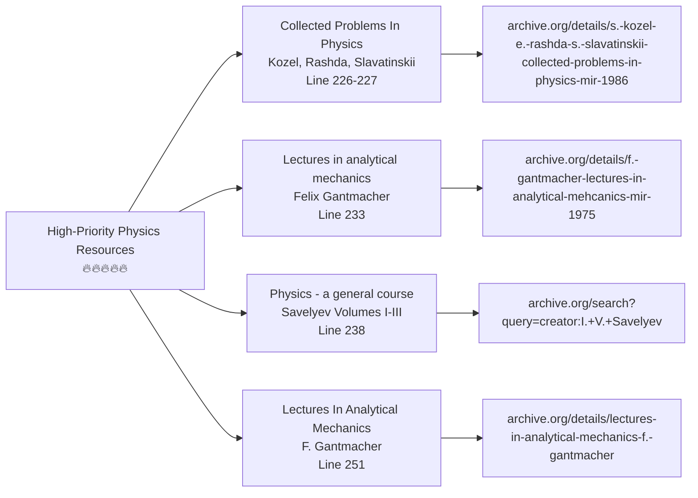
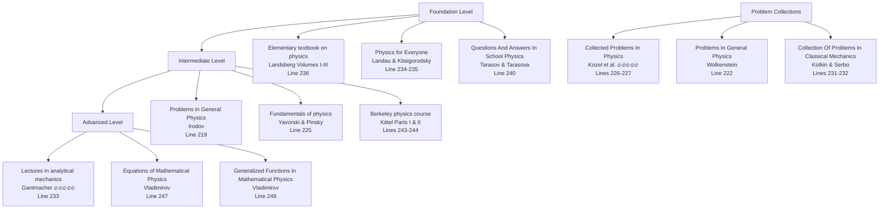
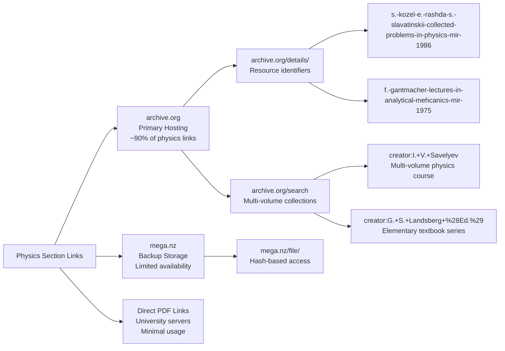
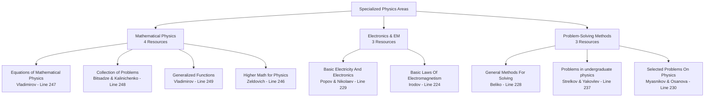

<!-- source: DeepWiki mcp.deepwiki.com · repo valeman/Awesome_Math_Books · page 3.2 Physics Resources · fetched 2026-10-30 -->

# Physics Resources

Relevant source files

The following files were used as context for generating this wiki page:

- [README.md](README.md)

This document covers the Physics section of the Awesome_Math_Books repository, which contains 30 curated physics resources representing 14% of the total collection. The physics resources complement the dominant mathematics collection by providing applied physics texts, problem collections, and mathematical physics materials. For information about the mathematics resources that form the bulk of the collection, see [Mathematics Resources](#3.1). For details about the overall repository structure and curation system, see [Repository Architecture](#2) and [Quality Curation System](#4).

## Overview and Content Distribution

The Physics section provides comprehensive coverage of undergraduate and graduate-level physics topics, with particular emphasis on problem-solving resources and theoretical foundations. The collection spans from introductory general physics to advanced mathematical physics, with strategic high-priority selections marked by the flame emoji system.

```mermaid
graph TD
    PHYSICS["Physics Section<br/>30 Resources<br/>14% of Collection"] --> GENERAL["General Physics<br/>8 Resources"]
    PHYSICS --> MECHANICS["Mechanics & Dynamics<br/>7 Resources"]
    PHYSICS --> EM["Electromagnetism<br/>4 Resources"]
    PHYSICS --> MATHPHYS["Mathematical Physics<br/>6 Resources"]
    PHYSICS --> QUANTUM["Quantum Mechanics<br/>2 Resources"]
    PHYSICS --> MISC["Miscellaneous<br/>3 Resources"]
    
    GENERAL --> GP1["Problems in General Physics - Irodov"]
    GENERAL --> GP2["Handbook Of Physics - Yavorsky & Detlaf"]
    GENERAL --> GP3["Physics - a general course - Savelyev 🔥🔥🔥🔥🔥"]
    
    MECHANICS --> M1["Lectures in analytical mechanics - Gantmacher 🔥🔥🔥🔥🔥"]
    MECHANICS --> M2["Collection Of Problems In Classical Mechanics - Kotkin & Serbo"]
    MECHANICS --> M3["Theoretical Mechanics - Chetaev"]
    
    EM --> E1["Basic Laws Of Electromagnetism - Irodov"]
    EM --> E2["Electricity And Magnetism - Matveev"]
    
    MATHPHYS --> MP1["Equations of Mathematical Physics - Vladimirov"]
    MATHPHYS --> MP2["Collected Problems In Physics - Kozel et al. 🔥🔥🔥🔥🔥"]
    
    QUANTUM --> Q1["Basic Concepts Of Quantum Mechanics - Tarasov"]
```

Sources: [README.md:218-252]()

## High-Priority Physics Resources

The physics section contains four flame-marked (🔥🔥🔥🔥🔥) high-priority resources that represent the essential core of the physics collection:

| Resource | Author(s) | Coverage | Archive Link Line |
|----------|-----------|----------|-------------------|
| Collected Problems In Physics | Kozel, Rashda, Slavatinskii | Comprehensive problem collection | [README.md:226-227]() |
| Lectures in analytical mechanics | Felix Gantmacher | Advanced theoretical mechanics | [README.md:233]() |
| Physics - a general course | Savelyev (Volumes I-III) | Complete undergraduate physics | [README.md:238]() |
| Lectures In Analytical Mechanics | F. Gantmacher | Duplicate high-priority entry | [README.md:251]() |

Sources: [README.md:226-227](), [README.md:233](), [README.md:238](), [README.md:251]()

## Topic Organization and Learning Pathways

The physics resources are organized to support progression from foundational understanding through advanced theoretical work:

Sources: [README.md:219](), [README.md:222](), [README.md:225](), [README.md:226-227](), [README.md:233](), [README.md:234-235](), [README.md:236](), [README.md:240](), [README.md:243-244](), [README.md:247](), [README.md:249]()

## External Hosting Architecture

The physics resources follow the same external dependency pattern as the broader collection, with primary hosting on `archive.org` and strategic backup systems:

Sources: [README.md:226](), [README.md:233](), [README.md:236](), [README.md:238]()

## Specialized Physics Subcategories

The physics collection includes specialized subcategories that bridge physics with mathematics and engineering:

### Mathematical Physics
- **Equations of Mathematical Physics** by V. S. Vladimirov [README.md:247]()
- **A Collection of Problems on the Equations of Mathematical Physics** by A. V. Bitsadze & D. F. Kalinichenko [README.md:248]()
- **Generalized Functions in Mathematical Physics** by V. S. Vladimirov [README.md:249]()
- **Higher Mathematics for Beginners and Its Application to Physics** by Yakov Zeldovich [README.md:246]()

### Electronics and Applied Physics
- **Basic Electricity And Electronics** by V. S. Popov; S. A. Nikolaev [README.md:229]()
- **Basic Laws Of Electromagnetism** by I. E. Irodov [README.md:224]()

### Problem-Solving Focus
- **General Methods For Solving Physics Problems** by B. S. Beliko [README.md:228]()
- **Problems in undergraduate physics** by Strelkov and Yakovlev [README.md:237]()
- **Selected Problems On Physics** by S. P. Myasnikov, T. N. Osanova [README.md:230]()

Sources: [README.md:224](), [README.md:228](), [README.md:229](), [README.md:230](), [README.md:237](), [README.md:246](), [README.md:247](), [README.md:248](), [README.md:249]()

## Integration with Mathematics Collection

The physics resources are strategically positioned to complement the dominant mathematics collection, particularly in areas of applied mathematics and mathematical physics. Several resources bridge both domains:

- **Higher Mathematics for Beginners and Its Application to Physics** by Zeldovich appears in both contexts [README.md:246]()
- Mathematical physics texts provide applied contexts for advanced mathematical concepts
- Problem collections emphasize mathematical techniques in physics applications

This integration supports the repository's goal of providing comprehensive educational resources spanning theoretical and applied domains.

Sources: [README.md:246](), [README.md:247-249]()

---

