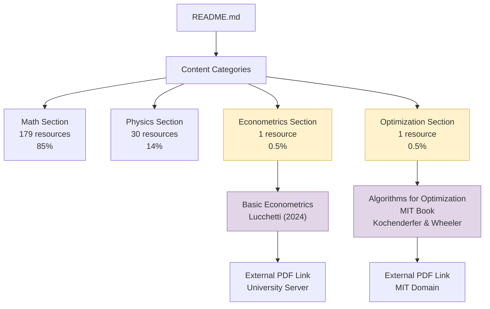
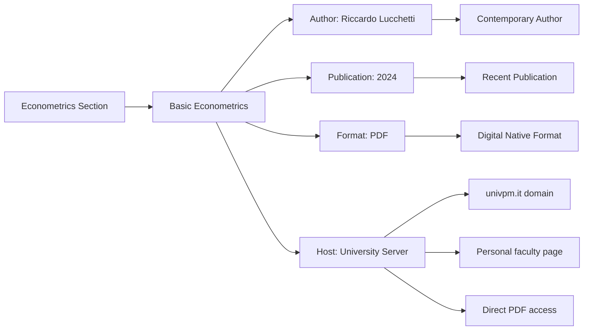
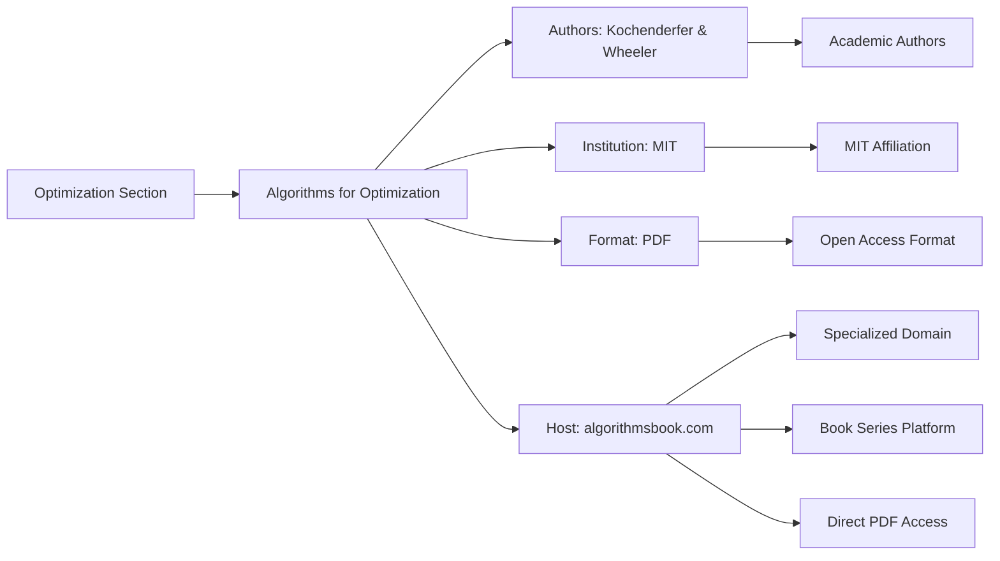
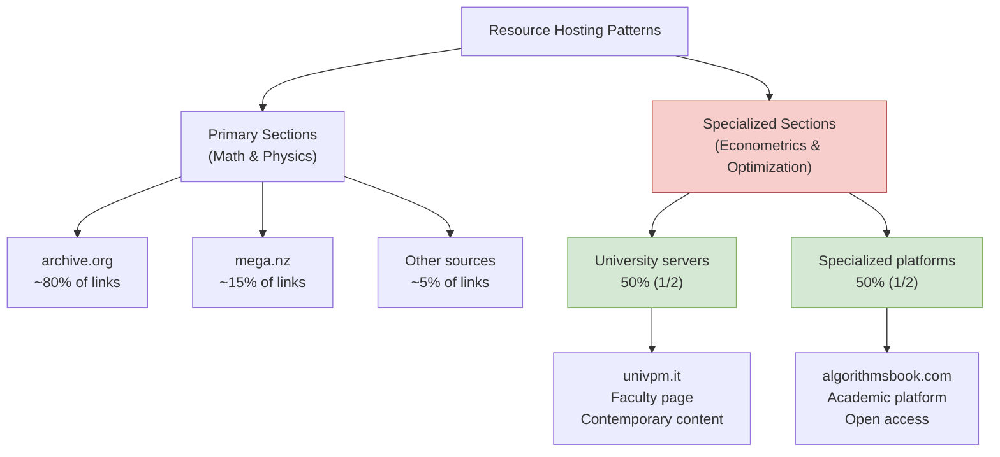
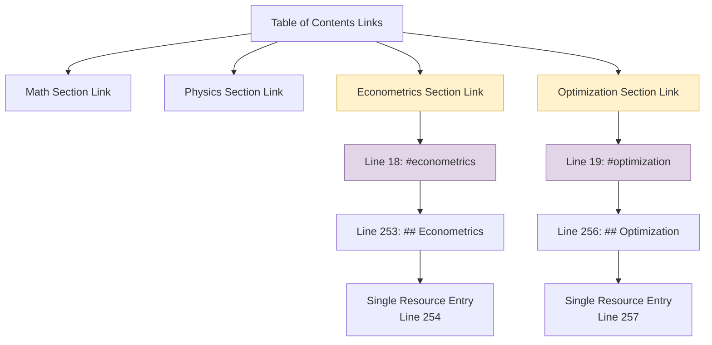
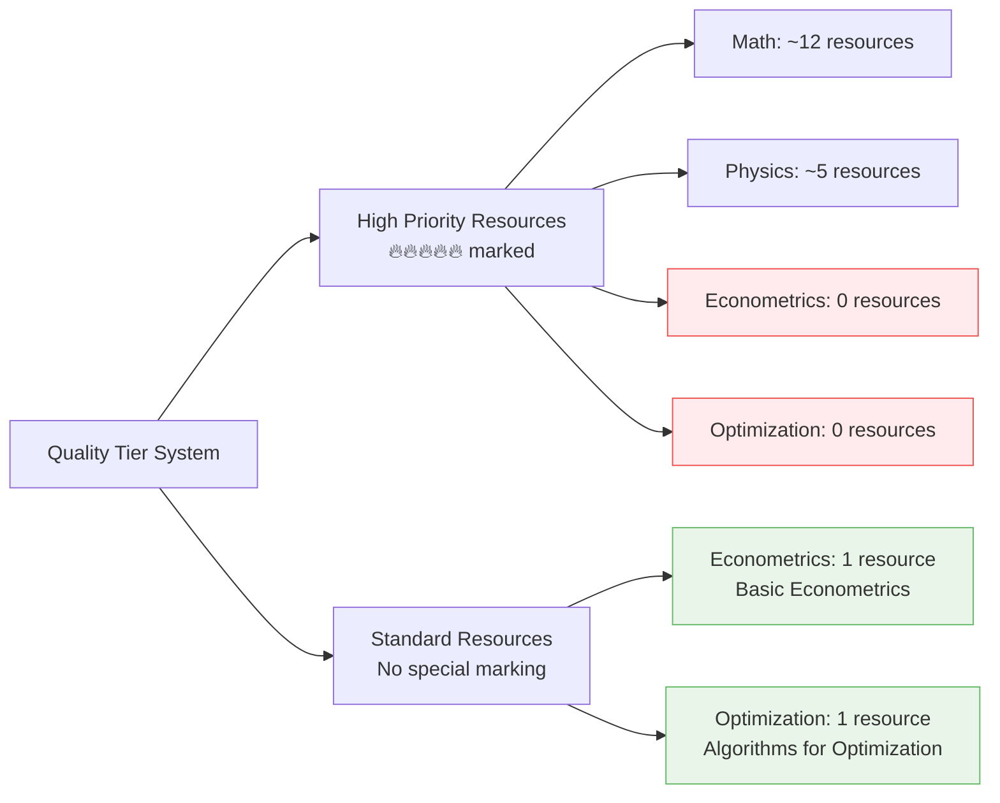

<!-- source: DeepWiki mcp.deepwiki.com · repo valeman/Awesome_Math_Books · page 3.3 Econometrics and Optimization Resources · fetched 2026-10-30 -->

# Econometrics and Optimization Resources

Relevant source files

The following files were used as context for generating this wiki page:

- [README.md](README.md)

This document covers the two smallest specialized content categories in the Awesome_Math_Books repository: Econometrics and Optimization. These sections contain exactly one resource each, representing focused collections for specific applied mathematical domains. Unlike the primary Math and Physics sections which emphasize historical and foundational texts, these categories feature contemporary resources targeting professional and graduate-level applications.

For information about the primary mathematical content, see [Mathematics Resources](#3.1). For physics-related materials, see [Physics Resources](#3.2).

## Section Overview and Repository Position

The Econometrics and Optimization sections occupy a unique position within the repository's content hierarchy. Together they represent only 1% of the total collection (2 out of 211 resources), contrasting sharply with the Mathematics section's 85% share and Physics section's 14% share.

**Repository Structure Context**
Sources: [README.md:253-258]()

## Econometrics Section Analysis

The Econometrics section contains a single contemporary resource that represents modern econometric methodology. This section demonstrates the repository's extension beyond pure mathematics into applied statistical domains.

**Resource Characteristics:**
- **Title**: Basic Econometrics
- **Author**: Riccardo (Jack) Lucchetti
- **Year**: 2024
- **URL Pattern**: `http://www2.econ.univpm.it/servizi/hpp/lucchetti/didattica/basic.pdf`
- **Hosting**: University faculty server (univpm.it)

Sources: [README.md:254]()

## Optimization Section Analysis

The Optimization section features a single MIT-affiliated resource focusing on algorithmic approaches to optimization problems. This represents the intersection of mathematics, computer science, and engineering applications.

**Resource Characteristics:**
- **Title**: Algorithms for optimization, MIT book
- **Authors**: Mykel Kochenderfer, Tim Wheeler
- **Institution**: MIT
- **URL Pattern**: `https://algorithmsbook.com/optimization/files/optimization.pdf`
- **Hosting**: Specialized book platform

Sources: [README.md:257]()

## External Hosting Pattern Analysis

Both specialized sections exhibit a distinct hosting pattern that differs significantly from the primary Math and Physics sections, which rely heavily on archive.org and mega.nz.

**Hosting Characteristics:**
| Section | Primary Host | Content Age | Access Pattern |
|---------|--------------|-------------|----------------|
| Math | archive.org | Historical | Preserved/Archived |
| Physics | archive.org | Historical | Preserved/Archived |
| Econometrics | University Server | Contemporary | Direct Faculty Link |
| Optimization | Academic Platform | Contemporary | Open Access Portal |

Sources: [README.md:254](), [README.md:257]()

## Section Integration Within Repository Architecture

The specialized sections serve as content bridges between pure mathematics and professional applications, though their minimal size indicates they are supplementary rather than core to the repository's mission.

**Navigation Structure:**
- **TOC References**: [README.md:18-19]()
- **Section Headers**: [README.md:253](), [README.md:256]()
- **Resource Entries**: [README.md:254](), [README.md:257]()

Sources: [README.md:14-19](), [README.md:253-258]()

## Content Quality and Curation Status

Neither specialized section contains resources marked with the flame emoji system (🔥🔥🔥🔥🔥) used to indicate high-priority materials in the main Math and Physics sections. This suggests these resources serve as supplementary references rather than foundational texts.

**Quality Classification:**
- **High Priority (Flame-marked)**: 0 resources across both sections
- **Standard Tier**: 2 resources total (100% of specialized content)
- **Coverage Role**: Supplementary/Reference materials

Sources: [README.md:253-258]()

## Usage Patterns and Access Characteristics

The specialized sections exhibit distinct access patterns optimized for contemporary professional use rather than historical study or comprehensive learning pathways.

| Characteristic | Math/Physics Sections | Econometrics/Optimization |
|----------------|----------------------|---------------------------|
| **Content Age** | Historical (1960s-1990s) | Contemporary (2020s) |
| **Target Audience** | Students & Self-learners | Professionals & Graduates |
| **Resource Depth** | Comprehensive collections | Focused single resources |
| **Access Reliability** | Archive-based preservation | Direct institutional links |
| **Update Frequency** | Static historical content | Potentially maintained |

Sources: [README.md:253-258]()

---

