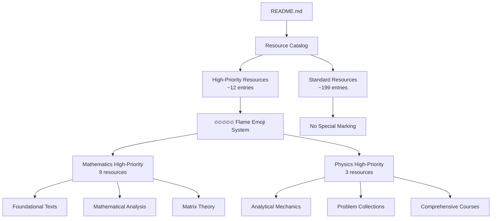
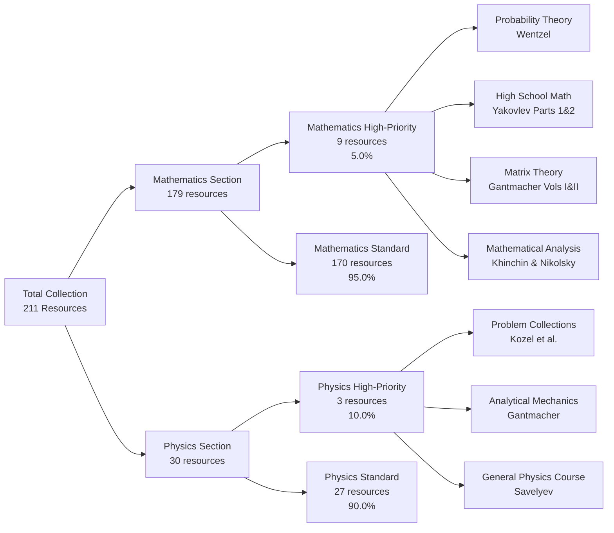
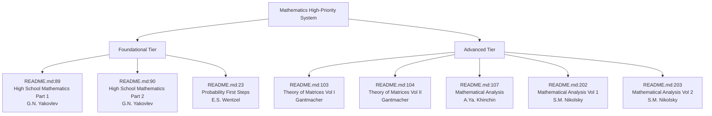
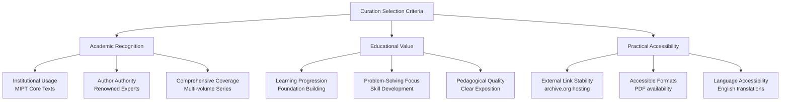
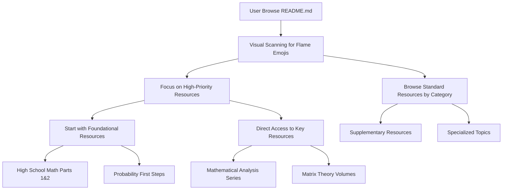

<!-- source: DeepWiki mcp.deepwiki.com · repo valeman/Awesome_Math_Books · page 4 Quality Curation System · fetched 2026-10-30 -->

# Quality Curation System

<details>
<summary>Relevant source files</summary>

The following files were used as context for generating this wiki page:

- [README.md](README.md)

</details>


## Purpose and Scope

The Quality Curation System implements a two-tier resource classification mechanism within the Awesome_Math_Books repository to help users identify the most valuable educational materials. This system uses visual markers to distinguish high-priority resources from standard entries, providing explicit guidance for learning pathways and resource selection.

For information about the broader content organization, see [Content Categories](#3). For details about accessing these curated resources, see [External Dependencies and Resource Access](#5).

## System Architecture

The Quality Curation System operates through a simple but effective flame emoji marking system embedded directly in the repository's primary catalog file.



Sources: [README.md:1-266]()

## Implementation Details

The curation system is implemented through direct markdown markup in the central catalog file, using a consistent five-flame emoji pattern to denote exceptional resources.

### Marking Syntax

High-priority resources follow this pattern in the README.md file:
```markdown
[Resource Title](link) by Author 🔥🔥🔥🔥🔥
```

The flame emoji sequence `🔥🔥🔥🔥🔥` serves as the visual indicator for top-tier resources, making them immediately identifiable during browsing.

Sources: [README.md:23](), [README.md:89-90](), [README.md:103-104]()

## High-Priority Resource Distribution

The Quality Curation System identifies 12 exceptional resources across the Mathematics and Physics domains, representing approximately 5.7% of the total collection.

| Category | High-Priority Count | Total Resources | Percentage |
|----------|-------------------|-----------------|------------|
| Mathematics | 9 | 179 | 5.0% |
| Physics | 3 | 30 | 10.0% |
| **Total** | **12** | **211** | **5.7%** |



Sources: [README.md:21-214](), [README.md:218-252]()

## Mathematics High-Priority Resources

The Mathematics section contains 9 flame-marked resources spanning foundational through advanced topics:

### Foundational Level
- **High School Mathematics Parts 1 & 2** by G.N. Yakovlev - Comprehensive secondary mathematics foundation
- **Probability - First Steps** by E.S. Wentzel - Introductory probability theory

### Advanced Level  
- **Theory of Matrices Volumes I & II** by Gantmacher - Definitive matrix theory reference
- **A Course of Mathematical Analysis** by A.Ya. Khinchin - Rigorous analysis foundation
- **A Course of Mathematical Analysis Volumes 1 & 2** by S.M. Nikolsky - MIPT core textbook series



Sources: [README.md:23](), [README.md:89-90](), [README.md:103-104](), [README.md:107](), [README.md:202-203]()

## Physics High-Priority Resources

The Physics section features 3 flame-marked resources covering theoretical foundations and problem-solving:

- **Collected Problems in Physics** by S. Kozel, E. Rashda, S. Slavatinskii - Comprehensive problem collection
- **Lectures in Analytical Mechanics** by F. Gantmacher - Theoretical mechanics foundation
- **Physics - A General Course Volumes I-III** by Savelyev - Complete physics curriculum

Sources: [README.md:227](), [README.md:233](), [README.md:238](), [README.md:251]()

## Curation Criteria and Selection Logic

The Quality Curation System appears to prioritize resources based on several implicit criteria:

### Academic Recognition
- **Institutional Usage**: Resources used as core textbooks at prestigious institutions (e.g., MIPT)
- **Author Authority**: Works by renowned mathematicians and physicists
- **Comprehensive Coverage**: Multi-volume series covering complete subject domains

### Educational Value
- **Learning Progression**: Resources suitable for building foundational knowledge
- **Problem-Solving Focus**: Extensive problem collections for skill development
- **Pedagogical Quality**: Clear exposition and systematic treatment



Sources: [README.md:202-203]() (MIPT notation), [README.md:103-104]() (Gantmacher authority), [README.md:23]() (foundational progression)

## User Interaction Patterns

The Quality Curation System guides user behavior through visual hierarchy and implicit learning pathways:



Sources: [README.md:14-20]() (Table of Contents), [README.md:89-90]() (foundational sequence)

## System Maintenance and Evolution

The Quality Curation System operates as a manually maintained classification within the single-file architecture:

### Maintenance Characteristics
- **Manual Curation**: Quality designations added through direct README.md editing
- **Stability**: Flame markings remain consistent across repository updates  
- **Scalability**: System can accommodate new high-priority additions
- **Simplicity**: No complex infrastructure or automated processes required

The system's integration with the single-file architecture ensures that quality curation remains tightly coupled with content organization, providing immediate value to users navigating the collection.

Sources: [README.md:1-266]() (entire file structure and manual maintenance approach)

---

