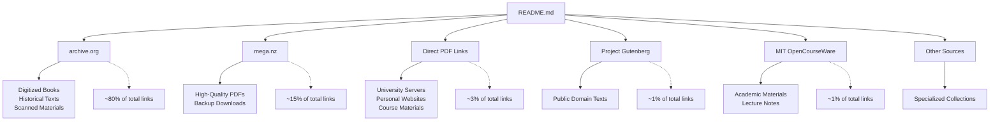
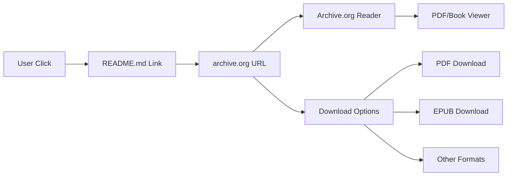
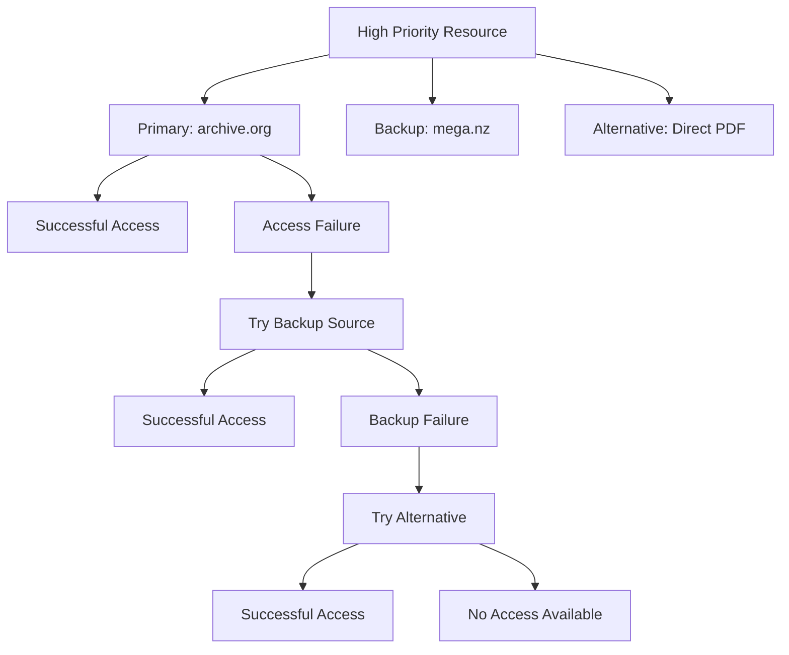
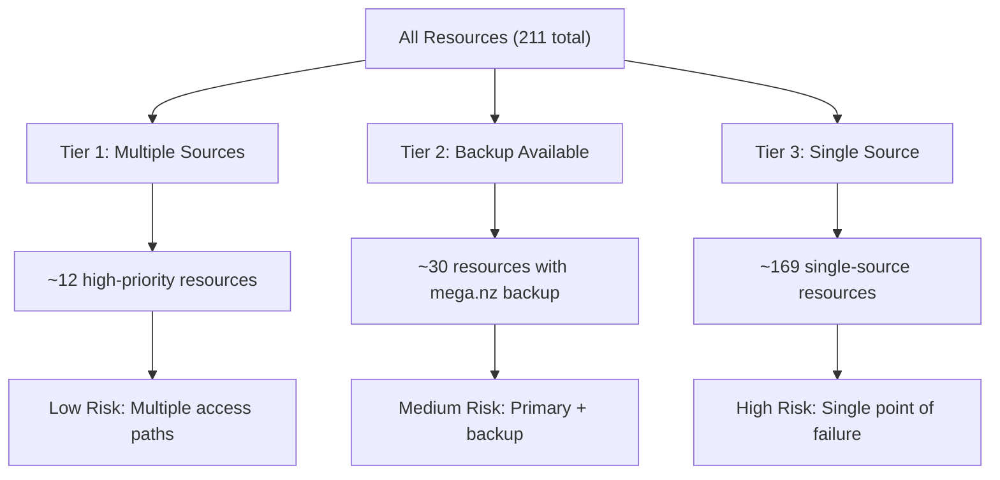

<!-- source: DeepWiki mcp.deepwiki.com · repo valeman/Awesome_Math_Books · page 5 External Dependencies and Resource Access · fetched 2026-10-30 -->

# External Dependencies and Resource Access

Relevant source files

The following files were used as context for generating this wiki page:

- [README.md](README.md)

This document covers the external hosting infrastructure, content delivery mechanisms, and resource access patterns used by the Awesome_Math_Books repository. It details how the curated collection depends on third-party platforms for content storage and delivery, along with backup strategies and access reliability considerations.

For information about the content organization and curation system, see [Quality Curation System](#4). For details about navigation and user interaction patterns, see [Navigation and Usage](#6).

## External Hosting Architecture

The repository operates as a centralized index that relies entirely on external hosting platforms for content delivery. The `README.md` file functions as a link directory, with no local content storage beyond the catalog itself.

**External Hosting Distribution**
Sources: [README.md:1-266]()

## Primary Infrastructure: Internet Archive

The Internet Archive (`archive.org`) serves as the primary content delivery platform, hosting the majority of resources in the collection. This platform provides reliable access to digitized academic texts, historical mathematics books, and scanned educational materials.

### Archive.org Link Patterns

The repository uses several URL patterns for Internet Archive resources:

- Standard archive links: `https://archive.org/details/[identifier]`
- Page-specific links: `https://archive.org/details/[identifier]/page/n[X]/mode/2up`
- Search-based collections: `https://archive.org/search?query=creator:[author]`

**Archive.org Access Flow**
Sources: [README.md:23-258]()

## Backup and Alternative Sources

### Mega.nz Backup System

The repository implements a strategic backup system using `mega.nz` cloud storage for critical high-priority resources. This provides redundancy for the most important educational materials.

| Resource Type | Primary Source | Backup Source | Example |
|---------------|----------------|---------------|---------|
| High-Priority Math | archive.org | mega.nz | Mathematical Analysis by Khinchin |
| Core Textbooks | archive.org | mega.nz | Linear Algebra by Voyevodin |
| Problem Collections | archive.org | mega.nz | Worked Problems in Applied Mathematics |

### Direct Institutional Access

Some resources link directly to university servers and institutional repositories, providing immediate access without intermediary platforms:

- University course materials
- Faculty personal pages
- Institutional digital libraries
- Open courseware platforms

Sources: [README.md:39-258]()

## Content Delivery Reliability

### High-Priority Resource Redundancy

Resources marked with flame emojis (`🔥🔥🔥🔥🔥`) often include multiple access methods to ensure availability:

**Redundancy Access Pattern**
Sources: [README.md:23, 39, 45, 67, 78, 103-104, 171-172, 227, 233, 238, 251]()

## Access Pattern Analysis

### Link Structure and Reliability

The repository's external dependencies create specific access patterns and potential failure points:

**Archive.org Dependencies:**
- Single point of failure for majority of content
- Relies on Internet Archive's infrastructure stability
- Subject to archive.org's terms of service and availability

**Mega.nz Backup Strategy:**
- Provides redundancy for critical resources
- Requires users to navigate cloud storage interface
- May have download limits or access restrictions

**Direct PDF Access:**
- Fastest access when available
- Higher risk of link decay over time
- No guaranteed backup or alternative access

### Resource Accessibility Tiers

**Resource Accessibility Risk Assessment**
Sources: [README.md:1-266]()

## Technical Implementation Details

### URL Management

The repository manages external dependencies through direct URL embedding in markdown format:

- No URL validation or health checking
- No automated link verification
- Manual curation and maintenance required
- Static link relationships without dynamic updates

### Content Type Distribution

| Content Type | Primary Host | Characteristics |
|--------------|--------------|-----------------|
| Scanned Books | archive.org | Large file sizes, page-by-page access |
| Modern PDFs | mega.nz | High quality, direct download |
| Historical Texts | Project Gutenberg | Public domain, multiple formats |
| Course Materials | University sites | Direct access, institutional reliability |
| Academic Papers | Various | Mixed hosting, variable availability |

Sources: [README.md:23-258]()

## Risk Management and Mitigation

### Single Point of Failure Risks

**Archive.org Dependency:**
- Repository functionality heavily dependent on Internet Archive availability
- No alternative primary hosting identified
- Limited redundancy for majority of content

**Link Decay Management:**
- No automated link checking implemented
- Manual discovery of broken links required
- Community-based reporting and updates needed

### Mitigation Strategies Currently Employed

1. **Strategic Backup Selection:** High-priority resources often include mega.nz alternatives
2. **Multiple Format Options:** Some resources available in different formats or locations
3. **Institutional Diversity:** Links distributed across multiple hosting organizations
4. **Community Maintenance:** Open repository structure allows community contributions for link updates

Sources: [README.md:39, 45, 67, 78, 103-104, 171-172]()

---

