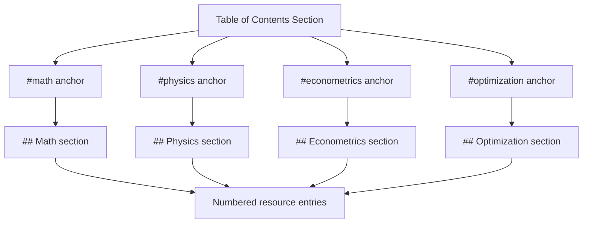
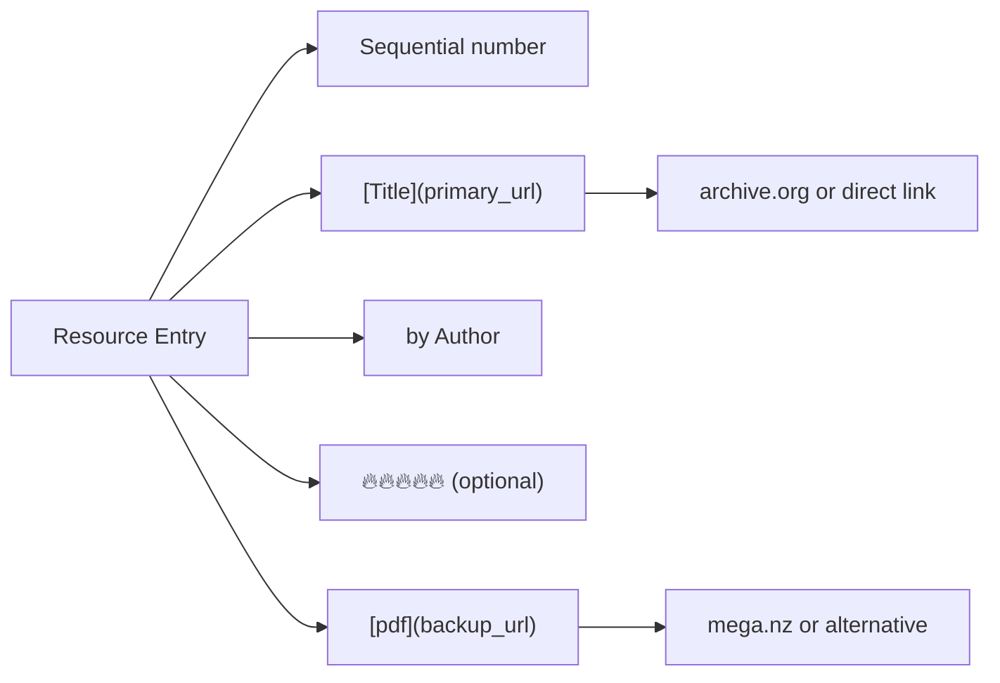
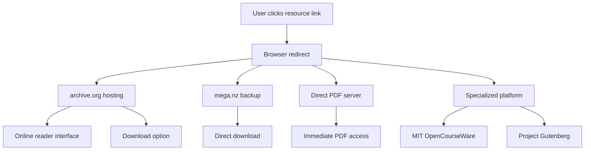
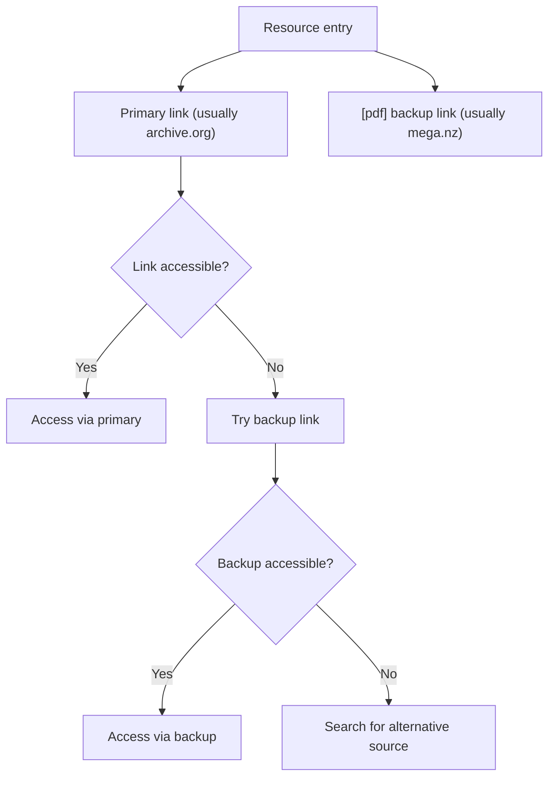
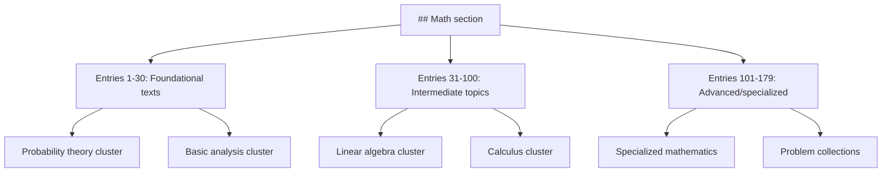
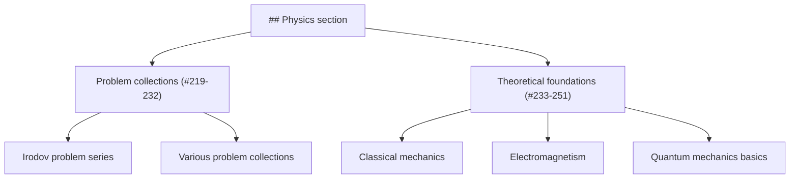

<!-- source: DeepWiki mcp.deepwiki.com · repo valeman/Awesome_Math_Books · page 6 Navigation and Usage · fetched 2026-10-30 -->

# Navigation and Usage

Relevant source files

The following files were used as context for generating this wiki page:

- [README.md](README.md)

This document explains how to navigate and effectively use the Awesome_Math_Books repository's curated collection of educational resources. It covers the internal navigation system, external resource access patterns, and best practices for finding specific materials within the collection.

For information about the content categories and their organization, see [Content Categories](#3). For details about the quality rating system, see [Quality Curation System](#4). For information about external hosting infrastructure, see [External Dependencies and Resource Access](#5).

## Navigation Architecture

The repository uses a single-file navigation system centered on `README.md` with internal anchor links and external resource connections.

### Table of Contents Structure

**Sources:** [README.md:14-19]()

### Resource Entry Pattern

Each resource follows a consistent markdown structure that enables both navigation and access:

**Sources:** [README.md:23-257]()

## External Resource Access Patterns

The navigation system connects to external resources through structured URL patterns that users must understand for effective access.

### Primary Access Flow

**Sources:** [README.md:23-257]()

### URL Pattern Analysis

| Link Type | Pattern | Example | Frequency |
|-----------|---------|---------|-----------|
| archive.org | `https://archive.org/details/` | `https://archive.org/details/ProbabilityTheoryfirstSteps` | ~80% |
| mega.nz | `https://mega.nz/file/` | `https://mega.nz/file/C5dGmATD#VFSnGH9FfSuvcPAJNa9PHHdrognlRz7c64dqErleDAk` | ~15% |
| Direct PDF | Various university/personal | `https://courses.csail.mit.edu/6.042/spring18/mcs.pdf` | ~3% |
| Specialized | gutenberg.org, MIT, etc. | `https://www.gutenberg.org/files/32625/32625-pdf.pdf` | ~2% |

**Sources:** [README.md:23-257]()

## Navigation Best Practices

### Finding High-Priority Resources

The flame emoji system (`🔥🔥🔥🔥🔥`) marks approximately 12 top-tier resources across the collection:

```mermaid
graph TD
    SEARCH["Looking for quality resources"] --> FLAME_SCAN["Scan for 🔥🔥🔥🔥🔥 markers"]
    FLAME_SCAN --> MATH_FLAMES["Math high-priority entries"]
    FLAME_SCAN --> PHYSICS_FLAMES["Physics high-priority entries"]
    
    MATH_FLAMES --> PROB_WENTZEL["#23: Probability - First Steps by Wentzel"]
    MATH_FLAMES --> HS_MATH_1["#89: High School Mathematics Part 1 by Yakovlev"]
    MATH_FLAMES --> HS_MATH_2["#90: High School Mathematics Part 2 by Yakovlev"]
    MATH_FLAMES --> MATRIX_1["#103: Theory of matrices, Volume I by Gantmacher"]
    MATH_FLAMES --> MATRIX_2["#104: Theory of matrices, Volume II by Gantmacher"]
    MATH_FLAMES --> ANALYSIS_KHIN["#107: A Course Of Mathematical Analysis by Khinchin"]
    MATH_FLAMES --> ANALYSIS_NIK_1["#171: A Course Of Mathematical Analysis Vol 1 by Nikolsky"]
    MATH_FLAMES --> ANALYSIS_NIK_2["#172: A Course Of Mathematical Analysis Vol 2 by Nikolsky"]
    
    PHYSICS_FLAMES --> COLLECTED_PROB["#226: Collected Problems In Physics by Kozel et al."]
    PHYSICS_FLAMES --> ANALYTICAL_MECH["#233: Lectures in analytical mechanics by Gantmacher"]
    PHYSICS_FLAMES --> PHYSICS_COURSE["#237: Physics - a general course by Savelyev"]
    PHYSICS_FLAMES --> ANALYTICAL_MECH_2["#251: Lectures In Analytical Mechanics by Gantmacher"]
```

**Sources:** [README.md:23](), [README.md:89-90](), [README.md:103-104](), [README.md:107](), [README.md:171-172](), [README.md:226](), [README.md:233](), [README.md:237](), [README.md:251]()

### Sequential vs. Targeted Navigation

Users can navigate through the collection using two primary approaches:

| Approach | Method | Best For |
|----------|---------|----------|
| Sequential | Browse numbered entries within sections | Discovering related resources |
| Targeted | Use Ctrl+F to search for specific topics/authors | Finding known resources |
| Priority-first | Scan for `🔥🔥🔥🔥🔥` markers | Accessing highest-quality content |

**Sources:** [README.md:14-257]()

## Link Reliability and Backup Strategy

The navigation system includes built-in redundancy for resource access:

**Sources:** [README.md:39](), [README.md:47](), [README.md:53]()

## Section-Specific Navigation Patterns

### Mathematics Section Navigation

With 179 resources, the Math section requires strategic navigation:

**Sources:** [README.md:21-214]()

### Physics Section Navigation

The Physics section (30 resources) focuses on problem-solving and theoretical foundations:

**Sources:** [README.md:218-251]()

## Usage Recommendations

### For New Users

1. Start with Table of Contents [README.md:14-19]() to understand scope
2. Scan for `🔥🔥🔥🔥🔥` entries to identify highest-priority resources
3. Use primary links first, fall back to `[pdf]` alternatives if needed
4. Focus on foundational entries (lower numbers) before advanced topics

### For Advanced Users

1. Use browser search (Ctrl+F) for specific topics or authors
2. Cross-reference flame-marked entries across sections for comprehensive coverage
3. Utilize backup links proactively for offline access
4. Follow author clusters (e.g., all Gantmacher works, all Yakovlev entries)

**Sources:** [README.md:1-257]()

---

