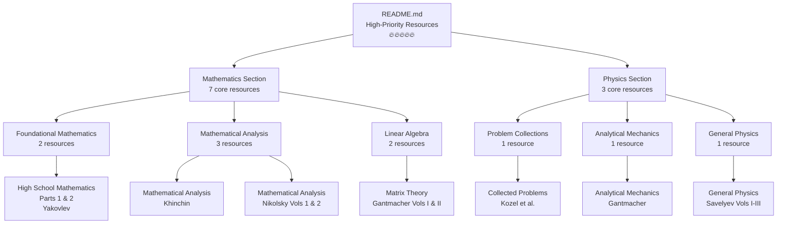
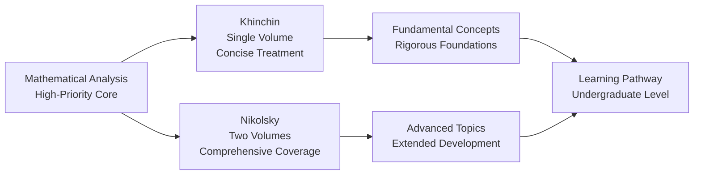
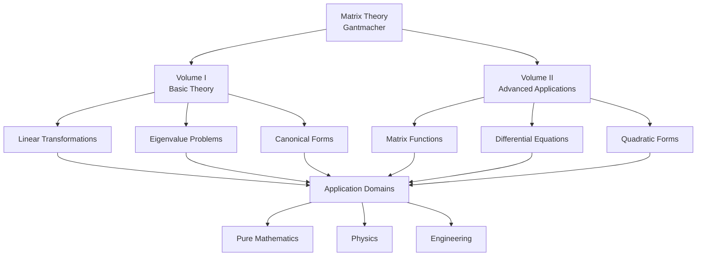
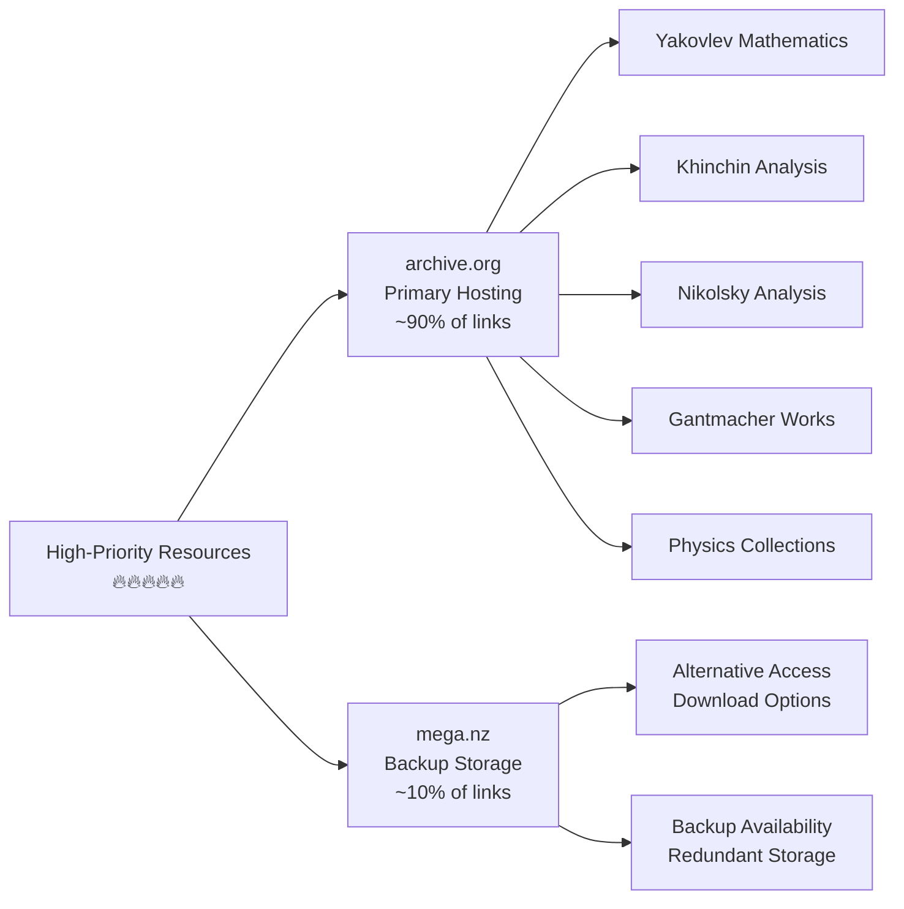

<!-- source: DeepWiki mcp.deepwiki.com · repo valeman/Awesome_Math_Books · page 7 Notable High-Priority Resources · fetched 2026-10-30 -->

# Notable High-Priority Resources

Relevant source files

The following files were used as context for generating this wiki page:

- [README.md](README.md)

This document provides detailed coverage of the flame-marked (🔥🔥🔥🔥🔥) high-priority resources within the Awesome_Math_Books collection. These approximately 11 resources represent the curated core of foundational and exceptional educational materials that have been specifically identified as essential references across mathematics and physics.

For information about the overall quality curation system and rating methodology, see [Quality Curation System](#4). For comprehensive coverage of all resources by category, see [Content Categories](#3).

## High-Priority Resource Architecture

The flame-marked resources form a carefully curated subset representing approximately 5% of the total collection, distributed strategically across foundational and advanced topics.

Sources: [README.md:23](), [README.md:89-90](), [README.md:103-104](), [README.md:107](), [README.md:202-203](), [README.md:227](), [README.md:233](), [README.md:238]()

## Mathematics High-Priority Resources

### Foundational Mathematics

#### High School Mathematics (Parts 1 & 2) - Yakovlev

Located at [README.md:89-90](), this two-volume series edited by G.N. Yakovlev represents the foundational entry point for serious mathematical study. These resources provide comprehensive coverage of pre-university mathematics with rigorous problem-solving approaches.

**Key Features:**
- Systematic progression through algebraic and geometric concepts
- Extensive problem collections with graduated difficulty
- Strong emphasis on mathematical reasoning and proof techniques
- Direct preparation for advanced mathematical study

#### Probability - First Steps - Wentzel

Found at [README.md:23](), E.S. Wentzel's introductory probability text serves as the primary entry point for probability theory within the collection.

**Significance:**
- Clear exposition of fundamental probability concepts
- Strong foundation for advanced statistical and stochastic studies
- Practical applications alongside theoretical development
- Gateway to more advanced probability resources in the collection

### Mathematical Analysis

The analysis resources form the theoretical backbone of the high-priority collection, with three complementary works covering different aspects and levels.

Sources: [README.md:107](), [README.md:202-203]()

#### A Course of Mathematical Analysis - Khinchin

Referenced at [README.md:107](), A. Ya. Khinchin's single-volume analysis text provides a concise yet rigorous treatment of fundamental analysis concepts.

**Distinguished Features:**
- Elegant mathematical exposition by a renowned Soviet mathematician
- Balance between theoretical rigor and practical understanding
- Comprehensive single-volume coverage of essential analysis topics
- Strong geometric intuition supporting analytical concepts

#### A Course of Mathematical Analysis (Volumes 1 & 2) - Nikolsky

Located at [README.md:202-203](), S.M. Nikolsky's two-volume series represents the core mathematical analysis textbook used at MIPT (Moscow Institute of Physics and Technology).

**Academic Significance:**
- Standard reference for elite technical education in Russia
- Comprehensive treatment spanning multiple semesters
- Integration of pure mathematical theory with physics applications
- Rigorous problem sets supporting theoretical development

### Linear Algebra

#### Theory of Matrices (Volumes I & II) - Gantmacher

Found at [README.md:103-104](), F.R. Gantmacher's two-volume matrix theory work represents the definitive treatment of matrix theory and linear algebra.

**Authoritative Status:**
- Comprehensive coverage from elementary to advanced topics
- Strong integration of theoretical development with applications
- Extensive treatment of eigenvalue problems and canonical forms
- Essential reference for both pure and applied mathematics

Sources: [README.md:103-104]()

## Physics High-Priority Resources

### Problem Collections

#### Collected Problems in Physics - Kozel, Rashda, Slavatinskii

Located at [README.md:227](), this comprehensive problem collection provides extensive coverage across all major physics domains.

**Collection Characteristics:**
- Systematic organization by physics subfields
- Problems ranging from introductory to advanced levels
- Strong emphasis on problem-solving methodology
- Integration of theoretical concepts with practical applications

### Theoretical Physics

#### Lectures in Analytical Mechanics - Gantmacher

Referenced at [README.md:233](), Felix Gantmacher's analytical mechanics lectures represent the definitive treatment of classical mechanics from a theoretical perspective.

**Theoretical Significance:**
- Rigorous mathematical formulation of classical mechanics
- Comprehensive treatment of Lagrangian and Hamiltonian methods
- Strong foundation for quantum mechanics and field theory
- Integration of mathematical sophistication with physical insight

#### Physics - A General Course (Volumes I-III) - Savelyev

Found at [README.md:238](), I.V. Savelyev's three-volume general physics course provides comprehensive coverage of undergraduate physics.

**Comprehensive Coverage:**
- Volume I: Mechanics and molecular physics
- Volume II: Electricity and magnetism
- Volume III: Optics and atomic physics
- Systematic progression from classical to modern physics
- Strong mathematical foundation supporting physical concepts

## Resource Accessibility and Hosting

All high-priority resources maintain consistent external hosting patterns, ensuring reliable access to these essential materials.

Sources: [README.md:23](), [README.md:89-90](), [README.md:103-104](), [README.md:107](), [README.md:202-203](), [README.md:227](), [README.md:233](), [README.md:238]()

## Learning Pathway Integration

The high-priority resources form coherent learning pathways supporting progressive mathematical and physical education.

| Subject Area | Entry Level | Intermediate | Advanced |
|--------------|-------------|--------------|----------|
| **Mathematics** | High School Math (Yakovlev) | Mathematical Analysis (Khinchin) | Advanced Analysis (Nikolsky) |
| **Linear Algebra** | - | Matrix Theory Vol I (Gantmacher) | Matrix Theory Vol II (Gantmacher) |
| **Probability** | First Steps (Wentzel) | - | - |
| **Physics** | - | General Course (Savelyev) | Analytical Mechanics (Gantmacher) |
| **Problem Solving** | - | Physics Problems (Kozel et al.) | - |

## Quality Curation Rationale

The flame-marking system identifies these resources based on several key criteria:

**Academic Authority:** Authors represent leading figures in Soviet/Russian mathematical and physical education, with works that have influenced generations of students.

**Pedagogical Excellence:** Each resource demonstrates exceptional clarity in presentation, systematic development of concepts, and effective integration of theory with practice.

**Comprehensive Coverage:** Resources provide complete treatment of their respective domains, serving as definitive references rather than supplementary materials.

**Enduring Relevance:** Despite publication dates spanning several decades, these works maintain their status as essential references due to their fundamental approach and mathematical rigor.

Sources: [README.md:1-266]()