# Page: Overview

# Overview

<details>
<summary>Relevant source files</summary>

The following files were used as context for generating this wiki page:

- [README.md](README.md)

</details>


## Purpose and Scope

The Awesome_Math_Books repository serves as a centralized, curated bibliography of educational resources in mathematics, physics, econometrics, and optimization. The system operates through a single-file architecture centered on [README.md:1-266](), functioning as both a content catalog and user interface for accessing 211 educational resources hosted across external platforms.

This document covers the repository's architectural design, content organization, and curation methodology. For detailed coverage of individual content categories, see [Mathematics Resources](#3.1), [Physics Resources](#3.2), and [Econometrics and Optimization Resources](#3.3). For information about the quality rating system, see [Quality Curation System](#4).

## Repository Architecture

The repository implements a minimalist single-file design where all functionality is concentrated in the `README.md` file. This architecture serves multiple roles simultaneously: content directory, user interface, navigation system, and metadata repository.

### Single-File System Design

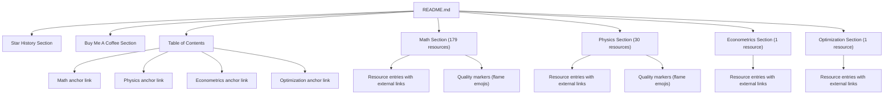

**Sources:** [README.md:1-266]()

### Content Distribution and Structure

The repository contains 211 total resources distributed across four categories with significant variance in content density:

| Category | Resource Count | Percentage | Line Range |
|----------|----------------|------------|------------|
| Math | 179 | 85% | [README.md:21-217]() |
| Physics | 30 | 14% | [README.md:218-252]() |
| Econometrics | 1 | 0.5% | [README.md:253-255]() |
| Optimization | 1 | 0.5% | [README.md:256-258]() |

### Quality Curation System

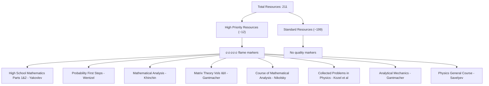

**Sources:** [README.md:23](), [README.md:66-67](), [README.md:78-79](), [README.md:82](), [README.md:103-104](), [README.md:171-172](), [README.md:227](), [README.md:233](), [README.md:238](), [README.md:251]()

## External Dependencies Architecture

The repository relies entirely on external hosting platforms for content delivery, implementing a distributed storage strategy with primary and backup sources.

### Hosting Platform Distribution

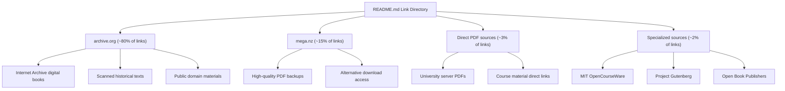

**Sources:** [README.md:25](), [README.md:39](), [README.md:40](), [README.md:71](), [README.md:142](), [README.md:157](), [README.md:187-188]()

### Link Structure and Redundancy

The system implements a strategic redundancy approach where critical resources have multiple access points:

- **Primary access**: archive.org links for most resources
- **Backup access**: mega.nz download links for high-priority items  
- **Alternative access**: Direct PDF links for specialized content

Example redundancy pattern from high-priority resources:
- [README.md:40](): Kolmogorov/Fomin with both archive.org and mega.nz links
- [README.md:47](): Elsgolts with both archive.org and mega.nz links
- [README.md:103](): Worked Problems with archive.org primary and mega.nz backup

## Navigation and Access Patterns

### User Flow Architecture

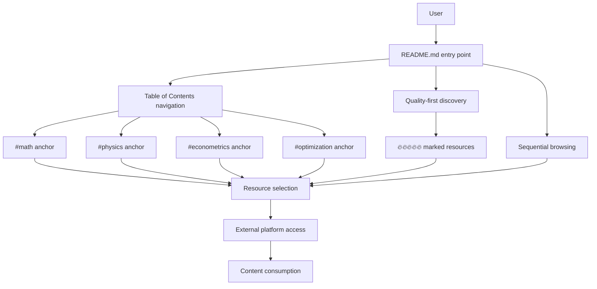

**Sources:** [README.md:14-19](), [README.md:21](), [README.md:218](), [README.md:253](), [README.md:256]()

### Internal Linking System

The repository uses standard Markdown anchor linking for navigation:

- Table of Contents section: [README.md:14-19]()
- Section anchors: `#math`, `#physics`, `#econometrics`, `#optimization`
- Direct section jumps without intermediate navigation layers

This creates a flat, efficient navigation hierarchy that minimizes user friction while maintaining organization.

**Sources:** [README.md:14-19](), [README.md:21](), [README.md:218](), [README.md:253](), [README.md:256]()

---

# Page: Repository Architecture

# Repository Architecture

<details>
<summary>Relevant source files</summary>

The following files were used as context for generating this wiki page:

- [README.md](README.md)

</details>


This document explains the architectural design of the Awesome_Math_Books repository, focusing on its single-file centralized approach and external resource management system. The architecture centers around `README.md` as both the user interface and the complete system implementation.

For information about the specific content categories and their organization, see [Content Categories](#3). For details about the quality rating system, see [Quality Curation System](#4). For external hosting strategies, see [External Dependencies and Resource Access](#5).

## Core Architecture Overview

The Awesome_Math_Books repository implements a minimalist single-file architecture where `README.md` serves as the entire system - acting simultaneously as the user interface, content catalog, navigation system, and administrative dashboard.

### Single-File System Design

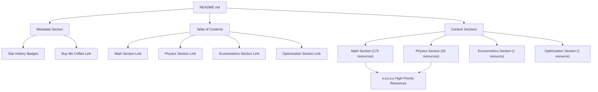

**Sources:** [README.md:1-266]()

### Repository Structure

The repository contains only one significant file, creating an extremely simple but effective architecture:

| Component | File Path | Lines | Purpose |
|-----------|-----------|-------|---------|
| Main System | `README.md` | 1-266 | Complete application |
| Repository Metadata | `README.md` | 3-10 | Badges and donation links |
| Navigation System | `README.md` | 14-19 | Table of contents |
| Content Catalog | `README.md` | 21-257 | Resource collections |

**Sources:** [README.md:1-266]()

## File Structure and Content Organization

### Header and Metadata System

The repository implements a metadata system at the top of `README.md` that serves both promotional and statistical purposes:

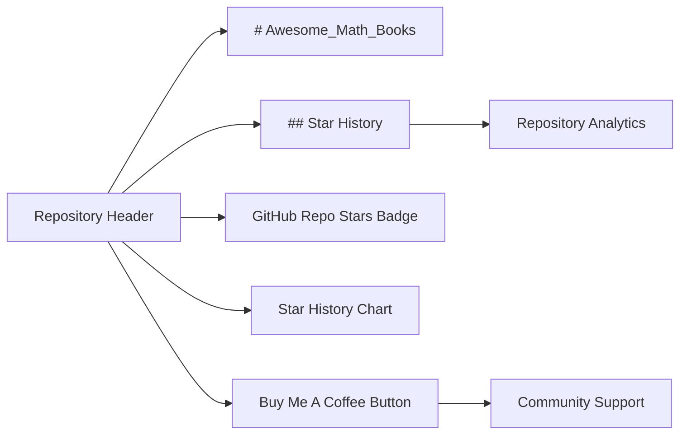

**Sources:** [README.md:1-11]()

### Table of Contents Implementation

The navigation system uses markdown anchor linking to create an internal routing system:

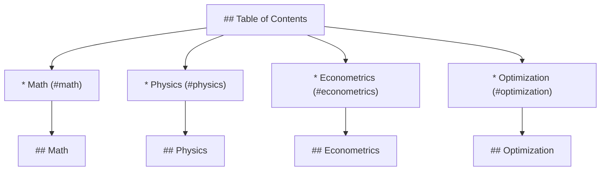

**Sources:** [README.md:14-19]()

## Content Organization System

### Section-Based Architecture

Each content section follows a consistent organizational pattern with numbered lists and external links:

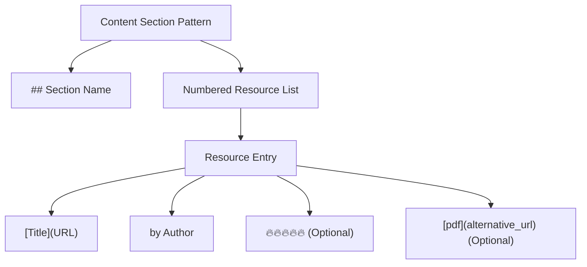

**Sources:** [README.md:21-257]()

### High-Priority Resource Marking

The system implements a quality curation mechanism using flame emojis (`🔥🔥🔥🔥🔥`) to mark exceptional resources:

| Section | High-Priority Resources | Examples |
|---------|------------------------|-----------|
| Math | ~8 resources | Yakovlev High School Mathematics, Nikolsky Analysis, Gantmacher Matrix Theory |
| Physics | ~4 resources | Kozel Problems Collection, Gantmacher Analytical Mechanics, Savelyev Physics Course |

**Sources:** [README.md:23](), [README.md:66](), [README.md:67](), [README.md:78](), [README.md:79](), [README.md:82](), [README.md:103](), [README.md:104](), [README.md:107](), [README.md:171](), [README.md:172](), [README.md:227](), [README.md:233](), [README.md:238](), [README.md:251]()

## External Dependency Architecture

### Link Distribution Strategy

The repository implements a multi-source external dependency strategy to ensure resource availability:

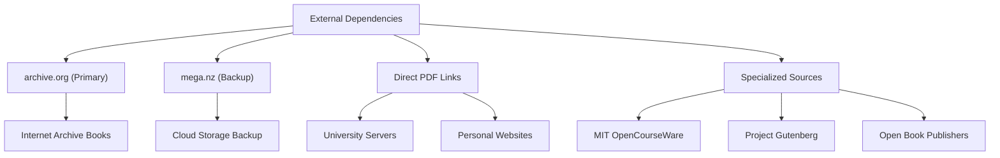

**Sources:** [README.md:21-257]()

### Resource Accessibility Patterns

The system provides multiple access methods for critical resources:

| Pattern | Implementation | Example |
|---------|----------------|---------|
| Primary Only | Single archive.org link | Most resources |
| Primary + Backup | archive.org + mega.nz | [README.md:39-40](), [README.md:47-48]() |
| Multiple Formats | Multiple volume links | [README.md:44-45](), [README.md:67-68]() |

**Sources:** [README.md:39](), [README.md:40](), [README.md:44](), [README.md:45](), [README.md:47](), [README.md:48](), [README.md:67](), [README.md:68]()

## Navigation System Implementation

### Internal Linking Architecture

The navigation system uses HTML anchor tags to create a single-page application experience:


**Sources:** [README.md:16-19]()

### Section Anchor System

Each major section implements a consistent anchor naming scheme:

| Section Header | Anchor ID | Line Reference |
|----------------|-----------|----------------|
| `## Math` | `#math` | [README.md:21]() |
| `## Physics` | `#physics` | [README.md:218]() |
| `## Econometrics` | `#econometrics` | [README.md:253]() |
| `## Optimization` | `#optimization` | [README.md:256]() |

**Sources:** [README.md:16](), [README.md:17](), [README.md:18](), [README.md:19](), [README.md:21](), [README.md:218](), [README.md:253](), [README.md:256]()

## Quality Curation Implementation

### Flame Rating System

The repository implements a binary quality system using five flame emojis (`🔥🔥🔥🔥🔥`) to mark resources of exceptional educational value:

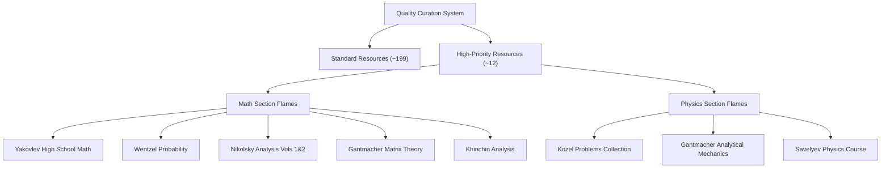

**Sources:** [README.md:23](), [README.md:66](), [README.md:67](), [README.md:78](), [README.md:79](), [README.md:82](), [README.md:103](), [README.md:104](), [README.md:107](), [README.md:171](), [README.md:172](), [README.md:227](), [README.md:233](), [README.md:238](), [README.md:251]()

The architecture successfully balances simplicity with functionality, creating a robust educational resource system through careful organization and external dependency management within a single markdown file.

---

# Page: Content Categories

# Content Categories

<details>
<summary>Relevant source files</summary>

The following files were used as context for generating this wiki page:

- [README.md](README.md)

</details>


This document provides an overview of the four main content categories in the Awesome_Math_Books repository and their organizational structure. It covers the distribution statistics, hierarchical arrangement, and navigation principles that govern how the 211 educational resources are categorized and accessed within the centralized README.md system.

For information about specific resources within each category, see [Mathematics Resources](#3.1), [Physics Resources](#3.2), and [Econometrics and Optimization Resources](#3.3). For details about the quality rating system, see [Quality Curation System](#4).

## Content Distribution and Organization

The repository implements a four-tier categorical system with highly uneven distribution, reflecting the mathematical focus of the collection.

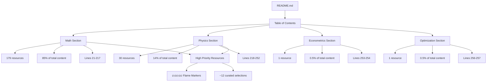

**Content Distribution Overview**
| Category | Resources | Percentage | Line Range |
|----------|-----------|------------|------------|
| Math | 179 | 85.0% | 21-217 |
| Physics | 30 | 14.2% | 218-252 |
| Econometrics | 1 | 0.5% | 253-254 |
| Optimization | 1 | 0.5% | 256-257 |
| **Total** | **211** | **100%** | **21-257** |

Sources: [README.md:14-19](), [README.md:21-257]()

## Navigation Architecture

The categorical system implements a hierarchical navigation structure anchored by the table of contents and internal section linking.

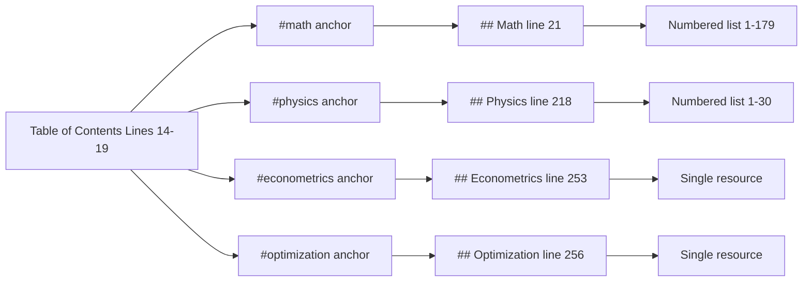

Sources: [README.md:14-19](), [README.md:21](), [README.md:218](), [README.md:253](), [README.md:256]()

## Categorical Content Profiles

### Mathematics Dominance Pattern

The Math section exhibits a comprehensive hierarchical structure spanning foundational through advanced topics, with explicit quality curation through flame emoji markers.

**Key Characteristics:**
- **Foundational Coverage**: High school mathematics, elementary handbooks
- **Advanced Topics**: Mathematical analysis, linear algebra, complex analysis
- **Problem Collections**: USSR Olympiad problems, worked examples
- **Quality Markers**: 🔥🔥🔥🔥🔥 system for premium resources

**High-Priority Math Resources** (flame-marked):
- `High School Mathematics Part 1 & 2` by Yakovlev [README.md:89-90]()
- `Probability - First Steps` by Wentzel [README.md:23]()
- `Theory of matrices, Volume I & II` by Gantmacher [README.md:103-104]()
- `A Course of Mathematical Analysis` by Khinchin [README.md:107]()
- `A Course Of Mathematical Analysis Vol 1 & 2` by Nikolsky [README.md:202-203]()

### Physics Concentration Pattern

The Physics section maintains focused coverage on core physics domains with strategic problem collections and theoretical foundations.

**Content Distribution:**
- **General Physics**: Problem collections and handbooks
- **Mechanics**: Classical and analytical mechanics
- **Electromagnetism**: Basic laws and applications
- **Quantum Mechanics**: Fundamental concepts

**High-Priority Physics Resources** (flame-marked):
- `Collected Problems In Physics` by Kozel et al. [README.md:227]()
- `Lectures in analytical mechanics` by Gantmacher [README.md:233]()
- `Physics - a general course` by Savelyev [README.md:238]()

### Specialized Domains

The Econometrics and Optimization sections represent targeted, single-resource domains addressing specific technical needs.

**Econometrics**: `Basic Econometrics` by Lucchetti [README.md:254]()
**Optimization**: `Algorithms for optimization` by Kochenderfer & Wheeler [README.md:257]()

Sources: [README.md:23](), [README.md:89-90](), [README.md:103-104](), [README.md:107](), [README.md:202-203](), [README.md:227](), [README.md:233](), [README.md:238](), [README.md:254](), [README.md:257]()

## Quality Stratification System

The repository implements a two-tier quality system distinguishing high-priority resources from standard catalog entries.

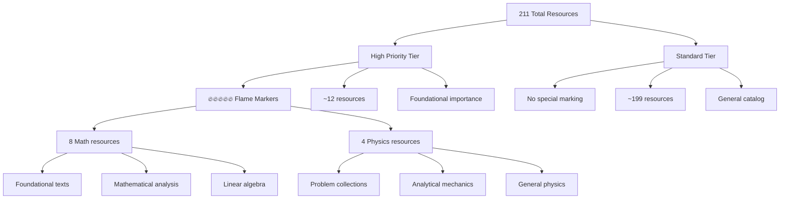

**Quality Distribution:**
- **High Priority**: ~5.7% of resources (12/211)
- **Standard**: ~94.3% of resources (199/211)
- **Math Priority**: 8 flame-marked resources
- **Physics Priority**: 4 flame-marked resources

Sources: [README.md:23](), [README.md:89-90](), [README.md:103-104](), [README.md:107](), [README.md:202-203](), [README.md:227](), [README.md:233](), [README.md:238](), [README.md:251]()

## Organizational Principles

The categorical system follows several key organizational principles:

1. **Domain Hierarchy**: Mathematical sciences as primary focus, physical sciences as secondary
2. **Progressive Complexity**: Within categories, resources range from elementary to advanced
3. **Quality-First Curation**: Flame emoji system highlights foundational resources
4. **Accessibility Balance**: Mix of introductory texts and specialized references
5. **Problem-Solution Pairing**: Theory texts complemented by problem collections

The single-file architecture in `README.md` enables this organizational structure through markdown section headers, numbered lists, and internal anchor linking, creating a navigable hierarchy despite the flat file structure.

Sources: [README.md:1-266]()

---

# Page: Mathematics Resources

# Mathematics Resources

<details>
<summary>Relevant source files</summary>

The following files were used as context for generating this wiki page:

- [README.md](README.md)

</details>


This document covers the Mathematics section of the Awesome_Math_Books repository, which contains 179 curated mathematical resources representing 85% of the total collection. The section spans from foundational high school mathematics through advanced university-level topics, with a special emphasis on high-priority resources marked with flame emojis (🔥🔥🔥🔥🔥).

For information about the other content categories, see [Physics Resources](#3.2) and [Econometrics and Optimization Resources](#3.3). For details on the quality curation system, see [Quality Curation System](#4).

## Resource Organization and Structure

The mathematics collection follows a hierarchical organization from foundational to advanced topics, with strategic curation highlighting exceptional educational resources.

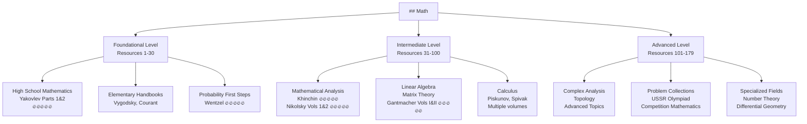

Sources: [README.md:21-214]()

## High-Priority Resources

The collection includes 8 flame-marked resources that represent the core foundation of mathematical education, carefully selected for their pedagogical excellence and comprehensive coverage.

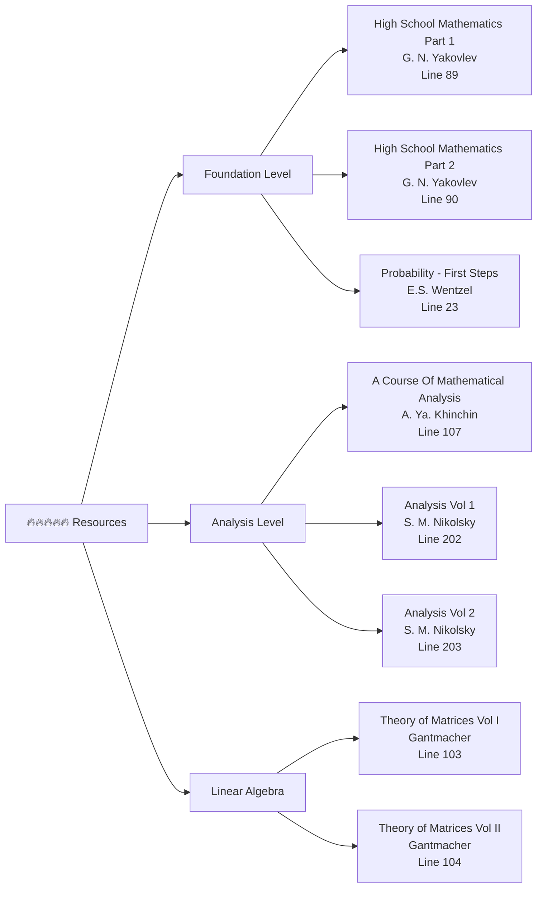

Sources: [README.md:23](), [README.md:89-90](), [README.md:103-104](), [README.md:107](), [README.md:202-203]()

## Topic Distribution and Coverage

| Mathematical Field | Resource Count | Key Authors | Notable Works |
|-------------------|----------------|-------------|---------------|
| Mathematical Analysis | ~35 | Khinchin, Nikolsky, Piskunov | Course of Mathematical Analysis series |
| Linear Algebra | ~20 | Gantmacher, Voyevodin, Shilov | Matrix Theory, Linear Algebra texts |
| Probability & Statistics | ~25 | Wentzel, Kolmogorov, Gnedenko | Probability First Steps, Foundations |
| Calculus | ~15 | Spivak, Tarasov, Bermant | Calculus, Differential/Integral texts |
| Geometry | ~12 | Pogorelov, Postnikov, Modenov | Analytic Geometry, Problems collections |
| Problem Collections | ~18 | Yaglom, Kordemsky, Olimpiad authors | USSR Olympiad, Moscow Puzzles |
| Advanced Topics | ~54 | Various specialists | Complex Analysis, Topology, Number Theory |

Sources: [README.md:21-214]()

## External Resource Architecture

The mathematics resources are hosted across multiple external platforms with strategic redundancy for content preservation.

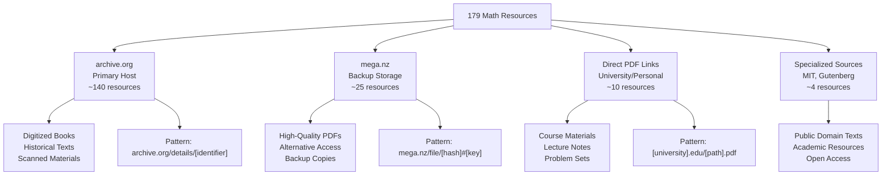

Sources: [README.md:23-214]()

## Learning Pathways and Progression

The collection supports multiple learning pathways from high school through advanced graduate-level mathematics.

### Foundational Track
1. **High School Mathematics Parts 1&2** (Yakovlev) 🔥🔥🔥🔥🔥 - [README.md:89-90]()
2. **Elementary Mathematical Handbook** (Vygodsky) - [README.md:37]()
3. **What is Mathematics** (Courant & Robbins) - [README.md:26]()

### Analysis Track  
1. **Mathematical Analysis - Brief Course** (Bermant) - [README.md:33]()
2. **A Course of Mathematical Analysis** (Khinchin) 🔥🔥🔥🔥🔥 - [README.md:107]()
3. **Mathematical Analysis Vols 1&2** (Nikolsky) 🔥🔥🔥🔥🔥 - [README.md:202-203]()

### Linear Algebra Track
1. **Fundamentals of Linear Algebra** (Bugrov, Nikolsky) - [README.md:53]()
2. **Theory of Matrices Vols I&II** (Gantmacher) 🔥🔥🔥🔥🔥 - [README.md:103-104]()
3. **Linear Algebra** (Shilov) - [README.md:70]()

### Probability Track
1. **Probability - First Steps** (Wentzel) 🔥🔥🔥🔥🔥 - [README.md:23]()
2. **Foundations of Theory of Probability** (Kolmogorov) - [README.md:38]()
3. **Theory of Probability** (Gnedenko) - [README.md:52]()

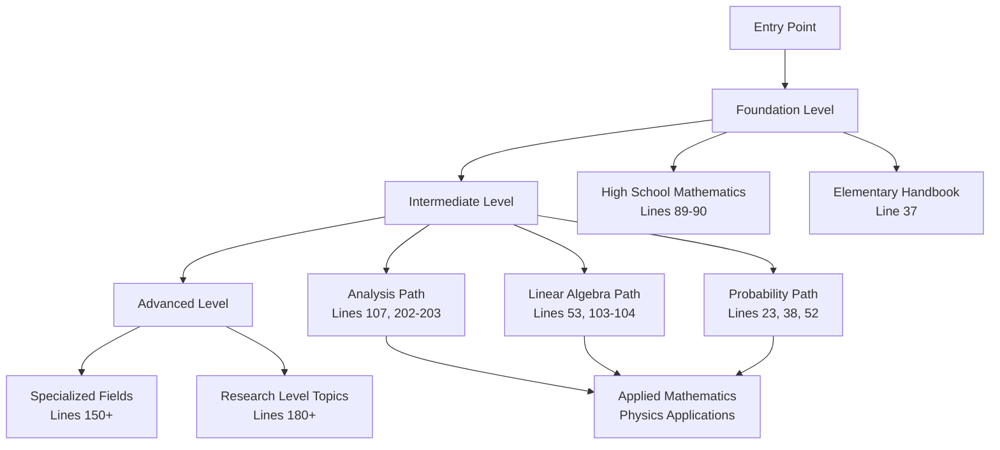

Sources: [README.md:23](), [README.md:37](), [README.md:53](), [README.md:89-90](), [README.md:103-104](), [README.md:107](), [README.md:202-203]()

## Resource Quality Indicators

Beyond the flame emoji system, resources demonstrate quality through several indicators:

- **Author Reputation**: Books by renowned mathematicians (Kolmogorov, Gelfand, Khinchin)
- **Publisher Pedigree**: MIR Publishers, Dover Publications, university presses
- **Historical Significance**: Classic texts that have educated generations
- **Comprehensive Coverage**: Multi-volume series for complete topic mastery
- **Problem Integration**: Books combining theory with extensive problem sets

The collection emphasizes Russian mathematical pedagogy, particularly MIR Publishers translations, known for rigorous exposition and comprehensive problem coverage.

Sources: [README.md:21-214]()

---

# Page: Physics Resources

# Physics Resources

<details>
<summary>Relevant source files</summary>

The following files were used as context for generating this wiki page:

- [README.md](README.md)

</details>


This document covers the Physics section of the Awesome_Math_Books repository, which contains 30 curated physics resources representing 14% of the total collection. The physics resources complement the dominant mathematics collection by providing applied physics texts, problem collections, and mathematical physics materials. For information about the mathematics resources that form the bulk of the collection, see [Mathematics Resources](#3.1). For details about the overall repository structure and curation system, see [Repository Architecture](#2) and [Quality Curation System](#4).

## Overview and Content Distribution

The Physics section provides comprehensive coverage of undergraduate and graduate-level physics topics, with particular emphasis on problem-solving resources and theoretical foundations. The collection spans from introductory general physics to advanced mathematical physics, with strategic high-priority selections marked by the flame emoji system.

```mermaid
graph TD
    PHYSICS["Physics Section<br/>30 Resources<br/>14% of Collection"] --> GENERAL["General Physics<br/>8 Resources"]
    PHYSICS --> MECHANICS["Mechanics & Dynamics<br/>7 Resources"]
    PHYSICS --> EM["Electromagnetism<br/>4 Resources"]
    PHYSICS --> MATHPHYS["Mathematical Physics<br/>6 Resources"]
    PHYSICS --> QUANTUM["Quantum Mechanics<br/>2 Resources"]
    PHYSICS --> MISC["Miscellaneous<br/>3 Resources"]
    
    GENERAL --> GP1["Problems in General Physics - Irodov"]
    GENERAL --> GP2["Handbook Of Physics - Yavorsky & Detlaf"]
    GENERAL --> GP3["Physics - a general course - Savelyev 🔥🔥🔥🔥🔥"]
    
    MECHANICS --> M1["Lectures in analytical mechanics - Gantmacher 🔥🔥🔥🔥🔥"]
    MECHANICS --> M2["Collection Of Problems In Classical Mechanics - Kotkin & Serbo"]
    MECHANICS --> M3["Theoretical Mechanics - Chetaev"]
    
    EM --> E1["Basic Laws Of Electromagnetism - Irodov"]
    EM --> E2["Electricity And Magnetism - Matveev"]
    
    MATHPHYS --> MP1["Equations of Mathematical Physics - Vladimirov"]
    MATHPHYS --> MP2["Collected Problems In Physics - Kozel et al. 🔥🔥🔥🔥🔥"]
    
    QUANTUM --> Q1["Basic Concepts Of Quantum Mechanics - Tarasov"]
```

Sources: [README.md:218-252]()

## High-Priority Physics Resources

The physics section contains four flame-marked (🔥🔥🔥🔥🔥) high-priority resources that represent the essential core of the physics collection:

| Resource | Author(s) | Coverage | Archive Link Line |
|----------|-----------|----------|-------------------|
| Collected Problems In Physics | Kozel, Rashda, Slavatinskii | Comprehensive problem collection | [README.md:226-227]() |
| Lectures in analytical mechanics | Felix Gantmacher | Advanced theoretical mechanics | [README.md:233]() |
| Physics - a general course | Savelyev (Volumes I-III) | Complete undergraduate physics | [README.md:238]() |
| Lectures In Analytical Mechanics | F. Gantmacher | Duplicate high-priority entry | [README.md:251]() |

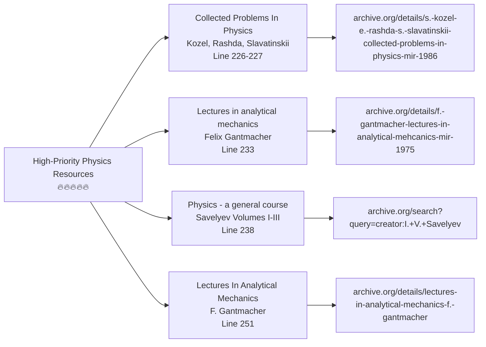

Sources: [README.md:226-227](), [README.md:233](), [README.md:238](), [README.md:251]()

## Topic Organization and Learning Pathways

The physics resources are organized to support progression from foundational understanding through advanced theoretical work:

```mermaid
graph TD
    FOUNDATION["Foundation Level"] --> INTERMEDIATE["Intermediate Level"] 
    INTERMEDIATE --> ADVANCED["Advanced Level"]
    
    FOUNDATION --> F1["Elementary textbook on physics<br/>Landsberg Volumes I-III<br/>Line 236"]
    FOUNDATION --> F2["Physics for Everyone<br/>Landau & Kitaigorodsky<br/>Line 234-235"]
    FOUNDATION --> F3["Questions And Answers In School Physics<br/>Tarasov & Tarasova<br/>Line 240"]
    
    INTERMEDIATE --> I1["Problems in General Physics<br/>Irodov<br/>Line 219"]
    INTERMEDIATE --> I2["Fundamentals of physics<br/>Yavorski & Pinsky<br/>Line 225"]
    INTERMEDIATE --> I3["Berkeley physics course<br/>Kittel Parts I & II<br/>Lines 243-244"]
    
    ADVANCED --> A1["Lectures in analytical mechanics<br/>Gantmacher 🔥🔥🔥🔥🔥<br/>Line 233"]
    ADVANCED --> A2["Equations of Mathematical Physics<br/>Vladimirov<br/>Line 247"]
    ADVANCED --> A3["Generalized Functions in Mathematical Physics<br/>Vladimirov<br/>Line 249"]
    
    PROBLEMS["Problem Collections"] --> P1["Collected Problems In Physics<br/>Kozel et al. 🔥🔥🔥🔥🔥<br/>Lines 226-227"]
    PROBLEMS --> P2["Problems In General Physics<br/>Wolkenstein<br/>Line 222"]
    PROBLEMS --> P3["Collection Of Problems In Classical Mechanics<br/>Kotkin & Serbo<br/>Lines 231-232"]
```

Sources: [README.md:219](), [README.md:222](), [README.md:225](), [README.md:226-227](), [README.md:233](), [README.md:234-235](), [README.md:236](), [README.md:240](), [README.md:243-244](), [README.md:247](), [README.md:249]()

## External Hosting Architecture

The physics resources follow the same external dependency pattern as the broader collection, with primary hosting on `archive.org` and strategic backup systems:

```mermaid
graph LR
    PHYSICS_LINKS["Physics Section Links"] --> PRIMARY["archive.org<br/>Primary Hosting<br/>~90% of physics links"]
    PHYSICS_LINKS --> BACKUP["mega.nz<br/>Backup Storage<br/>Limited availability"]
    PHYSICS_LINKS --> DIRECT["Direct PDF Links<br/>University servers<br/>Minimal usage"]
    
    PRIMARY --> ARCHIVE_DETAILS["archive.org/details/<br/>Resource identifiers"]
    PRIMARY --> ARCHIVE_SEARCH["archive.org/search<br/>Multi-volume collections"]
    
    BACKUP --> MEGA_FILES["mega.nz/file/<br/>Hash-based access"]
    
    ARCHIVE_DETAILS --> EXAMPLE1["s.-kozel-e.-rashda-s.-slavatinskii-collected-problems-in-physics-mir-1986"]
    ARCHIVE_DETAILS --> EXAMPLE2["f.-gantmacher-lectures-in-analytical-mehcanics-mir-1975"]
    
    ARCHIVE_SEARCH --> SAVELYEV["creator:I.+V.+Savelyev<br/>Multi-volume physics course"]
    ARCHIVE_SEARCH --> LANDSBERG["creator:G.+S.+Landsberg+%28Ed.%29<br/>Elementary textbook series"]
```

Sources: [README.md:226](), [README.md:233](), [README.md:236](), [README.md:238]()

## Specialized Physics Subcategories

The physics collection includes specialized subcategories that bridge physics with mathematics and engineering:

### Mathematical Physics
- **Equations of Mathematical Physics** by V. S. Vladimirov [README.md:247]()
- **A Collection of Problems on the Equations of Mathematical Physics** by A. V. Bitsadze & D. F. Kalinichenko [README.md:248]()
- **Generalized Functions in Mathematical Physics** by V. S. Vladimirov [README.md:249]()
- **Higher Mathematics for Beginners and Its Application to Physics** by Yakov Zeldovich [README.md:246]()

### Electronics and Applied Physics
- **Basic Electricity And Electronics** by V. S. Popov; S. A. Nikolaev [README.md:229]()
- **Basic Laws Of Electromagnetism** by I. E. Irodov [README.md:224]()

### Problem-Solving Focus
- **General Methods For Solving Physics Problems** by B. S. Beliko [README.md:228]()
- **Problems in undergraduate physics** by Strelkov and Yakovlev [README.md:237]()
- **Selected Problems On Physics** by S. P. Myasnikov, T. N. Osanova [README.md:230]()

```mermaid
graph TD
    SPECIAL["Specialized Physics Areas"] --> MATHPHYS_CAT["Mathematical Physics<br/>4 Resources"]
    SPECIAL --> ELECTRONICS["Electronics & EM<br/>3 Resources"]
    SPECIAL --> METHODS["Problem-Solving Methods<br/>3 Resources"]
    
    MATHPHYS_CAT --> VLADIMIROV1["Equations of Mathematical Physics<br/>Vladimirov - Line 247"]
    MATHPHYS_CAT --> PROBLEMS_EQ["Collection of Problems<br/>Bitsadze & Kalinichenko - Line 248"]
    MATHPHYS_CAT --> VLADIMIROV2["Generalized Functions<br/>Vladimirov - Line 249"]
    MATHPHYS_CAT --> ZELDOVICH["Higher Math for Physics<br/>Zeldovich - Line 246"]
    
    ELECTRONICS --> BASIC_ELEC["Basic Electricity And Electronics<br/>Popov & Nikolaev - Line 229"]
    ELECTRONICS --> ELECTROMAG["Basic Laws Of Electromagnetism<br/>Irodov - Line 224"]
    
    METHODS --> GENERAL_METHODS["General Methods For Solving<br/>Beliko - Line 228"]
    METHODS --> UNDERGRAD_PROB["Problems in undergraduate physics<br/>Strelkov & Yakovlev - Line 237"]
    METHODS --> SELECTED_PROB["Selected Problems On Physics<br/>Myasnikov & Osanova - Line 230"]
```

Sources: [README.md:224](), [README.md:228](), [README.md:229](), [README.md:230](), [README.md:237](), [README.md:246](), [README.md:247](), [README.md:248](), [README.md:249]()

## Integration with Mathematics Collection

The physics resources are strategically positioned to complement the dominant mathematics collection, particularly in areas of applied mathematics and mathematical physics. Several resources bridge both domains:

- **Higher Mathematics for Beginners and Its Application to Physics** by Zeldovich appears in both contexts [README.md:246]()
- Mathematical physics texts provide applied contexts for advanced mathematical concepts
- Problem collections emphasize mathematical techniques in physics applications

This integration supports the repository's goal of providing comprehensive educational resources spanning theoretical and applied domains.

Sources: [README.md:246](), [README.md:247-249]()

---

# Page: Econometrics and Optimization Resources

# Econometrics and Optimization Resources

<details>
<summary>Relevant source files</summary>

The following files were used as context for generating this wiki page:

- [README.md](README.md)

</details>


This document covers the two smallest specialized content categories in the Awesome_Math_Books repository: Econometrics and Optimization. These sections contain exactly one resource each, representing focused collections for specific applied mathematical domains. Unlike the primary Math and Physics sections which emphasize historical and foundational texts, these categories feature contemporary resources targeting professional and graduate-level applications.

For information about the primary mathematical content, see [Mathematics Resources](#3.1). For physics-related materials, see [Physics Resources](#3.2).

## Section Overview and Repository Position

The Econometrics and Optimization sections occupy a unique position within the repository's content hierarchy. Together they represent only 1% of the total collection (2 out of 211 resources), contrasting sharply with the Mathematics section's 85% share and Physics section's 14% share.

```mermaid
graph TD
    A["README.md"] --> B["Content Categories"]
    
    B --> C["Math Section<br/>179 resources<br/>85%"]
    B --> D["Physics Section<br/>30 resources<br/>14%"]
    B --> E["Econometrics Section<br/>1 resource<br/>0.5%"]
    B --> F["Optimization Section<br/>1 resource<br/>0.5%"]
    
    E --> G["Basic Econometrics<br/>Lucchetti (2024)"]
    F --> H["Algorithms for Optimization<br/>MIT Book<br/>Kochenderfer & Wheeler"]
    
    G --> I["External PDF Link<br/>University Server"]
    H --> J["External PDF Link<br/>MIT Domain"]
    
    style E fill:#fff2cc,stroke:#d6b656
    style F fill:#fff2cc,stroke:#d6b656
    style G fill:#e1d5e7,stroke:#9673a6
    style H fill:#e1d5e7,stroke:#9673a6
```

**Repository Structure Context**
Sources: [README.md:253-258]()

## Econometrics Section Analysis

The Econometrics section contains a single contemporary resource that represents modern econometric methodology. This section demonstrates the repository's extension beyond pure mathematics into applied statistical domains.

```mermaid
graph LR
    A["Econometrics Section"] --> B["Basic Econometrics"]
    B --> C["Author: Riccardo Lucchetti"]
    B --> D["Publication: 2024"]
    B --> E["Format: PDF"]
    B --> F["Host: University Server"]
    
    F --> G["univpm.it domain"]
    F --> H["Personal faculty page"]
    F --> I["Direct PDF access"]
    
    C --> J["Contemporary Author"]
    D --> K["Recent Publication"]
    E --> L["Digital Native Format"]
```

**Resource Characteristics:**
- **Title**: Basic Econometrics
- **Author**: Riccardo (Jack) Lucchetti
- **Year**: 2024
- **URL Pattern**: `http://www2.econ.univpm.it/servizi/hpp/lucchetti/didattica/basic.pdf`
- **Hosting**: University faculty server (univpm.it)

Sources: [README.md:254]()

## Optimization Section Analysis

The Optimization section features a single MIT-affiliated resource focusing on algorithmic approaches to optimization problems. This represents the intersection of mathematics, computer science, and engineering applications.

```mermaid
graph LR
    A["Optimization Section"] --> B["Algorithms for Optimization"]
    B --> C["Authors: Kochenderfer & Wheeler"]
    B --> D["Institution: MIT"]
    B --> E["Format: PDF"]
    B --> F["Host: algorithmsbook.com"]
    
    F --> G["Specialized Domain"]
    F --> H["Book Series Platform"]
    F --> I["Direct PDF Access"]
    
    C --> J["Academic Authors"]
    D --> K["MIT Affiliation"]
    E --> L["Open Access Format"]
```

**Resource Characteristics:**
- **Title**: Algorithms for optimization, MIT book
- **Authors**: Mykel Kochenderfer, Tim Wheeler
- **Institution**: MIT
- **URL Pattern**: `https://algorithmsbook.com/optimization/files/optimization.pdf`
- **Hosting**: Specialized book platform

Sources: [README.md:257]()

## External Hosting Pattern Analysis

Both specialized sections exhibit a distinct hosting pattern that differs significantly from the primary Math and Physics sections, which rely heavily on archive.org and mega.nz.

```mermaid
graph TD
    A["Resource Hosting Patterns"] --> B["Primary Sections<br/>(Math & Physics)"]
    A --> C["Specialized Sections<br/>(Econometrics & Optimization)"]
    
    B --> D["archive.org<br/>~80% of links"]
    B --> E["mega.nz<br/>~15% of links"]
    B --> F["Other sources<br/>~5% of links"]
    
    C --> G["University servers<br/>50% (1/2)"]
    C --> H["Specialized platforms<br/>50% (1/2)"]
    
    G --> I["univpm.it<br/>Faculty page<br/>Contemporary content"]
    H --> J["algorithmsbook.com<br/>Academic platform<br/>Open access"]
    
    style C fill:#f8cecc,stroke:#b85450
    style G fill:#d5e8d4,stroke:#82b366
    style H fill:#d5e8d4,stroke:#82b366
```

**Hosting Characteristics:**
| Section | Primary Host | Content Age | Access Pattern |
|---------|--------------|-------------|----------------|
| Math | archive.org | Historical | Preserved/Archived |
| Physics | archive.org | Historical | Preserved/Archived |
| Econometrics | University Server | Contemporary | Direct Faculty Link |
| Optimization | Academic Platform | Contemporary | Open Access Portal |

Sources: [README.md:254](), [README.md:257]()

## Section Integration Within Repository Architecture

The specialized sections serve as content bridges between pure mathematics and professional applications, though their minimal size indicates they are supplementary rather than core to the repository's mission.

```mermaid
graph TB
    A["Table of Contents Links"] --> B["Math Section Link"]
    A --> C["Physics Section Link"] 
    A --> D["Econometrics Section Link"]
    A --> E["Optimization Section Link"]
    
    D --> F["Line 18: #econometrics"]
    E --> G["Line 19: #optimization"]
    
    F --> H["Line 253: ## Econometrics"]
    G --> I["Line 256: ## Optimization"]
    
    H --> J["Single Resource Entry<br/>Line 254"]
    I --> K["Single Resource Entry<br/>Line 257"]
    
    style D fill:#fff2cc,stroke:#d6b656
    style E fill:#fff2cc,stroke:#d6b656
    style F fill:#e1d5e7,stroke:#9673a6
    style G fill:#e1d5e7,stroke:#9673a6
```

**Navigation Structure:**
- **TOC References**: [README.md:18-19]()
- **Section Headers**: [README.md:253](), [README.md:256]()
- **Resource Entries**: [README.md:254](), [README.md:257]()

Sources: [README.md:14-19](), [README.md:253-258]()

## Content Quality and Curation Status

Neither specialized section contains resources marked with the flame emoji system (🔥🔥🔥🔥🔥) used to indicate high-priority materials in the main Math and Physics sections. This suggests these resources serve as supplementary references rather than foundational texts.

```mermaid
graph LR
    A["Quality Tier System"] --> B["High Priority Resources<br/>🔥🔥🔥🔥🔥 marked"]
    A --> C["Standard Resources<br/>No special marking"]
    
    B --> D["Math: ~12 resources"]
    B --> E["Physics: ~5 resources"]
    B --> F["Econometrics: 0 resources"]
    B --> G["Optimization: 0 resources"]
    
    C --> H["Econometrics: 1 resource<br/>Basic Econometrics"]
    C --> I["Optimization: 1 resource<br/>Algorithms for Optimization"]
    
    style F fill:#ffebee,stroke:#ef5350
    style G fill:#ffebee,stroke:#ef5350
    style H fill:#e8f5e8,stroke:#66bb6a
    style I fill:#e8f5e8,stroke:#66bb6a
```

**Quality Classification:**
- **High Priority (Flame-marked)**: 0 resources across both sections
- **Standard Tier**: 2 resources total (100% of specialized content)
- **Coverage Role**: Supplementary/Reference materials

Sources: [README.md:253-258]()

## Usage Patterns and Access Characteristics

The specialized sections exhibit distinct access patterns optimized for contemporary professional use rather than historical study or comprehensive learning pathways.

| Characteristic | Math/Physics Sections | Econometrics/Optimization |
|----------------|----------------------|---------------------------|
| **Content Age** | Historical (1960s-1990s) | Contemporary (2020s) |
| **Target Audience** | Students & Self-learners | Professionals & Graduates |
| **Resource Depth** | Comprehensive collections | Focused single resources |
| **Access Reliability** | Archive-based preservation | Direct institutional links |
| **Update Frequency** | Static historical content | Potentially maintained |

Sources: [README.md:253-258]()

---

# Page: Quality Curation System

# Quality Curation System

<details>
<summary>Relevant source files</summary>

The following files were used as context for generating this wiki page:

- [README.md](README.md)

</details>


## Purpose and Scope

The Quality Curation System implements a two-tier resource classification mechanism within the Awesome_Math_Books repository to help users identify the most valuable educational materials. This system uses visual markers to distinguish high-priority resources from standard entries, providing explicit guidance for learning pathways and resource selection.

For information about the broader content organization, see [Content Categories](#3). For details about accessing these curated resources, see [External Dependencies and Resource Access](#5).

## System Architecture

The Quality Curation System operates through a simple but effective flame emoji marking system embedded directly in the repository's primary catalog file.

```mermaid
graph TD
    README["README.md"] --> CATALOG["Resource Catalog"]
    CATALOG --> STANDARD["Standard Resources<br/>~199 entries"]
    CATALOG --> PRIORITY["High-Priority Resources<br/>~12 entries"]
    
    PRIORITY --> FLAME_MARKER["🔥🔥🔥🔥🔥 Flame Emoji System"]
    STANDARD --> NO_MARKER["No Special Marking"]
    
    FLAME_MARKER --> MATH_HP["Mathematics High-Priority<br/>9 resources"]
    FLAME_MARKER --> PHYSICS_HP["Physics High-Priority<br/>3 resources"]
    
    MATH_HP --> FOUNDATIONS["Foundational Texts"]
    MATH_HP --> ANALYSIS["Mathematical Analysis"]
    MATH_HP --> MATRICES["Matrix Theory"]
    
    PHYSICS_HP --> MECHANICS["Analytical Mechanics"]
    PHYSICS_HP --> PROBLEMS["Problem Collections"]
    PHYSICS_HP --> COURSES["Comprehensive Courses"]
```

Sources: [README.md:1-266]()

## Implementation Details

The curation system is implemented through direct markdown markup in the central catalog file, using a consistent five-flame emoji pattern to denote exceptional resources.

### Marking Syntax

High-priority resources follow this pattern in the README.md file:
```markdown
[Resource Title](link) by Author 🔥🔥🔥🔥🔥
```

The flame emoji sequence `🔥🔥🔥🔥🔥` serves as the visual indicator for top-tier resources, making them immediately identifiable during browsing.

Sources: [README.md:23](), [README.md:89-90](), [README.md:103-104]()

## High-Priority Resource Distribution

The Quality Curation System identifies 12 exceptional resources across the Mathematics and Physics domains, representing approximately 5.7% of the total collection.

| Category | High-Priority Count | Total Resources | Percentage |
|----------|-------------------|-----------------|------------|
| Mathematics | 9 | 179 | 5.0% |
| Physics | 3 | 30 | 10.0% |
| **Total** | **12** | **211** | **5.7%** |

```mermaid
graph LR
    TOTAL["Total Collection<br/>211 Resources"] --> MATH_SECTION["Mathematics Section<br/>179 resources"]
    TOTAL --> PHYSICS_SECTION["Physics Section<br/>30 resources"]
    
    MATH_SECTION --> MATH_HP["Mathematics High-Priority<br/>9 resources<br/>5.0%"]
    MATH_SECTION --> MATH_STANDARD["Mathematics Standard<br/>170 resources<br/>95.0%"]
    
    PHYSICS_SECTION --> PHYSICS_HP["Physics High-Priority<br/>3 resources<br/>10.0%"]
    PHYSICS_SECTION --> PHYSICS_STANDARD["Physics Standard<br/>27 resources<br/>90.0%"]
    
    MATH_HP --> PROBABILITY["Probability Theory<br/>Wentzel"]
    MATH_HP --> HIGH_SCHOOL["High School Math<br/>Yakovlev Parts 1&2"]
    MATH_HP --> MATRIX_THEORY["Matrix Theory<br/>Gantmacher Vols I&II"]
    MATH_HP --> ANALYSIS["Mathematical Analysis<br/>Khinchin & Nikolsky"]
    
    PHYSICS_HP --> PROBLEMS_PHYSICS["Problem Collections<br/>Kozel et al."]
    PHYSICS_HP --> ANALYTICAL_MECH["Analytical Mechanics<br/>Gantmacher"]
    PHYSICS_HP --> GENERAL_COURSE["General Physics Course<br/>Savelyev"]
```

Sources: [README.md:21-214](), [README.md:218-252]()

## Mathematics High-Priority Resources

The Mathematics section contains 9 flame-marked resources spanning foundational through advanced topics:

### Foundational Level
- **High School Mathematics Parts 1 & 2** by G.N. Yakovlev - Comprehensive secondary mathematics foundation
- **Probability - First Steps** by E.S. Wentzel - Introductory probability theory

### Advanced Level  
- **Theory of Matrices Volumes I & II** by Gantmacher - Definitive matrix theory reference
- **A Course of Mathematical Analysis** by A.Ya. Khinchin - Rigorous analysis foundation
- **A Course of Mathematical Analysis Volumes 1 & 2** by S.M. Nikolsky - MIPT core textbook series

```mermaid
graph TD
    MATH_HP_SYSTEM["Mathematics High-Priority System"] --> FOUNDATIONAL["Foundational Tier"]
    MATH_HP_SYSTEM --> ADVANCED["Advanced Tier"]
    
    FOUNDATIONAL --> YAKOVLEV_1["README.md:89<br/>High School Mathematics Part 1<br/>G.N. Yakovlev"]
    FOUNDATIONAL --> YAKOVLEV_2["README.md:90<br/>High School Mathematics Part 2<br/>G.N. Yakovlev"]
    FOUNDATIONAL --> WENTZEL_PROB["README.md:23<br/>Probability First Steps<br/>E.S. Wentzel"]
    
    ADVANCED --> GANTMACHER_1["README.md:103<br/>Theory of Matrices Vol I<br/>Gantmacher"]
    ADVANCED --> GANTMACHER_2["README.md:104<br/>Theory of Matrices Vol II<br/>Gantmacher"]
    ADVANCED --> KHINCHIN["README.md:107<br/>Mathematical Analysis<br/>A.Ya. Khinchin"]
    ADVANCED --> NIKOLSKY_1["README.md:202<br/>Mathematical Analysis Vol 1<br/>S.M. Nikolsky"]
    ADVANCED --> NIKOLSKY_2["README.md:203<br/>Mathematical Analysis Vol 2<br/>S.M. Nikolsky"]
```

Sources: [README.md:23](), [README.md:89-90](), [README.md:103-104](), [README.md:107](), [README.md:202-203]()

## Physics High-Priority Resources

The Physics section features 3 flame-marked resources covering theoretical foundations and problem-solving:

- **Collected Problems in Physics** by S. Kozel, E. Rashda, S. Slavatinskii - Comprehensive problem collection
- **Lectures in Analytical Mechanics** by F. Gantmacher - Theoretical mechanics foundation
- **Physics - A General Course Volumes I-III** by Savelyev - Complete physics curriculum

Sources: [README.md:227](), [README.md:233](), [README.md:238](), [README.md:251]()

## Curation Criteria and Selection Logic

The Quality Curation System appears to prioritize resources based on several implicit criteria:

### Academic Recognition
- **Institutional Usage**: Resources used as core textbooks at prestigious institutions (e.g., MIPT)
- **Author Authority**: Works by renowned mathematicians and physicists
- **Comprehensive Coverage**: Multi-volume series covering complete subject domains

### Educational Value
- **Learning Progression**: Resources suitable for building foundational knowledge
- **Problem-Solving Focus**: Extensive problem collections for skill development
- **Pedagogical Quality**: Clear exposition and systematic treatment

```mermaid
graph TD
    CURATION_CRITERIA["Curation Selection Criteria"] --> ACADEMIC["Academic Recognition"]
    CURATION_CRITERIA --> EDUCATIONAL["Educational Value"]
    CURATION_CRITERIA --> PRACTICAL["Practical Accessibility"]
    
    ACADEMIC --> INSTITUTIONAL["Institutional Usage<br/>MIPT Core Texts"]
    ACADEMIC --> AUTHORITY["Author Authority<br/>Renowned Experts"]
    ACADEMIC --> COMPREHENSIVE["Comprehensive Coverage<br/>Multi-volume Series"]
    
    EDUCATIONAL --> PROGRESSION["Learning Progression<br/>Foundation Building"]
    EDUCATIONAL --> PROBLEMS["Problem-Solving Focus<br/>Skill Development"]
    EDUCATIONAL --> PEDAGOGY["Pedagogical Quality<br/>Clear Exposition"]
    
    PRACTICAL --> AVAILABILITY["External Link Stability<br/>archive.org hosting"]
    PRACTICAL --> FORMAT["Accessible Formats<br/>PDF availability"]
    PRACTICAL --> LANGUAGE["Language Accessibility<br/>English translations"]
```

Sources: [README.md:202-203]() (MIPT notation), [README.md:103-104]() (Gantmacher authority), [README.md:23]() (foundational progression)

## User Interaction Patterns

The Quality Curation System guides user behavior through visual hierarchy and implicit learning pathways:

```mermaid
graph TD
    USER_ENTRY["User Browse README.md"] --> VISUAL_SCAN["Visual Scanning for Flame Emojis"]
    VISUAL_SCAN --> PRIORITY_FOCUS["Focus on High-Priority Resources"]
    VISUAL_SCAN --> CATEGORY_BROWSE["Browse Standard Resources by Category"]
    
    PRIORITY_FOCUS --> FOUNDATIONAL_PATH["Start with Foundational Resources"]
    PRIORITY_FOCUS --> DIRECT_ACCESS["Direct Access to Key Resources"]
    
    FOUNDATIONAL_PATH --> YAKOVLEV_SEQUENCE["High School Math Parts 1&2"]
    FOUNDATIONAL_PATH --> PROBABILITY_INTRO["Probability First Steps"]
    
    DIRECT_ACCESS --> ADVANCED_ANALYSIS["Mathematical Analysis Series"]
    DIRECT_ACCESS --> MATRIX_THEORY["Matrix Theory Volumes"]
    
    CATEGORY_BROWSE --> SUPPLEMENTARY["Supplementary Resources"]
    CATEGORY_BROWSE --> SPECIALIZED["Specialized Topics"]
```

Sources: [README.md:14-20]() (Table of Contents), [README.md:89-90]() (foundational sequence)

## System Maintenance and Evolution

The Quality Curation System operates as a manually maintained classification within the single-file architecture:

### Maintenance Characteristics
- **Manual Curation**: Quality designations added through direct README.md editing
- **Stability**: Flame markings remain consistent across repository updates  
- **Scalability**: System can accommodate new high-priority additions
- **Simplicity**: No complex infrastructure or automated processes required

The system's integration with the single-file architecture ensures that quality curation remains tightly coupled with content organization, providing immediate value to users navigating the collection.

Sources: [README.md:1-266]() (entire file structure and manual maintenance approach)

---

# Page: External Dependencies and Resource Access

# External Dependencies and Resource Access

<details>
<summary>Relevant source files</summary>

The following files were used as context for generating this wiki page:

- [README.md](README.md)

</details>


This document covers the external hosting infrastructure, content delivery mechanisms, and resource access patterns used by the Awesome_Math_Books repository. It details how the curated collection depends on third-party platforms for content storage and delivery, along with backup strategies and access reliability considerations.

For information about the content organization and curation system, see [Quality Curation System](#4). For details about navigation and user interaction patterns, see [Navigation and Usage](#6).

## External Hosting Architecture

The repository operates as a centralized index that relies entirely on external hosting platforms for content delivery. The `README.md` file functions as a link directory, with no local content storage beyond the catalog itself.

```mermaid
graph TD
    README["README.md"] --> ArchiveOrg["archive.org"]
    README --> MegaNZ["mega.nz"]
    README --> DirectPDF["Direct PDF Links"]
    README --> Gutenberg["Project Gutenberg"]
    README --> MIT["MIT OpenCourseWare"]
    README --> Other["Other Sources"]
    
    ArchiveOrg --> Content1["Digitized Books<br/>Historical Texts<br/>Scanned Materials"]
    MegaNZ --> Content2["High-Quality PDFs<br/>Backup Downloads"]
    DirectPDF --> Content3["University Servers<br/>Personal Websites<br/>Course Materials"]
    Gutenberg --> Content4["Public Domain Texts"]
    MIT --> Content5["Academic Materials<br/>Lecture Notes"]
    Other --> Content6["Specialized Collections"]
    
    ArchiveOrg -.-> Stats1["~80% of total links"]
    MegaNZ -.-> Stats2["~15% of total links"]
    DirectPDF -.-> Stats3["~3% of total links"]
    Gutenberg -.-> Stats4["~1% of total links"]
    MIT -.-> Stats5["~1% of total links"]
```

**External Hosting Distribution**
Sources: [README.md:1-266]()

## Primary Infrastructure: Internet Archive

The Internet Archive (`archive.org`) serves as the primary content delivery platform, hosting the majority of resources in the collection. This platform provides reliable access to digitized academic texts, historical mathematics books, and scanned educational materials.

### Archive.org Link Patterns

The repository uses several URL patterns for Internet Archive resources:

- Standard archive links: `https://archive.org/details/[identifier]`
- Page-specific links: `https://archive.org/details/[identifier]/page/n[X]/mode/2up`
- Search-based collections: `https://archive.org/search?query=creator:[author]`

```mermaid
graph LR
    User["User Click"] --> README_Link["README.md Link"]
    README_Link --> Archive_URL["archive.org URL"]
    Archive_URL --> Archive_Reader["Archive.org Reader"]
    Archive_Reader --> Content_Display["PDF/Book Viewer"]
    
    Archive_URL --> Archive_Download["Download Options"]
    Archive_Download --> PDF_Download["PDF Download"]
    Archive_Download --> EPUB_Download["EPUB Download"]
    Archive_Download --> Other_Formats["Other Formats"]
```

**Archive.org Access Flow**
Sources: [README.md:23-258]()

## Backup and Alternative Sources

### Mega.nz Backup System

The repository implements a strategic backup system using `mega.nz` cloud storage for critical high-priority resources. This provides redundancy for the most important educational materials.

| Resource Type | Primary Source | Backup Source | Example |
|---------------|----------------|---------------|---------|
| High-Priority Math | archive.org | mega.nz | Mathematical Analysis by Khinchin |
| Core Textbooks | archive.org | mega.nz | Linear Algebra by Voyevodin |
| Problem Collections | archive.org | mega.nz | Worked Problems in Applied Mathematics |

### Direct Institutional Access

Some resources link directly to university servers and institutional repositories, providing immediate access without intermediary platforms:

- University course materials
- Faculty personal pages
- Institutional digital libraries
- Open courseware platforms

Sources: [README.md:39-258]()

## Content Delivery Reliability

### High-Priority Resource Redundancy

Resources marked with flame emojis (`🔥🔥🔥🔥🔥`) often include multiple access methods to ensure availability:

```mermaid
graph TD
    HighPriority["High Priority Resource"] --> Primary["Primary: archive.org"]
    HighPriority --> Backup["Backup: mega.nz"]
    HighPriority --> Alternative["Alternative: Direct PDF"]
    
    Primary --> Success1["Successful Access"]
    Primary --> Fail1["Access Failure"]
    
    Fail1 --> TryBackup["Try Backup Source"]
    TryBackup --> Success2["Successful Access"]
    TryBackup --> Fail2["Backup Failure"]
    
    Fail2 --> TryAlternative["Try Alternative"]
    TryAlternative --> Success3["Successful Access"]
    TryAlternative --> NoAccess["No Access Available"]
```

**Redundancy Access Pattern**
Sources: [README.md:23, 39, 45, 67, 78, 103-104, 171-172, 227, 233, 238, 251]()

## Access Pattern Analysis

### Link Structure and Reliability

The repository's external dependencies create specific access patterns and potential failure points:

**Archive.org Dependencies:**
- Single point of failure for majority of content
- Relies on Internet Archive's infrastructure stability
- Subject to archive.org's terms of service and availability

**Mega.nz Backup Strategy:**
- Provides redundancy for critical resources
- Requires users to navigate cloud storage interface
- May have download limits or access restrictions

**Direct PDF Access:**
- Fastest access when available
- Higher risk of link decay over time
- No guaranteed backup or alternative access

### Resource Accessibility Tiers

```mermaid
graph TD
    Resources["All Resources (211 total)"] --> Tier1["Tier 1: Multiple Sources"]
    Resources --> Tier2["Tier 2: Backup Available"]
    Resources --> Tier3["Tier 3: Single Source"]
    
    Tier1 --> T1_Count["~12 high-priority resources"]
    Tier2 --> T2_Count["~30 resources with mega.nz backup"]
    Tier3 --> T3_Count["~169 single-source resources"]
    
    T1_Count --> T1_Risk["Low Risk: Multiple access paths"]
    T2_Count --> T2_Risk["Medium Risk: Primary + backup"]
    T3_Count --> T3_Risk["High Risk: Single point of failure"]
```

**Resource Accessibility Risk Assessment**
Sources: [README.md:1-266]()

## Technical Implementation Details

### URL Management

The repository manages external dependencies through direct URL embedding in markdown format:

- No URL validation or health checking
- No automated link verification
- Manual curation and maintenance required
- Static link relationships without dynamic updates

### Content Type Distribution

| Content Type | Primary Host | Characteristics |
|--------------|--------------|-----------------|
| Scanned Books | archive.org | Large file sizes, page-by-page access |
| Modern PDFs | mega.nz | High quality, direct download |
| Historical Texts | Project Gutenberg | Public domain, multiple formats |
| Course Materials | University sites | Direct access, institutional reliability |
| Academic Papers | Various | Mixed hosting, variable availability |

Sources: [README.md:23-258]()

## Risk Management and Mitigation

### Single Point of Failure Risks

**Archive.org Dependency:**
- Repository functionality heavily dependent on Internet Archive availability
- No alternative primary hosting identified
- Limited redundancy for majority of content

**Link Decay Management:**
- No automated link checking implemented
- Manual discovery of broken links required
- Community-based reporting and updates needed

### Mitigation Strategies Currently Employed

1. **Strategic Backup Selection:** High-priority resources often include mega.nz alternatives
2. **Multiple Format Options:** Some resources available in different formats or locations
3. **Institutional Diversity:** Links distributed across multiple hosting organizations
4. **Community Maintenance:** Open repository structure allows community contributions for link updates

Sources: [README.md:39, 45, 67, 78, 103-104, 171-172]()

---

# Page: Navigation and Usage

# Navigation and Usage

<details>
<summary>Relevant source files</summary>

The following files were used as context for generating this wiki page:

- [README.md](README.md)

</details>


This document explains how to navigate and effectively use the Awesome_Math_Books repository's curated collection of educational resources. It covers the internal navigation system, external resource access patterns, and best practices for finding specific materials within the collection.

For information about the content categories and their organization, see [Content Categories](#3). For details about the quality rating system, see [Quality Curation System](#4). For information about external hosting infrastructure, see [External Dependencies and Resource Access](#5).

## Navigation Architecture

The repository uses a single-file navigation system centered on `README.md` with internal anchor links and external resource connections.

### Table of Contents Structure

```mermaid
graph TD
    TOC["Table of Contents Section"] --> MATH_LINK["#math anchor"]
    TOC --> PHYSICS_LINK["#physics anchor"] 
    TOC --> ECON_LINK["#econometrics anchor"]
    TOC --> OPT_LINK["#optimization anchor"]
    
    MATH_LINK --> MATH_SECTION["## Math section"]
    PHYSICS_LINK --> PHYSICS_SECTION["## Physics section"]
    ECON_LINK --> ECON_SECTION["## Econometrics section"] 
    OPT_LINK --> OPT_SECTION["## Optimization section"]
    
    MATH_SECTION --> NUMBERED_LIST["Numbered resource entries"]
    PHYSICS_SECTION --> NUMBERED_LIST
    ECON_SECTION --> NUMBERED_LIST
    OPT_SECTION --> NUMBERED_LIST
```

**Sources:** [README.md:14-19]()

### Resource Entry Pattern

Each resource follows a consistent markdown structure that enables both navigation and access:

```mermaid
graph LR
    ENTRY["Resource Entry"] --> NUMBER["Sequential number"]
    ENTRY --> TITLE_LINK["[Title](primary_url)"]
    ENTRY --> AUTHOR["by Author"]
    ENTRY --> RATING["🔥🔥🔥🔥🔥 (optional)"]
    ENTRY --> ALT_LINKS["[pdf](backup_url)"]
    
    TITLE_LINK --> PRIMARY_URL["archive.org or direct link"]
    ALT_LINKS --> BACKUP_URL["mega.nz or alternative"]
```

**Sources:** [README.md:23-257]()

## External Resource Access Patterns

The navigation system connects to external resources through structured URL patterns that users must understand for effective access.

### Primary Access Flow

```mermaid
graph TD
    USER["User clicks resource link"] --> REDIRECT["Browser redirect"]
    REDIRECT --> ARCHIVE["archive.org hosting"]
    REDIRECT --> MEGA["mega.nz backup"]
    REDIRECT --> DIRECT["Direct PDF server"]
    REDIRECT --> SPECIALTY["Specialized platform"]
    
    ARCHIVE --> ARCHIVE_VIEW["Online reader interface"]
    ARCHIVE --> ARCHIVE_DOWNLOAD["Download option"]
    
    MEGA --> MEGA_DOWNLOAD["Direct download"]
    
    DIRECT --> PDF_VIEW["Immediate PDF access"]
    
    SPECIALTY --> MIT_OCW["MIT OpenCourseWare"]
    SPECIALTY --> GUTENBERG["Project Gutenberg"]
```

**Sources:** [README.md:23-257]()

### URL Pattern Analysis

| Link Type | Pattern | Example | Frequency |
|-----------|---------|---------|-----------|
| archive.org | `https://archive.org/details/` | `https://archive.org/details/ProbabilityTheoryfirstSteps` | ~80% |
| mega.nz | `https://mega.nz/file/` | `https://mega.nz/file/C5dGmATD#VFSnGH9FfSuvcPAJNa9PHHdrognlRz7c64dqErleDAk` | ~15% |
| Direct PDF | Various university/personal | `https://courses.csail.mit.edu/6.042/spring18/mcs.pdf` | ~3% |
| Specialized | gutenberg.org, MIT, etc. | `https://www.gutenberg.org/files/32625/32625-pdf.pdf` | ~2% |

**Sources:** [README.md:23-257]()

## Navigation Best Practices

### Finding High-Priority Resources

The flame emoji system (`🔥🔥🔥🔥🔥`) marks approximately 12 top-tier resources across the collection:

```mermaid
graph TD
    SEARCH["Looking for quality resources"] --> FLAME_SCAN["Scan for 🔥🔥🔥🔥🔥 markers"]
    FLAME_SCAN --> MATH_FLAMES["Math high-priority entries"]
    FLAME_SCAN --> PHYSICS_FLAMES["Physics high-priority entries"]
    
    MATH_FLAMES --> PROB_WENTZEL["#23: Probability - First Steps by Wentzel"]
    MATH_FLAMES --> HS_MATH_1["#89: High School Mathematics Part 1 by Yakovlev"]
    MATH_FLAMES --> HS_MATH_2["#90: High School Mathematics Part 2 by Yakovlev"]
    MATH_FLAMES --> MATRIX_1["#103: Theory of matrices, Volume I by Gantmacher"]
    MATH_FLAMES --> MATRIX_2["#104: Theory of matrices, Volume II by Gantmacher"]
    MATH_FLAMES --> ANALYSIS_KHIN["#107: A Course Of Mathematical Analysis by Khinchin"]
    MATH_FLAMES --> ANALYSIS_NIK_1["#171: A Course Of Mathematical Analysis Vol 1 by Nikolsky"]
    MATH_FLAMES --> ANALYSIS_NIK_2["#172: A Course Of Mathematical Analysis Vol 2 by Nikolsky"]
    
    PHYSICS_FLAMES --> COLLECTED_PROB["#226: Collected Problems In Physics by Kozel et al."]
    PHYSICS_FLAMES --> ANALYTICAL_MECH["#233: Lectures in analytical mechanics by Gantmacher"]
    PHYSICS_FLAMES --> PHYSICS_COURSE["#237: Physics - a general course by Savelyev"]
    PHYSICS_FLAMES --> ANALYTICAL_MECH_2["#251: Lectures In Analytical Mechanics by Gantmacher"]
```

**Sources:** [README.md:23](), [README.md:89-90](), [README.md:103-104](), [README.md:107](), [README.md:171-172](), [README.md:226](), [README.md:233](), [README.md:237](), [README.md:251]()

### Sequential vs. Targeted Navigation

Users can navigate through the collection using two primary approaches:

| Approach | Method | Best For |
|----------|---------|----------|
| Sequential | Browse numbered entries within sections | Discovering related resources |
| Targeted | Use Ctrl+F to search for specific topics/authors | Finding known resources |
| Priority-first | Scan for `🔥🔥🔥🔥🔥` markers | Accessing highest-quality content |

**Sources:** [README.md:14-257]()

## Link Reliability and Backup Strategy

The navigation system includes built-in redundancy for resource access:

```mermaid
graph TD
    RESOURCE["Resource entry"] --> PRIMARY_LINK["Primary link (usually archive.org)"]
    RESOURCE --> BACKUP_LINK["[pdf] backup link (usually mega.nz)"]
    
    PRIMARY_LINK --> PRIMARY_AVAILABLE{"Link accessible?"}
    PRIMARY_AVAILABLE -->|Yes| ACCESS_PRIMARY["Access via primary"]
    PRIMARY_AVAILABLE -->|No| TRY_BACKUP["Try backup link"]
    
    TRY_BACKUP --> BACKUP_AVAILABLE{"Backup accessible?"}
    BACKUP_AVAILABLE -->|Yes| ACCESS_BACKUP["Access via backup"]
    BACKUP_AVAILABLE -->|No| SEARCH_ALTERNATIVE["Search for alternative source"]
```

**Sources:** [README.md:39](), [README.md:47](), [README.md:53]()

## Section-Specific Navigation Patterns

### Mathematics Section Navigation

With 179 resources, the Math section requires strategic navigation:

```mermaid
graph TD
    MATH_SECTION["## Math section"] --> FOUNDATIONAL["Entries 1-30: Foundational texts"]
    MATH_SECTION --> INTERMEDIATE["Entries 31-100: Intermediate topics"]
    MATH_SECTION --> ADVANCED["Entries 101-179: Advanced/specialized"]
    
    FOUNDATIONAL --> PROB_THEORY["Probability theory cluster"]
    FOUNDATIONAL --> BASIC_ANALYSIS["Basic analysis cluster"]
    
    INTERMEDIATE --> LINEAR_ALGEBRA["Linear algebra cluster"]
    INTERMEDIATE --> CALCULUS["Calculus cluster"]
    
    ADVANCED --> SPECIALIZED["Specialized mathematics"]
    ADVANCED --> PROBLEM_COLLECTIONS["Problem collections"]
```

**Sources:** [README.md:21-214]()

### Physics Section Navigation

The Physics section (30 resources) focuses on problem-solving and theoretical foundations:

```mermaid
graph TD
    PHYSICS_SECTION["## Physics section"] --> PROBLEM_BOOKS["Problem collections (#219-232)"]
    PHYSICS_SECTION --> THEORETICAL["Theoretical foundations (#233-251)"]
    
    PROBLEM_BOOKS --> IRODOV_SERIES["Irodov problem series"]
    PROBLEM_BOOKS --> COLLECTION_PROBLEMS["Various problem collections"]
    
    THEORETICAL --> MECHANICS["Classical mechanics"]
    THEORETICAL --> ELECTROMAGNETISM["Electromagnetism"]
    THEORETICAL --> QUANTUM["Quantum mechanics basics"]
```

**Sources:** [README.md:218-251]()

## Usage Recommendations

### For New Users

1. Start with Table of Contents [README.md:14-19]() to understand scope
2. Scan for `🔥🔥🔥🔥🔥` entries to identify highest-priority resources
3. Use primary links first, fall back to `[pdf]` alternatives if needed
4. Focus on foundational entries (lower numbers) before advanced topics

### For Advanced Users

1. Use browser search (Ctrl+F) for specific topics or authors
2. Cross-reference flame-marked entries across sections for comprehensive coverage
3. Utilize backup links proactively for offline access
4. Follow author clusters (e.g., all Gantmacher works, all Yakovlev entries)

**Sources:** [README.md:1-257]()

---

# Page: Notable High-Priority Resources

# Notable High-Priority Resources

<details>
<summary>Relevant source files</summary>

The following files were used as context for generating this wiki page:

- [README.md](README.md)

</details>


This document provides detailed coverage of the flame-marked (🔥🔥🔥🔥🔥) high-priority resources within the Awesome_Math_Books collection. These approximately 11 resources represent the curated core of foundational and exceptional educational materials that have been specifically identified as essential references across mathematics and physics.

For information about the overall quality curation system and rating methodology, see [Quality Curation System](#4). For comprehensive coverage of all resources by category, see [Content Categories](#3).

## High-Priority Resource Architecture

The flame-marked resources form a carefully curated subset representing approximately 5% of the total collection, distributed strategically across foundational and advanced topics.

```mermaid
graph TD
    A["README.md<br/>High-Priority Resources<br/>🔥🔥🔥🔥🔥"] --> B["Mathematics Section<br/>7 core resources"]
    A --> C["Physics Section<br/>3 core resources"]
    
    B --> B1["Foundational Mathematics<br/>2 resources"]
    B --> B2["Mathematical Analysis<br/>3 resources"]
    B --> B3["Linear Algebra<br/>2 resources"]
    
    C --> C1["Problem Collections<br/>1 resource"]
    C --> C2["Analytical Mechanics<br/>1 resource"]
    C --> C3["General Physics<br/>1 resource"]
    
    B1 --> B1A["High School Mathematics<br/>Parts 1 & 2<br/>Yakovlev"]
    B2 --> B2A["Mathematical Analysis<br/>Khinchin"]
    B2 --> B2B["Mathematical Analysis<br/>Nikolsky Vols 1 & 2"]
    B3 --> B3A["Matrix Theory<br/>Gantmacher Vols I & II"]
    
    C1 --> C1A["Collected Problems<br/>Kozel et al."]
    C2 --> C2A["Analytical Mechanics<br/>Gantmacher"]
    C3 --> C3A["General Physics<br/>Savelyev Vols I-III"]
```

Sources: [README.md:23](), [README.md:89-90](), [README.md:103-104](), [README.md:107](), [README.md:202-203](), [README.md:227](), [README.md:233](), [README.md:238]()

## Mathematics High-Priority Resources

### Foundational Mathematics

#### High School Mathematics (Parts 1 & 2) - Yakovlev

Located at [README.md:89-90](), this two-volume series edited by G.N. Yakovlev represents the foundational entry point for serious mathematical study. These resources provide comprehensive coverage of pre-university mathematics with rigorous problem-solving approaches.

**Key Features:**
- Systematic progression through algebraic and geometric concepts
- Extensive problem collections with graduated difficulty
- Strong emphasis on mathematical reasoning and proof techniques
- Direct preparation for advanced mathematical study

#### Probability - First Steps - Wentzel

Found at [README.md:23](), E.S. Wentzel's introductory probability text serves as the primary entry point for probability theory within the collection.

**Significance:**
- Clear exposition of fundamental probability concepts
- Strong foundation for advanced statistical and stochastic studies
- Practical applications alongside theoretical development
- Gateway to more advanced probability resources in the collection

### Mathematical Analysis

The analysis resources form the theoretical backbone of the high-priority collection, with three complementary works covering different aspects and levels.

```mermaid
graph LR
    A["Mathematical Analysis<br/>High-Priority Core"] --> B["Khinchin<br/>Single Volume<br/>Concise Treatment"]
    A --> C["Nikolsky<br/>Two Volumes<br/>Comprehensive Coverage"]
    
    B --> D["Fundamental Concepts<br/>Rigorous Foundations"]
    C --> E["Advanced Topics<br/>Extended Development"]
    
    D --> F["Learning Pathway<br/>Undergraduate Level"]
    E --> F
```

Sources: [README.md:107](), [README.md:202-203]()

#### A Course of Mathematical Analysis - Khinchin

Referenced at [README.md:107](), A. Ya. Khinchin's single-volume analysis text provides a concise yet rigorous treatment of fundamental analysis concepts.

**Distinguished Features:**
- Elegant mathematical exposition by a renowned Soviet mathematician
- Balance between theoretical rigor and practical understanding
- Comprehensive single-volume coverage of essential analysis topics
- Strong geometric intuition supporting analytical concepts

#### A Course of Mathematical Analysis (Volumes 1 & 2) - Nikolsky

Located at [README.md:202-203](), S.M. Nikolsky's two-volume series represents the core mathematical analysis textbook used at MIPT (Moscow Institute of Physics and Technology).

**Academic Significance:**
- Standard reference for elite technical education in Russia
- Comprehensive treatment spanning multiple semesters
- Integration of pure mathematical theory with physics applications
- Rigorous problem sets supporting theoretical development

### Linear Algebra

#### Theory of Matrices (Volumes I & II) - Gantmacher

Found at [README.md:103-104](), F.R. Gantmacher's two-volume matrix theory work represents the definitive treatment of matrix theory and linear algebra.

**Authoritative Status:**
- Comprehensive coverage from elementary to advanced topics
- Strong integration of theoretical development with applications
- Extensive treatment of eigenvalue problems and canonical forms
- Essential reference for both pure and applied mathematics

```mermaid
graph TD
    A["Matrix Theory<br/>Gantmacher"] --> B["Volume I<br/>Basic Theory"]
    A --> C["Volume II<br/>Advanced Applications"]
    
    B --> B1["Linear Transformations"]
    B --> B2["Eigenvalue Problems"]
    B --> B3["Canonical Forms"]
    
    C --> C1["Matrix Functions"]
    C --> C2["Differential Equations"]
    C --> C3["Quadratic Forms"]
    
    B1 --> D["Application Domains"]
    B2 --> D
    B3 --> D
    C1 --> D
    C2 --> D
    C3 --> D
    
    D --> D1["Pure Mathematics"]
    D --> D2["Physics"]
    D --> D3["Engineering"]
```

Sources: [README.md:103-104]()

## Physics High-Priority Resources

### Problem Collections

#### Collected Problems in Physics - Kozel, Rashda, Slavatinskii

Located at [README.md:227](), this comprehensive problem collection provides extensive coverage across all major physics domains.

**Collection Characteristics:**
- Systematic organization by physics subfields
- Problems ranging from introductory to advanced levels
- Strong emphasis on problem-solving methodology
- Integration of theoretical concepts with practical applications

### Theoretical Physics

#### Lectures in Analytical Mechanics - Gantmacher

Referenced at [README.md:233](), Felix Gantmacher's analytical mechanics lectures represent the definitive treatment of classical mechanics from a theoretical perspective.

**Theoretical Significance:**
- Rigorous mathematical formulation of classical mechanics
- Comprehensive treatment of Lagrangian and Hamiltonian methods
- Strong foundation for quantum mechanics and field theory
- Integration of mathematical sophistication with physical insight

#### Physics - A General Course (Volumes I-III) - Savelyev

Found at [README.md:238](), I.V. Savelyev's three-volume general physics course provides comprehensive coverage of undergraduate physics.

**Comprehensive Coverage:**
- Volume I: Mechanics and molecular physics
- Volume II: Electricity and magnetism
- Volume III: Optics and atomic physics
- Systematic progression from classical to modern physics
- Strong mathematical foundation supporting physical concepts

## Resource Accessibility and Hosting

All high-priority resources maintain consistent external hosting patterns, ensuring reliable access to these essential materials.

```mermaid
graph LR
    A["High-Priority Resources<br/>🔥🔥🔥🔥🔥"] --> B["archive.org<br/>Primary Hosting<br/>~90% of links"]
    A --> C["mega.nz<br/>Backup Storage<br/>~10% of links"]
    
    B --> B1["Yakovlev Mathematics"]
    B --> B2["Khinchin Analysis"]
    B --> B3["Nikolsky Analysis"]
    B --> B4["Gantmacher Works"]
    B --> B5["Physics Collections"]
    
    C --> C1["Alternative Access<br/>Download Options"]
    C --> C2["Backup Availability<br/>Redundant Storage"]
```

Sources: [README.md:23](), [README.md:89-90](), [README.md:103-104](), [README.md:107](), [README.md:202-203](), [README.md:227](), [README.md:233](), [README.md:238]()

## Learning Pathway Integration

The high-priority resources form coherent learning pathways supporting progressive mathematical and physical education.

| Subject Area | Entry Level | Intermediate | Advanced |
|--------------|-------------|--------------|----------|
| **Mathematics** | High School Math (Yakovlev) | Mathematical Analysis (Khinchin) | Advanced Analysis (Nikolsky) |
| **Linear Algebra** | - | Matrix Theory Vol I (Gantmacher) | Matrix Theory Vol II (Gantmacher) |
| **Probability** | First Steps (Wentzel) | - | - |
| **Physics** | - | General Course (Savelyev) | Analytical Mechanics (Gantmacher) |
| **Problem Solving** | - | Physics Problems (Kozel et al.) | - |

## Quality Curation Rationale

The flame-marking system identifies these resources based on several key criteria:

**Academic Authority:** Authors represent leading figures in Soviet/Russian mathematical and physical education, with works that have influenced generations of students.

**Pedagogical Excellence:** Each resource demonstrates exceptional clarity in presentation, systematic development of concepts, and effective integration of theory with practice.

**Comprehensive Coverage:** Resources provide complete treatment of their respective domains, serving as definitive references rather than supplementary materials.

**Enduring Relevance:** Despite publication dates spanning several decades, these works maintain their status as essential references due to their fundamental approach and mathematical rigor.

Sources: [README.md:1-266]()