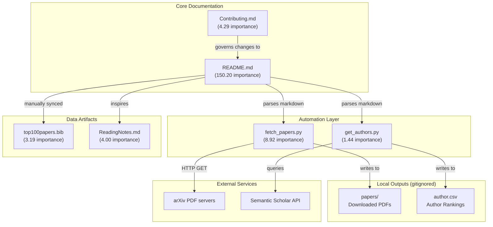
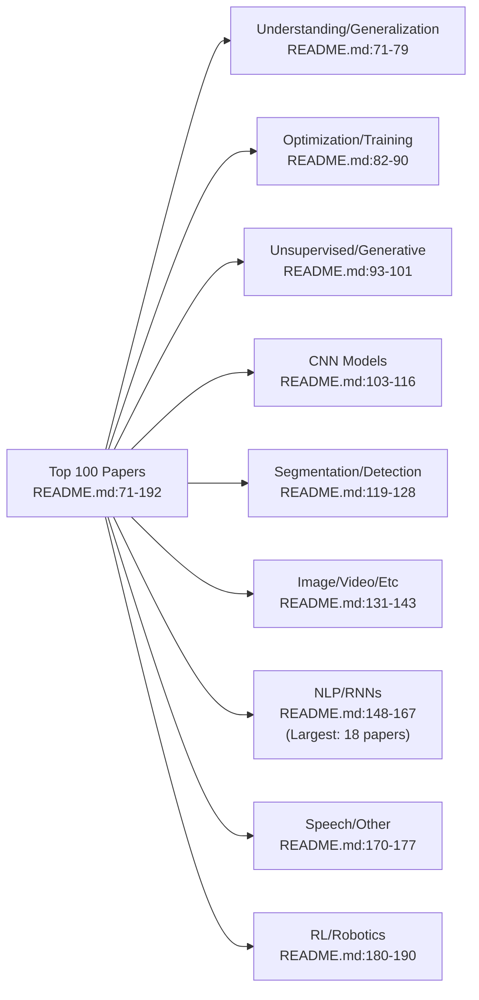
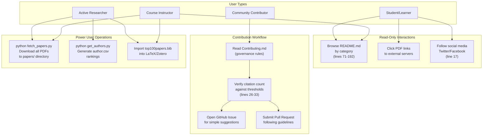
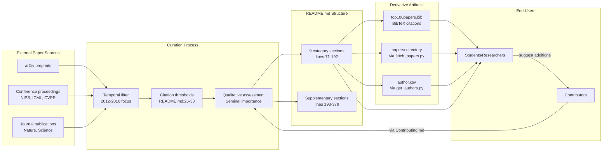

<!-- source: DeepWiki mcp.deepwiki.com · repo terryum/awesome-deep-learning-papers · page 1 Overview · fetched 2026-10-30 -->

# Overview

<details>
<summary>Relevant source files</summary>

The following files were used as context for generating this wiki page:

- [README.md](README.md)

</details>


This document provides a comprehensive overview of the awesome-deep-learning-papers repository, a curated collection of influential deep learning research papers published between 2012-2016. The repository serves as a knowledge curation and distribution system that helps researchers and students navigate the foundational literature of the deep learning revolution.

For detailed information about specific subsystems, see:
- Paper organization and categorization: [The Curated Paper List](#2)
- Automation tools for bulk operations: [Automation Tools](#4)
- Contributing guidelines and processes: [Contributing to the List](#3)

**Scope**: This page covers the repository's overall architecture, core components, maintenance status, and primary use cases. It does not detail individual research categories or specific automation script implementations, which are covered in subsequent sections.

---

## Purpose and Maintenance Status

The repository addresses a fundamental challenge in deep learning education: identifying which papers are essential reading. Rather than providing an overwhelming collection, it curates a focused "top 100" list of seminal works that remain relevant across application domains.

**Current Maintenance Status**: The list is no longer actively maintained as of 2017 due to the overwhelming volume of papers published daily since that time [README.md:5]().

### Selection Philosophy

The repository prioritizes:
- **Seminal papers** with broad applicability over narrow application-specific works
- **Citation-based filtering** with year-adjusted thresholds
- **Classic works** (2012-2016) that represent the deep learning breakthrough period

Sources: [README.md:1-43]()

---

## Repository Architecture

The repository follows a documentation-centric architecture where `README.md` serves dual purposes: human-readable knowledge curation and machine-parseable data source for automation tools.

### Component Architecture



Sources: [README.md:1-390](), [.gitignore:1-2]()

---

## Core Components

### 1. README.md - The Central Knowledge Repository

`README.md` is the single source of truth, containing 390 lines of structured markdown that organize 100+ papers across 9 research domains. It accounts for 92% of the repository's functional importance.

**Structure**:
- Lines 71-192: Top 100 papers organized into 9 categories
- Lines 193-209: "More Papers from 2016" overflow section  
- Lines 213-231: New Papers (< 6 months old)
- Lines 233-251: Old Papers (pre-2012 classics)
- Lines 253-262: Hardware/Software/Datasets
- Lines 264-275: Books/Surveys/Reviews
- Lines 276-298: Video lectures and tutorials
- Lines 299-379: Appendix with additional papers

**Dual-Purpose Design**: The markdown formatting follows strict conventions that enable automated parsing:

```markdown
### Understanding / Generalization / Transfer
- **Distilling the knowledge in a neural network** (2015), G. Hinton et al. [[pdf]](http://arxiv.org/pdf/1503.02531)
```

The pattern `### Heading` for sections and `**Title** [[pdf]](url)` for papers enables regex-based extraction by automation scripts.

Sources: [README.md:1-390]()

### 2. Citation Threshold System

The repository implements a year-based citation threshold system to account for publication recency:

| Publication Year | Citation Threshold | Section Placement |
|-----------------|-------------------|-------------------|
| < 6 months | By discussion | New Papers |
| 2016 | +60 citations | Main list or "More Papers from 2016" |
| 2015 | +200 citations | Main list |
| 2014 | +400 citations | Main list |
| 2013 | +600 citations | Main list |
| 2012 | +800 citations | Main list |
| ~2012 (pre-2012) | By discussion | Old Papers |

This sliding scale ensures that newer papers have a fair chance of inclusion despite having less time to accumulate citations [README.md:26-33]().

**Qualitative Override**: Citation thresholds are guidelines, not absolute rules. Papers are evaluated for seminal importance and broad applicability [README.md:35-36]().

Sources: [README.md:19-36]()

### 3. Research Domain Organization

The top 100 papers are distributed across 9 primary research categories:



The NLP/RNNs category is the largest with 18 papers, reflecting the explosion of sequence modeling research during this period.

Sources: [README.md:47-67](), [README.md:71-192]()

### 4. Automation Tools

Two Python scripts leverage `README.md` as a structured data source:

**fetch_papers.py** (importance: 8.92)
- Parses section headings using regex pattern `### (.+)`
- Extracts paper titles and PDF URLs using pattern `**(.+?)** .+?\[\[pdf\]\]\((.+?)\)`
- Downloads PDFs with auto-resume functionality
- Organizes downloads into `papers/` subdirectories by section

**get_authors.py** (importance: 1.44)
- Extracts paper titles from README.md
- Queries Semantic Scholar API to retrieve author information
- Calculates position-weighted author scores (first author gets more weight)
- Outputs rankings to `author.csv`

Both scripts demonstrate the repository's clever dual-use data model where README.md serves as both documentation and database.

Sources: [README.md:42](), [fetch_papers.py](), [get_authors.py]()

### 5. Version Control Configuration

The `.gitignore` file excludes `papers/` from version control:

```
papers/
*.pyc
```

This design decision reflects the repository's philosophy: curate *references* to papers, not the papers themselves. The repository remains lightweight and focused on knowledge organization rather than content hosting.

Sources: [.gitignore:1-2](), [README.md:42]()

---

## User Workflows

### Workflow Diagram: User Personas and Interactions



Sources: [README.md:1-43](), [Contributing.md]()

### Common Use Cases

**1. Learning Deep Learning Fundamentals**
- Browse by category in README.md [README.md:47-67]()
- Follow paper links to external PDF servers
- Use as reading roadmap for structured learning

**2. Contributing Papers**
- Consult Contributing.md for submission rules
- Verify paper meets citation threshold [README.md:26-33]()
- Submit via GitHub Issue or Pull Request [README.md:38-40]()

**3. Research Reference Collection**
- Execute `fetch_papers.py` to download all PDFs locally
- Import `top100papers.bib` into reference manager [README.md:42]()
- Use for literature review or citation purposes

**4. Author Network Analysis**
- Run `get_authors.py` to extract author information
- Analyze `author.csv` output for collaboration patterns
- Identify key researchers in the field [README.md:42-44]()

Sources: [README.md:1-43]()

---

## Data Flow Architecture

The following diagram illustrates how data flows from external sources through the repository to end users:



Sources: [README.md:1-390]()

---

## File System Structure

The repository follows a flat file structure with minimal directory nesting:

```
awesome-deep-learning-papers/
├── README.md              # Main curated list (150.20 importance)
├── Contributing.md        # Contribution guidelines (4.29 importance)
├── fetch_papers.py        # PDF download automation (8.92 importance)
├── get_authors.py         # Author extraction tool (1.44 importance)
├── top100papers.bib       # BibTeX bibliography (3.19 importance)
├── ReadingNotes.md        # Example research notes (4.00 importance)
├── .gitignore             # Excludes papers/ directory
└── papers/                # Local PDF storage (gitignored)
    ├── Understanding-Generalization-Transfer/
    ├── Optimization-Training-Techniques/
    ├── Unsupervised-Generative-Models/
    └── ...                # One subdirectory per category
```

The `papers/` directory is created by `fetch_papers.py` but excluded from version control to keep the repository lightweight.

Sources: [README.md:1-390](), [.gitignore:1-2]()

---

## Key Design Principles

### 1. Documentation as Data

The repository treats `README.md` as structured data rather than merely human-readable text. Strict markdown formatting conventions enable automated parsing while maintaining readability.

**Example pattern**:
```markdown
### Category Name
- **Paper Title** (Year), Authors [[pdf]](URL)
```

This dual-purpose design eliminates the need for separate data files.

### 2. Lightweight Reference Curation

By excluding PDFs from version control and linking to external servers, the repository remains under 1MB while providing access to hundreds of papers. This design choice prioritizes knowledge organization over content hosting.

### 3. Year-Adjusted Quality Metrics

The citation threshold system [README.md:26-33]() recognizes that paper impact compounds over time. A 2016 paper with 60 citations may be as significant as a 2012 paper with 800+ citations.

### 4. Qualitative Override Mechanism

Citation counts are guidelines, not absolute rules [README.md:35-36](). This allows inclusion of breakthrough papers that may not yet have accumulated citations but demonstrate clear importance.

Sources: [README.md:1-43]()

---

## Repository Statistics

### Component Importance Distribution

The following table shows the relative importance scores of repository components:

| Component | Importance Score | Percentage | Primary Role |
|-----------|-----------------|------------|--------------|
| README.md | 150.20 | 92.2% | Knowledge curation |
| fetch_papers.py | 8.92 | 5.5% | Bulk PDF download |
| Contributing.md | 4.29 | 2.6% | Governance |
| ReadingNotes.md | 4.00 | 2.5% | Example analysis |
| top100papers.bib | 3.19 | 2.0% | Citation management |
| get_authors.py | 1.44 | 0.9% | Author analytics |
| .gitignore | 1.33 | 0.8% | Version control config |

The overwhelming importance of `README.md` confirms the documentation-centric architecture.

Sources: High-level architecture diagrams

---

## Integration Points

### External Services

The repository integrates with external services through automation scripts:

1. **PDF Servers**: `fetch_papers.py` downloads from arXiv, conference websites, and journal servers
2. **Semantic Scholar API**: `get_authors.py` queries for author metadata and paper information
3. **Social Media**: Twitter and Facebook for community engagement [README.md:17]()

### Citation Management Systems

The `top100papers.bib` file integrates with:
- LaTeX bibliography systems (BibTeX/BibLaTeX)
- Reference managers (Zotero, Mendeley, EndNote)
- Academic writing tools

Sources: [README.md:42](), [fetch_papers.py](), [get_authors.py]()

---

## Summary

The awesome-deep-learning-papers repository represents a knowledge curation system optimized for three goals:

1. **Accessibility**: Curated list reduces overwhelming paper volume to essential reading
2. **Maintainability**: Documentation-centric design with minimal infrastructure
3. **Extensibility**: Automation tools enable bulk operations and custom analysis

While no longer actively maintained for new papers post-2017, it remains valuable as a historical snapshot of deep learning's foundational period (2012-2016) and a template for similar curation efforts.

For implementation details of specific subsystems, see [The Curated Paper List](#2), [Automation Tools](#4), and [Contributing to the List](#3).

Sources: [README.md:1-390](), all architecture diagrams

---

