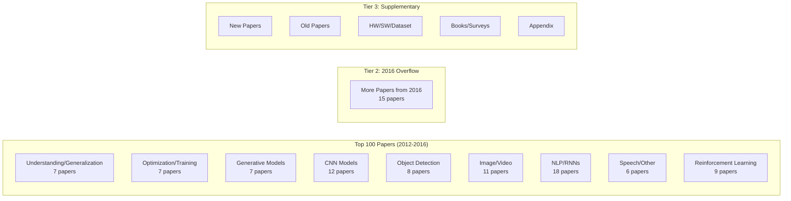
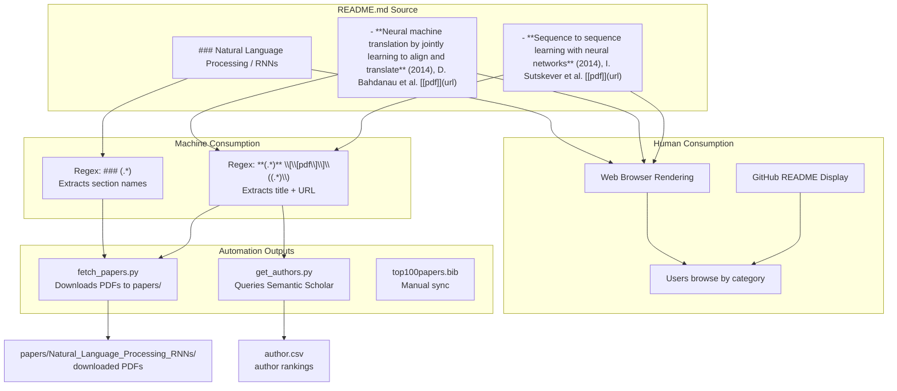
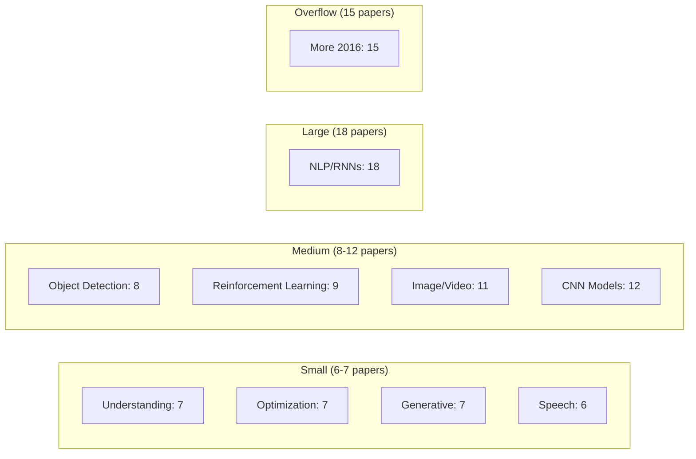
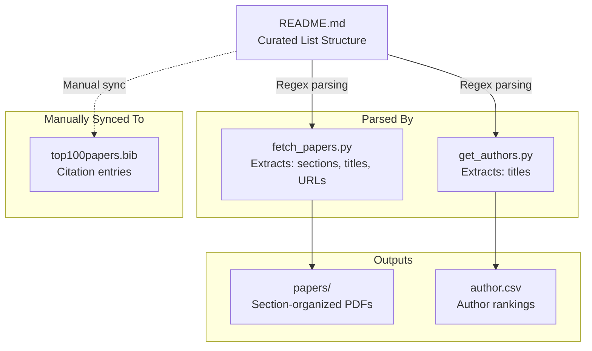

<!-- source: DeepWiki mcp.deepwiki.com · repo terryum/awesome-deep-learning-papers · page 2 The Curated Paper List · fetched 2026-10-30 -->

# The Curated Paper List

<details>
<summary>Relevant source files</summary>

The following files were used as context for generating this wiki page:

- [README.md](README.md)
- [top100papers.bib](top100papers.bib)

</details>


## Purpose and Scope

This document describes the structure and organization of the main curated list in [README.md:1-390](), which serves as the central knowledge artifact of the repository. The list contains the top 100 most cited deep learning papers from 2012-2016, plus supplementary sections for additional resources. This page explains the organizational architecture, markdown formatting conventions, and how the list functions as both human-readable documentation and machine-parseable structured data.

For information about how papers are selected for inclusion, see [Paper Selection Criteria](#2.1). For details on individual research categories, see [Research Domain Categories](#2.2). For supplementary resources beyond the top 100, see [Supplementary Resources](#2.3).

**Sources:** [README.md:1-390]()

## Overall Structure

The README.md file is organized as a hierarchical markdown document with distinct structural zones serving different purposes.

```mermaid
graph TB
    README["README.md<br/>Main Document"]
    
    subgraph Header["Header Section (Lines 1-45)"]
        TITLE["# Awesome - Most Cited Deep Learning Papers<br/>Line 1"]
        NOTICE["[Notice] maintenance status<br/>Line 5"]
        INTRO["Introduction & Background<br/>Lines 7-16"]
        CRITERIA["Awesome list criteria<br/>Lines 19-40"]
        TOOLS["Tool references<br/>Line 42"]
    end
    
    subgraph TOC["Table of Contents (Lines 47-67)"]
        MAIN_TOC["Main categories (9 sections)<br/>Lines 49-57"]
        SUPP_TOC["Supplementary sections<br/>Lines 60-67"]
    end
    
    subgraph Top100["Top 100 Papers (Lines 71-209)"]
        CAT1["### Understanding / Generalization / Transfer<br/>7 papers, Lines 71-78"]
        CAT2["### Optimization / Training Techniques<br/>7 papers, Lines 82-89"]
        CAT3["### Unsupervised / Generative Models<br/>7 papers, Lines 93-100"]
        CAT4["### Convolutional Neural Network Models<br/>12 papers, Lines 103-115"]
        CAT5["### Image: Segmentation / Object Detection<br/>8 papers, Lines 119-127"]
        CAT6["### Image / Video / Etc<br/>11 papers, Lines 131-142"]
        CAT7["### Natural Language Processing / RNNs<br/>18 papers, Lines 148-166"]
        CAT8["### Speech / Other Domain<br/>6 papers, Lines 170-176"]
        CAT9["### Reinforcement Learning / Robotics<br/>9 papers, Lines 180-189"]
        MORE2016["### More Papers from 2016<br/>15 papers, Lines 193-208"]
    end
    
    subgraph Supplementary["Supplementary Sections (Lines 213-379)"]
        NEW["### New papers<br/>< 6 months, Lines 213-230"]
        OLD["### Old Papers<br/>Pre-2012, Lines 233-250"]
        HWSW["### HW / SW / Dataset<br/>Lines 253-261"]
        BOOKS["### Book / Survey / Review<br/>Lines 264-274"]
        VIDEOS["### Video Lectures / Tutorials / Blogs<br/>Lines 276-297"]
        APPENDIX["### Appendix: More than Top 100<br/>Lines 299-379"]
    end
    
    README --> Header
    README --> TOC
    README --> Top100
    README --> Supplementary
    
    Top100 --> CAT1
    Top100 --> CAT2
    Top100 --> CAT3
    Top100 --> CAT4
    Top100 --> CAT5
    Top100 --> CAT6
    Top100 --> CAT7
    Top100 --> CAT8
    Top100 --> CAT9
    Top100 --> MORE2016
    
    Supplementary --> NEW
    Supplementary --> OLD
    Supplementary --> HWSW
    Supplementary --> BOOKS
    Supplementary --> VIDEOS
    Supplementary --> APPENDIX
```



**Sources:** [README.md:1-390]()

## Organizational Hierarchy

The curated list uses a three-tier organizational structure to partition the deep learning research landscape:

### Tier 1: Top 100 Core Papers

The primary curation consists of exactly 100 papers distributed across 9 research categories, representing seminal works from 2012-2016 that meet specific citation thresholds. These papers are organized in [README.md:71-189]().

### Tier 2: 2016 Overflow Section

Papers from 2016 that are relevant but couldn't displace existing Top 100 entries are listed in the "More Papers from 2016" section [README.md:193-208](). This section contains 15 additional papers that meet the +60 citation threshold for 2016 papers [README.md:28]().

### Tier 3: Supplementary Collections

Five additional sections provide context and broader coverage:
- **New Papers** [README.md:213-230](): Recent papers (<6 months old) under discussion
- **Old Papers** [README.md:233-250](): Classic papers published before 2012
- **HW/SW/Dataset** [README.md:253-261](): Technical infrastructure papers
- **Book/Survey/Review** [README.md:264-274](): Comprehensive learning resources
- **Appendix: More than Top 100** [README.md:299-379](): Additional papers that didn't make the main list



**Sources:** [README.md:47-67](), [README.md:71-379]()

## Markdown Formatting Conventions

The README.md uses strict markdown formatting patterns that enable it to function as both human-readable documentation and machine-parseable structured data. This dual-use design allows automation scripts to extract information programmatically.

### Section Headers

Research categories use level-3 markdown headers (`###`):

```markdown
### Understanding / Generalization / Transfer
### Optimization / Training Techniques
### Natural Language Processing / RNNs
```

These headers are parsed by automation scripts using regex pattern matching to identify section boundaries [README.md:71](), [README.md:82](), [README.md:148]().

### Paper Entry Format

Each paper follows a standardized format:

```markdown
- **Title** (year), Authors [[pdf]](url)
```

Example from the Understanding category [README.md:72]():
```markdown
- **Distilling the knowledge in a neural network** (2015), G. Hinton et al. [[pdf]](http://arxiv.org/pdf/1503.02531)
```

### Formatting Pattern Breakdown

| Component | Syntax | Example | Purpose |
|-----------|--------|---------|---------|
| List marker | `-` | `-` | Denotes individual paper entry |
| Title | `**text**` | `**Distilling the knowledge in a neural network**` | Bold title for emphasis and parsing |
| Year | `(YYYY)` | `(2015)` | Publication year in parentheses |
| Authors | `Author et al.` | `G. Hinton et al.` | Abbreviated author list |
| PDF Link | `[[pdf]](url)` | `[[pdf]](http://arxiv.org/pdf/1503.02531)` | Download link with consistent format |

This pattern is critical for automated parsing by [fetch_papers.py]() and [get_authors.py](), which extract titles and URLs using regular expressions.

**Sources:** [README.md:72-189]()

## Dual-Use Data Model

The README.md markdown structure serves a dual purpose: it is simultaneously human-readable documentation and machine-readable structured data. This design allows the same source document to support multiple consumption patterns.



### Parsing Constraints

The dual-use model requires maintaining specific formatting rules:

1. **Section headers must use exactly `###`** - Used to detect category boundaries
2. **Paper titles must be wrapped in `**...**`** - Enables title extraction
3. **PDF links must use `[[pdf]](url)` format** - Standardized link pattern for parsing
4. **One paper per line starting with `-`** - Ensures reliable line-by-line processing

Any deviation from these patterns would break automated parsing. For example, using `####` for a subsection or omitting the bold markers around titles would cause [fetch_papers.py]() to skip those entries.

**Sources:** [README.md:71-189](), [fetch_papers.py:1-end](), [get_authors.py:1-end]()

## Paper Distribution by Category

The 100 papers in the main list are distributed across 9 research categories, with Natural Language Processing being the largest.

| Category | Papers | Lines | Key Topics |
|----------|--------|-------|------------|
| Understanding / Generalization / Transfer | 7 | [72-78]() | Knowledge distillation, transfer learning, visualization |
| Optimization / Training Techniques | 7 | [83-89]() | Batch normalization, dropout, Adam optimizer |
| Unsupervised / Generative Models | 7 | [94-100]() | GANs, VAEs, PixelRNN |
| Convolutional Neural Network Models | 12 | [104-115]() | ResNet, Inception, VGG, AlexNet |
| Image: Segmentation / Object Detection | 8 | [120-127]() | R-CNN family, YOLO, FCN |
| Image / Video / Etc | 11 | [132-142]() | Image captioning, style transfer, VQA |
| Natural Language Processing / RNNs | 18 | [149-166]() | Seq2seq, attention, word embeddings, NMT |
| Speech / Other Domain | 6 | [171-176]() | Speech recognition, acoustic modeling |
| Reinforcement Learning / Robotics | 9 | [181-189]() | DQN, AlphaGo, policy gradients |
| **More Papers from 2016** | 15 | [194-208]() | WaveNet, layer norm, domain adaptation |

### Category Size Visualization



The NLP/RNNs category's size (18 papers) reflects the explosion of sequence modeling and attention mechanism research during 2012-2016, particularly the 2014-2015 period when neural machine translation emerged.

**Sources:** [README.md:71-208]()

## Section Navigation Structure

The README.md includes a table of contents [README.md:47-67]() that uses markdown anchor links to enable quick navigation:

```markdown
* [Understanding / Generalization / Transfer](#understanding--generalization--transfer)
* [Optimization / Training Techniques](#optimization--training-techniques)
* [Unsupervised / Generative Models](#unsupervised--generative-models)
* [Convolutional Network Models](#convolutional-neural-network-models)
* [Image Segmentation / Object Detection](#image-segmentation--object-detection)
* [Image / Video / Etc](#image--video--etc)
* [Natural Language Processing / RNNs](#natural-language-processing--rnns)
* [Speech / Other Domain](#speech--other-domain)
* [Reinforcement Learning / Robotics](#reinforcement-learning--robotics)
* [More Papers from 2016](#more-papers-from-2016)
```

The anchor format follows GitHub's automatic header ID generation: lowercase with spaces replaced by hyphens and special characters removed. For example, "Image / Video / Etc" becomes `#image--video--etc`.

**Sources:** [README.md:47-67]()

## Metadata and Commented Sections

The README.md includes commented-out metadata sections (using HTML comment syntax `<!-- -->`) that identify key researchers for each domain but are not rendered in the final display:

```markdown
<!---[Key researchers]  [Geoffrey Hinton](https://scholar.google.ca/citations?user=JicYPdAAAAAJ), 
[Yoshua Bengio](https://scholar.google.ca/citations?user=kukA0LcAAAAJ), 
[Jason Yosinski](https://scholar.google.ca/citations?hl=en&user=gxL1qj8AAAAJ) -->
```

These commented sections appear after most categories [README.md:80](), [README.md:91](), [README.md:102](), etc., providing additional context without cluttering the visible documentation. They could potentially be parsed for future researcher analytics features.

**Sources:** [README.md:80](), [README.md:91](), [README.md:102](), [README.md:117](), [README.md:129](), [README.md:144](), [README.md:168](), [README.md:178](), [README.md:191]()

## Maintenance Notice

The repository includes a prominent notice at the top [README.md:5]():

```markdown
[Notice] This list is not being maintained anymore because of the overwhelming amount 
of deep learning papers published every day since 2017.
```

This indicates that the list represents a historical snapshot of the 2012-2016 era, intentionally frozen to preserve its value as a curated collection of foundational papers rather than attempting to keep pace with exponential publication growth.

**Sources:** [README.md:5]()

## Relationship to Other Components

The curated list structure directly drives the behavior of automation tools and reference materials:



The strict markdown formatting conventions in README.md are essential for enabling this automated processing. Any structural changes to the paper list format would require corresponding updates to the parsing logic in the automation scripts.

**Sources:** [README.md:42](), [README.md:1-390]()

---

