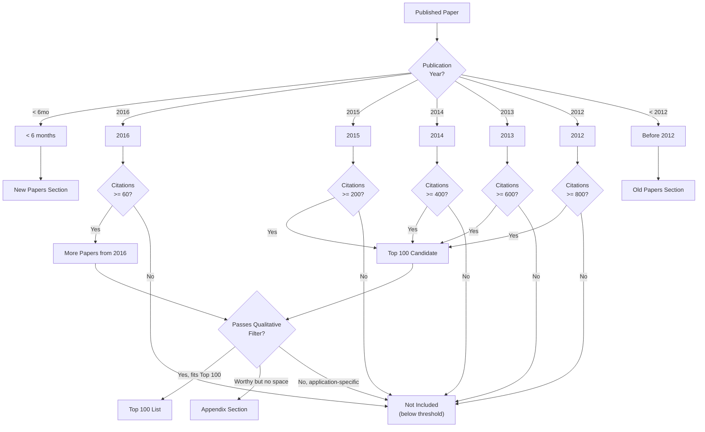
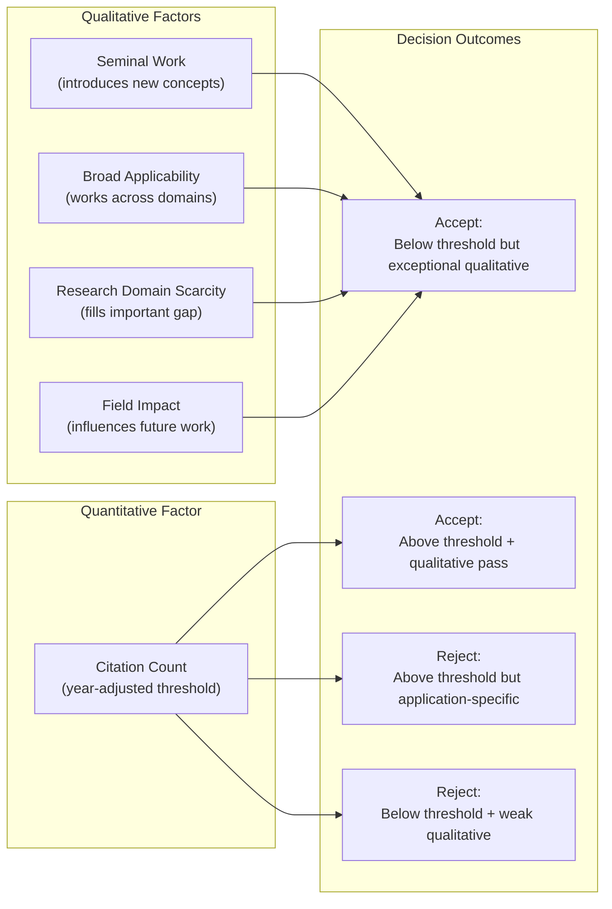
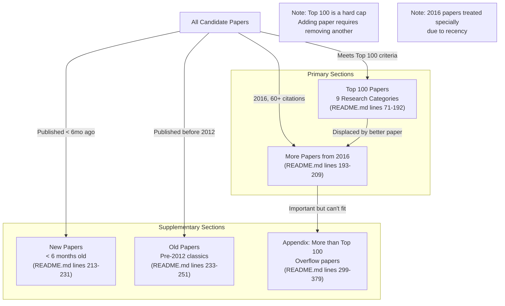
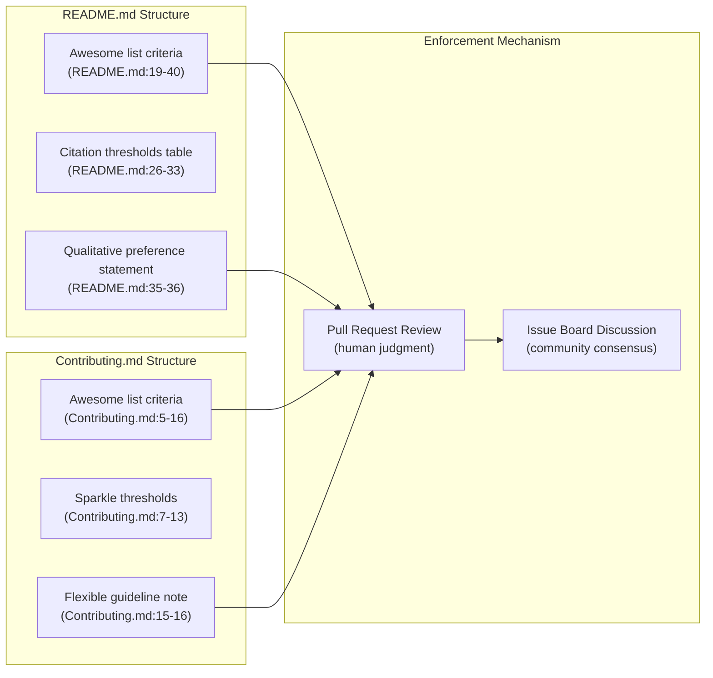

<!-- source: DeepWiki mcp.deepwiki.com · repo terryum/awesome-deep-learning-papers · page 2.1 Paper Selection Criteria · fetched 2026-10-30 -->

# Paper Selection Criteria

<details>
<summary>Relevant source files</summary>

The following files were used as context for generating this wiki page:

- [Contributing.md](Contributing.md)
- [README.md](README.md)

</details>


## Purpose and Scope

This page documents the quantitative citation thresholds and qualitative assessment criteria used to curate papers for inclusion in the awesome-deep-learning-papers repository. The criteria serve as a filtering mechanism to identify the most influential deep learning papers from 2012-2016, maintaining a manageable "Top 100" list while accommodating overflow and special cases.

For information about how papers are organized into research domain categories once selected, see [Research Domain Categories](#2.2). For details on how to contribute papers according to these criteria, see [Contributing to the List](#3).

---

## Citation Threshold Framework

The repository uses a **year-based sliding scale** for citation thresholds, recognizing that older papers have had more time to accumulate citations. The criteria are defined in two locations with slightly different purposes:

### Primary Criteria (README.md)

The main list uses these thresholds for determining inclusion in the Top 100 papers:

| Publication Year | Minimum Citations | Section Placement |
|-----------------|-------------------|-------------------|
| < 6 months | N/A (by discussion) | New Papers |
| 2016 | 60 citations | Top 100 or "More Papers from 2016" |
| 2015 | 200 citations | Top 100 |
| 2014 | 400 citations | Top 100 |
| 2013 | 600 citations | Top 100 |
| 2012 | 800 citations | Top 100 |
| Before 2012 | N/A (by discussion) | Old Papers |

**Sources:** [README.md:26-33]()

### Enhanced Criteria (Contributing.md)

The contributing guide provides more granular thresholds including "sparkle" (⭐) designations for particularly highly-cited papers:

| Publication Year | Base Threshold | Sparkle Threshold (⭐) |
|-----------------|----------------|----------------------|
| 2016 | 20 citations | 50 citations |
| 2015 | 100 citations | 200 citations |
| 2014 | 200 citations | 400 citations |
| 2013 | 300 citations | 600 citations |
| 2012 | 400 citations | 800 citations |
| 2011 | 500 citations | 1000 citations |
| 2010 | 600 citations | 1200 citations |

**Sources:** [Contributing.md:7-13]()

### Citation Threshold Decision Tree



**Sources:** [README.md:26-35](), [Contributing.md:7-15]()

---

## Qualitative Assessment Criteria

The citation thresholds are explicitly described as a **"flexible guideline"** rather than a strict baseline. The repository prioritizes papers based on qualitative factors:

### Core Qualitative Principles

1. **Seminal Contribution**: Papers that introduce fundamental concepts or techniques
2. **Broad Applicability**: Methods that can be applied across various research domains
3. **Impact on Field**: Papers that influenced subsequent research directions

As stated in the repository:

> "Please note that we prefer seminal deep learning papers that can be applied to various researches rather than application papers."

This means domain-specific application papers (even with high citations) may be excluded in favor of foundational techniques papers with lower citations.

**Sources:** [README.md:35-36]()

### Qualitative vs. Quantitative Trade-offs



**Sources:** [README.md:35-36](), [Contributing.md:15-16]()

---

## Section Placement Strategy

The repository uses a multi-tier organizational structure to accommodate papers that don't fit the strict Top 100 constraint:

### Section Hierarchy and Placement Rules



**Sources:** [README.md:19-24](), [README.md:60-67]()

### Hard Cap Enforcement

The repository enforces a strict limit of **exactly 100 papers** in the main list:

> "If a paper is added to the list, another paper (usually from *More Papers from 2016* section) should be removed to keep top 100 papers."

This zero-sum constraint means:
- **Addition Operation**: Adding 1 paper → Requires removing 1 paper
- **Typical Removal Source**: "More Papers from 2016" section (most recently added papers)
- **Contribution Value**: "removing papers is also important contributions as well as adding papers"

**Sources:** [README.md:22-23]()

---

## Criteria Encoding in Markdown Structure

The selection criteria are not enforced by code but are embedded in the repository's documentation structure and community governance:

### Markdown-Based Criteria Definition



**Sources:** [README.md:19-40](), [Contributing.md:5-16]()

### No Automated Validation

Unlike many repositories, this codebase does **not** programmatically enforce selection criteria. The automation scripts (`fetch_papers.py`, `get_authors.py`) operate on papers already in the list but do not validate citations or apply acceptance criteria.

**Validation is manual and community-driven:**
- Contributors reference criteria in pull request descriptions
- Maintainers evaluate against qualitative principles
- Discussion occurs on GitHub Issues for borderline cases

**Sources:** [README.md:39-40](), [Contributing.md:3-4]()

---

## Special Cases and Exceptions

### New Papers (< 6 Months Old)

Papers published within the last 6 months bypass citation requirements:

> "**< 6 months** : *New Papers* (by discussion)"

These papers are evaluated based on:
- Novelty and potential impact
- Community discussion and early reception
- Author reputation and research group
- Alignment with emerging research trends

**Section Location:** [README.md:213-231]()

**Sources:** [README.md:27](), [README.md:62]()

### Old Papers (Before 2012)

Classic papers from before 2012 also bypass standard thresholds:

> "**~2012** : *Old Papers* (by discussion)"

These foundational papers are included for historical context and often establish fundamental concepts that enabled the 2012-2016 deep learning revolution. Examples include:
- LSTM (1997) - S. Hochreiter and J. Schmidhuber
- LeNet (1998) - Y. LeCun et al.
- Deep Belief Nets (2006) - G. Hinton et al.

**Section Location:** [README.md:233-251]()

**Sources:** [README.md:33](), [README.md:63]()

### More Papers from 2016

2016 papers receive special treatment with a **lower threshold (+60 citations)** but separate section placement:

> "**2016** : +60 citations or "More Papers from 2016""

This acknowledges that:
1. Recent papers haven't had time to accumulate citations like older papers
2. 2016 represented a particularly productive year in deep learning
3. These papers may graduate to Top 100 as citations increase

**Section Location:** [README.md:193-209]()

**Sources:** [README.md:28](), [README.md:58]()

---

## Criteria Application Workflow

### Contributor Perspective

When contributors suggest papers, they follow this workflow:

```mermaid
sequenceDiagram
    participant Contributor
    participant ContribGuide as Contributing.md
    participant README as README.md
    participant PR as Pull Request
    participant Maintainer
    
    Contributor->>ContribGuide: Read criteria
    Note over Contributor: Check year-based threshold
    
    alt Paper meets threshold
        Contributor->>README: Add paper with standard description
        Contributor->>PR: Submit with citation count
    else Paper below threshold
        Contributor->>README: Add paper with detailed justification
        Contributor->>PR: Submit with "enough descriptions"
        Note over PR: Must explain why qualitatively important
    end
    
    PR->>Maintainer: Review request
    Maintainer->>Maintainer: Check citations
    Maintainer->>Maintainer: Assess qualitative fit
    
    alt Accepted to Top 100
        Maintainer->>README: Remove 1 paper from Top 100 or More 2016
        Maintainer->>README: Add new paper
    else Accepted to supplementary
        Maintainer->>README: Add to appropriate section
    else Rejected
        Maintainer->>PR: Close with explanation
    end
```



**Sources:** [Contributing.md:20-22](), [README.md:37-40]()

### Sparkle (⭐) Designation

High-impact papers that significantly exceed thresholds receive sparkle markers:

**Purpose:** Visual indication of exceptionally influential papers
**Implementation:** Manual addition via contributing process
**Modification Rule:** Contributors can suggest adding sparkles as citation counts increase

Example markdown:
```markdown
- **ImageNet classification with deep convolutional neural networks** (2012), A. Krizhevsky et al. :sparkles: [[pdf]](...)
```

**Sources:** [Contributing.md:7-13](), [Contributing.md:34]()

---

## Summary: Criteria Decision Matrix

| Factor | Weight | Evaluation Method |
|--------|--------|-------------------|
| **Publication Year** | High | Determines baseline threshold (800 for 2012 → 60 for 2016) |
| **Citation Count** | Medium-High | Quantitative screening against year-based threshold |
| **Seminal Nature** | High | Qualitative assessment: Does it introduce new concepts? |
| **Broad Applicability** | High | Qualitative assessment: Works across research domains? |
| **Research Domain Scarcity** | Medium | Qualitative assessment: Fills important gap in coverage? |
| **Field Impact** | High | Qualitative assessment: Influenced subsequent research? |

**Final Decision:** Boolean AND of quantitative screening + qualitative assessment, with flexibility to override thresholds for exceptional papers.

**Sources:** [README.md:19-40](), [Contributing.md:5-16]()

---

