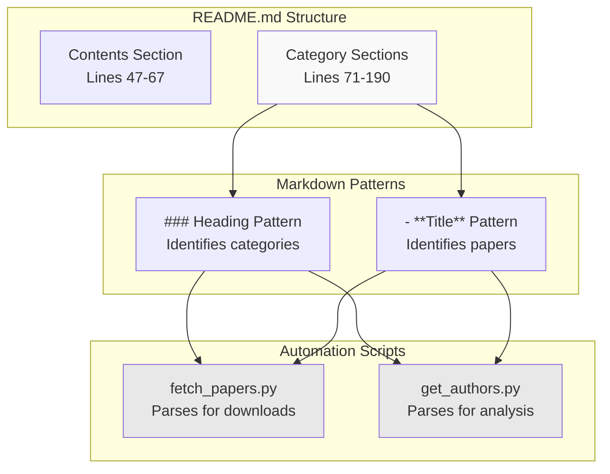
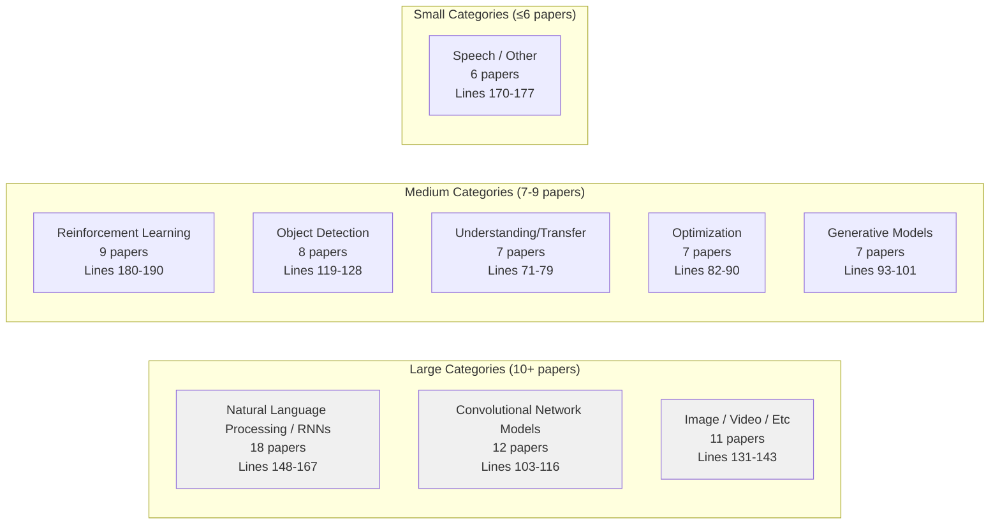
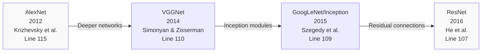
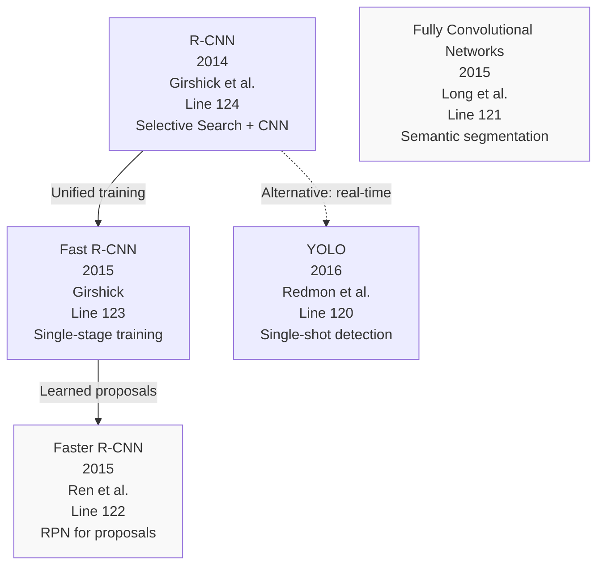
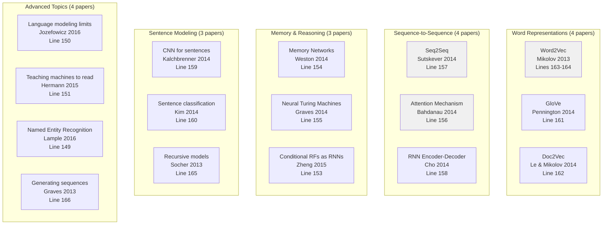
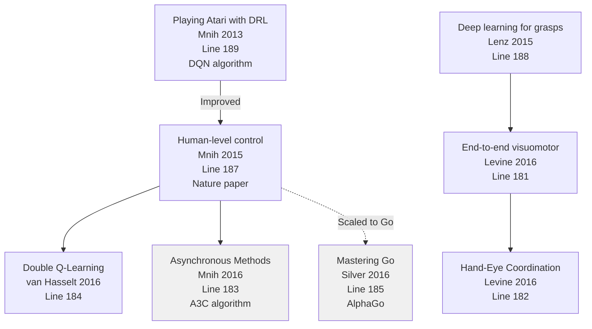
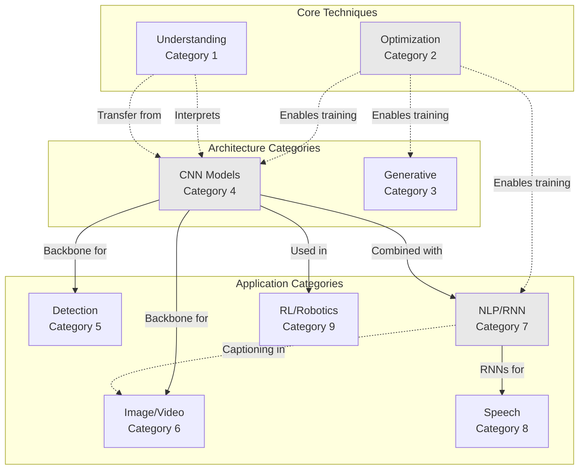
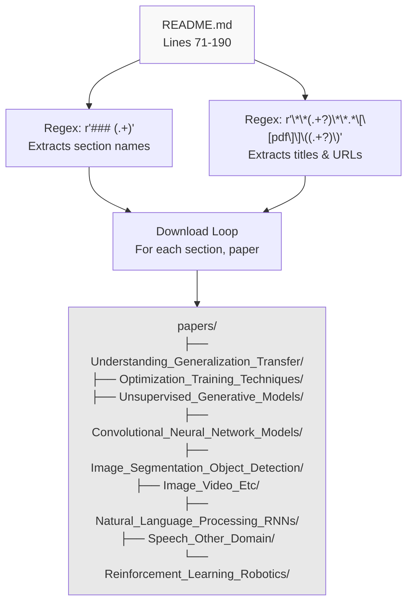
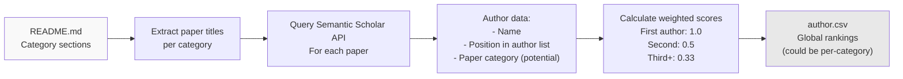

<!-- source: DeepWiki mcp.deepwiki.com · repo terryum/awesome-deep-learning-papers · page 2.2 Research Domain Categories · fetched 2026-10-30 -->

# Research Domain Categories

<details>
<summary>Relevant source files</summary>

The following files were used as context for generating this wiki page:

- [README.md](README.md)
- [top100papers.bib](top100papers.bib)

</details>


## Purpose and Scope

This document describes the nine primary research domain categories used to organize the Top 100 deep learning papers in README.md. Each category represents a distinct area of deep learning research during the 2012-2016 period, grouping papers by their primary methodological or application focus. This organizational structure enables readers to navigate the curated list by research interest rather than chronologically or alphabetically.

For information about the selection criteria used to determine which papers enter the Top 100, see [Paper Selection Criteria](#2.1). For details on supplementary sections like New Papers, Old Papers, and educational resources, see [Supplementary Resources](#2.3).

Sources: [README.md:47-67]()

## Category Structure in README.md

The research categories are implemented as level-3 markdown headings (`### Category Name`) in README.md, with each paper listed as a bullet point containing the title, publication year, authors, and PDF link. This simple markdown structure serves dual purposes: human-readable documentation and machine-parseable data for automation scripts.

### Markdown Format Convention

```markdown
### Category Name
- **Paper Title** (year), Authors et al. [[pdf]](url)
- **Another Paper** (year), Authors [[pdf]](url)
```

The automation scripts in [fetch_papers.py]() and [get_authors.py]() parse this structure using regular expressions to extract section names and paper metadata.

Sources: [README.md:71-190](), [fetch_papers.py](), [get_authors.py]()

### Category Extraction Pattern



**Diagram: Category Parsing Pipeline** - Shows how markdown patterns in README.md are parsed by automation scripts.

Sources: [README.md:71-190](), [fetch_papers.py](), [get_authors.py]()

## The Nine Primary Categories

### Category Overview Table

| Category ID | Category Name | Papers | Lines | Focus Area |
|------------|---------------|---------|-------|------------|
| 1 | Understanding / Generalization / Transfer | 7 | 71-79 | Transfer learning, visualization, knowledge distillation |
| 2 | Optimization / Training Techniques | 7 | 82-90 | Training methods, normalization, regularization |
| 3 | Unsupervised / Generative Models | 7 | 93-101 | GANs, VAEs, generative architectures |
| 4 | Convolutional Neural Network Models | 12 | 103-116 | CNN architectures (AlexNet→ResNet evolution) |
| 5 | Image Segmentation / Object Detection | 8 | 119-128 | R-CNN family, segmentation, detection |
| 6 | Image / Video / Etc | 11 | 131-143 | Multi-modal, captioning, style transfer, video |
| 7 | Natural Language Processing / RNNs | 18 | 148-167 | Word embeddings, seq2seq, attention, NMT |
| 8 | Speech / Other Domain | 6 | 170-177 | Speech recognition, acoustic modeling |
| 9 | Reinforcement Learning / Robotics | 9 | 180-190 | DQN, policy gradients, AlphaGo, robotics |

**Total: 85 papers across 9 categories** (of the Top 100, with 15 in "More Papers from 2016")

Sources: [README.md:71-190]()

### Category Size Distribution



**Diagram: Category Distribution by Paper Count** - NLP/RNNs dominates with 18 papers, reflecting the explosion of sequence modeling research in 2012-2016.

Sources: [README.md:71-190]()

## Category Details

### 1. Understanding / Generalization / Transfer

**Location**: [README.md:71-79]()  
**Paper Count**: 7  
**Focus**: How neural networks learn, transfer knowledge, and generalize across tasks

**Key Papers**:
- Distilling the knowledge in a neural network (Hinton 2015) - Knowledge transfer
- Visualizing and understanding convolutional networks (Zeiler 2014) - Model interpretation
- How transferable are features in deep neural networks? (Yosinski 2014) - Transfer learning

**Research Questions**: What do neural networks learn? How can learned representations transfer between tasks? How can we interpret model decisions?

Sources: [README.md:71-79](), [top100papers.bib:1-50]()

### 2. Optimization / Training Techniques

**Location**: [README.md:82-90]()  
**Paper Count**: 7  
**Focus**: Methods to train deeper, faster, and more reliably

**Key Papers**:
- Batch normalization (Ioffe & Szegedy 2015) - Internal covariate shift
- Dropout (Srivastava 2014) - Regularization technique
- Adam optimizer (Kingma & Ba 2014) - Adaptive learning rates
- Training very deep networks (Srivastava 2015) - Highway networks

**Core Techniques**: Normalization, regularization, optimization algorithms, hyperparameter tuning

Sources: [README.md:82-90](), [top100papers.bib:52-102]()

### 3. Unsupervised / Generative Models

**Location**: [README.md:93-101]()  
**Paper Count**: 7  
**Focus**: Learning from unlabeled data and generating new samples

**Key Papers**:
- Generative adversarial nets (Goodfellow 2014) - Adversarial training
- Auto-encoding variational Bayes (Kingma & Welling 2013) - VAEs
- Pixel recurrent neural networks (van den Oord 2016) - Autoregressive models
- Unsupervised representation learning with DCGANs (Radford 2015)

**Paradigms**: GANs, VAEs, autoregressive models, unsupervised feature learning

Sources: [README.md:93-101](), [top100papers.bib:103-148]()

### 4. Convolutional Neural Network Models

**Location**: [README.md:103-116]()  
**Paper Count**: 12 (largest architectural category)  
**Focus**: CNN architecture design and evolution

**Architectural Evolution**:



**Diagram: CNN Architecture Timeline** - Shows the progression from AlexNet to ResNet.

**Key Innovations**:
- **AlexNet** (2012): ReLU, dropout, GPU training
- **VGGNet** (2014): Deep uniform architectures
- **GoogLeNet** (2015): Inception modules, 1x1 convolutions
- **ResNet** (2016): Skip connections, 100+ layer networks
- **Spatial Transformer Networks** (2015): Learnable spatial transformations

Sources: [README.md:103-116](), [top100papers.bib:149-230]()

### 5. Image Segmentation / Object Detection

**Location**: [README.md:119-128]()  
**Paper Count**: 8  
**Focus**: Pixel-level classification and object localization

**R-CNN Family Evolution**:



**Diagram: Object Detection and Segmentation Methods** - Parallel evolution of detection (R-CNN family) and segmentation (FCN) approaches.

**Key Paradigms**:
- Two-stage detection: R-CNN → Fast R-CNN → Faster R-CNN
- One-stage detection: YOLO
- Semantic segmentation: FCN, DeepLab

Sources: [README.md:119-128](), [top100papers.bib:231-291]()

### 6. Image / Video / Etc

**Location**: [README.md:131-143]()  
**Paper Count**: 11  
**Focus**: Multi-modal applications beyond classification

**Application Areas**:

| Application | Papers | Representative Work |
|------------|--------|---------------------|
| Image Captioning | 4 | Show and Tell (Vinyals 2015), Show Attend and Tell (Xu 2015) |
| Visual QA | 1 | VQA (Antol 2015) |
| Style Transfer | 1 | Neural algorithm of artistic style (Gatys 2015) |
| Video Understanding | 2 | Two-stream CNNs (Simonyan 2014), Large-scale video classification (Karpathy 2014) |
| Face Recognition | 1 | DeepFace (Taigman 2014) |
| Super-Resolution | 1 | SRCNN (Dong 2016) |

**Vision + Language**: This category particularly emphasizes multi-modal models that combine vision and language, representing a major research direction in 2015-2016.

Sources: [README.md:131-143](), [top100papers.bib:292-381]()

### 7. Natural Language Processing / RNNs

**Location**: [README.md:148-167]()  
**Paper Count**: 18 (largest category overall)  
**Focus**: Sequential data, language understanding, and generation

**Sub-areas by Paper Count**:



**Diagram: NLP/RNN Sub-area Breakdown** - The 18 papers span word embeddings, seq2seq, memory networks, and sentence modeling.

**Major Breakthroughs**:
- **Word Embeddings**: Word2Vec, GloVe revolutionized representation learning
- **Sequence-to-Sequence**: Enabled neural machine translation
- **Attention Mechanisms**: Addressed long-sequence limitations
- **Memory Networks**: External memory for reasoning tasks

Sources: [README.md:148-167](), [top100papers.bib:389-500]()

### 8. Speech / Other Domain

**Location**: [README.md:170-177]()  
**Paper Count**: 6  
**Focus**: Speech recognition and acoustic modeling

**Key Papers**:
- Deep Speech 2 (Amodei 2015) - End-to-end English and Mandarin recognition
- Speech recognition with deep RNNs (Graves 2013) - Recurrent architectures
- Deep neural networks for acoustic modeling (Hinton 2012) - Foundational work

**Historical Note**: This category captures the transition from GMM-HMM to deep learning for speech, particularly work from 2012-2013 that established DNNs for acoustic modeling.

Sources: [README.md:170-177](), [top100papers.bib:501-552]()

### 9. Reinforcement Learning / Robotics

**Location**: [README.md:180-190]()  
**Paper Count**: 9  
**Focus**: Learning from interaction, game playing, robot control

**Key Milestones**:



**Diagram: RL/Robotics Milestones** - Shows parallel development of game-playing RL and robotic control.

**Two Tracks**:
- **Game Playing**: DQN → Double DQN → A3C → AlphaGo
- **Robotics**: Vision-based grasping and visuomotor policies

Sources: [README.md:180-190](), [top100papers.bib:553-622]()

## Category Relationships and Overlaps

### Cross-Category Themes

Several papers could fit multiple categories, revealing thematic connections:



**Diagram: Inter-Category Dependencies** - Core technique categories enable architecture categories, which support application categories.

**Notable Overlaps**:
- **CNNs + NLP**: Image captioning papers (Category 6) use both CNNs and RNNs
- **CNNs + RL**: Vision-based RL (Category 9) uses CNNs for perception
- **Optimization → All**: Training techniques apply across all architectures
- **Understanding → CNNs**: Visualization and transfer learning focus on CNNs

Sources: [README.md:71-190]()

## Category Evolution Over Time

### Temporal Distribution by Category

The papers span 2012-2016, with categories showing distinct temporal patterns:

| Category | 2012 | 2013 | 2014 | 2015 | 2016 | Peak Year |
|----------|------|------|------|------|------|-----------|
| Understanding / Transfer | 0 | 0 | 5 | 2 | 0 | 2014 |
| Optimization | 2 | 0 | 2 | 3 | 0 | 2015 |
| Generative Models | 0 | 2 | 1 | 2 | 2 | Mixed |
| CNN Models | 1 | 2 | 3 | 2 | 4 | 2016 |
| Detection/Segmentation | 0 | 1 | 3 | 3 | 1 | 2014-2015 |
| Image/Video | 0 | 1 | 4 | 5 | 1 | 2015 |
| NLP/RNNs | 0 | 4 | 8 | 3 | 3 | 2014 |
| Speech | 2 | 1 | 0 | 1 | 2 | 2012 |
| RL/Robotics | 0 | 1 | 0 | 4 | 4 | 2015-2016 |

**Observations**:
- **2012**: Foundational year (AlexNet, optimization basics, speech DNNs)
- **2013-2014**: Explosion in NLP/RNNs (Word2Vec, seq2seq, attention)
- **2014-2015**: Detection/segmentation maturity (R-CNN family, FCN)
- **2015-2016**: RL breakthroughs (DQN → AlphaGo) and CNN refinement (ResNet)

Sources: [README.md:71-190]()

## How Automation Scripts Use Categories

### fetch_papers.py Section Processing

The [fetch_papers.py]() script parses categories to create an organized download directory:



**Diagram: fetch_papers.py Category-Based Directory Creation** - Categories from README.md become subdirectories in papers/.

**Implementation Notes**:
- Section names are sanitized (spaces → underscores, special chars removed)
- Each category becomes a subdirectory in `papers/`
- Papers are downloaded with sanitized filenames based on titles
- The `.gitignore` file excludes `papers/` from version control

Sources: [fetch_papers.py](), [.gitignore]()

### get_authors.py Category Awareness

The [get_authors.py]() script could track authors per category (though current implementation aggregates globally):



**Diagram: get_authors.py Paper Extraction** - Shows potential for category-aware author analysis.

**Current vs. Potential**:
- **Current**: Aggregates all authors across all categories
- **Potential**: Could identify category-specific influential authors (e.g., "Top RL researchers" vs. "Top NLP researchers")

Sources: [get_authors.py]()

## Category Usage Patterns

### For Readers: Navigation by Interest

The category structure enables multiple reading paths:

1. **Domain Experts**: Start with specific category (e.g., NLP researchers → Category 7)
2. **Architecture Focus**: Follow CNN evolution in Category 4
3. **Application Focus**: Explore vision applications in Categories 5-6
4. **Methodology Focus**: Study core techniques in Categories 1-3

### For Contributors: Adding Papers

The [Contributing.md]() file implicitly requires category placement:

**Process**:
1. Identify appropriate category for new paper
2. Add to correct section in README.md
3. Maintain alphabetical or chronological ordering within category
4. Ensure paper meets category's thematic focus

**Category Boundaries**: Some papers span categories, requiring judgment:
- Image captioning: Category 6 (Image/Video) or Category 7 (NLP)? → Category 6 (vision-first)
- Visual QA: Similar decision → Category 6
- Conditional RFs as RNNs: Category 5 (segmentation) or Category 7 (RNNs)? → Category 7 (methodology-first)

Sources: [Contributing.md](), [README.md:47-67]()

### For Automated Tools: Category as Organizational Metadata

Categories provide machine-readable structure:

| Tool | Category Usage |
|------|----------------|
| `fetch_papers.py` | Creates subdirectories for organized downloads |
| `get_authors.py` | Could segment author rankings by field |
| BibTeX generators | Could generate category-specific bibliographies |
| Static site generators | Could create category-filtered views |
| Citation analysis | Could track category-specific impact metrics |

Future enhancements could leverage categories more deeply for domain-specific analytics.

Sources: [fetch_papers.py](), [get_authors.py](), [top100papers.bib]()

## Category Design Principles

### Principles Inferred from Structure

Analyzing the nine categories reveals implicit design principles:

1. **Methodology vs. Application**: Categories 1-4 focus on methods (understanding, optimization, generative, CNN architectures), while Categories 5-9 focus on applications (vision tasks, NLP, speech, RL)

2. **Granularity Balance**: 
   - Computer vision split into 3 categories (CNN architectures, detection/segmentation, other vision)
   - NLP consolidated into 1 category despite being largest (18 papers)
   - Speech separate despite small size (6 papers) due to domain specificity

3. **Historical Representation**: Categories capture 2012-2016 landscape:
   - Speech separate (major 2012 breakthrough)
   - RL separate (2015-2016 explosion)
   - No transformer category (emerged post-2016)

4. **Practical Organization**: Categories enable:
   - Efficient navigation (~6-18 papers per category)
   - Clear thematic grouping
   - Balanced representation across deep learning sub-fields

### What's Not Categorized

Several areas receive limited or no explicit categorization:

- **Meta-learning**: Only 1 paper in "More from 2016"
- **Neural architecture search**: Not yet prominent in 2012-2016
- **Graph neural networks**: Minimal presence
- **Transformers**: Published in 2017 (outside scope)
- **Multi-task learning**: Scattered across categories
- **Hardware/efficiency**: Relegated to supplementary sections

This reflects the historical state of deep learning in 2012-2016, dominated by CNNs, RNNs, and RL.

Sources: [README.md:1-390]()

## Summary

The nine research domain categories provide a hierarchical organization of the Top 100 papers that balances methodological depth (Categories 1-4) with application breadth (Categories 5-9). The markdown-based implementation serves both human readers and automation scripts, with categories ranging from 6 to 18 papers each. Natural Language Processing/RNNs dominates with 18 papers, reflecting the explosion of sequence modeling research during 2012-2016, while the separation of vision into three distinct categories (architectures, detection, applications) shows the maturity and diversity of computer vision research during this period.

Sources: [README.md:1-390](), [fetch_papers.py](), [get_authors.py]()

---

