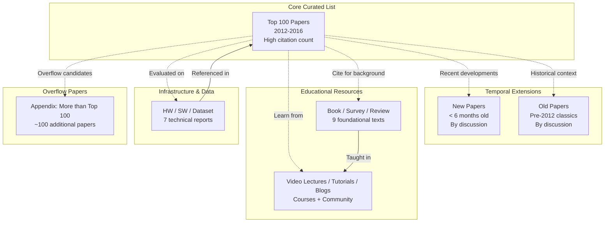
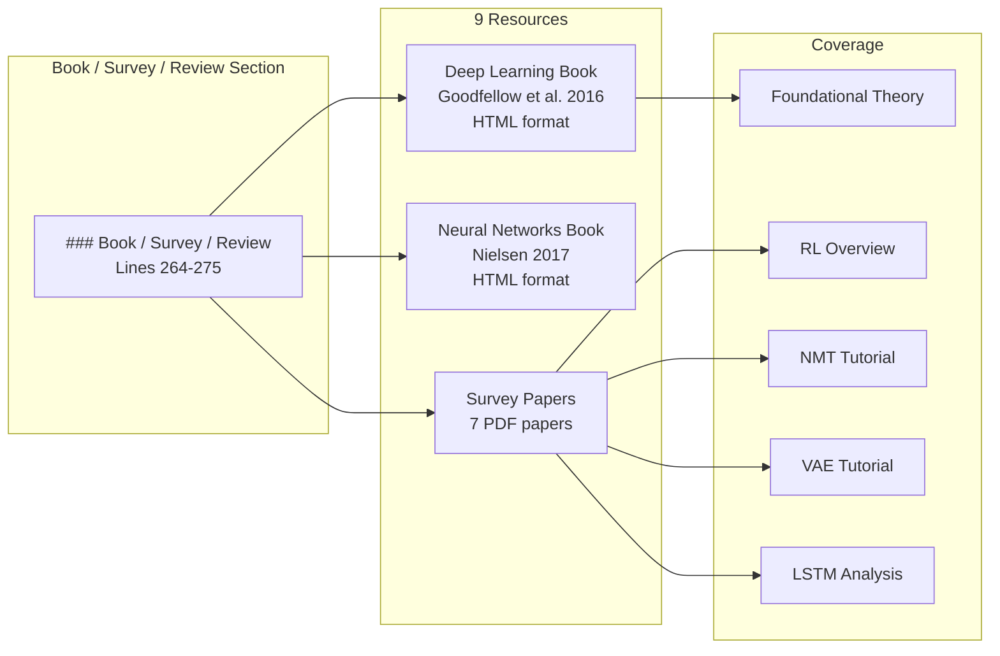
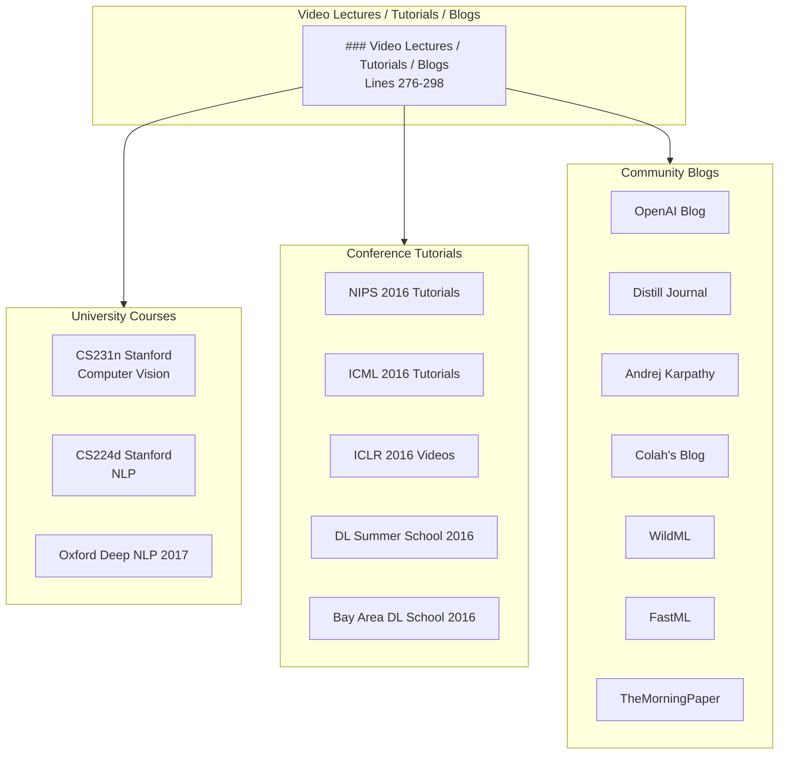
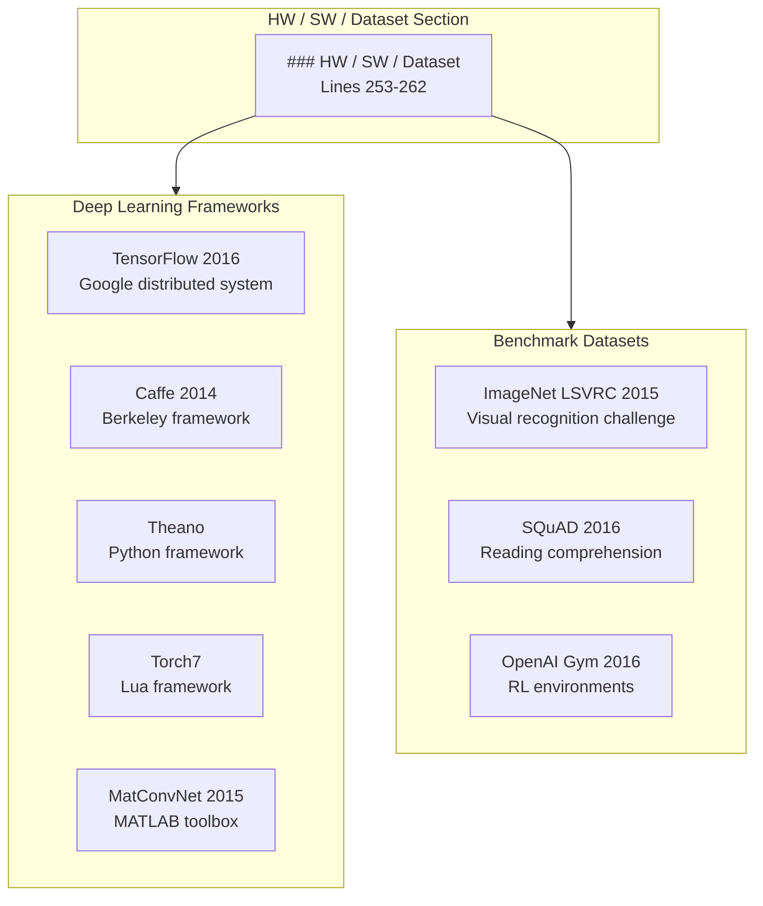
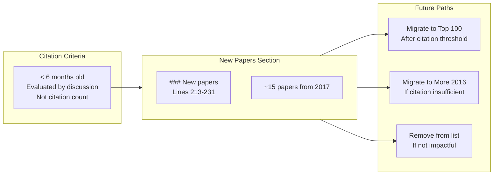
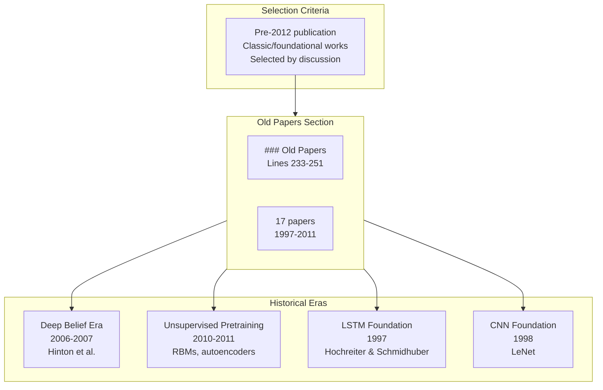
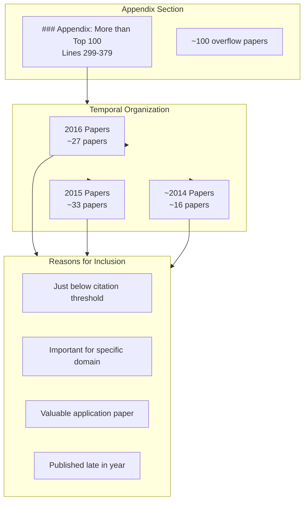
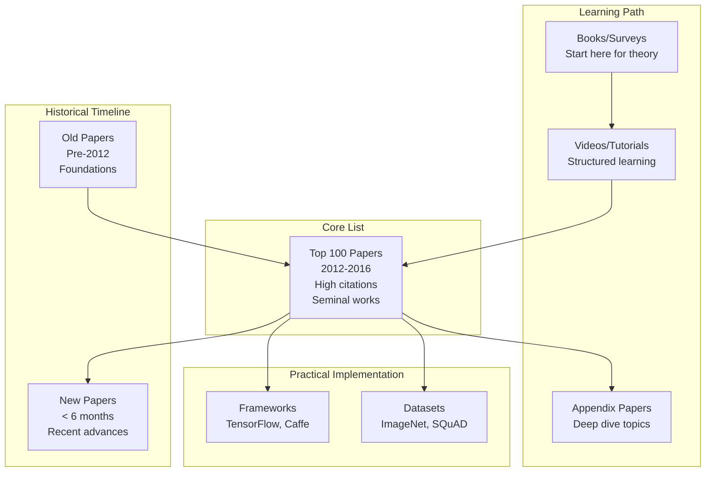

<!-- source: DeepWiki mcp.deepwiki.com · repo terryum/awesome-deep-learning-papers · page 2.3 Supplementary Resources · fetched 2026-10-30 -->

# Supplementary Resources

<details>
<summary>Relevant source files</summary>

The following files were used as context for generating this wiki page:

- [README.md](README.md)

</details>


## Purpose and Scope

This document describes the supplementary resources provided in the README.md beyond the Top 100 papers list. These sections capture foundational materials (books, tutorials, datasets), temporal overflow (new/old papers outside 2012-2016), and high-quality papers that didn't meet the Top 100 citation thresholds but remain valuable references.

For information about the Top 100 papers selection criteria, see [Paper Selection Criteria](#2.1). For information about the nine research domain categories that organize the Top 100 papers, see [Research Domain Categories](#2.2).

---

## Supplementary Resources Architecture

The supplementary sections extend the repository's value beyond the core Top 100 papers by providing contextual learning materials and temporal flexibility.



**Supplementary Resources Organization in README.md**

Sources: [README.md:60-67]()

---

## Resource Categories

### Books, Surveys, and Reviews

The `### Book / Survey / Review` section provides nine foundational texts that offer comprehensive overviews of deep learning theory and practice. These resources serve as companions to the paper list, providing structured learning paths and historical context.



**Books and Surveys in the Repository**

| Resource Type | Count | Format | Purpose |
|--------------|-------|---------|---------|
| Books | 2 | HTML | Comprehensive textbooks |
| Survey Papers | 5 | PDF | Topic-specific overviews |
| Tutorial Papers | 2 | PDF | Practical guides |

**Key Resources:**
- **Deep Learning** (Goodfellow et al., 2016): The canonical textbook, available online at deeplearningbook.org
- **Neural Networks and Deep Learning** (Nielsen, 2017): Beginner-friendly online book
- **Deep Reinforcement Learning: An Overview** (Li, 2017): Survey of RL methods
- **Neural Machine Translation Tutorial** (Neubig, 2017): Seq2seq models guide
- **Tutorial on Variational Autoencoders** (Doersch, 2016): VAE practical guide

Sources: [README.md:264-275]()

---

### Video Lectures, Tutorials, and Blogs

The `### Video Lectures / Tutorials / Blogs` section curates high-quality educational content organized into three tiers: university courses (lectures), conference tutorials, and community blogs.



**Educational Content Structure**

| Category | Count | Description | Format |
|----------|-------|-------------|---------|
| Lectures | 3 | Full semester university courses | Video + slides |
| Tutorials | 5 | Conference-length deep dives | Video recordings |
| Blogs | 7 | Ongoing community content | Web articles |

**Notable Courses:**
- **CS231n** (Stanford): Convolutional Neural Networks for Visual Recognition - the standard computer vision course
- **CS224d** (Stanford): Deep Learning for NLP - foundational sequence modeling course
- **Oxford Deep NLP 2017**: Modern NLP architectures with GitHub lecture materials

**Major Tutorial Events:**
- NIPS 2016, ICML 2016, ICLR 2016: Top-tier conference tutorial tracks
- Deep Learning Summer School 2016 (Montreal): Intensive week-long program
- Bay Area Deep Learning School 2016 (Stanford): Industry-focused bootcamp

Sources: [README.md:276-298]()

---

### Hardware, Software, and Datasets

The `### HW / SW / Dataset` section documents seven critical technical reports covering deep learning frameworks, benchmark datasets, and infrastructure papers.



**Framework and Dataset Papers**

| Resource | Year | Type | Citation Purpose |
|----------|------|------|------------------|
| TensorFlow | 2016 | Framework | Distributed training infrastructure |
| Caffe | 2014 | Framework | Fast convolutional network implementation |
| Theano | N/A | Framework | Symbolic differentiation engine |
| Torch7 | 2011 | Framework | Research prototyping environment |
| MatConvNet | 2015 | Framework | MATLAB integration |
| ImageNet LSVRC | 2015 | Dataset | Standard vision benchmark |
| SQuAD | 2016 | Dataset | Reading comprehension benchmark |
| OpenAI Gym | 2016 | Dataset | RL environment suite |

**Framework Ecosystem (2014-2016):**
- **TensorFlow**: Google's production-grade distributed system, replacing DistBelief
- **Caffe**: Berkeley's fast CNN framework, popular for computer vision
- **Theano**: Academic research tool with automatic differentiation
- **Torch7**: Lua-based framework favored by Facebook AI Research

**Benchmark Datasets:**
- **ImageNet LSVRC**: 1000-class image classification, standard CV benchmark
- **SQuAD**: 100,000+ question-answer pairs for reading comprehension
- **OpenAI Gym**: Standardized RL environment interface

Sources: [README.md:253-262]()

---

## Temporal Overflow Sections

### New Papers Section

The `### New papers` section captures recently published papers (less than 6 months old at time of curation) that show promise but lack sufficient citation history to qualify for the Top 100 list under the standard criteria.



**New Papers Characteristics:**

| Characteristic | Value | Rationale |
|----------------|-------|-----------|
| Age threshold | < 6 months | Too recent for citation metrics |
| Selection method | By discussion | Community consensus on importance |
| Typical count | ~15 papers | Manageable recent developments |
| Publication year | 2017 (at time of curation) | Post-maintenance period |

**Example Papers in New Section:**
- MobileNets (2017): Efficient mobile architectures
- Mask R-CNN (2017): Instance segmentation breakthrough
- Wasserstein GAN (2017): Improved GAN training
- Understanding Deep Learning Requires Rethinking Generalization (2017): Influential theory paper

**Selection Rationale:**
Papers enter this section based on community excitement, influential authors, breakthrough results, or significant architectural innovations before citation data matures.

Sources: [README.md:213-231](), [README.md:27]()

---

### Old Papers Section

The `### Old Papers` section preserves historically important papers published before 2012 that established deep learning foundations but predate the repository's primary focus period.



**Historical Paper Distribution:**

| Time Period | Count | Key Theme | Representative Work |
|-------------|-------|-----------|---------------------|
| 2011 | 3 | Unsupervised feature learning | Deep Sparse Rectifiers (Glorot) |
| 2010 | 5 | Pre-training techniques | Stacked Denoising Autoencoders (Vincent) |
| 2009 | 1 | Deep architectures | Learning Deep Architectures (Bengio) |
| 2006-2007 | 3 | Deep belief networks | Fast Learning Algorithm (Hinton) |
| 1997-1998 | 2 | Foundational architectures | LSTM, LeNet |

**Critical Historical Papers:**
- **LSTM** (Hochreiter & Schmidhuber, 1997): Recurrent network architecture still in use
- **LeNet** (LeCun, 1998): Gradient-based learning for document recognition
- **Fast Learning for DBNs** (Hinton, 2006): Sparked the deep learning renaissance
- **Reducing Dimensionality** (Hinton & Salakhutdinov, 2006): Demonstrated deep autoencoder effectiveness
- **Natural Language Processing Almost from Scratch** (Collobert, 2011): End-to-end NLP without hand-crafted features

Sources: [README.md:233-251](), [README.md:33]()

---

## Appendix: More than Top 100

The `### Appendix: More than Top 100` section serves as an overflow repository containing approximately 100 additional high-quality papers that either narrowly missed the Top 100 cutoff or represent important domain-specific contributions.



**Appendix Paper Categories:**

| Category | Description | Example Papers |
|----------|-------------|----------------|
| Near-miss Citations | Papers just below threshold | Character-level decoder (Chung, 2016) |
| Domain-specific Excellence | Important within subfield | Brain tumor segmentation (Havaei, 2017) |
| Application Breakthroughs | Novel applications | Dermatologist-level skin cancer (Esteva, 2017) |
| Architectural Variations | Important architectural tweaks | Densely connected networks (Huang, 2016) |
| Methodology Advances | Training/optimization improvements | Professor Forcing (Lamb, 2016) |

**Notable Appendix Papers:**

**2016 Additions:**
- Densely Connected CNNs (DenseNet): Alternative to ResNet architecture
- Adversarially Learned Inference: ALI framework for inference
- Deep Networks with Stochastic Depth: Training efficiency technique

**2015 Additions:**
- Deep Compression: Model compression techniques (Han et al.)
- Tree-structured LSTM: Hierarchical sentence modeling
- Trust Region Policy Optimization (TRPO): RL algorithm
- End-to-end Memory Networks: Neural reasoning architecture

**2014 Additions:**
- DeepPose: Human pose estimation
- Empirical Evaluation of GRUs: GRU vs LSTM comparison
- Addressing Rare Words in NMT: Unknown word handling

**Management Strategy:**
When new papers are added to the Top 100, papers from this appendix may be removed to maintain the "top 100" constraint, as stated in the contribution guidelines.

Sources: [README.md:299-379](), [README.md:22-23]()

---

## Relationship Between Supplementary Sections

The supplementary sections work together to provide complete coverage of the deep learning landscape around the Top 100 core.



**Section Interdependencies**

Sources: [README.md:47-67]()

---

## Section Formatting in README.md

All supplementary sections follow a consistent markdown structure that enables both human readability and automated parsing by scripts like `fetch_papers.py` and `get_authors.py`.

**Standard Section Format:**
```
### Section Title
- **Paper title** (year), Authors [[pdf]](url) [[web]](url)
- **Paper title** (year), Authors [[pdf]](url)
```

**Format Specifications:**

| Element | Syntax | Purpose |
|---------|--------|---------|
| Section header | `### Section Name` | Third-level markdown heading |
| Paper entry | `- **Title** (year), Authors` | Bullet list with bold title |
| PDF link | `[[pdf]](url)` | Direct PDF download link |
| Web link | `[[web]](url)` | Optional project/blog page |
| HTML link | `[[html]](url)` | Optional HTML article |

**Parsing by Automation Scripts:**
- `fetch_papers.py` uses regex pattern `### ` to identify sections [fetch_papers.py:31-33]()
- Paper titles extracted via pattern `\*\*(.+)\*\*` [fetch_papers.py:34-36]()
- PDF URLs extracted from `[[pdf]](...)` markdown links [fetch_papers.py:37-39]()

Sources: [README.md:264-379](), [fetch_papers.py:31-44]()

---

## Usage Patterns for Supplementary Sections

Different user personas interact with supplementary sections for distinct purposes:

**Learner Workflow:**
1. Start with Books/Surveys section for foundational understanding
2. Follow Video Lectures for structured courses (CS231n, CS224d)
3. Read Top 100 papers with context from books
4. Explore Appendix for deeper domain knowledge

**Researcher Workflow:**
1. Check New Papers for recent developments
2. Review Old Papers for historical context and inspiration
3. Use HW/SW/Dataset for implementation frameworks
4. Mine Appendix for related work citations

**Contributor Workflow:**
1. Monitor New Papers for promotion candidates (after 6 months + citations)
2. Propose Old Papers for historical completeness
3. Suggest Appendix additions for domain coverage
4. Update More Papers from 2016 when papers mature

**Educator Workflow:**
1. Use Books section for course textbooks
2. Link Video Lectures for student resources
3. Reference HW/SW/Dataset for practical assignments
4. Draw syllabus from Top 100 + selected Appendix papers

Sources: [README.md:7-17](), [Contributing.md]() (referenced but not provided)

---

## Summary Statistics

| Section | Count | Format | Selection Method |
|---------|-------|--------|------------------|
| Books/Surveys | 9 | PDF/HTML | Comprehensive foundational texts |
| Video Lectures | 3 | Video + Web | University courses |
| Tutorials | 5 | Video | Conference tutorial tracks |
| Blogs | 7 | Web | Community content |
| HW/SW/Dataset | 7 | PDF | Infrastructure papers |
| New Papers | ~15 | PDF | Discussion (< 6 months) |
| Old Papers | 17 | PDF | Discussion (pre-2012) |
| Appendix | ~100 | PDF | Overflow from Top 100 |

**Total Supplementary Resources:** ~163 items (excluding ~100 Appendix papers = ~63 curated non-paper resources + ~115 supplementary papers)

**Supplementary to Core Ratio:** The supplementary sections contain roughly 1.3x the number of papers as the Top 100 core list, demonstrating comprehensive coverage of the deep learning ecosystem.

Sources: [README.md:213-379]()

---

