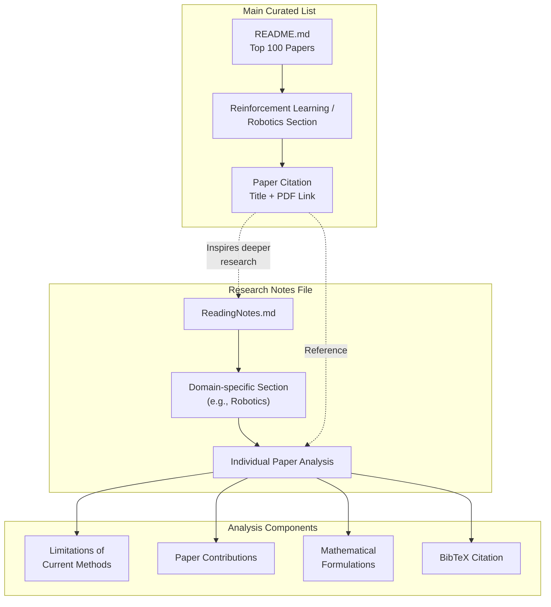
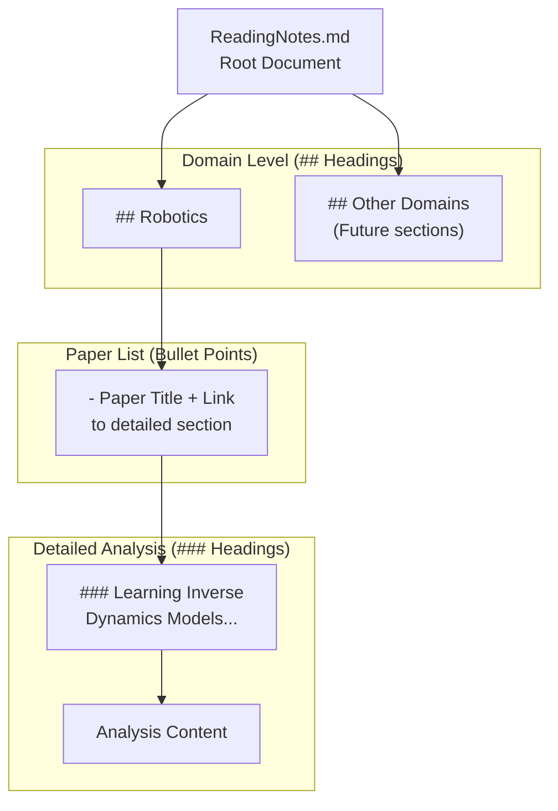
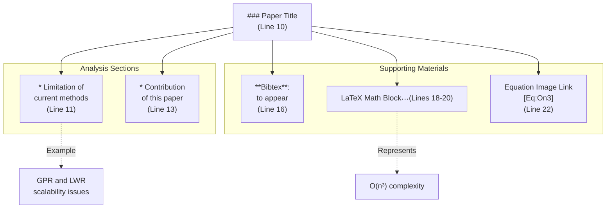
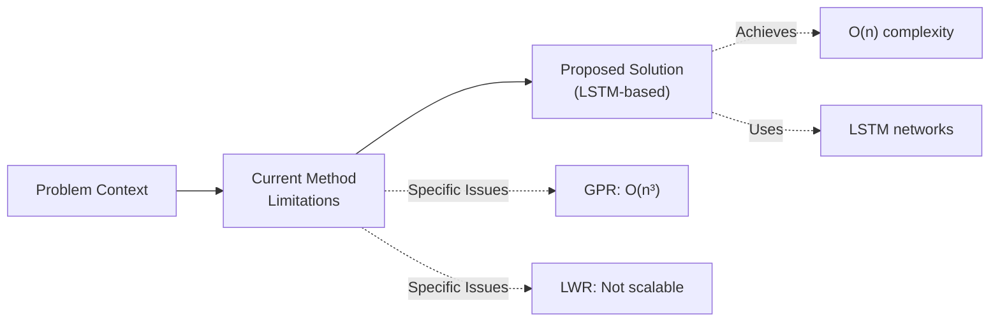
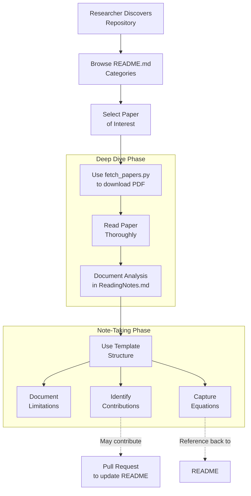
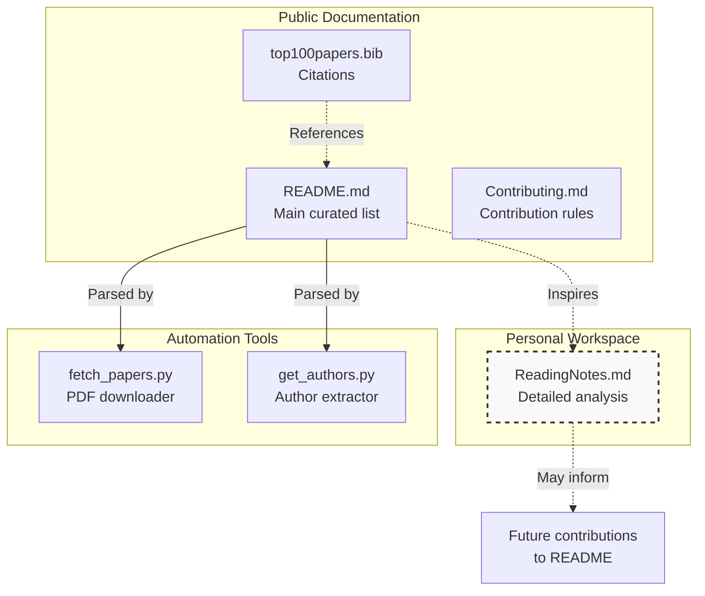

<!-- source: DeepWiki mcp.deepwiki.com · repo terryum/awesome-deep-learning-papers · page 2.4 Example: Research Notes · fetched 2026-10-30 -->

# Example: Research Notes

<details>
<summary>Relevant source files</summary>

The following files were used as context for generating this wiki page:

- [README.md](README.md)
- [ReadingNotes.md](ReadingNotes.md)

</details>


This page demonstrates how the curated paper list inspires deeper research analysis through the `ReadingNotes.md` file. This file serves as a template for detailed paper analysis, showing how researchers can document their understanding of papers beyond the brief citations in the main list. For information about the main curated list structure, see [Research Domain Categories](#2.2). For information about contributing papers to the main list, see [Contributing to the List](#3).

## Purpose and Scope

The `ReadingNotes.md` file exemplifies how the curated list can serve as a starting point for in-depth research documentation. While the main `README.md` provides high-level categorization and citations, the research notes file demonstrates a structured approach to analyzing papers in detail, including:

- Documenting limitations of existing methods
- Identifying specific contributions
- Recording mathematical formulations
- Maintaining bibliographic references
- Organizing notes by research domain

This page analyzes the structure, content format, and relationship between the curated list and detailed research notes.

Sources: [ReadingNotes.md:1-23](), [README.md:1-19]()

## Relationship Between Curated List and Research Notes

The following diagram illustrates how the curated list feeds into detailed research analysis:

**Diagram: Information Flow from Curation to Research Analysis**



Sources: [ReadingNotes.md:1-23](), [README.md:180-191]()

## File Structure and Organization

The `ReadingNotes.md` file follows a hierarchical organization pattern that mirrors the domain-based categorization of the main curated list.

### Document Hierarchy

**Diagram: ReadingNotes.md Structure**



Sources: [ReadingNotes.md:1-23]()

The file uses three levels of markdown headers:
- **Level 2 (`##`)**: Domain categories (e.g., "Robotics")
- **Level 3 (`###`)**: Individual paper titles for detailed analysis
- **Bullet points**: Table of contents linking to detailed sections

This structure is demonstrated in [ReadingNotes.md:4-5]() for the domain header and [ReadingNotes.md:10]() for the paper-specific analysis section.

## Analysis Template Structure

Each paper analysis in `ReadingNotes.md` follows a consistent template structure designed to capture key research insights.

### Standard Analysis Components

**Table: Research Note Template Fields**

| Component | Purpose | Format | Location in File |
|-----------|---------|--------|------------------|
| Paper Title | Identify the paper being analyzed | `### Full Title` | Line 10 |
| Metadata | Author, venue, date information | Inline text in bullet point | Line 5 |
| Limitations Section | Document weaknesses of prior art | `* Limitation of the current methods` | Lines 11-12 |
| Contributions Section | Identify novel contributions | `* Contribution of this paper` | Lines 13-14 |
| Mathematical Formulations | Capture key equations | LaTeX math blocks | Lines 18-20 |
| BibTeX Entry | Citation information | `**Bibtex**: ...` | Line 16 |
| External Image References | Link to equation images | Markdown image syntax | Line 22 |

Sources: [ReadingNotes.md:10-22]()

### Paper Analysis Entry Structure

**Diagram: Single Paper Analysis Components**



Sources: [ReadingNotes.md:10-22]()

## Mathematical Notation Support

The research notes file supports multiple formats for mathematical expressions, demonstrating flexibility in documenting technical content.

### LaTeX Math Support

The file demonstrates two methods for rendering mathematical equations:

1. **Display-style LaTeX blocks** using `$$...$$` delimiters:
   ```latex
   $$
   o(n^{3})
   $$
   ```
   This is shown in [ReadingNotes.md:18-20]().

2. **Inline image references** for equation rendering:
   - Define equation as image reference: `![Eq:On3]`
   - Link to external equation renderer: `[Eq:On3]: http://rogercortesi.com/eqn/tempimagedir/eqn8190.png`
   - Example in [ReadingNotes.md:12]() and [ReadingNotes.md:22]()

This dual approach allows researchers to:
- Use native LaTeX for simple equations
- Fall back to image URLs for complex rendering
- Ensure compatibility across different markdown viewers

Sources: [ReadingNotes.md:12](), [ReadingNotes.md:18-22]()

## Example: Robotics Paper Analysis

The file contains one complete example analyzing a robotics paper on inverse dynamics models.

### Paper Metadata

**Paper Details:**
- **Title**: "Learning Inverse Dynamics Models in O(n) time with LSTM networks"
- **Authors**: Elmar Rueckert, Moritz Nakatenus, Samuele Tosatto, Jan Peters
- **Venue**: Humanoid 2017
- **Read Date**: 2017/10/03

This metadata is captured in [ReadingNotes.md:5]().

### Analysis Content Structure

**Diagram: Analysis Content Flow for Robotics Paper**



Sources: [ReadingNotes.md:10-14]()

The analysis identifies:
- **Current method limitations**: GPR (Gaussian Process Regression) and LWR (Locally Weighted Regression) suffer from O(n³) complexity and scalability issues [ReadingNotes.md:12]()
- **Proposed contribution**: Using LSTM networks to achieve O(n) time complexity [ReadingNotes.md:13-14]()

Note that the contributions section is marked as incomplete (empty bullet point), indicating this is a work-in-progress analysis.

## Integration with Main Repository

The research notes file complements the main curated list by providing a private workspace for detailed analysis.

### Relationship to Repository Components

**Table: Research Notes vs. Other Repository Components**

| Component | Scope | Audience | Update Frequency | Format |
|-----------|-------|----------|------------------|--------|
| `README.md` | Curated top papers | Public, general audience | Community-driven | Brief citations |
| `ReadingNotes.md` | Detailed analysis | Personal/research group | Individual researcher | In-depth notes |
| `top100papers.bib` | Citation database | Public, academic users | Stable | BibTeX |
| `fetch_papers.py` | PDF downloads | Public, researchers | As needed | Python script |

Sources: [ReadingNotes.md:1-23](), [README.md:1-43]()

### Typical Usage Workflow

**Diagram: Researcher Workflow Using Curated List and Notes**



Sources: [ReadingNotes.md:1-23](), [README.md:37-43]()

## Template Extension Patterns

While the current file only contains one domain (Robotics), the structure supports expansion to additional research areas.

### Multi-Domain Organization Pattern

**Expected structure for multiple domains:**

```markdown
## Computer Vision
- [Paper 1](#paper-1) (Year), Authors, Venue. (Date read).
- [Paper 2](#paper-2) (Year), Authors, Venue. (Date read).

### Paper 1
* Limitation of current methods
  * ...
* Contribution of this paper
  * ...

## Natural Language Processing
- [Paper 3](#paper-3) (Year), Authors, Venue. (Date read).

### Paper 3
* Limitation of current methods
  * ...
```

This pattern aligns with the nine research categories defined in the main curated list [README.md:49-57]().

Sources: [ReadingNotes.md:1-23](), [README.md:49-67]()

## Practical Usage Recommendations

### For Individual Researchers

The `ReadingNotes.md` file serves as:

1. **Personal knowledge base**: Document understanding of papers in a structured format
2. **Research journal**: Track reading progress with dates [ReadingNotes.md:5]()
3. **Quick reference**: Organize key insights by domain [ReadingNotes.md:4]()
4. **Publication preparation**: Collect BibTeX entries for future papers [ReadingNotes.md:16]()

### For Research Groups

Teams can use this structure to:

1. **Share paper analyses**: Distribute reading responsibilities across team members
2. **Build institutional knowledge**: Create a shared understanding of research areas
3. **Track literature review**: Maintain organized notes on relevant papers
4. **Standardize documentation**: Use consistent template across all team members

Sources: [ReadingNotes.md:1-23]()

## Limitations of Current Implementation

The example in `ReadingNotes.md` demonstrates an **incomplete analysis**:

- The "Contribution of this paper" section is empty [ReadingNotes.md:14]()
- The BibTeX entry shows "to appear" placeholder [ReadingNotes.md:16]()
- Only one paper is analyzed despite the broader scope of the Robotics domain
- No papers from other research categories are included

This incompleteness actually serves as a realistic example of work-in-progress research notes, showing that the file can grow organically as researchers read more papers.

Sources: [ReadingNotes.md:13-16]()

## Comparison with Main Curated List

**Table: Content Depth Comparison**

| Aspect | README.md (Main List) | ReadingNotes.md |
|--------|----------------------|-----------------|
| Paper coverage | 100+ papers across 9 domains | 1 paper in 1 domain |
| Detail level | Title, authors, PDF link | Limitations, contributions, equations |
| Purpose | Broad curation | Deep analysis |
| Audience | General deep learning community | Individual researcher/team |
| Maintenance | Community contributions | Personal notes |
| Version control | Git-tracked, public | Git-tracked, personal |

The research notes file is **not referenced** in the main README.md, indicating it serves as a personal workspace rather than a public-facing component of the repository.

Sources: [ReadingNotes.md:1-23](), [README.md:1-390]()

## Technical Implementation Details

### File Format Specifications

The `ReadingNotes.md` file uses standard GitHub-flavored Markdown with the following extensions:

1. **Math rendering**: LaTeX blocks delimited by `$$` [ReadingNotes.md:18-20]()
2. **Link references**: Markdown reference-style links [ReadingNotes.md:22]()
3. **Internal anchors**: Auto-generated from headers for table of contents linking [ReadingNotes.md:5]()

### Equation Rendering Strategy

The file demonstrates a **hybrid equation rendering approach**:

```markdown
<!-- Display-style LaTeX -->
$$
o(n^{3})
$$

<!-- External image fallback -->
[Eq:On3]: http://rogercortesi.com/eqn/tempimagedir/eqn8190.png
```

This allows the same equation (O(n³)) to be:
- Rendered natively on platforms supporting LaTeX
- Displayed as an image on platforms without LaTeX support
- Referenced inline with `![Eq:On3]` syntax

Sources: [ReadingNotes.md:12](), [ReadingNotes.md:18-22]()

## Relationship to Other Repository Files

**Diagram: ReadingNotes.md in Repository Ecosystem**



The dashed border around `ReadingNotes.md` indicates its status as a **personal, non-essential** component that exists alongside but separate from the public-facing repository infrastructure.

Sources: [ReadingNotes.md:1-23](), [README.md:1-43]()

---

