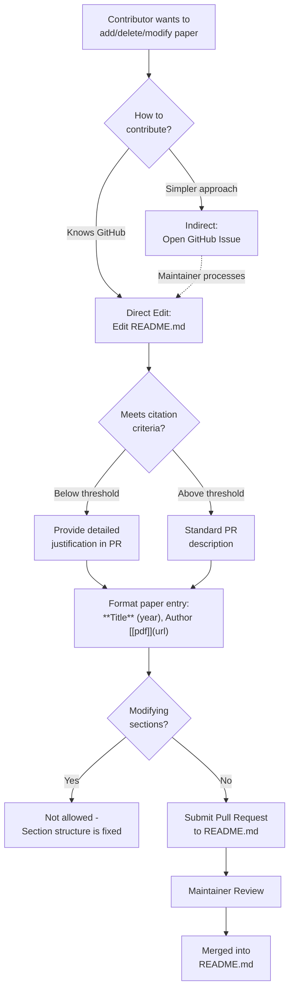
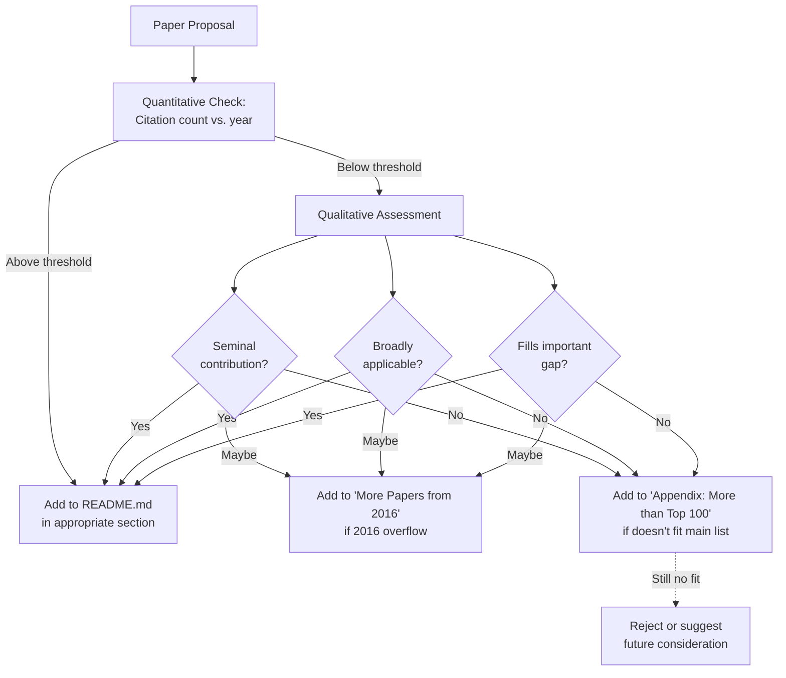
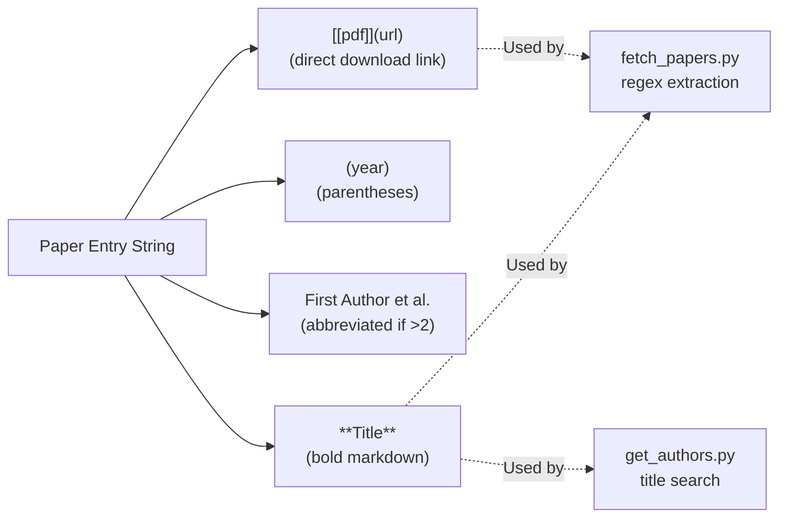
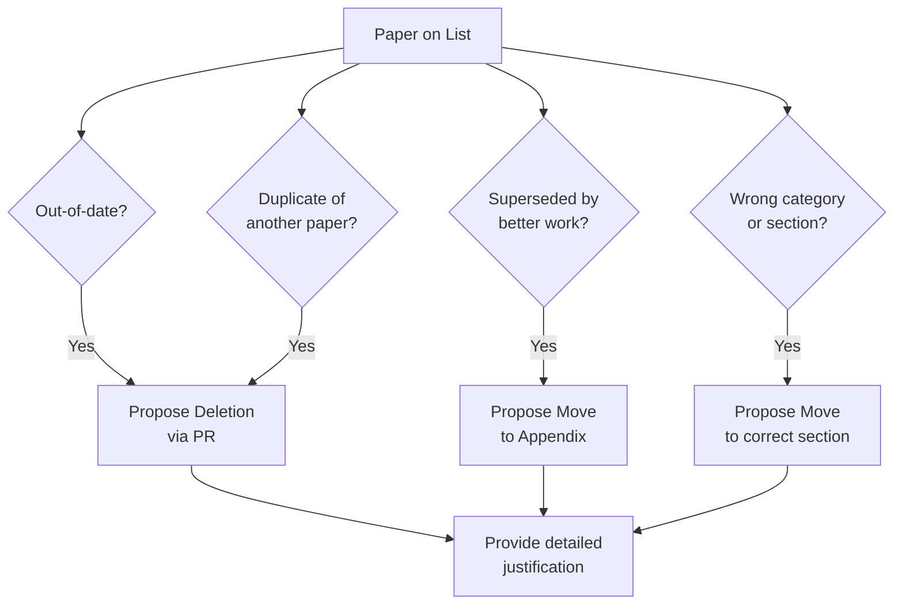

<!-- source: DeepWiki mcp.deepwiki.com · repo terryum/awesome-deep-learning-papers · page 3 Contributing to the List · fetched 2026-10-30 -->

# Contributing to the List

<details>
<summary>Relevant source files</summary>

The following files were used as context for generating this wiki page:

- [Contributing.md](Contributing.md)
- [README.md](README.md)

</details>


This document explains the process for contributing to the curated paper list, including how to add new papers, remove outdated entries, and modify existing entries. The contribution system balances quantitative citation thresholds with qualitative assessment to maintain a high-quality, tractable list of approximately 100 must-read papers.

For information about the structure and organization of the curated list itself, see [The Curated Paper List](#2). For details on the automation tools that work with this list, see [Automation Tools](#4).

## Overview of Contribution Process

The contribution process allows community members to directly edit the curated list or suggest changes through GitHub Issues. All contributions must follow the citation criteria and formatting guidelines documented in [Contributing.md]().



**Sources:** [Contributing.md:1-44](), [README.md:37-40]()

## Citation Criteria System

The curation system uses year-based citation thresholds to identify influential papers. These thresholds are **flexible guidelines** rather than strict rules, as citation counts vary significantly across research domains.

### Citation Thresholds Table

| Publication Year | Minimum Citations | ⭐ Sparkles Threshold | Notes |
|-----------------|-------------------|----------------------|-------|
| **2016** | 20+ | 50+ | Most recent; lower bar |
| **2015** | 100+ | 200+ | |
| **2014** | 200+ | 400+ | |
| **2013** | 300+ | 600+ | |
| **2012** | 400+ | 800+ | |
| **2011** | 500+ | 1000+ | Old Papers section |
| **2010** | 600+ | 1200+ | Old Papers section |
| **< 6 months** | N/A | N/A | New Papers (by discussion) |
| **~2012** | N/A | N/A | Old Papers (by discussion) |

**Sources:** [Contributing.md:7-14](), [README.md:26-33]()

### Qualitative Assessment

The citation thresholds are not strict baselines. Papers may be accepted below the threshold or rejected above it based on:

- **Impact**: Seminal contributions that changed the field
- **Applicability**: Broad applicability across research domains
- **Scarcity**: Underrepresented but important research areas
- **Preference**: Foundational methods over application-specific papers

When proposing papers below the citation threshold, contributors must provide **detailed justifications** explaining why the paper deserves inclusion despite lower citations.



**Sources:** [Contributing.md:15](), [README.md:35-36]()

## Contribution Methods

Contributors can participate through two primary channels: direct editing of [README.md]() or posting to the GitHub Issues board.

### Method 1: Direct Edit (Pull Request)

1. **Fork the repository** at `https://github.com/terryum/awesome-deep-learning-papers`
2. **Edit README.md** directly, following the formatting guidelines
3. **Submit a pull request** with clear description of changes
4. **Wait for review** from the maintainer

This method is preferred for contributors familiar with Git and GitHub workflows.

### Method 2: GitHub Issues

1. **Navigate to Issues board**: `https://github.com/terryum/awesome-deep-learning-papers/issues`
2. **Create new issue** with paper title and justification
3. **Wait for maintainer** to process and incorporate the suggestion

This method is suitable for contributors who prefer a simpler approach or just want to suggest a title.

**Sources:** [Contributing.md:3](), [README.md:39]()

## Adding Papers

### Paper Entry Format

All paper entries must follow this exact markdown syntax:

```markdown
**Title of the paper** (year), First Author et al. [[pdf]](direct_pdf_url)
```

**Example from README.md:**

```markdown
**Distilling the knowledge in a neural network** (2015), G. Hinton et al. [[pdf]](http://arxiv.org/pdf/1503.02531)
```

### Formatting Rules



**Key Rules:**
- **Title**: Enclosed in `**double asterisks**` for bold markdown
- **Year**: In parentheses immediately after title
- **Authors**: First author's name only, followed by "et al." if more than 2 authors
- **PDF Link**: Use `[[pdf]](url)` syntax with direct PDF download URL preferred
- **URL**: Direct link to PDF file rather than landing page (enables automation)

**Sources:** [Contributing.md:23-27](), [README.md:72-190]()

### Section Placement

Papers must be added to the appropriate research category section in README.md:

| Section Name | Line Range | Category |
|--------------|-----------|----------|
| `### Understanding / Generalization / Transfer` | ~71 | Foundational theory |
| `### Optimization / Training Techniques` | ~82 | Training methods |
| `### Unsupervised / Generative Models` | ~93 | GANs, VAEs, etc. |
| `### Convolutional Neural Network Models` | ~103 | CNN architectures |
| `### Image: Segmentation / Object Detection` | ~119 | Vision detection |
| `### Image / Video / Etc` | ~131 | Vision applications |
| `### Natural Language Processing / RNNs` | ~148 | NLP & sequences |
| `### Speech / Other Domain` | ~170 | Audio & other |
| `### Reinforcement Learning / Robotics` | ~180 | RL & control |
| `### More Papers from 2016` | ~193 | 2016 overflow |
| `### New Papers` | ~213 | < 6 months |
| `### Old Papers` | ~233 | Pre-2012 |
| `### Appendix: More than Top 100` | ~299 | Supplementary |

**Sources:** [README.md:49-67]()

### Top 100 Constraint

The main list maintains approximately **100 papers** in the core sections (Understanding through Reinforcement Learning). When adding a paper to these sections:

1. **Remove one paper** from "More Papers from 2016" or downgrade it to Appendix
2. **Provide justification** for why the new paper is more valuable
3. **Maintain balance** across research categories

This constraint ensures the list remains tractable and focused on the most influential papers.

**Sources:** [README.md:21-23]()

## Deleting Papers

Deletion is an important contribution that helps maintain list quality and tractability. Papers may be removed when:

### Valid Deletion Criteria



- **Out-of-date**: Methods rendered obsolete by newer research
- **Duplication**: Multiple entries for the same or very similar papers
- **Superseded**: Earlier versions replaced by improved versions (e.g., R-CNN → Faster R-CNN)
- **Category mismatch**: Paper doesn't fit the section it's in

### Deletion Process

1. **Identify candidate** for removal with clear reasoning
2. **Submit pull request** removing the entry from README.md
3. **Explain justification** in PR description
4. **Optionally suggest** moving to Appendix instead of complete removal

**Sources:** [Contributing.md:29-30]()

## Modifying Entries

Modifications update existing paper entries without adding or removing papers from the list. Common modification types include:

### Adding Sparkles (⭐)

Sparkles indicate papers that significantly exceed the citation threshold for their publication year. Add sparkles when:

```markdown
<!-- Before -->
**Dropout: A simple way to prevent neural networks from overfitting** (2014), N. Srivastava et al. [[pdf]](http://jmlr.org/papers/volume15/srivastava14a/srivastava14a.pdf)

<!-- After (if citations exceed sparkle threshold) -->
**Dropout: A simple way to prevent neural networks from overfitting** :sparkles: (2014), N. Srivastava et al. [[pdf]](http://jmlr.org/papers/volume15/srivastava14a/srivastava14a.pdf)
```

The `:sparkles:` emoji is added between the title and the year when citation count exceeds the sparkle threshold (see citation table above).

**Sources:** [Contributing.md:34]()

### Adding Key Researchers

The README.md includes commented-out sections listing key researchers for each category:

```markdown
<!---[Key researchers]  [Geoffrey Hinton](scholar_url), [Yoshua Bengio](scholar_url)-->
```

These HTML comments appear after each major section. Modifications can:
- Add influential researchers to existing comments
- Update Google Scholar URLs
- Ensure proper HTML comment syntax

**Sources:** [Contributing.md:35](), [README.md:80,91,102]()

### Moving Papers Between Sections

Papers can be moved between sections if they better fit a different category:

1. **Identify misplacement**: Paper is in wrong topical section
2. **Move entry**: Cut from current section, paste in appropriate section
3. **Maintain alphabetical/chronological order**: If section uses ordering
4. **Update pull request**: Explain reasoning for the move

**Sources:** [Contributing.md:36]()

### Correcting Errors

Simple corrections are always welcome:

- **Typos** in paper titles or author names
- **Grammatical errors** in section headers
- **Broken links** to PDF files
- **Formatting inconsistencies** in markdown syntax

These require minimal justification in the pull request.

**Sources:** [Contributing.md:37]()

## Modification Restrictions

### Section Structure is Fixed

Contributors are **not allowed** to add, remove, or rename the main section headers in README.md. The nine core research categories and supplementary sections form a stable organizational structure:

```mermaid
graph TD
    README["README.md Structure"]
    
    FIXED["Fixed Sections<br/>(Cannot Modify)"]
    ALLOWED["Allowed Modifications<br/>(Can Change)"]
    
    README --> FIXED
    README --> ALLOWED
    
    FIXED --> SEC1["### Understanding /<br/>Generalization / Transfer"]
    FIXED --> SEC2["### Optimization /<br/>Training Techniques"]
    FIXED --> SEC3["### Unsupervised /<br/>Generative Models"]
    FIXED --> SEC4["### Convolutional Neural<br/>Network Models"]
    FIXED --> SEC5["### Image: Segmentation /<br/>Object Detection"]
    FIXED --> SEC6["### Image / Video / Etc"]
    FIXED --> SEC7["### Natural Language<br/>Processing / RNNs"]
    FIXED --> SEC8["### Speech / Other Domain"]
    FIXED --> SEC9["### Reinforcement Learning /<br/>Robotics"]
    FIXED --> SECMORE["### More Papers from 2016"]
    FIXED --> SECNEW["### New Papers"]
    FIXED --> SECOLD["### Old Papers"]
    FIXED --> SECSUP["### HW / SW / Dataset"]
    FIXED --> SECBOOK["### Book / Survey / Review"]
    FIXED --> SECVID["### Video Lectures /<br/>Tutorials / Blogs"]
    FIXED --> SECAPP["### Appendix: More<br/>than Top 100"]
    
    ALLOWED --> PAPERS["Paper entries<br/>(add/delete/modify)"]
    ALLOWED --> RESEARCHERS["Key researchers<br/>(in HTML comments)"]
    ALLOWED --> SPARKLES["Sparkle markers<br/>(:sparkles:)"]
    ALLOWED --> TYPOS["Typo corrections"]
```



This restriction ensures:
- **Consistency** for automation scripts that parse section headers
- **Stability** for users familiar with the structure
- **Focus** on paper curation rather than reorganization

**Sources:** [Contributing.md:39]()

### Why Sections Are Protected

The automation scripts [fetch_papers.py]() and [get_authors.py]() use regex patterns to extract section headers:

```python
# fetch_papers.py parses section names like:
### Understanding / Generalization / Transfer
### Optimization / Training Techniques
```

Changing section names would break these automation tools and require coordinated updates to multiple files. The restriction maintains system integrity.

**Sources:** [fetch_papers.py](), [get_authors.py]()

## Integration with Automation Tools

The strict formatting requirements exist because the curated list serves as both human-readable documentation and machine-readable data. The automation scripts depend on consistent formatting:

| Script | Extracted Data | Required Format |
|--------|---------------|-----------------|
| `fetch_papers.py` | Section headers | `### Section Name` |
| `fetch_papers.py` | Paper titles | `**Title**` (bold) |
| `fetch_papers.py` | PDF URLs | `[[pdf]](url)` |
| `get_authors.py` | Paper titles | `**Title**` (bold) |

For detailed information on how these scripts use the markdown formatting, see [PDF Download Script](#4.1) and [Author Extraction Script](#4.2).

**Sources:** [README.md:42](), [fetch_papers.py](), [get_authors.py]()

## Example Contribution Workflow

Here's a complete example of adding a new paper:

### Step 1: Check Citation Count
```
Paper: "Attention Is All You Need" (2017)
Citations: 15,000+ (as of contribution date)
Qualifies for: New Papers section (< 6 months at time)
Later: Main list (far exceeds all thresholds)
```

### Step 2: Format Entry
```markdown
**Attention is all you need** (2017), A. Vaswani et al. [[pdf]](https://arxiv.org/pdf/1706.03762)
```

### Step 3: Choose Section
```
Best fit: "Natural Language Processing / RNNs"
Reason: Transformer architecture for sequence modeling
```

### Step 4: Create Pull Request
```
Title: Add "Attention Is All You Need" to NLP section
Description: 
- Transformer architecture paper with 15k+ citations
- Foundational work that replaced RNN-based approaches
- Broadly applicable beyond NLP
- Removing [specific paper] from "More Papers 2016" to maintain top 100 count
```

### Step 5: Wait for Review
The maintainer will review based on:
- Citation criteria compliance
- Format correctness
- Appropriate section placement
- Justification quality

**Sources:** [Contributing.md:1-44](), [README.md:37-40]()

---

