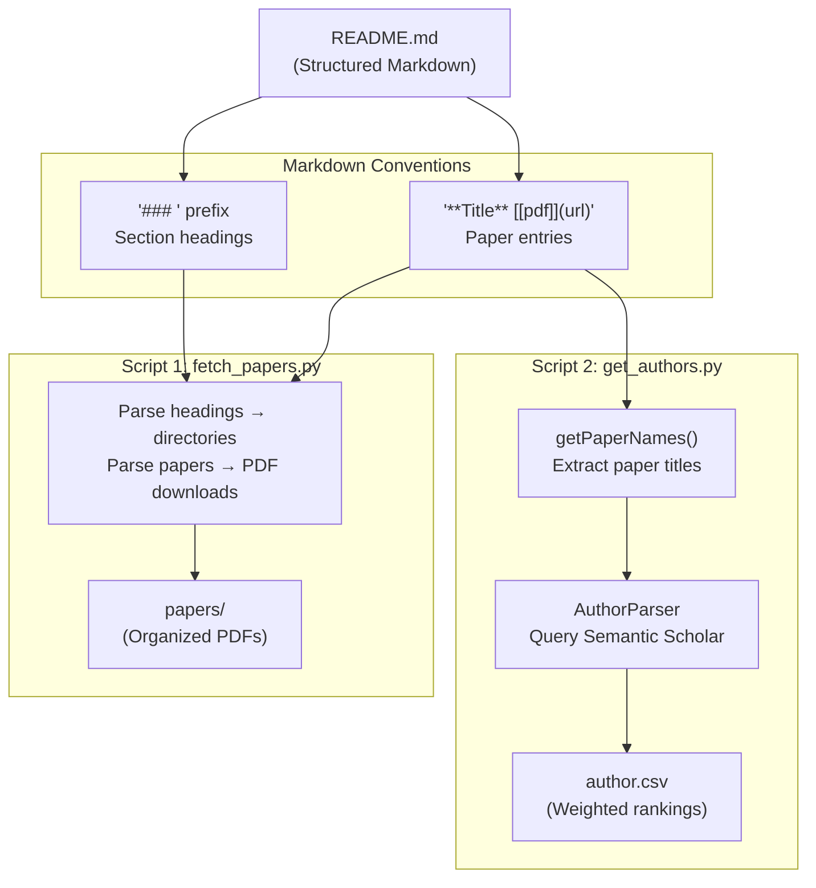
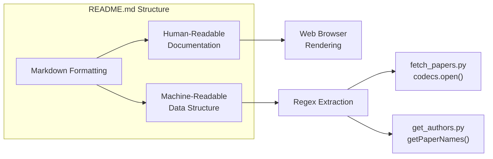
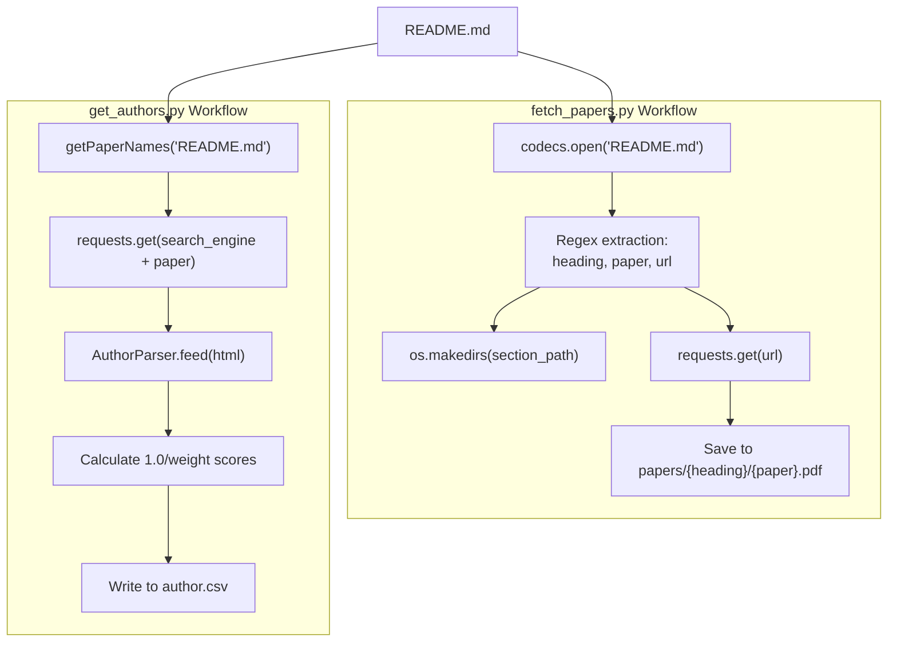
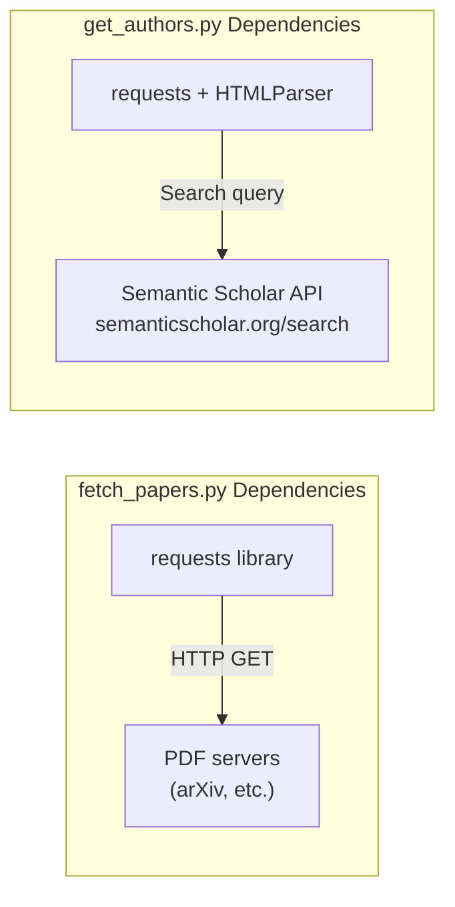

<!-- source: DeepWiki mcp.deepwiki.com · repo terryum/awesome-deep-learning-papers · page 4 Automation Tools · fetched 2026-10-30 -->

# Automation Tools

<details>
<summary>Relevant source files</summary>

The following files were used as context for generating this wiki page:

- [README.md](README.md)
- [fetch_papers.py](fetch_papers.py)
- [get_authors.py](get_authors.py)

</details>


## Purpose and Scope

This document describes the Python automation scripts that enable bulk operations on the curated paper list. Both scripts leverage the structured markdown formatting of [README.md:1-390]() as a machine-readable data source. The automation layer parses section headings and paper entries to perform two distinct tasks: bulk PDF downloads and author analytics.

For details on the curated list structure being parsed, see [The Curated Paper List](#2). For repository setup and the `.gitignore` configuration that excludes downloaded PDFs, see [Repository Setup and Configuration](#6).

## Architecture Overview

The automation tools implement a **markdown-as-database** pattern where [README.md:1-390]() serves dual purposes: human-readable documentation and structured data source. Both scripts parse the same markdown file using regular expressions to extract different information for their respective use cases.

### Markdown Parsing Strategy



**Common Markdown Pattern Recognition**

| Markdown Pattern | Regex | Extracted Data | Used By |
|-----------------|-------|----------------|---------|
| `### Section Name` | `'###' in line` | Section headings | `fetch_papers.py` |
| `**Title** [[pdf]](url)` | `\*\*(.*?)\*\*.*?\[\[pdf\]\]\((.*?)\)` | Title and URL | Both scripts |

Sources: [fetch_papers.py:13-39](), [get_authors.py:60-78]()

### Dual-Purpose Data Model



Sources: [fetch_papers.py:13-14](), [get_authors.py:62]()

## Script Inventory

The repository provides two automation scripts located in the root directory:

| Script | Importance | Primary Function | Input | Output | Lines of Code |
|--------|-----------|------------------|-------|--------|---------------|
| `fetch_papers.py` | 8.92 | PDF bulk downloader | README.md | papers/ directory | 40 |
| `get_authors.py` | 1.44 | Author analytics | README.md | author.csv | 109 |

### Data Flow Architecture



Sources: [fetch_papers.py:1-40](), [get_authors.py:1-109]()

## Common Code Patterns

Both scripts share several implementation patterns for working with the markdown data source:

### File Reading with UTF-8 Encoding

Both scripts use `codecs.open` with UTF-8 encoding to handle international characters in paper titles:

```python
# Pattern used in both scripts
with codecs.open('README.md', encoding='utf-8', mode='r', buffering=1, errors='strict') as f:
    lines = f.read().split('\n')
```

Sources: [fetch_papers.py:13-14](), [get_authors.py:62]()

### Section Heading Detection

```python
# fetch_papers.py approach
if('###' in line):
    heading = line.strip().split('###')[1]
```

Sources: [fetch_papers.py:17-18]()

### Paper Entry Extraction

Both scripts use the same regex pattern to identify paper entries marked with `**Title** [[pdf]](url)`:

```python
# Common regex pattern
result = re.search('\*\*(.*?)\*\*.*?\[\[pdf\]\]\((.*?)\)', line)
if(result):
    paper, url = result.groups()
```

The double-asterisk `**` formatting serves as a filter—only papers marked as important (bold in markdown) are processed. This effectively limits extraction to the "Top 100" papers section.

Sources: [fetch_papers.py:27-29](), [get_authors.py:73-75]()

### Windows Path Compatibility

`fetch_papers.py` includes special handling for Windows filesystem restrictions:

```python
# Remove characters invalid in Windows filenames
win_restricted_chars = re.compile(r'[\^\/\\\:\*\?\"<>\|]')
heading = win_restricted_chars.sub("", heading)
paper = win_restricted_chars.sub("", paper)
```

Sources: [fetch_papers.py:19-20](), [fetch_papers.py:30]()

## Integration Points

### External Services



Sources: [fetch_papers.py:6](), [fetch_papers.py:35](), [get_authors.py:9-10](), [get_authors.py:86]()

### Output Artifacts

| Artifact | Generator | Tracked in Git | Purpose |
|----------|-----------|----------------|---------|
| `papers/` directory | `fetch_papers.py` | No (in .gitignore) | Local PDF cache |
| `papers/{section}/` | `fetch_papers.py` | No | Organized by research category |
| `author.csv` | `get_authors.py` | No (likely) | Author influence rankings |

The `papers/` directory structure mirrors the section organization in README.md, with subdirectories created for each `###` heading.

Sources: [fetch_papers.py:8-10](), [fetch_papers.py:21-23](), [get_authors.py:99-105]()

## Detailed Documentation

For detailed information about each automation script:

- **[PDF Download Script (fetch_papers.py)](#4.1)** - Directory organization, auto-resume functionality, HTTP error handling
- **[Author Extraction Script (get_authors.py)](#4.2)** - HTML parsing, Semantic Scholar integration, position-weighted scoring algorithm

Sources: [README.md:42]()

---

