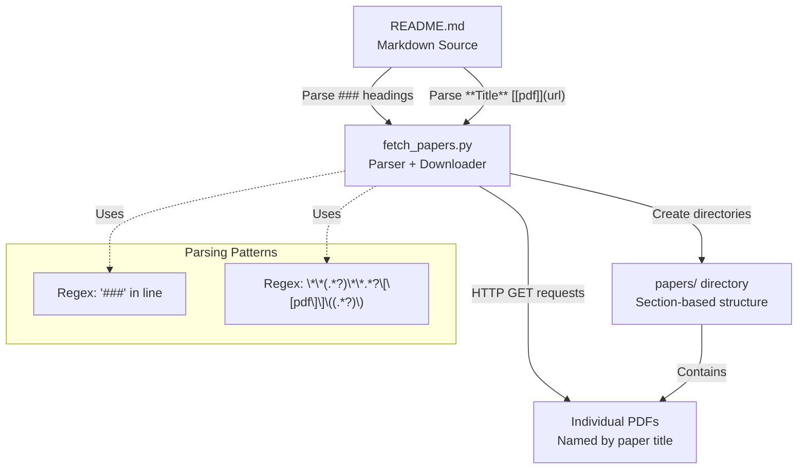
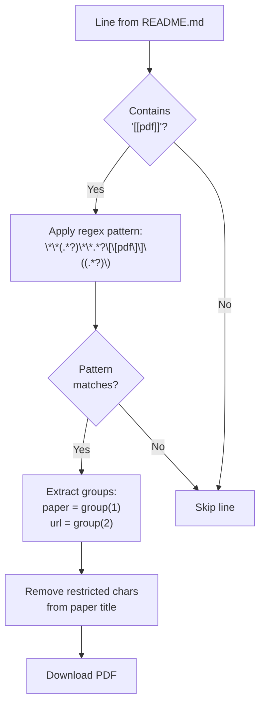
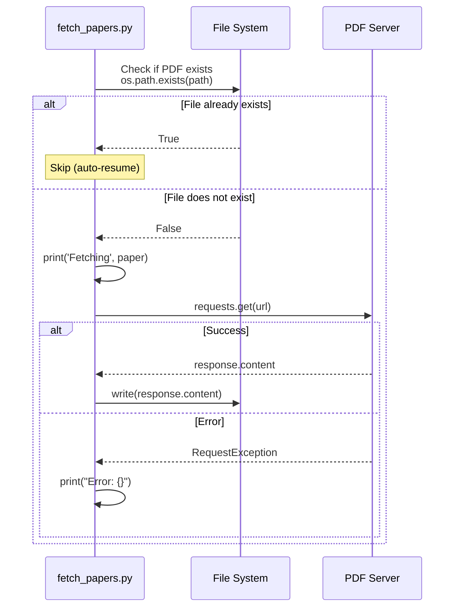
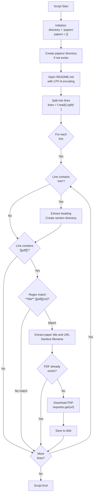

<!-- source: DeepWiki mcp.deepwiki.com · repo terryum/awesome-deep-learning-papers · page 4.1 PDF Download Script (fetch_papers.py) · fetched 2026-10-30 -->

# PDF Download Script (fetch_papers.py)

<details>
<summary>Relevant source files</summary>

The following files were used as context for generating this wiki page:

- [README.md](README.md)
- [fetch_papers.py](fetch_papers.py)

</details>


## Purpose and Scope

This document describes the `fetch_papers.py` automation script, which downloads PDF files for papers listed in the curated README.md collection. The script parses markdown-formatted paper entries, extracts PDF URLs, and organizes downloads into a directory structure mirroring the README.md category sections.

For information about the curated list structure that this script parses, see [The Curated Paper List](#2). For information about the companion author extraction script, see [Author Extraction Script (get_authors.py)](#4.2). For information about the .gitignore configuration that excludes downloaded papers from version control, see [Repository Setup and Configuration](#6).

Sources: [fetch_papers.py:1-40](), [README.md:42]()

## Overview

The `fetch_papers.py` script serves as a batch downloader that transforms the README.md curated list into a local collection of PDF files. It demonstrates a dual-use design pattern where structured markdown formatting serves both human-readable documentation and machine-parsable data.



**Diagram 1: Script Architecture and Data Flow**

Sources: [fetch_papers.py:1-40](), [README.md:1-390]()

## Key Features

| Feature | Implementation | Line Reference |
|---------|---------------|----------------|
| **Section-based organization** | Creates subdirectories matching README.md headings | [fetch_papers.py:16-23]() |
| **Auto-resume capability** | Checks for existing PDFs before downloading | [fetch_papers.py:32]() |
| **Windows compatibility** | Removes filesystem-restricted characters | [fetch_papers.py:19-20]() |
| **Top 100 filtering** | Only downloads papers with bold `**title**` formatting | [fetch_papers.py:25-27]() |
| **Error handling** | Catches and reports HTTP request exceptions | [fetch_papers.py:38-39]() |

Sources: [fetch_papers.py:1-40]()

## Input Source: README.md Structure

The script parses README.md using two primary structural patterns:

### Section Heading Detection

```mermaid
graph LR
    LINE["Line from README.md"]
    CHECK{"Contains<br/>'###'?"}
    EXTRACT["Extract heading text<br/>heading = line.strip().split('###')[1]"]
    SANITIZE["Remove Windows-restricted chars<br/>[\^\/\\\:\*\?\"<>\|]"]
    CREATE["Create directory<br/>os.path.join(directory, heading)"]
    
    LINE --> CHECK
    CHECK -->|"Yes"| EXTRACT
    CHECK -->|"No"| SKIP["Skip line"]
    EXTRACT --> SANITIZE
    SANITIZE --> CREATE
```

**Diagram 2: Section Heading Parser Flow**

The script identifies section headings by searching for lines containing `###`. For example, from README.md:

- Line 71: `### Understanding / Generalization / Transfer` → Directory: `papers/Understanding  Generalization  Transfer`
- Line 82: `### Optimization / Training Techniques` → Directory: `papers/Optimization  Training Techniques`

Sources: [fetch_papers.py:16-23](), [README.md:71-180]()

### Paper Entry Detection



**Diagram 3: Paper Entry Parser Flow**

The regex pattern `\*\*(.*?)\*\*.*?\[\[pdf\]\]\((.*?)\)` matches markdown entries like:

```markdown
- **Distilling the knowledge in a neural network** (2015), G. Hinton et al. [[pdf]](http://arxiv.org/pdf/1503.02531)
```

This extracts:
- `group(1)`: `"Distilling the knowledge in a neural network"`
- `group(2)`: `"http://arxiv.org/pdf/1503.02531"`

**Important**: The pattern requires the double asterisks `**title**` surrounding the paper title. This filters for "top 100" papers as noted in the comment at [fetch_papers.py:25-26](). Papers without bold formatting (e.g., in the "More Papers from 2016" section) are not downloaded.

Sources: [fetch_papers.py:24-30](), [README.md:72-189]()

## Code Entity Mapping

```mermaid
graph TB
    subgraph "Global Variables"
        DIRECTORY["directory = 'papers'"]
        PAPERS["papers = []<br/>(unused list)"]
    end
    
    subgraph "Main Loop Variables"
        LINES["lines = f.read().split('\n')"]
        HEADING["heading = ''"]
        SECTION_PATH["section_path = ''"]
    end
    
    subgraph "Regex Patterns"
        WIN_RESTRICT["win_restricted_chars<br/>r'[\^\/\\\:\*\?\"<>\|]'"]
        PAPER_PATTERN["re.search pattern<br/>\*\*(.*?)\*\*.*?\[\[pdf\]\]\((.*?)\)"]
    end
    
    subgraph "File Operations"
        OS_MAKEDIRS["os.makedirs(section_path)"]
        REQUESTS_GET["requests.get(url)"]
        FILE_WRITE["f.write(response.content)"]
    end
    
    DIRECTORY --> OS_MAKEDIRS
    WIN_RESTRICT --> HEADING
    WIN_RESTRICT --> PAPER_PATTERN
    PAPER_PATTERN --> REQUESTS_GET
    REQUESTS_GET --> FILE_WRITE
```

**Diagram 4: Code Entity Relationships**

Sources: [fetch_papers.py:8-40]()

## Directory Structure Output

The script creates a hierarchical directory structure under `papers/`:

```
papers/
├── Understanding  Generalization  Transfer/
│   ├── Distilling the knowledge in a neural network.pdf
│   ├── Deep neural networks are easily fooled High confidence predictions for unrecognizable images.pdf
│   └── ...
├── Optimization  Training Techniques/
│   ├── Training very deep networks.pdf
│   ├── Batch normalization Accelerating deep network training by reducing internal covariate shift.pdf
│   └── ...
├── Unsupervised  Generative Models/
│   └── ...
├── Convolutional Neural Network Models/
│   └── ...
└── ...
```

**Note on Character Sanitization**: The regex at [fetch_papers.py:19]() removes characters `^ / \ : * ? " < > |` that are restricted in Windows filenames. This ensures cross-platform compatibility. For example:

- Input: `"R-CNN: Towards Real-Time Object Detection"`
- Output: `"R-CNN Towards Real-Time Object Detection.pdf"`

Sources: [fetch_papers.py:18-23](), [fetch_papers.py:30]()

## Download Process Implementation

### HTTP Request Flow



**Diagram 5: Download Process with Auto-Resume**

Sources: [fetch_papers.py:32-39]()

### Step-by-Step Process

1. **Existence Check** [fetch_papers.py:32]()
   ```python
   if(not os.path.exists(os.path.join(section_path, paper + '.pdf'))):
   ```
   Implements auto-resume by skipping already-downloaded files.

2. **Console Feedback** [fetch_papers.py:33]()
   ```python
   print('Fetching', paper)
   ```
   Provides user visibility into download progress.

3. **HTTP Request** [fetch_papers.py:35]()
   ```python
   response = requests.get(url)
   ```
   Fetches PDF content via GET request to the URL extracted from README.md.

4. **File Write** [fetch_papers.py:36-37]()
   ```python
   with open(os.path.join(section_path, paper + '.pdf'), 'wb') as f:
       f.write(response.content)
   ```
   Writes binary PDF data to disk with `.pdf` extension.

5. **Exception Handling** [fetch_papers.py:38-39]()
   ```python
   except requests.exceptions.RequestException as e:
       print("Error: {}".format(e))
   ```
   Catches network errors, HTTP errors, and timeouts without crashing the script.

Sources: [fetch_papers.py:32-39]()

## File Encoding and Parsing

The script uses explicit UTF-8 encoding when reading README.md:

```python
with codecs.open('README.md', encoding='utf-8', mode='r', buffering=1, errors='strict') as f:
```

This configuration at [fetch_papers.py:13]() ensures:
- **encoding='utf-8'**: Handles Unicode characters in paper titles (e.g., special diacritics in author names)
- **mode='r'**: Read-only access
- **buffering=1**: Line-buffered reading
- **errors='strict'**: Raises exceptions on encoding errors rather than substituting

Sources: [fetch_papers.py:13-14]()

## Complete Execution Flow



**Diagram 6: Complete Script Execution Flow**

Sources: [fetch_papers.py:1-40]()

## Usage

### Basic Execution

```bash
python3 fetch_papers.py
```

The script requires:
- Python 3.x
- `requests` library (`pip install requests`)
- `README.md` in the current directory

### Expected Output

```
Fetching Distilling the knowledge in a neural network
Fetching Deep neural networks are easily fooled High confidence predictions for unrecognizable images
Fetching How transferable are features in deep neural networks?
...
Error: HTTPSConnectionPool(host='arxiv.org', port=443): Read timed out.
Fetching Training very deep networks
...
```

The script prints each paper title as it downloads and reports any errors encountered.

Sources: [fetch_papers.py:33](), [fetch_papers.py:39]()

## Integration with Repository Workflow

The script is designed to be run by end users who want a local copy of all papers:

| Aspect | Design Decision |
|--------|-----------------|
| **Input dependency** | Reads README.md, the canonical curated list (see [The Curated Paper List](#2)) |
| **Output location** | `papers/` directory, excluded from git via .gitignore (see [Repository Setup and Configuration](#6)) |
| **User action** | Explicitly run by users; not part of automated CI/CD |
| **Portability** | Cross-platform (Windows, macOS, Linux) via character sanitization |

As noted in [README.md:42](), the script is offered as a utility for users to "download all top-100 papers," complementing the reference-based curation approach of the repository.

Sources: [README.md:42](), [.gitignore](), [fetch_papers.py:8-10]()

## Limitations and Considerations

### Filtering Behavior

The regex pattern at [fetch_papers.py:27]() specifically matches `**title**` (bold formatting). This means:

- ✅ **Downloads**: Papers in the "Top 100" sections with bold titles
- ❌ **Skips**: Papers in "More Papers from 2016", "New Papers", "Old Papers", and "Appendix" sections that may not use bold formatting consistently

The comment at [fetch_papers.py:25-26]() explicitly states this design:
```
# The stars ensure you pick up only the top 100 papers
# Modify the expression if you want to fetch all other papers as well
```

### Error Recovery

The script continues execution after individual download failures [fetch_papers.py:38-39](), allowing partial completion if some URLs are broken or servers are unavailable. Users can re-run the script to retry failed downloads due to the auto-resume feature.

### Unused Variable

The `papers = []` list initialized at [fetch_papers.py:12]() is never populated or used. This appears to be legacy code that can be safely removed without affecting functionality.

Sources: [fetch_papers.py:12](), [fetch_papers.py:25-27](), [fetch_papers.py:38-39]()

---

