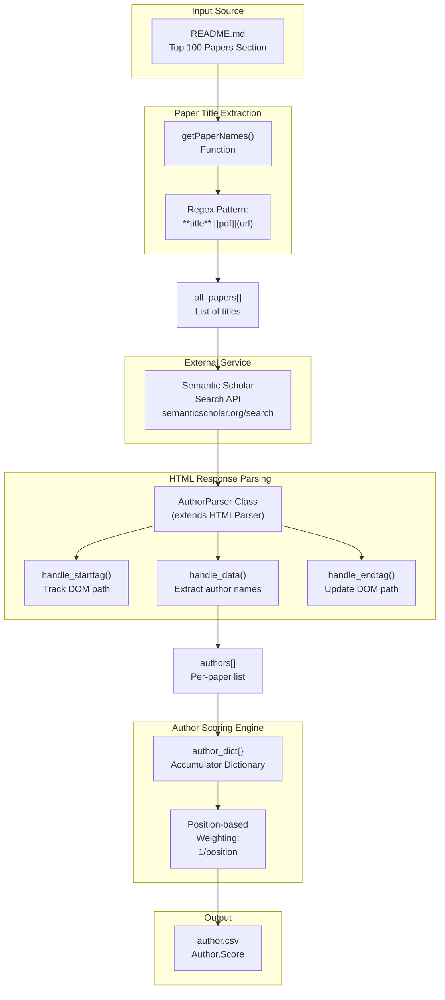
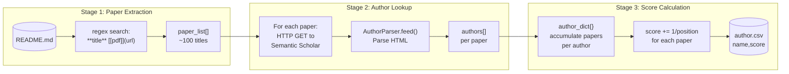
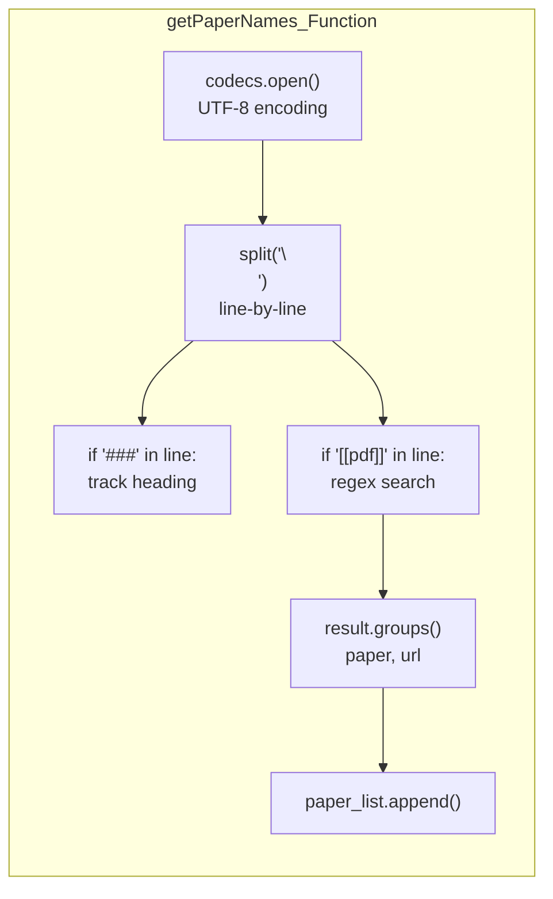
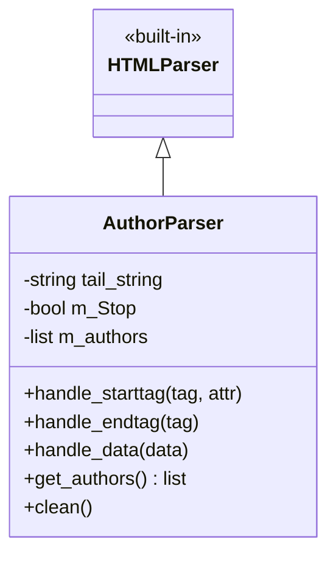
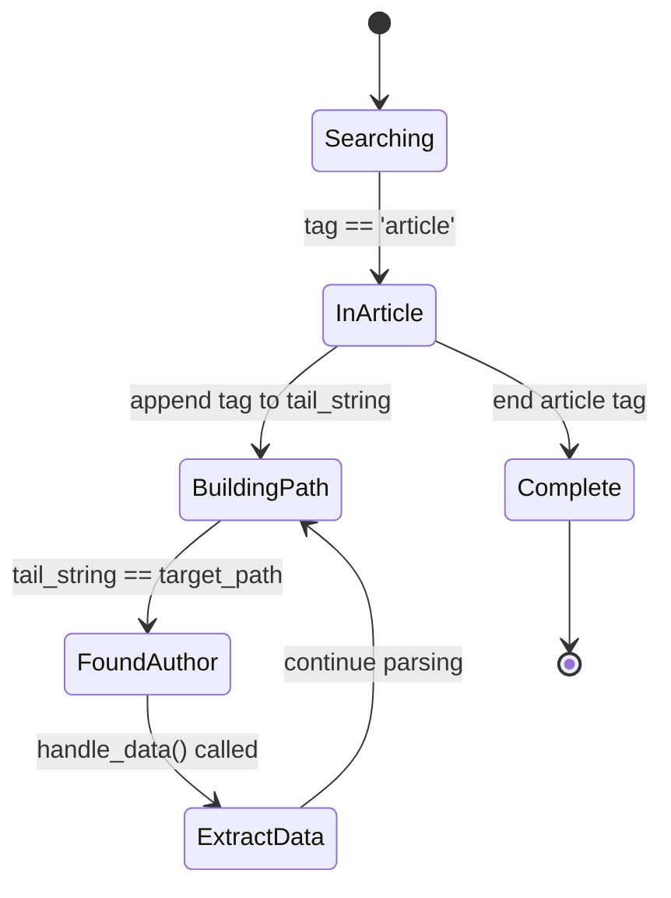
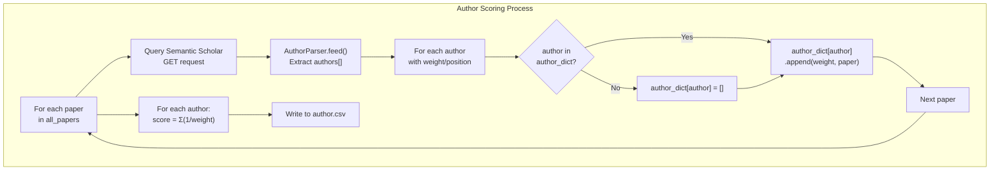
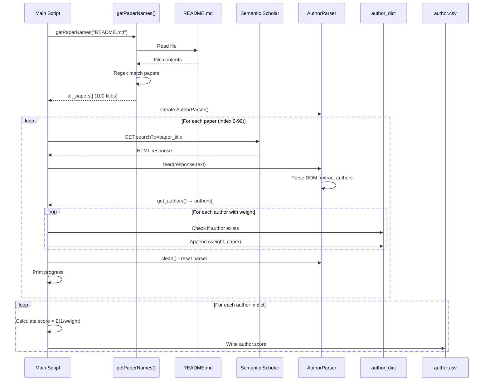
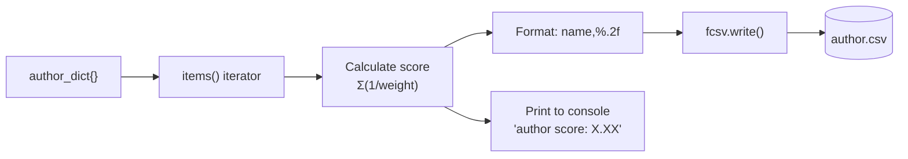
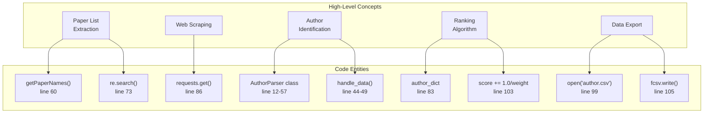
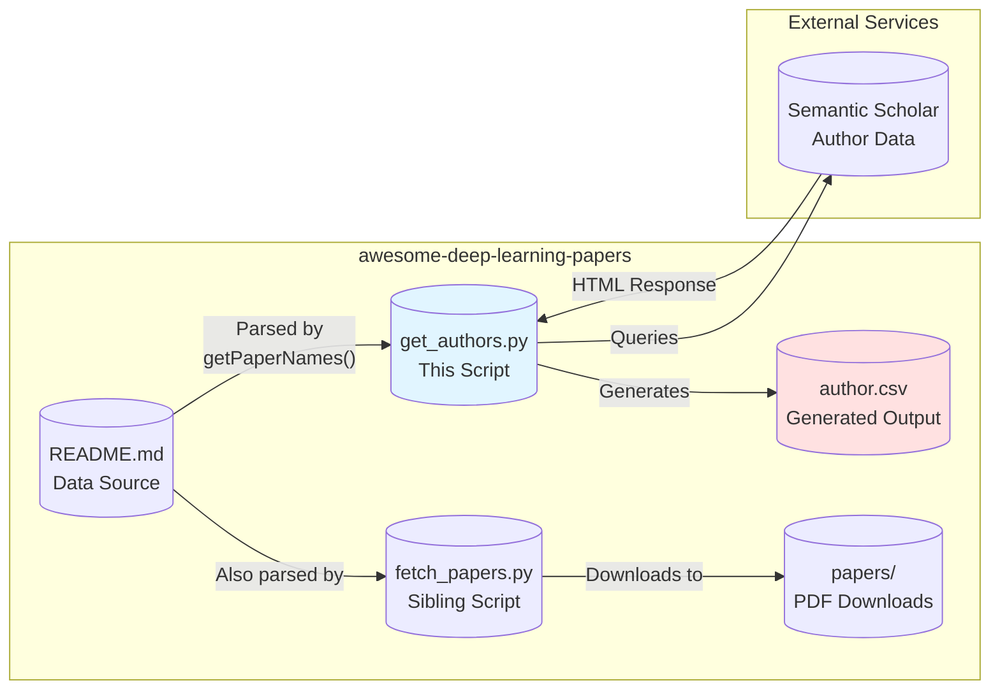

<!-- source: DeepWiki mcp.deepwiki.com · repo terryum/awesome-deep-learning-papers · page 4.2 Author Extraction Script (get_authors.py) · fetched 2026-10-30 -->

# Author Extraction Script (get_authors.py)

<details>
<summary>Relevant source files</summary>

The following files were used as context for generating this wiki page:

- [README.md](README.md)
- [get_authors.py](get_authors.py)

</details>


## Purpose and Scope

The `get_authors.py` script automates the process of identifying and ranking the most influential authors in the curated deep learning paper list. It parses paper titles from README.md, queries the Semantic Scholar API to retrieve author information, and generates a weighted ranking of authors based on their position in author lists (first author receives higher weight than subsequent authors). The output is a CSV file (`author.csv`) containing author names and their calculated scores.

For information about downloading the actual PDF files of these papers, see [PDF Download Script (fetch_papers.py)](#4.1). For details on the paper list structure that this script parses, see [The Curated Paper List](#2).

---

## System Architecture



**Sources:** [get_authors.py:1-109]()

---

## Data Flow Pipeline



**Sources:** [get_authors.py:60-106]()

---

## Core Components

### Paper Title Extraction: `getPaperNames()`

The `getPaperNames()` function extracts paper titles from the README.md file by identifying lines that contain the `[[pdf]]` marker and match the Top 100 paper formatting pattern.

**Key Implementation Details:**

| Aspect | Implementation |
|--------|----------------|
| Function signature | `getPaperNames(readme_file)` |
| File location | [get_authors.py:60-78]() |
| Input | Path to README.md file |
| Output | `paper_list` (list of strings) |
| Regex pattern | `\*\*(.*?)\*\*.*?\[\[pdf\]\]\((.*?)\)` |
| Key filter | Only extracts papers with `**bold title**` format |



**Regex Pattern Breakdown:**
- `\*\*(.*?)\*\*` - Captures text between double asterisks (paper title)
- `.*?` - Non-greedy match for any characters
- `\[\[pdf\]\]\((.*?)\)` - Matches the `[[pdf]](url)` markdown link

**Sources:** [get_authors.py:60-78]()

---

### HTML Parser: `AuthorParser` Class

The `AuthorParser` class extends Python's `HTMLParser` to extract author names from Semantic Scholar's HTML search results by tracking the DOM tree path and capturing data at specific locations.



**State Variables:**

| Variable | Type | Purpose |
|----------|------|---------|
| `tail_string` | string | Tracks current DOM path (e.g., "article.header.ul.li") |
| `m_Stop` | bool | Flag to stop after processing first search result |
| `m_authors` | list | Accumulates author names for current paper |

**DOM Path Tracking Logic:**

The parser builds a dot-separated path of HTML tags to identify when it reaches author data:



**Target DOM Path:** `"article.header.ul.li.span.span.a.span.span"`

This specific path points to author name elements in Semantic Scholar's HTML structure.

**Sources:** [get_authors.py:12-57]()

---

### Author Scoring Algorithm

The script implements a position-weighted scoring system where earlier authors in the author list receive higher scores:

**Scoring Formula:**
```
For each paper authored:
    score += 1.0 / author_position
    
Where author_position:
    1st author = position 1 → score += 1.0
    2nd author = position 2 → score += 0.5
    3rd author = position 3 → score += 0.33
    ...
```



**Example Calculation:**

If Yoshua Bengio appears as:
- 1st author on 3 papers: 3 × 1.0 = 3.0
- 2nd author on 2 papers: 2 × 0.5 = 1.0
- 3rd author on 1 paper: 1 × 0.33 = 0.33
- **Total Score: 4.33**

**Sources:** [get_authors.py:84-106]()

---

## Main Execution Flow

The script's main execution is a sequential process that ties all components together:



**Sources:** [get_authors.py:80-106]()

---

## API Integration: Semantic Scholar

The script queries Semantic Scholar's web search interface (not the official API) to retrieve author information.

**URL Construction:**

| Component | Value | Line Reference |
|-----------|-------|----------------|
| Base URL | `https://www.semanticscholar.org/search?q=` | [get_authors.py:9]() |
| Query parameter | Paper title (space-separated) | [get_authors.py:86]() |
| Post-fix | `&sort=relevance&ae=false` | [get_authors.py:10]() |

**Example Request:**
```
https://www.semanticscholar.org/search?q=ImageNet%20classification%20with%20deep%20convolutional%20neural%20networks&sort=relevance&ae=false
```

**Response Handling:**
- The script uses `requests.get()` to fetch the HTML page [get_authors.py:86]()
- Passes raw HTML text to `AuthorParser.feed()` [get_authors.py:87]()
- Only processes the first `<article>` element (top search result) [get_authors.py:19-31]()

**Important Note:** The script relies on Semantic Scholar's HTML structure remaining stable. Changes to their DOM structure would break the parser.

**Sources:** [get_authors.py:9-10, 84-87]()

---

## Output Format: author.csv

The script generates a CSV file with author rankings:

**File Structure:**

| Column | Type | Description | Example |
|--------|------|-------------|---------|
| Author Name | string | Full name as appears in papers | Geoffrey Hinton |
| Score | float (2 decimals) | Position-weighted total | 12.45 |

**CSV Format:**
```
Geoffrey Hinton,12.45
Yoshua Bengio,11.83
Yann LeCun,9.50
...
```

**Note:** The CSV output lacks headers. Each line follows the format: `author_name,score`

**Generation Process:**


**Sources:** [get_authors.py:99-106]()

---

## Code-to-Concept Mapping

This diagram maps high-level concepts to specific code entities in the script:



**Sources:** [get_authors.py:1-109]()

---

## Usage and Execution

**Prerequisites:**
- Python 3.x with `requests` library installed
- README.md file in the same directory
- Internet connection for Semantic Scholar API access

**Command:**
```bash
python get_authors.py
```

**Execution Behavior:**

1. **Progress Reporting:** Prints status for each paper processed:
   ```
   Processed 0 | Distilling the knowledge in a neural network
   Processed 1 | Deep neural networks are easily fooled
   ...
   ```
   [get_authors.py:96]()

2. **Author Score Display:** Prints calculated scores to console:
   ```
   Geoffrey Hinton  score: 12.45
   Yoshua Bengio  score: 11.83
   ...
   ```
   [get_authors.py:104]()

3. **Output File:** Creates/overwrites `author.csv` in the current directory [get_authors.py:99]()

**Expected Runtime:** 
- Approximately 2-5 minutes for ~100 papers
- Depends on network latency to Semantic Scholar

**Sources:** [get_authors.py:80-106](), [README.md:42-44]()

---

## Limitations and Considerations

### Technical Limitations

1. **HTML Structure Dependency**
   - The `AuthorParser` is tightly coupled to Semantic Scholar's specific DOM structure
   - Target path: `"article.header.ul.li.span.span.a.span.span"` [get_authors.py:47]()
   - Any changes to their HTML layout will break the parser

2. **First Result Assumption**
   - Only processes the first search result (`m_Stop` flag after first `<article>`) [get_authors.py:29-31]()
   - Assumes top result is the correct paper
   - No verification that the match is accurate

3. **No Error Handling**
   - No try-catch blocks for network failures
   - No validation of API responses
   - No handling of missing or malformed data

4. **Rate Limiting**
   - No delays between requests
   - May trigger rate limiting on Semantic Scholar
   - Could result in incomplete data

### Data Quality Issues

| Issue | Impact | Location |
|-------|--------|----------|
| Name Variations | Authors with different name formats counted separately | [get_authors.py:91-94]() |
| Missing Authors | If Semantic Scholar lacks data, authors are skipped | [get_authors.py:89]() |
| Duplicate Papers | No deduplication logic | [get_authors.py:84-96]() |
| Character Encoding | Potential issues with non-ASCII names | [get_authors.py:62]() |

**Sources:** [get_authors.py:1-109]()

---

## Relationship to Repository Ecosystem



**Key Differences from `fetch_papers.py`:**

| Aspect | `get_authors.py` | `fetch_papers.py` |
|--------|------------------|-------------------|
| **Purpose** | Extract author names and calculate rankings | Download PDF files |
| **Output** | `author.csv` (text data) | `papers/` directory (binary PDFs) |
| **External Service** | Semantic Scholar search | PDF hosting servers (arXiv, etc.) |
| **README Parsing** | Extracts titles only | Extracts titles + PDF URLs |
| **Processing** | Web scraping + text parsing | HTTP downloads |

Both scripts parse the same README.md format but serve complementary purposes in the repository's automation tooling.

**Sources:** [get_authors.py:1-109](), [README.md:42]()

---

