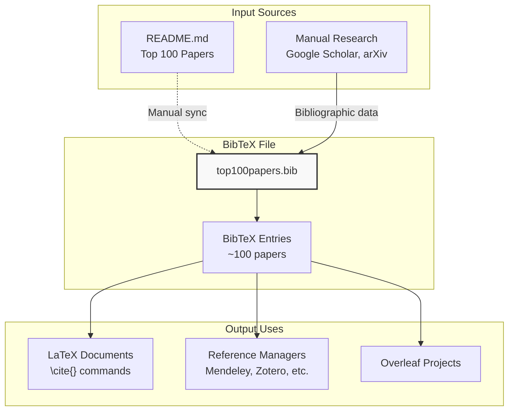
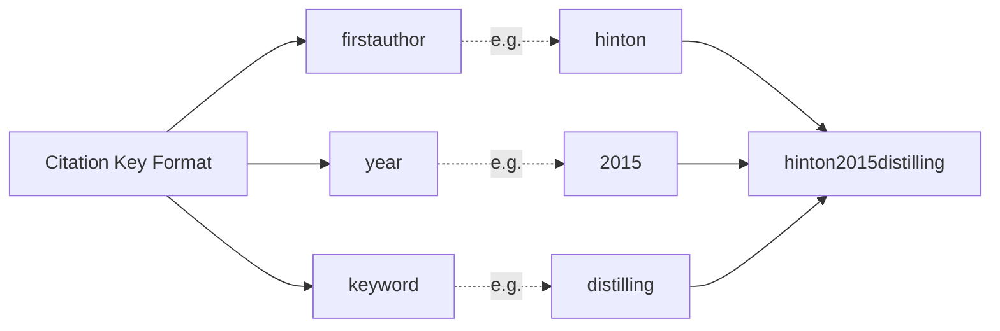
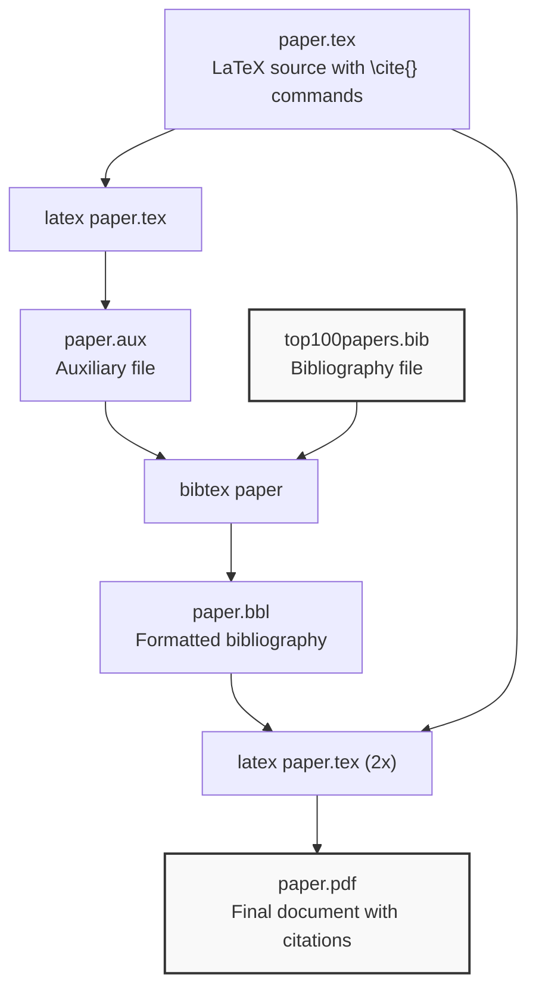
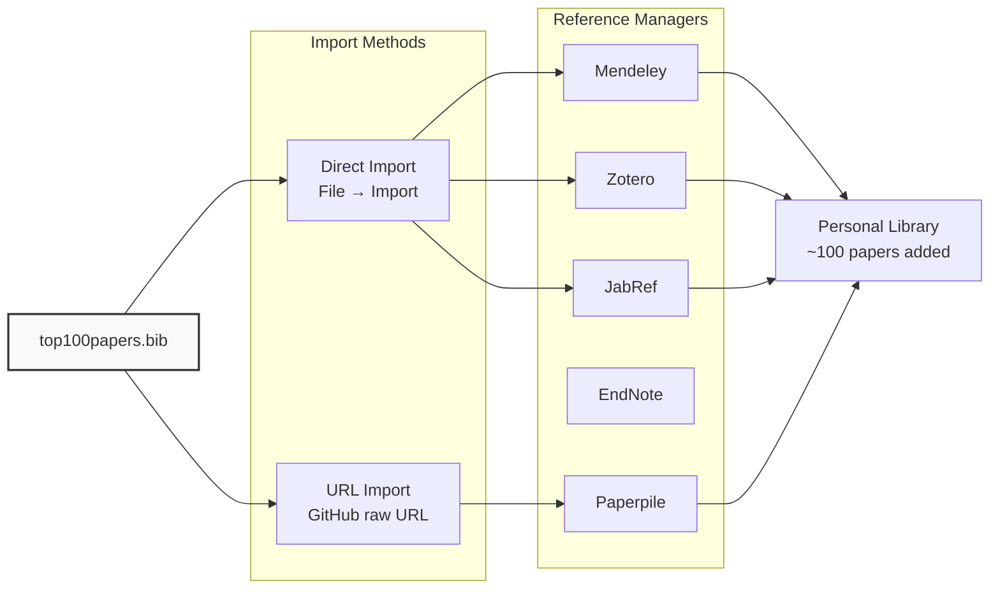
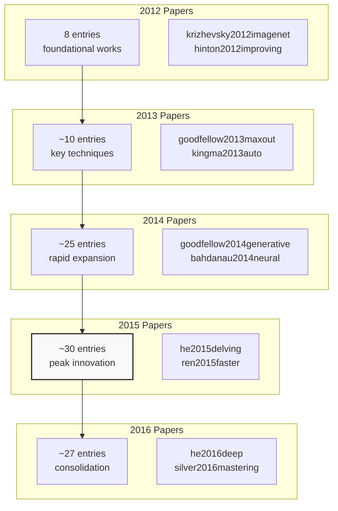
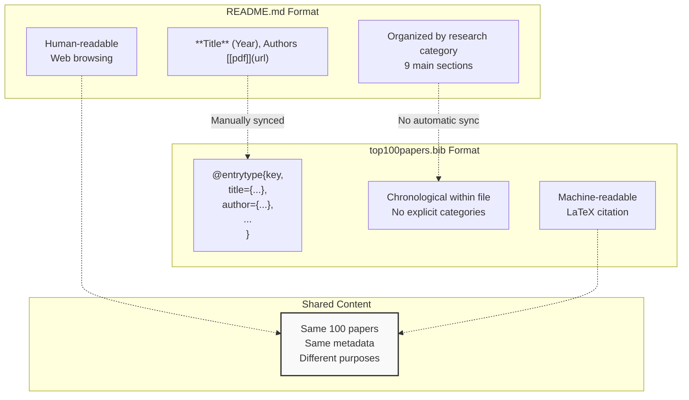
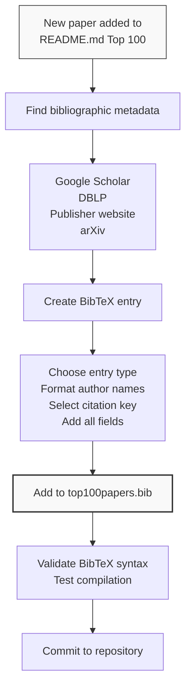
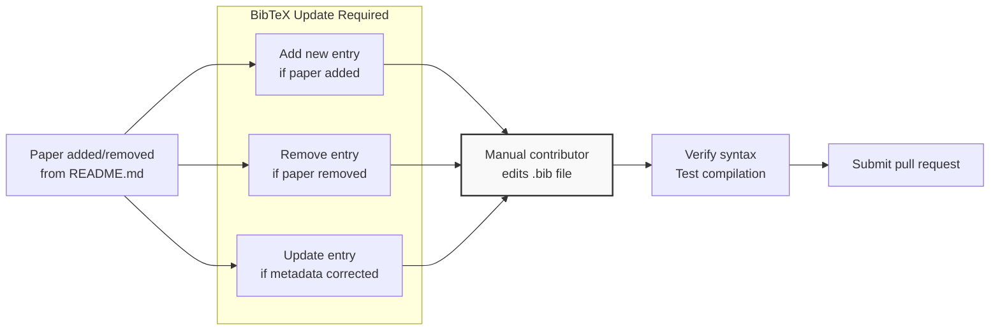

<!-- source: DeepWiki mcp.deepwiki.com · repo terryum/awesome-deep-learning-papers · page 5 Using the BibTeX Bibliography · fetched 2026-10-30 -->

# Using the BibTeX Bibliography

<details>
<summary>Relevant source files</summary>

The following files were used as context for generating this wiki page:

- [README.md](README.md)
- [top100papers.bib](top100papers.bib)

</details>


## Purpose and Scope

This page documents the `top100papers.bib` file, which provides BibTeX citation entries for the Top 100 deep learning papers curated in the repository. This bibliography enables researchers to easily cite these influential papers in LaTeX documents and import them into reference management software. The file is manually curated and maintained separately from the markdown-based paper list in README.md.

For information about the curated paper list itself, see [The Curated Paper List](#2). For automation tools that work with the paper list, see [Automation Tools](#4).

---

## Bibliography Overview

The `top100papers.bib` file contains citation metadata for all papers in the Top 100 list, organized as standard BibTeX entries. Each entry includes essential bibliographic information such as authors, title, publication venue, year, and other metadata required for academic citations.

**File Structure:**
- **Location**: [top100papers.bib:1-731]()
- **Format**: Standard BibTeX format
- **Entries**: ~100 citation entries corresponding to papers in the curated list
- **Maintenance**: Manually curated (not automatically generated)



**Sources**: [top100papers.bib:1-731](), [README.md:42]()

---

## BibTeX Entry Structure

Each paper in the bibliography follows standard BibTeX formatting with specific entry types and required fields. The file uses multiple entry types depending on the publication venue.

### Entry Type Distribution

| Entry Type | Description | Example Count | Typical Venues |
|------------|-------------|---------------|----------------|
| `@article` | Journal articles and arXiv papers | ~40 | arXiv, Nature, JMLR, IEEE Trans. |
| `@inproceedings` | Conference papers | ~60 | NIPS, CVPR, ICCV, ICML, EMNLP |

### Standard Entry Format

Each BibTeX entry contains the following structure:

```bibtex
@entrytype{citationkey,
  title={Paper Title},
  author={Author1, First and Author2, First and ...},
  journal/booktitle={Publication Venue},
  pages={start--end},
  year={YYYY},
  organization/publisher={Optional}
}
```

**Field Descriptions:**

| Field | Required | Description |
|-------|----------|-------------|
| `citationkey` | Yes | Unique identifier for citing (e.g., `hinton2015distilling`) |
| `title` | Yes | Full paper title |
| `author` | Yes | All authors in "Last, First" format separated by "and" |
| `year` | Yes | Publication year |
| `journal` | For articles | Journal name or "arXiv preprint arXiv:XXXX.XXXXX" |
| `booktitle` | For proceedings | Conference name |
| `pages` | Optional | Page range in format "start--end" |
| `volume`, `number` | Optional | Journal volume and issue number |

**Sources**: [top100papers.bib:1-50]()

---

## Citation Key Naming Convention

The citation keys follow a consistent pattern that makes them easy to remember and use:



**Naming Pattern**: `firstauthor[year][keyword]`

**Examples from the file:**

| Citation Key | First Author | Year | Keyword | Paper Title |
|--------------|--------------|------|---------|-------------|
| `hinton2015distilling` | Hinton | 2015 | distilling | Distilling the knowledge in a neural network |
| `krizhevsky2012imagenet` | Krizhevsky | 2012 | imagenet | ImageNet classification with deep CNN |
| `goodfellow2014generative` | Goodfellow | 2014 | generative | Generative adversarial nets |
| `he2016deep` | He | 2016 | deep | Deep residual learning for image recognition |
| `silver2016mastering` | Silver | 2016 | mastering | Mastering the game of Go |

**Sources**: [top100papers.bib:1-6](), [top100papers.bib:224-230](), [top100papers.bib:128-134](), [top100papers.bib:170-176](), [top100papers.bib:581-590]()

---

## Example Entries by Category

### Understanding / Generalization Papers

```bibtex
@article{hinton2015distilling,
  title={Distilling the knowledge in a neural network},
  author={Hinton, Geoffrey and Vinyals, Oriol and Dean, Jeff},
  journal={arXiv preprint arXiv:1503.02531},
  year={2015}
}

@inproceedings{yosinski2014transferable,
  title={How transferable are features in deep neural networks?},
  author={Yosinski, Jason and Clune, Jeff and Bengio, Yoshua and Lipson, Hod},
  booktitle={Advances in neural information processing systems},
  pages={3320--3328},
  year={2014}
}
```

**Sources**: [top100papers.bib:1-6](), [top100papers.bib:14-20]()

### CNN Architecture Papers

```bibtex
@inproceedings{he2016deep,
  title={Deep residual learning for image recognition},
  author={He, Kaiming and Zhang, Xiangyu and Ren, Shaoqing and Sun, Jian},
  booktitle={Proceedings of the IEEE Conference on Computer Vision and Pattern Recognition},
  pages={770--778},
  year={2016}
}

@inproceedings{krizhevsky2012imagenet,
  title={Imagenet classification with deep convolutional neural networks},
  author={Krizhevsky, Alex and Sutskever, Ilya and Hinton, Geoffrey E},
  booktitle={Advances in neural information processing systems},
  pages={1097--1105},
  year={2012}
}
```

**Sources**: [top100papers.bib:170-176](), [top100papers.bib:224-230]()

### Generative Models

```bibtex
@inproceedings{goodfellow2014generative,
  title={Generative adversarial nets},
  author={Goodfellow, Ian and Pouget-Abadie, Jean and Mirza, Mehdi and Xu, Bing and Warde-Farley, David and Ozair, Sherjil and Courville, Aaron and Bengio, Yoshua},
  booktitle={Advances in neural information processing systems},
  pages={2672--2680},
  year={2014}
}

@article{kingma2013auto,
  title={Auto-encoding variational bayes},
  author={Kingma, Diederik P and Welling, Max},
  journal={arXiv preprint arXiv:1312.6114},
  year={2013}
}
```

**Sources**: [top100papers.bib:128-134](), [top100papers.bib:135-140]()

### Reinforcement Learning

```bibtex
@article{silver2016mastering,
  title={Mastering the game of Go with deep neural networks and tree search},
  author={Silver, David and Huang, Aja and Maddison, Chris J and Guez, Arthur and Sifre, Laurent and Van Den Driessche, George and Schrittwieser, Julian and Antonoglou, Ioannis and Panneershelvam, Veda and Lanctot, Marc and others},
  journal={Nature},
  volume={529},
  number={7587},
  pages={484--489},
  year={2016},
  publisher={Nature Publishing Group}
}

@article{mnih2015human,
  title={Human-level control through deep reinforcement learning},
  author={Mnih, Volodymyr and Kavukcuoglu, Koray and Silver, David and Rusu, Andrei A and Veness, Joel and Bellemare, Marc G and Graves, Alex and Riedmiller, Martin and Fidjeland, Andreas K and Ostrovski, Georg and others},
  journal={Nature},
  volume={518},
  number={7540},
  pages={529--533},
  year={2015},
  publisher={Nature Research}
}
```

**Sources**: [top100papers.bib:581-590](), [top100papers.bib:597-606]()

---

## Using the Bibliography in LaTeX

### Basic Usage

The BibTeX file integrates seamlessly with standard LaTeX workflows:

```latex
\documentclass{article}
\usepackage{cite}

\begin{document}

Deep learning has achieved remarkable success in image recognition
\cite{krizhevsky2012imagenet, he2016deep}, natural language processing
\cite{bahdanau2014neural, sutskever2014sequence}, and reinforcement
learning \cite{mnih2015human, silver2016mastering}.

The concept of adversarial training \cite{goodfellow2014generative}
has revolutionized generative modeling.

\bibliographystyle{plain}
\bibliography{top100papers}

\end{document}
```

### LaTeX Workflow



### Multiple Citation Formats

The bibliography supports various LaTeX bibliography styles:

| Style Command | Output Format | Example |
|---------------|---------------|---------|
| `\bibliographystyle{plain}` | Alphabetical by author | [1] Goodfellow, I., et al. (2014)... |
| `\bibliographystyle{abbrv}` | Abbreviated names | [1] Goodfellow, I., et al. (2014)... |
| `\bibliographystyle{ieeetr}` | IEEE Transactions | [1] I. Goodfellow et al., "Generative..." |
| `\bibliographystyle{alpha}` | Author-year labels | [Goo14] Goodfellow, I., et al. (2014)... |
| `\bibliographystyle{unsrt}` | Citation order | [1] First cited paper... |

**Sources**: [top100papers.bib:1-731]()

---

## Using with Reference Management Software

The BibTeX file can be imported into various reference management tools:

### Import Process



### Software-Specific Instructions

**Mendeley:**
1. File → Import → BibTeX (*.bib)
2. Select `top100papers.bib`
3. All entries imported with full metadata
4. Papers automatically organized

**Zotero:**
1. File → Import...
2. Select `top100papers.bib`
3. Choose "A file (BibTeX, RIS, etc.)"
4. Entries added to current collection

**JabRef:**
1. File → Import into current database
2. Select BibTeX format
3. Open `top100papers.bib`
4. Native BibTeX editor for viewing/editing

**Overleaf:**
1. Upload `top100papers.bib` to project
2. Add `\bibliography{top100papers}` to .tex file
3. Citations automatically resolved

**Sources**: [top100papers.bib:1-731](), [README.md:42]()

---

## Coverage and Organization

### Papers by Research Domain

The bibliography entries are organized chronologically within the file but correspond to the categorical organization in README.md:

| Research Category | Approximate Entries | Example Keys |
|-------------------|---------------------|--------------|
| Understanding / Generalization | 7 | `hinton2015distilling`, `yosinski2014transferable` |
| Optimization / Training | 7 | `ioffe2015batch`, `kingma2014adam`, `srivastava2014dropout` |
| Generative Models | 7 | `goodfellow2014generative`, `kingma2013auto`, `radford2015unsupervised` |
| CNN Architectures | 12 | `he2016deep`, `krizhevsky2012imagenet`, `simonyan2014very` |
| Object Detection | 8 | `redmon2016you`, `ren2015faster`, `girshick2015fast` |
| Image/Video Applications | 11 | `karpathy2015deep`, `xu2015show`, `vinyals2015show` |
| NLP / RNNs | 18 | `bahdanau2014neural`, `sutskever2014sequence`, `mikolov2013efficient` |
| Speech / Audio | 6 | `graves2013speech`, `hinton2012deep`, `amodei2015deep` |
| Reinforcement Learning | 9 | `mnih2015human`, `silver2016mastering`, `levine2016end` |
| More 2016 Papers | ~15 | `ba2016layer`, `wu2016google`, `graves2016hybrid` |

### Year Distribution



**Sources**: [top100papers.bib:1-731]()

---

## Relationship to README.md

The BibTeX file provides an alternative representation of the curated paper list:



### Key Differences

| Aspect | README.md | top100papers.bib |
|--------|-----------|------------------|
| **Format** | Markdown with links | BibTeX entries |
| **Organization** | By research category | Chronological/alphabetical |
| **Primary Use** | Discovery and browsing | Citation and reference |
| **Links** | PDF links included | No PDF links |
| **Metadata** | Minimal (title, authors, year) | Complete (venue, pages, DOI, etc.) |
| **Updates** | Frequently updated | Manually synced |
| **Automation** | Parsed by fetch_papers.py | Not parsed by automation |

**Sources**: [README.md:71-190](), [top100papers.bib:1-731]()

---

## Manual Curation Process

Unlike the automation scripts that parse README.md, the BibTeX file is manually maintained:



### Common Metadata Sources

| Source | Information Provided | BibTeX Export |
|--------|---------------------|---------------|
| **Google Scholar** | Complete citations, citation counts | Yes (BibTeX button) |
| **DBLP** | Conference/journal metadata | Yes (export feature) |
| **arXiv** | Preprint metadata, abstract | Limited |
| **ACL Anthology** | NLP papers, proceedings info | Yes (BibTeX link) |
| **IEEE Xplore** | IEEE publications | Yes (citation export) |
| **Publisher sites** | Official metadata | Usually yes |

### Quality Checks

Before adding entries to the file:

1. **Citation key uniqueness**: Ensure no duplicate keys exist
2. **Author formatting**: "Last, First" with "and" separators
3. **Special characters**: Escape LaTeX special chars (e.g., `{\"u}` for ü)
4. **Page ranges**: Use double dash `--` not single `-`
5. **Venue names**: Use full official names
6. **Year accuracy**: Match actual publication year
7. **Syntax validation**: Test compile in LaTeX or BibTeX validator

**Sources**: [top100papers.bib:1-731](), [README.md:42]()

---

## Practical Examples

### Example 1: Citing Multiple Papers by Topic

```latex
% Citing papers on a specific topic
Recent advances in image classification
\cite{krizhevsky2012imagenet, simonyan2014very, he2016deep}
demonstrate the power of deep convolutional architectures.
```

Generates:
> Recent advances in image classification [12,15,18] demonstrate the power of deep convolutional architectures.

### Example 2: Inline Author Citations

```latex
\usepackage{natbib}

\citet{goodfellow2014generative} introduced generative adversarial networks,
while \citet{kingma2013auto} proposed variational autoencoders.
```

Generates:
> Goodfellow et al. (2014) introduced generative adversarial networks, while Kingma and Welling (2013) proposed variational autoencoders.

### Example 3: Selective Import

To use only specific papers from the bibliography:

```latex
\nocite{hinton2015distilling}
\nocite{he2016deep}
\nocite{silver2016mastering}

\bibliographystyle{plain}
\bibliography{top100papers}
```

This includes only the explicitly `\nocite`'d entries in the bibliography.

**Sources**: [top100papers.bib:1-6](), [top100papers.bib:170-176](), [top100papers.bib:581-590]()

---

## File Maintenance and Updates

### Update Workflow

When the Top 100 list changes:



### Current Limitations

1. **No automatic generation**: The file is not auto-generated from README.md
2. **Manual synchronization**: Updates require manual effort when Top 100 changes
3. **No PDF links**: Unlike README.md, BibTeX entries don't include PDF URLs
4. **Potential lag**: May not immediately reflect changes to the Top 100 list

### Community Contributions

Contributors who help maintain the bibliography (acknowledged in README.md):
- **doodhwala**: Initial BibTeX file creation
- **Sven** ([sunshinemyson](https://github.com/sunshinemyson)): BibTeX contributions
- **grepinsight** ([grepinsight](https://github.com/grepinsight)): BibTeX contributions

**Sources**: [README.md:42](), [top100papers.bib:1-731]()

---

## Advanced Usage Patterns

### Pattern 1: Domain-Specific Bibliography

Extract entries for a specific research area:

```bash
# Extract all reinforcement learning papers
grep -A 10 "silver\|mnih\|levine" top100papers.bib > rl_papers.bib
```

### Pattern 2: Year-Based Filtering

```bash
# Extract only 2016 papers
grep -A 10 "year={2016}" top100papers.bib > papers_2016.bib
```

### Pattern 3: Integration with Citation Management

```python
# Python script to parse BibTeX and extract specific fields
import bibtexparser

with open('top100papers.bib') as bib_file:
    bib_database = bibtexparser.load(bib_file)
    
# Filter entries
dl_papers = [entry for entry in bib_database.entries 
             if 'deep' in entry.get('title', '').lower()]

# Export filtered set
writer = bibtexparser.bwriter.BibTexWriter()
with open('deep_learning_subset.bib', 'w') as bibfile:
    bibfile.write(writer.write(bib_database))
```

### Pattern 4: Citation Analysis

```python
# Analyze author frequency in bibliography
from collections import Counter
import bibtexparser

with open('top100papers.bib') as bib_file:
    bib_db = bibtexparser.load(bib_file)

# Count author appearances
authors = []
for entry in bib_db.entries:
    if 'author' in entry:
        # Split on 'and' and extract last names
        entry_authors = entry['author'].split(' and ')
        authors.extend([a.split(',')[0].strip() for a in entry_authors])

top_authors = Counter(authors).most_common(10)
print("Most frequent authors:", top_authors)
```

**Sources**: [top100papers.bib:1-731]()

---

## Summary

The `top100papers.bib` file serves as a crucial reference resource that:

- **Provides citation metadata** for all Top 100 papers in standard BibTeX format
- **Enables LaTeX integration** for academic writing and paper preparation  
- **Supports reference managers** like Mendeley, Zotero, and JabRef
- **Uses consistent naming** with `firstauthorYEARkeyword` citation keys
- **Requires manual maintenance** as it is not auto-generated from README.md
- **Complements README.md** by providing machine-readable citation data

For researchers writing papers on deep learning, this bibliography eliminates the need to manually create citation entries for these influential papers. Simply download the file, include it in your LaTeX project, and cite papers using their citation keys.

**Sources**: [top100papers.bib:1-731](), [README.md:42]()

---

