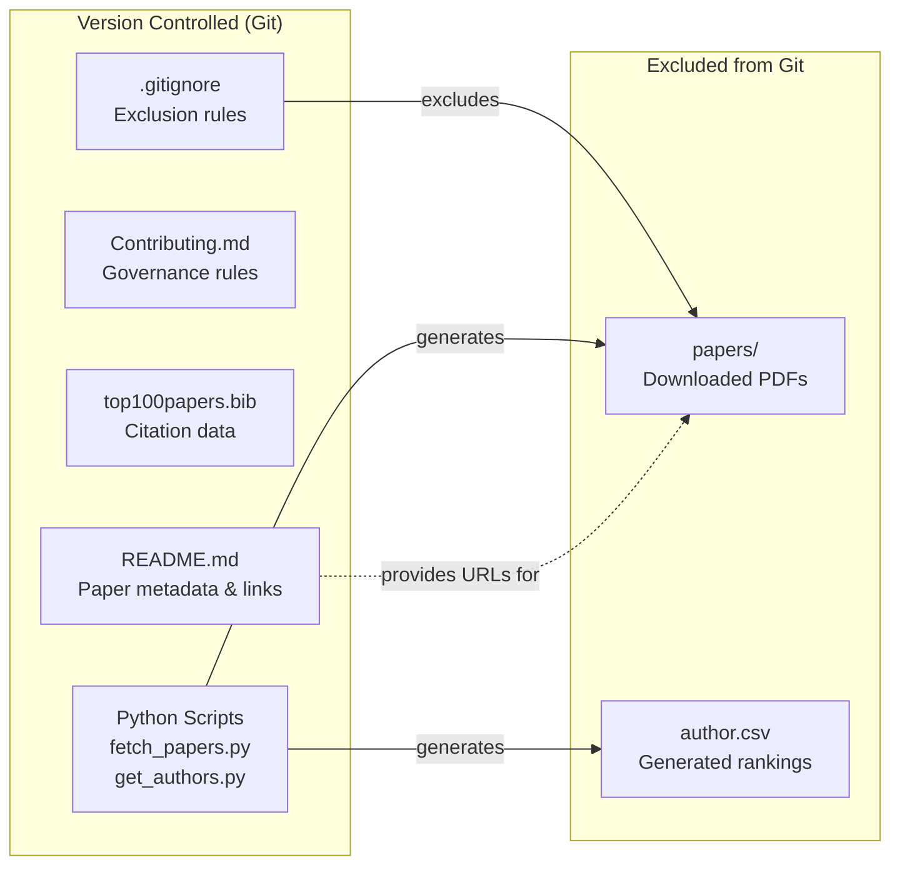
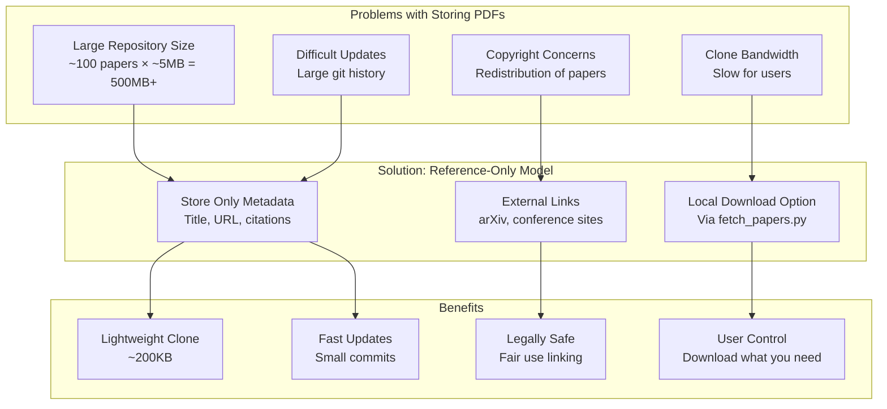
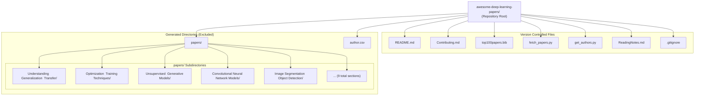
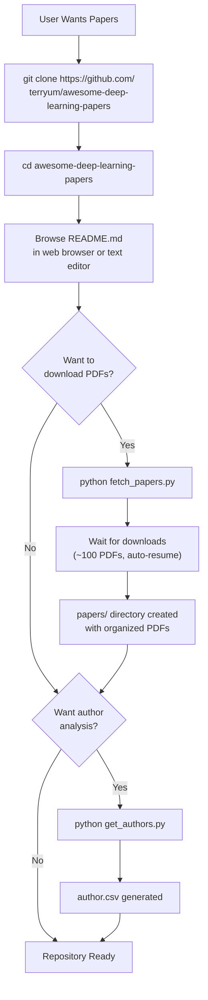
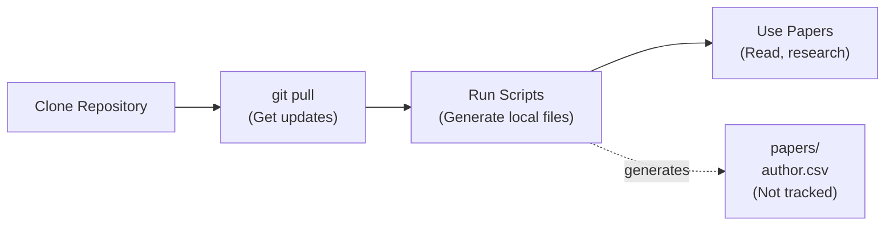
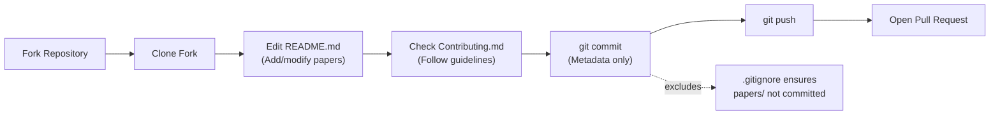

<!-- source: DeepWiki mcp.deepwiki.com · repo terryum/awesome-deep-learning-papers · page 6 Repository Setup and Configuration · fetched 2026-10-30 -->

# Repository Setup and Configuration

<details>
<summary>Relevant source files</summary>

The following files were used as context for generating this wiki page:

- [.gitignore](.gitignore)
- [README.md](README.md)
- [fetch_papers.py](fetch_papers.py)

</details>


This document covers the repository's version control configuration, local directory structure, and setup procedures. It explains the `.gitignore` configuration that excludes downloaded PDFs from version control, the design philosophy of curating paper references rather than storing actual PDF files, and the basic steps to set up and use the repository.

For information about the automation tools that download papers, see [Automation Tools](#4). For the curated paper list structure itself, see [The Curated Paper List](#2).

---

## Version Control Strategy

The repository employs a **lightweight, reference-only version control strategy** where the curated metadata is tracked but downloaded content is excluded. This approach keeps the repository small and focused on knowledge organization rather than content storage.

### Tracked vs Excluded Files



**Sources:** [.gitignore:1-1](), [README.md:1-390](), [fetch_papers.py:1-40]()

### .gitignore Configuration

The repository contains a minimal `.gitignore` file that excludes only the downloaded papers directory:

[.gitignore:1-1]()

This single-line configuration ensures that:
- The `papers/` directory and all its contents are never committed to version control
- Users can download PDFs locally without affecting the repository state
- The repository remains lightweight (~200KB instead of potentially multiple GB)

**Sources:** [.gitignore:1-1]()

---

## Design Philosophy: Reference Curation vs Content Storage

The repository makes a deliberate architectural decision to **curate references** rather than **store content**. This design choice has several important implications:

### Why PDFs Are Not Tracked



**Sources:** [.gitignore:1-1](), [README.md:42-42](), [fetch_papers.py:8-10]()

### The Dual-Source Data Model

The repository implements a clever separation between **version-controlled references** and **locally-generated content**:

| Artifact | Location | Version Controlled | Generated By | Purpose |
|----------|----------|-------------------|--------------|---------|
| `README.md` | Root | Yes | Human curators | Paper metadata, URLs, categorization |
| `top100papers.bib` | Root | Yes | Human curators | Academic citations |
| `Contributing.md` | Root | Yes | Human curators | Contribution guidelines |
| `fetch_papers.py` | Root | Yes | Developers | Download automation |
| `get_authors.py` | Root | Yes | Developers | Author analysis |
| `papers/` | Root | **No** | `fetch_papers.py` | Downloaded PDFs |
| `author.csv` | Root | **No** | `get_authors.py` | Author rankings |

This separation means:
- **Curators** maintain the authoritative paper list in `README.md`
- **Users** generate local artifacts on-demand using automation scripts
- **Version control** remains clean and focused on human-curated knowledge

**Sources:** [README.md:42-42](), [fetch_papers.py:8-10](), [.gitignore:1-1]()

---

## Local Directory Structure

When a user clones the repository and runs automation scripts, the following directory structure is created:

### Repository Root Structure



**Sources:** [fetch_papers.py:8-23](), [.gitignore:1-1]()

### How fetch_papers.py Creates Directory Structure

The `fetch_papers.py` script dynamically creates directories based on the section headings in `README.md`:

[fetch_papers.py:8-23]()

**Key behaviors:**
1. Creates root `papers/` directory if it doesn't exist (line 9-10)
2. Parses `README.md` for section headings marked with `###` (line 17-18)
3. Sanitizes heading names to remove Windows-restricted characters (line 19-20)
4. Creates subdirectory for each section (line 21-23)
5. Downloads PDFs into appropriate section subdirectory (line 32-37)

The Windows character sanitization regex removes: `^ / \ : * ? " < > |` to ensure cross-platform compatibility.

**Sources:** [fetch_papers.py:8-40]()

### Example Directory Tree After Download

After running `fetch_papers.py`, the structure looks like:

```
awesome-deep-learning-papers/
├── README.md
├── Contributing.md
├── top100papers.bib
├── fetch_papers.py
├── get_authors.py
├── .gitignore
└── papers/                                          (excluded by .gitignore)
    ├── Understanding  Generalization  Transfer/
    │   ├── Distilling the knowledge in a neural network.pdf
    │   ├── Deep neural networks are easily fooled.pdf
    │   └── ... (7 papers)
    ├── Optimization  Training Techniques/
    │   ├── Batch normalization.pdf
    │   ├── Dropout.pdf
    │   └── ... (7 papers)
    ├── Convolutional Neural Network Models/
    │   ├── Deep residual learning for image recognition.pdf
    │   ├── Very deep convolutional networks.pdf
    │   └── ... (12 papers)
    └── ... (6 more sections)
```

**Sources:** [fetch_papers.py:8-40](), [README.md:71-190]()

---

## Repository Setup Process

### Basic Clone and Setup



**Sources:** [README.md:42-42](), [fetch_papers.py:1-40]()

### Step-by-Step Setup Instructions

#### 1. Clone the Repository

```bash
git clone https://github.com/terryum/awesome-deep-learning-papers.git
cd awesome-deep-learning-papers
```

The initial clone is lightweight (~200KB) because it contains only metadata files, not PDFs.

#### 2. Browse the Curated List

Open `README.md` in a web browser or text editor to explore the curated papers. The file contains:
- Top 100 papers organized by research category [README.md:71-190]()
- Additional papers from 2016 and beyond [README.md:193-209]()
- Supplementary resources (books, tutorials, datasets) [README.md:253-297]()

#### 3. (Optional) Download PDFs Locally

Run the download script to fetch all papers referenced in `README.md`:

```bash
python fetch_papers.py
```

**Script behavior:**
- Parses `README.md` for paper titles and PDF URLs [fetch_papers.py:13-14]()
- Creates `papers/` directory and section subdirectories [fetch_papers.py:8-23]()
- Downloads each PDF with auto-resume capability [fetch_papers.py:31-37]()
- Skips already-downloaded papers to allow resuming interrupted downloads [fetch_papers.py:32]()

**Note:** The script only downloads papers marked with `**bold**` formatting in `README.md` (the Top 100), not papers from supplementary sections [fetch_papers.py:25-29]().

#### 4. (Optional) Generate Author Rankings

Run the author analysis script:

```bash
python get_authors.py
```

This queries Semantic Scholar to identify authors and generates position-weighted rankings in `author.csv`. For details, see [Author Extraction Script](#4.2).

**Sources:** [README.md:42-42](), [fetch_papers.py:1-40]()

---

## Version Control Workflow

### For Regular Users



**Regular users** interact with the repository in read-only mode:
1. Clone the repository to get the curated list
2. Pull updates periodically to get new papers added by curators
3. Run automation scripts to generate local artifacts
4. Use the papers for research, learning, or teaching

**Generated files are never committed** because `.gitignore` excludes them.

**Sources:** [.gitignore:1-1](), [README.md:37-40]()

### For Contributors



**Contributors** follow a standard Git workflow:
1. Fork the repository on GitHub
2. Clone their fork locally
3. Edit `README.md` to add/modify/remove papers
4. Follow guidelines in `Contributing.md` for criteria and formatting
5. Commit changes (only metadata files, not generated PDFs)
6. Push to their fork
7. Open a pull request to the main repository

The `.gitignore` configuration ensures contributors cannot accidentally commit PDFs even if they've run `fetch_papers.py` locally.

For detailed contribution guidelines, see [Contributing to the List](#3).

**Sources:** [.gitignore:1-1](), [README.md:37-41]()

---

## Configuration Files Reference

### .gitignore

**File path:** [.gitignore:1-1]()

**Purpose:** Exclude downloaded PDFs from version control

**Contents:**
```
papers/
```

**Effect:** 
- Excludes the entire `papers/` directory tree
- Applies recursively to all subdirectories and files within `papers/`
- Does not affect `README.md` references to papers
- Ensures repository remains lightweight regardless of local downloads

### Special Considerations

#### Cross-Platform Compatibility

The `fetch_papers.py` script includes Windows filename sanitization [fetch_papers.py:19-20]() to handle section headings that contain characters restricted on Windows filesystems:

- Characters removed: `^ / \ : * ? " < > |`
- Applied to both section directory names and PDF filenames
- Ensures the repository works identically on Windows, macOS, and Linux

#### UTF-8 Encoding

The script explicitly uses UTF-8 encoding when reading `README.md` [fetch_papers.py:13]():

```python
with codecs.open('README.md', encoding='utf-8', mode='r', ...)
```

This ensures proper handling of:
- Unicode characters in paper titles
- Special symbols (e.g., "α", "β", "–")
- Non-ASCII author names

**Sources:** [fetch_papers.py:13-20]()

---

## Summary: Repository Configuration Philosophy

The repository's configuration embodies three core principles:

| Principle | Implementation | Benefit |
|-----------|---------------|---------|
| **Lightweight Version Control** | `.gitignore` excludes `papers/` | Fast cloning, small repository size |
| **Reference-Based Curation** | Store URLs in `README.md`, not PDFs | Legal compliance, easy maintenance |
| **On-Demand Generation** | Scripts create local artifacts | User control, flexibility |

This architecture allows the repository to:
- Remain under 1MB in version control
- Scale to hundreds of papers without git bloat
- Support both casual browsers and deep researchers
- Avoid copyright issues with PDF redistribution
- Enable easy updates to the curated list

The configuration is minimal by design, consisting of a single `.gitignore` rule, yet it enables a sophisticated dual-mode operation where curators maintain metadata in version control while users generate content locally as needed.

**Sources:** [.gitignore:1-1](), [README.md:1-390](), [fetch_papers.py:1-40]()