# Page: Overview

# Overview

<details>
<summary>Relevant source files</summary>

The following files were used as context for generating this wiki page:

- [README.md](README.md)

</details>


This document provides a comprehensive overview of the awesome-deep-learning-papers repository, a curated collection of influential deep learning research papers published between 2012-2016. The repository serves as a knowledge curation and distribution system that helps researchers and students navigate the foundational literature of the deep learning revolution.

For detailed information about specific subsystems, see:
- Paper organization and categorization: [The Curated Paper List](#2)
- Automation tools for bulk operations: [Automation Tools](#4)
- Contributing guidelines and processes: [Contributing to the List](#3)

**Scope**: This page covers the repository's overall architecture, core components, maintenance status, and primary use cases. It does not detail individual research categories or specific automation script implementations, which are covered in subsequent sections.

---

## Purpose and Maintenance Status

The repository addresses a fundamental challenge in deep learning education: identifying which papers are essential reading. Rather than providing an overwhelming collection, it curates a focused "top 100" list of seminal works that remain relevant across application domains.

**Current Maintenance Status**: The list is no longer actively maintained as of 2017 due to the overwhelming volume of papers published daily since that time [README.md:5]().

### Selection Philosophy

The repository prioritizes:
- **Seminal papers** with broad applicability over narrow application-specific works
- **Citation-based filtering** with year-adjusted thresholds
- **Classic works** (2012-2016) that represent the deep learning breakthrough period

Sources: [README.md:1-43]()

---

## Repository Architecture

The repository follows a documentation-centric architecture where `README.md` serves dual purposes: human-readable knowledge curation and machine-parseable data source for automation tools.

### Component Architecture

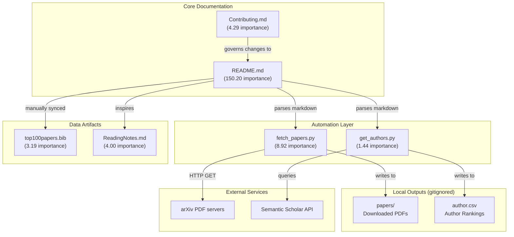

Sources: [README.md:1-390](), [.gitignore:1-2]()

---

## Core Components

### 1. README.md - The Central Knowledge Repository

`README.md` is the single source of truth, containing 390 lines of structured markdown that organize 100+ papers across 9 research domains. It accounts for 92% of the repository's functional importance.

**Structure**:
- Lines 71-192: Top 100 papers organized into 9 categories
- Lines 193-209: "More Papers from 2016" overflow section  
- Lines 213-231: New Papers (< 6 months old)
- Lines 233-251: Old Papers (pre-2012 classics)
- Lines 253-262: Hardware/Software/Datasets
- Lines 264-275: Books/Surveys/Reviews
- Lines 276-298: Video lectures and tutorials
- Lines 299-379: Appendix with additional papers

**Dual-Purpose Design**: The markdown formatting follows strict conventions that enable automated parsing:

```markdown
### Understanding / Generalization / Transfer
- **Distilling the knowledge in a neural network** (2015), G. Hinton et al. [[pdf]](http://arxiv.org/pdf/1503.02531)
```

The pattern `### Heading` for sections and `**Title** [[pdf]](url)` for papers enables regex-based extraction by automation scripts.

Sources: [README.md:1-390]()

### 2. Citation Threshold System

The repository implements a year-based citation threshold system to account for publication recency:

| Publication Year | Citation Threshold | Section Placement |
|-----------------|-------------------|-------------------|
| < 6 months | By discussion | New Papers |
| 2016 | +60 citations | Main list or "More Papers from 2016" |
| 2015 | +200 citations | Main list |
| 2014 | +400 citations | Main list |
| 2013 | +600 citations | Main list |
| 2012 | +800 citations | Main list |
| ~2012 (pre-2012) | By discussion | Old Papers |

This sliding scale ensures that newer papers have a fair chance of inclusion despite having less time to accumulate citations [README.md:26-33]().

**Qualitative Override**: Citation thresholds are guidelines, not absolute rules. Papers are evaluated for seminal importance and broad applicability [README.md:35-36]().

Sources: [README.md:19-36]()

### 3. Research Domain Organization

The top 100 papers are distributed across 9 primary research categories:

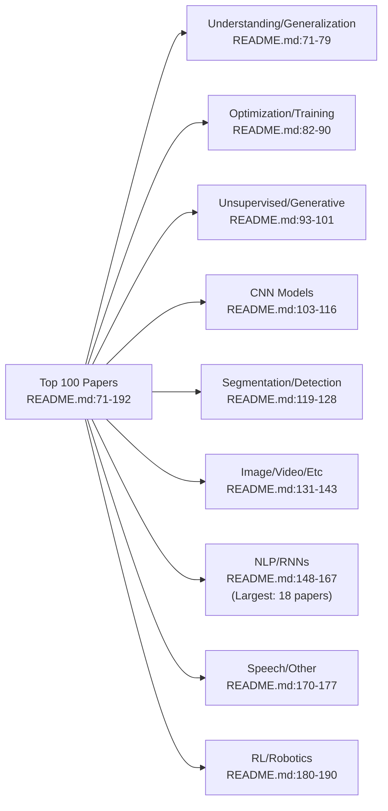

The NLP/RNNs category is the largest with 18 papers, reflecting the explosion of sequence modeling research during this period.

Sources: [README.md:47-67](), [README.md:71-192]()

### 4. Automation Tools

Two Python scripts leverage `README.md` as a structured data source:

**fetch_papers.py** (importance: 8.92)
- Parses section headings using regex pattern `### (.+)`
- Extracts paper titles and PDF URLs using pattern `**(.+?)** .+?\[\[pdf\]\]\((.+?)\)`
- Downloads PDFs with auto-resume functionality
- Organizes downloads into `papers/` subdirectories by section

**get_authors.py** (importance: 1.44)
- Extracts paper titles from README.md
- Queries Semantic Scholar API to retrieve author information
- Calculates position-weighted author scores (first author gets more weight)
- Outputs rankings to `author.csv`

Both scripts demonstrate the repository's clever dual-use data model where README.md serves as both documentation and database.

Sources: [README.md:42](), [fetch_papers.py](), [get_authors.py]()

### 5. Version Control Configuration

The `.gitignore` file excludes `papers/` from version control:

```
papers/
*.pyc
```

This design decision reflects the repository's philosophy: curate *references* to papers, not the papers themselves. The repository remains lightweight and focused on knowledge organization rather than content hosting.

Sources: [.gitignore:1-2](), [README.md:42]()

---

## User Workflows

### Workflow Diagram: User Personas and Interactions

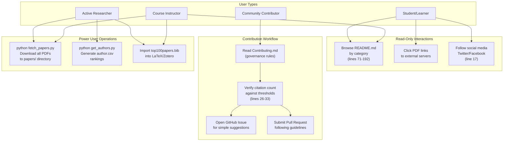

Sources: [README.md:1-43](), [Contributing.md]()

### Common Use Cases

**1. Learning Deep Learning Fundamentals**
- Browse by category in README.md [README.md:47-67]()
- Follow paper links to external PDF servers
- Use as reading roadmap for structured learning

**2. Contributing Papers**
- Consult Contributing.md for submission rules
- Verify paper meets citation threshold [README.md:26-33]()
- Submit via GitHub Issue or Pull Request [README.md:38-40]()

**3. Research Reference Collection**
- Execute `fetch_papers.py` to download all PDFs locally
- Import `top100papers.bib` into reference manager [README.md:42]()
- Use for literature review or citation purposes

**4. Author Network Analysis**
- Run `get_authors.py` to extract author information
- Analyze `author.csv` output for collaboration patterns
- Identify key researchers in the field [README.md:42-44]()

Sources: [README.md:1-43]()

---

## Data Flow Architecture

The following diagram illustrates how data flows from external sources through the repository to end users:

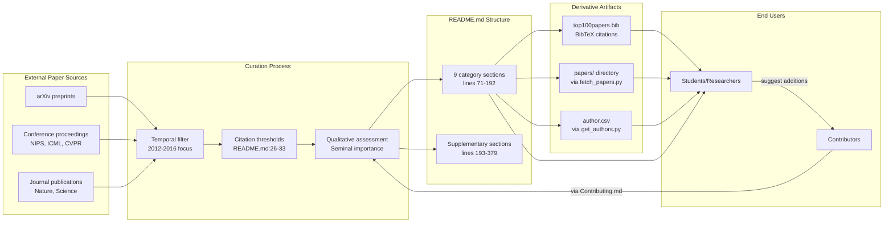

Sources: [README.md:1-390]()

---

## File System Structure

The repository follows a flat file structure with minimal directory nesting:

```
awesome-deep-learning-papers/
├── README.md              # Main curated list (150.20 importance)
├── Contributing.md        # Contribution guidelines (4.29 importance)
├── fetch_papers.py        # PDF download automation (8.92 importance)
├── get_authors.py         # Author extraction tool (1.44 importance)
├── top100papers.bib       # BibTeX bibliography (3.19 importance)
├── ReadingNotes.md        # Example research notes (4.00 importance)
├── .gitignore             # Excludes papers/ directory
└── papers/                # Local PDF storage (gitignored)
    ├── Understanding-Generalization-Transfer/
    ├── Optimization-Training-Techniques/
    ├── Unsupervised-Generative-Models/
    └── ...                # One subdirectory per category
```

The `papers/` directory is created by `fetch_papers.py` but excluded from version control to keep the repository lightweight.

Sources: [README.md:1-390](), [.gitignore:1-2]()

---

## Key Design Principles

### 1. Documentation as Data

The repository treats `README.md` as structured data rather than merely human-readable text. Strict markdown formatting conventions enable automated parsing while maintaining readability.

**Example pattern**:
```markdown
### Category Name
- **Paper Title** (Year), Authors [[pdf]](URL)
```

This dual-purpose design eliminates the need for separate data files.

### 2. Lightweight Reference Curation

By excluding PDFs from version control and linking to external servers, the repository remains under 1MB while providing access to hundreds of papers. This design choice prioritizes knowledge organization over content hosting.

### 3. Year-Adjusted Quality Metrics

The citation threshold system [README.md:26-33]() recognizes that paper impact compounds over time. A 2016 paper with 60 citations may be as significant as a 2012 paper with 800+ citations.

### 4. Qualitative Override Mechanism

Citation counts are guidelines, not absolute rules [README.md:35-36](). This allows inclusion of breakthrough papers that may not yet have accumulated citations but demonstrate clear importance.

Sources: [README.md:1-43]()

---

## Repository Statistics

### Component Importance Distribution

The following table shows the relative importance scores of repository components:

| Component | Importance Score | Percentage | Primary Role |
|-----------|-----------------|------------|--------------|
| README.md | 150.20 | 92.2% | Knowledge curation |
| fetch_papers.py | 8.92 | 5.5% | Bulk PDF download |
| Contributing.md | 4.29 | 2.6% | Governance |
| ReadingNotes.md | 4.00 | 2.5% | Example analysis |
| top100papers.bib | 3.19 | 2.0% | Citation management |
| get_authors.py | 1.44 | 0.9% | Author analytics |
| .gitignore | 1.33 | 0.8% | Version control config |

The overwhelming importance of `README.md` confirms the documentation-centric architecture.

Sources: High-level architecture diagrams

---

## Integration Points

### External Services

The repository integrates with external services through automation scripts:

1. **PDF Servers**: `fetch_papers.py` downloads from arXiv, conference websites, and journal servers
2. **Semantic Scholar API**: `get_authors.py` queries for author metadata and paper information
3. **Social Media**: Twitter and Facebook for community engagement [README.md:17]()

### Citation Management Systems

The `top100papers.bib` file integrates with:
- LaTeX bibliography systems (BibTeX/BibLaTeX)
- Reference managers (Zotero, Mendeley, EndNote)
- Academic writing tools

Sources: [README.md:42](), [fetch_papers.py](), [get_authors.py]()

---

## Summary

The awesome-deep-learning-papers repository represents a knowledge curation system optimized for three goals:

1. **Accessibility**: Curated list reduces overwhelming paper volume to essential reading
2. **Maintainability**: Documentation-centric design with minimal infrastructure
3. **Extensibility**: Automation tools enable bulk operations and custom analysis

While no longer actively maintained for new papers post-2017, it remains valuable as a historical snapshot of deep learning's foundational period (2012-2016) and a template for similar curation efforts.

For implementation details of specific subsystems, see [The Curated Paper List](#2), [Automation Tools](#4), and [Contributing to the List](#3).

Sources: [README.md:1-390](), all architecture diagrams

---

# Page: The Curated Paper List

# The Curated Paper List

<details>
<summary>Relevant source files</summary>

The following files were used as context for generating this wiki page:

- [README.md](README.md)
- [top100papers.bib](top100papers.bib)

</details>


## Purpose and Scope

This document describes the structure and organization of the main curated list in [README.md:1-390](), which serves as the central knowledge artifact of the repository. The list contains the top 100 most cited deep learning papers from 2012-2016, plus supplementary sections for additional resources. This page explains the organizational architecture, markdown formatting conventions, and how the list functions as both human-readable documentation and machine-parseable structured data.

For information about how papers are selected for inclusion, see [Paper Selection Criteria](#2.1). For details on individual research categories, see [Research Domain Categories](#2.2). For supplementary resources beyond the top 100, see [Supplementary Resources](#2.3).

**Sources:** [README.md:1-390]()

## Overall Structure

The README.md file is organized as a hierarchical markdown document with distinct structural zones serving different purposes.

```mermaid
graph TB
    README["README.md<br/>Main Document"]
    
    subgraph Header["Header Section (Lines 1-45)"]
        TITLE["# Awesome - Most Cited Deep Learning Papers<br/>Line 1"]
        NOTICE["[Notice] maintenance status<br/>Line 5"]
        INTRO["Introduction & Background<br/>Lines 7-16"]
        CRITERIA["Awesome list criteria<br/>Lines 19-40"]
        TOOLS["Tool references<br/>Line 42"]
    end
    
    subgraph TOC["Table of Contents (Lines 47-67)"]
        MAIN_TOC["Main categories (9 sections)<br/>Lines 49-57"]
        SUPP_TOC["Supplementary sections<br/>Lines 60-67"]
    end
    
    subgraph Top100["Top 100 Papers (Lines 71-209)"]
        CAT1["### Understanding / Generalization / Transfer<br/>7 papers, Lines 71-78"]
        CAT2["### Optimization / Training Techniques<br/>7 papers, Lines 82-89"]
        CAT3["### Unsupervised / Generative Models<br/>7 papers, Lines 93-100"]
        CAT4["### Convolutional Neural Network Models<br/>12 papers, Lines 103-115"]
        CAT5["### Image: Segmentation / Object Detection<br/>8 papers, Lines 119-127"]
        CAT6["### Image / Video / Etc<br/>11 papers, Lines 131-142"]
        CAT7["### Natural Language Processing / RNNs<br/>18 papers, Lines 148-166"]
        CAT8["### Speech / Other Domain<br/>6 papers, Lines 170-176"]
        CAT9["### Reinforcement Learning / Robotics<br/>9 papers, Lines 180-189"]
        MORE2016["### More Papers from 2016<br/>15 papers, Lines 193-208"]
    end
    
    subgraph Supplementary["Supplementary Sections (Lines 213-379)"]
        NEW["### New papers<br/>< 6 months, Lines 213-230"]
        OLD["### Old Papers<br/>Pre-2012, Lines 233-250"]
        HWSW["### HW / SW / Dataset<br/>Lines 253-261"]
        BOOKS["### Book / Survey / Review<br/>Lines 264-274"]
        VIDEOS["### Video Lectures / Tutorials / Blogs<br/>Lines 276-297"]
        APPENDIX["### Appendix: More than Top 100<br/>Lines 299-379"]
    end
    
    README --> Header
    README --> TOC
    README --> Top100
    README --> Supplementary
    
    Top100 --> CAT1
    Top100 --> CAT2
    Top100 --> CAT3
    Top100 --> CAT4
    Top100 --> CAT5
    Top100 --> CAT6
    Top100 --> CAT7
    Top100 --> CAT8
    Top100 --> CAT9
    Top100 --> MORE2016
    
    Supplementary --> NEW
    Supplementary --> OLD
    Supplementary --> HWSW
    Supplementary --> BOOKS
    Supplementary --> VIDEOS
    Supplementary --> APPENDIX
```

**Sources:** [README.md:1-390]()

## Organizational Hierarchy

The curated list uses a three-tier organizational structure to partition the deep learning research landscape:

### Tier 1: Top 100 Core Papers

The primary curation consists of exactly 100 papers distributed across 9 research categories, representing seminal works from 2012-2016 that meet specific citation thresholds. These papers are organized in [README.md:71-189]().

### Tier 2: 2016 Overflow Section

Papers from 2016 that are relevant but couldn't displace existing Top 100 entries are listed in the "More Papers from 2016" section [README.md:193-208](). This section contains 15 additional papers that meet the +60 citation threshold for 2016 papers [README.md:28]().

### Tier 3: Supplementary Collections

Five additional sections provide context and broader coverage:
- **New Papers** [README.md:213-230](): Recent papers (<6 months old) under discussion
- **Old Papers** [README.md:233-250](): Classic papers published before 2012
- **HW/SW/Dataset** [README.md:253-261](): Technical infrastructure papers
- **Book/Survey/Review** [README.md:264-274](): Comprehensive learning resources
- **Appendix: More than Top 100** [README.md:299-379](): Additional papers that didn't make the main list

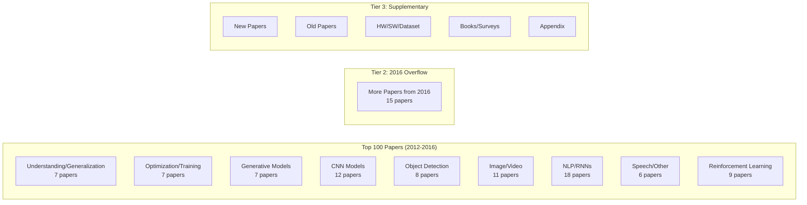

**Sources:** [README.md:47-67](), [README.md:71-379]()

## Markdown Formatting Conventions

The README.md uses strict markdown formatting patterns that enable it to function as both human-readable documentation and machine-parseable structured data. This dual-use design allows automation scripts to extract information programmatically.

### Section Headers

Research categories use level-3 markdown headers (`###`):

```markdown
### Understanding / Generalization / Transfer
### Optimization / Training Techniques
### Natural Language Processing / RNNs
```

These headers are parsed by automation scripts using regex pattern matching to identify section boundaries [README.md:71](), [README.md:82](), [README.md:148]().

### Paper Entry Format

Each paper follows a standardized format:

```markdown
- **Title** (year), Authors [[pdf]](url)
```

Example from the Understanding category [README.md:72]():
```markdown
- **Distilling the knowledge in a neural network** (2015), G. Hinton et al. [[pdf]](http://arxiv.org/pdf/1503.02531)
```

### Formatting Pattern Breakdown

| Component | Syntax | Example | Purpose |
|-----------|--------|---------|---------|
| List marker | `-` | `-` | Denotes individual paper entry |
| Title | `**text**` | `**Distilling the knowledge in a neural network**` | Bold title for emphasis and parsing |
| Year | `(YYYY)` | `(2015)` | Publication year in parentheses |
| Authors | `Author et al.` | `G. Hinton et al.` | Abbreviated author list |
| PDF Link | `[[pdf]](url)` | `[[pdf]](http://arxiv.org/pdf/1503.02531)` | Download link with consistent format |

This pattern is critical for automated parsing by [fetch_papers.py]() and [get_authors.py](), which extract titles and URLs using regular expressions.

**Sources:** [README.md:72-189]()

## Dual-Use Data Model

The README.md markdown structure serves a dual purpose: it is simultaneously human-readable documentation and machine-readable structured data. This design allows the same source document to support multiple consumption patterns.

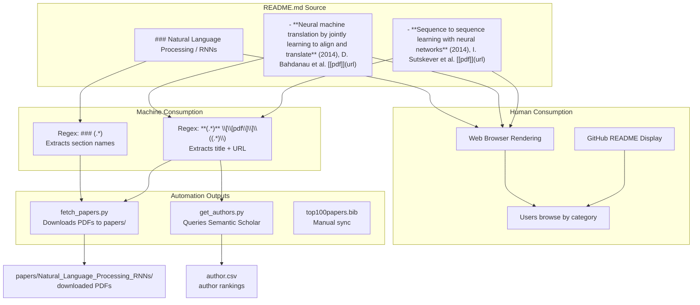

### Parsing Constraints

The dual-use model requires maintaining specific formatting rules:

1. **Section headers must use exactly `###`** - Used to detect category boundaries
2. **Paper titles must be wrapped in `**...**`** - Enables title extraction
3. **PDF links must use `[[pdf]](url)` format** - Standardized link pattern for parsing
4. **One paper per line starting with `-`** - Ensures reliable line-by-line processing

Any deviation from these patterns would break automated parsing. For example, using `####` for a subsection or omitting the bold markers around titles would cause [fetch_papers.py]() to skip those entries.

**Sources:** [README.md:71-189](), [fetch_papers.py:1-end](), [get_authors.py:1-end]()

## Paper Distribution by Category

The 100 papers in the main list are distributed across 9 research categories, with Natural Language Processing being the largest.

| Category | Papers | Lines | Key Topics |
|----------|--------|-------|------------|
| Understanding / Generalization / Transfer | 7 | [72-78]() | Knowledge distillation, transfer learning, visualization |
| Optimization / Training Techniques | 7 | [83-89]() | Batch normalization, dropout, Adam optimizer |
| Unsupervised / Generative Models | 7 | [94-100]() | GANs, VAEs, PixelRNN |
| Convolutional Neural Network Models | 12 | [104-115]() | ResNet, Inception, VGG, AlexNet |
| Image: Segmentation / Object Detection | 8 | [120-127]() | R-CNN family, YOLO, FCN |
| Image / Video / Etc | 11 | [132-142]() | Image captioning, style transfer, VQA |
| Natural Language Processing / RNNs | 18 | [149-166]() | Seq2seq, attention, word embeddings, NMT |
| Speech / Other Domain | 6 | [171-176]() | Speech recognition, acoustic modeling |
| Reinforcement Learning / Robotics | 9 | [181-189]() | DQN, AlphaGo, policy gradients |
| **More Papers from 2016** | 15 | [194-208]() | WaveNet, layer norm, domain adaptation |

### Category Size Visualization

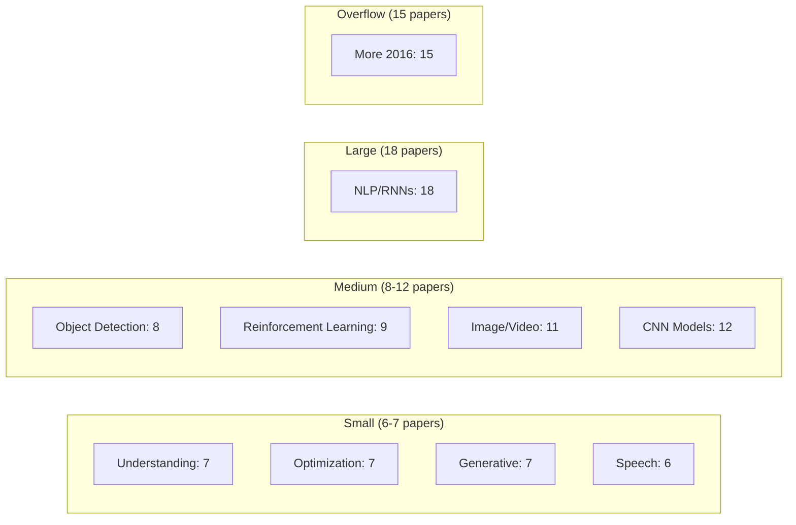

The NLP/RNNs category's size (18 papers) reflects the explosion of sequence modeling and attention mechanism research during 2012-2016, particularly the 2014-2015 period when neural machine translation emerged.

**Sources:** [README.md:71-208]()

## Section Navigation Structure

The README.md includes a table of contents [README.md:47-67]() that uses markdown anchor links to enable quick navigation:

```markdown
* [Understanding / Generalization / Transfer](#understanding--generalization--transfer)
* [Optimization / Training Techniques](#optimization--training-techniques)
* [Unsupervised / Generative Models](#unsupervised--generative-models)
* [Convolutional Network Models](#convolutional-neural-network-models)
* [Image Segmentation / Object Detection](#image-segmentation--object-detection)
* [Image / Video / Etc](#image--video--etc)
* [Natural Language Processing / RNNs](#natural-language-processing--rnns)
* [Speech / Other Domain](#speech--other-domain)
* [Reinforcement Learning / Robotics](#reinforcement-learning--robotics)
* [More Papers from 2016](#more-papers-from-2016)
```

The anchor format follows GitHub's automatic header ID generation: lowercase with spaces replaced by hyphens and special characters removed. For example, "Image / Video / Etc" becomes `#image--video--etc`.

**Sources:** [README.md:47-67]()

## Metadata and Commented Sections

The README.md includes commented-out metadata sections (using HTML comment syntax `<!-- -->`) that identify key researchers for each domain but are not rendered in the final display:

```markdown
<!---[Key researchers]  [Geoffrey Hinton](https://scholar.google.ca/citations?user=JicYPdAAAAAJ), 
[Yoshua Bengio](https://scholar.google.ca/citations?user=kukA0LcAAAAJ), 
[Jason Yosinski](https://scholar.google.ca/citations?hl=en&user=gxL1qj8AAAAJ) -->
```

These commented sections appear after most categories [README.md:80](), [README.md:91](), [README.md:102](), etc., providing additional context without cluttering the visible documentation. They could potentially be parsed for future researcher analytics features.

**Sources:** [README.md:80](), [README.md:91](), [README.md:102](), [README.md:117](), [README.md:129](), [README.md:144](), [README.md:168](), [README.md:178](), [README.md:191]()

## Maintenance Notice

The repository includes a prominent notice at the top [README.md:5]():

```markdown
[Notice] This list is not being maintained anymore because of the overwhelming amount 
of deep learning papers published every day since 2017.
```

This indicates that the list represents a historical snapshot of the 2012-2016 era, intentionally frozen to preserve its value as a curated collection of foundational papers rather than attempting to keep pace with exponential publication growth.

**Sources:** [README.md:5]()

## Relationship to Other Components

The curated list structure directly drives the behavior of automation tools and reference materials:

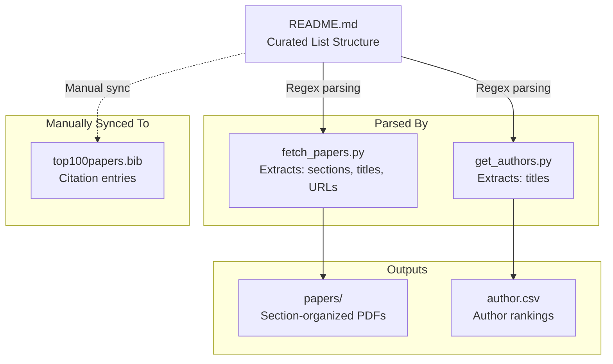

The strict markdown formatting conventions in README.md are essential for enabling this automated processing. Any structural changes to the paper list format would require corresponding updates to the parsing logic in the automation scripts.

**Sources:** [README.md:42](), [README.md:1-390]()

---

# Page: Paper Selection Criteria

# Paper Selection Criteria

<details>
<summary>Relevant source files</summary>

The following files were used as context for generating this wiki page:

- [Contributing.md](Contributing.md)
- [README.md](README.md)

</details>


## Purpose and Scope

This page documents the quantitative citation thresholds and qualitative assessment criteria used to curate papers for inclusion in the awesome-deep-learning-papers repository. The criteria serve as a filtering mechanism to identify the most influential deep learning papers from 2012-2016, maintaining a manageable "Top 100" list while accommodating overflow and special cases.

For information about how papers are organized into research domain categories once selected, see [Research Domain Categories](#2.2). For details on how to contribute papers according to these criteria, see [Contributing to the List](#3).

---

## Citation Threshold Framework

The repository uses a **year-based sliding scale** for citation thresholds, recognizing that older papers have had more time to accumulate citations. The criteria are defined in two locations with slightly different purposes:

### Primary Criteria (README.md)

The main list uses these thresholds for determining inclusion in the Top 100 papers:

| Publication Year | Minimum Citations | Section Placement |
|-----------------|-------------------|-------------------|
| < 6 months | N/A (by discussion) | New Papers |
| 2016 | 60 citations | Top 100 or "More Papers from 2016" |
| 2015 | 200 citations | Top 100 |
| 2014 | 400 citations | Top 100 |
| 2013 | 600 citations | Top 100 |
| 2012 | 800 citations | Top 100 |
| Before 2012 | N/A (by discussion) | Old Papers |

**Sources:** [README.md:26-33]()

### Enhanced Criteria (Contributing.md)

The contributing guide provides more granular thresholds including "sparkle" (⭐) designations for particularly highly-cited papers:

| Publication Year | Base Threshold | Sparkle Threshold (⭐) |
|-----------------|----------------|----------------------|
| 2016 | 20 citations | 50 citations |
| 2015 | 100 citations | 200 citations |
| 2014 | 200 citations | 400 citations |
| 2013 | 300 citations | 600 citations |
| 2012 | 400 citations | 800 citations |
| 2011 | 500 citations | 1000 citations |
| 2010 | 600 citations | 1200 citations |

**Sources:** [Contributing.md:7-13]()

### Citation Threshold Decision Tree

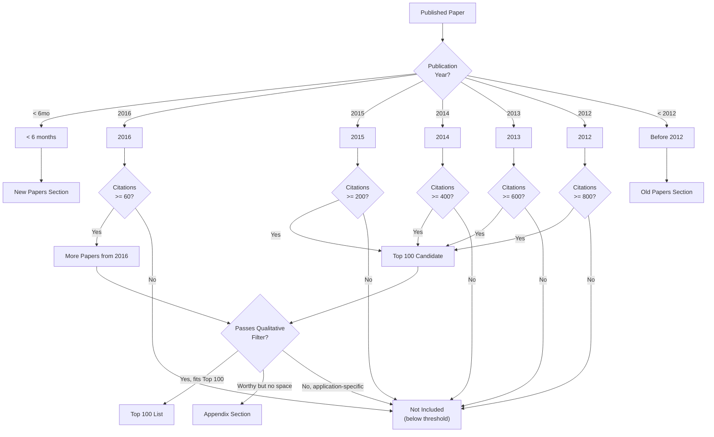

**Sources:** [README.md:26-35](), [Contributing.md:7-15]()

---

## Qualitative Assessment Criteria

The citation thresholds are explicitly described as a **"flexible guideline"** rather than a strict baseline. The repository prioritizes papers based on qualitative factors:

### Core Qualitative Principles

1. **Seminal Contribution**: Papers that introduce fundamental concepts or techniques
2. **Broad Applicability**: Methods that can be applied across various research domains
3. **Impact on Field**: Papers that influenced subsequent research directions

As stated in the repository:

> "Please note that we prefer seminal deep learning papers that can be applied to various researches rather than application papers."

This means domain-specific application papers (even with high citations) may be excluded in favor of foundational techniques papers with lower citations.

**Sources:** [README.md:35-36]()

### Qualitative vs. Quantitative Trade-offs

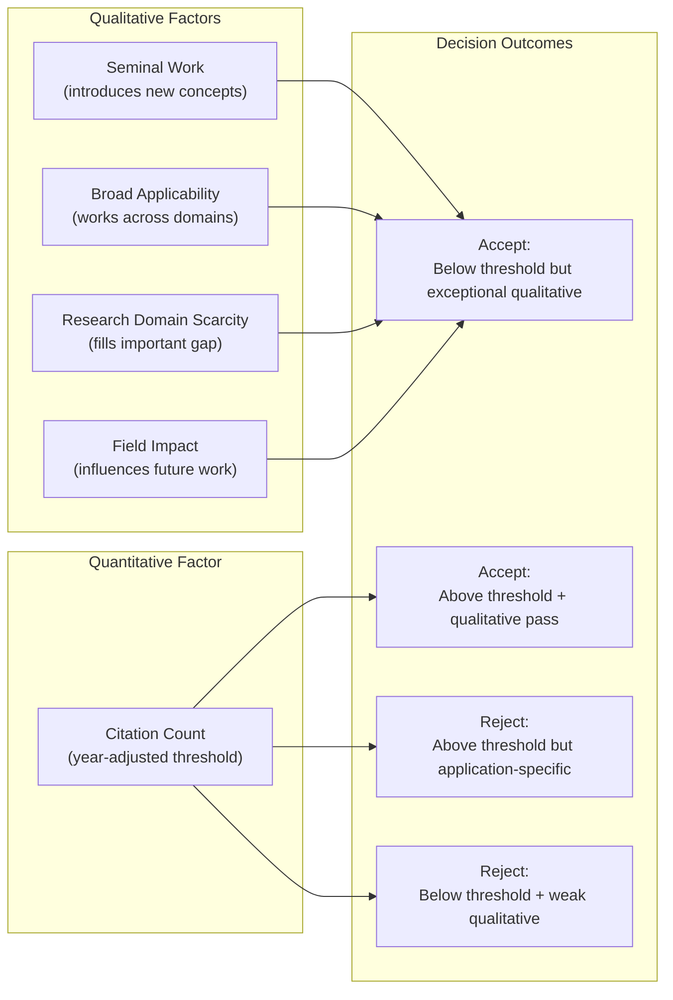

**Sources:** [README.md:35-36](), [Contributing.md:15-16]()

---

## Section Placement Strategy

The repository uses a multi-tier organizational structure to accommodate papers that don't fit the strict Top 100 constraint:

### Section Hierarchy and Placement Rules

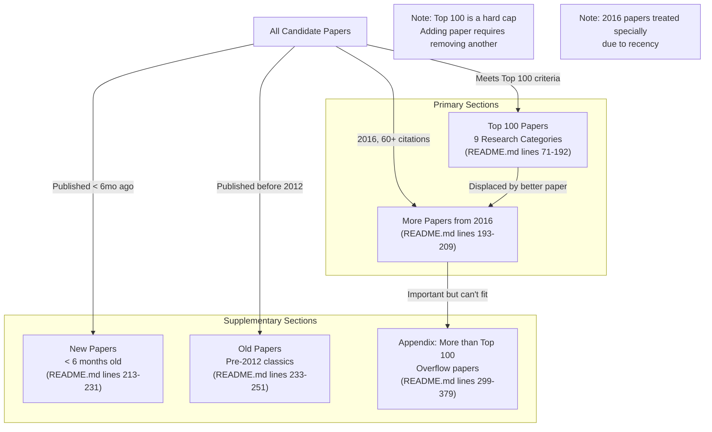

**Sources:** [README.md:19-24](), [README.md:60-67]()

### Hard Cap Enforcement

The repository enforces a strict limit of **exactly 100 papers** in the main list:

> "If a paper is added to the list, another paper (usually from *More Papers from 2016* section) should be removed to keep top 100 papers."

This zero-sum constraint means:
- **Addition Operation**: Adding 1 paper → Requires removing 1 paper
- **Typical Removal Source**: "More Papers from 2016" section (most recently added papers)
- **Contribution Value**: "removing papers is also important contributions as well as adding papers"

**Sources:** [README.md:22-23]()

---

## Criteria Encoding in Markdown Structure

The selection criteria are not enforced by code but are embedded in the repository's documentation structure and community governance:

### Markdown-Based Criteria Definition

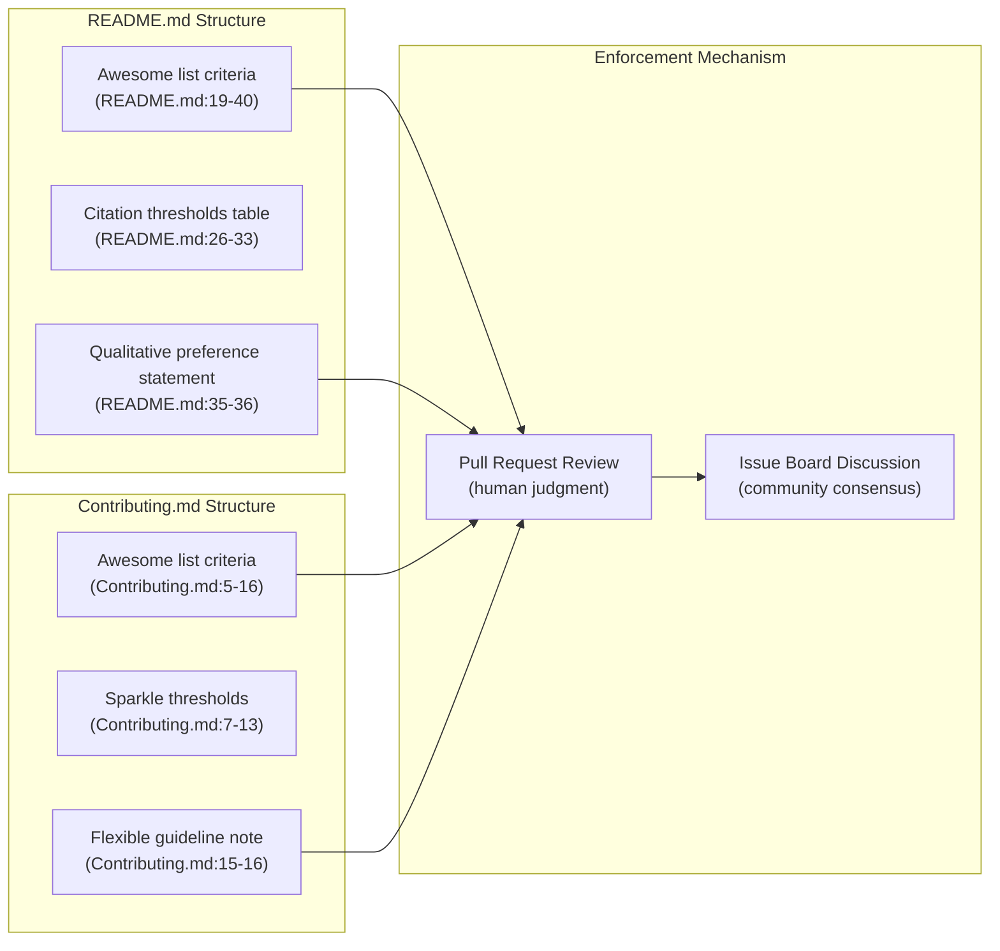

**Sources:** [README.md:19-40](), [Contributing.md:5-16]()

### No Automated Validation

Unlike many repositories, this codebase does **not** programmatically enforce selection criteria. The automation scripts (`fetch_papers.py`, `get_authors.py`) operate on papers already in the list but do not validate citations or apply acceptance criteria.

**Validation is manual and community-driven:**
- Contributors reference criteria in pull request descriptions
- Maintainers evaluate against qualitative principles
- Discussion occurs on GitHub Issues for borderline cases

**Sources:** [README.md:39-40](), [Contributing.md:3-4]()

---

## Special Cases and Exceptions

### New Papers (< 6 Months Old)

Papers published within the last 6 months bypass citation requirements:

> "**< 6 months** : *New Papers* (by discussion)"

These papers are evaluated based on:
- Novelty and potential impact
- Community discussion and early reception
- Author reputation and research group
- Alignment with emerging research trends

**Section Location:** [README.md:213-231]()

**Sources:** [README.md:27](), [README.md:62]()

### Old Papers (Before 2012)

Classic papers from before 2012 also bypass standard thresholds:

> "**~2012** : *Old Papers* (by discussion)"

These foundational papers are included for historical context and often establish fundamental concepts that enabled the 2012-2016 deep learning revolution. Examples include:
- LSTM (1997) - S. Hochreiter and J. Schmidhuber
- LeNet (1998) - Y. LeCun et al.
- Deep Belief Nets (2006) - G. Hinton et al.

**Section Location:** [README.md:233-251]()

**Sources:** [README.md:33](), [README.md:63]()

### More Papers from 2016

2016 papers receive special treatment with a **lower threshold (+60 citations)** but separate section placement:

> "**2016** : +60 citations or "More Papers from 2016""

This acknowledges that:
1. Recent papers haven't had time to accumulate citations like older papers
2. 2016 represented a particularly productive year in deep learning
3. These papers may graduate to Top 100 as citations increase

**Section Location:** [README.md:193-209]()

**Sources:** [README.md:28](), [README.md:58]()

---

## Criteria Application Workflow

### Contributor Perspective

When contributors suggest papers, they follow this workflow:

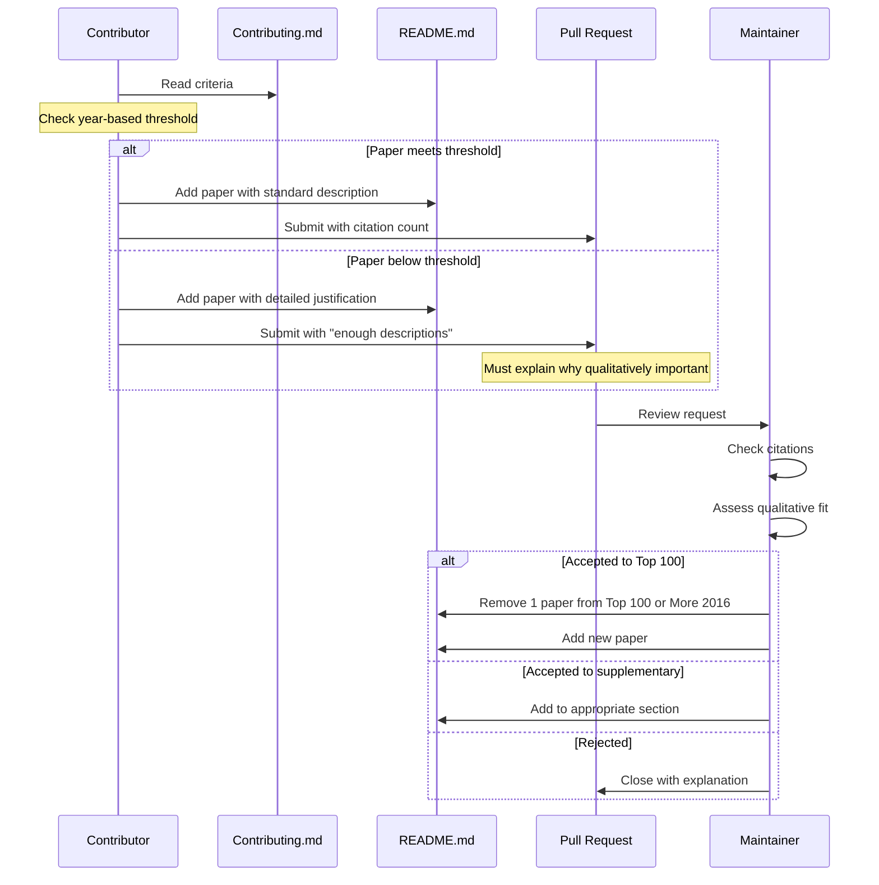

**Sources:** [Contributing.md:20-22](), [README.md:37-40]()

### Sparkle (⭐) Designation

High-impact papers that significantly exceed thresholds receive sparkle markers:

**Purpose:** Visual indication of exceptionally influential papers
**Implementation:** Manual addition via contributing process
**Modification Rule:** Contributors can suggest adding sparkles as citation counts increase

Example markdown:
```markdown
- **ImageNet classification with deep convolutional neural networks** (2012), A. Krizhevsky et al. :sparkles: [[pdf]](...)
```

**Sources:** [Contributing.md:7-13](), [Contributing.md:34]()

---

## Summary: Criteria Decision Matrix

| Factor | Weight | Evaluation Method |
|--------|--------|-------------------|
| **Publication Year** | High | Determines baseline threshold (800 for 2012 → 60 for 2016) |
| **Citation Count** | Medium-High | Quantitative screening against year-based threshold |
| **Seminal Nature** | High | Qualitative assessment: Does it introduce new concepts? |
| **Broad Applicability** | High | Qualitative assessment: Works across research domains? |
| **Research Domain Scarcity** | Medium | Qualitative assessment: Fills important gap in coverage? |
| **Field Impact** | High | Qualitative assessment: Influenced subsequent research? |

**Final Decision:** Boolean AND of quantitative screening + qualitative assessment, with flexibility to override thresholds for exceptional papers.

**Sources:** [README.md:19-40](), [Contributing.md:5-16]()

---

# Page: Research Domain Categories

# Research Domain Categories

<details>
<summary>Relevant source files</summary>

The following files were used as context for generating this wiki page:

- [README.md](README.md)
- [top100papers.bib](top100papers.bib)

</details>


## Purpose and Scope

This document describes the nine primary research domain categories used to organize the Top 100 deep learning papers in README.md. Each category represents a distinct area of deep learning research during the 2012-2016 period, grouping papers by their primary methodological or application focus. This organizational structure enables readers to navigate the curated list by research interest rather than chronologically or alphabetically.

For information about the selection criteria used to determine which papers enter the Top 100, see [Paper Selection Criteria](#2.1). For details on supplementary sections like New Papers, Old Papers, and educational resources, see [Supplementary Resources](#2.3).

Sources: [README.md:47-67]()

## Category Structure in README.md

The research categories are implemented as level-3 markdown headings (`### Category Name`) in README.md, with each paper listed as a bullet point containing the title, publication year, authors, and PDF link. This simple markdown structure serves dual purposes: human-readable documentation and machine-parseable data for automation scripts.

### Markdown Format Convention

```markdown
### Category Name
- **Paper Title** (year), Authors et al. [[pdf]](url)
- **Another Paper** (year), Authors [[pdf]](url)
```

The automation scripts in [fetch_papers.py]() and [get_authors.py]() parse this structure using regular expressions to extract section names and paper metadata.

Sources: [README.md:71-190](), [fetch_papers.py](), [get_authors.py]()

### Category Extraction Pattern

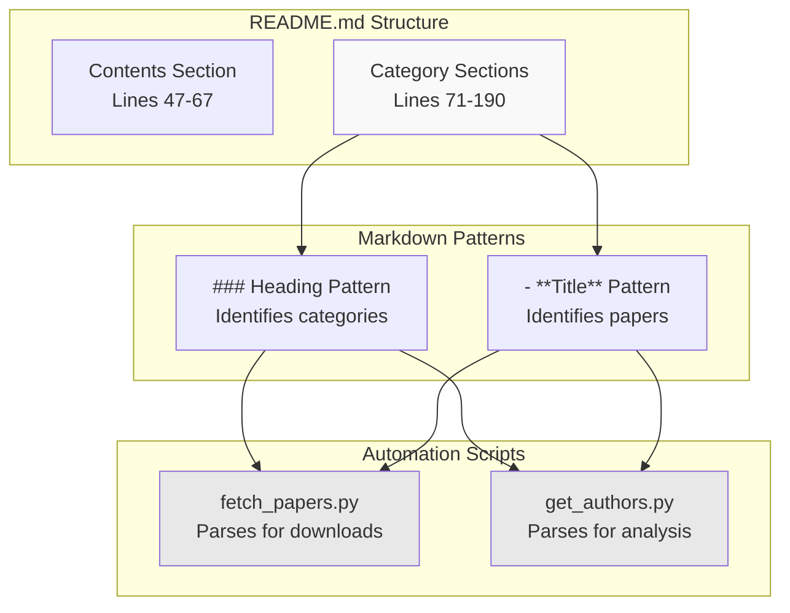

**Diagram: Category Parsing Pipeline** - Shows how markdown patterns in README.md are parsed by automation scripts.

Sources: [README.md:71-190](), [fetch_papers.py](), [get_authors.py]()

## The Nine Primary Categories

### Category Overview Table

| Category ID | Category Name | Papers | Lines | Focus Area |
|------------|---------------|---------|-------|------------|
| 1 | Understanding / Generalization / Transfer | 7 | 71-79 | Transfer learning, visualization, knowledge distillation |
| 2 | Optimization / Training Techniques | 7 | 82-90 | Training methods, normalization, regularization |
| 3 | Unsupervised / Generative Models | 7 | 93-101 | GANs, VAEs, generative architectures |
| 4 | Convolutional Neural Network Models | 12 | 103-116 | CNN architectures (AlexNet→ResNet evolution) |
| 5 | Image Segmentation / Object Detection | 8 | 119-128 | R-CNN family, segmentation, detection |
| 6 | Image / Video / Etc | 11 | 131-143 | Multi-modal, captioning, style transfer, video |
| 7 | Natural Language Processing / RNNs | 18 | 148-167 | Word embeddings, seq2seq, attention, NMT |
| 8 | Speech / Other Domain | 6 | 170-177 | Speech recognition, acoustic modeling |
| 9 | Reinforcement Learning / Robotics | 9 | 180-190 | DQN, policy gradients, AlphaGo, robotics |

**Total: 85 papers across 9 categories** (of the Top 100, with 15 in "More Papers from 2016")

Sources: [README.md:71-190]()

### Category Size Distribution

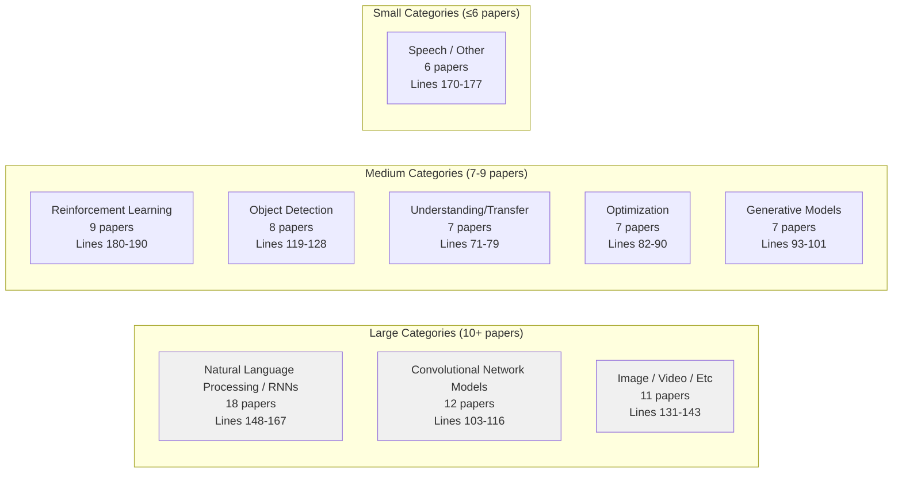

**Diagram: Category Distribution by Paper Count** - NLP/RNNs dominates with 18 papers, reflecting the explosion of sequence modeling research in 2012-2016.

Sources: [README.md:71-190]()

## Category Details

### 1. Understanding / Generalization / Transfer

**Location**: [README.md:71-79]()  
**Paper Count**: 7  
**Focus**: How neural networks learn, transfer knowledge, and generalize across tasks

**Key Papers**:
- Distilling the knowledge in a neural network (Hinton 2015) - Knowledge transfer
- Visualizing and understanding convolutional networks (Zeiler 2014) - Model interpretation
- How transferable are features in deep neural networks? (Yosinski 2014) - Transfer learning

**Research Questions**: What do neural networks learn? How can learned representations transfer between tasks? How can we interpret model decisions?

Sources: [README.md:71-79](), [top100papers.bib:1-50]()

### 2. Optimization / Training Techniques

**Location**: [README.md:82-90]()  
**Paper Count**: 7  
**Focus**: Methods to train deeper, faster, and more reliably

**Key Papers**:
- Batch normalization (Ioffe & Szegedy 2015) - Internal covariate shift
- Dropout (Srivastava 2014) - Regularization technique
- Adam optimizer (Kingma & Ba 2014) - Adaptive learning rates
- Training very deep networks (Srivastava 2015) - Highway networks

**Core Techniques**: Normalization, regularization, optimization algorithms, hyperparameter tuning

Sources: [README.md:82-90](), [top100papers.bib:52-102]()

### 3. Unsupervised / Generative Models

**Location**: [README.md:93-101]()  
**Paper Count**: 7  
**Focus**: Learning from unlabeled data and generating new samples

**Key Papers**:
- Generative adversarial nets (Goodfellow 2014) - Adversarial training
- Auto-encoding variational Bayes (Kingma & Welling 2013) - VAEs
- Pixel recurrent neural networks (van den Oord 2016) - Autoregressive models
- Unsupervised representation learning with DCGANs (Radford 2015)

**Paradigms**: GANs, VAEs, autoregressive models, unsupervised feature learning

Sources: [README.md:93-101](), [top100papers.bib:103-148]()

### 4. Convolutional Neural Network Models

**Location**: [README.md:103-116]()  
**Paper Count**: 12 (largest architectural category)  
**Focus**: CNN architecture design and evolution

**Architectural Evolution**:

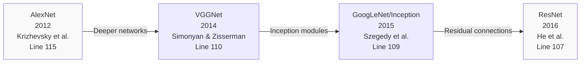

**Diagram: CNN Architecture Timeline** - Shows the progression from AlexNet to ResNet.

**Key Innovations**:
- **AlexNet** (2012): ReLU, dropout, GPU training
- **VGGNet** (2014): Deep uniform architectures
- **GoogLeNet** (2015): Inception modules, 1x1 convolutions
- **ResNet** (2016): Skip connections, 100+ layer networks
- **Spatial Transformer Networks** (2015): Learnable spatial transformations

Sources: [README.md:103-116](), [top100papers.bib:149-230]()

### 5. Image Segmentation / Object Detection

**Location**: [README.md:119-128]()  
**Paper Count**: 8  
**Focus**: Pixel-level classification and object localization

**R-CNN Family Evolution**:

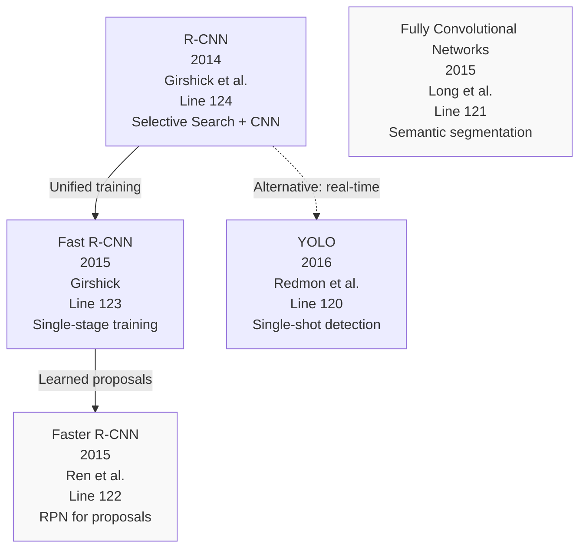

**Diagram: Object Detection and Segmentation Methods** - Parallel evolution of detection (R-CNN family) and segmentation (FCN) approaches.

**Key Paradigms**:
- Two-stage detection: R-CNN → Fast R-CNN → Faster R-CNN
- One-stage detection: YOLO
- Semantic segmentation: FCN, DeepLab

Sources: [README.md:119-128](), [top100papers.bib:231-291]()

### 6. Image / Video / Etc

**Location**: [README.md:131-143]()  
**Paper Count**: 11  
**Focus**: Multi-modal applications beyond classification

**Application Areas**:

| Application | Papers | Representative Work |
|------------|--------|---------------------|
| Image Captioning | 4 | Show and Tell (Vinyals 2015), Show Attend and Tell (Xu 2015) |
| Visual QA | 1 | VQA (Antol 2015) |
| Style Transfer | 1 | Neural algorithm of artistic style (Gatys 2015) |
| Video Understanding | 2 | Two-stream CNNs (Simonyan 2014), Large-scale video classification (Karpathy 2014) |
| Face Recognition | 1 | DeepFace (Taigman 2014) |
| Super-Resolution | 1 | SRCNN (Dong 2016) |

**Vision + Language**: This category particularly emphasizes multi-modal models that combine vision and language, representing a major research direction in 2015-2016.

Sources: [README.md:131-143](), [top100papers.bib:292-381]()

### 7. Natural Language Processing / RNNs

**Location**: [README.md:148-167]()  
**Paper Count**: 18 (largest category overall)  
**Focus**: Sequential data, language understanding, and generation

**Sub-areas by Paper Count**:

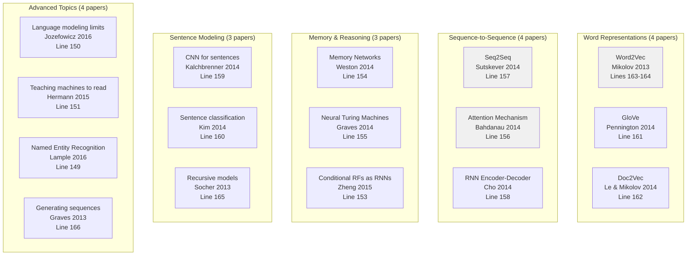

**Diagram: NLP/RNN Sub-area Breakdown** - The 18 papers span word embeddings, seq2seq, memory networks, and sentence modeling.

**Major Breakthroughs**:
- **Word Embeddings**: Word2Vec, GloVe revolutionized representation learning
- **Sequence-to-Sequence**: Enabled neural machine translation
- **Attention Mechanisms**: Addressed long-sequence limitations
- **Memory Networks**: External memory for reasoning tasks

Sources: [README.md:148-167](), [top100papers.bib:389-500]()

### 8. Speech / Other Domain

**Location**: [README.md:170-177]()  
**Paper Count**: 6  
**Focus**: Speech recognition and acoustic modeling

**Key Papers**:
- Deep Speech 2 (Amodei 2015) - End-to-end English and Mandarin recognition
- Speech recognition with deep RNNs (Graves 2013) - Recurrent architectures
- Deep neural networks for acoustic modeling (Hinton 2012) - Foundational work

**Historical Note**: This category captures the transition from GMM-HMM to deep learning for speech, particularly work from 2012-2013 that established DNNs for acoustic modeling.

Sources: [README.md:170-177](), [top100papers.bib:501-552]()

### 9. Reinforcement Learning / Robotics

**Location**: [README.md:180-190]()  
**Paper Count**: 9  
**Focus**: Learning from interaction, game playing, robot control

**Key Milestones**:

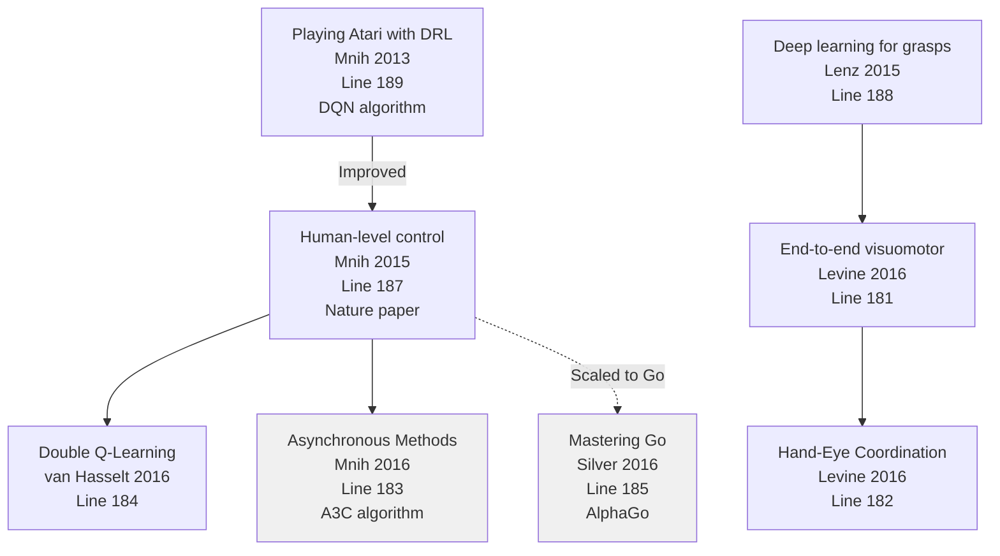

**Diagram: RL/Robotics Milestones** - Shows parallel development of game-playing RL and robotic control.

**Two Tracks**:
- **Game Playing**: DQN → Double DQN → A3C → AlphaGo
- **Robotics**: Vision-based grasping and visuomotor policies

Sources: [README.md:180-190](), [top100papers.bib:553-622]()

## Category Relationships and Overlaps

### Cross-Category Themes

Several papers could fit multiple categories, revealing thematic connections:

```mermaid
graph TB
    subgraph "Core Techniques"
        OPT["Optimization<br/>Category 2"]
        UNDERSTAND["Understanding<br/>Category 1"]
    end
    
    subgraph "Architecture Categories"
        CNN["CNN Models<br/>Category 4"]
        GEN["Generative<br/>Category 3"]
    end
    
    subgraph "Application Categories"
        DETECTION["Detection<br/>Category 5"]
        IMGVID["Image/Video<br/>Category 6"]
        NLP["NLP/RNN<br/>Category 7"]
        SPEECH["Speech<br/>Category 8"]
        RL["RL/Robotics<br/>Category 9"]
    end
    
    OPT -.->|"Enables training"| CNN
    OPT -.->|"Enables training"| GEN
    OPT -.->|"Enables training"| NLP
    
    UNDERSTAND -.->|"Interprets"| CNN
    UNDERSTAND -.->|"Transfer from"| CNN
    
    CNN -->|"Backbone for"| DETECTION
    CNN -->|"Backbone for"| IMGVID
    CNN -->|"Combined with"| NLP
    CNN -->|"Used in"| RL
    
    NLP -->|"RNNs for"| SPEECH
    NLP -.->|"Captioning in"| IMGVID
    
    style OPT fill:#e8e8e8
    style CNN fill:#e8e8e8
    style NLP fill:#e8e8e8
```

**Diagram: Inter-Category Dependencies** - Core technique categories enable architecture categories, which support application categories.

**Notable Overlaps**:
- **CNNs + NLP**: Image captioning papers (Category 6) use both CNNs and RNNs
- **CNNs + RL**: Vision-based RL (Category 9) uses CNNs for perception
- **Optimization → All**: Training techniques apply across all architectures
- **Understanding → CNNs**: Visualization and transfer learning focus on CNNs

Sources: [README.md:71-190]()

## Category Evolution Over Time

### Temporal Distribution by Category

The papers span 2012-2016, with categories showing distinct temporal patterns:

| Category | 2012 | 2013 | 2014 | 2015 | 2016 | Peak Year |
|----------|------|------|------|------|------|-----------|
| Understanding / Transfer | 0 | 0 | 5 | 2 | 0 | 2014 |
| Optimization | 2 | 0 | 2 | 3 | 0 | 2015 |
| Generative Models | 0 | 2 | 1 | 2 | 2 | Mixed |
| CNN Models | 1 | 2 | 3 | 2 | 4 | 2016 |
| Detection/Segmentation | 0 | 1 | 3 | 3 | 1 | 2014-2015 |
| Image/Video | 0 | 1 | 4 | 5 | 1 | 2015 |
| NLP/RNNs | 0 | 4 | 8 | 3 | 3 | 2014 |
| Speech | 2 | 1 | 0 | 1 | 2 | 2012 |
| RL/Robotics | 0 | 1 | 0 | 4 | 4 | 2015-2016 |

**Observations**:
- **2012**: Foundational year (AlexNet, optimization basics, speech DNNs)
- **2013-2014**: Explosion in NLP/RNNs (Word2Vec, seq2seq, attention)
- **2014-2015**: Detection/segmentation maturity (R-CNN family, FCN)
- **2015-2016**: RL breakthroughs (DQN → AlphaGo) and CNN refinement (ResNet)

Sources: [README.md:71-190]()

## How Automation Scripts Use Categories

### fetch_papers.py Section Processing

The [fetch_papers.py]() script parses categories to create an organized download directory:

```mermaid
graph TB
    README["README.md<br/>Lines 71-190"]
    
    REGEX_SECTION["Regex: r'### (.+)'<br/>Extracts section names"]
    REGEX_PAPER["Regex: r'\*\*(.+?)\*\*.*\[\[pdf\]\]\((.+?)\)'<br/>Extracts titles & URLs"]
    
    DOWNLOAD["Download Loop<br/>For each section, paper"]
    
    DIR_STRUCTURE["papers/<br/>├── Understanding_Generalization_Transfer/<br/>├── Optimization_Training_Techniques/<br/>├── Unsupervised_Generative_Models/<br/>├── Convolutional_Neural_Network_Models/<br/>├── Image_Segmentation_Object_Detection/<br/>├── Image_Video_Etc/<br/>├── Natural_Language_Processing_RNNs/<br/>├── Speech_Other_Domain/<br/>└── Reinforcement_Learning_Robotics/"]
    
    README --> REGEX_SECTION
    README --> REGEX_PAPER
    
    REGEX_SECTION --> DOWNLOAD
    REGEX_PAPER --> DOWNLOAD
    
    DOWNLOAD --> DIR_STRUCTURE
    
    style README fill:#f9f9f9
    style DIR_STRUCTURE fill:#e8e8e8
```

**Diagram: fetch_papers.py Category-Based Directory Creation** - Categories from README.md become subdirectories in papers/.

**Implementation Notes**:
- Section names are sanitized (spaces → underscores, special chars removed)
- Each category becomes a subdirectory in `papers/`
- Papers are downloaded with sanitized filenames based on titles
- The `.gitignore` file excludes `papers/` from version control

Sources: [fetch_papers.py](), [.gitignore]()

### get_authors.py Category Awareness

The [get_authors.py]() script could track authors per category (though current implementation aggregates globally):

```mermaid
graph LR
    README["README.md<br/>Category sections"]
    
    EXTRACT["Extract paper titles<br/>per category"]
    
    SEMANTIC["Query Semantic Scholar API<br/>For each paper"]
    
    AUTHORS_DATA["Author data:<br/>- Name<br/>- Position in author list<br/>- Paper category (potential)"]
    
    SCORE["Calculate weighted scores<br/>First author: 1.0<br/>Second: 0.5<br/>Third+: 0.33"]
    
    CSV["author.csv<br/>Global rankings<br/>(could be per-category)"]
    
    README --> EXTRACT
    EXTRACT --> SEMANTIC
    SEMANTIC --> AUTHORS_DATA
    AUTHORS_DATA --> SCORE
    SCORE --> CSV
    
    style README fill:#f9f9f9
    style CSV fill:#e8e8e8
```

**Diagram: get_authors.py Paper Extraction** - Shows potential for category-aware author analysis.

**Current vs. Potential**:
- **Current**: Aggregates all authors across all categories
- **Potential**: Could identify category-specific influential authors (e.g., "Top RL researchers" vs. "Top NLP researchers")

Sources: [get_authors.py]()

## Category Usage Patterns

### For Readers: Navigation by Interest

The category structure enables multiple reading paths:

1. **Domain Experts**: Start with specific category (e.g., NLP researchers → Category 7)
2. **Architecture Focus**: Follow CNN evolution in Category 4
3. **Application Focus**: Explore vision applications in Categories 5-6
4. **Methodology Focus**: Study core techniques in Categories 1-3

### For Contributors: Adding Papers

The [Contributing.md]() file implicitly requires category placement:

**Process**:
1. Identify appropriate category for new paper
2. Add to correct section in README.md
3. Maintain alphabetical or chronological ordering within category
4. Ensure paper meets category's thematic focus

**Category Boundaries**: Some papers span categories, requiring judgment:
- Image captioning: Category 6 (Image/Video) or Category 7 (NLP)? → Category 6 (vision-first)
- Visual QA: Similar decision → Category 6
- Conditional RFs as RNNs: Category 5 (segmentation) or Category 7 (RNNs)? → Category 7 (methodology-first)

Sources: [Contributing.md](), [README.md:47-67]()

### For Automated Tools: Category as Organizational Metadata

Categories provide machine-readable structure:

| Tool | Category Usage |
|------|----------------|
| `fetch_papers.py` | Creates subdirectories for organized downloads |
| `get_authors.py` | Could segment author rankings by field |
| BibTeX generators | Could generate category-specific bibliographies |
| Static site generators | Could create category-filtered views |
| Citation analysis | Could track category-specific impact metrics |

Future enhancements could leverage categories more deeply for domain-specific analytics.

Sources: [fetch_papers.py](), [get_authors.py](), [top100papers.bib]()

## Category Design Principles

### Principles Inferred from Structure

Analyzing the nine categories reveals implicit design principles:

1. **Methodology vs. Application**: Categories 1-4 focus on methods (understanding, optimization, generative, CNN architectures), while Categories 5-9 focus on applications (vision tasks, NLP, speech, RL)

2. **Granularity Balance**: 
   - Computer vision split into 3 categories (CNN architectures, detection/segmentation, other vision)
   - NLP consolidated into 1 category despite being largest (18 papers)
   - Speech separate despite small size (6 papers) due to domain specificity

3. **Historical Representation**: Categories capture 2012-2016 landscape:
   - Speech separate (major 2012 breakthrough)
   - RL separate (2015-2016 explosion)
   - No transformer category (emerged post-2016)

4. **Practical Organization**: Categories enable:
   - Efficient navigation (~6-18 papers per category)
   - Clear thematic grouping
   - Balanced representation across deep learning sub-fields

### What's Not Categorized

Several areas receive limited or no explicit categorization:

- **Meta-learning**: Only 1 paper in "More from 2016"
- **Neural architecture search**: Not yet prominent in 2012-2016
- **Graph neural networks**: Minimal presence
- **Transformers**: Published in 2017 (outside scope)
- **Multi-task learning**: Scattered across categories
- **Hardware/efficiency**: Relegated to supplementary sections

This reflects the historical state of deep learning in 2012-2016, dominated by CNNs, RNNs, and RL.

Sources: [README.md:1-390]()

## Summary

The nine research domain categories provide a hierarchical organization of the Top 100 papers that balances methodological depth (Categories 1-4) with application breadth (Categories 5-9). The markdown-based implementation serves both human readers and automation scripts, with categories ranging from 6 to 18 papers each. Natural Language Processing/RNNs dominates with 18 papers, reflecting the explosion of sequence modeling research during 2012-2016, while the separation of vision into three distinct categories (architectures, detection, applications) shows the maturity and diversity of computer vision research during this period.

Sources: [README.md:1-390](), [fetch_papers.py](), [get_authors.py]()

---

# Page: Supplementary Resources

# Supplementary Resources

<details>
<summary>Relevant source files</summary>

The following files were used as context for generating this wiki page:

- [README.md](README.md)

</details>


## Purpose and Scope

This document describes the supplementary resources provided in the README.md beyond the Top 100 papers list. These sections capture foundational materials (books, tutorials, datasets), temporal overflow (new/old papers outside 2012-2016), and high-quality papers that didn't meet the Top 100 citation thresholds but remain valuable references.

For information about the Top 100 papers selection criteria, see [Paper Selection Criteria](#2.1). For information about the nine research domain categories that organize the Top 100 papers, see [Research Domain Categories](#2.2).

---

## Supplementary Resources Architecture

The supplementary sections extend the repository's value beyond the core Top 100 papers by providing contextual learning materials and temporal flexibility.

```mermaid
graph TB
    subgraph Core["Core Curated List"]
        TOP100["Top 100 Papers<br/>2012-2016<br/>High citation count"]
    end
    
    subgraph Temporal["Temporal Extensions"]
        NEW["New Papers<br/>< 6 months old<br/>By discussion"]
        OLD["Old Papers<br/>Pre-2012 classics<br/>By discussion"]
    end
    
    subgraph Educational["Educational Resources"]
        BOOKS["Book / Survey / Review<br/>9 foundational texts"]
        VIDEOS["Video Lectures / Tutorials / Blogs<br/>Courses + Community"]
    end
    
    subgraph Infrastructure["Infrastructure & Data"]
        HWSW["HW / SW / Dataset<br/>7 technical reports"]
    end
    
    subgraph Overflow["Overflow Papers"]
        APPENDIX["Appendix: More than Top 100<br/>~100 additional papers"]
    end
    
    TOP100 -.->|"Cite for background"| BOOKS
    TOP100 -.->|"Learn from"| VIDEOS
    TOP100 -.->|"Evaluated on"| HWSW
    TOP100 -.->|"Recent developments"| NEW
    TOP100 -.->|"Historical context"| OLD
    TOP100 -.->|"Overflow candidates"| APPENDIX
    
    BOOKS -->|"Taught in"| VIDEOS
    HWSW -->|"Referenced in"| TOP100
```

**Supplementary Resources Organization in README.md**

Sources: [README.md:60-67]()

---

## Resource Categories

### Books, Surveys, and Reviews

The `### Book / Survey / Review` section provides nine foundational texts that offer comprehensive overviews of deep learning theory and practice. These resources serve as companions to the paper list, providing structured learning paths and historical context.

```mermaid
graph LR
    subgraph Books_Section["Book / Survey / Review Section"]
        HEADER["### Book / Survey / Review<br/>Lines 264-275"]
    end
    
    subgraph Resources["9 Resources"]
        TEXTBOOK["Deep Learning Book<br/>Goodfellow et al. 2016<br/>HTML format"]
        NIELSEN["Neural Networks Book<br/>Nielsen 2017<br/>HTML format"]
        OVERVIEW["Survey Papers<br/>7 PDF papers"]
    end
    
    subgraph Topics["Coverage"]
        THEORY["Foundational Theory"]
        RL["RL Overview"]
        NMT["NMT Tutorial"]
        VAE["VAE Tutorial"]
        LSTM["LSTM Analysis"]
    end
    
    HEADER --> TEXTBOOK
    HEADER --> NIELSEN
    HEADER --> OVERVIEW
    
    TEXTBOOK --> THEORY
    OVERVIEW --> RL
    OVERVIEW --> NMT
    OVERVIEW --> VAE
    OVERVIEW --> LSTM
```

**Books and Surveys in the Repository**

| Resource Type | Count | Format | Purpose |
|--------------|-------|---------|---------|
| Books | 2 | HTML | Comprehensive textbooks |
| Survey Papers | 5 | PDF | Topic-specific overviews |
| Tutorial Papers | 2 | PDF | Practical guides |

**Key Resources:**
- **Deep Learning** (Goodfellow et al., 2016): The canonical textbook, available online at deeplearningbook.org
- **Neural Networks and Deep Learning** (Nielsen, 2017): Beginner-friendly online book
- **Deep Reinforcement Learning: An Overview** (Li, 2017): Survey of RL methods
- **Neural Machine Translation Tutorial** (Neubig, 2017): Seq2seq models guide
- **Tutorial on Variational Autoencoders** (Doersch, 2016): VAE practical guide

Sources: [README.md:264-275]()

---

### Video Lectures, Tutorials, and Blogs

The `### Video Lectures / Tutorials / Blogs` section curates high-quality educational content organized into three tiers: university courses (lectures), conference tutorials, and community blogs.

```mermaid
graph TB
    subgraph Section["Video Lectures / Tutorials / Blogs"]
        HEADER["### Video Lectures / Tutorials / Blogs<br/>Lines 276-298"]
    end
    
    subgraph Lectures["University Courses"]
        CS231N["CS231n Stanford<br/>Computer Vision"]
        CS224D["CS224d Stanford<br/>NLP"]
        OXFORD["Oxford Deep NLP 2017"]
    end
    
    subgraph Tutorials["Conference Tutorials"]
        NIPS2016["NIPS 2016 Tutorials"]
        ICML2016["ICML 2016 Tutorials"]
        ICLR2016["ICLR 2016 Videos"]
        DLSS2016["DL Summer School 2016"]
        BAYDL2016["Bay Area DL School 2016"]
    end
    
    subgraph Blogs["Community Blogs"]
        OPENAI["OpenAI Blog"]
        DISTILL["Distill Journal"]
        KARPATHY["Andrej Karpathy"]
        COLAH["Colah's Blog"]
        WILDML["WildML"]
        FASTML["FastML"]
        MORNING["TheMorningPaper"]
    end
    
    HEADER --> Lectures
    HEADER --> Tutorials
    HEADER --> Blogs
```

**Educational Content Structure**

| Category | Count | Description | Format |
|----------|-------|-------------|---------|
| Lectures | 3 | Full semester university courses | Video + slides |
| Tutorials | 5 | Conference-length deep dives | Video recordings |
| Blogs | 7 | Ongoing community content | Web articles |

**Notable Courses:**
- **CS231n** (Stanford): Convolutional Neural Networks for Visual Recognition - the standard computer vision course
- **CS224d** (Stanford): Deep Learning for NLP - foundational sequence modeling course
- **Oxford Deep NLP 2017**: Modern NLP architectures with GitHub lecture materials

**Major Tutorial Events:**
- NIPS 2016, ICML 2016, ICLR 2016: Top-tier conference tutorial tracks
- Deep Learning Summer School 2016 (Montreal): Intensive week-long program
- Bay Area Deep Learning School 2016 (Stanford): Industry-focused bootcamp

Sources: [README.md:276-298]()

---

### Hardware, Software, and Datasets

The `### HW / SW / Dataset` section documents seven critical technical reports covering deep learning frameworks, benchmark datasets, and infrastructure papers.

```mermaid
graph TB
    subgraph Section["HW / SW / Dataset Section"]
        HEADER["### HW / SW / Dataset<br/>Lines 253-262"]
    end
    
    subgraph Frameworks["Deep Learning Frameworks"]
        TF["TensorFlow 2016<br/>Google distributed system"]
        CAFFE["Caffe 2014<br/>Berkeley framework"]
        THEANO["Theano<br/>Python framework"]
        TORCH["Torch7<br/>Lua framework"]
        MATCONV["MatConvNet 2015<br/>MATLAB toolbox"]
    end
    
    subgraph Datasets["Benchmark Datasets"]
        IMAGENET["ImageNet LSVRC 2015<br/>Visual recognition challenge"]
        SQUAD["SQuAD 2016<br/>Reading comprehension"]
        OPENAIGYM["OpenAI Gym 2016<br/>RL environments"]
    end
    
    HEADER --> Frameworks
    HEADER --> Datasets
```

**Framework and Dataset Papers**

| Resource | Year | Type | Citation Purpose |
|----------|------|------|------------------|
| TensorFlow | 2016 | Framework | Distributed training infrastructure |
| Caffe | 2014 | Framework | Fast convolutional network implementation |
| Theano | N/A | Framework | Symbolic differentiation engine |
| Torch7 | 2011 | Framework | Research prototyping environment |
| MatConvNet | 2015 | Framework | MATLAB integration |
| ImageNet LSVRC | 2015 | Dataset | Standard vision benchmark |
| SQuAD | 2016 | Dataset | Reading comprehension benchmark |
| OpenAI Gym | 2016 | Dataset | RL environment suite |

**Framework Ecosystem (2014-2016):**
- **TensorFlow**: Google's production-grade distributed system, replacing DistBelief
- **Caffe**: Berkeley's fast CNN framework, popular for computer vision
- **Theano**: Academic research tool with automatic differentiation
- **Torch7**: Lua-based framework favored by Facebook AI Research

**Benchmark Datasets:**
- **ImageNet LSVRC**: 1000-class image classification, standard CV benchmark
- **SQuAD**: 100,000+ question-answer pairs for reading comprehension
- **OpenAI Gym**: Standardized RL environment interface

Sources: [README.md:253-262]()

---

## Temporal Overflow Sections

### New Papers Section

The `### New papers` section captures recently published papers (less than 6 months old at time of curation) that show promise but lack sufficient citation history to qualify for the Top 100 list under the standard criteria.

```mermaid
graph LR
    subgraph Criteria["Citation Criteria"]
        SIX["< 6 months old<br/>Evaluated by discussion<br/>Not citation count"]
    end
    
    subgraph NewPapers["New Papers Section"]
        HEADER["### New papers<br/>Lines 213-231"]
        PAPERS["~15 papers from 2017"]
    end
    
    subgraph Disposition["Future Paths"]
        TOP100["Migrate to Top 100<br/>After citation threshold"]
        MORE2016["Migrate to More 2016<br/>If citation insufficient"]
        REMOVE["Remove from list<br/>If not impactful"]
    end
    
    SIX --> NewPapers
    NewPapers --> TOP100
    NewPapers --> MORE2016
    NewPapers --> REMOVE
```

**New Papers Characteristics:**

| Characteristic | Value | Rationale |
|----------------|-------|-----------|
| Age threshold | < 6 months | Too recent for citation metrics |
| Selection method | By discussion | Community consensus on importance |
| Typical count | ~15 papers | Manageable recent developments |
| Publication year | 2017 (at time of curation) | Post-maintenance period |

**Example Papers in New Section:**
- MobileNets (2017): Efficient mobile architectures
- Mask R-CNN (2017): Instance segmentation breakthrough
- Wasserstein GAN (2017): Improved GAN training
- Understanding Deep Learning Requires Rethinking Generalization (2017): Influential theory paper

**Selection Rationale:**
Papers enter this section based on community excitement, influential authors, breakthrough results, or significant architectural innovations before citation data matures.

Sources: [README.md:213-231](), [README.md:27]()

---

### Old Papers Section

The `### Old Papers` section preserves historically important papers published before 2012 that established deep learning foundations but predate the repository's primary focus period.

```mermaid
graph TB
    subgraph Criteria["Selection Criteria"]
        PRE2012["Pre-2012 publication<br/>Classic/foundational works<br/>Selected by discussion"]
    end
    
    subgraph OldPapers["Old Papers Section"]
        HEADER["### Old Papers<br/>Lines 233-251"]
        COUNT["17 papers<br/>1997-2011"]
    end
    
    subgraph Eras["Historical Eras"]
        ERA1["Deep Belief Era<br/>2006-2007<br/>Hinton et al."]
        ERA2["Unsupervised Pretraining<br/>2010-2011<br/>RBMs, autoencoders"]
        ERA3["LSTM Foundation<br/>1997<br/>Hochreiter & Schmidhuber"]
        ERA4["CNN Foundation<br/>1998<br/>LeNet"]
    end
    
    PRE2012 --> OldPapers
    OldPapers --> ERA1
    OldPapers --> ERA2
    OldPapers --> ERA3
    OldPapers --> ERA4
```

**Historical Paper Distribution:**

| Time Period | Count | Key Theme | Representative Work |
|-------------|-------|-----------|---------------------|
| 2011 | 3 | Unsupervised feature learning | Deep Sparse Rectifiers (Glorot) |
| 2010 | 5 | Pre-training techniques | Stacked Denoising Autoencoders (Vincent) |
| 2009 | 1 | Deep architectures | Learning Deep Architectures (Bengio) |
| 2006-2007 | 3 | Deep belief networks | Fast Learning Algorithm (Hinton) |
| 1997-1998 | 2 | Foundational architectures | LSTM, LeNet |

**Critical Historical Papers:**
- **LSTM** (Hochreiter & Schmidhuber, 1997): Recurrent network architecture still in use
- **LeNet** (LeCun, 1998): Gradient-based learning for document recognition
- **Fast Learning for DBNs** (Hinton, 2006): Sparked the deep learning renaissance
- **Reducing Dimensionality** (Hinton & Salakhutdinov, 2006): Demonstrated deep autoencoder effectiveness
- **Natural Language Processing Almost from Scratch** (Collobert, 2011): End-to-end NLP without hand-crafted features

Sources: [README.md:233-251](), [README.md:33]()

---

## Appendix: More than Top 100

The `### Appendix: More than Top 100` section serves as an overflow repository containing approximately 100 additional high-quality papers that either narrowly missed the Top 100 cutoff or represent important domain-specific contributions.

```mermaid
graph TB
    subgraph Appendix["Appendix Section"]
        HEADER["### Appendix: More than Top 100<br/>Lines 299-379"]
        COUNT["~100 overflow papers"]
    end
    
    subgraph Organization["Temporal Organization"]
        Y2016["2016 Papers<br/>~27 papers"]
        Y2015["2015 Papers<br/>~33 papers"]
        Y2014["~2014 Papers<br/>~16 papers"]
    end
    
    subgraph Reasons["Reasons for Inclusion"]
        CITATIONS["Just below citation threshold"]
        DOMAIN["Important for specific domain"]
        APPLICATION["Valuable application paper"]
        TIMING["Published late in year"]
    end
    
    HEADER --> Organization
    Organization --> Y2016
    Organization --> Y2015
    Organization --> Y2014
    
    Y2016 --> Reasons
    Y2015 --> Reasons
    Y2014 --> Reasons
```

**Appendix Paper Categories:**

| Category | Description | Example Papers |
|----------|-------------|----------------|
| Near-miss Citations | Papers just below threshold | Character-level decoder (Chung, 2016) |
| Domain-specific Excellence | Important within subfield | Brain tumor segmentation (Havaei, 2017) |
| Application Breakthroughs | Novel applications | Dermatologist-level skin cancer (Esteva, 2017) |
| Architectural Variations | Important architectural tweaks | Densely connected networks (Huang, 2016) |
| Methodology Advances | Training/optimization improvements | Professor Forcing (Lamb, 2016) |

**Notable Appendix Papers:**

**2016 Additions:**
- Densely Connected CNNs (DenseNet): Alternative to ResNet architecture
- Adversarially Learned Inference: ALI framework for inference
- Deep Networks with Stochastic Depth: Training efficiency technique

**2015 Additions:**
- Deep Compression: Model compression techniques (Han et al.)
- Tree-structured LSTM: Hierarchical sentence modeling
- Trust Region Policy Optimization (TRPO): RL algorithm
- End-to-end Memory Networks: Neural reasoning architecture

**2014 Additions:**
- DeepPose: Human pose estimation
- Empirical Evaluation of GRUs: GRU vs LSTM comparison
- Addressing Rare Words in NMT: Unknown word handling

**Management Strategy:**
When new papers are added to the Top 100, papers from this appendix may be removed to maintain the "top 100" constraint, as stated in the contribution guidelines.

Sources: [README.md:299-379](), [README.md:22-23]()

---

## Relationship Between Supplementary Sections

The supplementary sections work together to provide complete coverage of the deep learning landscape around the Top 100 core.

```mermaid
graph TB
    subgraph MainList["Core List"]
        TOP100_CORE["Top 100 Papers<br/>2012-2016<br/>High citations<br/>Seminal works"]
    end
    
    subgraph Learning["Learning Path"]
        BOOKS_RES["Books/Surveys<br/>Start here for theory"]
        VIDEOS_RES["Videos/Tutorials<br/>Structured learning"]
        TOP100_CORE
        PAPERS_EXP["Appendix Papers<br/>Deep dive topics"]
    end
    
    subgraph Timeline["Historical Timeline"]
        OLD_RES["Old Papers<br/>Pre-2012<br/>Foundations"]
        TOP100_CORE
        NEW_RES["New Papers<br/>< 6 months<br/>Recent advances"]
    end
    
    subgraph Practice["Practical Implementation"]
        TOP100_CORE
        HWSW_RES["Frameworks<br/>TensorFlow, Caffe"]
        DATA_RES["Datasets<br/>ImageNet, SQuAD"]
    end
    
    BOOKS_RES --> VIDEOS_RES
    VIDEOS_RES --> TOP100_CORE
    TOP100_CORE --> PAPERS_EXP
    
    OLD_RES --> TOP100_CORE
    TOP100_CORE --> NEW_RES
    
    TOP100_CORE --> HWSW_RES
    TOP100_CORE --> DATA_RES
```

**Section Interdependencies**

Sources: [README.md:47-67]()

---

## Section Formatting in README.md

All supplementary sections follow a consistent markdown structure that enables both human readability and automated parsing by scripts like `fetch_papers.py` and `get_authors.py`.

**Standard Section Format:**
```
### Section Title
- **Paper title** (year), Authors [[pdf]](url) [[web]](url)
- **Paper title** (year), Authors [[pdf]](url)
```

**Format Specifications:**

| Element | Syntax | Purpose |
|---------|--------|---------|
| Section header | `### Section Name` | Third-level markdown heading |
| Paper entry | `- **Title** (year), Authors` | Bullet list with bold title |
| PDF link | `[[pdf]](url)` | Direct PDF download link |
| Web link | `[[web]](url)` | Optional project/blog page |
| HTML link | `[[html]](url)` | Optional HTML article |

**Parsing by Automation Scripts:**
- `fetch_papers.py` uses regex pattern `### ` to identify sections [fetch_papers.py:31-33]()
- Paper titles extracted via pattern `\*\*(.+)\*\*` [fetch_papers.py:34-36]()
- PDF URLs extracted from `[[pdf]](...)` markdown links [fetch_papers.py:37-39]()

Sources: [README.md:264-379](), [fetch_papers.py:31-44]()

---

## Usage Patterns for Supplementary Sections

Different user personas interact with supplementary sections for distinct purposes:

**Learner Workflow:**
1. Start with Books/Surveys section for foundational understanding
2. Follow Video Lectures for structured courses (CS231n, CS224d)
3. Read Top 100 papers with context from books
4. Explore Appendix for deeper domain knowledge

**Researcher Workflow:**
1. Check New Papers for recent developments
2. Review Old Papers for historical context and inspiration
3. Use HW/SW/Dataset for implementation frameworks
4. Mine Appendix for related work citations

**Contributor Workflow:**
1. Monitor New Papers for promotion candidates (after 6 months + citations)
2. Propose Old Papers for historical completeness
3. Suggest Appendix additions for domain coverage
4. Update More Papers from 2016 when papers mature

**Educator Workflow:**
1. Use Books section for course textbooks
2. Link Video Lectures for student resources
3. Reference HW/SW/Dataset for practical assignments
4. Draw syllabus from Top 100 + selected Appendix papers

Sources: [README.md:7-17](), [Contributing.md]() (referenced but not provided)

---

## Summary Statistics

| Section | Count | Format | Selection Method |
|---------|-------|--------|------------------|
| Books/Surveys | 9 | PDF/HTML | Comprehensive foundational texts |
| Video Lectures | 3 | Video + Web | University courses |
| Tutorials | 5 | Video | Conference tutorial tracks |
| Blogs | 7 | Web | Community content |
| HW/SW/Dataset | 7 | PDF | Infrastructure papers |
| New Papers | ~15 | PDF | Discussion (< 6 months) |
| Old Papers | 17 | PDF | Discussion (pre-2012) |
| Appendix | ~100 | PDF | Overflow from Top 100 |

**Total Supplementary Resources:** ~163 items (excluding ~100 Appendix papers = ~63 curated non-paper resources + ~115 supplementary papers)

**Supplementary to Core Ratio:** The supplementary sections contain roughly 1.3x the number of papers as the Top 100 core list, demonstrating comprehensive coverage of the deep learning ecosystem.

Sources: [README.md:213-379]()

---

# Page: Example: Research Notes

# Example: Research Notes

<details>
<summary>Relevant source files</summary>

The following files were used as context for generating this wiki page:

- [README.md](README.md)
- [ReadingNotes.md](ReadingNotes.md)

</details>


This page demonstrates how the curated paper list inspires deeper research analysis through the `ReadingNotes.md` file. This file serves as a template for detailed paper analysis, showing how researchers can document their understanding of papers beyond the brief citations in the main list. For information about the main curated list structure, see [Research Domain Categories](#2.2). For information about contributing papers to the main list, see [Contributing to the List](#3).

## Purpose and Scope

The `ReadingNotes.md` file exemplifies how the curated list can serve as a starting point for in-depth research documentation. While the main `README.md` provides high-level categorization and citations, the research notes file demonstrates a structured approach to analyzing papers in detail, including:

- Documenting limitations of existing methods
- Identifying specific contributions
- Recording mathematical formulations
- Maintaining bibliographic references
- Organizing notes by research domain

This page analyzes the structure, content format, and relationship between the curated list and detailed research notes.

Sources: [ReadingNotes.md:1-23](), [README.md:1-19]()

## Relationship Between Curated List and Research Notes

The following diagram illustrates how the curated list feeds into detailed research analysis:

**Diagram: Information Flow from Curation to Research Analysis**

```mermaid
graph TB
    subgraph "Main Curated List"
        README["README.md<br/>Top 100 Papers"]
        RL_SECTION["Reinforcement Learning /<br/>Robotics Section"]
        PAPER_ENTRY["Paper Citation<br/>Title + PDF Link"]
    end
    
    subgraph "Research Notes File"
        READING_NOTES["ReadingNotes.md"]
        DOMAIN_SECTION["Domain-specific Section<br/>(e.g., Robotics)"]
        PAPER_ANALYSIS["Individual Paper Analysis"]
    end
    
    subgraph "Analysis Components"
        LIMITATIONS["Limitations of<br/>Current Methods"]
        CONTRIBUTIONS["Paper Contributions"]
        EQUATIONS["Mathematical<br/>Formulations"]
        BIBTEX["BibTeX Citation"]
    end
    
    README --> RL_SECTION
    RL_SECTION --> PAPER_ENTRY
    PAPER_ENTRY -.->|Inspires deeper<br/>research| READING_NOTES
    
    READING_NOTES --> DOMAIN_SECTION
    DOMAIN_SECTION --> PAPER_ANALYSIS
    
    PAPER_ANALYSIS --> LIMITATIONS
    PAPER_ANALYSIS --> CONTRIBUTIONS
    PAPER_ANALYSIS --> EQUATIONS
    PAPER_ANALYSIS --> BIBTEX
    
    PAPER_ENTRY -.->|Reference| PAPER_ANALYSIS
```

Sources: [ReadingNotes.md:1-23](), [README.md:180-191]()

## File Structure and Organization

The `ReadingNotes.md` file follows a hierarchical organization pattern that mirrors the domain-based categorization of the main curated list.

### Document Hierarchy

**Diagram: ReadingNotes.md Structure**

```mermaid
graph TD
    ROOT["ReadingNotes.md<br/>Root Document"]
    
    subgraph "Domain Level (## Headings)"
        ROBOTICS["## Robotics"]
        OTHER_DOMAINS["## Other Domains<br/>(Future sections)"]
    end
    
    subgraph "Paper List (Bullet Points)"
        PAPER_TOC["- Paper Title + Link<br/>to detailed section"]
    end
    
    subgraph "Detailed Analysis (### Headings)"
        PAPER_TITLE["### Learning Inverse<br/>Dynamics Models..."]
        CONTENT["Analysis Content"]
    end
    
    ROOT --> ROBOTICS
    ROOT --> OTHER_DOMAINS
    
    ROBOTICS --> PAPER_TOC
    PAPER_TOC --> PAPER_TITLE
    PAPER_TITLE --> CONTENT
```

Sources: [ReadingNotes.md:1-23]()

The file uses three levels of markdown headers:
- **Level 2 (`##`)**: Domain categories (e.g., "Robotics")
- **Level 3 (`###`)**: Individual paper titles for detailed analysis
- **Bullet points**: Table of contents linking to detailed sections

This structure is demonstrated in [ReadingNotes.md:4-5]() for the domain header and [ReadingNotes.md:10]() for the paper-specific analysis section.

## Analysis Template Structure

Each paper analysis in `ReadingNotes.md` follows a consistent template structure designed to capture key research insights.

### Standard Analysis Components

**Table: Research Note Template Fields**

| Component | Purpose | Format | Location in File |
|-----------|---------|--------|------------------|
| Paper Title | Identify the paper being analyzed | `### Full Title` | Line 10 |
| Metadata | Author, venue, date information | Inline text in bullet point | Line 5 |
| Limitations Section | Document weaknesses of prior art | `* Limitation of the current methods` | Lines 11-12 |
| Contributions Section | Identify novel contributions | `* Contribution of this paper` | Lines 13-14 |
| Mathematical Formulations | Capture key equations | LaTeX math blocks | Lines 18-20 |
| BibTeX Entry | Citation information | `**Bibtex**: ...` | Line 16 |
| External Image References | Link to equation images | Markdown image syntax | Line 22 |

Sources: [ReadingNotes.md:10-22]()

### Paper Analysis Entry Structure

**Diagram: Single Paper Analysis Components**

```mermaid
graph TB
    TITLE["### Paper Title<br/>(Line 10)"]
    
    subgraph "Analysis Sections"
        LIMITS["* Limitation of<br/>current methods<br/>(Line 11)"]
        CONTRIB["* Contribution<br/>of this paper<br/>(Line 13)"]
    end
    
    subgraph "Supporting Materials"
        BIBTEX_SECTION["**Bibtex**:<br/>to appear<br/>(Line 16)"]
        MATH["LaTeX Math Block<br/>$$...$$<br/>(Lines 18-20)"]
        IMAGE_REF["Equation Image Link<br/>[Eq:On3]<br/>(Line 22)"]
    end
    
    TITLE --> LIMITS
    TITLE --> CONTRIB
    TITLE --> BIBTEX_SECTION
    TITLE --> MATH
    TITLE --> IMAGE_REF
    
    LIMITS -.->|Example| GPR_LWR["GPR and LWR<br/>scalability issues"]
    MATH -.->|Represents| ON3["O(n³) complexity"]
```

Sources: [ReadingNotes.md:10-22]()

## Mathematical Notation Support

The research notes file supports multiple formats for mathematical expressions, demonstrating flexibility in documenting technical content.

### LaTeX Math Support

The file demonstrates two methods for rendering mathematical equations:

1. **Display-style LaTeX blocks** using `$$...$$` delimiters:
   ```latex
   $$
   o(n^{3})
   $$
   ```
   This is shown in [ReadingNotes.md:18-20]().

2. **Inline image references** for equation rendering:
   - Define equation as image reference: `![Eq:On3]`
   - Link to external equation renderer: `[Eq:On3]: http://rogercortesi.com/eqn/tempimagedir/eqn8190.png`
   - Example in [ReadingNotes.md:12]() and [ReadingNotes.md:22]()

This dual approach allows researchers to:
- Use native LaTeX for simple equations
- Fall back to image URLs for complex rendering
- Ensure compatibility across different markdown viewers

Sources: [ReadingNotes.md:12](), [ReadingNotes.md:18-22]()

## Example: Robotics Paper Analysis

The file contains one complete example analyzing a robotics paper on inverse dynamics models.

### Paper Metadata

**Paper Details:**
- **Title**: "Learning Inverse Dynamics Models in O(n) time with LSTM networks"
- **Authors**: Elmar Rueckert, Moritz Nakatenus, Samuele Tosatto, Jan Peters
- **Venue**: Humanoid 2017
- **Read Date**: 2017/10/03

This metadata is captured in [ReadingNotes.md:5]().

### Analysis Content Structure

**Diagram: Analysis Content Flow for Robotics Paper**

```mermaid
graph LR
    PROBLEM["Problem Context"]
    LIMITATIONS["Current Method<br/>Limitations"]
    SOLUTION["Proposed Solution<br/>(LSTM-based)"]
    
    PROBLEM --> LIMITATIONS
    LIMITATIONS --> SOLUTION
    
    LIMITATIONS -.->|Specific Issues| GPR["GPR: O(n³)"]
    LIMITATIONS -.->|Specific Issues| LWR["LWR: Not scalable"]
    
    SOLUTION -.->|Achieves| ON["O(n) complexity"]
    SOLUTION -.->|Uses| LSTM["LSTM networks"]
```

Sources: [ReadingNotes.md:10-14]()

The analysis identifies:
- **Current method limitations**: GPR (Gaussian Process Regression) and LWR (Locally Weighted Regression) suffer from O(n³) complexity and scalability issues [ReadingNotes.md:12]()
- **Proposed contribution**: Using LSTM networks to achieve O(n) time complexity [ReadingNotes.md:13-14]()

Note that the contributions section is marked as incomplete (empty bullet point), indicating this is a work-in-progress analysis.

## Integration with Main Repository

The research notes file complements the main curated list by providing a private workspace for detailed analysis.

### Relationship to Repository Components

**Table: Research Notes vs. Other Repository Components**

| Component | Scope | Audience | Update Frequency | Format |
|-----------|-------|----------|------------------|--------|
| `README.md` | Curated top papers | Public, general audience | Community-driven | Brief citations |
| `ReadingNotes.md` | Detailed analysis | Personal/research group | Individual researcher | In-depth notes |
| `top100papers.bib` | Citation database | Public, academic users | Stable | BibTeX |
| `fetch_papers.py` | PDF downloads | Public, researchers | As needed | Python script |

Sources: [ReadingNotes.md:1-23](), [README.md:1-43]()

### Typical Usage Workflow

**Diagram: Researcher Workflow Using Curated List and Notes**

```mermaid
graph TB
    START["Researcher Discovers<br/>Repository"]
    BROWSE["Browse README.md<br/>Categories"]
    SELECT["Select Paper<br/>of Interest"]
    
    subgraph "Deep Dive Phase"
        DOWNLOAD["Use fetch_papers.py<br/>to download PDF"]
        READ["Read Paper<br/>Thoroughly"]
        ANALYZE["Document Analysis<br/>in ReadingNotes.md"]
    end
    
    subgraph "Note-Taking Phase"
        TEMPLATE["Use Template<br/>Structure"]
        LIMITS["Document<br/>Limitations"]
        CONTRIB["Identify<br/>Contributions"]
        MATH["Capture<br/>Equations"]
    end
    
    START --> BROWSE
    BROWSE --> SELECT
    SELECT --> DOWNLOAD
    DOWNLOAD --> READ
    READ --> ANALYZE
    
    ANALYZE --> TEMPLATE
    TEMPLATE --> LIMITS
    TEMPLATE --> CONTRIB
    TEMPLATE --> MATH
    
    MATH -.->|Reference back to| README
    CONTRIB -.->|May contribute| PR["Pull Request<br/>to update README"]
```

Sources: [ReadingNotes.md:1-23](), [README.md:37-43]()

## Template Extension Patterns

While the current file only contains one domain (Robotics), the structure supports expansion to additional research areas.

### Multi-Domain Organization Pattern

**Expected structure for multiple domains:**

```markdown
## Computer Vision
- [Paper 1](#paper-1) (Year), Authors, Venue. (Date read).
- [Paper 2](#paper-2) (Year), Authors, Venue. (Date read).

### Paper 1
* Limitation of current methods
  * ...
* Contribution of this paper
  * ...

## Natural Language Processing
- [Paper 3](#paper-3) (Year), Authors, Venue. (Date read).

### Paper 3
* Limitation of current methods
  * ...
```

This pattern aligns with the nine research categories defined in the main curated list [README.md:49-57]().

Sources: [ReadingNotes.md:1-23](), [README.md:49-67]()

## Practical Usage Recommendations

### For Individual Researchers

The `ReadingNotes.md` file serves as:

1. **Personal knowledge base**: Document understanding of papers in a structured format
2. **Research journal**: Track reading progress with dates [ReadingNotes.md:5]()
3. **Quick reference**: Organize key insights by domain [ReadingNotes.md:4]()
4. **Publication preparation**: Collect BibTeX entries for future papers [ReadingNotes.md:16]()

### For Research Groups

Teams can use this structure to:

1. **Share paper analyses**: Distribute reading responsibilities across team members
2. **Build institutional knowledge**: Create a shared understanding of research areas
3. **Track literature review**: Maintain organized notes on relevant papers
4. **Standardize documentation**: Use consistent template across all team members

Sources: [ReadingNotes.md:1-23]()

## Limitations of Current Implementation

The example in `ReadingNotes.md` demonstrates an **incomplete analysis**:

- The "Contribution of this paper" section is empty [ReadingNotes.md:14]()
- The BibTeX entry shows "to appear" placeholder [ReadingNotes.md:16]()
- Only one paper is analyzed despite the broader scope of the Robotics domain
- No papers from other research categories are included

This incompleteness actually serves as a realistic example of work-in-progress research notes, showing that the file can grow organically as researchers read more papers.

Sources: [ReadingNotes.md:13-16]()

## Comparison with Main Curated List

**Table: Content Depth Comparison**

| Aspect | README.md (Main List) | ReadingNotes.md |
|--------|----------------------|-----------------|
| Paper coverage | 100+ papers across 9 domains | 1 paper in 1 domain |
| Detail level | Title, authors, PDF link | Limitations, contributions, equations |
| Purpose | Broad curation | Deep analysis |
| Audience | General deep learning community | Individual researcher/team |
| Maintenance | Community contributions | Personal notes |
| Version control | Git-tracked, public | Git-tracked, personal |

The research notes file is **not referenced** in the main README.md, indicating it serves as a personal workspace rather than a public-facing component of the repository.

Sources: [ReadingNotes.md:1-23](), [README.md:1-390]()

## Technical Implementation Details

### File Format Specifications

The `ReadingNotes.md` file uses standard GitHub-flavored Markdown with the following extensions:

1. **Math rendering**: LaTeX blocks delimited by `$$` [ReadingNotes.md:18-20]()
2. **Link references**: Markdown reference-style links [ReadingNotes.md:22]()
3. **Internal anchors**: Auto-generated from headers for table of contents linking [ReadingNotes.md:5]()

### Equation Rendering Strategy

The file demonstrates a **hybrid equation rendering approach**:

```markdown
<!-- Display-style LaTeX -->
$$
o(n^{3})
$$

<!-- External image fallback -->
[Eq:On3]: http://rogercortesi.com/eqn/tempimagedir/eqn8190.png
```

This allows the same equation (O(n³)) to be:
- Rendered natively on platforms supporting LaTeX
- Displayed as an image on platforms without LaTeX support
- Referenced inline with `![Eq:On3]` syntax

Sources: [ReadingNotes.md:12](), [ReadingNotes.md:18-22]()

## Relationship to Other Repository Files

**Diagram: ReadingNotes.md in Repository Ecosystem**

```mermaid
graph TB
    subgraph "Public Documentation"
        README["README.md<br/>Main curated list"]
        CONTRIB["Contributing.md<br/>Contribution rules"]
        BIB["top100papers.bib<br/>Citations"]
    end
    
    subgraph "Personal Workspace"
        NOTES["ReadingNotes.md<br/>Detailed analysis"]
    end
    
    subgraph "Automation Tools"
        FETCH["fetch_papers.py<br/>PDF downloader"]
        AUTHORS["get_authors.py<br/>Author extractor"]
    end
    
    README -.->|Inspires| NOTES
    README -->|Parsed by| FETCH
    README -->|Parsed by| AUTHORS
    
    NOTES -.->|May inform| CONTRIB_BACK["Future contributions<br/>to README"]
    
    BIB -.->|References| README
    
    style NOTES fill:#f9f9f9,stroke:#333,stroke-width:2px,stroke-dasharray: 5 5
```

The dashed border around `ReadingNotes.md` indicates its status as a **personal, non-essential** component that exists alongside but separate from the public-facing repository infrastructure.

Sources: [ReadingNotes.md:1-23](), [README.md:1-43]()

---

# Page: Contributing to the List

# Contributing to the List

<details>
<summary>Relevant source files</summary>

The following files were used as context for generating this wiki page:

- [Contributing.md](Contributing.md)
- [README.md](README.md)

</details>


This document explains the process for contributing to the curated paper list, including how to add new papers, remove outdated entries, and modify existing entries. The contribution system balances quantitative citation thresholds with qualitative assessment to maintain a high-quality, tractable list of approximately 100 must-read papers.

For information about the structure and organization of the curated list itself, see [The Curated Paper List](#2). For details on the automation tools that work with this list, see [Automation Tools](#4).

## Overview of Contribution Process

The contribution process allows community members to directly edit the curated list or suggest changes through GitHub Issues. All contributions must follow the citation criteria and formatting guidelines documented in [Contributing.md]().

```mermaid
flowchart TB
    START["Contributor wants to<br/>add/delete/modify paper"]
    
    DECIDE{"How to<br/>contribute?"}
    
    DIRECT["Direct Edit:<br/>Edit README.md"]
    ISSUE["Indirect:<br/>Open GitHub Issue"]
    
    CHECK_CRITERIA{"Meets citation<br/>criteria?"}
    
    JUSTIFY["Provide detailed<br/>justification in PR"]
    NO_JUSTIFY["Standard PR<br/>description"]
    
    FORMAT["Format paper entry:<br/>**Title** (year), Author [[pdf]](url)"]
    
    SECTION_CHECK{"Modifying<br/>sections?"}
    
    REJECT["Not allowed -<br/>Section structure is fixed"]
    
    PR["Submit Pull Request<br/>to README.md"]
    
    REVIEW["Maintainer Review"]
    
    MERGE["Merged into<br/>README.md"]
    
    START --> DECIDE
    DECIDE -->|"Knows GitHub"| DIRECT
    DECIDE -->|"Simpler approach"| ISSUE
    
    DIRECT --> CHECK_CRITERIA
    
    CHECK_CRITERIA -->|"Below threshold"| JUSTIFY
    CHECK_CRITERIA -->|"Above threshold"| NO_JUSTIFY
    
    JUSTIFY --> FORMAT
    NO_JUSTIFY --> FORMAT
    
    FORMAT --> SECTION_CHECK
    
    SECTION_CHECK -->|"Yes"| REJECT
    SECTION_CHECK -->|"No"| PR
    
    PR --> REVIEW
    REVIEW --> MERGE
    
    ISSUE -.->|"Maintainer processes"| DIRECT
```

**Sources:** [Contributing.md:1-44](), [README.md:37-40]()

## Citation Criteria System

The curation system uses year-based citation thresholds to identify influential papers. These thresholds are **flexible guidelines** rather than strict rules, as citation counts vary significantly across research domains.

### Citation Thresholds Table

| Publication Year | Minimum Citations | ⭐ Sparkles Threshold | Notes |
|-----------------|-------------------|----------------------|-------|
| **2016** | 20+ | 50+ | Most recent; lower bar |
| **2015** | 100+ | 200+ | |
| **2014** | 200+ | 400+ | |
| **2013** | 300+ | 600+ | |
| **2012** | 400+ | 800+ | |
| **2011** | 500+ | 1000+ | Old Papers section |
| **2010** | 600+ | 1200+ | Old Papers section |
| **< 6 months** | N/A | N/A | New Papers (by discussion) |
| **~2012** | N/A | N/A | Old Papers (by discussion) |

**Sources:** [Contributing.md:7-14](), [README.md:26-33]()

### Qualitative Assessment

The citation thresholds are not strict baselines. Papers may be accepted below the threshold or rejected above it based on:

- **Impact**: Seminal contributions that changed the field
- **Applicability**: Broad applicability across research domains
- **Scarcity**: Underrepresented but important research areas
- **Preference**: Foundational methods over application-specific papers

When proposing papers below the citation threshold, contributors must provide **detailed justifications** explaining why the paper deserves inclusion despite lower citations.

```mermaid
graph TD
    PAPER["Paper Proposal"]
    
    QUANT["Quantitative Check:<br/>Citation count vs. year"]
    
    QUAL["Qualitative Assessment"]
    
    IMPACT{"Seminal<br/>contribution?"}
    BROAD{"Broadly<br/>applicable?"}
    SCARCE{"Fills important<br/>gap?"}
    
    ACCEPT["Add to README.md<br/>in appropriate section"]
    MORE2016["Add to 'More Papers from 2016'<br/>if 2016 overflow"]
    APPENDIX["Add to 'Appendix: More than Top 100'<br/>if doesn't fit main list"]
    REJECT["Reject or suggest<br/>future consideration"]
    
    PAPER --> QUANT
    
    QUANT -->|"Above threshold"| ACCEPT
    QUANT -->|"Below threshold"| QUAL
    
    QUAL --> IMPACT
    QUAL --> BROAD
    QUAL --> SCARCE
    
    IMPACT -->|"Yes"| ACCEPT
    BROAD -->|"Yes"| ACCEPT
    SCARCE -->|"Yes"| ACCEPT
    
    IMPACT -->|"Maybe"| MORE2016
    BROAD -->|"Maybe"| MORE2016
    SCARCE -->|"Maybe"| MORE2016
    
    IMPACT -->|"No"| APPENDIX
    BROAD -->|"No"| APPENDIX
    SCARCE -->|"No"| APPENDIX
    
    APPENDIX -.->|"Still no fit"| REJECT
```

**Sources:** [Contributing.md:15](), [README.md:35-36]()

## Contribution Methods

Contributors can participate through two primary channels: direct editing of [README.md]() or posting to the GitHub Issues board.

### Method 1: Direct Edit (Pull Request)

1. **Fork the repository** at `https://github.com/terryum/awesome-deep-learning-papers`
2. **Edit README.md** directly, following the formatting guidelines
3. **Submit a pull request** with clear description of changes
4. **Wait for review** from the maintainer

This method is preferred for contributors familiar with Git and GitHub workflows.

### Method 2: GitHub Issues

1. **Navigate to Issues board**: `https://github.com/terryum/awesome-deep-learning-papers/issues`
2. **Create new issue** with paper title and justification
3. **Wait for maintainer** to process and incorporate the suggestion

This method is suitable for contributors who prefer a simpler approach or just want to suggest a title.

**Sources:** [Contributing.md:3](), [README.md:39]()

## Adding Papers

### Paper Entry Format

All paper entries must follow this exact markdown syntax:

```markdown
**Title of the paper** (year), First Author et al. [[pdf]](direct_pdf_url)
```

**Example from README.md:**

```markdown
**Distilling the knowledge in a neural network** (2015), G. Hinton et al. [[pdf]](http://arxiv.org/pdf/1503.02531)
```

### Formatting Rules

```mermaid
graph LR
    ENTRY["Paper Entry String"]
    
    BOLD["**Title**<br/>(bold markdown)"]
    YEAR["(year)<br/>(parentheses)"]
    AUTHOR["First Author et al.<br/>(abbreviated if >2)"]
    LINK["[[pdf]](url)<br/>(direct download link)"]
    
    ENTRY --> BOLD
    ENTRY --> YEAR
    ENTRY --> AUTHOR
    ENTRY --> LINK
    
    BOLD -.->|"Used by"| FETCH["fetch_papers.py<br/>regex extraction"]
    LINK -.->|"Used by"| FETCH
    BOLD -.->|"Used by"| GET_AUTHORS["get_authors.py<br/>title search"]
```

**Key Rules:**
- **Title**: Enclosed in `**double asterisks**` for bold markdown
- **Year**: In parentheses immediately after title
- **Authors**: First author's name only, followed by "et al." if more than 2 authors
- **PDF Link**: Use `[[pdf]](url)` syntax with direct PDF download URL preferred
- **URL**: Direct link to PDF file rather than landing page (enables automation)

**Sources:** [Contributing.md:23-27](), [README.md:72-190]()

### Section Placement

Papers must be added to the appropriate research category section in README.md:

| Section Name | Line Range | Category |
|--------------|-----------|----------|
| `### Understanding / Generalization / Transfer` | ~71 | Foundational theory |
| `### Optimization / Training Techniques` | ~82 | Training methods |
| `### Unsupervised / Generative Models` | ~93 | GANs, VAEs, etc. |
| `### Convolutional Neural Network Models` | ~103 | CNN architectures |
| `### Image: Segmentation / Object Detection` | ~119 | Vision detection |
| `### Image / Video / Etc` | ~131 | Vision applications |
| `### Natural Language Processing / RNNs` | ~148 | NLP & sequences |
| `### Speech / Other Domain` | ~170 | Audio & other |
| `### Reinforcement Learning / Robotics` | ~180 | RL & control |
| `### More Papers from 2016` | ~193 | 2016 overflow |
| `### New Papers` | ~213 | < 6 months |
| `### Old Papers` | ~233 | Pre-2012 |
| `### Appendix: More than Top 100` | ~299 | Supplementary |

**Sources:** [README.md:49-67]()

### Top 100 Constraint

The main list maintains approximately **100 papers** in the core sections (Understanding through Reinforcement Learning). When adding a paper to these sections:

1. **Remove one paper** from "More Papers from 2016" or downgrade it to Appendix
2. **Provide justification** for why the new paper is more valuable
3. **Maintain balance** across research categories

This constraint ensures the list remains tractable and focused on the most influential papers.

**Sources:** [README.md:21-23]()

## Deleting Papers

Deletion is an important contribution that helps maintain list quality and tractability. Papers may be removed when:

### Valid Deletion Criteria

```mermaid
graph TB
    PAPER["Paper on List"]
    
    OUTDATED{"Out-of-date?"}
    DUPLICATE{"Duplicate of<br/>another paper?"}
    SUPERSEDED{"Superseded by<br/>better work?"}
    MISPLACED{"Wrong category<br/>or section?"}
    
    DELETE["Propose Deletion<br/>via PR"]
    MOVE["Propose Move<br/>to Appendix"]
    RELOCATE["Propose Move<br/>to correct section"]
    
    JUSTIFY["Provide detailed<br/>justification"]
    
    PAPER --> OUTDATED
    PAPER --> DUPLICATE
    PAPER --> SUPERSEDED
    PAPER --> MISPLACED
    
    OUTDATED -->|"Yes"| DELETE
    DUPLICATE -->|"Yes"| DELETE
    SUPERSEDED -->|"Yes"| MOVE
    MISPLACED -->|"Yes"| RELOCATE
    
    DELETE --> JUSTIFY
    MOVE --> JUSTIFY
    RELOCATE --> JUSTIFY
```

- **Out-of-date**: Methods rendered obsolete by newer research
- **Duplication**: Multiple entries for the same or very similar papers
- **Superseded**: Earlier versions replaced by improved versions (e.g., R-CNN → Faster R-CNN)
- **Category mismatch**: Paper doesn't fit the section it's in

### Deletion Process

1. **Identify candidate** for removal with clear reasoning
2. **Submit pull request** removing the entry from README.md
3. **Explain justification** in PR description
4. **Optionally suggest** moving to Appendix instead of complete removal

**Sources:** [Contributing.md:29-30]()

## Modifying Entries

Modifications update existing paper entries without adding or removing papers from the list. Common modification types include:

### Adding Sparkles (⭐)

Sparkles indicate papers that significantly exceed the citation threshold for their publication year. Add sparkles when:

```markdown
<!-- Before -->
**Dropout: A simple way to prevent neural networks from overfitting** (2014), N. Srivastava et al. [[pdf]](http://jmlr.org/papers/volume15/srivastava14a/srivastava14a.pdf)

<!-- After (if citations exceed sparkle threshold) -->
**Dropout: A simple way to prevent neural networks from overfitting** :sparkles: (2014), N. Srivastava et al. [[pdf]](http://jmlr.org/papers/volume15/srivastava14a/srivastava14a.pdf)
```

The `:sparkles:` emoji is added between the title and the year when citation count exceeds the sparkle threshold (see citation table above).

**Sources:** [Contributing.md:34]()

### Adding Key Researchers

The README.md includes commented-out sections listing key researchers for each category:

```markdown
<!---[Key researchers]  [Geoffrey Hinton](scholar_url), [Yoshua Bengio](scholar_url)-->
```

These HTML comments appear after each major section. Modifications can:
- Add influential researchers to existing comments
- Update Google Scholar URLs
- Ensure proper HTML comment syntax

**Sources:** [Contributing.md:35](), [README.md:80,91,102]()

### Moving Papers Between Sections

Papers can be moved between sections if they better fit a different category:

1. **Identify misplacement**: Paper is in wrong topical section
2. **Move entry**: Cut from current section, paste in appropriate section
3. **Maintain alphabetical/chronological order**: If section uses ordering
4. **Update pull request**: Explain reasoning for the move

**Sources:** [Contributing.md:36]()

### Correcting Errors

Simple corrections are always welcome:

- **Typos** in paper titles or author names
- **Grammatical errors** in section headers
- **Broken links** to PDF files
- **Formatting inconsistencies** in markdown syntax

These require minimal justification in the pull request.

**Sources:** [Contributing.md:37]()

## Modification Restrictions

### Section Structure is Fixed

Contributors are **not allowed** to add, remove, or rename the main section headers in README.md. The nine core research categories and supplementary sections form a stable organizational structure:

```mermaid
graph TD
    README["README.md Structure"]
    
    FIXED["Fixed Sections<br/>(Cannot Modify)"]
    ALLOWED["Allowed Modifications<br/>(Can Change)"]
    
    README --> FIXED
    README --> ALLOWED
    
    FIXED --> SEC1["### Understanding /<br/>Generalization / Transfer"]
    FIXED --> SEC2["### Optimization /<br/>Training Techniques"]
    FIXED --> SEC3["### Unsupervised /<br/>Generative Models"]
    FIXED --> SEC4["### Convolutional Neural<br/>Network Models"]
    FIXED --> SEC5["### Image: Segmentation /<br/>Object Detection"]
    FIXED --> SEC6["### Image / Video / Etc"]
    FIXED --> SEC7["### Natural Language<br/>Processing / RNNs"]
    FIXED --> SEC8["### Speech / Other Domain"]
    FIXED --> SEC9["### Reinforcement Learning /<br/>Robotics"]
    FIXED --> SECMORE["### More Papers from 2016"]
    FIXED --> SECNEW["### New Papers"]
    FIXED --> SECOLD["### Old Papers"]
    FIXED --> SECSUP["### HW / SW / Dataset"]
    FIXED --> SECBOOK["### Book / Survey / Review"]
    FIXED --> SECVID["### Video Lectures /<br/>Tutorials / Blogs"]
    FIXED --> SECAPP["### Appendix: More<br/>than Top 100"]
    
    ALLOWED --> PAPERS["Paper entries<br/>(add/delete/modify)"]
    ALLOWED --> RESEARCHERS["Key researchers<br/>(in HTML comments)"]
    ALLOWED --> SPARKLES["Sparkle markers<br/>(:sparkles:)"]
    ALLOWED --> TYPOS["Typo corrections"]
```

This restriction ensures:
- **Consistency** for automation scripts that parse section headers
- **Stability** for users familiar with the structure
- **Focus** on paper curation rather than reorganization

**Sources:** [Contributing.md:39]()

### Why Sections Are Protected

The automation scripts [fetch_papers.py]() and [get_authors.py]() use regex patterns to extract section headers:

```python
# fetch_papers.py parses section names like:
### Understanding / Generalization / Transfer
### Optimization / Training Techniques
```

Changing section names would break these automation tools and require coordinated updates to multiple files. The restriction maintains system integrity.

**Sources:** [fetch_papers.py](), [get_authors.py]()

## Integration with Automation Tools

The strict formatting requirements exist because the curated list serves as both human-readable documentation and machine-readable data. The automation scripts depend on consistent formatting:

| Script | Extracted Data | Required Format |
|--------|---------------|-----------------|
| `fetch_papers.py` | Section headers | `### Section Name` |
| `fetch_papers.py` | Paper titles | `**Title**` (bold) |
| `fetch_papers.py` | PDF URLs | `[[pdf]](url)` |
| `get_authors.py` | Paper titles | `**Title**` (bold) |

For detailed information on how these scripts use the markdown formatting, see [PDF Download Script](#4.1) and [Author Extraction Script](#4.2).

**Sources:** [README.md:42](), [fetch_papers.py](), [get_authors.py]()

## Example Contribution Workflow

Here's a complete example of adding a new paper:

### Step 1: Check Citation Count
```
Paper: "Attention Is All You Need" (2017)
Citations: 15,000+ (as of contribution date)
Qualifies for: New Papers section (< 6 months at time)
Later: Main list (far exceeds all thresholds)
```

### Step 2: Format Entry
```markdown
**Attention is all you need** (2017), A. Vaswani et al. [[pdf]](https://arxiv.org/pdf/1706.03762)
```

### Step 3: Choose Section
```
Best fit: "Natural Language Processing / RNNs"
Reason: Transformer architecture for sequence modeling
```

### Step 4: Create Pull Request
```
Title: Add "Attention Is All You Need" to NLP section
Description: 
- Transformer architecture paper with 15k+ citations
- Foundational work that replaced RNN-based approaches
- Broadly applicable beyond NLP
- Removing [specific paper] from "More Papers 2016" to maintain top 100 count
```

### Step 5: Wait for Review
The maintainer will review based on:
- Citation criteria compliance
- Format correctness
- Appropriate section placement
- Justification quality

**Sources:** [Contributing.md:1-44](), [README.md:37-40]()

---

# Page: Automation Tools

# Automation Tools

<details>
<summary>Relevant source files</summary>

The following files were used as context for generating this wiki page:

- [README.md](README.md)
- [fetch_papers.py](fetch_papers.py)
- [get_authors.py](get_authors.py)

</details>


## Purpose and Scope

This document describes the Python automation scripts that enable bulk operations on the curated paper list. Both scripts leverage the structured markdown formatting of [README.md:1-390]() as a machine-readable data source. The automation layer parses section headings and paper entries to perform two distinct tasks: bulk PDF downloads and author analytics.

For details on the curated list structure being parsed, see [The Curated Paper List](#2). For repository setup and the `.gitignore` configuration that excludes downloaded PDFs, see [Repository Setup and Configuration](#6).

## Architecture Overview

The automation tools implement a **markdown-as-database** pattern where [README.md:1-390]() serves dual purposes: human-readable documentation and structured data source. Both scripts parse the same markdown file using regular expressions to extract different information for their respective use cases.

### Markdown Parsing Strategy

```mermaid
graph TB
    README["README.md<br/>(Structured Markdown)"]
    
    subgraph "Markdown Conventions"
        HEADING["'### ' prefix<br/>Section headings"]
        PAPER["'**Title** [[pdf]](url)'<br/>Paper entries"]
    end
    
    subgraph "Script 1: fetch_papers.py"
        FETCH_PARSE["Parse headings → directories<br/>Parse papers → PDF downloads"]
        FETCH_OUTPUT["papers/<br/>(Organized PDFs)"]
    end
    
    subgraph "Script 2: get_authors.py"
        AUTH_PARSE["getPaperNames()<br/>Extract paper titles"]
        AUTH_PROCESS["AuthorParser<br/>Query Semantic Scholar"]
        AUTH_OUTPUT["author.csv<br/>(Weighted rankings)"]
    end
    
    README --> HEADING
    README --> PAPER
    
    HEADING --> FETCH_PARSE
    PAPER --> FETCH_PARSE
    FETCH_PARSE --> FETCH_OUTPUT
    
    PAPER --> AUTH_PARSE
    AUTH_PARSE --> AUTH_PROCESS
    AUTH_PROCESS --> AUTH_OUTPUT
```

**Common Markdown Pattern Recognition**

| Markdown Pattern | Regex | Extracted Data | Used By |
|-----------------|-------|----------------|---------|
| `### Section Name` | `'###' in line` | Section headings | `fetch_papers.py` |
| `**Title** [[pdf]](url)` | `\*\*(.*?)\*\*.*?\[\[pdf\]\]\((.*?)\)` | Title and URL | Both scripts |

Sources: [fetch_papers.py:13-39](), [get_authors.py:60-78]()

### Dual-Purpose Data Model

```mermaid
graph LR
    subgraph "README.md Structure"
        MARKDOWN["Markdown Formatting"]
        HUMAN["Human-Readable<br/>Documentation"]
        MACHINE["Machine-Readable<br/>Data Structure"]
    end
    
    MARKDOWN --> HUMAN
    MARKDOWN --> MACHINE
    
    HUMAN --> BROWSE["Web Browser<br/>Rendering"]
    
    MACHINE --> REGEX["Regex Extraction"]
    REGEX --> FETCH["fetch_papers.py<br/>codecs.open()"]
    REGEX --> AUTH["get_authors.py<br/>getPaperNames()"]
```

Sources: [fetch_papers.py:13-14](), [get_authors.py:62]()

## Script Inventory

The repository provides two automation scripts located in the root directory:

| Script | Importance | Primary Function | Input | Output | Lines of Code |
|--------|-----------|------------------|-------|--------|---------------|
| `fetch_papers.py` | 8.92 | PDF bulk downloader | README.md | papers/ directory | 40 |
| `get_authors.py` | 1.44 | Author analytics | README.md | author.csv | 109 |

### Data Flow Architecture

```mermaid
graph TB
    README["README.md"]
    
    subgraph "fetch_papers.py Workflow"
        FETCH_READ["codecs.open('README.md')"]
        FETCH_REGEX["Regex extraction:<br/>heading, paper, url"]
        FETCH_DIR["os.makedirs(section_path)"]
        FETCH_DL["requests.get(url)"]
        FETCH_SAVE["Save to papers/{heading}/{paper}.pdf"]
    end
    
    subgraph "get_authors.py Workflow"
        AUTH_READ["getPaperNames('README.md')"]
        AUTH_SEARCH["requests.get(search_engine + paper)"]
        AUTH_PARSE["AuthorParser.feed(html)"]
        AUTH_SCORE["Calculate 1.0/weight scores"]
        AUTH_CSV["Write to author.csv"]
    end
    
    README --> FETCH_READ
    FETCH_READ --> FETCH_REGEX
    FETCH_REGEX --> FETCH_DIR
    FETCH_REGEX --> FETCH_DL
    FETCH_DL --> FETCH_SAVE
    
    README --> AUTH_READ
    AUTH_READ --> AUTH_SEARCH
    AUTH_SEARCH --> AUTH_PARSE
    AUTH_PARSE --> AUTH_SCORE
    AUTH_SCORE --> AUTH_CSV
```

Sources: [fetch_papers.py:1-40](), [get_authors.py:1-109]()

## Common Code Patterns

Both scripts share several implementation patterns for working with the markdown data source:

### File Reading with UTF-8 Encoding

Both scripts use `codecs.open` with UTF-8 encoding to handle international characters in paper titles:

```python
# Pattern used in both scripts
with codecs.open('README.md', encoding='utf-8', mode='r', buffering=1, errors='strict') as f:
    lines = f.read().split('\n')
```

Sources: [fetch_papers.py:13-14](), [get_authors.py:62]()

### Section Heading Detection

```python
# fetch_papers.py approach
if('###' in line):
    heading = line.strip().split('###')[1]
```

Sources: [fetch_papers.py:17-18]()

### Paper Entry Extraction

Both scripts use the same regex pattern to identify paper entries marked with `**Title** [[pdf]](url)`:

```python
# Common regex pattern
result = re.search('\*\*(.*?)\*\*.*?\[\[pdf\]\]\((.*?)\)', line)
if(result):
    paper, url = result.groups()
```

The double-asterisk `**` formatting serves as a filter—only papers marked as important (bold in markdown) are processed. This effectively limits extraction to the "Top 100" papers section.

Sources: [fetch_papers.py:27-29](), [get_authors.py:73-75]()

### Windows Path Compatibility

`fetch_papers.py` includes special handling for Windows filesystem restrictions:

```python
# Remove characters invalid in Windows filenames
win_restricted_chars = re.compile(r'[\^\/\\\:\*\?\"<>\|]')
heading = win_restricted_chars.sub("", heading)
paper = win_restricted_chars.sub("", paper)
```

Sources: [fetch_papers.py:19-20](), [fetch_papers.py:30]()

## Integration Points

### External Services

```mermaid
graph LR
    subgraph "fetch_papers.py Dependencies"
        FETCH_LIB["requests library"]
        PDF_SERVERS["PDF servers<br/>(arXiv, etc.)"]
    end
    
    subgraph "get_authors.py Dependencies"
        AUTH_LIB["requests + HTMLParser"]
        SEMANTIC["Semantic Scholar API<br/>semanticscholar.org/search"]
    end
    
    FETCH_LIB -->|"HTTP GET"| PDF_SERVERS
    AUTH_LIB -->|"Search query"| SEMANTIC
```

Sources: [fetch_papers.py:6](), [fetch_papers.py:35](), [get_authors.py:9-10](), [get_authors.py:86]()

### Output Artifacts

| Artifact | Generator | Tracked in Git | Purpose |
|----------|-----------|----------------|---------|
| `papers/` directory | `fetch_papers.py` | No (in .gitignore) | Local PDF cache |
| `papers/{section}/` | `fetch_papers.py` | No | Organized by research category |
| `author.csv` | `get_authors.py` | No (likely) | Author influence rankings |

The `papers/` directory structure mirrors the section organization in README.md, with subdirectories created for each `###` heading.

Sources: [fetch_papers.py:8-10](), [fetch_papers.py:21-23](), [get_authors.py:99-105]()

## Detailed Documentation

For detailed information about each automation script:

- **[PDF Download Script (fetch_papers.py)](#4.1)** - Directory organization, auto-resume functionality, HTTP error handling
- **[Author Extraction Script (get_authors.py)](#4.2)** - HTML parsing, Semantic Scholar integration, position-weighted scoring algorithm

Sources: [README.md:42]()

---

# Page: PDF Download Script (fetch_papers.py)

# PDF Download Script (fetch_papers.py)

<details>
<summary>Relevant source files</summary>

The following files were used as context for generating this wiki page:

- [README.md](README.md)
- [fetch_papers.py](fetch_papers.py)

</details>


## Purpose and Scope

This document describes the `fetch_papers.py` automation script, which downloads PDF files for papers listed in the curated README.md collection. The script parses markdown-formatted paper entries, extracts PDF URLs, and organizes downloads into a directory structure mirroring the README.md category sections.

For information about the curated list structure that this script parses, see [The Curated Paper List](#2). For information about the companion author extraction script, see [Author Extraction Script (get_authors.py)](#4.2). For information about the .gitignore configuration that excludes downloaded papers from version control, see [Repository Setup and Configuration](#6).

Sources: [fetch_papers.py:1-40](), [README.md:42]()

## Overview

The `fetch_papers.py` script serves as a batch downloader that transforms the README.md curated list into a local collection of PDF files. It demonstrates a dual-use design pattern where structured markdown formatting serves both human-readable documentation and machine-parsable data.

```mermaid
graph TB
    README["README.md<br/>Markdown Source"]
    SCRIPT["fetch_papers.py<br/>Parser + Downloader"]
    DIRS["papers/ directory<br/>Section-based structure"]
    PDFS["Individual PDFs<br/>Named by paper title"]
    
    README -->|"Parse ### headings"| SCRIPT
    README -->|"Parse **Title** [[pdf]](url)"| SCRIPT
    SCRIPT -->|"Create directories"| DIRS
    SCRIPT -->|"HTTP GET requests"| PDFS
    DIRS -->|"Contains"| PDFS
    
    subgraph "Parsing Patterns"
        HEADING_RE["Regex: '###' in line"]
        PAPER_RE["Regex: \*\*(.*?)\*\*.*?\[\[pdf\]\]\((.*?)\)"]
    end
    
    SCRIPT -.->|"Uses"| HEADING_RE
    SCRIPT -.->|"Uses"| PAPER_RE
```

**Diagram 1: Script Architecture and Data Flow**

Sources: [fetch_papers.py:1-40](), [README.md:1-390]()

## Key Features

| Feature | Implementation | Line Reference |
|---------|---------------|----------------|
| **Section-based organization** | Creates subdirectories matching README.md headings | [fetch_papers.py:16-23]() |
| **Auto-resume capability** | Checks for existing PDFs before downloading | [fetch_papers.py:32]() |
| **Windows compatibility** | Removes filesystem-restricted characters | [fetch_papers.py:19-20]() |
| **Top 100 filtering** | Only downloads papers with bold `**title**` formatting | [fetch_papers.py:25-27]() |
| **Error handling** | Catches and reports HTTP request exceptions | [fetch_papers.py:38-39]() |

Sources: [fetch_papers.py:1-40]()

## Input Source: README.md Structure

The script parses README.md using two primary structural patterns:

### Section Heading Detection

```mermaid
graph LR
    LINE["Line from README.md"]
    CHECK{"Contains<br/>'###'?"}
    EXTRACT["Extract heading text<br/>heading = line.strip().split('###')[1]"]
    SANITIZE["Remove Windows-restricted chars<br/>[\^\/\\\:\*\?\"<>\|]"]
    CREATE["Create directory<br/>os.path.join(directory, heading)"]
    
    LINE --> CHECK
    CHECK -->|"Yes"| EXTRACT
    CHECK -->|"No"| SKIP["Skip line"]
    EXTRACT --> SANITIZE
    SANITIZE --> CREATE
```

**Diagram 2: Section Heading Parser Flow**

The script identifies section headings by searching for lines containing `###`. For example, from README.md:

- Line 71: `### Understanding / Generalization / Transfer` → Directory: `papers/Understanding  Generalization  Transfer`
- Line 82: `### Optimization / Training Techniques` → Directory: `papers/Optimization  Training Techniques`

Sources: [fetch_papers.py:16-23](), [README.md:71-180]()

### Paper Entry Detection

```mermaid
graph TB
    LINE["Line from README.md"]
    CHECK1{"Contains<br/>'[[pdf]]'?"}
    REGEX["Apply regex pattern:<br/>\*\*(.*?)\*\*.*?\[\[pdf\]\]\((.*?)\)"]
    MATCH{"Pattern<br/>matches?"}
    EXTRACT["Extract groups:<br/>paper = group(1)<br/>url = group(2)"]
    SANITIZE["Remove restricted chars<br/>from paper title"]
    DOWNLOAD["Download PDF"]
    
    LINE --> CHECK1
    CHECK1 -->|"Yes"| REGEX
    CHECK1 -->|"No"| SKIP["Skip line"]
    REGEX --> MATCH
    MATCH -->|"Yes"| EXTRACT
    MATCH -->|"No"| SKIP
    EXTRACT --> SANITIZE
    SANITIZE --> DOWNLOAD
```

**Diagram 3: Paper Entry Parser Flow**

The regex pattern `\*\*(.*?)\*\*.*?\[\[pdf\]\]\((.*?)\)` matches markdown entries like:

```markdown
- **Distilling the knowledge in a neural network** (2015), G. Hinton et al. [[pdf]](http://arxiv.org/pdf/1503.02531)
```

This extracts:
- `group(1)`: `"Distilling the knowledge in a neural network"`
- `group(2)`: `"http://arxiv.org/pdf/1503.02531"`

**Important**: The pattern requires the double asterisks `**title**` surrounding the paper title. This filters for "top 100" papers as noted in the comment at [fetch_papers.py:25-26](). Papers without bold formatting (e.g., in the "More Papers from 2016" section) are not downloaded.

Sources: [fetch_papers.py:24-30](), [README.md:72-189]()

## Code Entity Mapping

```mermaid
graph TB
    subgraph "Global Variables"
        DIRECTORY["directory = 'papers'"]
        PAPERS["papers = []<br/>(unused list)"]
    end
    
    subgraph "Main Loop Variables"
        LINES["lines = f.read().split('\n')"]
        HEADING["heading = ''"]
        SECTION_PATH["section_path = ''"]
    end
    
    subgraph "Regex Patterns"
        WIN_RESTRICT["win_restricted_chars<br/>r'[\^\/\\\:\*\?\"<>\|]'"]
        PAPER_PATTERN["re.search pattern<br/>\*\*(.*?)\*\*.*?\[\[pdf\]\]\((.*?)\)"]
    end
    
    subgraph "File Operations"
        OS_MAKEDIRS["os.makedirs(section_path)"]
        REQUESTS_GET["requests.get(url)"]
        FILE_WRITE["f.write(response.content)"]
    end
    
    DIRECTORY --> OS_MAKEDIRS
    WIN_RESTRICT --> HEADING
    WIN_RESTRICT --> PAPER_PATTERN
    PAPER_PATTERN --> REQUESTS_GET
    REQUESTS_GET --> FILE_WRITE
```

**Diagram 4: Code Entity Relationships**

Sources: [fetch_papers.py:8-40]()

## Directory Structure Output

The script creates a hierarchical directory structure under `papers/`:

```
papers/
├── Understanding  Generalization  Transfer/
│   ├── Distilling the knowledge in a neural network.pdf
│   ├── Deep neural networks are easily fooled High confidence predictions for unrecognizable images.pdf
│   └── ...
├── Optimization  Training Techniques/
│   ├── Training very deep networks.pdf
│   ├── Batch normalization Accelerating deep network training by reducing internal covariate shift.pdf
│   └── ...
├── Unsupervised  Generative Models/
│   └── ...
├── Convolutional Neural Network Models/
│   └── ...
└── ...
```

**Note on Character Sanitization**: The regex at [fetch_papers.py:19]() removes characters `^ / \ : * ? " < > |` that are restricted in Windows filenames. This ensures cross-platform compatibility. For example:

- Input: `"R-CNN: Towards Real-Time Object Detection"`
- Output: `"R-CNN Towards Real-Time Object Detection.pdf"`

Sources: [fetch_papers.py:18-23](), [fetch_papers.py:30]()

## Download Process Implementation

### HTTP Request Flow

```mermaid
sequenceDiagram
    participant Script as fetch_papers.py
    participant FS as File System
    participant HTTP as PDF Server
    
    Script->>FS: Check if PDF exists<br/>os.path.exists(path)
    
    alt File already exists
        FS-->>Script: True
        Note over Script: Skip (auto-resume)
    else File does not exist
        FS-->>Script: False
        Script->>Script: print('Fetching', paper)
        Script->>HTTP: requests.get(url)
        
        alt Success
            HTTP-->>Script: response.content
            Script->>FS: write(response.content)
        else Error
            HTTP-->>Script: RequestException
            Script->>Script: print("Error: {}")
        end
    end
```

**Diagram 5: Download Process with Auto-Resume**

Sources: [fetch_papers.py:32-39]()

### Step-by-Step Process

1. **Existence Check** [fetch_papers.py:32]()
   ```python
   if(not os.path.exists(os.path.join(section_path, paper + '.pdf'))):
   ```
   Implements auto-resume by skipping already-downloaded files.

2. **Console Feedback** [fetch_papers.py:33]()
   ```python
   print('Fetching', paper)
   ```
   Provides user visibility into download progress.

3. **HTTP Request** [fetch_papers.py:35]()
   ```python
   response = requests.get(url)
   ```
   Fetches PDF content via GET request to the URL extracted from README.md.

4. **File Write** [fetch_papers.py:36-37]()
   ```python
   with open(os.path.join(section_path, paper + '.pdf'), 'wb') as f:
       f.write(response.content)
   ```
   Writes binary PDF data to disk with `.pdf` extension.

5. **Exception Handling** [fetch_papers.py:38-39]()
   ```python
   except requests.exceptions.RequestException as e:
       print("Error: {}".format(e))
   ```
   Catches network errors, HTTP errors, and timeouts without crashing the script.

Sources: [fetch_papers.py:32-39]()

## File Encoding and Parsing

The script uses explicit UTF-8 encoding when reading README.md:

```python
with codecs.open('README.md', encoding='utf-8', mode='r', buffering=1, errors='strict') as f:
```

This configuration at [fetch_papers.py:13]() ensures:
- **encoding='utf-8'**: Handles Unicode characters in paper titles (e.g., special diacritics in author names)
- **mode='r'**: Read-only access
- **buffering=1**: Line-buffered reading
- **errors='strict'**: Raises exceptions on encoding errors rather than substituting

Sources: [fetch_papers.py:13-14]()

## Complete Execution Flow

```mermaid
flowchart TD
    START["Script Start"]
    INIT["Initialize:<br/>directory = 'papers'<br/>papers = []"]
    CREATE_ROOT["Create papers/ directory<br/>if not exists"]
    OPEN["Open README.md<br/>with UTF-8 encoding"]
    SPLIT["Split into lines<br/>lines = f.read().split('\n')"]
    
    LOOP_START{"For each<br/>line"}
    CHECK_HEADING{"Line contains<br/>'###'?"}
    EXTRACT_HEADING["Extract heading<br/>Create section directory"]
    
    CHECK_PDF{"Line contains<br/>'[[pdf]]'?"}
    REGEX_MATCH{"Regex match<br/>**title** [[pdf]](url)?"}
    EXTRACT_PAPER["Extract paper title and URL<br/>Sanitize filename"]
    
    CHECK_EXISTS{"PDF already<br/>exists?"}
    DOWNLOAD["Download PDF<br/>requests.get(url)"]
    SAVE["Save to disk"]
    
    LOOP_END{"More<br/>lines?"}
    END["Script End"]
    
    START --> INIT
    INIT --> CREATE_ROOT
    CREATE_ROOT --> OPEN
    OPEN --> SPLIT
    SPLIT --> LOOP_START
    
    LOOP_START -->|"Yes"| CHECK_HEADING
    CHECK_HEADING -->|"Yes"| EXTRACT_HEADING
    CHECK_HEADING -->|"No"| CHECK_PDF
    EXTRACT_HEADING --> CHECK_PDF
    
    CHECK_PDF -->|"Yes"| REGEX_MATCH
    CHECK_PDF -->|"No"| LOOP_END
    REGEX_MATCH -->|"Match"| EXTRACT_PAPER
    REGEX_MATCH -->|"No match"| LOOP_END
    EXTRACT_PAPER --> CHECK_EXISTS
    
    CHECK_EXISTS -->|"No"| DOWNLOAD
    CHECK_EXISTS -->|"Yes"| LOOP_END
    DOWNLOAD --> SAVE
    SAVE --> LOOP_END
    
    LOOP_END -->|"Yes"| CHECK_HEADING
    LOOP_END -->|"No"| END
```

**Diagram 6: Complete Script Execution Flow**

Sources: [fetch_papers.py:1-40]()

## Usage

### Basic Execution

```bash
python3 fetch_papers.py
```

The script requires:
- Python 3.x
- `requests` library (`pip install requests`)
- `README.md` in the current directory

### Expected Output

```
Fetching Distilling the knowledge in a neural network
Fetching Deep neural networks are easily fooled High confidence predictions for unrecognizable images
Fetching How transferable are features in deep neural networks?
...
Error: HTTPSConnectionPool(host='arxiv.org', port=443): Read timed out.
Fetching Training very deep networks
...
```

The script prints each paper title as it downloads and reports any errors encountered.

Sources: [fetch_papers.py:33](), [fetch_papers.py:39]()

## Integration with Repository Workflow

The script is designed to be run by end users who want a local copy of all papers:

| Aspect | Design Decision |
|--------|-----------------|
| **Input dependency** | Reads README.md, the canonical curated list (see [The Curated Paper List](#2)) |
| **Output location** | `papers/` directory, excluded from git via .gitignore (see [Repository Setup and Configuration](#6)) |
| **User action** | Explicitly run by users; not part of automated CI/CD |
| **Portability** | Cross-platform (Windows, macOS, Linux) via character sanitization |

As noted in [README.md:42](), the script is offered as a utility for users to "download all top-100 papers," complementing the reference-based curation approach of the repository.

Sources: [README.md:42](), [.gitignore](), [fetch_papers.py:8-10]()

## Limitations and Considerations

### Filtering Behavior

The regex pattern at [fetch_papers.py:27]() specifically matches `**title**` (bold formatting). This means:

- ✅ **Downloads**: Papers in the "Top 100" sections with bold titles
- ❌ **Skips**: Papers in "More Papers from 2016", "New Papers", "Old Papers", and "Appendix" sections that may not use bold formatting consistently

The comment at [fetch_papers.py:25-26]() explicitly states this design:
```
# The stars ensure you pick up only the top 100 papers
# Modify the expression if you want to fetch all other papers as well
```

### Error Recovery

The script continues execution after individual download failures [fetch_papers.py:38-39](), allowing partial completion if some URLs are broken or servers are unavailable. Users can re-run the script to retry failed downloads due to the auto-resume feature.

### Unused Variable

The `papers = []` list initialized at [fetch_papers.py:12]() is never populated or used. This appears to be legacy code that can be safely removed without affecting functionality.

Sources: [fetch_papers.py:12](), [fetch_papers.py:25-27](), [fetch_papers.py:38-39]()

---

# Page: Author Extraction Script (get_authors.py)

# Author Extraction Script (get_authors.py)

<details>
<summary>Relevant source files</summary>

The following files were used as context for generating this wiki page:

- [README.md](README.md)
- [get_authors.py](get_authors.py)

</details>


## Purpose and Scope

The `get_authors.py` script automates the process of identifying and ranking the most influential authors in the curated deep learning paper list. It parses paper titles from README.md, queries the Semantic Scholar API to retrieve author information, and generates a weighted ranking of authors based on their position in author lists (first author receives higher weight than subsequent authors). The output is a CSV file (`author.csv`) containing author names and their calculated scores.

For information about downloading the actual PDF files of these papers, see [PDF Download Script (fetch_papers.py)](#4.1). For details on the paper list structure that this script parses, see [The Curated Paper List](#2).

---

## System Architecture

```mermaid
graph TB
    subgraph Input["Input Source"]
        README["README.md<br/>Top 100 Papers Section"]
    end
    
    subgraph Parser["Paper Title Extraction"]
        getPaperNames["getPaperNames()<br/>Function"]
        REGEX["Regex Pattern:<br/>**title** [[pdf]](url)"]
    end
    
    subgraph API["External Service"]
        SEMANTIC["Semantic Scholar<br/>Search API<br/>semanticscholar.org/search"]
    end
    
    subgraph HTMLParsing["HTML Response Parsing"]
        AuthorParser["AuthorParser Class<br/>(extends HTMLParser)"]
        handle_starttag["handle_starttag()<br/>Track DOM path"]
        handle_data["handle_data()<br/>Extract author names"]
        handle_endtag["handle_endtag()<br/>Update DOM path"]
    end
    
    subgraph Scoring["Author Scoring Engine"]
        author_dict["author_dict{}<br/>Accumulator Dictionary"]
        weight_calc["Position-based<br/>Weighting:<br/>1/position"]
    end
    
    subgraph Output["Output"]
        author_csv["author.csv<br/>Author,Score"]
    end
    
    README --> getPaperNames
    getPaperNames --> REGEX
    REGEX --> all_papers["all_papers[]<br/>List of titles"]
    
    all_papers --> SEMANTIC
    SEMANTIC --> AuthorParser
    
    AuthorParser --> handle_starttag
    AuthorParser --> handle_data
    AuthorParser --> handle_endtag
    
    handle_data --> authors_list["authors[]<br/>Per-paper list"]
    authors_list --> author_dict
    author_dict --> weight_calc
    
    weight_calc --> author_csv
```

**Sources:** [get_authors.py:1-109]()

---

## Data Flow Pipeline

```mermaid
flowchart LR
    subgraph Stage1["Stage 1: Paper Extraction"]
        S1_IN[("README.md")]
        S1_PROC["regex search:<br/>**title** [[pdf]](url)"]
        S1_OUT["paper_list[]<br/>~100 titles"]
        
        S1_IN --> S1_PROC
        S1_PROC --> S1_OUT
    end
    
    subgraph Stage2["Stage 2: Author Lookup"]
        S2_PROC["For each paper:<br/>HTTP GET to<br/>Semantic Scholar"]
        S2_PARSE["AuthorParser.feed()<br/>Parse HTML"]
        S2_OUT["authors[]<br/>per paper"]
        
        S1_OUT --> S2_PROC
        S2_PROC --> S2_PARSE
        S2_PARSE --> S2_OUT
    end
    
    subgraph Stage3["Stage 3: Score Calculation"]
        S3_ACC["author_dict{}<br/>accumulate papers<br/>per author"]
        S3_CALC["score += 1/position<br/>for each paper"]
        S3_OUT[("author.csv<br/>name,score")]
        
        S2_OUT --> S3_ACC
        S3_ACC --> S3_CALC
        S3_CALC --> S3_OUT
    end
```

**Sources:** [get_authors.py:60-106]()

---

## Core Components

### Paper Title Extraction: `getPaperNames()`

The `getPaperNames()` function extracts paper titles from the README.md file by identifying lines that contain the `[[pdf]]` marker and match the Top 100 paper formatting pattern.

**Key Implementation Details:**

| Aspect | Implementation |
|--------|----------------|
| Function signature | `getPaperNames(readme_file)` |
| File location | [get_authors.py:60-78]() |
| Input | Path to README.md file |
| Output | `paper_list` (list of strings) |
| Regex pattern | `\*\*(.*?)\*\*.*?\[\[pdf\]\]\((.*?)\)` |
| Key filter | Only extracts papers with `**bold title**` format |

```mermaid
graph LR
    subgraph getPaperNames_Function
        OPEN["codecs.open()<br/>UTF-8 encoding"]
        SPLIT["split('\\n')<br/>line-by-line"]
        CHECK["if '###' in line:<br/>track heading"]
        MATCH["if '[[pdf]]' in line:<br/>regex search"]
        EXTRACT["result.groups()<br/>paper, url"]
        APPEND["paper_list.append()"]
    end
    
    OPEN --> SPLIT
    SPLIT --> CHECK
    SPLIT --> MATCH
    MATCH --> EXTRACT
    EXTRACT --> APPEND
```

**Regex Pattern Breakdown:**
- `\*\*(.*?)\*\*` - Captures text between double asterisks (paper title)
- `.*?` - Non-greedy match for any characters
- `\[\[pdf\]\]\((.*?)\)` - Matches the `[[pdf]](url)` markdown link

**Sources:** [get_authors.py:60-78]()

---

### HTML Parser: `AuthorParser` Class

The `AuthorParser` class extends Python's `HTMLParser` to extract author names from Semantic Scholar's HTML search results by tracking the DOM tree path and capturing data at specific locations.

```mermaid
classDiagram
    class HTMLParser {
        <<built-in>>
    }
    
    class AuthorParser {
        -string tail_string
        -bool m_Stop
        -list m_authors
        +handle_starttag(tag, attr)
        +handle_endtag(tag)
        +handle_data(data)
        +get_authors() list
        +clean()
    }
    
    HTMLParser <|-- AuthorParser
```

**State Variables:**

| Variable | Type | Purpose |
|----------|------|---------|
| `tail_string` | string | Tracks current DOM path (e.g., "article.header.ul.li") |
| `m_Stop` | bool | Flag to stop after processing first search result |
| `m_authors` | list | Accumulates author names for current paper |

**DOM Path Tracking Logic:**

The parser builds a dot-separated path of HTML tags to identify when it reaches author data:

```mermaid
stateDiagram-v2
    [*] --> Searching
    Searching --> InArticle: tag == 'article'
    InArticle --> BuildingPath: append tag to tail_string
    BuildingPath --> FoundAuthor: tail_string == target_path
    FoundAuthor --> ExtractData: handle_data() called
    ExtractData --> BuildingPath: continue parsing
    InArticle --> Complete: end article tag
    Complete --> [*]
```

**Target DOM Path:** `"article.header.ul.li.span.span.a.span.span"`

This specific path points to author name elements in Semantic Scholar's HTML structure.

**Sources:** [get_authors.py:12-57]()

---

### Author Scoring Algorithm

The script implements a position-weighted scoring system where earlier authors in the author list receive higher scores:

**Scoring Formula:**
```
For each paper authored:
    score += 1.0 / author_position
    
Where author_position:
    1st author = position 1 → score += 1.0
    2nd author = position 2 → score += 0.5
    3rd author = position 3 → score += 0.33
    ...
```

```mermaid
graph TB
    subgraph AuthorScoring["Author Scoring Process"]
        START["For each paper<br/>in all_papers"]
        QUERY["Query Semantic Scholar<br/>GET request"]
        PARSE["AuthorParser.feed()<br/>Extract authors[]"]
        
        LOOP["For each author<br/>with weight/position"]
        
        CHECK{"author in<br/>author_dict?"}
        CREATE["author_dict[author] = []"]
        APPEND["author_dict[author]<br/>.append(weight, paper)"]
        
        NEXT["Next paper"]
        
        CALC["For each author:<br/>score = Σ(1/weight)"]
        WRITE["Write to author.csv"]
    end
    
    START --> QUERY
    QUERY --> PARSE
    PARSE --> LOOP
    
    LOOP --> CHECK
    CHECK -->|No| CREATE
    CHECK -->|Yes| APPEND
    CREATE --> APPEND
    APPEND --> NEXT
    
    NEXT --> START
    START --> CALC
    CALC --> WRITE
```

**Example Calculation:**

If Yoshua Bengio appears as:
- 1st author on 3 papers: 3 × 1.0 = 3.0
- 2nd author on 2 papers: 2 × 0.5 = 1.0
- 3rd author on 1 paper: 1 × 0.33 = 0.33
- **Total Score: 4.33**

**Sources:** [get_authors.py:84-106]()

---

## Main Execution Flow

The script's main execution is a sequential process that ties all components together:

```mermaid
sequenceDiagram
    participant Script as Main Script
    participant Parser as getPaperNames()
    participant README as README.md
    participant API as Semantic Scholar
    participant HTML as AuthorParser
    participant Dict as author_dict
    participant CSV as author.csv
    
    Script->>Parser: getPaperNames("README.md")
    Parser->>README: Read file
    README-->>Parser: File contents
    Parser->>Parser: Regex match papers
    Parser-->>Script: all_papers[] (100 titles)
    
    Script->>HTML: Create AuthorParser()
    
    loop For each paper (index 0-99)
        Script->>API: GET search?q=paper_title
        API-->>Script: HTML response
        Script->>HTML: feed(response.text)
        HTML->>HTML: Parse DOM, extract authors
        HTML-->>Script: get_authors() → authors[]
        
        loop For each author with weight
            Script->>Dict: Check if author exists
            Script->>Dict: Append (weight, paper)
        end
        
        Script->>HTML: clean() - reset parser
        Script->>Script: Print progress
    end
    
    loop For each author in dict
        Script->>Script: Calculate score = Σ(1/weight)
        Script->>CSV: Write author,score
    end
```

**Sources:** [get_authors.py:80-106]()

---

## API Integration: Semantic Scholar

The script queries Semantic Scholar's web search interface (not the official API) to retrieve author information.

**URL Construction:**

| Component | Value | Line Reference |
|-----------|-------|----------------|
| Base URL | `https://www.semanticscholar.org/search?q=` | [get_authors.py:9]() |
| Query parameter | Paper title (space-separated) | [get_authors.py:86]() |
| Post-fix | `&sort=relevance&ae=false` | [get_authors.py:10]() |

**Example Request:**
```
https://www.semanticscholar.org/search?q=ImageNet%20classification%20with%20deep%20convolutional%20neural%20networks&sort=relevance&ae=false
```

**Response Handling:**
- The script uses `requests.get()` to fetch the HTML page [get_authors.py:86]()
- Passes raw HTML text to `AuthorParser.feed()` [get_authors.py:87]()
- Only processes the first `<article>` element (top search result) [get_authors.py:19-31]()

**Important Note:** The script relies on Semantic Scholar's HTML structure remaining stable. Changes to their DOM structure would break the parser.

**Sources:** [get_authors.py:9-10, 84-87]()

---

## Output Format: author.csv

The script generates a CSV file with author rankings:

**File Structure:**

| Column | Type | Description | Example |
|--------|------|-------------|---------|
| Author Name | string | Full name as appears in papers | Geoffrey Hinton |
| Score | float (2 decimals) | Position-weighted total | 12.45 |

**CSV Format:**
```
Geoffrey Hinton,12.45
Yoshua Bengio,11.83
Yann LeCun,9.50
...
```

**Note:** The CSV output lacks headers. Each line follows the format: `author_name,score`

**Generation Process:**
```mermaid
graph LR
    author_dict["author_dict{}"] --> items["items() iterator"]
    items --> calc["Calculate score<br/>Σ(1/weight)"]
    calc --> format["Format: name,%.2f"]
    format --> write["fcsv.write()"]
    write --> author_csv[("author.csv")]
    
    calc --> print["Print to console<br/>'author score: X.XX'"]
```

**Sources:** [get_authors.py:99-106]()

---

## Code-to-Concept Mapping

This diagram maps high-level concepts to specific code entities in the script:

```mermaid
graph TB
    subgraph Concepts["High-Level Concepts"]
        C1["Paper List<br/>Extraction"]
        C2["Web Scraping"]
        C3["Author<br/>Identification"]
        C4["Ranking<br/>Algorithm"]
        C5["Data Export"]
    end
    
    subgraph CodeEntities["Code Entities"]
        E1["getPaperNames()<br/>line 60"]
        E2["re.search()<br/>line 73"]
        E3["requests.get()<br/>line 86"]
        E4["AuthorParser class<br/>line 12-57"]
        E5["handle_data()<br/>line 44-49"]
        E6["author_dict<br/>line 83"]
        E7["score += 1.0/weight<br/>line 103"]
        E8["open('author.csv')<br/>line 99"]
        E9["fcsv.write()<br/>line 105"]
    end
    
    C1 --> E1
    C1 --> E2
    C2 --> E3
    C3 --> E4
    C3 --> E5
    C4 --> E6
    C4 --> E7
    C5 --> E8
    C5 --> E9
```

**Sources:** [get_authors.py:1-109]()

---

## Usage and Execution

**Prerequisites:**
- Python 3.x with `requests` library installed
- README.md file in the same directory
- Internet connection for Semantic Scholar API access

**Command:**
```bash
python get_authors.py
```

**Execution Behavior:**

1. **Progress Reporting:** Prints status for each paper processed:
   ```
   Processed 0 | Distilling the knowledge in a neural network
   Processed 1 | Deep neural networks are easily fooled
   ...
   ```
   [get_authors.py:96]()

2. **Author Score Display:** Prints calculated scores to console:
   ```
   Geoffrey Hinton  score: 12.45
   Yoshua Bengio  score: 11.83
   ...
   ```
   [get_authors.py:104]()

3. **Output File:** Creates/overwrites `author.csv` in the current directory [get_authors.py:99]()

**Expected Runtime:** 
- Approximately 2-5 minutes for ~100 papers
- Depends on network latency to Semantic Scholar

**Sources:** [get_authors.py:80-106](), [README.md:42-44]()

---

## Limitations and Considerations

### Technical Limitations

1. **HTML Structure Dependency**
   - The `AuthorParser` is tightly coupled to Semantic Scholar's specific DOM structure
   - Target path: `"article.header.ul.li.span.span.a.span.span"` [get_authors.py:47]()
   - Any changes to their HTML layout will break the parser

2. **First Result Assumption**
   - Only processes the first search result (`m_Stop` flag after first `<article>`) [get_authors.py:29-31]()
   - Assumes top result is the correct paper
   - No verification that the match is accurate

3. **No Error Handling**
   - No try-catch blocks for network failures
   - No validation of API responses
   - No handling of missing or malformed data

4. **Rate Limiting**
   - No delays between requests
   - May trigger rate limiting on Semantic Scholar
   - Could result in incomplete data

### Data Quality Issues

| Issue | Impact | Location |
|-------|--------|----------|
| Name Variations | Authors with different name formats counted separately | [get_authors.py:91-94]() |
| Missing Authors | If Semantic Scholar lacks data, authors are skipped | [get_authors.py:89]() |
| Duplicate Papers | No deduplication logic | [get_authors.py:84-96]() |
| Character Encoding | Potential issues with non-ASCII names | [get_authors.py:62]() |

**Sources:** [get_authors.py:1-109]()

---

## Relationship to Repository Ecosystem

```mermaid
graph LR
    subgraph Repository["awesome-deep-learning-papers"]
        README_SRC[("README.md<br/>Data Source")]
        get_authors[("get_authors.py<br/>This Script")]
        author_output[("author.csv<br/>Generated Output")]
        
        fetch_papers[("fetch_papers.py<br/>Sibling Script")]
        papers_dir[("papers/<br/>PDF Downloads")]
    end
    
    subgraph External["External Services"]
        semantic[("Semantic Scholar<br/>Author Data")]
    end
    
    README_SRC -->|"Parsed by<br/>getPaperNames()"| get_authors
    get_authors -->|"Queries"| semantic
    semantic -->|"HTML Response"| get_authors
    get_authors -->|"Generates"| author_output
    
    README_SRC -->|"Also parsed by"| fetch_papers
    fetch_papers -->|"Downloads to"| papers_dir
    
    style get_authors fill:#e1f5ff
    style author_output fill:#ffe1e1
```

**Key Differences from `fetch_papers.py`:**

| Aspect | `get_authors.py` | `fetch_papers.py` |
|--------|------------------|-------------------|
| **Purpose** | Extract author names and calculate rankings | Download PDF files |
| **Output** | `author.csv` (text data) | `papers/` directory (binary PDFs) |
| **External Service** | Semantic Scholar search | PDF hosting servers (arXiv, etc.) |
| **README Parsing** | Extracts titles only | Extracts titles + PDF URLs |
| **Processing** | Web scraping + text parsing | HTTP downloads |

Both scripts parse the same README.md format but serve complementary purposes in the repository's automation tooling.

**Sources:** [get_authors.py:1-109](), [README.md:42]()

---

# Page: Using the BibTeX Bibliography

# Using the BibTeX Bibliography

<details>
<summary>Relevant source files</summary>

The following files were used as context for generating this wiki page:

- [README.md](README.md)
- [top100papers.bib](top100papers.bib)

</details>


## Purpose and Scope

This page documents the `top100papers.bib` file, which provides BibTeX citation entries for the Top 100 deep learning papers curated in the repository. This bibliography enables researchers to easily cite these influential papers in LaTeX documents and import them into reference management software. The file is manually curated and maintained separately from the markdown-based paper list in README.md.

For information about the curated paper list itself, see [The Curated Paper List](#2). For automation tools that work with the paper list, see [Automation Tools](#4).

---

## Bibliography Overview

The `top100papers.bib` file contains citation metadata for all papers in the Top 100 list, organized as standard BibTeX entries. Each entry includes essential bibliographic information such as authors, title, publication venue, year, and other metadata required for academic citations.

**File Structure:**
- **Location**: [top100papers.bib:1-731]()
- **Format**: Standard BibTeX format
- **Entries**: ~100 citation entries corresponding to papers in the curated list
- **Maintenance**: Manually curated (not automatically generated)

```mermaid
graph TB
    subgraph "Input Sources"
        README["README.md<br/>Top 100 Papers"]
        MANUAL["Manual Research<br/>Google Scholar, arXiv"]
    end
    
    subgraph "BibTeX File"
        BIB["top100papers.bib"]
        ENTRIES["BibTeX Entries<br/>~100 papers"]
    end
    
    subgraph "Output Uses"
        LATEX["LaTeX Documents<br/>\cite{} commands"]
        MENDELEY["Reference Managers<br/>Mendeley, Zotero, etc."]
        OVERLEAF["Overleaf Projects"]
    end
    
    README -.->|"Manual sync"| BIB
    MANUAL -->|"Bibliographic data"| BIB
    BIB --> ENTRIES
    
    ENTRIES --> LATEX
    ENTRIES --> MENDELEY
    ENTRIES --> OVERLEAF
    
    style BIB fill:#f9f9f9,stroke:#333,stroke-width:2px
```

**Sources**: [top100papers.bib:1-731](), [README.md:42]()

---

## BibTeX Entry Structure

Each paper in the bibliography follows standard BibTeX formatting with specific entry types and required fields. The file uses multiple entry types depending on the publication venue.

### Entry Type Distribution

| Entry Type | Description | Example Count | Typical Venues |
|------------|-------------|---------------|----------------|
| `@article` | Journal articles and arXiv papers | ~40 | arXiv, Nature, JMLR, IEEE Trans. |
| `@inproceedings` | Conference papers | ~60 | NIPS, CVPR, ICCV, ICML, EMNLP |

### Standard Entry Format

Each BibTeX entry contains the following structure:

```bibtex
@entrytype{citationkey,
  title={Paper Title},
  author={Author1, First and Author2, First and ...},
  journal/booktitle={Publication Venue},
  pages={start--end},
  year={YYYY},
  organization/publisher={Optional}
}
```

**Field Descriptions:**

| Field | Required | Description |
|-------|----------|-------------|
| `citationkey` | Yes | Unique identifier for citing (e.g., `hinton2015distilling`) |
| `title` | Yes | Full paper title |
| `author` | Yes | All authors in "Last, First" format separated by "and" |
| `year` | Yes | Publication year |
| `journal` | For articles | Journal name or "arXiv preprint arXiv:XXXX.XXXXX" |
| `booktitle` | For proceedings | Conference name |
| `pages` | Optional | Page range in format "start--end" |
| `volume`, `number` | Optional | Journal volume and issue number |

**Sources**: [top100papers.bib:1-50]()

---

## Citation Key Naming Convention

The citation keys follow a consistent pattern that makes them easy to remember and use:

```mermaid
graph LR
    KEY["Citation Key Format"]
    FIRST["firstauthor"]
    YEAR["year"]
    KEYWORD["keyword"]
    
    KEY --> FIRST
    KEY --> YEAR
    KEY --> KEYWORD
    
    FIRST -.->|"e.g."| EX1["hinton"]
    YEAR -.->|"e.g."| EX2["2015"]
    KEYWORD -.->|"e.g."| EX3["distilling"]
    
    EX1 --> EXAMPLE["hinton2015distilling"]
    EX2 --> EXAMPLE
    EX3 --> EXAMPLE
```

**Naming Pattern**: `firstauthor[year][keyword]`

**Examples from the file:**

| Citation Key | First Author | Year | Keyword | Paper Title |
|--------------|--------------|------|---------|-------------|
| `hinton2015distilling` | Hinton | 2015 | distilling | Distilling the knowledge in a neural network |
| `krizhevsky2012imagenet` | Krizhevsky | 2012 | imagenet | ImageNet classification with deep CNN |
| `goodfellow2014generative` | Goodfellow | 2014 | generative | Generative adversarial nets |
| `he2016deep` | He | 2016 | deep | Deep residual learning for image recognition |
| `silver2016mastering` | Silver | 2016 | mastering | Mastering the game of Go |

**Sources**: [top100papers.bib:1-6](), [top100papers.bib:224-230](), [top100papers.bib:128-134](), [top100papers.bib:170-176](), [top100papers.bib:581-590]()

---

## Example Entries by Category

### Understanding / Generalization Papers

```bibtex
@article{hinton2015distilling,
  title={Distilling the knowledge in a neural network},
  author={Hinton, Geoffrey and Vinyals, Oriol and Dean, Jeff},
  journal={arXiv preprint arXiv:1503.02531},
  year={2015}
}

@inproceedings{yosinski2014transferable,
  title={How transferable are features in deep neural networks?},
  author={Yosinski, Jason and Clune, Jeff and Bengio, Yoshua and Lipson, Hod},
  booktitle={Advances in neural information processing systems},
  pages={3320--3328},
  year={2014}
}
```

**Sources**: [top100papers.bib:1-6](), [top100papers.bib:14-20]()

### CNN Architecture Papers

```bibtex
@inproceedings{he2016deep,
  title={Deep residual learning for image recognition},
  author={He, Kaiming and Zhang, Xiangyu and Ren, Shaoqing and Sun, Jian},
  booktitle={Proceedings of the IEEE Conference on Computer Vision and Pattern Recognition},
  pages={770--778},
  year={2016}
}

@inproceedings{krizhevsky2012imagenet,
  title={Imagenet classification with deep convolutional neural networks},
  author={Krizhevsky, Alex and Sutskever, Ilya and Hinton, Geoffrey E},
  booktitle={Advances in neural information processing systems},
  pages={1097--1105},
  year={2012}
}
```

**Sources**: [top100papers.bib:170-176](), [top100papers.bib:224-230]()

### Generative Models

```bibtex
@inproceedings{goodfellow2014generative,
  title={Generative adversarial nets},
  author={Goodfellow, Ian and Pouget-Abadie, Jean and Mirza, Mehdi and Xu, Bing and Warde-Farley, David and Ozair, Sherjil and Courville, Aaron and Bengio, Yoshua},
  booktitle={Advances in neural information processing systems},
  pages={2672--2680},
  year={2014}
}

@article{kingma2013auto,
  title={Auto-encoding variational bayes},
  author={Kingma, Diederik P and Welling, Max},
  journal={arXiv preprint arXiv:1312.6114},
  year={2013}
}
```

**Sources**: [top100papers.bib:128-134](), [top100papers.bib:135-140]()

### Reinforcement Learning

```bibtex
@article{silver2016mastering,
  title={Mastering the game of Go with deep neural networks and tree search},
  author={Silver, David and Huang, Aja and Maddison, Chris J and Guez, Arthur and Sifre, Laurent and Van Den Driessche, George and Schrittwieser, Julian and Antonoglou, Ioannis and Panneershelvam, Veda and Lanctot, Marc and others},
  journal={Nature},
  volume={529},
  number={7587},
  pages={484--489},
  year={2016},
  publisher={Nature Publishing Group}
}

@article{mnih2015human,
  title={Human-level control through deep reinforcement learning},
  author={Mnih, Volodymyr and Kavukcuoglu, Koray and Silver, David and Rusu, Andrei A and Veness, Joel and Bellemare, Marc G and Graves, Alex and Riedmiller, Martin and Fidjeland, Andreas K and Ostrovski, Georg and others},
  journal={Nature},
  volume={518},
  number={7540},
  pages={529--533},
  year={2015},
  publisher={Nature Research}
}
```

**Sources**: [top100papers.bib:581-590](), [top100papers.bib:597-606]()

---

## Using the Bibliography in LaTeX

### Basic Usage

The BibTeX file integrates seamlessly with standard LaTeX workflows:

```latex
\documentclass{article}
\usepackage{cite}

\begin{document}

Deep learning has achieved remarkable success in image recognition
\cite{krizhevsky2012imagenet, he2016deep}, natural language processing
\cite{bahdanau2014neural, sutskever2014sequence}, and reinforcement
learning \cite{mnih2015human, silver2016mastering}.

The concept of adversarial training \cite{goodfellow2014generative}
has revolutionized generative modeling.

\bibliographystyle{plain}
\bibliography{top100papers}

\end{document}
```

### LaTeX Workflow

```mermaid
graph TD
    TEX["paper.tex<br/>LaTeX source with \cite{} commands"]
    BIB["top100papers.bib<br/>Bibliography file"]
    
    LATEX["latex paper.tex"]
    BIBTEX["bibtex paper"]
    LATEX2["latex paper.tex (2x)"]
    
    PDF["paper.pdf<br/>Final document with citations"]
    
    TEX --> LATEX
    LATEX --> AUX["paper.aux<br/>Auxiliary file"]
    AUX --> BIBTEX
    BIB --> BIBTEX
    BIBTEX --> BBL["paper.bbl<br/>Formatted bibliography"]
    BBL --> LATEX2
    TEX --> LATEX2
    LATEX2 --> PDF
    
    style BIB fill:#f9f9f9,stroke:#333,stroke-width:2px
    style PDF fill:#f9f9f9,stroke:#333,stroke-width:2px
```

### Multiple Citation Formats

The bibliography supports various LaTeX bibliography styles:

| Style Command | Output Format | Example |
|---------------|---------------|---------|
| `\bibliographystyle{plain}` | Alphabetical by author | [1] Goodfellow, I., et al. (2014)... |
| `\bibliographystyle{abbrv}` | Abbreviated names | [1] Goodfellow, I., et al. (2014)... |
| `\bibliographystyle{ieeetr}` | IEEE Transactions | [1] I. Goodfellow et al., "Generative..." |
| `\bibliographystyle{alpha}` | Author-year labels | [Goo14] Goodfellow, I., et al. (2014)... |
| `\bibliographystyle{unsrt}` | Citation order | [1] First cited paper... |

**Sources**: [top100papers.bib:1-731]()

---

## Using with Reference Management Software

The BibTeX file can be imported into various reference management tools:

### Import Process

```mermaid
graph LR
    BIB["top100papers.bib"]
    
    subgraph "Reference Managers"
        MENDELEY["Mendeley"]
        ZOTERO["Zotero"]
        JABREF["JabRef"]
        ENDNOTE["EndNote"]
        PAPERPILE["Paperpile"]
    end
    
    subgraph "Import Methods"
        DIRECT["Direct Import<br/>File → Import"]
        URL["URL Import<br/>GitHub raw URL"]
    end
    
    BIB --> DIRECT
    BIB --> URL
    
    DIRECT --> MENDELEY
    DIRECT --> ZOTERO
    DIRECT --> JABREF
    URL --> PAPERPILE
    
    MENDELEY --> LIBRARY["Personal Library<br/>~100 papers added"]
    ZOTERO --> LIBRARY
    JABREF --> LIBRARY
    PAPERPILE --> LIBRARY
    
    style BIB fill:#f9f9f9,stroke:#333,stroke-width:2px
```

### Software-Specific Instructions

**Mendeley:**
1. File → Import → BibTeX (*.bib)
2. Select `top100papers.bib`
3. All entries imported with full metadata
4. Papers automatically organized

**Zotero:**
1. File → Import...
2. Select `top100papers.bib`
3. Choose "A file (BibTeX, RIS, etc.)"
4. Entries added to current collection

**JabRef:**
1. File → Import into current database
2. Select BibTeX format
3. Open `top100papers.bib`
4. Native BibTeX editor for viewing/editing

**Overleaf:**
1. Upload `top100papers.bib` to project
2. Add `\bibliography{top100papers}` to .tex file
3. Citations automatically resolved

**Sources**: [top100papers.bib:1-731](), [README.md:42]()

---

## Coverage and Organization

### Papers by Research Domain

The bibliography entries are organized chronologically within the file but correspond to the categorical organization in README.md:

| Research Category | Approximate Entries | Example Keys |
|-------------------|---------------------|--------------|
| Understanding / Generalization | 7 | `hinton2015distilling`, `yosinski2014transferable` |
| Optimization / Training | 7 | `ioffe2015batch`, `kingma2014adam`, `srivastava2014dropout` |
| Generative Models | 7 | `goodfellow2014generative`, `kingma2013auto`, `radford2015unsupervised` |
| CNN Architectures | 12 | `he2016deep`, `krizhevsky2012imagenet`, `simonyan2014very` |
| Object Detection | 8 | `redmon2016you`, `ren2015faster`, `girshick2015fast` |
| Image/Video Applications | 11 | `karpathy2015deep`, `xu2015show`, `vinyals2015show` |
| NLP / RNNs | 18 | `bahdanau2014neural`, `sutskever2014sequence`, `mikolov2013efficient` |
| Speech / Audio | 6 | `graves2013speech`, `hinton2012deep`, `amodei2015deep` |
| Reinforcement Learning | 9 | `mnih2015human`, `silver2016mastering`, `levine2016end` |
| More 2016 Papers | ~15 | `ba2016layer`, `wu2016google`, `graves2016hybrid` |

### Year Distribution

```mermaid
graph TD
    subgraph "2012 Papers"
        Y2012["8 entries<br/>foundational works"]
        Y2012_EX["krizhevsky2012imagenet<br/>hinton2012improving"]
    end
    
    subgraph "2013 Papers"
        Y2013["~10 entries<br/>key techniques"]
        Y2013_EX["goodfellow2013maxout<br/>kingma2013auto"]
    end
    
    subgraph "2014 Papers"
        Y2014["~25 entries<br/>rapid expansion"]
        Y2014_EX["goodfellow2014generative<br/>bahdanau2014neural"]
    end
    
    subgraph "2015 Papers"
        Y2015["~30 entries<br/>peak innovation"]
        Y2015_EX["he2015delving<br/>ren2015faster"]
    end
    
    subgraph "2016 Papers"
        Y2016["~27 entries<br/>consolidation"]
        Y2016_EX["he2016deep<br/>silver2016mastering"]
    end
    
    Y2012 --> Y2013
    Y2013 --> Y2014
    Y2014 --> Y2015
    Y2015 --> Y2016
    
    style Y2015 fill:#f9f9f9,stroke:#333,stroke-width:2px
```

**Sources**: [top100papers.bib:1-731]()

---

## Relationship to README.md

The BibTeX file provides an alternative representation of the curated paper list:

```mermaid
graph TB
    subgraph "README.md Format"
        README_ENTRY["**Title** (Year), Authors [[pdf]](url)"]
        README_ORG["Organized by research category<br/>9 main sections"]
        README_USE["Human-readable<br/>Web browsing"]
    end
    
    subgraph "top100papers.bib Format"
        BIB_ENTRY["@entrytype{key,<br/>  title={...},<br/>  author={...},<br/>  ...<br/>}"]
        BIB_ORG["Chronological within file<br/>No explicit categories"]
        BIB_USE["Machine-readable<br/>LaTeX citation"]
    end
    
    subgraph "Shared Content"
        PAPERS["Same 100 papers<br/>Same metadata<br/>Different purposes"]
    end
    
    README_ENTRY -.->|"Manually synced"| BIB_ENTRY
    README_ORG -.->|"No automatic sync"| BIB_ORG
    README_USE -.-> PAPERS
    BIB_USE -.-> PAPERS
    
    style PAPERS fill:#f9f9f9,stroke:#333,stroke-width:2px
```

### Key Differences

| Aspect | README.md | top100papers.bib |
|--------|-----------|------------------|
| **Format** | Markdown with links | BibTeX entries |
| **Organization** | By research category | Chronological/alphabetical |
| **Primary Use** | Discovery and browsing | Citation and reference |
| **Links** | PDF links included | No PDF links |
| **Metadata** | Minimal (title, authors, year) | Complete (venue, pages, DOI, etc.) |
| **Updates** | Frequently updated | Manually synced |
| **Automation** | Parsed by fetch_papers.py | Not parsed by automation |

**Sources**: [README.md:71-190](), [top100papers.bib:1-731]()

---

## Manual Curation Process

Unlike the automation scripts that parse README.md, the BibTeX file is manually maintained:

```mermaid
graph TD
    NEW_PAPER["New paper added to<br/>README.md Top 100"]
    
    FIND_META["Find bibliographic metadata"]
    SOURCES["Google Scholar<br/>DBLP<br/>Publisher website<br/>arXiv"]
    
    CREATE_ENTRY["Create BibTeX entry"]
    DECISIONS["Choose entry type<br/>Format author names<br/>Select citation key<br/>Add all fields"]
    
    ADD_FILE["Add to top100papers.bib"]
    VALIDATE["Validate BibTeX syntax<br/>Test compilation"]
    
    COMMIT["Commit to repository"]
    
    NEW_PAPER --> FIND_META
    FIND_META --> SOURCES
    SOURCES --> CREATE_ENTRY
    CREATE_ENTRY --> DECISIONS
    DECISIONS --> ADD_FILE
    ADD_FILE --> VALIDATE
    VALIDATE --> COMMIT
    
    style NEW_PAPER fill:#f9f9f9,stroke:#333,stroke-width:1px
    style ADD_FILE fill:#f9f9f9,stroke:#333,stroke-width:2px
```

### Common Metadata Sources

| Source | Information Provided | BibTeX Export |
|--------|---------------------|---------------|
| **Google Scholar** | Complete citations, citation counts | Yes (BibTeX button) |
| **DBLP** | Conference/journal metadata | Yes (export feature) |
| **arXiv** | Preprint metadata, abstract | Limited |
| **ACL Anthology** | NLP papers, proceedings info | Yes (BibTeX link) |
| **IEEE Xplore** | IEEE publications | Yes (citation export) |
| **Publisher sites** | Official metadata | Usually yes |

### Quality Checks

Before adding entries to the file:

1. **Citation key uniqueness**: Ensure no duplicate keys exist
2. **Author formatting**: "Last, First" with "and" separators
3. **Special characters**: Escape LaTeX special chars (e.g., `{\"u}` for ü)
4. **Page ranges**: Use double dash `--` not single `-`
5. **Venue names**: Use full official names
6. **Year accuracy**: Match actual publication year
7. **Syntax validation**: Test compile in LaTeX or BibTeX validator

**Sources**: [top100papers.bib:1-731](), [README.md:42]()

---

## Practical Examples

### Example 1: Citing Multiple Papers by Topic

```latex
% Citing papers on a specific topic
Recent advances in image classification
\cite{krizhevsky2012imagenet, simonyan2014very, he2016deep}
demonstrate the power of deep convolutional architectures.
```

Generates:
> Recent advances in image classification [12,15,18] demonstrate the power of deep convolutional architectures.

### Example 2: Inline Author Citations

```latex
\usepackage{natbib}

\citet{goodfellow2014generative} introduced generative adversarial networks,
while \citet{kingma2013auto} proposed variational autoencoders.
```

Generates:
> Goodfellow et al. (2014) introduced generative adversarial networks, while Kingma and Welling (2013) proposed variational autoencoders.

### Example 3: Selective Import

To use only specific papers from the bibliography:

```latex
\nocite{hinton2015distilling}
\nocite{he2016deep}
\nocite{silver2016mastering}

\bibliographystyle{plain}
\bibliography{top100papers}
```

This includes only the explicitly `\nocite`'d entries in the bibliography.

**Sources**: [top100papers.bib:1-6](), [top100papers.bib:170-176](), [top100papers.bib:581-590]()

---

## File Maintenance and Updates

### Update Workflow

When the Top 100 list changes:

```mermaid
graph LR
    CHANGE["Paper added/removed<br/>from README.md"]
    
    subgraph "BibTeX Update Required"
        ADD["Add new entry<br/>if paper added"]
        REMOVE["Remove entry<br/>if paper removed"]
        MODIFY["Update entry<br/>if metadata corrected"]
    end
    
    MANUAL["Manual contributor<br/>edits .bib file"]
    
    VERIFY["Verify syntax<br/>Test compilation"]
    
    PR["Submit pull request"]
    
    CHANGE --> ADD
    CHANGE --> REMOVE
    CHANGE --> MODIFY
    
    ADD --> MANUAL
    REMOVE --> MANUAL
    MODIFY --> MANUAL
    
    MANUAL --> VERIFY
    VERIFY --> PR
    
    style MANUAL fill:#f9f9f9,stroke:#333,stroke-width:2px
```

### Current Limitations

1. **No automatic generation**: The file is not auto-generated from README.md
2. **Manual synchronization**: Updates require manual effort when Top 100 changes
3. **No PDF links**: Unlike README.md, BibTeX entries don't include PDF URLs
4. **Potential lag**: May not immediately reflect changes to the Top 100 list

### Community Contributions

Contributors who help maintain the bibliography (acknowledged in README.md):
- **doodhwala**: Initial BibTeX file creation
- **Sven** ([sunshinemyson](https://github.com/sunshinemyson)): BibTeX contributions
- **grepinsight** ([grepinsight](https://github.com/grepinsight)): BibTeX contributions

**Sources**: [README.md:42](), [top100papers.bib:1-731]()

---

## Advanced Usage Patterns

### Pattern 1: Domain-Specific Bibliography

Extract entries for a specific research area:

```bash
# Extract all reinforcement learning papers
grep -A 10 "silver\|mnih\|levine" top100papers.bib > rl_papers.bib
```

### Pattern 2: Year-Based Filtering

```bash
# Extract only 2016 papers
grep -A 10 "year={2016}" top100papers.bib > papers_2016.bib
```

### Pattern 3: Integration with Citation Management

```python
# Python script to parse BibTeX and extract specific fields
import bibtexparser

with open('top100papers.bib') as bib_file:
    bib_database = bibtexparser.load(bib_file)
    
# Filter entries
dl_papers = [entry for entry in bib_database.entries 
             if 'deep' in entry.get('title', '').lower()]

# Export filtered set
writer = bibtexparser.bwriter.BibTexWriter()
with open('deep_learning_subset.bib', 'w') as bibfile:
    bibfile.write(writer.write(bib_database))
```

### Pattern 4: Citation Analysis

```python
# Analyze author frequency in bibliography
from collections import Counter
import bibtexparser

with open('top100papers.bib') as bib_file:
    bib_db = bibtexparser.load(bib_file)

# Count author appearances
authors = []
for entry in bib_db.entries:
    if 'author' in entry:
        # Split on 'and' and extract last names
        entry_authors = entry['author'].split(' and ')
        authors.extend([a.split(',')[0].strip() for a in entry_authors])

top_authors = Counter(authors).most_common(10)
print("Most frequent authors:", top_authors)
```

**Sources**: [top100papers.bib:1-731]()

---

## Summary

The `top100papers.bib` file serves as a crucial reference resource that:

- **Provides citation metadata** for all Top 100 papers in standard BibTeX format
- **Enables LaTeX integration** for academic writing and paper preparation  
- **Supports reference managers** like Mendeley, Zotero, and JabRef
- **Uses consistent naming** with `firstauthorYEARkeyword` citation keys
- **Requires manual maintenance** as it is not auto-generated from README.md
- **Complements README.md** by providing machine-readable citation data

For researchers writing papers on deep learning, this bibliography eliminates the need to manually create citation entries for these influential papers. Simply download the file, include it in your LaTeX project, and cite papers using their citation keys.

**Sources**: [top100papers.bib:1-731](), [README.md:42]()

---

# Page: Repository Setup and Configuration

# Repository Setup and Configuration

<details>
<summary>Relevant source files</summary>

The following files were used as context for generating this wiki page:

- [.gitignore](.gitignore)
- [README.md](README.md)
- [fetch_papers.py](fetch_papers.py)

</details>


This document covers the repository's version control configuration, local directory structure, and setup procedures. It explains the `.gitignore` configuration that excludes downloaded PDFs from version control, the design philosophy of curating paper references rather than storing actual PDF files, and the basic steps to set up and use the repository.

For information about the automation tools that download papers, see [Automation Tools](#4). For the curated paper list structure itself, see [The Curated Paper List](#2).

---

## Version Control Strategy

The repository employs a **lightweight, reference-only version control strategy** where the curated metadata is tracked but downloaded content is excluded. This approach keeps the repository small and focused on knowledge organization rather than content storage.

### Tracked vs Excluded Files

```mermaid
graph LR
    subgraph "Version Controlled (Git)"
        README["README.md<br/>Paper metadata & links"]
        CONTRIB["Contributing.md<br/>Governance rules"]
        BIB["top100papers.bib<br/>Citation data"]
        SCRIPTS["Python Scripts<br/>fetch_papers.py<br/>get_authors.py"]
        GITIGNORE[".gitignore<br/>Exclusion rules"]
    end
    
    subgraph "Excluded from Git"
        PAPERS_DIR["papers/<br/>Downloaded PDFs"]
        AUTHORS_CSV["author.csv<br/>Generated rankings"]
    end
    
    GITIGNORE -->|"excludes"| PAPERS_DIR
    SCRIPTS -->|"generates"| PAPERS_DIR
    SCRIPTS -->|"generates"| AUTHORS_CSV
    
    README -.->|"provides URLs for"| PAPERS_DIR
```

**Sources:** [.gitignore:1-1](), [README.md:1-390](), [fetch_papers.py:1-40]()

### .gitignore Configuration

The repository contains a minimal `.gitignore` file that excludes only the downloaded papers directory:

[.gitignore:1-1]()

This single-line configuration ensures that:
- The `papers/` directory and all its contents are never committed to version control
- Users can download PDFs locally without affecting the repository state
- The repository remains lightweight (~200KB instead of potentially multiple GB)

**Sources:** [.gitignore:1-1]()

---

## Design Philosophy: Reference Curation vs Content Storage

The repository makes a deliberate architectural decision to **curate references** rather than **store content**. This design choice has several important implications:

### Why PDFs Are Not Tracked

```mermaid
graph TB
    subgraph "Problems with Storing PDFs"
        SIZE["Large Repository Size<br/>~100 papers × ~5MB = 500MB+"]
        LEGAL["Copyright Concerns<br/>Redistribution of papers"]
        UPDATES["Difficult Updates<br/>Large git history"]
        BANDWIDTH["Clone Bandwidth<br/>Slow for users"]
    end
    
    subgraph "Solution: Reference-Only Model"
        METADATA["Store Only Metadata<br/>Title, URL, citations"]
        LINKS["External Links<br/>arXiv, conference sites"]
        LOCAL["Local Download Option<br/>Via fetch_papers.py"]
    end
    
    SIZE --> METADATA
    LEGAL --> LINKS
    UPDATES --> METADATA
    BANDWIDTH --> LOCAL
    
    subgraph "Benefits"
        LIGHT["Lightweight Clone<br/>~200KB"]
        FAST["Fast Updates<br/>Small commits"]
        LEGAL_SAFE["Legally Safe<br/>Fair use linking"]
        USER_CHOICE["User Control<br/>Download what you need"]
    end
    
    METADATA --> LIGHT
    METADATA --> FAST
    LINKS --> LEGAL_SAFE
    LOCAL --> USER_CHOICE
```

**Sources:** [.gitignore:1-1](), [README.md:42-42](), [fetch_papers.py:8-10]()

### The Dual-Source Data Model

The repository implements a clever separation between **version-controlled references** and **locally-generated content**:

| Artifact | Location | Version Controlled | Generated By | Purpose |
|----------|----------|-------------------|--------------|---------|
| `README.md` | Root | Yes | Human curators | Paper metadata, URLs, categorization |
| `top100papers.bib` | Root | Yes | Human curators | Academic citations |
| `Contributing.md` | Root | Yes | Human curators | Contribution guidelines |
| `fetch_papers.py` | Root | Yes | Developers | Download automation |
| `get_authors.py` | Root | Yes | Developers | Author analysis |
| `papers/` | Root | **No** | `fetch_papers.py` | Downloaded PDFs |
| `author.csv` | Root | **No** | `get_authors.py` | Author rankings |

This separation means:
- **Curators** maintain the authoritative paper list in `README.md`
- **Users** generate local artifacts on-demand using automation scripts
- **Version control** remains clean and focused on human-curated knowledge

**Sources:** [README.md:42-42](), [fetch_papers.py:8-10](), [.gitignore:1-1]()

---

## Local Directory Structure

When a user clones the repository and runs automation scripts, the following directory structure is created:

### Repository Root Structure

```mermaid
graph TB
    ROOT["awesome-deep-learning-papers/<br/>(Repository Root)"]
    
    subgraph "Version Controlled Files"
        README_FILE["README.md"]
        CONTRIB_FILE["Contributing.md"]
        BIB_FILE["top100papers.bib"]
        FETCH_FILE["fetch_papers.py"]
        AUTHORS_FILE["get_authors.py"]
        NOTES_FILE["ReadingNotes.md"]
        IGNORE_FILE[".gitignore"]
    end
    
    subgraph "Generated Directories (Excluded)"
        PAPERS_ROOT["papers/"]
        
        subgraph "papers/ Subdirectories"
            SEC1["Understanding  Generalization  Transfer/"]
            SEC2["Optimization  Training Techniques/"]
            SEC3["Unsupervised  Generative Models/"]
            SEC4["Convolutional Neural Network Models/"]
            SEC5["Image Segmentation  Object Detection/"]
            SEC_MORE["... (9 total sections)"]
        end
        
        AUTHORS_GEN["author.csv"]
    end
    
    ROOT --> README_FILE
    ROOT --> CONTRIB_FILE
    ROOT --> BIB_FILE
    ROOT --> FETCH_FILE
    ROOT --> AUTHORS_FILE
    ROOT --> NOTES_FILE
    ROOT --> IGNORE_FILE
    
    ROOT --> PAPERS_ROOT
    ROOT --> AUTHORS_GEN
    
    PAPERS_ROOT --> SEC1
    PAPERS_ROOT --> SEC2
    PAPERS_ROOT --> SEC3
    PAPERS_ROOT --> SEC4
    PAPERS_ROOT --> SEC5
    PAPERS_ROOT --> SEC_MORE
```

**Sources:** [fetch_papers.py:8-23](), [.gitignore:1-1]()

### How fetch_papers.py Creates Directory Structure

The `fetch_papers.py` script dynamically creates directories based on the section headings in `README.md`:

[fetch_papers.py:8-23]()

**Key behaviors:**
1. Creates root `papers/` directory if it doesn't exist (line 9-10)
2. Parses `README.md` for section headings marked with `###` (line 17-18)
3. Sanitizes heading names to remove Windows-restricted characters (line 19-20)
4. Creates subdirectory for each section (line 21-23)
5. Downloads PDFs into appropriate section subdirectory (line 32-37)

The Windows character sanitization regex removes: `^ / \ : * ? " < > |` to ensure cross-platform compatibility.

**Sources:** [fetch_papers.py:8-40]()

### Example Directory Tree After Download

After running `fetch_papers.py`, the structure looks like:

```
awesome-deep-learning-papers/
├── README.md
├── Contributing.md
├── top100papers.bib
├── fetch_papers.py
├── get_authors.py
├── .gitignore
└── papers/                                          (excluded by .gitignore)
    ├── Understanding  Generalization  Transfer/
    │   ├── Distilling the knowledge in a neural network.pdf
    │   ├── Deep neural networks are easily fooled.pdf
    │   └── ... (7 papers)
    ├── Optimization  Training Techniques/
    │   ├── Batch normalization.pdf
    │   ├── Dropout.pdf
    │   └── ... (7 papers)
    ├── Convolutional Neural Network Models/
    │   ├── Deep residual learning for image recognition.pdf
    │   ├── Very deep convolutional networks.pdf
    │   └── ... (12 papers)
    └── ... (6 more sections)
```

**Sources:** [fetch_papers.py:8-40](), [README.md:71-190]()

---

## Repository Setup Process

### Basic Clone and Setup

```mermaid
flowchart TD
    START["User Wants Papers"]
    
    CLONE["git clone https://github.com/<br/>terryum/awesome-deep-learning-papers"]
    
    CD["cd awesome-deep-learning-papers"]
    
    CHECK_README["Browse README.md<br/>in web browser or text editor"]
    
    DECISION{"Want to<br/>download PDFs?"}
    
    FETCH_RUN["python fetch_papers.py"]
    
    WAIT["Wait for downloads<br/>(~100 PDFs, auto-resume)"]
    
    PAPERS_READY["papers/ directory created<br/>with organized PDFs"]
    
    AUTHORS_DECISION{"Want author<br/>analysis?"}
    
    AUTHORS_RUN["python get_authors.py"]
    
    AUTHORS_READY["author.csv generated"]
    
    DONE["Repository Ready"]
    
    START --> CLONE
    CLONE --> CD
    CD --> CHECK_README
    CHECK_README --> DECISION
    
    DECISION -->|"Yes"| FETCH_RUN
    DECISION -->|"No"| AUTHORS_DECISION
    
    FETCH_RUN --> WAIT
    WAIT --> PAPERS_READY
    PAPERS_READY --> AUTHORS_DECISION
    
    AUTHORS_DECISION -->|"Yes"| AUTHORS_RUN
    AUTHORS_DECISION -->|"No"| DONE
    
    AUTHORS_RUN --> AUTHORS_READY
    AUTHORS_READY --> DONE
```

**Sources:** [README.md:42-42](), [fetch_papers.py:1-40]()

### Step-by-Step Setup Instructions

#### 1. Clone the Repository

```bash
git clone https://github.com/terryum/awesome-deep-learning-papers.git
cd awesome-deep-learning-papers
```

The initial clone is lightweight (~200KB) because it contains only metadata files, not PDFs.

#### 2. Browse the Curated List

Open `README.md` in a web browser or text editor to explore the curated papers. The file contains:
- Top 100 papers organized by research category [README.md:71-190]()
- Additional papers from 2016 and beyond [README.md:193-209]()
- Supplementary resources (books, tutorials, datasets) [README.md:253-297]()

#### 3. (Optional) Download PDFs Locally

Run the download script to fetch all papers referenced in `README.md`:

```bash
python fetch_papers.py
```

**Script behavior:**
- Parses `README.md` for paper titles and PDF URLs [fetch_papers.py:13-14]()
- Creates `papers/` directory and section subdirectories [fetch_papers.py:8-23]()
- Downloads each PDF with auto-resume capability [fetch_papers.py:31-37]()
- Skips already-downloaded papers to allow resuming interrupted downloads [fetch_papers.py:32]()

**Note:** The script only downloads papers marked with `**bold**` formatting in `README.md` (the Top 100), not papers from supplementary sections [fetch_papers.py:25-29]().

#### 4. (Optional) Generate Author Rankings

Run the author analysis script:

```bash
python get_authors.py
```

This queries Semantic Scholar to identify authors and generates position-weighted rankings in `author.csv`. For details, see [Author Extraction Script](#4.2).

**Sources:** [README.md:42-42](), [fetch_papers.py:1-40]()

---

## Version Control Workflow

### For Regular Users

```mermaid
graph LR
    CLONE["Clone Repository"]
    PULL["git pull<br/>(Get updates)"]
    RUN["Run Scripts<br/>(Generate local files)"]
    USE["Use Papers<br/>(Read, research)"]
    
    CLONE --> PULL
    PULL --> RUN
    RUN --> USE
    
    LOCAL["papers/<br/>author.csv<br/>(Not tracked)"]
    
    RUN -.->|"generates"| LOCAL
```

**Regular users** interact with the repository in read-only mode:
1. Clone the repository to get the curated list
2. Pull updates periodically to get new papers added by curators
3. Run automation scripts to generate local artifacts
4. Use the papers for research, learning, or teaching

**Generated files are never committed** because `.gitignore` excludes them.

**Sources:** [.gitignore:1-1](), [README.md:37-40]()

### For Contributors

```mermaid
graph LR
    FORK["Fork Repository"]
    CLONE["Clone Fork"]
    EDIT["Edit README.md<br/>(Add/modify papers)"]
    CHECK["Check Contributing.md<br/>(Follow guidelines)"]
    COMMIT["git commit<br/>(Metadata only)"]
    PUSH["git push"]
    PR["Open Pull Request"]
    
    FORK --> CLONE
    CLONE --> EDIT
    EDIT --> CHECK
    CHECK --> COMMIT
    COMMIT --> PUSH
    PUSH --> PR
    
    IGNORE[".gitignore ensures<br/>papers/ not committed"]
    
    COMMIT -.->|"excludes"| IGNORE
```

**Contributors** follow a standard Git workflow:
1. Fork the repository on GitHub
2. Clone their fork locally
3. Edit `README.md` to add/modify/remove papers
4. Follow guidelines in `Contributing.md` for criteria and formatting
5. Commit changes (only metadata files, not generated PDFs)
6. Push to their fork
7. Open a pull request to the main repository

The `.gitignore` configuration ensures contributors cannot accidentally commit PDFs even if they've run `fetch_papers.py` locally.

For detailed contribution guidelines, see [Contributing to the List](#3).

**Sources:** [.gitignore:1-1](), [README.md:37-41]()

---

## Configuration Files Reference

### .gitignore

**File path:** [.gitignore:1-1]()

**Purpose:** Exclude downloaded PDFs from version control

**Contents:**
```
papers/
```

**Effect:** 
- Excludes the entire `papers/` directory tree
- Applies recursively to all subdirectories and files within `papers/`
- Does not affect `README.md` references to papers
- Ensures repository remains lightweight regardless of local downloads

### Special Considerations

#### Cross-Platform Compatibility

The `fetch_papers.py` script includes Windows filename sanitization [fetch_papers.py:19-20]() to handle section headings that contain characters restricted on Windows filesystems:

- Characters removed: `^ / \ : * ? " < > |`
- Applied to both section directory names and PDF filenames
- Ensures the repository works identically on Windows, macOS, and Linux

#### UTF-8 Encoding

The script explicitly uses UTF-8 encoding when reading `README.md` [fetch_papers.py:13]():

```python
with codecs.open('README.md', encoding='utf-8', mode='r', ...)
```

This ensures proper handling of:
- Unicode characters in paper titles
- Special symbols (e.g., "α", "β", "–")
- Non-ASCII author names

**Sources:** [fetch_papers.py:13-20]()

---

## Summary: Repository Configuration Philosophy

The repository's configuration embodies three core principles:

| Principle | Implementation | Benefit |
|-----------|---------------|---------|
| **Lightweight Version Control** | `.gitignore` excludes `papers/` | Fast cloning, small repository size |
| **Reference-Based Curation** | Store URLs in `README.md`, not PDFs | Legal compliance, easy maintenance |
| **On-Demand Generation** | Scripts create local artifacts | User control, flexibility |

This architecture allows the repository to:
- Remain under 1MB in version control
- Scale to hundreds of papers without git bloat
- Support both casual browsers and deep researchers
- Avoid copyright issues with PDF redistribution
- Enable easy updates to the curated list

The configuration is minimal by design, consisting of a single `.gitignore` rule, yet it enables a sophisticated dual-mode operation where curators maintain metadata in version control while users generate content locally as needed.

**Sources:** [.gitignore:1-1](), [README.md:1-390](), [fetch_papers.py:1-40]()