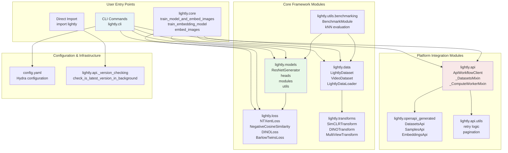
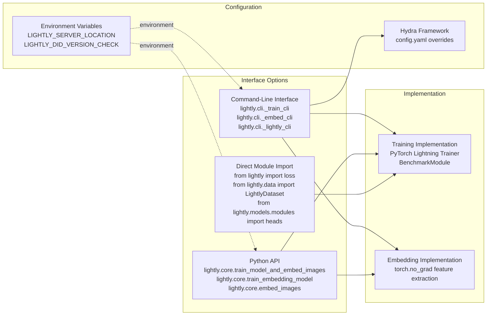
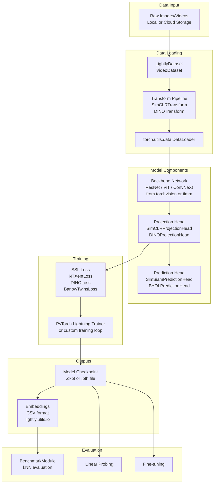
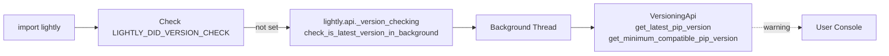

<!-- source: DeepWiki mcp.deepwiki.com · repo lightly-ai/lightly · page 1 Overview · fetched 2026-10-21 -->

# Overview

<details>
<summary>Relevant source files</summary>

The following files were used as context for generating this wiki page:

- [README.md](README.md)
- [docs/source/getting_started/advanced.rst](docs/source/getting_started/advanced.rst)
- [docs/source/getting_started/benchmarks.rst](docs/source/getting_started/benchmarks.rst)
- [docs/source/getting_started/benchmarks/cifar10_benchmark.py](docs/source/getting_started/benchmarks/cifar10_benchmark.py)
- [docs/source/getting_started/benchmarks/imagenet100_benchmark.py](docs/source/getting_started/benchmarks/imagenet100_benchmark.py)
- [docs/source/getting_started/benchmarks/imagenette_benchmark.py](docs/source/getting_started/benchmarks/imagenette_benchmark.py)
- [docs/source/getting_started/command_line_tool.rst](docs/source/getting_started/command_line_tool.rst)
- [docs/source/getting_started/images/lightly_overview.png](docs/source/getting_started/images/lightly_overview.png)
- [docs/source/getting_started/install.rst](docs/source/getting_started/install.rst)
- [docs/source/getting_started/lightly_at_a_glance.rst](docs/source/getting_started/lightly_at_a_glance.rst)
- [docs/source/getting_started/main_concepts.rst](docs/source/getting_started/main_concepts.rst)
- [docs/source/index.rst](docs/source/index.rst)
- [docs/source/lightly.models.rst](docs/source/lightly.models.rst)
- [docs/source/lightly.models.utils.rst](docs/source/lightly.models.utils.rst)
- [lightly/__init__.py](lightly/__init__.py)
- [lightly/api/_version_checking.py](lightly/api/_version_checking.py)
- [tests/api/test_version_checking.py](tests/api/test_version_checking.py)
- [tests/api_workflow/test_api_workflow_client.py](tests/api_workflow/test_api_workflow_client.py)
- [tests/conftest.py](tests/conftest.py)

</details>


**Lightly** is a computer vision framework for self-supervised learning (SSL) built on top of PyTorch. It enables training deep learning models without labeled data, helping users understand and work with large unlabeled datasets through self-supervised pre-training and active learning workflows.

This page provides a high-level introduction to the Lightly framework architecture, covering its major subsystems and how they relate to each other. For detailed information about specific subsystems, see:
- Self-supervised learning models and architectures: [2](#2)
- Data handling and processing: [3](#3)
- Command-line interface usage: [4](#4)
- Programmatic Python API: [5](#5)
- Platform integration and API workflows: [6](#6)
- Benchmarking and evaluation: [7](#7)

Sources: [lightly/__init__.py:1-93](), [README.md:1-438]()

## Purpose and Scope

The Lightly framework provides a modular, PyTorch-compatible toolkit for self-supervised learning with three primary use cases:

1. **Local Training**: Train SSL models (SimCLR, MoCo, BYOL, DINO, etc.) on local datasets without requiring labels
2. **Feature Extraction**: Generate embeddings from pre-trained models for downstream tasks
3. **Platform Integration**: Connect to the Lightly Platform for dataset management, compute worker scheduling, and active learning workflows

The framework exposes both low-level building blocks (loss functions, projection heads, transforms) and high-level abstractions (CLI commands, one-line training functions) to support users at different expertise levels.

Sources: [lightly/__init__.py:1-72](), [README.md:14-27]()

## Framework Architecture

The following diagram shows how the major code modules in the Lightly package relate to each other:



Sources: [lightly/__init__.py:10-72](), [README.md:40-77]()

## Core Subsystems

The Lightly framework is organized into distinct modules, each handling a specific aspect of the self-supervised learning workflow:

| Module | Purpose | Key Classes/Functions |
|--------|---------|----------------------|
| **lightly.models** | SSL model architectures, backbones, projection/prediction heads | `ResNetGenerator`, `heads.SimCLRProjectionHead`, `heads.BYOLPredictionHead`, `heads.DINOProjectionHead`, `utils.update_momentum` |
| **lightly.loss** | Self-supervised loss functions | `NTXentLoss`, `NegativeCosineSimilarity`, `DINOLoss`, `BarlowTwinsLoss`, `VICRegLoss`, `SwaVLoss` |
| **lightly.data** | Dataset wrappers and data loading | `LightlyDataset`, `VideoDataset`, `LightlyDataLoader` |
| **lightly.transforms** | Data augmentation pipelines for SSL | `SimCLRTransform`, `DINOTransform`, `BYOLTransform`, `MultiViewTransform` |
| **lightly.cli** | Command-line interface | `lightly-ssl-train`, `lightly-embed`, `lightly-magic`, `lightly-download` |
| **lightly.core** | High-level training API | `train_model_and_embed_images()`, `train_embedding_model()`, `embed_images()` |
| **lightly.api** | Platform integration client | `ApiWorkflowClient`, `_DatasetsMixin`, `_ComputeWorkerMixin`, `_UploadEmbeddingsMixin` |
| **lightly.utils** | Utilities and benchmarking | `BenchmarkModule`, `LARS`, `scheduler`, `io` |

Sources: [lightly/__init__.py:10-72](), [README.md:40-77]()

## User Interfaces

Lightly provides three ways to interact with the framework, each suited to different workflows:



### 1. Command-Line Interface (CLI)

The CLI provides executable commands for common workflows, configured via `config.yaml` with Hydra overrides:

- **`lightly-ssl-train`**: Train self-supervised models
- **`lightly-embed`**: Generate embeddings from trained models
- **`lightly-magic`**: Combined training and embedding pipeline
- **`lightly-crop`**: Preprocess images for object detection
- **`lightly-download`**: Download datasets from the Lightly Platform

Sources: [lightly/__init__.py:16-20](), [README.md:94-278]()

### 2. Python API (lightly.core)

The `lightly.core` module provides high-level functions for programmatic use:

- `train_model_and_embed_images()`: Train a model and generate embeddings in one call
- `train_embedding_model()`: Train a self-supervised model only
- `embed_images()`: Generate embeddings from a trained model

Sources: [lightly/__init__.py:22-24]()

### 3. Direct Module Import

For maximum flexibility, users can import individual components directly:

```python
from lightly.data import LightlyDataset
from lightly.loss import NTXentLoss
from lightly.models.modules import heads
from lightly.transforms import SimCLRTransform
```

This approach allows custom training loops with full control over model architecture, loss functions, and data augmentation.

Sources: [README.md:125-219]()

## Training and Evaluation Workflow

The following diagram illustrates the complete data flow from raw images through training to evaluation:



Sources: [README.md:125-278](), [docs/source/getting_started/benchmarks.rst:1-219]()

### Supported SSL Algorithms

Lightly implements over 20 state-of-the-art self-supervised learning algorithms with full PyTorch and PyTorch Lightning support:

| Algorithm | Year | Loss Function | Key Components |
|-----------|------|---------------|----------------|
| SimCLR | 2020 | `NTXentLoss` | `SimCLRProjectionHead`, `SimCLRTransform` |
| MoCo | 2019 | `NTXentLoss` + memory bank | `MoCoProjectionHead`, momentum encoder |
| SimSiam | 2021 | `NegativeCosineSimilarity` | `SimSiamProjectionHead`, `SimSiamPredictionHead` |
| BYOL | 2020 | `NegativeCosineSimilarity` | `BYOLProjectionHead`, `BYOLPredictionHead`, momentum encoder |
| DINO | 2021 | `DINOLoss` | `DINOProjectionHead`, teacher-student architecture |
| Barlow Twins | 2021 | `BarlowTwinsLoss` | `BarlowTwinsProjectionHead`, redundancy reduction |
| VICReg | 2021 | `VICRegLoss` | `VICRegProjectionHead`, variance-covariance regularization |
| SwAV | 2020 | `SwaVLoss` | `SwaVProjectionHead`, `SwaVPrototypes`, online clustering |
| MAE | 2021 | MSE reconstruction | `MAEDecoderTIMM`, masked autoencoder for ViT |

Sources: [README.md:55-77](), [docs/source/getting_started/benchmarks.rst:30-46]()

## Platform Integration Overview

The `ApiWorkflowClient` class in `lightly.api` provides integration with the Lightly Platform for:

- **Dataset Management**: Create, update, and delete datasets
- **Compute Worker Orchestration**: Schedule and monitor worker runs for large-scale processing
- **Embeddings Upload/Download**: Sync embeddings with the platform
- **Sample Operations**: Upload metadata, manage tags, and create selections
- **Datasource Configuration**: Configure cloud storage connections (S3, Azure, GCS)

The client uses a mixin architecture, composing functionality from specialized mixins (`_DatasetsMixin`, `_ComputeWorkerMixin`, `_UploadEmbeddingsMixin`, etc.) that delegate to OpenAPI-generated clients for HTTP communication.

For detailed platform integration documentation, see [6](#6).

Sources: [lightly/api/api_workflow_client.py]() (inferred from test), [tests/api_workflow/test_api_workflow_client.py:10-103]()

## Version Management

Lightly automatically checks for version compatibility on import to ensure compatibility with the Lightly Platform API:



The version check runs in a background thread to avoid blocking package import. It can be disabled by setting the `LIGHTLY_DID_VERSION_CHECK` environment variable to `"True"`.

Sources: [lightly/__init__.py:83-92](), [lightly/api/_version_checking.py:1-74](), [tests/api/test_version_checking.py:1-88]()

## Benchmarking and Evaluation

The framework includes comprehensive benchmarking infrastructure to evaluate SSL models on standard datasets:

| Dataset | Classes | Training Images | Evaluation Protocol | Backbone Options |
|---------|---------|-----------------|---------------------|------------------|
| ImageNet1k | 1,000 | 1.28M | kNN, Linear, Fine-tune | ResNet-50, ViT-S/16, ViT-B/16 |
| ImageNet100 | 100 | 130k | kNN | ResNet-18 |
| Imagenette | 10 | 9,469 | kNN | ResNet-18, ViT-S |
| CIFAR-10 | 10 | 50k | kNN | ResNet-18 (3x3 conv) |

The `BenchmarkModule` class in `lightly.utils.benchmarking` provides kNN evaluation during training using PyTorch Lightning callbacks. Evaluation results for all supported algorithms on ImageNet1k are available in the repository.

Sources: [docs/source/getting_started/benchmarks.rst:1-219](), [docs/source/getting_started/benchmarks/imagenette_benchmark.py:1-708](), [docs/source/getting_started/benchmarks/cifar10_benchmark.py:1-596](), [docs/source/getting_started/benchmarks/imagenet100_benchmark.py:1-501]()

## Installation and Dependencies

Lightly requires:
- Python 3.7+ (Python 3.13 not yet supported)
- PyTorch >= 1.11.0
- Torchvision >= 0.12.0  
- PyTorch Lightning >= 1.7.1

Install via pip:
```bash
pip3 install lightly
```

The framework is compatible with PyTorch and PyTorch Lightning v2.0+.

Sources: [README.md:96-116]()

## Next Steps

- **Model Training**: See [2](#2) for details on SSL algorithms and model components
- **Data Handling**: See [3](#3) for dataset wrappers and transform pipelines
- **CLI Usage**: See [4](#4) for command-line training and embedding workflows
- **Python API**: See [5](#5) for programmatic training interfaces
- **Platform Integration**: See [6](#6) for dataset management and compute worker orchestration
- **Benchmarking**: See [7](#7) for evaluation protocols and performance metrics
- **Examples**: See [8](#8) for practical tutorials and code examples

Sources: [README.md:78-93](), [docs/source/getting_started/benchmarks.rst:215-219]()

---

