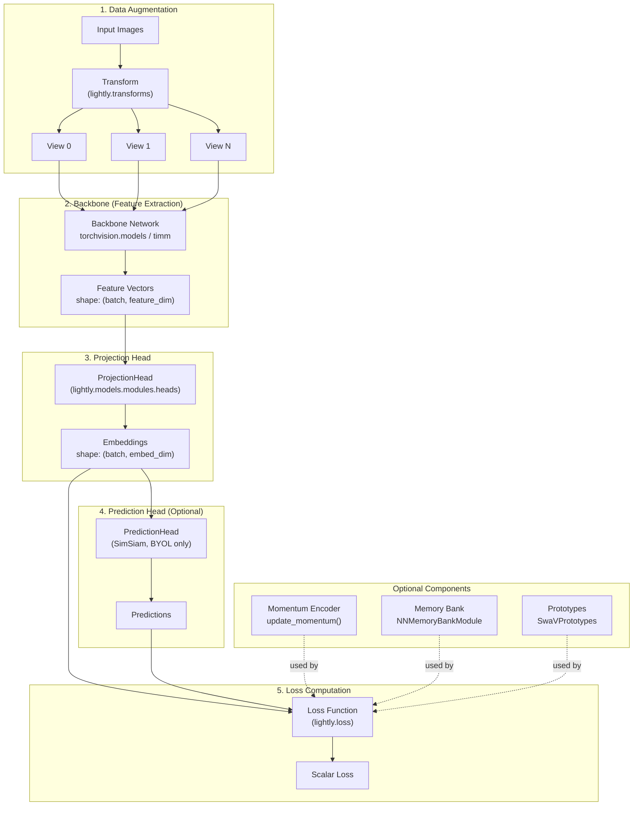
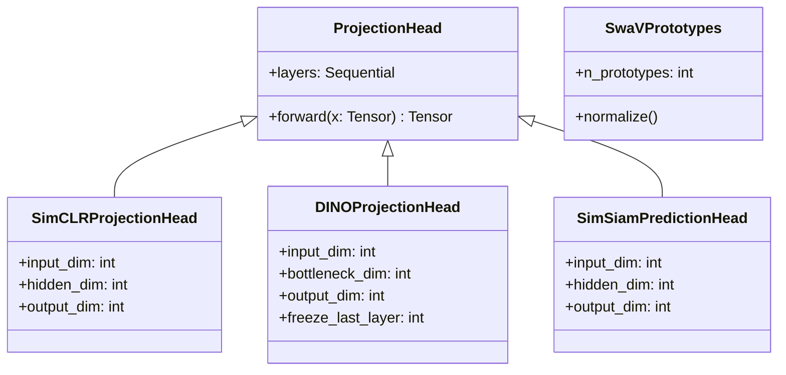
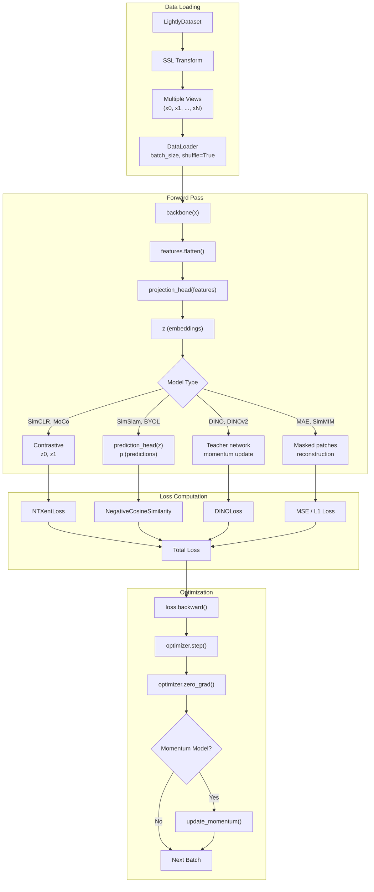

<!-- source: DeepWiki mcp.deepwiki.com · repo lightly-ai/lightly · page 2 Self-Supervised Learning Models · fetched 2026-10-21 -->

# Self-Supervised Learning Models

<details>
<summary>Relevant source files</summary>

The following files were used as context for generating this wiki page:

- [.github/workflows/check_example_nbs.yml](.github/workflows/check_example_nbs.yml)
- [.github/workflows/discord_release_notification.yml](.github/workflows/discord_release_notification.yml)
- [Makefile](Makefile)
- [README.md](README.md)
- [benchmarks/imagenet/vitb16/dinov2.py](benchmarks/imagenet/vitb16/dinov2.py)
- [benchmarks/imagenet/vitb16/ibot.py](benchmarks/imagenet/vitb16/ibot.py)
- [docs/source/getting_started/benchmarks.rst](docs/source/getting_started/benchmarks.rst)
- [docs/source/getting_started/benchmarks/cifar10_benchmark.py](docs/source/getting_started/benchmarks/cifar10_benchmark.py)
- [docs/source/getting_started/benchmarks/imagenet100_benchmark.py](docs/source/getting_started/benchmarks/imagenet100_benchmark.py)
- [docs/source/getting_started/benchmarks/imagenette_benchmark.py](docs/source/getting_started/benchmarks/imagenette_benchmark.py)
- [lightly/loss/pmsn_loss.py](lightly/loss/pmsn_loss.py)
- [lightly/models/modules/__init__.py](lightly/models/modules/__init__.py)
- [lightly/models/modules/heads.py](lightly/models/modules/heads.py)
- [lightly/models/modules/ijepa_timm.py](lightly/models/modules/ijepa_timm.py)
- [lightly/models/modules/masked_autoencoder_timm.py](lightly/models/modules/masked_autoencoder_timm.py)
- [lightly/models/modules/masked_vision_transformer_timm.py](lightly/models/modules/masked_vision_transformer_timm.py)
- [lightly/models/utils.py](lightly/models/utils.py)
- [pyproject.toml](pyproject.toml)
- [tests/loss/test_msn_loss.py](tests/loss/test_msn_loss.py)
- [tests/loss/test_pmsn_loss.py](tests/loss/test_pmsn_loss.py)
- [tests/models/modules/test_masked_autoencoder.py](tests/models/modules/test_masked_autoencoder.py)
- [tests/models/test_ModelUtils.py](tests/models/test_ModelUtils.py)
- [tests/models/test_ProjectionHeads.py](tests/models/test_ProjectionHeads.py)

</details>


This page provides an overview of the self-supervised learning (SSL) model implementations in Lightly. It explains how models are composed from modular building blocks and lists the 19+ supported SSL algorithms. For detailed information about specific components, see:

- **Page 2.1** - Model Architectures (backbones)
- **Page 2.2** - Model Components and Utilities (heads, momentum encoders, utilities)
- **Page 2.3** - Loss Functions
- **Page 2.4** - Transforms and Augmentations

## Modular SSL Architecture

Lightly implements SSL models using a modular architecture where each model is composed from interchangeable components:

1. **Backbone networks** - Feature extractors (ResNet, Vision Transformers) - See page 2.1
2. **Projection heads** - Transform features into embedding space - See page 2.2
3. **Prediction heads** - Optional asymmetric networks (SimSiam, BYOL) - See page 2.2
4. **Loss functions** - Define training objectives (contrastive, distillation, masking) - See page 2.3
5. **Transforms** - Generate augmented views for training - See page 2.4

This modularity allows researchers to experiment with different combinations and implement new SSL methods by reusing existing components.

SSL Model Composition Architecture:



This diagram shows the typical forward pass through an SSL model. Different SSL methods use different combinations of these components.

Sources:
- [lightly/models/modules/__init__.py:1-57]()
- [lightly/models/modules/heads.py:15-66]()
- [README.md:125-189]()

## Supported SSL Methods

Lightly implements 19+ self-supervised learning methods. Each method is defined by its combination of components:

| Model | Year | Type | Key Components | Paper |
|-------|------|------|----------------|-------|
| SimCLR | 2020 | Contrastive | SimCLRProjectionHead, NTXentLoss | [arxiv](https://arxiv.org/abs/2002.05709) |
| MoCo/MoCoV2 | 2019/2020 | Contrastive + Momentum | MoCoProjectionHead, momentum encoder, memory bank | [arxiv](https://arxiv.org/abs/1911.05722) |
| SimSiam | 2021 | Similarity | SimSiamProjectionHead, SimSiamPredictionHead | [arxiv](https://arxiv.org/abs/2011.10566) |
| BYOL | 2020 | Similarity + Momentum | BYOLProjectionHead, BYOLPredictionHead, momentum encoder | [arxiv](https://arxiv.org/abs/2006.07733) |
| NNCLR | 2021 | Contrastive + NN | NNCLRProjectionHead, NNCLRPredictionHead, NNMemoryBankModule | [arxiv](https://arxiv.org/abs/2104.14548) |
| Barlow Twins | 2021 | Redundancy Reduction | BarlowTwinsProjectionHead, BarlowTwinsLoss | [arxiv](https://arxiv.org/abs/2103.03230) |
| VICReg | 2021 | Variance-Covariance | VICRegProjectionHead, VICRegLoss | [arxiv](https://arxiv.org/abs/2105.04906) |
| SwAV | 2020 | Clustering | SwaVProjectionHead, SwaVPrototypes, SwaVLoss | [arxiv](https://arxiv.org/abs/2006.09882) |
| DINO | 2021 | Distillation | DINOProjectionHead, DINOLoss, momentum teacher | [arxiv](https://arxiv.org/abs/2104.14294) |
| DINOv2 | 2023 | Distillation | DINOv2ProjectionHead, DINOLoss, IBOTPatchLoss | [arxiv](https://arxiv.org/abs/2304.07193) |
| iBOT | 2021 | Distillation + Masking | DINOProjectionHead, DINOLoss, IBOTPatchLoss | [arxiv](https://arxiv.org/abs/2111.07832) |
| MAE | 2021 | Masked Autoencoder | MAEEncoder, MAEDecoder, MSE loss | [arxiv](https://arxiv.org/abs/2111.06377) |
| SimMIM | 2022 | Masked Image Modeling | MaskedVisionTransformer, L1 loss | [arxiv](https://arxiv.org/abs/2111.09886) |
| MSN | 2022 | Masked Siamese | MSNProjectionHead, MSNLoss | [arxiv](https://arxiv.org/abs/2204.07141) |
| PMSN | 2022 | Prototype MSN | MSNProjectionHead, PMSNLoss | [arxiv](https://arxiv.org/abs/2210.07277) |
| DCL/DCLW | 2021 | Decoupled Contrastive | SimCLRProjectionHead, DCLLoss/DCLWLoss | [arxiv](https://arxiv.org/abs/2110.06848) |
| DenseCL | 2021 | Dense Contrastive | DenseCLProjectionHead, NTXentLoss | [arxiv](https://arxiv.org/abs/2011.09157) |
| SMoG | 2022 | Group Momentum | SMoGProjectionHead, SMoGPrototypes | [arxiv](https://arxiv.org/abs/2207.06167) |
| AIM | 2024 | Autoregressive | AIMPredictionHead, masked modeling | [arxiv](https://arxiv.org/abs/2401.08541) |

Sources:
- [README.md:55-76]()
- [docs/source/getting_started/benchmarks.rst:1-219]()
- [lightly/models/modules/heads.py:1-1317]()

## SSL Method Paradigms

SSL methods can be categorized into paradigms based on their learning approach. Each paradigm uses different combinations of components:

SSL Method Paradigms by Learning Approach:

```mermaid
graph TB
    subgraph "Contrastive Learning"
        Contrastive["Maximize agreement between positive pairs<br/>Minimize agreement with negative pairs"]
        SimCLR["SimCLR: NTXentLoss"]
        MoCo["MoCo: NTXentLoss + memory bank"]
        NNCLR["NNCLR: NNMemoryBankModule"]
        DCL["DCL/DCLW: Decoupled loss"]
        Contrastive --> SimCLR
        Contrastive --> MoCo
        Contrastive --> NNCLR
        Contrastive --> DCL
    end
    
    subgraph "Similarity Learning"
        Similarity["Maximize agreement between views<br/>No negative pairs"]
        SimSiam["SimSiam: stop-gradient"]
        BYOL["BYOL: momentum encoder"]
        Similarity --> SimSiam
        Similarity --> BYOL
    end
    
    subgraph "Redundancy Reduction"
        Redundancy["Minimize redundancy in embeddings"]
        BarlowTwins["Barlow Twins: cross-correlation"]
        VICReg["VICReg: variance + covariance"]
        Redundancy --> BarlowTwins
        Redundancy --> VICReg
    end
    
    subgraph "Clustering"
        Clustering["Online clustering of features"]
        SwAV["SwAV: SwaVPrototypes"]
        SMoG["SMoG: group momentum"]
        Clustering --> SwAV
        Clustering --> SMoG
    end
    
    subgraph "Knowledge Distillation"
        Distillation["Student learns from teacher"]
        DINO["DINO: self-distillation"]
        DINOv2["DINOv2: + patch loss"]
        iBOT["iBOT: masked distillation"]
        Distillation --> DINO
        Distillation --> DINOv2
        Distillation --> iBOT
    end
    
    subgraph "Masked Modeling"
        Masked["Predict masked image regions"]
        MAE["MAE: pixel reconstruction"]
        SimMIM["SimMIM: patch prediction"]
        MSN["MSN/PMSN: prototype prediction"]
        Masked --> MAE
        Masked --> SimMIM
        Masked --> MSN
    end
```

Sources:
- [README.md:55-76]()
- [lightly/models/modules/heads.py:1-630]()
- [lightly/loss/]()

## Model Composition Examples

Different SSL methods are composed from different combinations of components. Here are examples:

Component Composition for Common SSL Methods:

| Method | Backbone | Projection Head | Prediction Head | Momentum Encoder | Memory Bank | Loss Function |
|--------|----------|----------------|-----------------|------------------|-------------|---------------|
| SimCLR | ResNet / ViT | `SimCLRProjectionHead` | - | - | - | `NTXentLoss` |
| MoCo | ResNet / ViT | `MoCoProjectionHead` | - | ✓ | ✓ (optional) | `NTXentLoss` |
| SimSiam | ResNet / ViT | `SimSiamProjectionHead` | `SimSiamPredictionHead` | - | - | `NegativeCosineSimilarity` |
| BYOL | ResNet / ViT | `BYOLProjectionHead` | `BYOLPredictionHead` | ✓ | - | `NegativeCosineSimilarity` |
| NNCLR | ResNet / ViT | `NNCLRProjectionHead` | `NNCLRPredictionHead` | - | `NNMemoryBankModule` | `NTXentLoss` |
| Barlow Twins | ResNet / ViT | `BarlowTwinsProjectionHead` | - | - | - | `BarlowTwinsLoss` |
| SwAV | ResNet / ViT | `SwaVProjectionHead` + `SwaVPrototypes` | - | - | - | `SwaVLoss` |
| DINO | ResNet / ViT | `DINOProjectionHead` | - | ✓ | - | `DINOLoss` |
| MAE | ViT | `MAEEncoder` + `MAEDecoder` | - | - | - | MSE Loss |
| MSN | ViT | `MSNProjectionHead` | - | ✓ | - | `MSNLoss` |

**Backbone Sources**: Lightly supports backbones from three sources:
- **torchvision**: Standard ResNet, VGG, EfficientNet, ViT (requires >=0.12)
- **timm**: Extensive model zoo including ViT variants, Swin, ConvNeXt (requires >=0.9.9)
- **Lightly**: CIFAR-optimized ResNet via `ResNetGenerator`

See **page 2.1** for detailed documentation on backbone architectures.

Sources:
- [lightly/models/modules/__init__.py:12-57]()
- [lightly/models/modules/heads.py:1-630]()
- [README.md:55-76]()
- [benchmarks/imagenet/resnet50/]()

## Model Components

Lightly provides reusable components that can be combined to implement SSL methods. The main component categories are:

### Projection and Prediction Heads

All projection heads inherit from `ProjectionHead` base class and transform backbone features into embeddings:



Available heads include: `SimCLRProjectionHead`, `MoCoProjectionHead`, `BYOLProjectionHead`, `BYOLPredictionHead`, `SimSiamProjectionHead`, `SimSiamPredictionHead`, `NNCLRProjectionHead`, `NNCLRPredictionHead`, `BarlowTwinsProjectionHead`, `SwaVProjectionHead`, `DINOProjectionHead`, `DINOv2ProjectionHead`, `MSNProjectionHead`, and more.

See **page 2.2** for detailed documentation on all projection and prediction heads.

### Momentum Encoders and Memory Banks

Some SSL methods use additional components:

- **Momentum Encoders**: Slowly updated copies of the model used in MoCo, BYOL, DINO. Updated using `update_momentum()` utility function.
- **Memory Banks**: Store features from previous batches. `NNMemoryBankModule` is used by NNCLR. `NTXentLoss` has built-in memory bank support for MoCo.
- **Prototypes**: Learnable cluster centers used by SwAV (`SwaVPrototypes`) and SMoG (`SMoGPrototypes`).

See **page 2.2** for detailed documentation on these components and utility functions.

Sources:
- [lightly/models/modules/heads.py:15-630]()
- [lightly/models/modules/__init__.py:12-57]()
- [lightly/models/modules/nn_memory_bank.py]()
- [lightly/models/utils.py:262-292]()

## Example Model Implementations

Here are simplified examples showing how to compose SSL models from components:

### SimCLR Example

```python
# Contrastive learning with two augmented views
class SimCLRModel(nn.Module):
    def __init__(self):
        super().__init__()
        resnet = torchvision.models.resnet18()
        self.backbone = nn.Sequential(*list(resnet.children())[:-1])
        self.projection_head = heads.SimCLRProjectionHead(512, 512, 128)
        self.criterion = NTXentLoss()
    
    def forward(self, x):
        features = self.backbone(x).flatten(start_dim=1)
        z = self.projection_head(features)
        return z
```

### MoCo Example

```python
# Contrastive learning with momentum encoder and memory bank
class MoCoModel(nn.Module):
    def __init__(self):
        super().__init__()
        resnet = torchvision.models.resnet18()
        self.backbone = nn.Sequential(*list(resnet.children())[:-1])
        self.projection_head = heads.MoCoProjectionHead(512, 2048, 128)
        
        # Momentum encoder (no gradients)
        self.backbone_momentum = copy.deepcopy(self.backbone)
        self.projection_head_momentum = copy.deepcopy(self.projection_head)
        utils.deactivate_requires_grad(self.backbone_momentum)
        utils.deactivate_requires_grad(self.projection_head_momentum)
        
        # Loss with memory bank
        self.criterion = NTXentLoss(memory_bank_size=(4096, 128))
    
    def training_step(self, x0, x1):
        # Update momentum encoder (m=0.999)
        utils.update_momentum(self.backbone, self.backbone_momentum, 0.999)
        utils.update_momentum(self.projection_head, self.projection_head_momentum, 0.999)
        
        # Forward pass with batch shuffling
        x1_shuffled, shuffle = utils.batch_shuffle(x1)
        z0 = self.forward(x0)
        with torch.no_grad():
            z1 = self.forward_momentum(x1_shuffled)
            z1 = utils.batch_unshuffle(z1, shuffle)
        
        loss = self.criterion(z0, z1)
        return loss
```

### DINO Example

```python
# Self-distillation with momentum teacher
class DINOModel(nn.Module):
    def __init__(self):
        super().__init__()
        from timm.models.vision_transformer import vit_small_patch16_224
        
        self.student_backbone = MaskedVisionTransformerTIMM(
            vit=vit_small_patch16_224()
        )
        self.student_head = DINOProjectionHead(
            input_dim=384, hidden_dim=2048, 
            bottleneck_dim=256, output_dim=65536
        )
        
        # Teacher is EMA of student
        self.teacher_backbone = copy.deepcopy(self.student_backbone)
        self.teacher_head = copy.deepcopy(self.student_head)
        utils.deactivate_requires_grad(self.teacher_backbone)
        utils.deactivate_requires_grad(self.teacher_head)
        
        self.criterion = DINOLoss(output_dim=65536)
    
    def training_step(self, global_views, local_views):
        # Student: process all views
        student_out = [self.student_head(self.student_backbone(v)) 
                       for v in global_views + local_views]
        
        # Teacher: process only global views
        with torch.no_grad():
            teacher_out = [self.teacher_head(self.teacher_backbone(v)) 
                          for v in global_views]
            utils.update_momentum(self.student_backbone, self.teacher_backbone, 0.996)
            utils.update_momentum(self.student_head, self.teacher_head, 0.996)
        
        loss = self.criterion(teacher_out, student_out)
        return loss
```

See **page 2.2** for utility functions like `update_momentum()`, `batch_shuffle()`, and masking operations.

Sources:
- [docs/source/getting_started/benchmarks/cifar10_benchmark.py:323-456]()
- [benchmarks/imagenet/vitb16/dinov2.py:48-224]()
- [README.md:125-189]()
- [lightly/models/utils.py:262-292]()

## Training Workflow

Diagram: SSL Training Pipeline



**Typical Training Loop**:

```python
# Setup (from benchmarks)
model = BenchmarkModule(dataloader_kNN, num_classes)
optimizer = torch.optim.SGD(model.parameters(), lr=0.06)
trainer = pl.Trainer(max_epochs=200, devices=1)

# Training step implementation
def training_step(self, batch, batch_idx):
    (x0, x1), targets, filenames = batch
    
    # Forward pass
    z0 = self.backbone(x0).flatten(start_dim=1)
    z0 = self.projection_head(z0)
    z1 = self.backbone(x1).flatten(start_dim=1)
    z1 = self.projection_head(z1)
    
    # Compute loss
    loss = self.criterion(z0, z1)
    
    # Momentum update (if applicable)
    if hasattr(self, 'backbone_momentum'):
        utils.update_momentum(self.backbone, self.backbone_momentum, m=0.99)
    
    return loss
```

Sources:
- [docs/source/getting_started/benchmarks/cifar10_benchmark.py:390-731]()
- [docs/source/getting_started/benchmarks/imagenette_benchmark.py:257-817]()
- [lightly/utils/benchmarking/benchmark_module.py]()
- [README.md:125-274]()

## Using Pretrained SSL Models

After training, the backbone network can be used for various downstream tasks:

1. **Feature Extraction**: Using the backbone to extract features for visualization or clustering
   ```python
   model.eval()
   embeddings = []
   with torch.no_grad():
       for img, _, _ in dataloader:
           emb = model.backbone(img).flatten(start_dim=1)
           embeddings.append(emb)
   ```

2. **Transfer Learning**: Fine-tuning the pretrained backbone for a specific task
   ```python
   # Use the pretrained backbone
   pretrained_backbone = model.backbone
   
   # Create a new classifier with the pretrained backbone
   classifier = nn.Sequential(
       pretrained_backbone,
       nn.Linear(backbone_output_dim, num_classes)
   )
   ```

Sources:
- [docs/source/tutorials_source/package/tutorial_simclr_clothing.py:187-204]()
- [docs/source/tutorials_source/package/tutorial_moco_memory_bank.py:292-317]()
- [docs/source/tutorials_source/package/tutorial_simsiam_esa.py:264-281]()
- [docs/source/tutorials_source/package/tutorial_pretrain_detectron2.py:169-180]()

## Examples and Tutorials

Lightly provides several tutorials for training and using SSL models:

1. **SimCLR on Clothing Dataset** - Training a SimCLR model and exploring nearest neighbors in embedding space
2. **MoCo with Memory Bank** - Training a MoCo model with a memory bank on CIFAR-10
3. **SimSiam on Satellite Images** - Training a SimSiam model on a dataset of satellite images
4. **Custom Augmentations** - Training an SSL model with custom augmentations for X-ray images
5. **Pre-train Detectron2 Backbone** - Using Lightly to pre-train a Detectron2 backbone for object detection

Sources:
- [docs/source/tutorials_source/package/tutorial_simclr_clothing.py]()
- [docs/source/tutorials_source/package/tutorial_moco_memory_bank.py]()
- [docs/source/tutorials_source/package/tutorial_simsiam_esa.py]()
- [docs/source/tutorials_source/package/tutorial_custom_augmentations.py]()
- [docs/source/tutorials_source/package/tutorial_pretrain_detectron2.py]()
- [docs/source/examples/models.rst]()

---

