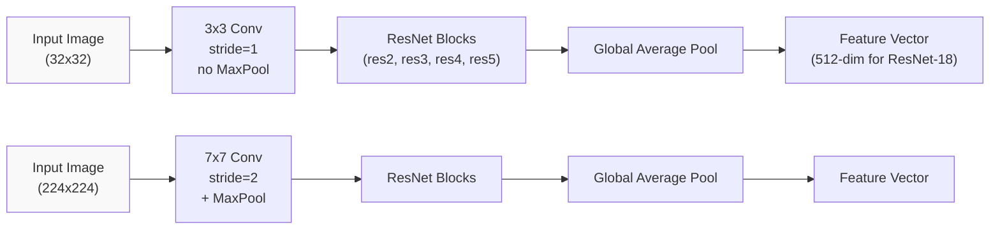
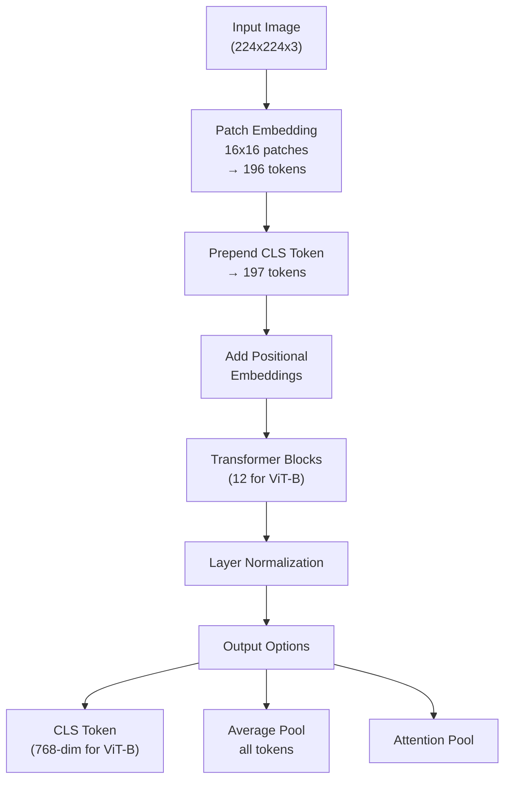
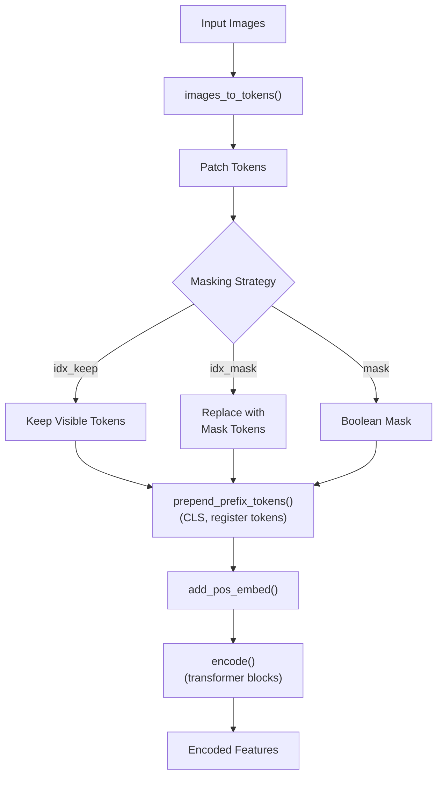
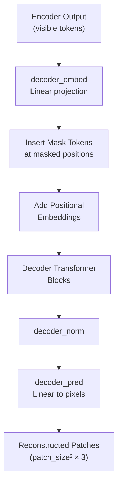
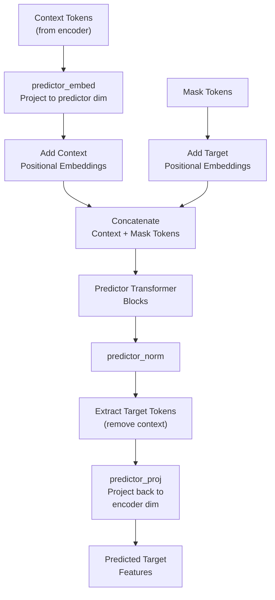

<!-- source: DeepWiki mcp.deepwiki.com · repo lightly-ai/lightly · page 2.1 Model Architectures · fetched 2026-10-21 -->

# Model Architectures

<details>
<summary>Relevant source files</summary>

The following files were used as context for generating this wiki page:

- [.github/workflows/check_example_nbs.yml](.github/workflows/check_example_nbs.yml)
- [.github/workflows/discord_release_notification.yml](.github/workflows/discord_release_notification.yml)
- [Makefile](Makefile)
- [README.md](README.md)
- [docs/source/getting_started/benchmarks.rst](docs/source/getting_started/benchmarks.rst)
- [docs/source/getting_started/benchmarks/cifar10_benchmark.py](docs/source/getting_started/benchmarks/cifar10_benchmark.py)
- [docs/source/getting_started/benchmarks/imagenet100_benchmark.py](docs/source/getting_started/benchmarks/imagenet100_benchmark.py)
- [docs/source/getting_started/benchmarks/imagenette_benchmark.py](docs/source/getting_started/benchmarks/imagenette_benchmark.py)
- [docs/source/tutorials/structure_your_input.rst](docs/source/tutorials/structure_your_input.rst)
- [docs/source/tutorials_source/package/Base-RCNN-FPN.yaml](docs/source/tutorials_source/package/Base-RCNN-FPN.yaml)
- [docs/source/tutorials_source/package/tutorial_custom_augmentations.py](docs/source/tutorials_source/package/tutorial_custom_augmentations.py)
- [docs/source/tutorials_source/package/tutorial_moco_memory_bank.py](docs/source/tutorials_source/package/tutorial_moco_memory_bank.py)
- [docs/source/tutorials_source/package/tutorial_pretrain_detectron2.py](docs/source/tutorials_source/package/tutorial_pretrain_detectron2.py)
- [docs/source/tutorials_source/package/tutorial_simclr_clothing.py](docs/source/tutorials_source/package/tutorial_simclr_clothing.py)
- [docs/source/tutorials_source/package/tutorial_simsiam_esa.py](docs/source/tutorials_source/package/tutorial_simsiam_esa.py)
- [lightly/loss/pmsn_loss.py](lightly/loss/pmsn_loss.py)
- [lightly/models/modules/ijepa_timm.py](lightly/models/modules/ijepa_timm.py)
- [lightly/models/modules/masked_autoencoder_timm.py](lightly/models/modules/masked_autoencoder_timm.py)
- [lightly/models/modules/masked_vision_transformer_timm.py](lightly/models/modules/masked_vision_transformer_timm.py)
- [pyproject.toml](pyproject.toml)
- [tests/loss/test_msn_loss.py](tests/loss/test_msn_loss.py)
- [tests/loss/test_pmsn_loss.py](tests/loss/test_pmsn_loss.py)

</details>


This page documents the backbone architectures available in Lightly for self-supervised learning. Backbones are the feature extraction networks that process input images into learned representations. The framework supports standard ResNet and Vision Transformer (ViT) architectures, as well as specialized variants for masked image modeling methods like MAE and I-JEPA.

For information about projection heads, prediction heads, and other model components that build on top of backbones, see [Model Components and Utilities](#2.2). For loss functions used to train these architectures, see [Loss Functions](#2.3).

## Overview of Available Backbones

The Lightly framework provides three main categories of backbone architectures:

| Architecture Family | Variants | Primary Use Cases | Integration Source |
|-------------------|----------|------------------|-------------------|
| **ResNet** | ResNet-18, ResNet-50, ResNet-101 | General-purpose SSL, benchmarking | torchvision |
| **Vision Transformer** | ViT-S/16, ViT-B/16, ViT-B/32 | Attention-based SSL methods (DINO, MAE) | torchvision, TIMM |
| **Masked Vision Transformer** | Masked ViT variants | Masked image modeling (MAE, I-JEPA, iBOT) | Custom + TIMM |

All backbone architectures can be combined with method-specific projection heads to create complete SSL models.

**Sources:** [README.md:50-76](), [docs/source/getting_started/benchmarks.rst:30-46]()

## ResNet Backbones

### Standard ResNet Architecture

ResNet backbones from torchvision are the most commonly used architectures in the framework. When creating a ResNet backbone for SSL, the classification head is typically removed to extract features:

```python
import torchvision
import torch.nn as nn

# Create ResNet-18 backbone
resnet = torchvision.models.resnet18()
backbone = nn.Sequential(*list(resnet.children())[:-1])
# Output shape: (batch_size, 512, 1, 1) for ResNet-18
```

The feature dimensions for standard ResNet variants are:
- ResNet-18: 512 dimensions
- ResNet-50: 2048 dimensions  
- ResNet-101: 2048 dimensions

**Sources:** [docs/source/tutorials_source/package/tutorial_simclr_clothing.py:143-145](), [docs/source/tutorials_source/package/tutorial_moco_memory_bank.py:226-229]()

### ResNet for Small Images (CIFAR-10)

For small input images like CIFAR-10 (32x32 pixels), the framework provides a specialized ResNet variant that uses a 3x3 convolution instead of the standard 7x7 convolution, with no stride and no MaxPool2d in the first layer. This prevents excessive downsampling of already small images.


**Diagram: ResNet Architecture Variants for Different Input Sizes**

This specialized variant is created using `ResNetGenerator` from `lightly.models`:

```python
from lightly.models import ResNetGenerator
import torch.nn as nn

# ResNet for small images (CIFAR-10)
resnet = ResNetGenerator("resnet-18")
backbone = nn.Sequential(
    *list(resnet.children())[:-1], 
    nn.AdaptiveAvgPool2d(1)
)
```

**Sources:** [docs/source/getting_started/benchmarks.rst:144-147](), [docs/source/getting_started/benchmarks/cifar10_benchmark.py:296-299](), [docs/source/getting_started/benchmarks/cifar10_benchmark.py:362-365]()

### Split Batch Normalization

For methods like MoCo that use momentum encoders, the framework supports split batch normalization to simulate multi-GPU behavior. This prevents information leakage through batch statistics:

```python
from lightly.models import ResNetGenerator

# Create ResNet with 8 batch norm splits
num_splits = 8
resnet = ResNetGenerator("resnet-18", num_splits=num_splits)
```

The `num_splits` parameter controls how the batch is divided for independent batch norm calculation.

**Sources:** [docs/source/tutorials_source/package/tutorial_moco_memory_bank.py:218-221](), [docs/source/getting_started/benchmarks/cifar10_benchmark.py:295-296]()

## Vision Transformer (ViT) Backbones

### Standard ViT Architecture

Vision Transformers process images as sequences of patches. The framework supports ViT architectures from both torchvision and TIMM libraries:


**Diagram: Vision Transformer Architecture Flow**

ViT variants differ primarily in:
- **Patch size**: 16x16 (ViT-*/16) or 32x32 (ViT-*/32)
- **Model size**: Small (ViT-S), Base (ViT-B), Large (ViT-L)
- **Embedding dimension**: 384 (ViT-S), 768 (ViT-B), 1024 (ViT-L)

**Sources:** [lightly/models/modules/masked_vision_transformer_timm.py:68-90]()

### TIMM Integration

The framework integrates with the TIMM library to support a wider range of ViT architectures and features. TIMM models provide additional functionality like dynamic image sizes and flexible pooling strategies:

```python
from timm.models.vision_transformer import vit_base_patch32_224
import torch.nn as nn

# Create ViT-B/32 from TIMM
vit = vit_base_patch32_224(pretrained=False)
# Use as backbone (remove head if present)
```

Key TIMM features used in Lightly:
- **Dynamic image size**: Resample positional embeddings for different input sizes
- **Flexible prefix tokens**: Support for both class tokens and register tokens
- **Multiple pooling strategies**: Class token, average pooling, or attention pooling

**Sources:** [lightly/models/modules/masked_vision_transformer_timm.py:1-218](), [docs/source/getting_started/benchmarks/imagenette_benchmark.py:73-74]()

## Masked Vision Transformers

### MaskedVisionTransformerTIMM

For masked image modeling methods (MAE, SimMIM, iBOT), the framework provides `MaskedVisionTransformerTIMM`, which extends standard ViT to support masking patches during training:


**Diagram: MaskedVisionTransformerTIMM Processing Pipeline**

The class provides three methods for token preprocessing:

| Method | Parameters | Purpose |
|--------|-----------|---------|
| `images_to_tokens()` | `images` | Convert images to patch tokens |
| `prepend_prefix_tokens()` | `x` | Add CLS and register tokens |
| `add_pos_embed()` | `x` | Add positional embeddings (with resampling) |
| `encode()` | `images, idx_mask, idx_keep, mask` | Full encoding with optional masking |

**Key features:**
- **Flexible masking**: Supports token indices (`idx_keep`, `idx_mask`) or boolean masks
- **Positional embedding resampling**: Handles dynamic image sizes via `resample_abs_pos_embed`
- **Weight initialization**: Configurable initialization strategies ('', 'skip')
- **Positional embedding initialization**: Supports 'learn', 'sincos', 'skip' strategies

**Sources:** [lightly/models/modules/masked_vision_transformer_timm.py:15-218]()

### MAEDecoderTIMM

The MAE decoder reconstructs masked patches from encoded representations:


**Diagram: MAE Decoder Architecture**

The decoder is typically much smaller than the encoder:
- **Encoder**: 1024-dim embeddings, 24 blocks (ViT-B)
- **Decoder**: 512-dim embeddings, 8 blocks

Configuration parameters:
```python
MAEDecoderTIMM(
    num_patches=196,           # Number of patches (14×14 for 224×224 image)
    patch_size=16,             # Size of each patch
    embed_dim=1024,            # Encoder embedding dimension
    decoder_embed_dim=512,     # Decoder embedding dimension
    decoder_depth=8,           # Number of decoder blocks
    decoder_num_heads=16,      # Attention heads in decoder
    mlp_ratio=4.0,            # MLP hidden dim ratio
)
```

**Sources:** [lightly/models/modules/masked_autoencoder_timm.py:14-218]()

### IJEPAPredictorTIMM

For I-JEPA (Joint-Embedding Predictive Architecture), the predictor network predicts target patch embeddings from context embeddings:


**Diagram: I-JEPA Predictor Architecture**

The predictor uses a bottleneck architecture:
- **Input**: Encoder dimension (e.g., 768 for ViT-B)
- **Predictor**: Smaller dimension (e.g., 384)
- **Output**: Back to encoder dimension

Configuration example:
```python
IJEPAPredictorTIMM(
    num_patches=196,
    depth=6,                    # Predictor depth
    mlp_dim=768,               # Encoder dimension
    predictor_embed_dim=384,   # Bottleneck dimension
    num_heads=12,
    qkv_bias=True,
    mlp_ratio=4.0,
)
```

**Sources:** [lightly/models/modules/ijepa_timm.py:15-152]()

## Backbone Selection by SSL Method

Different SSL methods have different architectural requirements and perform best with specific backbones:

| SSL Method | Recommended Backbone | Feature Dimension | Notes |
|------------|---------------------|------------------|-------|
| SimCLR, MoCo | ResNet-18/50 | 512/2048 | Standard choice for contrastive learning |
| BYOL, SimSiam | ResNet-18/50 | 512/2048 | Momentum encoder variants |
| DINO, DINOv2 | ViT-S/16, ResNet-50 | 384/512 | Works with both CNN and ViT |
| MAE | ViT-B/16 | 768 | Requires masked ViT |
| iBOT | ViT-S/16 | 384 | Combines DINO with masked modeling |
| MSN, PMSN | ViT-S | 384 | Prototype-based with ViT |
| SimMIM | ViT-B/32 | 768 | Masked modeling |
| I-JEPA | ViT-B/16 | 768 | Requires predictor network |

**Sources:** [README.md:57-76](), [docs/source/getting_started/benchmarks.rst:30-46]()

## Common Usage Patterns

### Pattern 1: ResNet Backbone for Contrastive Learning

```python
import torchvision
import torch.nn as nn
from lightly.models.modules.heads import SimCLRProjectionHead

# Create ResNet-18 backbone
resnet = torchvision.models.resnet18()
backbone = nn.Sequential(*list(resnet.children())[:-1])

# Add projection head
projection_head = SimCLRProjectionHead(
    input_dim=512,
    hidden_dim=512,
    output_dim=128,
)

# Forward pass
features = backbone(images).flatten(start_dim=1)  # (batch, 512)
projections = projection_head(features)            # (batch, 128)
```

**Sources:** [docs/source/tutorials_source/package/tutorial_simclr_clothing.py:139-155]()

### Pattern 2: ViT Backbone for DINO

```python
from timm.models.vision_transformer import VisionTransformer
from lightly.models.modules import DINOProjectionHead

# Create ViT backbone (simplified)
vit = VisionTransformer(
    patch_size=16,
    embed_dim=384,
    depth=12,
    num_heads=6,
)

# DINO uses both student and teacher networks
# Teacher is a momentum-updated copy of student
teacher = copy.deepcopy(vit)
```

**Sources:** [docs/source/getting_started/benchmarks/imagenette_benchmark.py:661-668]()

### Pattern 3: Masked ViT for MAE

```python
from timm.models.vision_transformer import VisionTransformer
from lightly.models.modules import MaskedVisionTransformerTIMM, MAEDecoderTIMM

# Create encoder
vit = VisionTransformer(...)
encoder = MaskedVisionTransformerTIMM(vit=vit)

# Create decoder
decoder = MAEDecoderTIMM(
    num_patches=196,
    patch_size=16,
    embed_dim=768,
    decoder_embed_dim=512,
    decoder_depth=8,
)

# Forward with masking
encoded = encoder.encode(images, idx_keep=idx_keep)
reconstructed = decoder(encoded)
```

**Sources:** [lightly/models/modules/masked_autoencoder_timm.py:109-122]()

## Architecture Considerations

### Input Size Adaptation

When using different input sizes than the standard 224×224, consider:

1. **ResNet**: Works with any input size ≥32×32. For small images (32×32), use `ResNetGenerator` to avoid excessive downsampling.

2. **ViT**: Positional embeddings are designed for specific grid sizes. Use TIMM's `resample_abs_pos_embed()` for dynamic sizes:

```python
# Handled automatically in MaskedVisionTransformerTIMM
pos_embed = resample_abs_pos_embed(
    self.vit.pos_embed,
    (H, W),  # New grid size
    num_prefix_tokens=1,
    antialias=True,
)
```

**Sources:** [lightly/models/modules/masked_vision_transformer_timm.py:156-179]()

### Memory Requirements

Approximate GPU memory requirements for common configurations (batch size 256):

| Architecture | Input Size | Memory | Typical Use |
|-------------|-----------|--------|------------|
| ResNet-18 | 32×32 | 1.5 GB | CIFAR-10 benchmarks |
| ResNet-18 | 128×128 | 4.0 GB | ImageNette |
| ResNet-50 | 224×224 | 11.3 GB | ImageNet |
| ViT-S/16 | 224×224 | 14.7 GB | ImageNet SSL |
| ViT-B/16 | 224×224 | ~20 GB | MAE pretraining |

**Sources:** [docs/source/getting_started/benchmarks.rst:69-81](), [docs/source/getting_started/benchmarks/imagenette_benchmark.py:103-127]()

### Checkpoint Compatibility

Backbones trained with Lightly can be used with other frameworks:

```python
# Save backbone
state_dict = {"resnet18_parameters": backbone.state_dict()}
torch.save(state_dict, "backbone.pth")

# Load in another framework
resnet18 = torchvision.models.resnet18()
backbone = nn.Sequential(*list(resnet18.children())[:-1])
backbone.load_state_dict(torch.load("backbone.pth")["resnet18_parameters"])
```

For Detectron2 integration, see the specialized tutorial at [docs/source/tutorials_source/package/tutorial_pretrain_detectron2.py:1-334]().

**Sources:** [docs/source/tutorials_source/package/tutorial_simclr_clothing.py:289-307](), [docs/source/tutorials_source/package/tutorial_pretrain_detectron2.py:1-334]()

---

