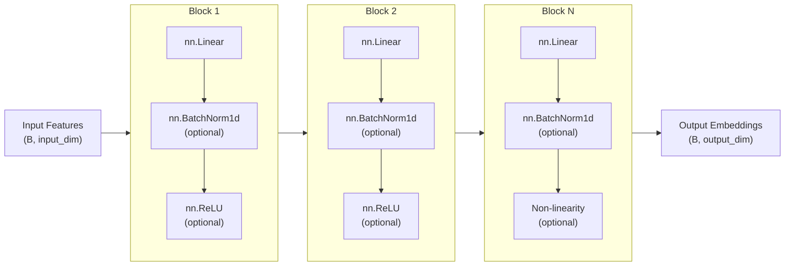
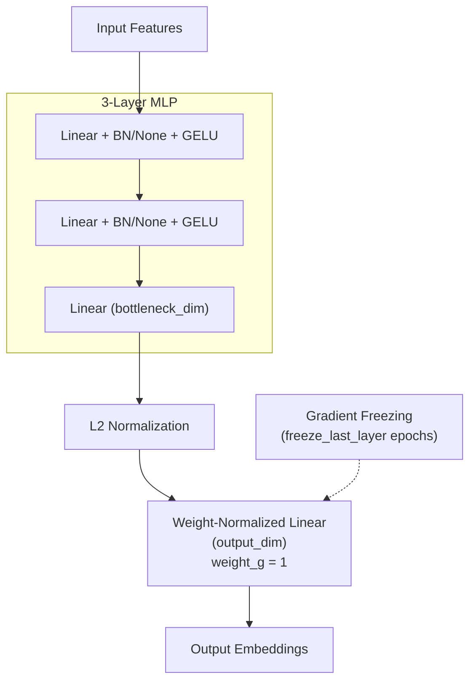
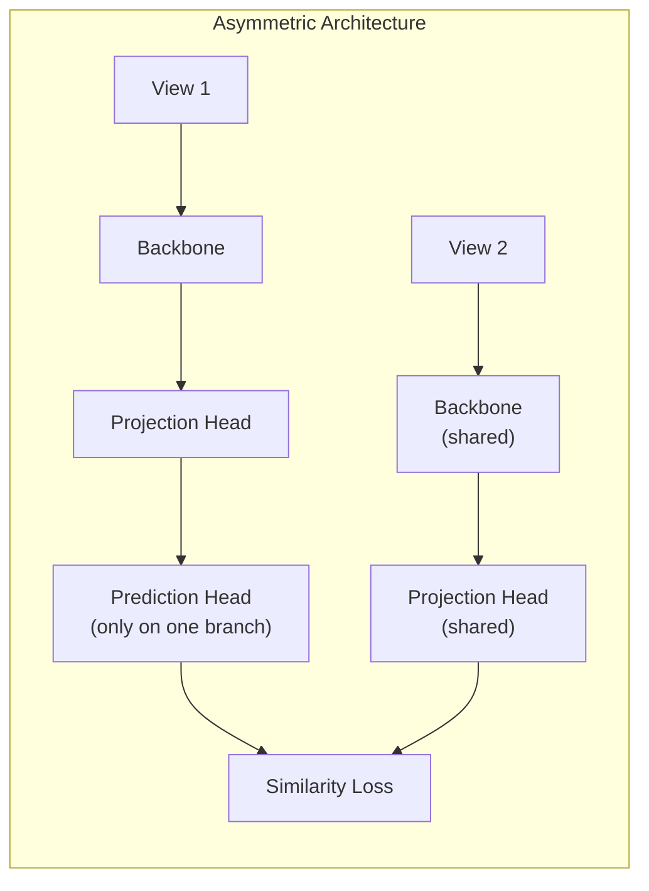
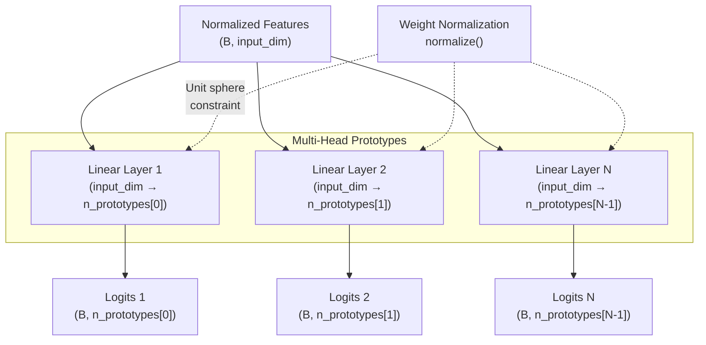
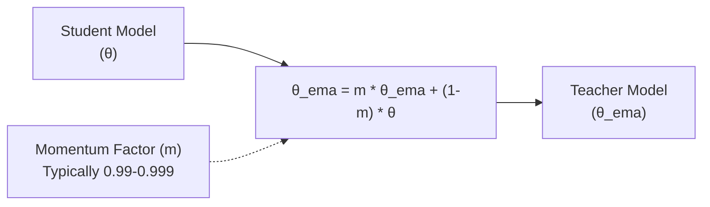
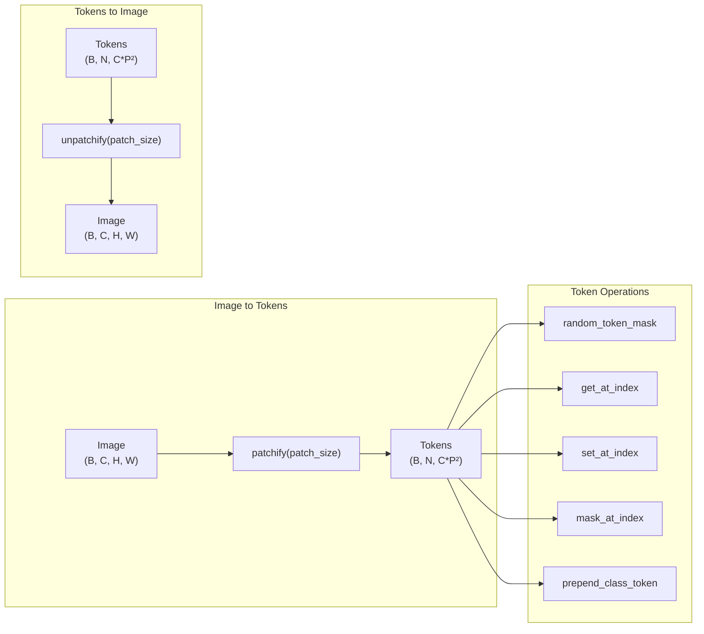
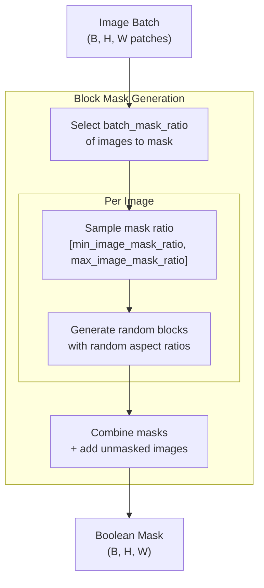

<!-- source: DeepWiki mcp.deepwiki.com · repo lightly-ai/lightly · page 2.2 Model Components and Utilities · fetched 2026-10-21 -->

# Model Components and Utilities

<details>
<summary>Relevant source files</summary>

The following files were used as context for generating this wiki page:

- [README.md](README.md)
- [benchmarks/imagenet/vitb16/dinov2.py](benchmarks/imagenet/vitb16/dinov2.py)
- [benchmarks/imagenet/vitb16/ibot.py](benchmarks/imagenet/vitb16/ibot.py)
- [docs/source/getting_started/benchmarks.rst](docs/source/getting_started/benchmarks.rst)
- [docs/source/getting_started/benchmarks/cifar10_benchmark.py](docs/source/getting_started/benchmarks/cifar10_benchmark.py)
- [docs/source/getting_started/benchmarks/imagenet100_benchmark.py](docs/source/getting_started/benchmarks/imagenet100_benchmark.py)
- [docs/source/getting_started/benchmarks/imagenette_benchmark.py](docs/source/getting_started/benchmarks/imagenette_benchmark.py)
- [lightly/models/modules/__init__.py](lightly/models/modules/__init__.py)
- [lightly/models/modules/heads.py](lightly/models/modules/heads.py)
- [lightly/models/utils.py](lightly/models/utils.py)
- [tests/models/modules/test_masked_autoencoder.py](tests/models/modules/test_masked_autoencoder.py)
- [tests/models/test_ModelUtils.py](tests/models/test_ModelUtils.py)
- [tests/models/test_ProjectionHeads.py](tests/models/test_ProjectionHeads.py)

</details>


This page documents the modular components and utility functions used to construct self-supervised learning (SSL) models in Lightly. These components include projection heads, prediction heads, prototypes, and various utility functions for momentum updates, batch operations, token manipulation, and masking strategies.

For information about complete SSL model implementations and loss functions, see [Loss Functions](#2.2). For data augmentation pipelines, see [Transforms](#2.3).

## Overview

SSL models in Lightly follow a composable architecture where different components can be mixed and matched to implement various algorithms. The main building blocks are:

- **Projection Heads**: MLPs that map backbone features to embedding space
- **Prediction Heads**: MLPs used in asymmetric architectures (SimSiam, BYOL)
- **Prototypes**: Learnable prototype vectors for clustering-based methods (SwaV, SMoG)
- **Utility Functions**: Shared functionality for momentum updates, masking, and token operations

```mermaid
graph TB
    subgraph "Base Components"
        ProjectionHead["ProjectionHead<br/>(Base Class)"]
        Utils["lightly.models.utils"]
    end
    
    subgraph "Projection Heads"
        SimCLR["SimCLRProjectionHead"]
        MoCo["MoCoProjectionHead"]
        BYOL["BYOLProjectionHead"]
        DINO["DINOProjectionHead"]
        DINOv2["DINOv2ProjectionHead"]
        SwaV["SwaVProjectionHead"]
        BarlowTwins["BarlowTwinsProjectionHead"]
        VICReg["VICRegProjectionHead"]
    end
    
    subgraph "Prediction Heads"
        SimSiamPred["SimSiamPredictionHead"]
        BYOLPred["BYOLPredictionHead"]
        NNCLRPred["NNCLRPredictionHead"]
        SMoGPred["SMoGPredictionHead"]
    end
    
    subgraph "Prototypes"
        SwaVProto["SwaVPrototypes"]
        SMoGProto["SMoGPrototypes"]
    end
    
    subgraph "Utilities"
        UpdateMomentum["update_momentum"]
        BatchShuffle["batch_shuffle<br/>batch_unshuffle"]
        TokenOps["random_token_mask<br/>patchify<br/>unpatchify"]
        Masking["random_block_mask<br/>mask_at_index"]
    end
    
    ProjectionHead --> SimCLR
    ProjectionHead --> MoCo
    ProjectionHead --> BYOL
    ProjectionHead --> DINO
    ProjectionHead --> DINOv2
    ProjectionHead --> SwaV
    ProjectionHead --> BarlowTwins
    ProjectionHead --> VICReg
    
    ProjectionHead --> SimSiamPred
    ProjectionHead --> BYOLPred
    ProjectionHead --> NNCLRPred
    ProjectionHead --> SMoGPred
    
    Utils --> UpdateMomentum
    Utils --> BatchShuffle
    Utils --> TokenOps
    Utils --> Masking
```



**Diagram: Component Architecture Overview**

Sources: [lightly/models/modules/heads.py:1-987](), [lightly/models/utils.py:1-100]()

## Projection Heads

### Base Class: ProjectionHead

The `ProjectionHead` base class provides a flexible architecture for building MLPs with configurable blocks. Each block consists of a linear layer, optional batch normalization, and optional non-linearity.



**Diagram: ProjectionHead Block Architecture**

The constructor accepts a sequence of block tuples with the format:
```
(input_dim, output_dim, batch_norm_layer, non_linearity_layer, use_bias (optional))
```

If `use_bias` is not specified, bias is automatically disabled when batch normalization is used (following common practice).

Sources: [lightly/models/modules/heads.py:15-66]()

### Algorithm-Specific Projection Heads

Each SSL algorithm has a projection head with architecture parameters from the original paper:

| Head | Layers | Hidden Dim | Output Dim | Batch Norm | Non-linearity | Reference |
|------|--------|------------|------------|------------|---------------|-----------|
| `SimCLRProjectionHead` | 2-3 | 2048 | 128 | Yes | ReLU | [lightly/models/modules/heads.py:264-324]() |
| `MoCoProjectionHead` | 2-3 | 2048-4096 | 128-256 | Optional | ReLU | [lightly/models/modules/heads.py:143-206]() |
| `BYOLProjectionHead` | 2 | 4096 | 256 | Yes | ReLU | [lightly/models/modules/heads.py:100-119]() |
| `SimSiamProjectionHead` | 3 | 2048 | 2048 | Yes (no affine on last) | ReLU | [lightly/models/modules/heads.py:327-351]() |
| `DINOProjectionHead` | 3 + last | 2048 | 65536 | Optional | GELU | [lightly/models/modules/heads.py:632-731]() |
| `DINOv2ProjectionHead` | 3 + last | 2048 | 65536 | Optional | GELU | [lightly/models/modules/heads.py:733-776]() |
| `SwaVProjectionHead` | 2 | 2048 | 128 | Yes | ReLU | [lightly/models/modules/heads.py:531-546]() |
| `BarlowTwinsProjectionHead` | 3 | 8192 | 8192 | Yes | ReLU | [lightly/models/modules/heads.py:68-97]() |
| `VICRegProjectionHead` | 3 | 8192 | 8192 | Yes | ReLU | [lightly/models/modules/heads.py:904-943]() |

**Table: Projection Head Architectures by Algorithm**

#### Special Cases: DINO Heads

The DINO projection heads have unique characteristics:



**Diagram: DINO Projection Head Architecture**

Key features:
- L2 normalization before the last layer [lightly/models/modules/heads.py:714-716]()
- Weight-normalized last layer with `weight_g.data.fill_(1)` [lightly/models/modules/heads.py:696-698]()
- Optional gradient freezing via `cancel_last_layer_gradients()` [lightly/models/modules/heads.py:704-709]()
- Truncated normal initialization for stability [lightly/models/modules/heads.py:719-730]()

Sources: [lightly/models/modules/heads.py:632-776](), [benchmarks/imagenet/vitb16/dinov2.py:81-99]()

## Prediction Heads

Prediction heads are used in asymmetric SSL architectures where one branch predicts the representations of another branch. Unlike projection heads, prediction heads typically have no batch normalization on the output layer and use only ReLU activations.



**Diagram: Asymmetric Architecture with Prediction Head**

| Head | Layers | Hidden Dim | Output Dim | Reference |
|------|--------|------------|------------|-----------|
| `SimSiamPredictionHead` | 2 | 512 | 2048 | [lightly/models/modules/heads.py:501-528]() |
| `BYOLPredictionHead` | 2 | 4096 | 256 | [lightly/models/modules/heads.py:122-140]() |
| `NNCLRPredictionHead` | 2 | 4096 | 256 | [lightly/models/modules/heads.py:243-261]() |
| `SMoGPredictionHead` | 2 | 2048 | 128 | [lightly/models/modules/heads.py:469-498]() |

**Table: Prediction Head Architectures**

All prediction heads follow the pattern:
1. First layer: Linear → BatchNorm → ReLU
2. Last layer: Linear (no BatchNorm, no activation)

Sources: [lightly/models/modules/heads.py:122-528](), [tests/models/test_ProjectionHeads.py:1-320]()

## Prototypes

Prototypes are learnable vectors used in clustering-based SSL methods. They act as cluster centers in the embedding space.

### SwaVPrototypes

The `SwaVPrototypes` module implements learnable prototypes for SwAV with support for multi-head prototypes and prototype freezing.



**Diagram: SwaVPrototypes Multi-Head Architecture**

Key features:
- Supports single or multiple prototype heads via `n_prototypes` parameter [lightly/models/modules/heads.py:576-592]()
- Prototype weights normalized to unit sphere via `normalize()` [lightly/models/modules/heads.py:616-619]()
- Optional prototype freezing for initial epochs via `n_steps_frozen_prototypes` [lightly/models/modules/heads.py:621-629]()

Sources: [lightly/models/modules/heads.py:549-630](), [tests/models/test_ProjectionHeads.py:92-155]()

### SMoGPrototypes

The `SMoGPrototypes` module implements Synchronous Momentum Grouping with momentum-updated group features.

Key operations:
- **Forward pass**: Computes logits via cosine similarity with temperature scaling [lightly/models/modules/heads.py:374-393]()
- **Group assignment**: Assigns samples to nearest group via `assign_groups()` [lightly/models/modules/heads.py:419-430]()
- **Momentum update**: Updates group features via exponential moving average [lightly/models/modules/heads.py:395-413]()

```python
# Momentum update formula
group_features[c] = beta * group_features[c] + (1 - beta) * x[mask].mean(dim=0)
```

Sources: [lightly/models/modules/heads.py:354-431]()

## Utility Functions

The `lightly.models.utils` module provides shared functionality used across SSL models.

### Momentum Updates



**Diagram: Momentum Encoder Update**

The `update_momentum()` function updates teacher/momentum encoder parameters using exponential moving average:

```python
update_momentum(model, model_ema, m=0.999)
```

Implementation: [lightly/models/utils.py:262-288]()

Used in MoCo, BYOL, DINO, and other momentum-based methods. See examples: [benchmarks/imagenet/vitb16/dinov2.py:359-360](), [benchmarks/imagenet/vitb16/ibot.py:296-297]()

### Batch Operations

Batch shuffling is used in MoCo to prevent the model from learning shortcuts by ensuring samples in the momentum encoder come from different GPUs.

| Function | Purpose | Distributed Support |
|----------|---------|-------------------|
| `batch_shuffle()` | Randomly shuffle batch | Yes via `distributed=True` |
| `batch_unshuffle()` | Restore original order | Yes via `distributed=True` |
| `concat_all_gather()` | Gather tensors from all GPUs | Multi-GPU only |

**Table: Batch Operation Functions**

```python
# Usage example
x1_shuffled, shuffle = batch_shuffle(x1, distributed=True)
f1 = momentum_encoder(x1_shuffled)
out1 = batch_unshuffle(f1, shuffle, distributed=True)
```

Sources: [lightly/models/utils.py:81-231](), [tests/models/test_ModelUtils.py:170-176]()

### Token Manipulation

Vision Transformer (ViT) operations for working with image patches as tokens:



**Diagram: Token Manipulation Functions**

#### Key Functions

| Function | Purpose | Input Shape | Output Shape |
|----------|---------|-------------|--------------|
| `patchify()` | Convert images to patches | (B, C, H, W) | (B, N, C·P²) |
| `unpatchify()` | Reconstruct images from patches | (B, N, C·P²) | (B, C, H, W) |
| `random_token_mask()` | Generate random mask indices | (B, N) | (idx_keep, idx_mask) |
| `get_at_index()` | Select tokens at indices | (B, N, D) | (B, K, D) |
| `set_at_index()` | Set tokens at indices | (B, N, D) | (B, N, D) |
| `mask_at_index()` | Replace tokens with mask token | (B, N, D) | (B, N, D) |
| `prepend_class_token()` | Prepend class token | (B, N, D) | (B, N+1, D) |

**Table: Token Manipulation Functions**

Example usage in MAE:
```python
# Create patches
patches = patchify(images, patch_size=16)  # (B, N, C*16²)

# Random masking
idx_keep, idx_mask = random_token_mask(
    size=(batch_size, sequence_length),
    mask_ratio=0.75,
    mask_class_token=False
)

# Get visible tokens
visible_tokens = get_at_index(tokens, idx_keep)

# Reconstruct
reconstructed = unpatchify(decoded_patches, patch_size=16, channels=3)
```

Sources: [lightly/models/utils.py:358-563](), [tests/models/test_ModelUtils.py:219-338]()

### Masking Strategies

Advanced masking strategies for masked image modeling (MIM) methods:

#### Random Token Mask

Creates random masks for individual tokens, commonly used in MAE:

```python
idx_keep, idx_mask = random_token_mask(
    size=(batch_size, sequence_length),
    mask_ratio=0.75,
    mask_class_token=False  # Never mask class token
)
```

Sources: [lightly/models/utils.py:565-611](), [tests/models/modules/test_masked_autoencoder.py:34-37]()

#### Random Block Mask

Creates block-based masks used in DINOv2 and iBOT:



**Diagram: Random Block Mask Generation**

Key parameters:
- `batch_mask_ratio`: Percentage of images to mask (e.g., 0.5)
- `min_image_mask_ratio`, `max_image_mask_ratio`: Range of mask ratios per image
- `min_num_masks_per_block`, `max_num_masks_per_block`: Block size constraints
- `min_block_aspect_ratio`, `max_block_aspect_ratio`: Block shape constraints

```python
# DINOv2-style block masking
block_mask = random_block_mask(
    size=(batch_size, height_patches, width_patches),
    batch_mask_ratio=0.5,
    min_image_mask_ratio=0.1,
    max_image_mask_ratio=0.5,
)
```

Sources: [lightly/models/utils.py:654-832](), [benchmarks/imagenet/vitb16/dinov2.py:153](), [benchmarks/imagenet/vitb16/ibot.py:130-134]()

### Additional Utilities

| Function | Purpose | Reference |
|----------|---------|-----------|
| `normalize_weight()` | Normalize layer weights to unit length | [lightly/models/utils.py:290-293]() |
| `deactivate_requires_grad()` | Disable gradients for a model | [lightly/models/utils.py:233-245]() |
| `activate_requires_grad()` | Enable gradients for a model | [lightly/models/utils.py:248-259]() |
| `nearest_neighbors()` | Find nearest neighbors in feature maps | [lightly/models/utils.py:835-892]() |
| `most_similar_index()` | Find most similar feature indices | [lightly/models/utils.py:895-925]() |
| `pool_masked()` | Pool features according to mask indices | [lightly/models/utils.py:30-78]() |

**Table: Additional Utility Functions**

Sources: [lightly/models/utils.py:1-1500](), [tests/models/test_ModelUtils.py:1-800]()

---

