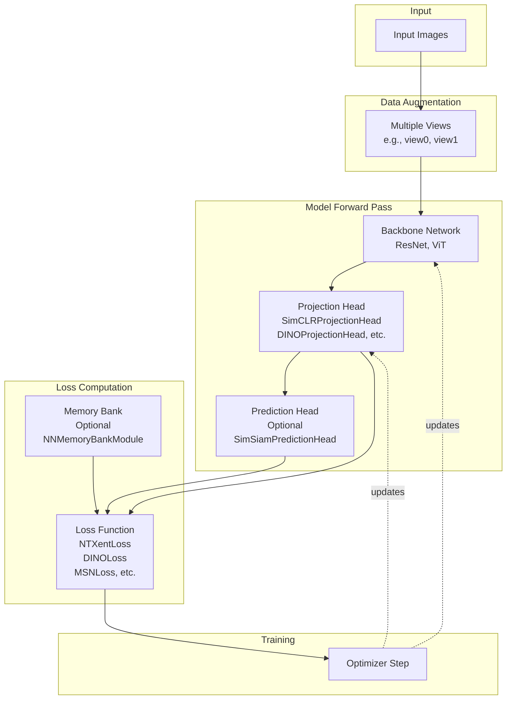
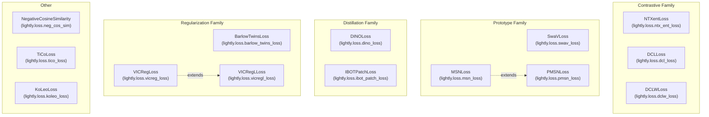
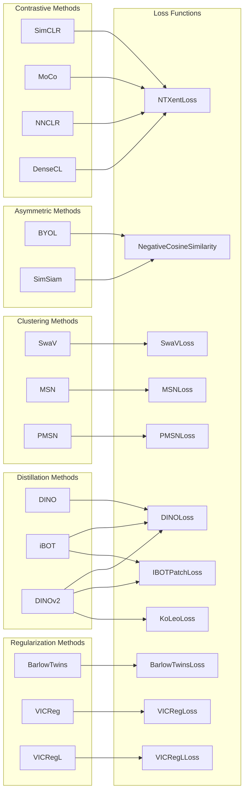
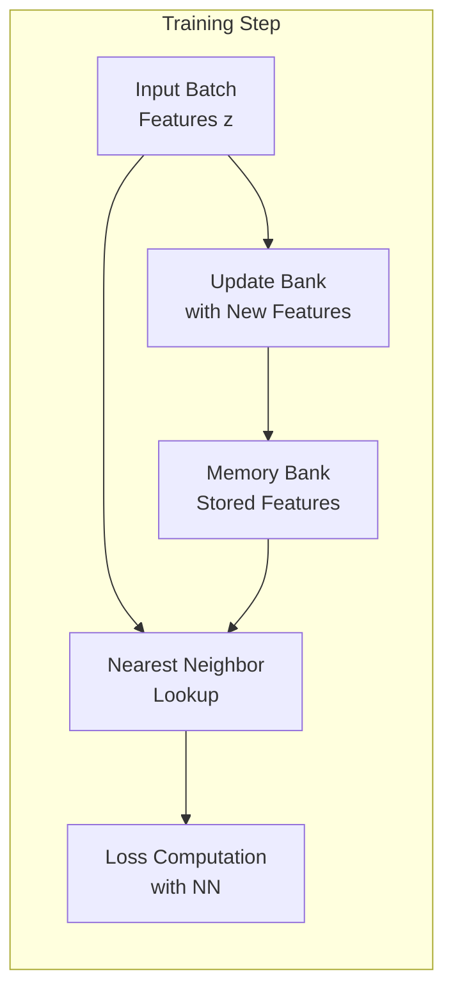

<!-- source: DeepWiki mcp.deepwiki.com · repo lightly-ai/lightly · page 2.3 Loss Functions · fetched 2026-10-21 -->

# Loss Functions

Relevant source files

The following files were used as context for generating this wiki page:

- [.github/workflows/check_example_nbs.yml](.github/workflows/check_example_nbs.yml)
- [.github/workflows/discord_release_notification.yml](.github/workflows/discord_release_notification.yml)
- [Makefile](Makefile)
- [README.md](README.md)
- [benchmarks/imagenet/vitb16/dinov2.py](benchmarks/imagenet/vitb16/dinov2.py)
- [benchmarks/imagenet/vitb16/ibot.py](benchmarks/imagenet/vitb16/ibot.py)
- [docs/source/getting_started/benchmarks.rst](docs/source/getting_started/benchmarks.rst)
- [docs/source/getting_started/benchmarks/cifar10_benchmark.py](docs/source/getting_started/benchmarks/cifar10_benchmark.py)
- [docs/source/getting_started/benchmarks/imagenet100_benchmark.py](docs/source/getting_started/benchmarks/imagenet100_benchmark.py)
- [docs/source/getting_started/benchmarks/imagenette_benchmark.py](docs/source/getting_started/benchmarks/imagenette_benchmark.py)
- [lightly/loss/pmsn_loss.py](lightly/loss/pmsn_loss.py)
- [lightly/models/modules/__init__.py](lightly/models/modules/__init__.py)
- [lightly/models/modules/heads.py](lightly/models/modules/heads.py)
- [lightly/models/modules/ijepa_timm.py](lightly/models/modules/ijepa_timm.py)
- [lightly/models/modules/masked_autoencoder_timm.py](lightly/models/modules/masked_autoencoder_timm.py)
- [lightly/models/modules/masked_vision_transformer_timm.py](lightly/models/modules/masked_vision_transformer_timm.py)
- [lightly/models/utils.py](lightly/models/utils.py)
- [pyproject.toml](pyproject.toml)
- [tests/loss/test_msn_loss.py](tests/loss/test_msn_loss.py)
- [tests/loss/test_pmsn_loss.py](tests/loss/test_pmsn_loss.py)
- [tests/models/modules/test_masked_autoencoder.py](tests/models/modules/test_masked_autoencoder.py)
- [tests/models/test_ModelUtils.py](tests/models/test_ModelUtils.py)
- [tests/models/test_ProjectionHeads.py](tests/models/test_ProjectionHeads.py)

## Purpose and Scope

This page documents the loss functions available in the Lightly framework for self-supervised learning. Loss functions are a core component of SSL methods, computing the training objective that drives representation learning. Each SSL method (SimCLR, DINO, MAE, etc.) requires specific loss functions that work in conjunction with model architectures and data augmentations.

For information about model architectures and projection heads that produce the inputs to these loss functions, see [Model Components and Utilities](#2.2). For complete SSL model implementations that combine backbones, heads, and losses, see [Self-Supervised Learning Models](#2).

---

## Loss Function Architecture

The following diagram shows how loss functions fit into the SSL training pipeline:

**Sources:** [README.md:125-189](), [docs/source/getting_started/benchmarks/cifar10_benchmark.py:1-220]()

---

## Loss Function Categories

Lightly provides loss functions organized into distinct categories based on their learning paradigm:

| Category | Learning Approach | Example Losses | Characteristics |
|----------|------------------|----------------|-----------------|
| **Contrastive** | Maximize similarity between positive pairs, minimize similarity between negative pairs | `NTXentLoss`, `DCLLoss`, `DCLWLoss` | Requires negative samples, often uses memory banks |
| **Asymmetric** | Online network predicts target network outputs | `NegativeCosineSimilarity` | No negative pairs needed, uses stop-gradient |
| **Prototype-Based** | Cluster assignments via learnable prototypes | `SwaVLoss`, `MSNLoss`, `PMSNLoss` | Uses Sinkhorn-Knopp algorithm |
| **Distillation** | Student mimics teacher outputs | `DINOLoss`, `IBOTPatchLoss` | Uses momentum teacher, centering |
| **Regularization** | Enforce properties on embeddings | `BarlowTwinsLoss`, `VICRegLoss`, `VICRegLLoss` | Invariance, variance, covariance constraints |
| **Reconstruction** | Predict masked input patches | MAE reconstruction loss | Used with masked autoencoders |
| **Specialized** | Task-specific objectives | `TiCoLoss`, `KoLeoLoss`, `SMoGLoss` | Method-specific design |

**Sources:** [lightly/loss/__init__.py](), [docs/source/getting_started/benchmarks/imagenette_benchmark.py:77-90]()

---

## Available Loss Functions

The following table lists all implemented loss functions with their primary use cases:

| Loss Function | SSL Method | Year | Key Parameters | Description |
|---------------|------------|------|----------------|-------------|
| `NTXentLoss` | SimCLR, MoCo | 2020 | `temperature`, `memory_bank_size` | Normalized temperature-scaled cross entropy loss |
| `NegativeCosineSimilarity` | BYOL, SimSiam | 2020-2021 | None | Negative cosine similarity between predictions |
| `BarlowTwinsLoss` | Barlow Twins | 2021 | `lambda_param`, `gather_distributed` | Cross-correlation matrix with invariance term |
| `DINOLoss` | DINO, iBOT | 2021 | `output_dim`, `teacher_temp`, `student_temp` | Knowledge distillation with centering |
| `MSNLoss` | MSN | 2022 | `temperature`, `sinkhorn_iterations` | Masked Siamese Networks with prototypes |
| `PMSNLoss` | PMSN | 2022 | `power_law_exponent`, `regularization_weight` | MSN with power law target distribution |
| `SwaVLoss` | SwaV | 2020 | `temperature`, `sinkhorn_iterations` | Swapped prediction with online clustering |
| `VICRegLoss` | VICReg | 2021 | `lambda_param`, `mu_param`, `nu_param` | Variance-Invariance-Covariance regularization |
| `VICRegLLoss` | VICRegL | 2022 | Inherits VICReg params + local loss | VICReg with local feature regularization |
| `DCLLoss` | DCL | 2021 | `temperature`, `weight_fn` | Decoupled Contrastive Learning |
| `DCLWLoss` | DCLW | 2021 | `temperature`, `sigma` | DCL with Gaussian weighting |
| `TiCoLoss` | TiCo | 2024 | `temperature`, `gather_distributed` | Transformation invariance and covariance |
| `IBOTPatchLoss` | iBOT | 2021 | `output_dim`, `teacher_temp` | Patch-level distillation for masked tokens |
| `KoLeoLoss` | DINOv2 | 2023 | None | KoLeo regularization for uniform distribution |
| `SMoGLoss` | SMoG | 2022 | `temperature` | Synchronous momentum grouping |

**Sources:** [docs/source/getting_started/benchmarks/imagenette_benchmark.py:77-90](), [lightly/loss/pmsn_loss.py:1-80](), [benchmarks/imagenet/vitb16/dinov2.py:15-16]()

---

## Loss Function Hierarchy

**Sources:** [lightly/loss/pmsn_loss.py:10-11](), [lightly/loss/msn_loss.py]()

---

## Common Loss Parameters

### Temperature Scaling

Most contrastive and prototype-based losses use a temperature parameter to control the sharpness of probability distributions:

| Loss | Temperature Parameter | Typical Range | Effect |
|------|----------------------|---------------|---------|
| `NTXentLoss` | `temperature` | 0.1 - 0.5 | Lower = sharper distributions, harder negatives |
| `DINOLoss` | `student_temp`, `teacher_temp` | 0.04 - 0.1 | Asymmetric temps balance predictions |
| `MSNLoss` | `temperature` | 0.1 | Controls prototype assignment sharpness |
| `SwaVLoss` | `temperature` | 0.1 | Affects clustering behavior |

**Example from benchmark:**

[docs/source/getting_started/benchmarks/cifar10_benchmark.py:342-344]()

**Sources:** [docs/source/getting_started/benchmarks/cifar10_benchmark.py:340-388](), [tests/loss/test_msn_loss.py:30-36]()

### Memory Bank Configuration

Memory banks store previous embeddings to provide additional negative samples without recomputing:

| Parameter | Purpose | Typical Values |
|-----------|---------|----------------|
| `memory_bank_size` | Number of cached embeddings | 4096 - 65536 |
| Tuple format | `(bank_size, embedding_dim)` | `(4096, 128)` |

**Example usage:**

[docs/source/getting_started/benchmarks/cifar10_benchmark.py:342-344]()

Memory banks are particularly important for:
- **MoCo**: Core component storing momentum encoder outputs
- **NNCLR**: Nearest neighbor lookup for support set
- Small batch sizes where in-batch negatives are insufficient

**Sources:** [docs/source/getting_started/benchmarks/cifar10_benchmark.py:323-387](), [docs/source/getting_started/benchmarks/imagenette_benchmark.py:122]()

### Distributed Training Support

Losses support gathering features from multiple GPUs before computing loss:

| Parameter | Purpose | When to Use |
|-----------|---------|-------------|
| `gather_distributed` | Gather embeddings from all GPUs | When using DDP and want global negatives |

**Example configuration:**

[docs/source/getting_started/benchmarks/cifar10_benchmark.py:119-121]()

When `gather_distributed=True`:
- Effective batch size for loss computation = `batch_size * num_gpus`
- All GPUs see the same negative samples
- Improves training quality at computational cost

**Sources:** [README.md:263-274](), [docs/source/getting_started/benchmarks/cifar10_benchmark.py:108-139]()

---

## Integration with SSL Methods

The following table shows which loss functions are used by each SSL method:

**Sources:** [docs/source/getting_started/benchmarks/cifar10_benchmark.py:62-82](), [docs/source/getting_started/benchmarks/imagenette_benchmark.py:77-90](), [benchmarks/imagenet/vitb16/dinov2.py:113-116]()

---

## Usage Patterns

### Basic Contrastive Loss (SimCLR)

Typical usage of `NTXentLoss` for contrastive learning:

[README.md:174-176]()

The loss computes similarity between positive pairs (z0, z1) and pushes apart negative pairs from the same batch.

**Full training loop example:**

[README.md:180-189]()

**Sources:** [README.md:125-189](), [docs/source/getting_started/benchmarks/cifar10_benchmark.py:390-419]()

### Asymmetric Loss (SimSiam)

Using `NegativeCosineSimilarity` with prediction head:

[README.md:214-216]()

Note the `.detach()` on the projection output - this implements the stop-gradient operation critical to SimSiam.

**Full example:**

[README.md:196-216]()

**Sources:** [README.md:195-218](), [docs/source/getting_started/benchmarks/cifar10_benchmark.py:421-456]()

### Prototype-Based Loss (MSN)

`MSNLoss` and `PMSNLoss` require prototypes and use Sinkhorn-Knopp normalization:

[tests/loss/test_msn_loss.py:46-65]()

**Key parameters:**
- `temperature`: Controls sharpness of prototype assignments (default: 0.1)
- `sinkhorn_iterations`: Number of normalization iterations (default: 3)
- `regularization_weight`: Weight for entropy regularization (default: 1.0)

**PMSN-specific:**

[lightly/loss/pmsn_loss.py:47-54]()

The `power_law_exponent` parameter (default: 0.25) controls the prior distribution over prototypes.

**Sources:** [lightly/loss/pmsn_loss.py:1-80](), [tests/loss/test_msn_loss.py:1-100]()

### Distillation Loss (DINO)

`DINOLoss` implements knowledge distillation with centering and sharpening:

[benchmarks/imagenet/vitb16/dinov2.py:113-116]()

**Teacher temperature scheduling:**

[benchmarks/imagenet/vitb16/dinov2.py:182-189]()

The teacher temperature typically uses a warmup schedule, starting low (e.g., 0.04) and increasing to a final value (e.g., 0.07).

**Loss computation:**

[benchmarks/imagenet/vitb16/dinov2.py:189-193]()

**Sources:** [benchmarks/imagenet/vitb16/dinov2.py:48-205](), [benchmarks/imagenet/vitb16/ibot.py:85-92]()

### Multi-Loss Training (DINOv2)

Complex methods like DINOv2 combine multiple losses:

[benchmarks/imagenet/vitb16/dinov2.py:113-116]()

**Weighted combination:**

[benchmarks/imagenet/vitb16/dinov2.py:189-205]()

Loss weights can be scheduled during training to balance different objectives.

**Sources:** [benchmarks/imagenet/vitb16/dinov2.py:113-206]()

---

## Memory Bank Integration

### NNMemoryBankModule

The `NNMemoryBankModule` stores feature vectors for nearest neighbor lookup:

**Usage pattern in MoCo:**

[docs/source/getting_started/benchmarks/cifar10_benchmark.py:342-344]()

The memory bank is created with a tuple `(memory_bank_size, embedding_dim)` and automatically manages FIFO updates.

**Benefits:**
- Provides more negative samples than fit in a single batch
- Enables larger effective batch sizes without increased GPU memory
- Critical for contrastive methods on small batch sizes

**Sources:** [docs/source/getting_started/benchmarks/cifar10_benchmark.py:323-387](), [lightly/models/modules/__init__.py:32]()

### Memory Bank Configuration for Distributed Training

When using distributed training with larger batch sizes, memory bank size should be adjusted:

[docs/source/getting_started/benchmarks/cifar10_benchmark.py:342-344]()

**Note:** Comments in benchmarks indicate memory banks are increased from 4096 to 8192 for batch size 512 to prevent rapid turnover.

**Sources:** [docs/source/getting_started/benchmarks/cifar10_benchmark.py:29-51]()

---

## Specialized Loss Functions

### IBOTPatchLoss

Patch-level distillation for masked image modeling:

[benchmarks/imagenet/vitb16/ibot.py:89-92]()

**Usage in training:**

[benchmarks/imagenet/vitb16/ibot.py:194-198]()

The `mask` parameter specifies which patches are masked and should be predicted.

**Sources:** [benchmarks/imagenet/vitb16/ibot.py:38-206](), [benchmarks/imagenet/vitb16/dinov2.py:114]()

### KoLeoLoss

Regularization for uniform distribution of features:

[benchmarks/imagenet/vitb16/dinov2.py:115]()

**Usage:**

[benchmarks/imagenet/vitb16/dinov2.py:199-202]()

Encourages feature vectors to be uniformly distributed on the unit sphere, preventing dimensional collapse.

**Sources:** [benchmarks/imagenet/vitb16/dinov2.py:115-202]()

### TiCoLoss

Transformation invariance and covariance loss:

[docs/source/getting_started/benchmarks/imagenette_benchmark.py:87]()

Used in the TiCo method for learning invariant representations.

**Sources:** [docs/source/getting_started/benchmarks/imagenette_benchmark.py:85-89]()

---

## Loss Function Parameters Reference

### NTXentLoss

| Parameter | Type | Default | Description |
|-----------|------|---------|-------------|
| `temperature` | float | 0.5 | Temperature scaling parameter |
| `memory_bank_size` | int or tuple | 0 | Size of memory bank, 0 disables |
| `gather_distributed` | bool | False | Gather features from all GPUs |

### DINOLoss

| Parameter | Type | Default | Description |
|-----------|------|---------|-------------|
| `output_dim` | int | 65536 | Dimension of output features |
| `teacher_temp` | float | 0.04 | Teacher network temperature |
| `student_temp` | float | 0.1 | Student network temperature |
| `center_momentum` | float | 0.9 | EMA momentum for center |

### MSNLoss

| Parameter | Type | Default | Description |
|-----------|------|---------|-------------|
| `temperature` | float | 0.1 | Temperature for prototype similarities |
| `sinkhorn_iterations` | int | 3 | Number of Sinkhorn-Knopp iterations |
| `regularization_weight` | float | 1.0 | Weight for entropy regularization |
| `gather_distributed` | bool | False | Gather features from all GPUs |

### PMSNLoss (extends MSNLoss)

| Parameter | Type | Default | Description |
|-----------|------|---------|-------------|
| `power_law_exponent` | float | 0.25 | Exponent for power law prior |
| All MSNLoss params | - | - | Inherits all MSNLoss parameters |

### BarlowTwinsLoss

| Parameter | Type | Default | Description |
|-----------|------|---------|-------------|
| `lambda_param` | float | 5e-3 | Weight for off-diagonal terms |
| `gather_distributed` | bool | False | Gather features from all GPUs |

### VICRegLoss

| Parameter | Type | Default | Description |
|-----------|------|---------|-------------|
| `lambda_param` | float | 25.0 | Weight for variance term |
| `mu_param` | float | 25.0 | Weight for invariance term |
| `nu_param` | float | 1.0 | Weight for covariance term |

**Sources:** [tests/loss/test_msn_loss.py:30-44](), [lightly/loss/pmsn_loss.py:47-54]()

---

## Performance Considerations

### Computational Complexity

Different loss functions have varying computational requirements:

| Loss Type | Complexity | Memory Usage | Notes |
|-----------|------------|--------------|-------|
| `NTXentLoss` | O(B²) | Low | Scales quadratically with batch size |
| `NTXentLoss` + memory bank | O(B·M) | Medium | M = memory bank size |
| `DINOLoss` | O(B·D) | Low | D = output dimension |
| `MSNLoss` | O(B·K·I) | Medium | K = prototypes, I = Sinkhorn iterations |
| `BarlowTwinsLoss` | O(D²) | Low | Computes cross-correlation matrix |

### Distributed Training Impact

When using `gather_distributed=True`:

**Memory increase:**
- Features from all GPUs are gathered
- Memory usage scales with number of GPUs
- Batch size per GPU can be reduced to compensate

**Computation increase:**
- Loss computed with global view of data
- Better gradient quality
- Longer training time per step

**Example from benchmark:**

[README.md:263-274]()

**Sources:** [README.md:263-277](), [docs/source/getting_started/benchmarks/cifar10_benchmark.py:108-139]()

---

## Summary

Lightly provides a comprehensive set of loss functions covering all major self-supervised learning paradigms:

1. **Contrastive losses** (`NTXentLoss`, `DCLLoss`) for learning by comparing positive and negative pairs
2. **Prototype-based losses** (`MSNLoss`, `PMSNLoss`, `SwaVLoss`) for online clustering
3. **Distillation losses** (`DINOLoss`, `IBOTPatchLoss`) for knowledge transfer
4. **Regularization losses** (`BarlowTwinsLoss`, `VICRegLoss`) for decorrelation
5. **Specialized losses** for specific methods and use cases

Key configuration considerations:
- **Temperature** controls prediction sharpness
- **Memory banks** provide additional negatives efficiently
- **Distributed gathering** improves training quality at computational cost
- **Loss combinations** enable sophisticated training objectives

For complete training examples demonstrating these losses in action, see the benchmark implementations and the main README examples.

**Sources:** [README.md:1-437](), [docs/source/getting_started/benchmarks.rst:1-219](), [lightly/loss/__init__.py]()

---

