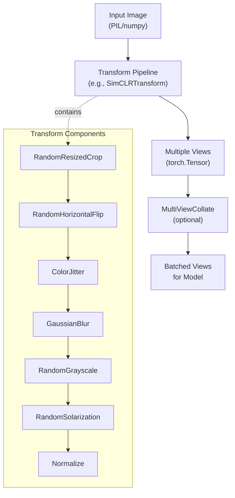
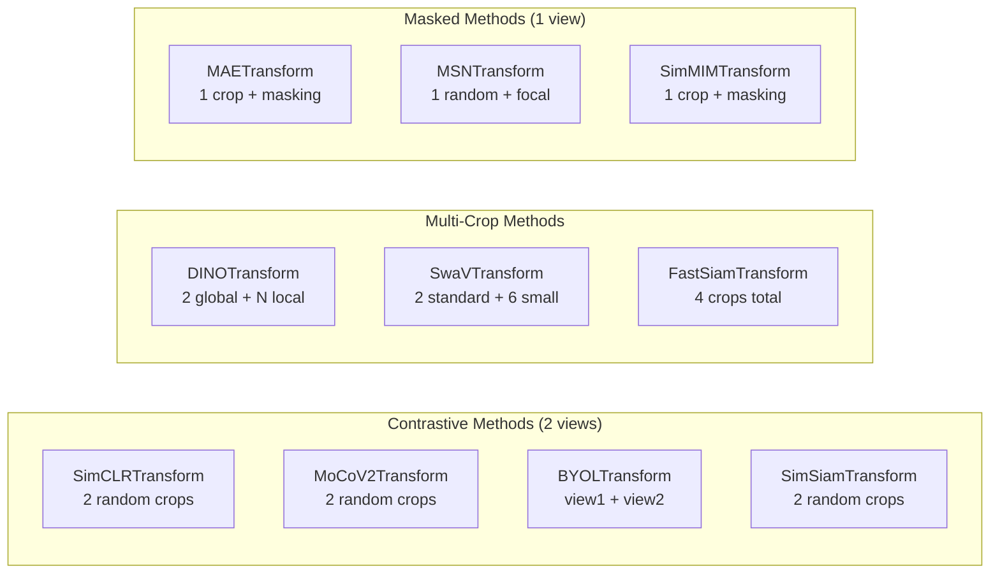
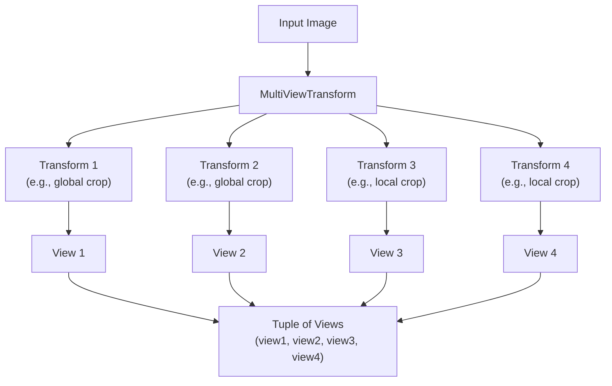
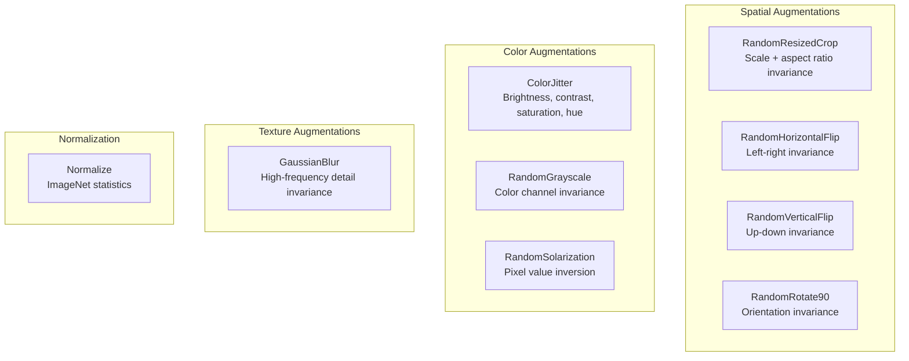
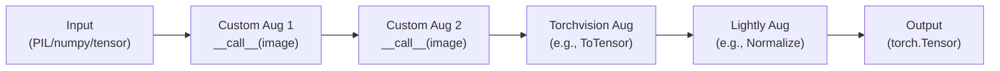
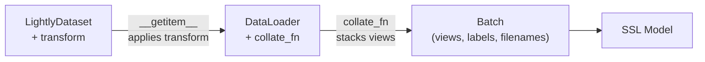

<!-- source: DeepWiki mcp.deepwiki.com · repo lightly-ai/lightly · page 2.4 Transforms and Augmentations · fetched 2026-10-21 -->

# Transforms and Augmentations

<details>
<summary>Relevant source files</summary>

The following files were used as context for generating this wiki page:

- [README.md](README.md)
- [docs/source/getting_started/advanced.rst](docs/source/getting_started/advanced.rst)
- [docs/source/getting_started/benchmarks.rst](docs/source/getting_started/benchmarks.rst)
- [docs/source/getting_started/benchmarks/cifar10_benchmark.py](docs/source/getting_started/benchmarks/cifar10_benchmark.py)
- [docs/source/getting_started/benchmarks/imagenet100_benchmark.py](docs/source/getting_started/benchmarks/imagenet100_benchmark.py)
- [docs/source/getting_started/benchmarks/imagenette_benchmark.py](docs/source/getting_started/benchmarks/imagenette_benchmark.py)
- [docs/source/getting_started/command_line_tool.rst](docs/source/getting_started/command_line_tool.rst)
- [docs/source/getting_started/images/lightly_overview.png](docs/source/getting_started/images/lightly_overview.png)
- [docs/source/getting_started/install.rst](docs/source/getting_started/install.rst)
- [docs/source/getting_started/lightly_at_a_glance.rst](docs/source/getting_started/lightly_at_a_glance.rst)
- [docs/source/getting_started/main_concepts.rst](docs/source/getting_started/main_concepts.rst)
- [docs/source/index.rst](docs/source/index.rst)
- [docs/source/lightly.models.utils.rst](docs/source/lightly.models.utils.rst)
- [docs/source/tutorials/structure_your_input.rst](docs/source/tutorials/structure_your_input.rst)
- [docs/source/tutorials_source/package/Base-RCNN-FPN.yaml](docs/source/tutorials_source/package/Base-RCNN-FPN.yaml)
- [docs/source/tutorials_source/package/tutorial_custom_augmentations.py](docs/source/tutorials_source/package/tutorial_custom_augmentations.py)
- [docs/source/tutorials_source/package/tutorial_moco_memory_bank.py](docs/source/tutorials_source/package/tutorial_moco_memory_bank.py)
- [docs/source/tutorials_source/package/tutorial_pretrain_detectron2.py](docs/source/tutorials_source/package/tutorial_pretrain_detectron2.py)
- [docs/source/tutorials_source/package/tutorial_simclr_clothing.py](docs/source/tutorials_source/package/tutorial_simclr_clothing.py)
- [docs/source/tutorials_source/package/tutorial_simsiam_esa.py](docs/source/tutorials_source/package/tutorial_simsiam_esa.py)

</details>


This page documents the transform and augmentation system in Lightly SSL, which is responsible for creating multiple augmented views of input images during self-supervised learning. Transforms define what invariances the model learns and are critical to the success of SSL training.

For information about how transforms integrate with the data loading pipeline, see [Data Handling](#3). For details on specific SSL methods that use these transforms, see [Self-Supervised Learning Models](#2).

## Overview

Self-supervised learning methods typically create multiple views of each input image by applying random transformations. The model then learns to produce similar representations for different views of the same image, thereby learning invariance to the applied transformations. Lightly provides:

- **Method-specific transforms**: Pre-configured transform pipelines for popular SSL methods (SimCLR, DINO, MAE, etc.)
- **Custom transform composition**: Tools to build custom multi-view transforms
- **Modular augmentations**: Individual augmentation operations that can be mixed and matched

The transforms are implemented using PyTorch/torchvision primitives and are compatible with the standard PyTorch data loading pipeline.

Sources: [lightly/transforms/](https://github.com/lightly-ai/lightly/tree/master/lightly/transforms), [docs/source/getting_started/advanced.rst:8-74](), [README.md:125-162]()

## Transform Pipeline Architecture



**Transform Pipeline Flow**

The transform pipeline processes each input image through a sequence of augmentation operations to produce one or more augmented views. The number and type of views depends on the SSL method being used.

Sources: [lightly/transforms/simclr_transform.py](), [lightly/transforms/multi_view_transform.py](), [docs/source/getting_started/advanced.rst:76-92]()

## Method-Specific Transforms

Lightly provides pre-configured transform classes for major SSL methods. Each transform creates the specific number and types of views required by its corresponding SSL method.



**SSL Method to Transform Mapping**

| Transform Class | SSL Method | Number of Views | Key Parameters |
|-----------------|------------|-----------------|----------------|
| `SimCLRTransform` | SimCLR | 2 | `input_size`, `cj_prob`, `gaussian_blur` |
| `MoCoV2Transform` | MoCo v2 | 2 | `input_size`, `gaussian_blur` |
| `BYOLTransform` | BYOL | 2 | `view_1_transform`, `view_2_transform` |
| `SimSiamTransform` | SimSiam | 2 | `input_size`, `cj_strength` |
| `DINOTransform` | DINO/DINOv2 | 2 global + N local | `global_crop_size`, `local_crop_size`, `n_local_views` |
| `SwaVTransform` | SwaV | Configurable | `crop_sizes`, `crop_counts` |
| `MAETransform` | MAE | 1 | `input_size` (masking done in model) |
| `MSNTransform` | MSN/PMSN | 2 | `random_size`, `focal_size` |
| `FastSiamTransform` | FastSiam | 4 | `input_size` |

Sources: [lightly/transforms/simclr_transform.py](), [lightly/transforms/dino_transform.py](), [lightly/transforms/mae_transform.py](), [lightly/transforms/swav_transform.py](), [docs/source/getting_started/benchmarks/imagenette_benchmark.py:169-235]()

### Common Transform Parameters

Most transforms accept these configuration parameters:

- **`input_size`**: Target size for cropped images (int or tuple)
- **`cj_prob`**: Probability of applying color jitter (default varies by method)
- **`cj_strength`**: Strength of color jitter (default varies by method)
- **`gaussian_blur`**: Probability or tuple of probabilities for Gaussian blur
- **`hf_prob`**: Probability of horizontal flip (default 0.5)
- **`vf_prob`**: Probability of vertical flip (default 0.0)
- **`rr_prob`**: Probability of random 90-degree rotation (default 0.0)
- **`min_scale`**: Minimum scale for random resized crop (default varies)
- **`random_gray_scale`**: Probability of grayscale conversion

Example usage from tutorials:

```python
# SimCLR transform with custom parameters
from lightly.transforms import SimCLRTransform

transform = SimCLRTransform(
    input_size=128,      # Resize to 128x128
    cj_prob=0.5,         # 50% chance of color jitter
    gaussian_blur=0.0,   # Disable Gaussian blur
)
```

Sources: [docs/source/tutorials_source/package/tutorial_simclr_clothing.py:91](), [docs/source/getting_started/advanced.rst:100-110](), [docs/source/getting_started/benchmarks/cifar10_benchmark.py:166-213]()

## MultiViewTransform Composition

The `MultiViewTransform` class allows composition of arbitrary transforms to create custom multi-view pipelines.



**MultiViewTransform Architecture**

Example from documentation:

```python
from torchvision import transforms as T
from lightly.transforms import MultiViewTransform

# Global view transform (224x224 patches)
global_view = T.Compose([
    T.RandomResizedCrop(size=224, scale=(0.08, 1.0)),
    T.RandomHorizontalFlip(p=0.5),
    T.RandomGrayscale(p=0.2),
    T.ToTensor(),
])

# Local view transform (96x96 patches)
local_view = T.Compose([
    T.RandomResizedCrop(size=96, scale=(0.05, 0.4)),
    T.RandomHorizontalFlip(p=0.5),
    T.ToTensor(),
])

# Combine: 2 global + 2 local views
transform = MultiViewTransform([
    global_view,
    global_view,
    local_view,
    local_view,
])

# Returns tuple of 4 views
views = transform(image)
```

Sources: [docs/source/getting_started/advanced.rst:116-142](), [lightly/transforms/multi_view_transform.py]()

## Augmentation Types and Learned Invariances

Different augmentations induce different invariances in the learned representations. Understanding these is crucial for selecting appropriate transforms for your domain.

### Augmentation Catalog



**Augmentation Categories and Effects**

| Category | Augmentation | Invariance Learned | Typical Use Cases |
|----------|--------------|-------------------|-------------------|
| **Spatial** | `RandomResizedCrop` | Object scale, position, partial visibility | Universal (all datasets) |
| | `RandomHorizontalFlip` | Left-right orientation | Natural images, objects |
| | `RandomVerticalFlip` | Up-down orientation | Satellite/aerial imagery, medical scans |
| | `RandomRotate` (90°) | Camera orientation | Satellite imagery, texture classification |
| **Color** | `ColorJitter` | Color variations, lighting | Natural images (avoid for X-ray, medical) |
| | `RandomGrayscale` | Color presence | Objects where color is not discriminative |
| | `RandomSolarization` | Pixel value inversion | Robustness augmentation |
| **Texture** | `GaussianBlur` | High-frequency details | Focusing on shape over texture |

Sources: [docs/source/getting_started/advanced.rst:26-59](), [README.md:14-24]()

### Domain-Specific Considerations

**Natural Images** (ImageNet, COCO):
- Use all standard augmentations including color jitter and blur
- Typical config: `SimCLRTransform(input_size=224)`

**Small Images** (CIFAR-10, CIFAR-100):
- Disable Gaussian blur (images too small)
- Example: `SimCLRTransform(input_size=32, gaussian_blur=0.0)`

**Satellite/Aerial Imagery**:
- Enable vertical flip and 90° rotation
- Use weak color jitter
- Example: `SimCLRTransform(input_size=256, vf_prob=0.5, rr_prob=0.5, cj_prob=0.2)`

**Medical/X-ray Images**:
- Disable color augmentations (grayscale images)
- Use custom preprocessing (e.g., histogram normalization)
- Focus on spatial augmentations only

Sources: [docs/source/tutorials_source/package/tutorial_simsiam_esa.py:92-108](), [docs/source/tutorials_source/package/tutorial_custom_augmentations.py:88-151](), [docs/source/getting_started/benchmarks/cifar10_benchmark.py:172-177]()

## Custom Augmentation Implementation

Users can implement custom augmentations and integrate them with Lightly's transform system. Custom augmentations should be callable objects that accept and return images.

### Custom Augmentation Pattern



**Custom Augmentation Integration**

Example from X-ray tutorial showing histogram normalization and Gaussian noise:

```python
# Custom augmentation for 16-bit to 8-bit conversion
class HistogramNormalize:
    def __init__(self, number_bins=256):
        self.number_bins = number_bins
    
    def __call__(self, image: np.array) -> Image:
        # Histogram equalization
        histogram, bins = np.histogram(
            image.flatten(), self.number_bins, density=True
        )
        cdf = histogram.cumsum()
        cdf = 255 * cdf / cdf[-1]
        image_equalized = np.interp(image.flatten(), bins[:-1], cdf)
        return Image.fromarray(image_equalized.reshape(image.shape))

# Custom noise augmentation
class GaussianNoise:
    def __call__(self, sample: torch.Tensor) -> torch.Tensor:
        mu = sample.mean()
        snr = np.random.randint(low=4, high=8)
        sigma = mu / snr
        noise = torch.normal(torch.zeros(sample.shape), sigma)
        return sample + noise

# Compose with standard transforms
transform = T.Compose([
    HistogramNormalize(number_bins=256),  # Custom
    T.RandomResizedCrop(128),
    T.RandomHorizontalFlip(),
    T.ToTensor(),
    GaussianNoise(),  # Custom (after ToTensor)
    T.Normalize(mean=[0.485], std=[0.229]),
])
```

Sources: [docs/source/tutorials_source/package/tutorial_custom_augmentations.py:100-144](), [docs/source/getting_started/advanced.rst:95-162]()

## Transform Configuration Patterns

### Pattern 1: Using Pre-configured Transforms

The simplest approach is to use method-specific transforms with default or slightly modified parameters:

```python
from lightly.data import LightlyDataset
from lightly.transforms import SimCLRTransform

# Use defaults
transform = SimCLRTransform()

# Or customize parameters
transform = SimCLRTransform(
    input_size=128,
    cj_prob=0.8,
    gaussian_blur=0.5,
)

dataset = LightlyDataset(
    input_dir='path/to/data',
    transform=transform
)
```

Sources: [docs/source/tutorials_source/package/tutorial_simclr_clothing.py:79-106](), [README.md:160-161]()

### Pattern 2: Multi-View Custom Composition

For research or custom SSL methods, compose multiple transforms:

```python
from torchvision import transforms as T
from lightly.transforms import MultiViewTransform
from lightly.transforms.utils import IMAGENET_NORMALIZE

# Define individual view transforms
strong_aug = T.Compose([
    T.RandomResizedCrop(224, scale=(0.2, 1.0)),
    T.RandomHorizontalFlip(),
    T.ColorJitter(0.4, 0.4, 0.4, 0.1),
    T.RandomGrayscale(p=0.2),
    T.ToTensor(),
    T.Normalize(**IMAGENET_NORMALIZE),
])

weak_aug = T.Compose([
    T.RandomResizedCrop(224, scale=(0.5, 1.0)),
    T.RandomHorizontalFlip(),
    T.ToTensor(),
    T.Normalize(**IMAGENET_NORMALIZE),
])

# Combine into multi-view transform
transform = MultiViewTransform([strong_aug, weak_aug])
```

Sources: [docs/source/getting_started/advanced.rst:116-142]()

### Pattern 3: Dataset-Specific Transforms

Different transforms for training vs. inference:

```python
from lightly.transforms import SimCLRTransform
import torchvision.transforms as T

# Training: Multi-view augmentation
train_transform = SimCLRTransform(input_size=128)
train_dataset = LightlyDataset(
    input_dir='data/train',
    transform=train_transform
)

# Inference: Single view, minimal augmentation
test_transform = T.Compose([
    T.Resize(128),
    T.CenterCrop(128),
    T.ToTensor(),
    T.Normalize(mean=[0.485, 0.456, 0.406],
                std=[0.229, 0.224, 0.225]),
])
test_dataset = LightlyDataset(
    input_dir='data/test',
    transform=test_transform
)
```

Sources: [docs/source/tutorials_source/package/tutorial_moco_memory_bank.py:126-161](), [docs/source/getting_started/benchmarks/imagenette_benchmark.py:242-249]()

## Transform Utilities

Lightly provides utility functions and constants for common transform operations.

### IMAGENET_NORMALIZE

Pre-computed normalization statistics for ImageNet:

```python
from lightly.transforms.utils import IMAGENET_NORMALIZE

# Usage
T.Normalize(
    mean=IMAGENET_NORMALIZE["mean"],  # [0.485, 0.456, 0.406]
    std=IMAGENET_NORMALIZE["std"],    # [0.229, 0.224, 0.225]
)
```

Sources: [lightly/transforms/utils.py](), [docs/source/getting_started/benchmarks/imagenette_benchmark.py:236-239]()

### Custom Augmentation Classes

Lightly provides custom augmentations not available in torchvision:

- **`RandomSolarization`**: Inverts pixel values above a threshold
- **`RandomRotate`**: 90-degree rotations (0°, 90°, 180°, 270°)

These can be imported from `lightly.transforms`:

```python
from lightly.transforms import RandomRotate, RandomSolarization

# Use in custom pipelines
transform = T.Compose([
    T.RandomResizedCrop(224),
    RandomRotate(prob=0.5),  # 50% chance of 90° rotation
    RandomSolarization(prob=0.2),  # 20% chance of solarization
    T.ToTensor(),
])
```

Sources: [docs/source/getting_started/advanced.rst:91-92]()

## Integration with Data Loading

Transforms are applied automatically by the dataset and dataloader pipeline:



**Data Loading Pipeline**

When using `LightlyDataset` with a transform:

1. **`LightlyDataset.__getitem__(index)`** loads raw image and applies transform
2. Transform returns tuple of views: `(view0, view1, ...)`
3. **`DataLoader`** collects multiple samples into a batch
4. **`MultiViewCollate`** (optional) properly stacks multi-view batches
5. Model receives batch: `((view0_batch, view1_batch, ...), labels, filenames)`

Example from benchmark code:

```python
from lightly.data import LightlyDataset
from lightly.transforms import SimCLRTransform

# Create dataset with transform
transform = SimCLRTransform(input_size=128)
dataset = LightlyDataset(
    input_dir='path/to/images',
    transform=transform
)

# Create dataloader
dataloader = torch.utils.data.DataLoader(
    dataset,
    batch_size=256,
    shuffle=True,
    drop_last=True,
    num_workers=8,
)

# Training loop receives multi-view batches
for (view0, view1), labels, filenames in dataloader:
    z0 = model(view0)
    z1 = model(view1)
    loss = criterion(z0, z1)
```

Sources: [docs/source/tutorials_source/package/tutorial_simclr_clothing.py:106-124](), [docs/source/getting_started/benchmarks/cifar10_benchmark.py:263-287]()

## Performance Considerations

### Memory vs. Computation Tradeoff

- **More views**: Higher GPU memory usage but better representations
- **Larger input sizes**: More memory, longer training time
- **Blur/strong augmentations**: Increased CPU preprocessing time

Typical configurations by GPU memory:

| GPU Memory | Batch Size | Input Size | Example Config |
|------------|------------|------------|----------------|
| 8 GB | 128 | 128×128 | CIFAR-10 style training |
| 16 GB | 256 | 128×128 | Medium-scale training |
| 16 GB | 128 | 224×224 | ImageNet-style training |
| 32+ GB | 256+ | 224×224 | Full-scale ImageNet training |

Sources: [docs/source/tutorials_source/package/tutorial_simclr_clothing.py:56-65](), [docs/source/tutorials_source/package/tutorial_custom_augmentations.py:66-69]()

### CPU Preprocessing

Use `num_workers > 0` in DataLoader to parallelize transform application:

```python
dataloader = torch.utils.data.DataLoader(
    dataset,
    batch_size=256,
    num_workers=8,  # 8 parallel workers for data loading
    pin_memory=True,  # Faster GPU transfer
)
```

Sources: [docs/source/tutorials_source/package/tutorial_simclr_clothing.py:110-116]()

## Summary

The transform system in Lightly provides:

1. **Pre-configured transforms** for major SSL methods (SimCLR, DINO, MAE, etc.)
2. **Flexible composition** via `MultiViewTransform` for custom pipelines  
3. **Domain-specific customization** for different image types
4. **Seamless integration** with PyTorch data loading

Key classes and modules:
- `lightly.transforms.SimCLRTransform`, `DINOTransform`, `MAETransform`, etc.
- `lightly.transforms.MultiViewTransform`
- `lightly.transforms.utils.IMAGENET_NORMALIZE`
- `lightly.data.LightlyDataset` (applies transforms automatically)

Sources: [lightly/transforms/](), [docs/source/getting_started/advanced.rst:8-162](), [README.md:125-189]()

---

