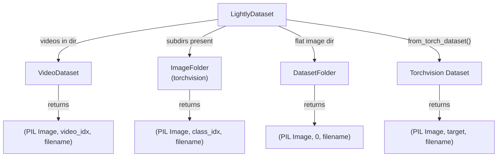
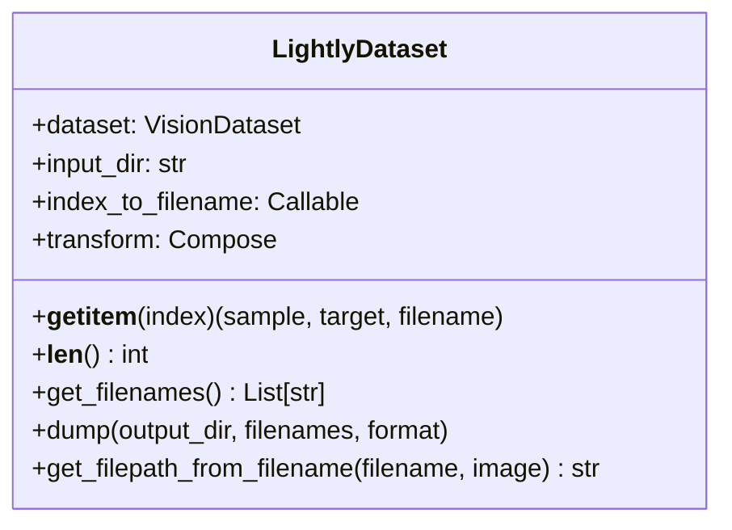
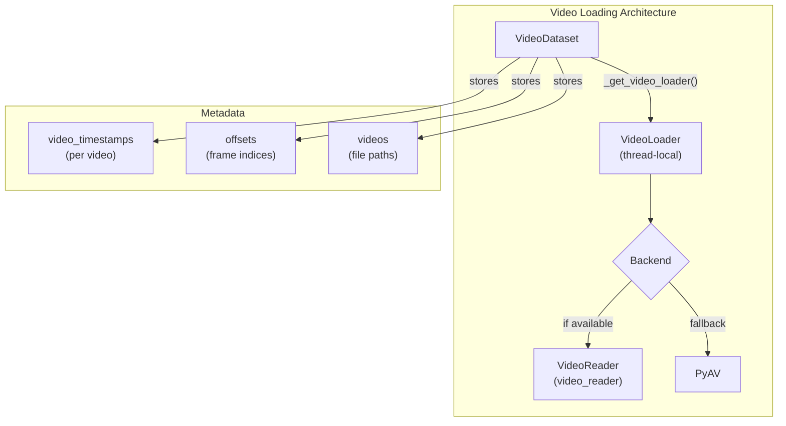
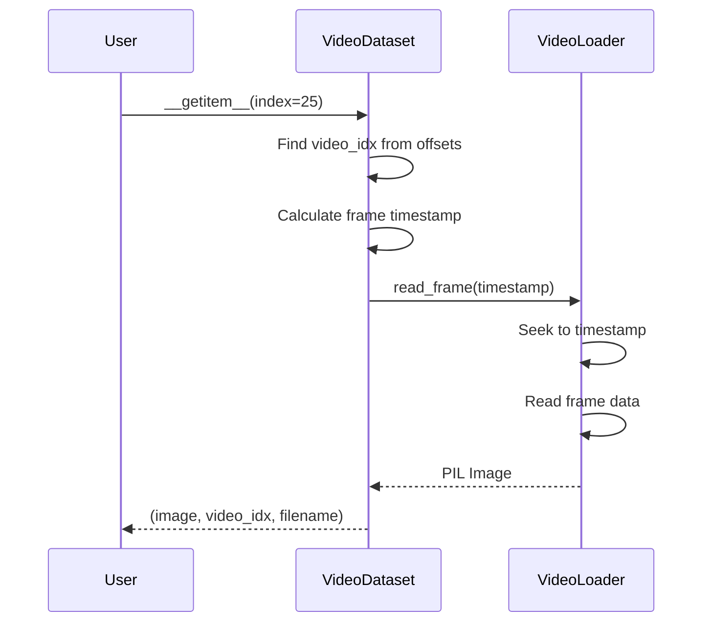
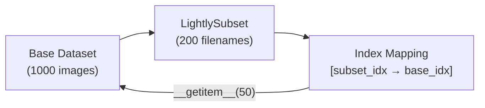
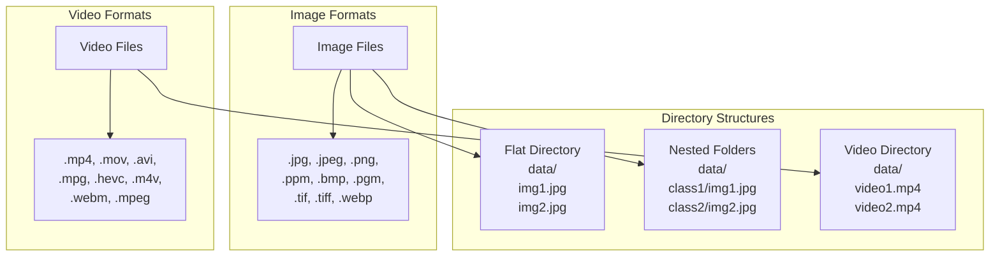
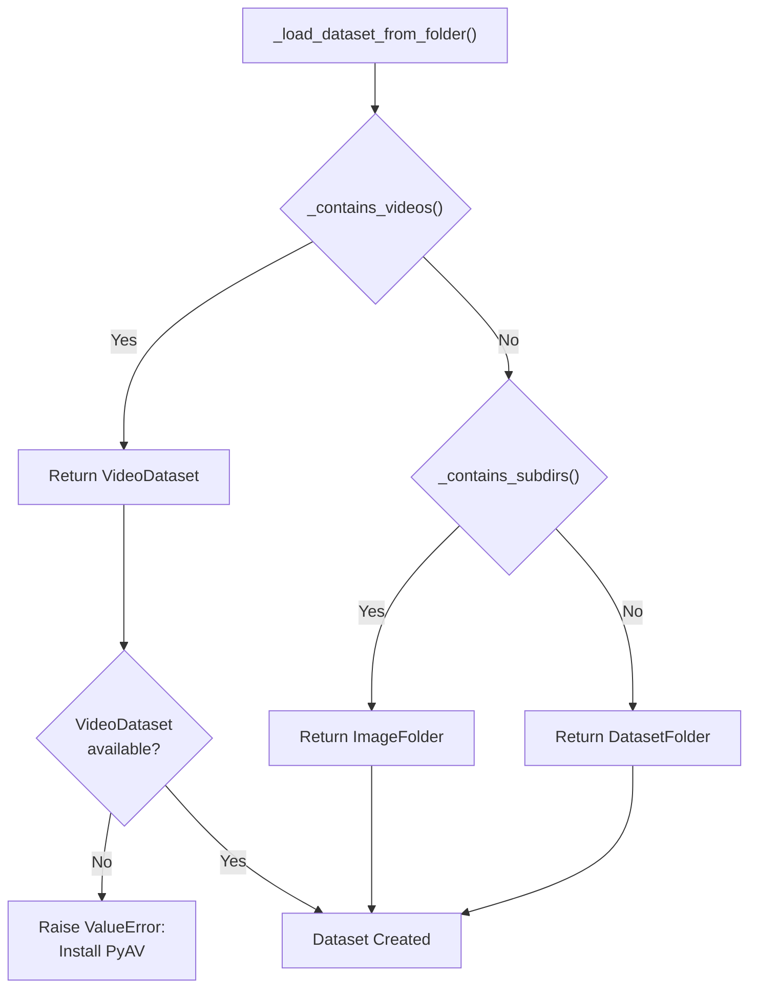
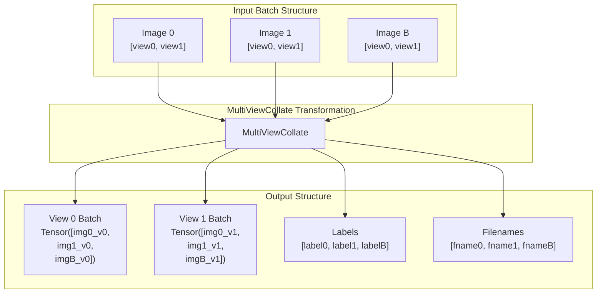
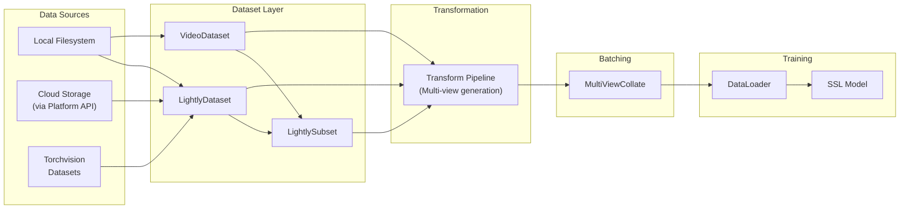

<!-- source: DeepWiki mcp.deepwiki.com · repo lightly-ai/lightly · page 3 Data Handling · fetched 2026-10-21 -->

# Data Handling

<details>
<summary>Relevant source files</summary>

The following files were used as context for generating this wiki page:

- [docs/source/getting_started/advanced.rst](docs/source/getting_started/advanced.rst)
- [docs/source/getting_started/command_line_tool.rst](docs/source/getting_started/command_line_tool.rst)
- [docs/source/getting_started/images/lightly_overview.png](docs/source/getting_started/images/lightly_overview.png)
- [docs/source/getting_started/install.rst](docs/source/getting_started/install.rst)
- [docs/source/getting_started/lightly_at_a_glance.rst](docs/source/getting_started/lightly_at_a_glance.rst)
- [docs/source/getting_started/main_concepts.rst](docs/source/getting_started/main_concepts.rst)
- [docs/source/index.rst](docs/source/index.rst)
- [docs/source/lightly.models.utils.rst](docs/source/lightly.models.utils.rst)
- [lightly/data/_helpers.py](lightly/data/_helpers.py)
- [lightly/data/_image.py](lightly/data/_image.py)
- [lightly/data/_video.py](lightly/data/_video.py)
- [lightly/data/dataset.py](lightly/data/dataset.py)
- [lightly/data/lightly_subset.py](lightly/data/lightly_subset.py)
- [lightly/data/multi_view_collate.py](lightly/data/multi_view_collate.py)
- [tests/data/test_LightlyDataset.py](tests/data/test_LightlyDataset.py)
- [tests/data/test_LightlySubset.py](tests/data/test_LightlySubset.py)
- [tests/data/test_VideoDataset.py](tests/data/test_VideoDataset.py)

</details>


This page documents the data handling infrastructure in the Lightly SSL framework. It covers the dataset classes used to load images and videos, the supported input formats, filtering mechanisms, and batch collation for multi-view self-supervised learning.

For information about data augmentation and transforms, see [Transforms and Augmentations](#2.4). For dataset management via the Lightly Platform, see [Dataset and Tag Management](#6.3).

## Overview

The data handling layer provides a unified interface for working with different data sources in self-supervised learning workflows. The core abstraction is `LightlyDataset`, which wraps various underlying dataset types and provides consistent access to samples in the format `(sample, target, filename)`.

**Key Features:**
- Automatic detection of data type (images vs videos)
- Support for flat directories and nested folder structures
- Integration with torchvision datasets
- Video frame extraction without pre-processing
- Filename-based dataset filtering via `LightlySubset`
- Multi-view collation for batch preparation

**Sources:** [lightly/data/dataset.py:19-71](), [docs/source/getting_started/main_concepts.rst:19-26]()

## Dataset Classes

### LightlyDataset

`LightlyDataset` is the primary class for loading data in Lightly. It automatically detects the data format and delegates to the appropriate underlying implementation.



**Sources:** [lightly/data/dataset.py:19-295](), [lightly/data/_helpers.py:93-151]()

#### Initialization

`LightlyDataset` can be initialized from a directory or from an existing PyTorch dataset:

| Initialization Method | Description | Returns |
|----------------------|-------------|---------|
| `LightlyDataset(input_dir)` | Loads from directory | Auto-detects format |
| `LightlyDataset.from_torch_dataset(dataset)` | Wraps PyTorch dataset | Adds filename tracking |

The class uses `_load_dataset_from_folder()` to determine the appropriate underlying dataset type:

1. Check if directory contains videos (`.mp4`, `.mov`, `.avi`, etc.) → `VideoDataset`
2. Check if directory contains subdirectories → `ImageFolder` 
3. Otherwise → `DatasetFolder` (flat image directory)

**Sources:** [lightly/data/dataset.py:73-111](), [lightly/data/dataset.py:112-151](), [lightly/data/_helpers.py:93-151]()

#### Core Methods



| Method | Purpose |
|--------|---------|
| `__getitem__(index)` | Returns `(sample, target, filename)` tuple |
| `get_filenames()` | Returns list of all filenames in dataset |
| `dump(output_dir, filenames, format)` | Saves subset of images to disk |
| `get_filepath_from_filename(filename, image)` | Resolves full path for a filename |

**Sources:** [lightly/data/dataset.py:153-294]()

### VideoDataset

`VideoDataset` enables efficient random access to video frames without extracting them beforehand. It uses `VideoLoader` for frame reading and supports both PyAV and torchvision video backends.



**Sources:** [lightly/data/_video.py:307-604](), [lightly/data/_video.py:89-305]()

#### Frame Access

Frames are accessed by global index, which is mapped to `(video_index, frame_index_within_video)`:



The filename for video frames is constructed as: `{video_name}-{frame_number:0{padding}}-{video_format}.png`

**Sources:** [lightly/data/_video.py:397-469](), [lightly/data/_video.py:479-526](), [lightly/data/_video.py:570-578]()

#### Non-Increasing Timestamps

`VideoDataset` detects frames with non-increasing timestamps (which can cause wrong frames to be loaded) and raises `NonIncreasingTimestampError` by default. This can be disabled:

```python
dataset.exception_on_non_increasing_timestamp = False
```

**Sources:** [lightly/data/_video.py:324-327](), [lightly/data/_video.py:446-456](), [lightly/data/_video.py:709-734]()

#### Multi-threading and Multi-processing

`VideoLoader` is thread-safe (inherits from `threading.local`). `VideoDataset` tracks worker references to avoid sharing `VideoLoader` instances between DataLoader workers, which is necessary for the `video_reader` backend.

**Sources:** [lightly/data/_video.py:66-86](), [lightly/data/_video.py:580-603]()

### DatasetFolder

`DatasetFolder` handles flat image directories (no subdirectories). All images are assigned label `0` since they're in the same directory.

**Sources:** [lightly/data/_image.py:16-108](), [lightly/data/_image.py:110-159]()

### LightlySubset

`LightlySubset` creates a filtered view of a `LightlyDataset` based on a list of filenames. It's used for active learning and selection workflows.



The subset maintains a mapping from subset indices to base dataset indices, computed during initialization.

**Sources:** [lightly/data/lightly_subset.py:6-97]()

#### Usage Pattern

```python
base_dataset = LightlyDataset(input_dir='data/')
selected_filenames = ['img_001.jpg', 'img_005.jpg', 'img_042.jpg']
subset = LightlySubset(
    base_dataset=base_dataset,
    filenames_subset=selected_filenames
)
```

**Sources:** [lightly/data/lightly_subset.py:7-27](), [tests/data/test_LightlySubset.py:28-39]()

## Data Sources and Formats

### Supported Input Formats



**Supported Extensions:**

| Category | Extensions |
|----------|-----------|
| Images | `.jpg`, `.jpeg`, `.png`, `.ppm`, `.bmp`, `.pgm`, `.tif`, `.tiff`, `.webp` |
| Videos | `.mp4`, `.mov`, `.avi`, `.mpg`, `.hevc`, `.m4v`, `.webm`, `.mpeg` |

**Sources:** [lightly/data/_helpers.py:23-35]()

### Directory Detection Logic

The framework uses these helper functions to determine data type:



**Sources:** [lightly/data/_helpers.py:38-91](), [lightly/data/_helpers.py:93-151]()

### Torchvision Integration

Any torchvision dataset can be wrapped using `from_torch_dataset()`:

```python
import torchvision
from lightly.data import LightlyDataset

cifar10 = torchvision.datasets.CIFAR10(root='./')
dataset = LightlyDataset.from_torch_dataset(cifar10)
```

This adds filename tracking to the underlying dataset.

**Sources:** [lightly/data/dataset.py:112-151](), [tests/data/test_LightlyDataset.py:165-175]()

## Data Collation

### MultiViewCollate

Self-supervised learning methods create multiple augmented views of each image. `MultiViewCollate` reorganizes batch data from per-image views to per-view batches.



**Input Format:**
```python
[
    ([img_0_view_0, ..., img_0_view_N], label_0, filename_0),
    ([img_1_view_0, ..., img_1_view_N], label_1, filename_1),
    ...
    ([img_B_view_0, ..., img_B_view_N], label_B, filename_B),
]
```

**Output Format:**
```python
(
    [
        Tensor([img_0_view_0, ..., img_B_view_0]),  # view 0
        ...
        Tensor([img_0_view_N, ..., img_B_view_N]),  # view N
    ],
    torch.tensor([label_0, ..., label_B], dtype=torch.long),
    [filename_0, ..., filename_B],
)
```

**Sources:** [lightly/data/multi_view_collate.py:8-86]()

#### Usage with DataLoader

```python
from torch.utils.data import DataLoader
from lightly.data import LightlyDataset, MultiViewCollate
from lightly.transforms import SimCLRTransform

transform = SimCLRTransform()
dataset = LightlyDataset(input_dir='data/', transform=transform)
dataloader = DataLoader(
    dataset,
    batch_size=128,
    collate_fn=MultiViewCollate()
)

for views, targets, filenames in dataloader:
    view0, view1 = views  # Each is a tensor of shape (batch_size, C, H, W)
```

**Sources:** [lightly/data/multi_view_collate.py:16-21](), [docs/source/getting_started/lightly_at_a_glance.rst:36-50]()

## Data Flow Pipeline



**Typical Workflow:**

1. **Initialization:** Create `LightlyDataset` from directory or torchvision dataset
2. **Filtering (Optional):** Wrap in `LightlySubset` to select specific samples
3. **Transformation:** Apply multi-view transforms (e.g., `SimCLRTransform`)
4. **Collation:** Use `MultiViewCollate` in DataLoader to organize views
5. **Training:** Iterate over batches in SSL training loop

**Sources:** [docs/source/getting_started/lightly_at_a_glance.rst:16-60](), [lightly/data/dataset.py:19-71]()

## File Operations

### Dumping Datasets

`LightlyDataset.dump()` saves images to disk, either copying from source or re-encoding:

| Source Dataset Type | Behavior |
|--------------------|----------|
| `ImageFolder` / `DatasetFolder` | Direct file copy (preserves format) |
| `VideoDataset` / Torchvision datasets | Load and save (default format: PNG) |

```python
dataset.dump(
    output_dir='selected_images/',
    filenames=['img_001.jpg', 'img_042.jpg'],
    format='jpg'  # Optional: specify output format
)
```

**Sources:** [lightly/data/dataset.py:188-239](), [lightly/data/dataset.py:342-360]()

### Filename Handling

The framework maintains consistent filename conventions:

- **Images:** Relative path from dataset root (e.g., `subdir/img.jpg`)
- **Videos:** `{video_name}-{frame_number:0{padding}}-{video_format}.png`

For temporary operations (e.g., uploading from VideoDataset), `get_filepath_from_filename()` creates temporary files as needed.

**Sources:** [lightly/data/dataset.py:241-284](), [lightly/data/dataset.py:297-313](), [lightly/data/_video.py:479-578]()

## Configuration and Dependencies

### Video Support

Video functionality requires PyAV:

```bash
pip install "lightly[video]"
```

If videos are present but PyAV is not installed, a `ValueError` is raised with installation instructions.

**Sources:** [lightly/data/_helpers.py:14-20](), [lightly/data/_helpers.py:122-130](), [docs/source/getting_started/install.rst:28-33]()

### Video Backends

Two backends are supported:

| Backend | Description | Availability |
|---------|-------------|------------|
| `video_reader` | Faster sequential reads | Requires torchvision with video support |
| `pyav` | Fallback, works with random access | Requires PyAV installation |

The backend is automatically selected based on availability, with `video_reader` preferred if available.

**Sources:** [lightly/data/_video.py:28-29](), [lightly/data/_video.py:133-152]()

## Common Usage Patterns

### Basic Image Dataset

```python
from lightly.data import LightlyDataset

dataset = LightlyDataset(input_dir='my_images/')
print(f"Dataset size: {len(dataset)}")
print(f"Filenames: {dataset.get_filenames()}")

sample, target, fname = dataset[0]
```

**Sources:** [lightly/data/dataset.py:50-70]()

### Video Dataset with Frame Counting Workers

```python
dataset = LightlyDataset(
    input_dir='my_videos/',
    num_workers_video_frame_counting=4  # Parallel frame counting
)
```

**Sources:** [tests/data/test_LightlyDataset.py:149-160]()

### Filtered Dataset

```python
base_dataset = LightlyDataset(input_dir='data/')
selected_files = ['img_001.jpg', 'img_050.jpg']
subset = LightlySubset(base_dataset, selected_files)
```

**Sources:** [lightly/data/lightly_subset.py:7-27]()

### With Transforms and DataLoader

```python
from torch.utils.data import DataLoader
from lightly.transforms import SimCLRTransform
from lightly.data import LightlyDataset, MultiViewCollate

transform = SimCLRTransform(input_size=224)
dataset = LightlyDataset('data/', transform=transform)

dataloader = DataLoader(
    dataset,
    batch_size=128,
    shuffle=True,
    collate_fn=MultiViewCollate(),
    num_workers=8
)

for views, targets, filenames in dataloader:
    # views is a list of 2 tensors (for SimCLR)
    view0, view1 = views
```

**Sources:** [docs/source/getting_started/lightly_at_a_glance.rst:23-50]()

---

