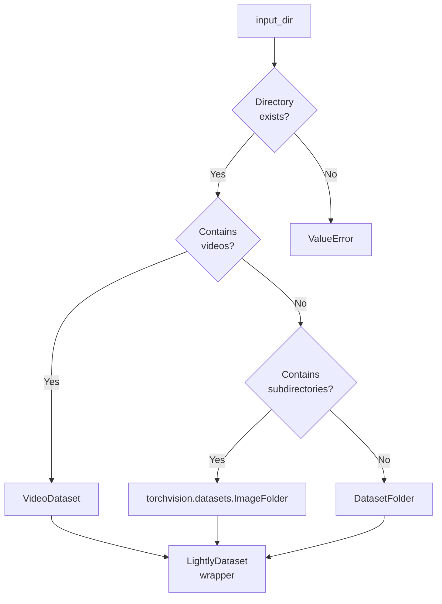
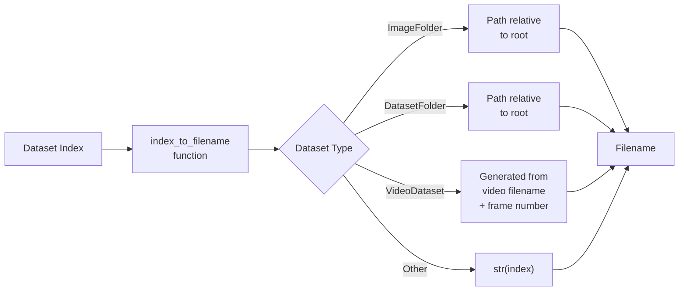
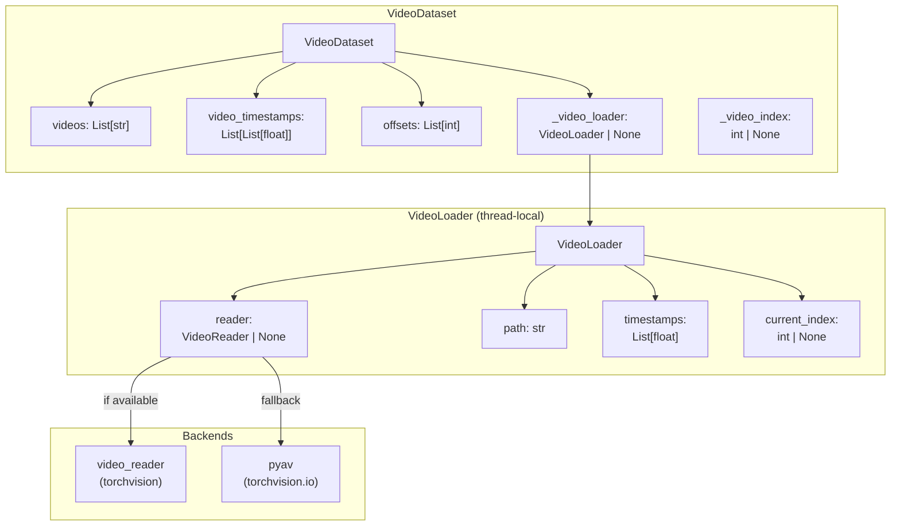
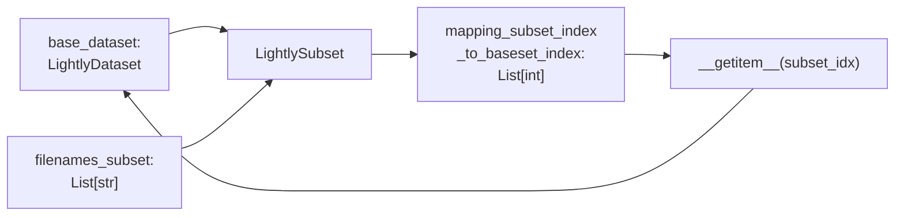

<!-- source: DeepWiki mcp.deepwiki.com · repo lightly-ai/lightly · page 3.1 Datasets · fetched 2026-10-21 -->

# Datasets

<details>
<summary>Relevant source files</summary>

The following files were used as context for generating this wiki page:

- [lightly/data/_helpers.py](lightly/data/_helpers.py)
- [lightly/data/_image.py](lightly/data/_image.py)
- [lightly/data/_video.py](lightly/data/_video.py)
- [lightly/data/dataset.py](lightly/data/dataset.py)
- [lightly/data/lightly_subset.py](lightly/data/lightly_subset.py)
- [lightly/data/multi_view_collate.py](lightly/data/multi_view_collate.py)
- [tests/data/test_LightlyDataset.py](tests/data/test_LightlyDataset.py)
- [tests/data/test_LightlySubset.py](tests/data/test_LightlySubset.py)
- [tests/data/test_VideoDataset.py](tests/data/test_VideoDataset.py)

</details>


This page documents the dataset classes used in Lightly for loading and managing image and video data. For information about data collation and batching for SSL training, see [Data Collation and Batching](#3.2).

## Overview

Lightly provides three primary dataset classes for data loading:

- **`LightlyDataset`**: Main interface that wraps image or video datasets and provides a uniform interface returning `(sample, target, filename)` tuples
- **`VideoDataset`**: Specialized dataset for extracting frames from video files without pre-extraction
- **`LightlySubset`**: Filtered view of a dataset based on a list of filenames

The framework automatically selects the appropriate underlying dataset implementation based on directory contents.

---

## Dataset Type Selection



**Dataset Selection Logic**

The `_load_dataset_from_folder()` function implements automatic dataset type detection:

Sources: [lightly/data/_helpers.py:93-151]()

---

## LightlyDataset

`LightlyDataset` is the primary dataset class that provides a uniform interface for all data types in Lightly. It wraps underlying PyTorch datasets and ensures all items are returned as `(sample, target, filename)` tuples.

### Creation from Directory

```python
from lightly.data import LightlyDataset

# Images in flat directory
dataset = LightlyDataset(input_dir='path/to/images/')

# Images in subdirectories (ImageNet-style)
dataset = LightlyDataset(input_dir='path/to/imagenet/')

# Videos
dataset = LightlyDataset(input_dir='path/to/videos/')
```

**Supported Directory Structures:**

| Structure | Example | Underlying Dataset |
|-----------|---------|-------------------|
| Flat directory | `images/img1.jpg, img2.jpg, ...` | `DatasetFolder` |
| Subdirectories | `imagenet/class1/img1.jpg, class2/img2.jpg, ...` | `torchvision.datasets.ImageFolder` |
| Videos | `videos/video1.mp4, video2.mp4, ...` | `VideoDataset` |

### Creation from PyTorch Dataset

```python
import torchvision.datasets as datasets
from lightly.data import LightlyDataset

# Load CIFAR-10 from torchvision
cifar10 = datasets.CIFAR10(root='./data', download=True)
dataset = LightlyDataset.from_torch_dataset(cifar10)
```

Sources: [lightly/data/dataset.py:112-151]()

### Constructor Parameters

```python
LightlyDataset(
    input_dir: Union[str, None],
    transform: transforms.Compose = None,
    index_to_filename: Callable = None,
    filenames: List[str] = None,
    tqdm_args: Dict[str, Any] = None,
    num_workers_video_frame_counting: int = 0,
)
```

| Parameter | Description |
|-----------|-------------|
| `input_dir` | Path to directory containing images or videos. Can be `None` when using `from_torch_dataset()`. |
| `transform` | Torchvision transforms to apply to samples. |
| `index_to_filename` | Custom function mapping dataset index to filename. |
| `filenames` | Optional list to filter dataset to specific filenames. |
| `tqdm_args` | Arguments for progress bar during video frame counting. |
| `num_workers_video_frame_counting` | Number of workers for parallel video timestamp extraction. |

Sources: [lightly/data/dataset.py:73-111]()

### Key Methods

**`__getitem__(index)`**: Returns `(sample, target, filename)` tuple

```python
sample, target, fname = dataset[0]
# sample: PIL Image or Tensor (if transform applied)
# target: int (class label or video index)
# fname: str (relative path to file)
```

**`get_filenames()`**: Returns list of all filenames in dataset

```python
filenames = dataset.get_filenames()
# ['img1.jpg', 'img2.jpg', 'subdir/img3.jpg', ...]
```

**`dump(output_dir, filenames=None, format=None)`**: Saves images to output directory

```python
# Save all images
dataset.dump('output/')

# Save specific images
dataset.dump('output/', filenames=['img1.jpg', 'img2.jpg'])

# Save with specific format
dataset.dump('output/', format='png')
```

For `VideoDataset` and PyTorch datasets, images are loaded and saved (not copied). For `ImageFolder` and `DatasetFolder`, images are copied directly.

**`get_filepath_from_filename(filename, image=None)`**: Gets or creates filepath for a filename

For regular image datasets, returns existing filepath. For video datasets and PyTorch datasets, creates temporary file if needed.

Sources: [lightly/data/dataset.py:153-294]()

### Filename Handling



The `index_to_filename` function maps dataset indices to filenames. Default implementations:

- **ImageFolder**: `relative_path(dataset.imgs[index][0], dataset.root)`
- **DatasetFolder**: `relative_path(dataset.samples[index][0], dataset.root)`
- **VideoDataset**: `video_name-frame_number-video_format.png`
- **Other**: `str(index)` (fallback)

Sources: [lightly/data/dataset.py:297-312]()

---

## VideoDataset

`VideoDataset` enables efficient random access to video frames without extracting all frames to disk. It uses `VideoLoader` for frame reading and supports both `pyav` and `video_reader` backends.

### Architecture



### VideoLoader

`VideoLoader` is a thread-local class that efficiently reads frames from video files. It automatically detects sequential frame access and optimizes reading.

**Key Features:**
- Thread-safe through `threading.local` inheritance
- Optimized sequential reading with `video_reader` backend
- Automatic fallback to `pyav` backend
- Frame seeking with timestamp validation

Sources: [lightly/data/_video.py:89-305]()

### Constructor Parameters

```python
VideoDataset(
    root: str,
    extensions: Tuple[str, ...] = None,
    transform: Callable = None,
    target_transform: Callable = None,
    is_valid_file: Callable = None,
    exception_on_non_increasing_timestamp: bool = True,
    tqdm_args: Dict[str, Any] = None,
    num_workers: int = 0,
)
```

| Parameter | Description |
|-----------|-------------|
| `root` | Root directory containing video files. |
| `extensions` | Tuple of valid video extensions (e.g., `('.mp4', '.avi')`). |
| `transform` | Transform to apply to frames (PIL Images). |
| `exception_on_non_increasing_timestamp` | Raise error if timestamps are non-increasing. |
| `tqdm_args` | Arguments for progress bar during initialization. |
| `num_workers` | Workers for parallel timestamp extraction during initialization. |

Sources: [lightly/data/_video.py:331-395]()

### Video Frame Extraction

During initialization, `VideoDataset` reads timestamps from all videos using `_make_dataset()`:


The offsets list enables O(log n) video lookup: `offsets[i]` indicates the global index of the first frame in video `i`.

Sources: [lightly/data/_video.py:620-706]()

### Frame Filename Generation

Video frames have generated filenames following this pattern:

```
{video_name}-{frame_number:0{padding}}-{video_format}.png
```

Example: For frame 153 of `my_video.mp4`:
```
my_video-153-mp4.png
```

Sources: [lightly/data/_video.py:479-578]()

### Thread Safety and Multi-Processing

The `VideoDataset` is designed to be safe for use with PyTorch DataLoader:

- **Single-threaded**: Works with both backends
- **Multi-processing**: Each worker gets its own `VideoLoader` instance
- **Multi-threading**: Use with caution - `pyav` backend is single-threaded

Worker detection prevents `VideoLoader` sharing between DataLoader workers using weak references to track worker identity.

Sources: [lightly/data/_video.py:66-87](), [lightly/data/_video.py:580-603]()

### Exception Handling

**Custom Exceptions:**

| Exception | Raised When |
|-----------|-------------|
| `EmptyVideoError` | Video has no frames |
| `FrameShapeError` | Loaded frame has unexpected shape |
| `NonIncreasingTimestampError` | Frame timestamp ≤ previous timestamps |
| `UnseekableTimestampError` | Cannot seek to requested timestamp |

**Non-Increasing Timestamps:**

Videos with non-increasing frame timestamps can cause the wrong frame to be loaded. By default, `VideoDataset` raises `NonIncreasingTimestampError` for such frames. Disable with:

```python
dataset.exception_on_non_increasing_timestamp = False
```

Sources: [lightly/data/_video.py:32-63](), [lightly/data/_video.py:446-456]()

---

## LightlySubset

`LightlySubset` creates a filtered view of a `LightlyDataset` based on a list of filenames. This is useful for working with dataset selections from the Lightly Platform or custom filtering.

### Architecture



### Usage

```python
from lightly.data import LightlyDataset, LightlySubset

# Create base dataset
base_dataset = LightlyDataset(input_dir='path/to/data/')

# Get all filenames
all_filenames = base_dataset.get_filenames()

# Select subset (e.g., first half)
subset_filenames = all_filenames[:len(all_filenames)//2]

# Create filtered view
subset = LightlySubset(
    base_dataset=base_dataset,
    filenames_subset=subset_filenames
)

# Access works as normal
sample, target, fname = subset[0]
len(subset)  # Length is len(subset_filenames)
```

### Implementation Details

During initialization, `LightlySubset` builds a mapping from subset indices to base dataset indices:

1. Creates a `filename -> base_index` dictionary for the base dataset
2. Maps each filename in `filenames_subset` to its base index
3. Stores this mapping for O(1) index translation

Index translation: `subset[i]` → `base_dataset[mapping[i]]`

Sources: [lightly/data/lightly_subset.py:1-97]()

### Methods

**`__getitem__(index_subset)`**: Access sample by subset index

```python
sample, target, fname = subset[10]  # 10th item in subset
```

**`__len__()`**: Returns number of samples in subset

```python
length = len(subset)
```

**`get_filenames()`**: Returns list of filenames in subset

```python
filenames = subset.get_filenames()  # Returns filenames_subset
```

**Properties:**
- `input_dir`: Returns base dataset's input directory
- `dataset`: Returns base dataset's underlying dataset

Sources: [lightly/data/lightly_subset.py:29-96]()

---

## DatasetFolder

`DatasetFolder` is a simple dataset for flat directories (no subdirectories) containing images. It's similar to `torchvision.datasets.ImageFolder` but for non-hierarchical folder structures.

### Key Characteristics

- All images in the root directory (no subdirectories)
- All samples assigned target label `0`
- Samples sorted alphabetically by path
- Supports custom image loaders and file validation

### Constructor

```python
DatasetFolder(
    root: str,
    loader: Callable = default_loader,
    extensions: Tuple[str, ...] = None,
    transform: Callable = None,
    target_transform: Callable = None,
    is_valid_file: Callable = None,
)
```

Sources: [lightly/data/_image.py:16-108]()

---

## Supported File Formats

### Image Extensions

```python
IMG_EXTENSIONS = (
    '.jpg', '.jpeg', '.png', '.ppm', '.bmp', 
    '.pgm', '.tif', '.tiff', '.webp'
)
```

### Video Extensions

```python
VIDEO_EXTENSIONS = (
    '.mp4', '.mov', '.avi', '.mpg', '.hevc', 
    '.m4v', '.webm', '.mpeg'
)
```

Video support requires `pyav` and/or torchvision video backend to be installed.

Sources: [lightly/data/_helpers.py:23-35]()

---

## Usage Examples

### Basic Image Loading

```python
from lightly.data import LightlyDataset

# Load images from directory
dataset = LightlyDataset(input_dir='data/images/')

# Iterate over dataset
for sample, target, filename in dataset:
    print(f"Loaded {filename} with label {target}")
```

### Video Loading with Progress Bar

```python
dataset = LightlyDataset(
    input_dir='data/videos/',
    tqdm_args={'desc': 'Loading videos'},
    num_workers_video_frame_counting=4
)
```

### Creating Subset from API Selection

```python
from lightly.data import LightlyDataset, LightlySubset

# Load full dataset
full_dataset = LightlyDataset(input_dir='data/')

# Get selected filenames from Lightly Platform
# (e.g., through ApiWorkflowClient)
selected_filenames = ['img1.jpg', 'img5.jpg', 'img10.jpg']

# Create subset
subset = LightlySubset(
    base_dataset=full_dataset,
    filenames_subset=selected_filenames
)

# Train on subset
for sample, target, fname in subset:
    # Training code
    pass
```

### From PyTorch Dataset with Transforms

```python
import torchvision
from lightly.data import LightlyDataset
from lightly.transforms import SimCLRTransform

# Load CIFAR-10
cifar = torchvision.datasets.CIFAR10(
    root='./data', 
    train=True, 
    download=True
)

# Wrap with LightlyDataset and add SSL transforms
transform = SimCLRTransform()
dataset = LightlyDataset.from_torch_dataset(
    cifar,
    transform=transform
)
```

### Dumping Subset to Disk

```python
# Create subset
subset = LightlySubset(base_dataset, selected_filenames)

# Save images to output directory
subset.dump(
    output_dir='output/selected/',
    format='png'
)
```

Sources: [tests/data/test_LightlyDataset.py:85-329](), [tests/data/test_LightlySubset.py:1-86]()

---

