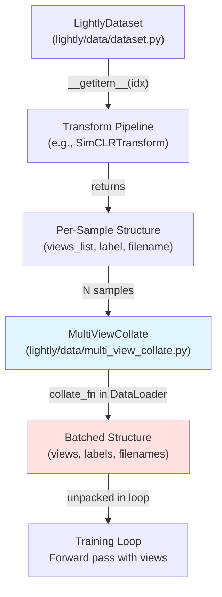
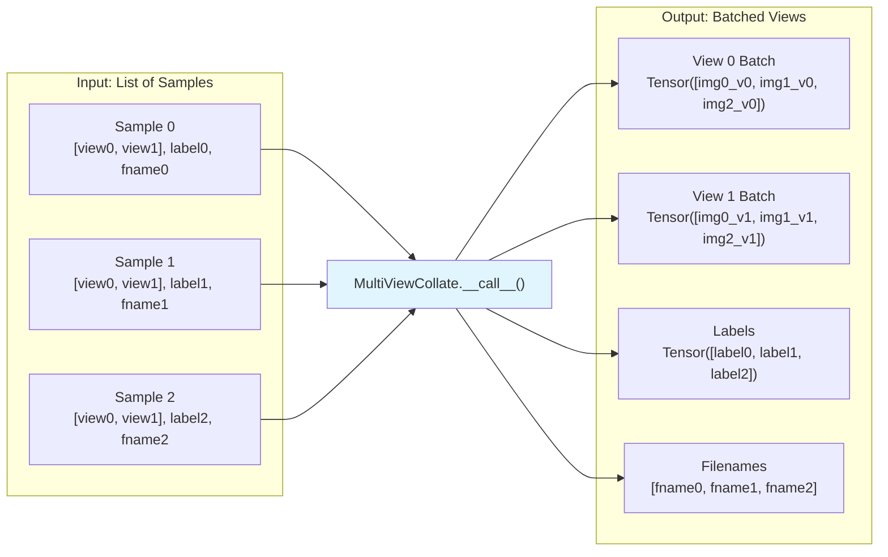
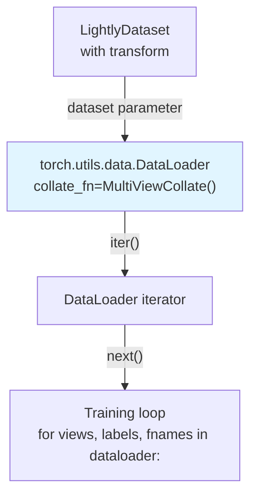
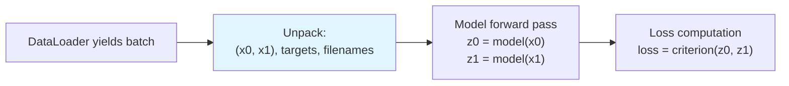
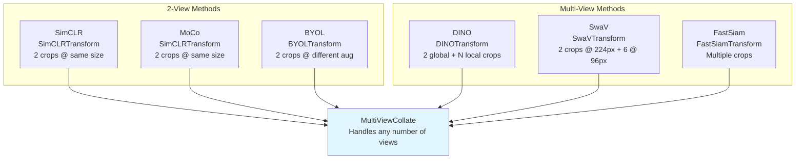
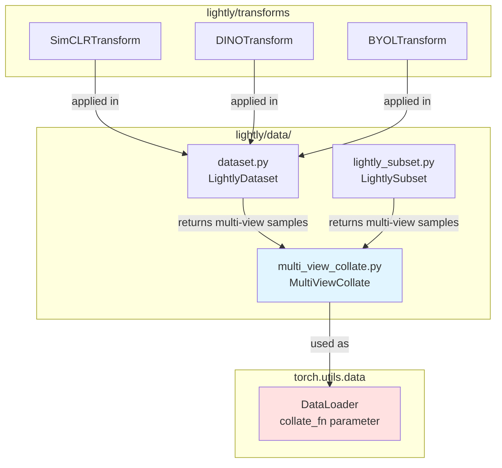
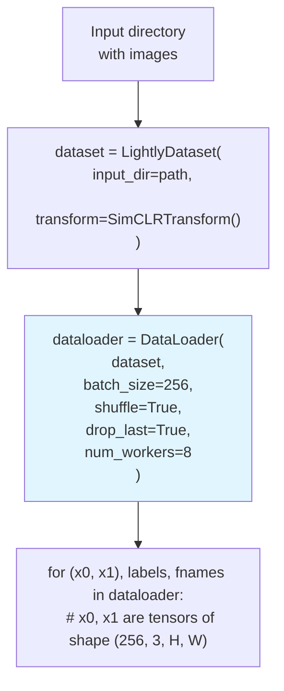

<!-- source: DeepWiki mcp.deepwiki.com · repo lightly-ai/lightly · page 3.2 Data Collation and Batching · fetched 2026-10-21 -->

# Data Collation and Batching

<details>
<summary>Relevant source files</summary>

The following files were used as context for generating this wiki page:

- [README.md](README.md)
- [docs/source/getting_started/benchmarks.rst](docs/source/getting_started/benchmarks.rst)
- [docs/source/getting_started/benchmarks/cifar10_benchmark.py](docs/source/getting_started/benchmarks/cifar10_benchmark.py)
- [docs/source/getting_started/benchmarks/imagenet100_benchmark.py](docs/source/getting_started/benchmarks/imagenet100_benchmark.py)
- [docs/source/getting_started/benchmarks/imagenette_benchmark.py](docs/source/getting_started/benchmarks/imagenette_benchmark.py)
- [lightly/data/_helpers.py](lightly/data/_helpers.py)
- [lightly/data/_image.py](lightly/data/_image.py)
- [lightly/data/_video.py](lightly/data/_video.py)
- [lightly/data/dataset.py](lightly/data/dataset.py)
- [lightly/data/lightly_subset.py](lightly/data/lightly_subset.py)
- [lightly/data/multi_view_collate.py](lightly/data/multi_view_collate.py)
- [tests/data/test_LightlyDataset.py](tests/data/test_LightlyDataset.py)
- [tests/data/test_LightlySubset.py](tests/data/test_LightlySubset.py)
- [tests/data/test_VideoDataset.py](tests/data/test_VideoDataset.py)

</details>


This page describes how Lightly handles data collation and batching for self-supervised learning. Specifically, it covers the `MultiViewCollate` class that prepares batches of multiple augmented views for contrastive and other SSL methods. For information about creating and loading datasets, see [Datasets](#3.1). For information about the transforms that generate multiple views, see [Transforms and Augmentations](#2.4).

## Purpose and Scope

In self-supervised learning, each image is typically transformed into multiple augmented views (e.g., two views for SimCLR, global and local views for DINO). These views must be properly collated into batches so that the training loop can process them efficiently. The collation step reorganizes data from a per-sample structure (multiple views per image) to a per-view structure (all images for each view grouped together).

This document covers:
- The `MultiViewCollate` class and its functionality
- Batch structure before and after collation
- Integration with PyTorch `DataLoader`
- Usage patterns in SSL training workflows

## Overview of Collation in SSL Training

The data flow from dataset to model involves several steps:



**Sources:** [lightly/data/multi_view_collate.py:1-87](), [lightly/data/dataset.py:153-167]()

When a dataset with multi-view transforms is accessed, each sample returns:
- A list of view tensors (e.g., `[view0, view1]` for 2-view methods)
- A label (integer)
- A filename (string)

The `MultiViewCollate` class reorganizes a batch of these samples into a structure suitable for SSL training.

## MultiViewCollate Class

### Class Definition and Responsibility

The `MultiViewCollate` class is a collate function designed for use with PyTorch's `DataLoader`. It transforms a list of per-sample tuples into a per-view batch structure.



**Sources:** [lightly/data/multi_view_collate.py:8-87]()

### Implementation Details

The core logic of `MultiViewCollate` is in its `__call__` method:

| Step | Operation | Code Location |
|------|-----------|---------------|
| 1. Initialize containers | Create empty lists for views, labels, and filenames | [lightly/data/multi_view_collate.py:70-77]() |
| 2. Iterate batch | Loop through each (views, label, filename) tuple | [lightly/data/multi_view_collate.py:78-82]() |
| 3. Group views | Collect all samples' view i into views[i] list | [lightly/data/multi_view_collate.py:79-80]() |
| 4. Concatenate | Stack views into tensors using `torch.cat` | [lightly/data/multi_view_collate.py:84]() |
| 5. Return tuple | Return (views, labels, filenames) | [lightly/data/multi_view_collate.py:86]() |

**Sources:** [lightly/data/multi_view_collate.py:23-86]()

The method handles edge cases such as empty batches by issuing a warning and returning empty structures [lightly/data/multi_view_collate.py:73-75]().

## Batch Structure

### Input Structure (Per-Sample)

Before collation, each sample from the dataset has this structure:

```
Sample i:
  - views: List[Tensor]  # e.g., [view0_tensor, view1_tensor]
  - label: int           # class label or video index
  - filename: str        # unique identifier
```

For a batch of size B with N views per sample, the input to `MultiViewCollate.__call__` is:

```
[
    (List[Tensor of shape (C, H, W)], int, str),  # Sample 0
    (List[Tensor of shape (C, H, W)], int, str),  # Sample 1
    ...
    (List[Tensor of shape (C, H, W)], int, str),  # Sample B-1
]
```

**Sources:** [lightly/data/multi_view_collate.py:24-42]()

### Output Structure (Per-View)

After collation, the structure is reorganized:

```
(
    [Tensor of shape (B, C, H, W),  # All samples, view 0
     Tensor of shape (B, C, H, W),  # All samples, view 1
     ...
     Tensor of shape (B, C, H, W)], # All samples, view N-1
    Tensor of shape (B,),           # All labels
    List[str]                       # All filenames
)
```

This structure allows SSL methods to easily access all samples for a specific view without additional indexing.

**Sources:** [lightly/data/multi_view_collate.py:45-65]()

## Integration with PyTorch DataLoader

### Basic Usage Pattern

The `MultiViewCollate` class is passed to PyTorch's `DataLoader` via the `collate_fn` parameter:



**Sources:** [docs/source/getting_started/benchmarks/cifar10_benchmark.py:263-269](), [docs/source/getting_started/benchmarks/imagenette_benchmark.py:296-302]()

### DataLoader Configuration

Typical DataLoader configuration for SSL training:

| Parameter | Typical Value | Purpose |
|-----------|---------------|---------|
| `dataset` | `LightlyDataset` with multi-view transform | Source of samples |
| `batch_size` | 128-512 | Number of images per batch |
| `shuffle` | `True` for training | Randomize sample order |
| `drop_last` | `True` for training | Ensure consistent batch sizes |
| `num_workers` | 4-12 | Parallel data loading |
| `collate_fn` | `MultiViewCollate()` (implicit) | Batch collation |

**Sources:** [docs/source/getting_started/benchmarks/cifar10_benchmark.py:263-269](), [docs/source/getting_started/benchmarks/imagenette_benchmark.py:296-302]()

Note: When using transforms that return multiple views (like `SimCLRTransform`, `DINOTransform`), the `MultiViewCollate` behavior is often the default or implicit behavior handled by the framework. Users typically don't need to explicitly instantiate it.

### Training Loop Pattern

In training loops, the collated batch is unpacked:



**Sources:** [docs/source/getting_started/benchmarks/cifar10_benchmark.py:374-380](), [README.md:182-189]()

Common unpacking patterns:

**Two-view methods (SimCLR, MoCo, BYOL):**
```python
for (x0, x1), targets, filenames in dataloader:
    z0 = model(x0)
    z1 = model(x1)
    loss = criterion(z0, z1)
```

**Multi-view methods (SwaV, DINO, FastSiam):**
```python
for views, targets, filenames in dataloader:
    # views is a list of tensors
    features = [model(view) for view in views]
    loss = compute_loss(features)
```

**Sources:** [docs/source/getting_started/benchmarks/cifar10_benchmark.py:374-380](), [docs/source/getting_started/benchmarks/imagenette_benchmark.py:462-474]()

## Method-Specific Batch Patterns

Different SSL methods use different numbers of views and may require different collation patterns:



**Sources:** [docs/source/getting_started/benchmarks/cifar10_benchmark.py:166-213](), [docs/source/getting_started/benchmarks/imagenette_benchmark.py:169-234]()

### View Count by Method

| Method | Transform | Number of Views | View Types |
|--------|-----------|-----------------|------------|
| SimCLR | `SimCLRTransform` | 2 | Two random crops with strong augmentation |
| MoCo | `SimCLRTransform` | 2 | Two random crops with strong augmentation |
| BYOL | `BYOLTransform` | 2 | View 1 (stronger) + View 2 (weaker) |
| SimSiam | `SimSiamTransform` | 2 | Two random crops with augmentation |
| DINO | `DINOTransform` | 2-10 | 2 global crops + N local crops (default N=8) |
| SwaV | `SwaVTransform` | 2-8 | 2 crops @ 224px + 6 crops @ 96px |
| FastSiam | `FastSiamTransform` | Variable | Multiple random crops |
| MAE | `MAETransform` | 1 | Single crop (masking done in model) |

**Sources:** [docs/source/getting_started/benchmarks/imagenette_benchmark.py:169-234](), [lightly/transforms/__init__.py]()

## Code Entity Reference

Key classes and their locations:



**Sources:** [lightly/data/multi_view_collate.py:1-87](), [lightly/data/dataset.py:1-361](), [lightly/data/lightly_subset.py:1-97]()

### Key Methods

| Class | Method | Purpose | Location |
|-------|--------|---------|----------|
| `MultiViewCollate` | `__call__` | Collate batch of multi-view samples | [lightly/data/multi_view_collate.py:23-86]() |
| `LightlyDataset` | `__getitem__` | Return (sample, target, filename) | [lightly/data/dataset.py:153-167]() |
| `LightlySubset` | `__getitem__` | Return subset sample via base dataset | [lightly/data/lightly_subset.py:29-45]() |

**Sources:** [lightly/data/multi_view_collate.py:23-86](), [lightly/data/dataset.py:153-167](), [lightly/data/lightly_subset.py:29-45]()

## Performance Considerations

### Memory Efficiency

The collation process creates new tensors by concatenating view tensors along the batch dimension. For a batch of B images with N views:

- Input: B lists of N tensors, each of shape (C, H, W)
- Output: N tensors, each of shape (B, C, H, W)

Memory usage is O(B × N × C × H × W), which is the same before and after collation, but the reorganization enables efficient batch processing.

**Sources:** [lightly/data/multi_view_collate.py:78-84]()

### Multi-Worker Considerations

When using `num_workers > 0` in `DataLoader`, collation happens in the main process after workers fetch samples. This means:

1. Workers independently load and transform samples
2. Main process receives samples from workers
3. Main process calls collate function to create batch
4. Batch is passed to training loop

**Sources:** [docs/source/getting_started/benchmarks/cifar10_benchmark.py:263-269](), [docs/source/getting_started/benchmarks/imagenette_benchmark.py:296-302]()

### Edge Cases

The `MultiViewCollate` class handles several edge cases:

| Case | Behavior | Code |
|------|----------|------|
| Empty batch | Warning issued, returns `([], torch.tensor([]), [])` | [lightly/data/multi_view_collate.py:73-75]() |
| Single sample | Works correctly, batch dimension = 1 | [lightly/data/multi_view_collate.py:78-84]() |
| Variable view count | Expects all samples to have same number of views | [lightly/data/multi_view_collate.py:77]() |

**Sources:** [lightly/data/multi_view_collate.py:70-86]()

## Example Usage

### Complete DataLoader Setup

A complete example showing dataset creation, transform application, and dataloader configuration:



**Sources:** [README.md:164-172](), [docs/source/getting_started/benchmarks/cifar10_benchmark.py:232-269]()

### Benchmark Usage Patterns

The benchmark scripts demonstrate real-world usage:

| Benchmark | Batch Size | Workers | Transform | Purpose |
|-----------|------------|---------|-----------|---------|
| CIFAR-10 | 128-512 | 8 | Method-specific | Fast small-scale testing | 
| ImageNette | 128-256 | 12 | Method-specific | Medium-scale validation |
| ImageNet100 | 256 | 12 | Method-specific | Large-scale subset |
| ImageNet1k | 256 | Variable | Method-specific | Full-scale benchmarks |

**Sources:** [docs/source/getting_started/benchmarks/cifar10_benchmark.py:104-138](), [docs/source/getting_started/benchmarks/imagenette_benchmark.py:121-148](), [docs/source/getting_started/benchmarks/imagenet100_benchmark.py:65-105]()

All benchmarks use the implicit `MultiViewCollate` behavior through the dataset's multi-view transforms, demonstrating that explicit collate function specification is often unnecessary when using Lightly's transform classes.

---

