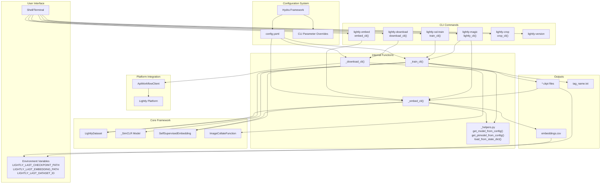
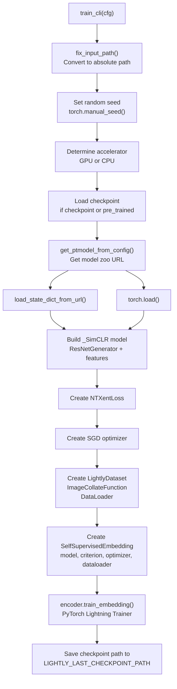
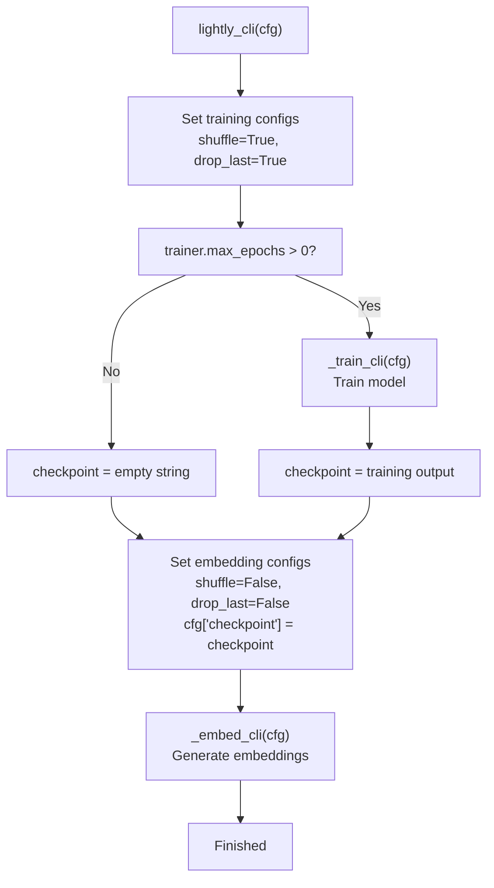
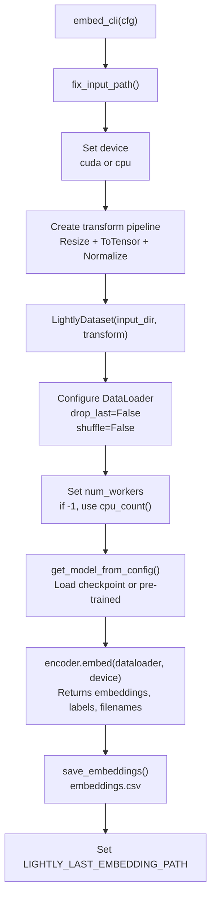
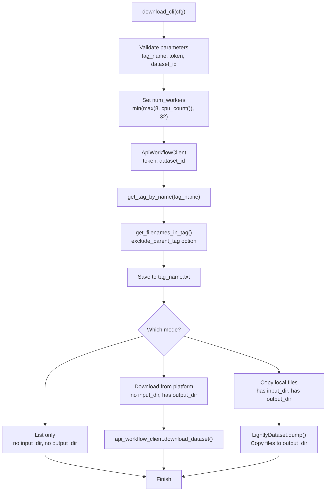
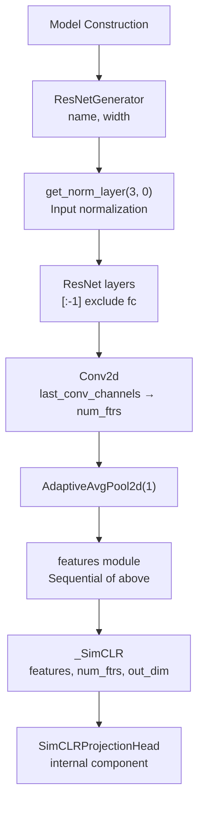

<!-- source: DeepWiki mcp.deepwiki.com · repo lightly-ai/lightly · page 4 Command-Line Interface · fetched 2026-10-21 -->

# Command-Line Interface

<details>
<summary>Relevant source files</summary>

The following files were used as context for generating this wiki page:

- [docs/source/getting_started/advanced.rst](docs/source/getting_started/advanced.rst)
- [docs/source/getting_started/command_line_tool.rst](docs/source/getting_started/command_line_tool.rst)
- [docs/source/getting_started/images/lightly_overview.png](docs/source/getting_started/images/lightly_overview.png)
- [docs/source/getting_started/install.rst](docs/source/getting_started/install.rst)
- [docs/source/getting_started/lightly_at_a_glance.rst](docs/source/getting_started/lightly_at_a_glance.rst)
- [docs/source/getting_started/main_concepts.rst](docs/source/getting_started/main_concepts.rst)
- [docs/source/index.rst](docs/source/index.rst)
- [docs/source/lightly.models.utils.rst](docs/source/lightly.models.utils.rst)
- [lightly/cli/__init__.py](lightly/cli/__init__.py)
- [lightly/cli/_helpers.py](lightly/cli/_helpers.py)
- [lightly/cli/config/config.yaml](lightly/cli/config/config.yaml)
- [lightly/cli/download_cli.py](lightly/cli/download_cli.py)
- [lightly/cli/embed_cli.py](lightly/cli/embed_cli.py)
- [lightly/cli/lightly_cli.py](lightly/cli/lightly_cli.py)
- [lightly/cli/train_cli.py](lightly/cli/train_cli.py)
- [requirements/base.txt](requirements/base.txt)
- [setup.py](setup.py)
- [tests/cli/test_cli_download.py](tests/cli/test_cli_download.py)
- [tests/cli/test_cli_magic.py](tests/cli/test_cli_magic.py)
- [tests/cli/test_cli_train.py](tests/cli/test_cli_train.py)
- [tests/embedding/test_embedding.py](tests/embedding/test_embedding.py)

</details>


The Lightly command-line interface (CLI) provides a set of tools for training self-supervised learning models, generating embeddings, and interacting with the Lightly Platform without writing Python code. The CLI enables quick experimentation and integration into automated workflows through shell scripts or CI/CD pipelines.

For information about using Lightly as a Python library, see [Python API](#5). For details on platform integration via the Python API, see [Platform Integration](#6).

---

## Overview of CLI Commands

The Lightly CLI consists of five primary commands, each serving a specific purpose in the self-supervised learning workflow:

| Command | Entry Point Function | Purpose |
|---------|---------------------|---------|
| `lightly-magic` | `lightly_cli()` | Train a model and generate embeddings in one command |
| `lightly-ssl-train` | `train_cli()` | Train a self-supervised model |
| `lightly-embed` | `embed_cli()` | Generate embeddings from a trained or pre-trained model |
| `lightly-download` | `download_cli()` | Download tagged samples from the Lightly Platform |
| `lightly-crop` | `crop_cli()` | Crop objects from images using YOLO-format labels |
| `lightly-version` | N/A | Display the installed Lightly version |

Each command is implemented as a separate module within [lightly/cli]() and uses Hydra for configuration management. Commands can be configured through YAML files or command-line parameter overrides.

Sources: [lightly/cli/__init__.py:1-14](), [docs/source/getting_started/command_line_tool.rst:1-237]()

---

## CLI Command Flow Architecture



**CLI Command Flow and Integration**

The diagram shows how CLI commands interact with the configuration system, core framework, and platform. Commands use Hydra for configuration management and track outputs via environment variables, enabling command chaining.

Sources: [lightly/cli/lightly_cli.py:1-69](), [lightly/cli/train_cli.py:1-188](), [lightly/cli/embed_cli.py:1-129](), [lightly/cli/download_cli.py:1-135]()

---

## Configuration System Architecture

The CLI uses Hydra for hierarchical configuration management. All commands share a common configuration file with command-specific parameter overrides.

```mermaid
graph TB
    subgraph "Configuration File Structure"
        CONFIG["config.yaml"]
        
        IO["I/O Parameters<br/>input_dir<br/>output_dir<br/>embeddings<br/>checkpoint"]
        PLATFORM["Platform Parameters<br/>token<br/>dataset_id<br/>tag_name<br/>upload mode"]
        TRAINING["Training Parameters<br/>pre_trained<br/>seed"]
        
        MODEL["model namespace<br/>name: resnet-18<br/>out_dim: 128<br/>num_ftrs: 32<br/>width: 1"]
        CRITERION["criterion namespace<br/>temperature: 0.5<br/>memory_bank_size: 0"]
        OPTIMIZER["optimizer namespace<br/>lr: 1.0<br/>weight_decay: 0.00001"]
        
        COLLATE["collate namespace<br/>input_size: 64<br/>cj_prob: 0.8<br/>gaussian_blur: 0.5<br/>min_scale: 0.15"]
        LOADER["loader namespace<br/>batch_size: 16<br/>shuffle: True<br/>num_workers: -1<br/>drop_last: True"]
        TRAINER["trainer namespace<br/>gpus: 1<br/>max_epochs: 100<br/>precision: 32"]
        
        CKPT_CB["checkpoint_callback<br/>save_last: True<br/>save_top_k: 1"]
        ENV_NAMES["environment_variable_names<br/>lightly_last_checkpoint_path<br/>lightly_last_embedding_path"]
        HYDRA_CFG["hydra namespace<br/>run.dir output path"]
    end
    
    subgraph "Override Mechanism"
        CLI_OVERRIDE["CLI Override<br/>trainer.max_epochs=10<br/>loader.batch_size=128"]
        PROGRAMMATIC["Programmatic Override<br/>cfg['trainer']['max_epochs']"]
    end
    
    subgraph "Target Components"
        RESNET["ResNetGenerator"]
        NTXENT["NTXentLoss"]
        SGD["torch.optim.SGD"]
        IMG_COLLATE["ImageCollateFunction"]
        DATALOADER["torch.utils.data.DataLoader"]
        PL_TRAINER["SelfSupervisedEmbedding"]
    end
    
    CONFIG --> IO
    CONFIG --> PLATFORM
    CONFIG --> TRAINING
    CONFIG --> MODEL
    CONFIG --> CRITERION
    CONFIG --> OPTIMIZER
    CONFIG --> COLLATE
    CONFIG --> LOADER
    CONFIG --> TRAINER
    CONFIG --> CKPT_CB
    CONFIG --> ENV_NAMES
    CONFIG --> HYDRA_CFG
    
    CLI_OVERRIDE -.overrides.-> CONFIG
    PROGRAMMATIC -.overrides.-> CONFIG
    
    MODEL --> RESNET
    CRITERION --> NTXENT
    OPTIMIZER --> SGD
    COLLATE --> IMG_COLLATE
    LOADER --> DATALOADER
    TRAINER --> PL_TRAINER
```



**Hydra Configuration Hierarchy**

The configuration file is organized into namespaces that map directly to PyTorch and Lightly components. Parameters can be overridden via CLI (`key.subkey=value`) or programmatically.

Sources: [lightly/cli/config/config.yaml:1-160](), [lightly/cli/_helpers.py:36-54]()

---

## Configuration Parameters

### I/O Parameters

| Parameter | Type | Default | Description |
|-----------|------|---------|-------------|
| `input_dir` | str | `''` | Path to directory containing images |
| `output_dir` | str | `''` | Path for downloaded images/outputs |
| `embeddings` | str | `''` | Path to embeddings CSV file |
| `checkpoint` | str | `''` | Path to model checkpoint (`.ckpt` file) |
| `label_dir` | str | `''` | Path to directory with YOLO format labels |

### Platform Parameters

| Parameter | Type | Default | Description |
|-----------|------|---------|-------------|
| `token` | str | `''` | Lightly Platform API token |
| `dataset_id` | str | `''` | Platform dataset identifier |
| `tag_name` | str | `'initial-tag'` | Tag name for downloads/uploads |
| `upload` | str | `'full'` | Upload mode: `'full'`, `'thumbnails'`, or `'none'` |
| `embedding_name` | str | `'default'` | Name for embeddings on platform |

### Training Parameters

| Parameter | Type | Default | Description |
|-----------|------|---------|-------------|
| `pre_trained` | bool | `True` | Use pre-trained model from Lightly model zoo |
| `seed` | int | `1` | Random seed for reproducibility |
| `trainer.max_epochs` | int | `100` | Number of training epochs |
| `trainer.gpus` | int | `1` | Number of GPUs to use (deprecated in favor of `devices`) |
| `trainer.precision` | int | `32` | Training precision (16 or 32) |
| `loader.batch_size` | int | `16` | Batch size for training/inference |
| `loader.num_workers` | int | `-1` | Number of data loading workers (-1 = auto) |

### Model Architecture

| Parameter | Type | Default | Description |
|-----------|------|---------|-------------|
| `model.name` | str | `'resnet-18'` | Model architecture (resnet-18/34/50/101/152) |
| `model.out_dim` | int | `128` | Projection head output dimension |
| `model.num_ftrs` | int | `32` | Feature vector dimension |
| `model.width` | float | `1` | ResNet width multiplier |

### Augmentation Parameters

| Parameter | Type | Default | Description |
|-----------|------|---------|-------------|
| `collate.input_size` | int | `64` | Input image size in pixels |
| `collate.cj_prob` | float | `0.8` | Color jitter probability |
| `collate.gaussian_blur` | float | `0.5` | Gaussian blur probability |
| `collate.min_scale` | float | `0.15` | Minimum crop scale |
| `collate.hf_prob` | float | `0.5` | Horizontal flip probability |

Sources: [lightly/cli/config/config.yaml:1-160]()

---

## Environment Variables for Output Tracking

The CLI automatically sets environment variables to track outputs, enabling command chaining:

```mermaid
graph LR
    subgraph "Training Workflow"
        TRAIN_CMD["lightly-ssl-train<br/>input_dir=data/"]
        TRAIN_OUT["checkpoint.ckpt"]
        ENV_CKPT["$LIGHTLY_LAST_CHECKPOINT_PATH"]
    end
    
    subgraph "Embedding Workflow"
        EMBED_CMD["lightly-embed<br/>checkpoint=$LIGHTLY_LAST_CHECKPOINT_PATH"]
        EMBED_OUT["embeddings.csv"]
        ENV_EMB["$LIGHTLY_LAST_EMBEDDING_PATH"]
    end
    
    subgraph "Platform Workflow"
        UPLOAD["Upload to Platform"]
        ENV_DATASET["$LIGHTLY_LAST_DATASET_ID"]
    end
    
    TRAIN_CMD --> TRAIN_OUT
    TRAIN_OUT --> ENV_CKPT
    ENV_CKPT --> EMBED_CMD
    EMBED_CMD --> EMBED_OUT
    EMBED_OUT --> ENV_EMB
    ENV_EMB --> UPLOAD
    UPLOAD --> ENV_DATASET
```



**Environment Variable Chaining**

Commands set environment variables upon completion, allowing subsequent commands to reference previous outputs without manual path specification.

The environment variable names are configurable in [lightly/cli/config/config.yaml:106-109]():

```yaml
environment_variable_names:
  lightly_last_checkpoint_path: LIGHTLY_LAST_CHECKPOINT_PATH
  lightly_last_embedding_path: LIGHTLY_LAST_EMBEDDING_PATH
  lightly_last_dataset_id: LIGHTLY_LAST_DATASET_ID
```

Sources: [lightly/cli/config/config.yaml:106-109](), [lightly/cli/train_cli.py:149-151](), [lightly/cli/embed_cli.py:85-87]()

---

## Training Commands (lightly-ssl-train and lightly-magic)

### lightly-ssl-train

The `lightly-ssl-train` command trains a self-supervised SimCLR model on an image dataset. It is implemented in [lightly/cli/train_cli.py]() with the entry point function `train_cli()` decorated with `@hydra.main()`.

**Training Workflow Implementation:**



**lightly-ssl-train Execution Flow**

The command builds a SimCLR model with ResNet backbone, configures training components, and trains using PyTorch Lightning's Trainer. The checkpoint path is stored in an environment variable for downstream use.

**Example Usage:**

```bash
# Train with default settings
lightly-ssl-train input_dir=data/

# Train for 5 epochs with batch size 128
lightly-ssl-train input_dir=data/ trainer.max_epochs=5 loader.batch_size=128

# Continue training from checkpoint
lightly-ssl-train input_dir=data/ trainer.max_epochs=10 \
                  checkpoint=$LIGHTLY_LAST_CHECKPOINT_PATH

# Train with multiple GPUs (DDP strategy)
lightly-ssl-train input_dir=data/ trainer.gpus=4

# Train from scratch (no pre-trained weights)
lightly-ssl-train input_dir=data/ pre_trained=False

# Train with half precision
lightly-ssl-train input_dir=data/ trainer.precision=16
```

**Key Implementation Details:**

- **Model Architecture:** Uses `_SimCLR` class from [lightly/cli/_cli_simclr.py]() which combines a ResNet backbone with a projection head
- **Features Extraction:** Constructs features from `ResNetGenerator` with normalization layer and adaptive pooling [lightly/cli/train_cli.py:92-100]()
- **Checkpoint Loading:** Supports URLs (model zoo), local files, and state dict filtering for compatibility [lightly/cli/train_cli.py:83-90]()
- **Batch Size Warning:** Issues warning if batch size < 64 [lightly/cli/train_cli.py:57-63]()
- **Worker Count:** Auto-determines number of workers if set to -1 using `cpu_count()` [lightly/cli/train_cli.py:66-67]()

Sources: [lightly/cli/train_cli.py:37-153](), [lightly/cli/_helpers.py:199-238]()

### lightly-magic

The `lightly-magic` command combines training and embedding in a single execution. It internally calls `_train_cli()` followed by `_embed_cli()`.

**lightly-magic Execution Flow:**



**lightly-magic Command Flow**

The command conditionally trains a model (if `max_epochs > 0`), then uses the resulting checkpoint (or pre-trained model) to generate embeddings.

**Example Usage:**

```bash
# Train for 10 epochs and generate embeddings
lightly-magic input_dir=data/ trainer.max_epochs=10

# Only generate embeddings (using pre-trained model)
lightly-magic input_dir=data/ trainer.max_epochs=0

# Custom batch size
lightly-magic input_dir=data/ trainer.max_epochs=5 loader.batch_size=128
```

Sources: [lightly/cli/lightly_cli.py:20-64](), [docs/source/getting_started/command_line_tool.rst:84-108]()

---

## Embedding Generation (lightly-embed)

The `lightly-embed` command generates embeddings from images using a trained model or pre-trained weights. It is implemented in [lightly/cli/embed_cli.py]() with entry point `embed_cli()`.

**Embedding Generation Workflow:**



**lightly-embed Execution Flow**

The command creates a dataset with inference transforms (resize, normalize), loads a model, runs inference to generate embeddings, and saves results to CSV.

**Transform Pipeline:**

The embedding command uses a standard inference transform [lightly/cli/embed_cli.py:56-62]():

```python
transform = T.Compose([
    T.Resize((cfg["collate"]["input_size"], cfg["collate"]["input_size"])),
    T.ToTensor(),
    T.Normalize(mean=[0.485, 0.456, 0.406], std=[0.229, 0.224, 0.225]),
])
```

**Example Usage:**

```bash
# Embed with pre-trained model
lightly-embed input_dir=data/

# Embed with custom checkpoint
lightly-embed input_dir=data/ checkpoint=my_checkpoint.ckpt

# Embed using the last trained checkpoint
lightly-embed input_dir=data/ checkpoint=$LIGHTLY_LAST_CHECKPOINT_PATH

# Embed with custom input size
lightly-embed input_dir=data/ collate.input_size=224

# Embed with custom feature dimension
lightly-embed input_dir=data/ model.num_ftrs=512
```

**Output Format:**

The command generates a CSV file named `embeddings.csv` in the current working directory with the following structure:

| Column | Description |
|--------|-------------|
| `filenames` | Image filename |
| `embedding_0`, `embedding_1`, ... | Embedding dimensions (count = `model.num_ftrs`) |
| `labels` | Integer labels (auto-generated from directory structure) |

Sources: [lightly/cli/embed_cli.py:31-124](), [docs/source/getting_started/command_line_tool.rst:155-182]()

---

## Platform Integration Commands (lightly-download)

The `lightly-download` command retrieves tagged samples from the Lightly Platform. It supports three modes of operation:

1. Download a list of filenames
2. Download full images from the platform
3. Copy images from a local input directory to an output directory

**Download Command Workflow:**



**lightly-download Execution Flow**

The command retrieves filenames from a tag, saves them to a text file, and optionally downloads images or copies them from a local directory based on the provided parameters.

**Example Usage:**

```bash
# Download list of filenames in a tag
lightly-download tag_name='my-tag' dataset_id='XYZ' token='123'

# Download list excluding parent tag samples
lightly-download tag_name='my-tag' dataset_id='XYZ' token='123' \
                 exclude_parent_tag=True

# Download full images from platform
lightly-download tag_name='my-tag' dataset_id='XYZ' token='123' \
                 output_dir='downloaded_images/'

# Copy tagged images from local directory
lightly-download tag_name='my-tag' dataset_id='XYZ' token='123' \
                 input_dir='all_images/' output_dir='selected_images/'
```

**Key Parameters:**

| Parameter | Required | Description |
|-----------|----------|-------------|
| `tag_name` | Yes | Tag name to download (use 'initial-tag' for all images) |
| `dataset_id` | Yes | Platform dataset identifier |
| `token` | Yes | Platform API token |
| `input_dir` | No | Source directory for local copy mode |
| `output_dir` | No | Destination directory for downloads/copies |
| `exclude_parent_tag` | No | If True, exclude samples from parent tag |

**Output:**

The command always creates a `{tag_name}.txt` file containing the list of filenames. If `output_dir` is specified, images are downloaded or copied to that directory.

Sources: [lightly/cli/download_cli.py:22-131](), [docs/source/getting_started/command_line_tool.rst:183-209]()

---

## Image Cropping (lightly-crop)

The `lightly-crop` command extracts object crops from images based on YOLO-format bounding box labels. This is useful for object-level self-supervised learning rather than image-level.

**Label Format:**

Labels must be in YOLO format with one `.txt` file per image. Each line in the label file contains:

```
class x_center y_center width height
```

Where all coordinates are normalized to [0, 1]. Example [docs/source/getting_started/command_line_tool.rst:70-73]():

```
0 0.23 0.14 0.05 0.04
1 0.43 0.13 0.12 0.08
```

**Example Usage:**

```bash
# Crop with 20% padding around bounding boxes
lightly-crop input_dir=images label_dir=labels output_dir=cropped_images \
             crop_padding=0.2

# Include class names in output filenames
lightly-crop input_dir=images label_dir=labels output_dir=cropped_images \
             label_names_file=data.yaml
```

**Label Names File Format:**

The `label_names_file` should be a YAML file with class names [docs/source/getting_started/command_line_tool.rst:78-79]():

```yaml
names: [cat, dog]
```

**Workflow:**

1. Read images from `input_dir`
2. Read corresponding labels from `label_dir`
3. For each bounding box, extract a crop with padding
4. Save crops to `output_dir` with naming: `{original_filename}_{class_name}_{index}.jpg`

The cropped images can then be used as input for `lightly-ssl-train` to learn object-level representations.

Sources: [docs/source/getting_started/command_line_tool.rst:42-82]()

---

## Version Check (lightly-version)

The `lightly-version` command displays the installed Lightly package version. This is useful for verifying the installation and debugging compatibility issues.

**Example Usage:**

```bash
lightly-version
# Output: lightly version 1.1.4
```

Sources: [docs/source/getting_started/command_line_tool.rst:27-40]()

---

## Configuration Override Mechanisms

The CLI supports multiple ways to override default configuration values:

### CLI Override Syntax

Parameters can be overridden using dot notation:

```bash
# Override top-level parameter
lightly-ssl-train input_dir=data/ pre_trained=False

# Override nested parameter
lightly-ssl-train input_dir=data/ trainer.max_epochs=10

# Override deeply nested parameter
lightly-ssl-train input_dir=data/ checkpoint_callback.save_top_k=3

# Multiple overrides
lightly-ssl-train input_dir=data/ \
                  trainer.max_epochs=5 \
                  loader.batch_size=128 \
                  model.num_ftrs=256
```

### Configuration File Customization

Users can create custom configuration files and specify them via Hydra's config path mechanism. The default configuration is located at [lightly/cli/config/config.yaml]().

### Programmatic Configuration

When using CLI functions programmatically (e.g., in tests), configuration can be modified via dictionary access:

```python
from hydra.experimental import compose, initialize

with initialize(config_path="lightly/cli/config"):
    cfg = compose(
        config_name="config",
        overrides=["input_dir=data/", "trainer.max_epochs=5"]
    )
    # Modify programmatically
    cfg["trainer"]["max_epochs"] = 10
    cfg["loader"]["batch_size"] = 128
```

Sources: [lightly/cli/train_cli.py:155-183](), [tests/cli/test_cli_train.py:26-33]()

---

## Hydra Integration Details

The CLI uses Hydra 1.0+ for configuration management. Each CLI command is decorated with `@hydra.main()` which handles:

1. **Configuration Loading:** Reads [lightly/cli/config/config.yaml]()
2. **Override Processing:** Applies CLI parameter overrides
3. **Working Directory Management:** Changes to Hydra output directory
4. **Help Generation:** Auto-generates help text from config

**Hydra Decorator Usage:**

```python
@hydra.main(**fix_hydra_arguments(config_path="config", config_name="config"))
def train_cli(cfg):
    return _train_cli(cfg)
```

The `fix_hydra_arguments()` helper [lightly/cli/_helpers.py:36-54]() provides backward compatibility across Hydra versions by conditionally adding the `version_base` parameter for Hydra 1.2+.

**Hydra Output Directory:**

By default, Hydra creates outputs in timestamped directories [lightly/cli/config/config.yaml:117-118]():

```yaml
hydra:
  run:
    dir: lightly_outputs/${now:%Y-%m-%d}/${now:%H-%M-%S}
```

This can be overridden:

```bash
lightly-ssl-train input_dir=data/ hydra.run.dir=./my_output
```

Sources: [lightly/cli/_helpers.py:36-54](), [lightly/cli/config/config.yaml:114-160]()

---

## Helper Functions and Utilities

The [lightly/cli/_helpers.py]() module provides shared utilities for CLI commands:

### Path Handling

- **`fix_input_path(path)`** [lightly/cli/_helpers.py:29-33](): Converts relative paths to absolute using Hydra's `utils.to_absolute_path()`
- Used by all CLI commands to handle user-provided paths correctly

### Model Loading

- **`get_ptmodel_from_config(model)`** [lightly/cli/_helpers.py:62-72](): Constructs model zoo key from config parameters
- **`get_model_from_config(cfg, is_cli_call)`** [lightly/cli/_helpers.py:199-238](): Loads a complete model from config, checkpoint, or model zoo
- **`load_state_dict_from_url(url)`** [lightly/cli/_helpers.py:75-92](): Downloads checkpoint from URL with HTTP fallback

### State Dict Compatibility

- **`load_from_state_dict(model, state_dict)`** [lightly/cli/_helpers.py:175-197](): Loads weights with compatibility handling
- **`_filter_state_dict(state_dict)`** [lightly/cli/_helpers.py:119-141](): Removes model prefix for PyTorch Lightning compatibility
- **`_fix_projection_head_keys(state_dict)`** [lightly/cli/_helpers.py:144-172](): Updates old checkpoint format to new structure
- **`_maybe_expand_batchnorm_weights()`** [lightly/cli/_helpers.py:95-116](): Expands BatchNorm weights for SplitBatchNorm compatibility

### System Information

- **`cpu_count()`** [lightly/cli/_helpers.py:20-26](): Returns system CPU count for auto-determining worker count

Sources: [lightly/cli/_helpers.py:1-238]()

---

## Model Architecture in CLI

The CLI uses a simplified SimCLR architecture defined in `_SimCLR` class. The model construction process:



**CLI Model Architecture Construction**

The CLI builds a feature extractor from ResNet components and wraps it in a `_SimCLR` model with a projection head.

The features module [lightly/cli/train_cli.py:93-100]() combines:
1. Input normalization layer
2. ResNet backbone (excluding final FC layer)
3. 1x1 convolution to project to `num_ftrs` dimensions
4. Global average pooling

This is then passed to `_SimCLR` which adds a projection head for contrastive learning.

Sources: [lightly/cli/train_cli.py:92-106](), [lightly/cli/_helpers.py:220-231]()

---

## CLI Testing Infrastructure

The CLI has comprehensive test coverage in the [tests/cli]() directory:

- **`test_cli_train.py`**: Tests training command execution and checkpoint creation
- **`test_cli_magic.py`**: Tests combined training and embedding workflow
- **`test_cli_download.py`**: Tests platform download functionality with mocked API
- **Embedding tests**: Located in [tests/embedding/test_embedding.py]()

**Test Structure:**

Tests use Hydra's `compose()` and `initialize()` for programmatic configuration [tests/cli/test_cli_train.py:26-33]():

```python
with initialize(config_path="../../lightly/cli/config", job_name="test_app"):
    cfg = compose(
        config_name="config",
        overrides=[
            f"input_dir={folder_path}",
            "trainer.max_epochs=1",
        ],
    )
```

Tests verify:
- Checkpoint creation and path storage in environment variables
- Embeddings generation with correct ordering
- Configuration parsing and override handling
- Platform integration with mocked API client

Sources: [tests/cli/test_cli_train.py:1-63](), [tests/cli/test_cli_magic.py:1-92](), [tests/cli/test_cli_download.py:1-136](), [tests/embedding/test_embedding.py:1-82]()

---

## Common Usage Patterns

### Pattern 1: Complete Local Workflow

```bash
# Train a model
lightly-ssl-train input_dir=raw_images/ trainer.max_epochs=100 \
                  loader.batch_size=256

# Generate embeddings from trained model
lightly-embed input_dir=raw_images/ checkpoint=$LIGHTLY_LAST_CHECKPOINT_PATH
```

### Pattern 2: Using Pre-trained Models

```bash
# Use pre-trained model from model zoo (default)
lightly-embed input_dir=images/ collate.input_size=224

# Specify model architecture for pre-trained weights
lightly-embed input_dir=images/ model.name=resnet-50 model.num_ftrs=2048
```

### Pattern 3: Platform-Integrated Workflow

```bash
# Download tagged subset
lightly-download tag_name=curated_v1 dataset_id=$DATASET_ID token=$TOKEN \
                 input_dir=all_images/ output_dir=selected_images/

# Train on selected subset
lightly-ssl-train input_dir=selected_images/ trainer.max_epochs=50

# Generate embeddings
lightly-embed input_dir=selected_images/ checkpoint=$LIGHTLY_LAST_CHECKPOINT_PATH
```

### Pattern 4: Object Detection Preprocessing

```bash
# Crop objects from images
lightly-crop input_dir=images/ label_dir=yolo_labels/ \
             output_dir=crops/ crop_padding=0.1

# Train on object crops
lightly-ssl-train input_dir=crops/ trainer.max_epochs=100
```

### Pattern 5: One-Command Training and Embedding

```bash
# Train and embed in single command
lightly-magic input_dir=images/ trainer.max_epochs=50 loader.batch_size=128
```

Sources: [docs/source/getting_started/command_line_tool.rst:110-228]()

---

## Advanced Configuration Examples

### Multi-GPU Training

```bash
# Distributed data parallel with 4 GPUs
lightly-ssl-train input_dir=data/ trainer.gpus=4 loader.batch_size=64
# Note: Effective batch size = 4 GPUs × 64 = 256
```

### Half-Precision Training

```bash
# 16-bit precision for faster training and reduced memory
lightly-ssl-train input_dir=data/ trainer.precision=16
```

### Custom Augmentation Parameters

```bash
# Disable color jittering and Gaussian blur
lightly-ssl-train input_dir=data/ \
                  collate.cj_prob=0.0 \
                  collate.gaussian_blur=0.0

# Strong augmentations for large images
lightly-ssl-train input_dir=data/ \
                  collate.input_size=224 \
                  collate.min_scale=0.08 \
                  collate.cj_prob=0.8 \
                  collate.gaussian_blur=0.5
```

### Custom Model Architecture

```bash
# Use ResNet-50 with larger feature dimension
lightly-ssl-train input_dir=data/ \
                  model.name=resnet-50 \
                  model.num_ftrs=2048 \
                  model.out_dim=256
```

### Memory Bank Configuration

```bash
# Use memory bank for MoCo-style training
lightly-ssl-train input_dir=data/ \
                  criterion.memory_bank_size=4096 \
                  criterion.temperature=0.07
```

### Checkpoint Management

```bash
# Save top 3 checkpoints based on validation metric
lightly-ssl-train input_dir=data/ \
                  checkpoint_callback.save_top_k=3

# Specify custom checkpoint directory
lightly-ssl-train input_dir=data/ \
                  checkpoint_callback.dirpath=./checkpoints/
```

Sources: [lightly/cli/config/config.yaml:1-160](), [docs/source/getting_started/command_line_tool.rst:110-147]()

---

