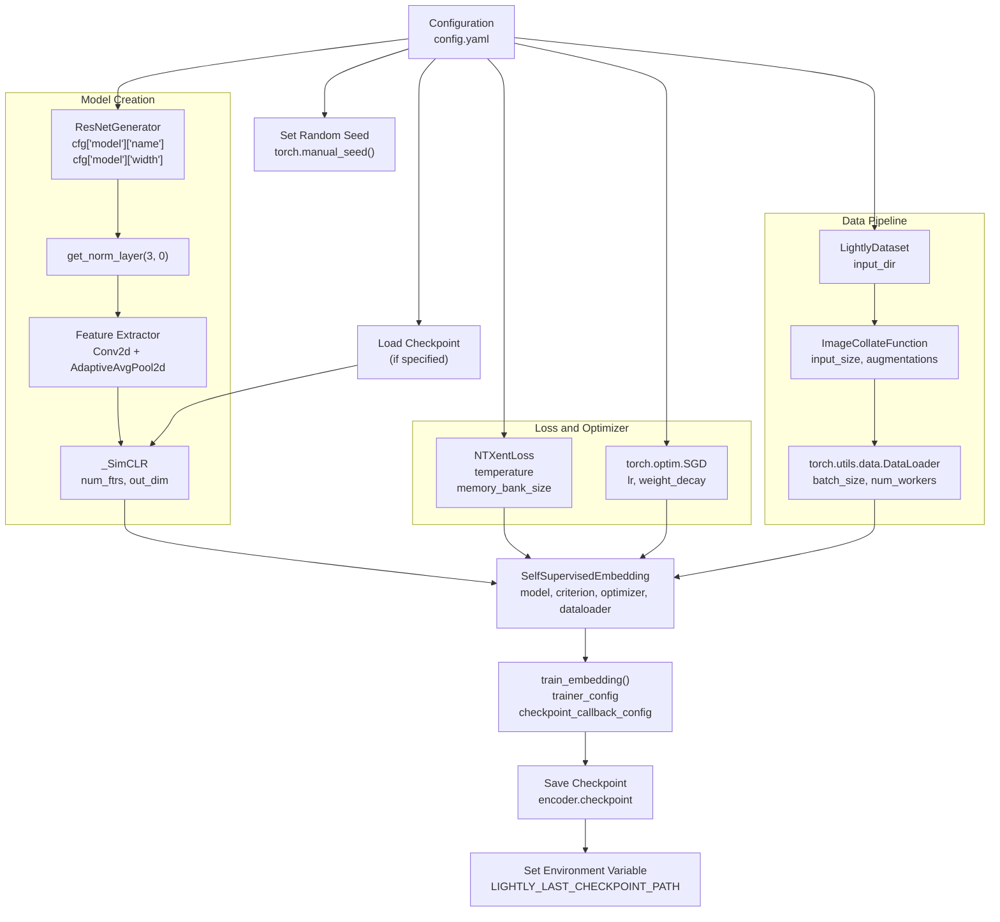
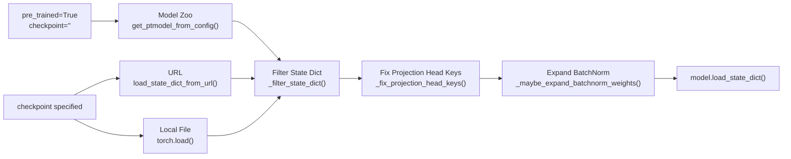
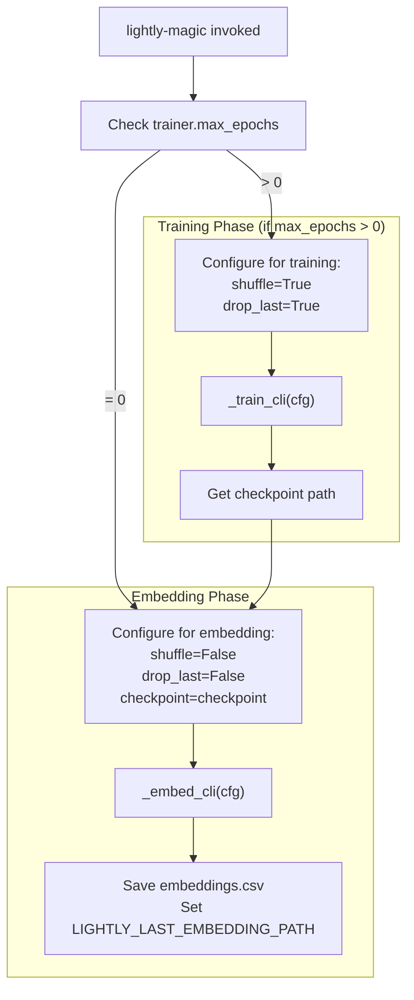

<!-- source: DeepWiki mcp.deepwiki.com · repo lightly-ai/lightly · page 4.1 Training Commands · fetched 2026-10-21 -->

# Training Commands

<details>
<summary>Relevant source files</summary>

The following files were used as context for generating this wiki page:

- [docs/source/getting_started/advanced.rst](docs/source/getting_started/advanced.rst)
- [docs/source/getting_started/command_line_tool.rst](docs/source/getting_started/command_line_tool.rst)
- [docs/source/getting_started/images/lightly_overview.png](docs/source/getting_started/images/lightly_overview.png)
- [docs/source/getting_started/install.rst](docs/source/getting_started/install.rst)
- [docs/source/getting_started/lightly_at_a_glance.rst](docs/source/getting_started/lightly_at_a_glance.rst)
- [docs/source/getting_started/main_concepts.rst](docs/source/getting_started/main_concepts.rst)
- [docs/source/index.rst](docs/source/index.rst)
- [docs/source/lightly.models.utils.rst](docs/source/lightly.models.utils.rst)
- [lightly/cli/_helpers.py](lightly/cli/_helpers.py)
- [lightly/cli/config/config.yaml](lightly/cli/config/config.yaml)
- [lightly/cli/embed_cli.py](lightly/cli/embed_cli.py)
- [lightly/cli/lightly_cli.py](lightly/cli/lightly_cli.py)
- [lightly/cli/train_cli.py](lightly/cli/train_cli.py)
- [tests/cli/test_cli_magic.py](tests/cli/test_cli_magic.py)
- [tests/cli/test_cli_train.py](tests/cli/test_cli_train.py)

</details>


## Purpose and Scope

This document covers the command-line tools for training self-supervised learning models in Lightly. The primary commands are `lightly-ssl-train` for training models and `lightly-magic` for combined training and embedding generation.

For information about generating embeddings from trained models, see [Embedding Generation](#4.2). For details about configuration parameters and Hydra-based configuration, see [CLI Configuration](#4.4). For platform integration commands, see [Platform Integration Commands](#4.3).

## Overview

Lightly provides two main training commands:

| Command | Purpose | Typical Use Case |
|---------|---------|------------------|
| `lightly-ssl-train` | Train a self-supervised model | Full control over training process, resume from checkpoint |
| `lightly-magic` | Train and embed in one command | Quick experimentation, end-to-end workflow |

Both commands use the same underlying training infrastructure but differ in their workflow and outputs.

## Command Execution Flow

```mermaid
graph TB
    subgraph "lightly-ssl-train"
        TRAIN_START["lightly-ssl-train<br/>entry point"]
        TRAIN_HYDRA["hydra.main decorator<br/>train_cli()"]
        TRAIN_IMPL["_train_cli()"]
        TRAIN_SETUP["Setup:<br/>- Load config<br/>- Fix paths<br/>- Set random seed"]
        TRAIN_MODEL["Create Model:<br/>- ResNetGenerator<br/>- _SimCLR wrapper<br/>- NTXentLoss"]
        TRAIN_DATA["Create DataLoader:<br/>- LightlyDataset<br/>- ImageCollateFunction"]
        TRAIN_EMBEDDING["SelfSupervisedEmbedding<br/>train_embedding()"]
        TRAIN_SAVE["Save checkpoint<br/>Set LIGHTLY_LAST_CHECKPOINT_PATH"]
    end
    
    subgraph "lightly-magic"
        MAGIC_START["lightly-magic<br/>entry point"]
        MAGIC_HYDRA["hydra.main decorator<br/>lightly_cli()"]
        MAGIC_IMPL["_lightly_cli()"]
        MAGIC_TRAIN["Call _train_cli()<br/>if max_epochs > 0"]
        MAGIC_EMBED["Call _embed_cli()<br/>with checkpoint"]
        MAGIC_DONE["Output embeddings<br/>Set env variables"]
    end
    
    TRAIN_START --> TRAIN_HYDRA
    TRAIN_HYDRA --> TRAIN_IMPL
    TRAIN_IMPL --> TRAIN_SETUP
    TRAIN_SETUP --> TRAIN_MODEL
    TRAIN_SETUP --> TRAIN_DATA
    TRAIN_MODEL --> TRAIN_EMBEDDING
    TRAIN_DATA --> TRAIN_EMBEDDING
    TRAIN_EMBEDDING --> TRAIN_SAVE
    
    MAGIC_START --> MAGIC_HYDRA
    MAGIC_HYDRA --> MAGIC_IMPL
    MAGIC_IMPL --> MAGIC_TRAIN
    MAGIC_TRAIN --> MAGIC_EMBED
    MAGIC_EMBED --> MAGIC_DONE
```



Sources: [lightly/cli/train_cli.py:155-188](), [lightly/cli/lightly_cli.py:20-64]()

## lightly-ssl-train Command

### Purpose

The `lightly-ssl-train` command trains self-supervised learning models using the SimCLR method. It provides fine-grained control over training parameters, checkpoint management, and distributed training.

### Entry Point and Initialization

The command is registered via the `train_cli()` function which is decorated with `hydra.main` to enable hierarchical configuration management:

```python
@hydra.main(**fix_hydra_arguments(config_path="config", config_name="config"))
def train_cli(cfg):
    return _train_cli(cfg)
```

Sources: [lightly/cli/train_cli.py:155-183]()

### Basic Usage Examples

```bash
# Train with default parameters
lightly-ssl-train input_dir=path/to/images

# Train for 5 epochs with custom batch size
lightly-ssl-train input_dir=path/to/images trainer.max_epochs=5 loader.batch_size=128

# Continue training from checkpoint
lightly-ssl-train input_dir=path/to/images checkpoint=model.ckpt trainer.max_epochs=10

# Train with multiple GPUs (DDP strategy)
lightly-ssl-train input_dir=path/to/images trainer.gpus=2

# Train with half-precision
lightly-ssl-train input_dir=path/to/images trainer.precision=16

# Use last checkpoint via environment variable
lightly-ssl-train input_dir=path/to/images checkpoint=$LIGHTLY_LAST_CHECKPOINT_PATH
```

Sources: [docs/source/getting_started/command_line_tool.rst:112-151](), [lightly/cli/config/config.yaml:120-143]()

### Training Architecture



Sources: [lightly/cli/train_cli.py:37-152]()

### Key Configuration Parameters

The training command uses parameters from the Hydra configuration file. Key parameters include:

| Parameter | Default | Description |
|-----------|---------|-------------|
| `input_dir` | `''` | Path to directory containing images |
| `checkpoint` | `''` | Path to model checkpoint for resuming training |
| `pre_trained` | `True` | Whether to use pre-trained weights from model zoo |
| `seed` | `1` | Random seed for reproducibility |
| `model.name` | `'resnet-18'` | Backbone architecture name |
| `model.out_dim` | `128` | Output dimension for projection head |
| `model.num_ftrs` | `32` | Feature embedding dimension |
| `model.width` | `1` | ResNet width multiplier |
| `criterion.temperature` | `0.5` | Temperature for NTXentLoss |
| `criterion.memory_bank_size` | `0` | Size of memory bank (0 = disabled) |
| `optimizer.lr` | `1.0` | Learning rate |
| `optimizer.weight_decay` | `0.00001` | L2 regularization weight |
| `loader.batch_size` | `16` | Batch size for training |
| `loader.num_workers` | `-1` | Number of data loading workers (-1 = auto) |
| `trainer.max_epochs` | `100` | Number of training epochs |
| `trainer.gpus` | `1` | Number of GPUs to use |
| `trainer.precision` | `32` | Training precision (16 or 32) |

Sources: [lightly/cli/config/config.yaml:1-112]()

### Model Architecture Details

The training command creates a SimCLR model using the following components:

1. **Backbone**: Created via `ResNetGenerator` with configurable architecture and width
2. **Feature Extraction**: Sequential pipeline with normalization layer, ResNet backbone (without final FC layer), 1x1 convolution, and adaptive pooling
3. **Projection Head**: Wrapped in `_SimCLR` class which adds the SimCLR projection head
4. **Loss Function**: `NTXentLoss` with optional memory bank support

Sources: [lightly/cli/train_cli.py:92-106]()

### Checkpoint Management

The training process handles checkpoints through multiple mechanisms:

1. **Pre-trained Models**: If `pre_trained=True` and no checkpoint specified, downloads from model zoo via `get_ptmodel_from_config()`
2. **Custom Checkpoints**: Loads state dict from specified checkpoint path or URL
3. **Resume Training**: Uses `load_from_state_dict()` to load weights, handling compatibility issues
4. **Save Checkpoints**: Saves via PyTorch Lightning's checkpoint callback
5. **Environment Variable**: Sets `LIGHTLY_LAST_CHECKPOINT_PATH` to latest checkpoint path



Sources: [lightly/cli/train_cli.py:69-106](), [lightly/cli/_helpers.py:119-197]()

### Distributed Training Configuration

The command automatically configures distributed training based on available GPUs:

```python
accelerator = "gpu" if torch.cuda.is_available() else "cpu"
if accelerator == "gpu" and cfg["trainer"]["gpus"] > 1:
    devices = cfg["trainer"]["gpus"]
    strategy = "ddp"
else:
    devices = 1
    strategy = None
```

This configuration:
- Uses GPU if available, otherwise CPU
- Enables Distributed Data Parallel (DDP) strategy for multi-GPU training
- Automatically adjusts for PyTorch Lightning version compatibility

Sources: [lightly/cli/train_cli.py:49-56](), [lightly/cli/train_cli.py:127-137]()

### Data Loading Configuration

The command creates the data pipeline with the following components:

1. **Dataset**: `LightlyDataset` created from input directory
2. **Collate Function**: `ImageCollateFunction` configured with augmentation parameters
3. **DataLoader**: PyTorch DataLoader with configurable batch size and workers
4. **Auto-Configuration**: 
   - Batch size capped at dataset size
   - Number of workers auto-detected if set to -1 (via `cpu_count()`)
   - Warning issued if batch size < 64

Sources: [lightly/cli/train_cli.py:57-118]()

## lightly-magic Command

### Purpose

The `lightly-magic` command provides a streamlined workflow that combines model training and embedding generation in a single command. It internally calls `_train_cli()` followed by `_embed_cli()`.

### Workflow



Sources: [lightly/cli/lightly_cli.py:20-38]()

### Basic Usage Examples

```bash
# Train for 10 epochs and generate embeddings
lightly-magic input_dir=path/to/images trainer.max_epochs=10

# Use pre-trained model only (no training)
lightly-magic input_dir=path/to/images trainer.max_epochs=0

# Custom batch size and workers
lightly-magic input_dir=path/to/images trainer.max_epochs=10 loader.batch_size=128 loader.num_workers=8

# Custom image size
lightly-magic input_dir=path/to/images collate.input_size=224 trainer.max_epochs=5
```

Sources: [docs/source/getting_started/command_line_tool.rst:84-108]()

### Configuration Changes

The `lightly-magic` command modifies configuration between training and embedding phases:

| Phase | shuffle | drop_last | Purpose |
|-------|---------|-----------|---------|
| Training | `True` | `True` | Randomize batches, ensure consistent batch sizes |
| Embedding | `False` | `False` | Preserve order, process all samples |

Sources: [lightly/cli/lightly_cli.py:21-31]()

### Equivalence to Separate Commands

The `lightly-magic` command is equivalent to running:

```bash
# Train the model
lightly-ssl-train input_dir=data_dir

# Generate embeddings using the trained checkpoint
lightly-embed input_dir=data_dir checkpoint=$LIGHTLY_LAST_CHECKPOINT_PATH
```

Sources: [docs/source/getting_started/command_line_tool.rst:210-228]()

## Environment Variables

Both training commands manage environment variables for workflow integration:

| Variable Name | Set By | Purpose |
|---------------|--------|---------|
| `LIGHTLY_LAST_CHECKPOINT_PATH` | `lightly-ssl-train`, `lightly-magic` | Path to most recent checkpoint file |
| `LIGHTLY_LAST_EMBEDDING_PATH` | `lightly-magic` | Path to most recent embeddings file |

The environment variable names are configurable via the `environment_variable_names` section in the configuration file:

```yaml
environment_variable_names:
  lightly_last_checkpoint_path: LIGHTLY_LAST_CHECKPOINT_PATH
  lightly_last_embedding_path: LIGHTLY_LAST_EMBEDDING_PATH
```

These variables enable chaining commands and resuming workflows without manually tracking file paths.

Sources: [lightly/cli/config/config.yaml:105-109](), [lightly/cli/train_cli.py:146-151]()

## Code Entity Reference

### Key Classes and Functions

| Entity | Location | Purpose |
|--------|----------|---------|
| `train_cli()` | [lightly/cli/train_cli.py:156]() | Entry point for `lightly-ssl-train` |
| `_train_cli()` | [lightly/cli/train_cli.py:37]() | Core training implementation |
| `lightly_cli()` | [lightly/cli/lightly_cli.py:42]() | Entry point for `lightly-magic` |
| `_lightly_cli()` | [lightly/cli/lightly_cli.py:20]() | Core magic command implementation |
| `_SimCLR` | [lightly/cli/_cli_simclr.py]() | SimCLR model wrapper for CLI |
| `ResNetGenerator` | [lightly/models]() | Creates ResNet backbones |
| `ImageCollateFunction` | [lightly/data]() | Collates augmented image batches |
| `SelfSupervisedEmbedding` | [lightly/embedding]() | Wrapper for training and embedding |
| `get_ptmodel_from_config()` | [lightly/cli/_helpers.py:62]() | Downloads pre-trained models from zoo |
| `load_from_state_dict()` | [lightly/cli/_helpers.py:175]() | Loads checkpoints with compatibility fixes |
| `cpu_count()` | [lightly/cli/_helpers.py:20]() | Gets number of available CPU cores |
| `fix_input_path()` | [lightly/cli/_helpers.py:29]() | Converts relative paths to absolute |

Sources: [lightly/cli/train_cli.py](), [lightly/cli/lightly_cli.py](), [lightly/cli/_helpers.py]()

---

