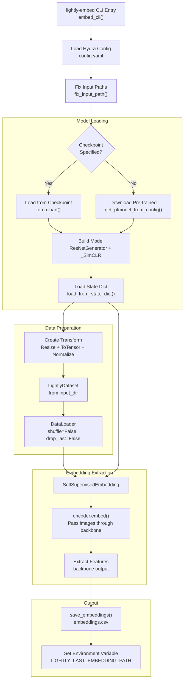
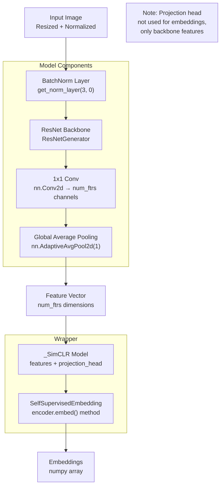
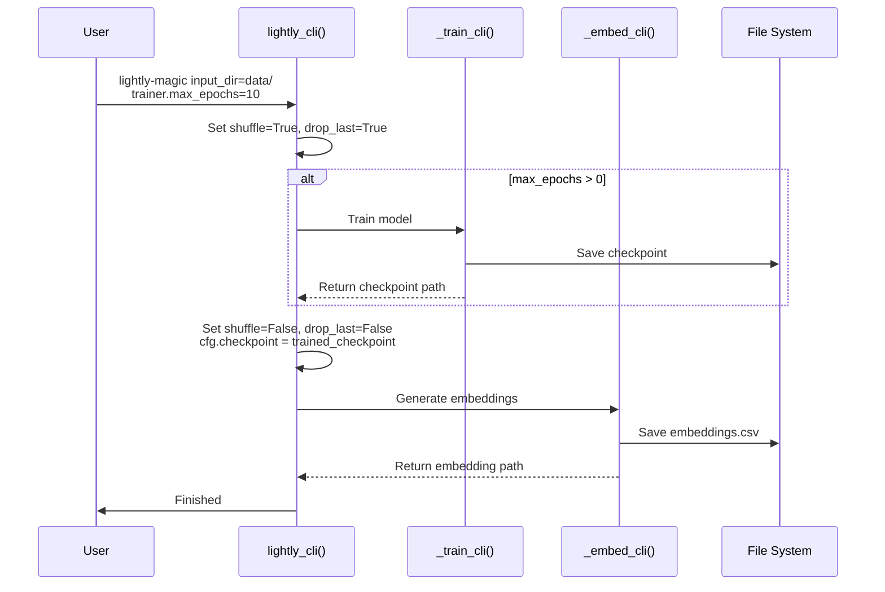

<!-- source: DeepWiki mcp.deepwiki.com · repo lightly-ai/lightly · page 4.2 Embedding Generation · fetched 2026-10-21 -->

# Embedding Generation

<details>
<summary>Relevant source files</summary>

The following files were used as context for generating this wiki page:

- [docs/source/getting_started/advanced.rst](docs/source/getting_started/advanced.rst)
- [docs/source/getting_started/command_line_tool.rst](docs/source/getting_started/command_line_tool.rst)
- [docs/source/getting_started/images/lightly_overview.png](docs/source/getting_started/images/lightly_overview.png)
- [docs/source/getting_started/install.rst](docs/source/getting_started/install.rst)
- [docs/source/getting_started/lightly_at_a_glance.rst](docs/source/getting_started/lightly_at_a_glance.rst)
- [docs/source/getting_started/main_concepts.rst](docs/source/getting_started/main_concepts.rst)
- [docs/source/index.rst](docs/source/index.rst)
- [docs/source/lightly.models.utils.rst](docs/source/lightly.models.utils.rst)
- [lightly/cli/_helpers.py](lightly/cli/_helpers.py)
- [lightly/cli/config/config.yaml](lightly/cli/config/config.yaml)
- [lightly/cli/embed_cli.py](lightly/cli/embed_cli.py)
- [lightly/cli/lightly_cli.py](lightly/cli/lightly_cli.py)
- [lightly/cli/train_cli.py](lightly/cli/train_cli.py)
- [tests/cli/test_cli_magic.py](tests/cli/test_cli_magic.py)
- [tests/cli/test_cli_train.py](tests/cli/test_cli_train.py)

</details>


This page documents the embedding generation system in Lightly, which creates compact numerical representations (embeddings) of images using trained self-supervised models. Embeddings can be used for similarity search, nearest neighbor finding, clustering, or as inputs to the Lightly Platform for dataset curation.

For information about training models that generate embeddings, see [Training Commands](#4.1). For platform integration workflows, see [Platform Integration Commands](#4.3).

## Overview

Embedding generation extracts feature vectors from images by passing them through the backbone of a trained SSL model. The system supports:

- **Pre-trained models**: Use Lightly's model zoo for immediate embedding generation
- **Custom checkpoints**: Load user-trained models from `.ckpt` files
- **Batch processing**: Efficient processing of large image datasets
- **Multiple output formats**: CSV files with embeddings, labels, and filenames

The primary interface is the `lightly-embed` CLI command, though the functionality is also available through the Python API.

Sources: [lightly/cli/embed_cli.py:1-129](), [docs/source/getting_started/command_line_tool.rst:153-182]()

## CLI Command Usage

### Basic Embedding Generation

```bash
# Use pre-trained Lightly model
lightly-embed input_dir=path/to/images

# Use custom checkpoint from training
lightly-embed input_dir=path/to/images checkpoint=model.ckpt

# Use the last trained checkpoint (from environment variable)
lightly-embed input_dir=path/to/images checkpoint=$LIGHTLY_LAST_CHECKPOINT_PATH
```

### Configuration Parameters

The embedding process is controlled by parameters in the Hydra configuration:

| Parameter | Default | Description |
|-----------|---------|-------------|
| `input_dir` | `''` | Path to directory containing images |
| `checkpoint` | `''` | Path to model checkpoint (empty uses pre-trained) |
| `collate.input_size` | `64` | Image resize dimension before embedding |
| `loader.batch_size` | `16` | Batch size for inference |
| `loader.num_workers` | `-1` | Number of CPU cores for data loading (-1 = auto) |
| `model.name` | `'resnet-18'` | Backbone architecture name |
| `model.num_ftrs` | `32` | Embedding dimensionality |
| `model.width` | `1` | ResNet width multiplier |

Sources: [lightly/cli/config/config.yaml:4-38](), [docs/source/getting_started/command_line_tool.rst:155-172]()

## Embedding Generation Pipeline



**Embedding Generation Pipeline Flow**

Sources: [lightly/cli/embed_cli.py:31-90](), [lightly/cli/_helpers.py:199-237]()

## Model and Checkpoint Loading

The embedding system supports multiple model loading strategies:

### Pre-trained Model Zoo

When no checkpoint is specified, the system downloads pre-trained models from the Lightly model zoo based on the configuration:

```python
# Model zoo key construction: {model.name}/simclr/d{num_ftrs}/w{width}
# Example: "resnet-18/simclr/d32/w1"
```

The key is constructed in [lightly/cli/_helpers.py:62-72]() using parameters from `model` configuration namespace.

### Custom Checkpoint Loading

Checkpoints can be loaded from:
- **Local files**: Absolute or relative paths to `.ckpt` files
- **URLs**: Direct download from HTTPS URLs (e.g., Google Cloud Storage)

The loading process handles:
- State dict filtering to remove PyTorch Lightning `model.` prefix
- Backward compatibility with old checkpoint formats (pre-v1.0.6)
- Projection head key transformations for refactored heads

Sources: [lightly/cli/_helpers.py:56-93](), [lightly/cli/_helpers.py:119-197]()

## Model Architecture for Embedding



**Model Architecture Used for Embedding Extraction**

The embedding is extracted from the backbone output (after the 1x1 convolution and pooling), not from the projection head. This is standard practice as the backbone features generalize better to downstream tasks.

Sources: [lightly/cli/_helpers.py:220-236](), [lightly/cli/train_cli.py:93-106]()

## Data Transformation for Inference

Unlike training, embedding generation uses minimal transformations to preserve image content:

```python
# Transform pipeline in embed_cli.py
transform = T.Compose([
    T.Resize((input_size, input_size)),       # Resize to model input size
    T.ToTensor(),                              # Convert to tensor
    T.Normalize(                               # ImageNet normalization
        mean=[0.485, 0.456, 0.406],
        std=[0.229, 0.224, 0.225]
    ),
])
```

Key differences from training transforms:
- **No augmentations**: No random cropping, color jitter, flipping, or blurring
- **Single view**: Only one view per image (training uses multiple views)
- **Deterministic**: Fixed resize ensures reproducible embeddings
- **Full coverage**: `drop_last=False` ensures all images are embedded

Sources: [lightly/cli/embed_cli.py:56-62](), [lightly/cli/embed_cli.py:66-69]()

## Output Format

### CSV Structure

Embeddings are saved to `embeddings.csv` in the current working directory with the following format:

```csv
filenames,embedding_0,embedding_1,...,embedding_N,labels
image1.jpg,0.123,-0.456,...,0.789,0
image2.jpg,-0.234,0.567,...,-0.123,1
```

| Column | Type | Description |
|--------|------|-------------|
| `filenames` | string | Original image filename |
| `embedding_0` to `embedding_N` | float | Feature vector components (N = `model.num_ftrs`) |
| `labels` | int | Numeric label (from directory structure or enumeration) |

The CSV is written by `save_embeddings()` utility function defined in [lightly/utils/io.py]().

Sources: [lightly/cli/embed_cli.py:82-84](), [docs/source/getting_started/command_line_tool.rst:173-182]()

### Environment Variable

After successful embedding generation, the output path is stored in an environment variable:

```bash
echo $LIGHTLY_LAST_EMBEDDING_PATH
# Output: /path/to/working/directory/embeddings.csv
```

This enables chaining commands in workflows:

```bash
# Train model
lightly-ssl-train input_dir=data/ trainer.max_epochs=10

# Generate embeddings from trained model
lightly-embed input_dir=data/ checkpoint=$LIGHTLY_LAST_CHECKPOINT_PATH

# Use embeddings in subsequent operations
echo $LIGHTLY_LAST_EMBEDDING_PATH
```

Sources: [lightly/cli/embed_cli.py:85-87](), [lightly/cli/config/config.yaml:106-109]()

## Python API Usage

The embedding functionality is accessible programmatically for integration into Python scripts:

### Using the Internal API

```python
from lightly.cli.embed_cli import _embed_cli
from omegaconf import OmegaConf

# Create configuration
cfg = OmegaConf.create({
    'input_dir': 'path/to/images',
    'checkpoint': 'model.ckpt',
    'collate': {'input_size': 224},
    'loader': {'batch_size': 64, 'num_workers': 8, 'shuffle': False, 'drop_last': False},
    'model': {'name': 'resnet-18', 'num_ftrs': 128, 'width': 1, 'out_dim': 128},
    'environment_variable_names': {'lightly_last_embedding_path': 'LIGHTLY_LAST_EMBEDDING_PATH'}
})

# Generate embeddings (returns embeddings, labels, filenames)
embeddings, labels, filenames = _embed_cli(cfg, is_cli_call=False)
```

### Using SelfSupervisedEmbedding Directly

```python
import torch
from lightly.embedding import SelfSupervisedEmbedding
from lightly.data import LightlyDataset
from torchvision import transforms as T

# Load your trained model
model = ...  # Your trained SSL model

# Create encoder
encoder = SelfSupervisedEmbedding(model, None, None, None)

# Prepare dataset and dataloader
transform = T.Compose([
    T.Resize((224, 224)),
    T.ToTensor(),
    T.Normalize(mean=[0.485, 0.456, 0.406], std=[0.229, 0.224, 0.225])
])
dataset = LightlyDataset('path/to/images', transform=transform)
dataloader = torch.utils.data.DataLoader(dataset, batch_size=64)

# Generate embeddings
device = torch.device('cuda' if torch.cuda.is_available() else 'cpu')
embeddings, labels, filenames = encoder.embed(dataloader, device=device)
```

Sources: [lightly/cli/embed_cli.py:31-90](), [docs/source/getting_started/lightly_at_a_glance.rst:183-211]()

## Embedding Generation vs Training

```mermaid
graph TB
    subgraph "Training Mode"
        TR_INPUT["Images"]
        TR_AUG["Multiple Augmented Views<br/>SimCLRTransform, etc."]
        TR_MODEL["Full Model<br/>backbone + projection_head"]
        TR_LOSS["Loss Computation<br/>NTXentLoss, etc."]
        TR_BACK["Backward Pass<br/>Update Weights"]
    end
    
    subgraph "Embedding Mode"
        EM_INPUT["Images"]
        EM_TRANS["Minimal Transform<br/>Resize + Normalize only"]
        EM_MODEL["Backbone Only<br/>No projection head"]
        EM_FEAT["Feature Extraction<br/>model.eval() + no_grad()"]
        EM_SAVE["Save to CSV"]
    end
    
    TR_INPUT --> TR_AUG
    TR_AUG --> TR_MODEL
    TR_MODEL --> TR_LOSS
    TR_LOSS --> TR_BACK
    
    EM_INPUT --> EM_TRANS
    EM_TRANS --> EM_MODEL
    EM_MODEL --> EM_FEAT
    EM_FEAT --> EM_SAVE
    
    style TR_INPUT fill:#f9f9f9
    style EM_INPUT fill:#f9f9f9
```



**Comparison of Training vs Embedding Mode**

| Aspect | Training | Embedding |
|--------|----------|-----------|
| Transforms | Multiple augmented views | Single minimal transform |
| Batch preparation | `MultiViewCollate` | Standard collate |
| Model components | Backbone + projection head | Backbone only |
| Model mode | `train()` | `eval()` |
| Gradient computation | Enabled | Disabled (`torch.no_grad()`) |
| Shuffle data | True | False |
| Drop last batch | True | False |
| Output | Model checkpoint | Embeddings CSV |

Sources: [lightly/cli/embed_cli.py:56-69](), [lightly/cli/train_cli.py:111-118](), [lightly/cli/lightly_cli.py:20-35]()

## Common Use Cases

### 1. Zero-shot Embedding with Pre-trained Models

Generate embeddings immediately without training:

```bash
lightly-embed input_dir=my_images collate.input_size=224
```

This downloads and uses a pre-trained ResNet-18 model from the Lightly model zoo.

### 2. Embedding After Training

Use a checkpoint from a training run:

```bash
# Train
lightly-ssl-train input_dir=data/ trainer.max_epochs=50

# Embed with trained model
lightly-embed input_dir=data/ checkpoint=$LIGHTLY_LAST_CHECKPOINT_PATH
```

### 3. Using lightly-magic

The `lightly-magic` command combines training and embedding in one step:

```bash
lightly-magic input_dir=data/ trainer.max_epochs=10
```

This internally calls:
1. `_train_cli()` to train the model
2. `_embed_cli()` with the trained checkpoint

Sources: [lightly/cli/lightly_cli.py:20-38](), [docs/source/getting_started/command_line_tool.rst:84-108]()

## Implementation Details

### Checkpoint State Dict Processing

The system handles several checkpoint compatibility issues:

1. **PyTorch Lightning prefix removal**: Removes `model.` prefix from keys
2. **Backbone renaming**: Converts old `features` backbone name to `backbone`
3. **Projection head refactoring**: Inserts `layers` into projection head keys for backward compatibility

These transformations are applied in [lightly/cli/_helpers.py:119-172]().

### Automatic CPU Core Detection

When `loader.num_workers=-1`, the system automatically detects available CPU cores:

```python
if cfg["loader"]["num_workers"] < 0:
    cfg["loader"]["num_workers"] = cpu_count()
```

This ensures optimal data loading performance without manual configuration.

Sources: [lightly/cli/embed_cli.py:71-73](), [lightly/cli/_helpers.py:20-26]()

### Device Selection

The system automatically selects the best available device:

```python
if torch.cuda.is_available():
    device = torch.device("cuda")
else:
    device = torch.device("cpu")
```

All embedding computation happens on the selected device for optimal performance.

Sources: [lightly/cli/embed_cli.py:51-54]()

## Integration with lightly-magic

The `lightly-magic` command provides a streamlined workflow that combines training and embedding:



**lightly-magic Workflow Sequence**

Sources: [lightly/cli/lightly_cli.py:20-38](), [docs/source/getting_started/command_line_tool.rst:210-228]()

---

