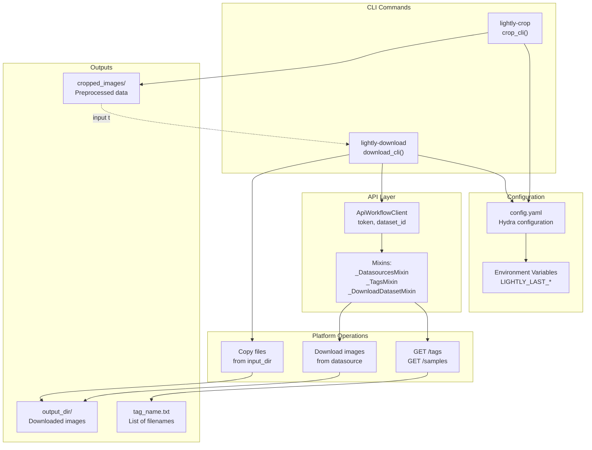
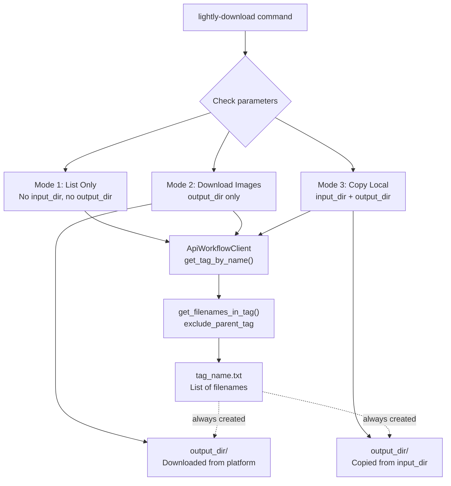
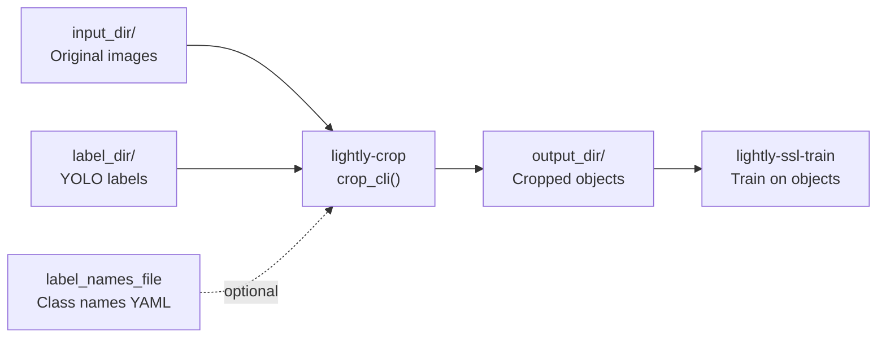
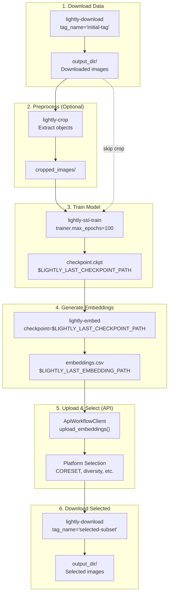

<!-- source: DeepWiki mcp.deepwiki.com · repo lightly-ai/lightly · page 4.3 Platform Integration Commands · fetched 2026-10-21 -->

# Platform Integration Commands

<details>
<summary>Relevant source files</summary>

The following files were used as context for generating this wiki page:

- [docs/source/getting_started/advanced.rst](docs/source/getting_started/advanced.rst)
- [docs/source/getting_started/command_line_tool.rst](docs/source/getting_started/command_line_tool.rst)
- [docs/source/getting_started/images/lightly_overview.png](docs/source/getting_started/images/lightly_overview.png)
- [docs/source/getting_started/install.rst](docs/source/getting_started/install.rst)
- [docs/source/getting_started/lightly_at_a_glance.rst](docs/source/getting_started/lightly_at_a_glance.rst)
- [docs/source/getting_started/main_concepts.rst](docs/source/getting_started/main_concepts.rst)
- [docs/source/index.rst](docs/source/index.rst)
- [docs/source/lightly.models.utils.rst](docs/source/lightly.models.utils.rst)
- [lightly/cli/__init__.py](lightly/cli/__init__.py)
- [lightly/cli/_helpers.py](lightly/cli/_helpers.py)
- [lightly/cli/config/config.yaml](lightly/cli/config/config.yaml)
- [lightly/cli/download_cli.py](lightly/cli/download_cli.py)
- [lightly/cli/embed_cli.py](lightly/cli/embed_cli.py)
- [lightly/cli/lightly_cli.py](lightly/cli/lightly_cli.py)
- [lightly/cli/train_cli.py](lightly/cli/train_cli.py)
- [requirements/base.txt](requirements/base.txt)
- [setup.py](setup.py)
- [tests/cli/test_cli_download.py](tests/cli/test_cli_download.py)
- [tests/cli/test_cli_magic.py](tests/cli/test_cli_magic.py)
- [tests/cli/test_cli_train.py](tests/cli/test_cli_train.py)
- [tests/embedding/test_embedding.py](tests/embedding/test_embedding.py)

</details>


This page documents the command-line interface (CLI) commands for interacting with the Lightly Platform. These commands enable downloading datasets and tags from the platform, uploading data, and preprocessing images for self-supervised learning workflows. For information about training models, see [Training Commands](#4.1). For embedding generation, see [Embedding Generation](#4.2). For configuration details, see [CLI Configuration](#4.4).

## Overview

The Lightly CLI provides commands to bridge local training workflows with the Lightly Platform's dataset management and selection capabilities. The primary integration commands are:

- **`lightly-download`**: Download tagged samples, file lists, or full datasets from the platform
- **`lightly-crop`**: Preprocess images by cropping objects based on YOLO-format labels
- **Platform configuration parameters**: Token-based authentication and dataset management settings

All platform integration commands use the `ApiWorkflowClient` internally (see [API Workflow Client](#6.1)) to communicate with the Lightly Platform REST API.

Sources: [lightly/cli/download_cli.py:1-135](), [lightly/cli/config/config.yaml:13-27](), [docs/source/getting_started/command_line_tool.rst:183-209]()

## Command Architecture



Sources: [lightly/cli/download_cli.py:1-135](), [lightly/api/api_workflow_client.py](), [lightly/cli/config/config.yaml:1-160]()

## lightly-download Command

The `lightly-download` command retrieves data from the Lightly Platform based on dataset tags. It supports three distinct modes of operation.

### Command Signature

```bash
lightly-download \
    tag_name=<tag_name> \
    dataset_id=<dataset_id> \
    token=<token> \
    [input_dir=<path>] \
    [output_dir=<path>] \
    [exclude_parent_tag=<bool>]
```

Sources: [lightly/cli/download_cli.py:22-82](), [docs/source/getting_started/command_line_tool.rst:183-209]()

### Required Parameters

| Parameter | Description | Example |
|-----------|-------------|---------|
| `token` | User access token for platform authentication | `token='your_access_token'` |
| `dataset_id` | Unique identifier of the dataset on the platform | `dataset_id='XYZ123'` |
| `tag_name` | Name of the tag to download (defaults to `'initial-tag'`) | `tag_name='my-tag'` |

Sources: [lightly/cli/download_cli.py:23-26](), [lightly/cli/config/config.yaml:16-26]()

### Optional Parameters

| Parameter | Description | Default |
|-----------|-------------|---------|
| `input_dir` | Local directory containing original images | `''` (empty) |
| `output_dir` | Target directory for downloaded/copied images | `''` (empty) |
| `exclude_parent_tag` | Exclude samples from parent tag | `False` |
| `loader.num_workers` | Number of parallel download workers | Auto-detected (8-32) |

Sources: [lightly/cli/download_cli.py:34-41](), [lightly/cli/config/config.yaml:5-26]()

### Operation Modes



Sources: [lightly/cli/download_cli.py:42-82]()

#### Mode 1: Download Filename List Only

When neither `input_dir` nor `output_dir` is specified, the command downloads only the list of filenames in the tag and saves it to a `.txt` file.

```bash
# Download list of all files in the dataset
lightly-download tag_name='initial-tag' dataset_id='XYZ' token='123'

# Download list of files in a specific tag
lightly-download tag_name='my-tag' dataset_id='XYZ' token='123'
```

**Output**: Creates `{tag_name}.txt` in the current working directory containing one filename per line.

Sources: [lightly/cli/download_cli.py:53-61](), [docs/source/getting_started/command_line_tool.rst:198-201]()

#### Mode 2: Download Images from Platform

When `output_dir` is specified but `input_dir` is not, the command downloads the actual images from the platform's datasource.

```bash
# Download images to output directory
lightly-download tag_name='my-tag' dataset_id='XYZ' token='123' \
    output_dir='my_data/'
```

This uses the `ApiWorkflowClient.download_dataset()` method to retrieve images directly from the configured datasource (S3, Azure, GCS, or local storage).

Sources: [lightly/cli/download_cli.py:63-68](), [docs/source/getting_started/command_line_tool.rst:202-204]()

#### Mode 3: Copy Images from Local Directory

When both `input_dir` and `output_dir` are specified, the command copies files from the local input directory to the output directory based on the tag's file list.

```bash
# Copy tagged files from local directory
lightly-download tag_name='my-tag' dataset_id='XYZ' token='123' \
    input_dir='data/' output_dir='my_data/'
```

This mode is efficient for extracting subsets from large local datasets without re-downloading from the platform.

Sources: [lightly/cli/download_cli.py:70-82](), [docs/source/getting_started/command_line_tool.rst:206-208]()

### Implementation Details

The download command implementation uses the following workflow:

1. **Validation**: Check that `tag_name`, `token`, and `dataset_id` are provided [lightly/cli/download_cli.py:27-32]()
2. **Worker Configuration**: Auto-detect optimal number of workers (8-32) if not specified [lightly/cli/download_cli.py:34-40]()
3. **API Client Initialization**: Create `ApiWorkflowClient` with authentication [lightly/cli/download_cli.py:42-44]()
4. **Tag Resolution**: Retrieve tag data by name using `get_tag_by_name()` [lightly/cli/download_cli.py:47]()
5. **Filename Retrieval**: Get list of filenames in tag with optional parent exclusion [lightly/cli/download_cli.py:48-51]()
6. **File List Export**: Always write filenames to `{tag_name}.txt` [lightly/cli/download_cli.py:53-61]()
7. **Image Retrieval**: Download or copy images based on specified directories [lightly/cli/download_cli.py:63-82]()

Sources: [lightly/cli/download_cli.py:22-82]()

### Excluding Parent Tags

The `exclude_parent_tag` parameter filters out samples that exist in both the specified tag and its parent tag, returning only samples unique to the specified tag.

```bash
# Download only samples in 'my-tag' but not in its parent
lightly-download tag_name='my-tag' dataset_id='XYZ' token='123' \
    exclude_parent_tag=True
```

Sources: [lightly/cli/download_cli.py:48-51](), [lightly/cli/config/config.yaml:26](), [docs/source/getting_started/command_line_tool.rst:148-149]()

### Error Handling

The command includes validation and error handling for common issues:

| Scenario | Behavior |
|----------|----------|
| Missing `token`, `dataset_id`, or `tag_name` | Prints warning and returns without action |
| Tag name not found | Raises `ValueError` (from `get_tag_by_name()`) |
| Integer tag name | Correctly converts to string (fixes issue #575) |

Sources: [lightly/cli/download_cli.py:27-32](), [tests/cli/test_cli_download.py:77-82](), [tests/cli/test_cli_download.py:117-129]()

## lightly-crop Command

The `lightly-crop` command preprocesses datasets by cropping objects from images based on YOLO-format bounding box labels. This is useful for object-centric self-supervised learning where features should focus on individual objects rather than full scenes.

### Command Signature

```bash
lightly-crop \
    input_dir=<images> \
    label_dir=<labels> \
    output_dir=<cropped_images> \
    [crop_padding=<float>] \
    [label_names_file=<path>]
```

Sources: [docs/source/getting_started/command_line_tool.rst:42-80](), [lightly/cli/config/config.yaml:30]()

### Parameters

| Parameter | Description | Default | Example |
|-----------|-------------|---------|---------|
| `input_dir` | Directory containing input images | Required | `input_dir=images` |
| `label_dir` | Directory containing YOLO-format label files | Required | `label_dir=labels` |
| `output_dir` | Directory to store cropped images | Required | `output_dir=cropped_images` |
| `crop_padding` | Padding around bounding box (fraction) | `0.1` | `crop_padding=0.2` |
| `label_names_file` | YAML file with class names | Optional | `label_names_file=data.yaml` |

Sources: [lightly/cli/config/config.yaml:30](), [docs/source/getting_started/command_line_tool.rst:56-63]()

### YOLO Label Format

Each image must have a corresponding `.txt` file with the same base name. Each line in the label file represents one object:

```
class_id x_center y_center width height
```

Where coordinates are normalized to [0, 1] relative to image dimensions.

**Example label file (`image_001.txt`):**
```text
0 0.23 0.14 0.05 0.04
1 0.43 0.13 0.12 0.08
```

Sources: [docs/source/getting_started/command_line_tool.rst:66-74]()

### Class Names File

Optional YAML file mapping class IDs to human-readable names. When provided, class names are included in output filenames.

**Example `data.yaml`:**
```yaml
names: [cat, dog, car]
```

Sources: [docs/source/getting_started/command_line_tool.rst:76-79]()

### Usage Examples

```bash
# Basic cropping with 20% padding
lightly-crop input_dir=images label_dir=labels output_dir=cropped_images \
    crop_padding=0.2

# Cropping with class names in output filenames
lightly-crop input_dir=images label_dir=labels output_dir=cropped_images \
    label_names_file=data.yaml
```

The cropped images can be used as input for training commands:

```bash
# Use cropped images for training
lightly-ssl-train input_dir=cropped_images trainer.max_epochs=10
```

Sources: [docs/source/getting_started/command_line_tool.rst:56-82]()

### Preprocessing Workflow



Sources: [docs/source/getting_started/command_line_tool.rst:42-82]()

## Platform Configuration Parameters

Platform integration requires several configuration parameters in `config.yaml` or as command-line overrides.

### Authentication Parameters

```yaml
# Lightly platform authentication
token: ''                     # User access token to the Lightly platform
dataset_id: ''                # Identifier of the dataset on the Lightly platform
```

These parameters are required for all platform operations. The token authenticates API requests, and the dataset_id specifies which dataset to operate on.

Sources: [lightly/cli/config/config.yaml:16-17]()

### Dataset Management Parameters

```yaml
# Dataset creation and modification
new_dataset_name: ''          # Name of the new dataset to be created
append: False                 # True to append samples to existing dataset
tag_name: 'initial-tag'       # Name of the tag to download/operate on
exclude_parent_tag: False     # Exclude samples from parent tag
```

Sources: [lightly/cli/config/config.yaml:18-26]()

### Upload Configuration

```yaml
# Image upload settings
upload: 'full'                # Upload mode: 'full', 'thumbnails', 'none'
resize: -1                    # Resize images before upload: -1, x, or [x,y]
```

The `upload` parameter controls what gets uploaded to the platform:
- `'full'`: Upload full-resolution images
- `'thumbnails'`: Upload thumbnail versions only
- `'none'`: Upload metadata only (no image data)

Sources: [lightly/cli/config/config.yaml:19-22]()

### Embedding Upload Parameters

```yaml
# Embedding configuration
embedding_name: 'default'     # Name for the embedding on the platform
emb_upload_bsz: 32           # Batch size for embedding uploads
```

When embeddings are uploaded to the platform (typically after running `lightly-embed`), these parameters control the upload behavior.

Sources: [lightly/cli/config/config.yaml:23-24]()

### Environment Variables

The CLI uses environment variables to track outputs and chain commands:

| Variable | Purpose | Set By |
|----------|---------|--------|
| `LIGHTLY_LAST_CHECKPOINT_PATH` | Path to most recent checkpoint | `lightly-ssl-train` |
| `LIGHTLY_LAST_EMBEDDING_PATH` | Path to most recent embeddings CSV | `lightly-embed` |
| `LIGHTLY_LAST_DATASET_ID` | Most recently created/used dataset ID | Various commands |

These enable command chaining without manually specifying paths:

```bash
# Train model
lightly-ssl-train input_dir=data/ trainer.max_epochs=10

# Embed using the trained model
lightly-embed input_dir=data/ checkpoint=$LIGHTLY_LAST_CHECKPOINT_PATH
```

Sources: [lightly/cli/config/config.yaml:105-109](), [lightly/cli/train_cli.py:149-152](), [lightly/cli/embed_cli.py:85-87]()

## Platform Integration Workflows

### End-to-End Workflow with Platform



Sources: [docs/source/getting_started/command_line_tool.rst:1-237](), [lightly/cli/download_cli.py:1-135]()

### Typical Command Sequence

```bash
# Step 1: Download initial dataset from platform
lightly-download \
    tag_name='initial-tag' \
    dataset_id='abc123' \
    token='your_token' \
    output_dir='raw_data/'

# Step 2: (Optional) Crop objects for object-centric learning
lightly-crop \
    input_dir='raw_data/' \
    label_dir='labels/' \
    output_dir='cropped_data/' \
    crop_padding=0.2

# Step 3: Train self-supervised model
lightly-ssl-train \
    input_dir='cropped_data/' \
    trainer.max_epochs=100 \
    loader.batch_size=128

# Step 4: Generate embeddings
lightly-embed \
    input_dir='cropped_data/' \
    checkpoint=$LIGHTLY_LAST_CHECKPOINT_PATH

# Step 5: Upload embeddings to platform (via Python API)
# See API Workflow Client documentation

# Step 6: Download selected subset after platform selection
lightly-download \
    tag_name='active-learning-selected' \
    dataset_id='abc123' \
    token='your_token' \
    input_dir='raw_data/' \
    output_dir='selected_subset/'
```

Sources: [docs/source/getting_started/command_line_tool.rst:145-209](), [docs/source/lightly.cli.rst]()

### Iterative Active Learning Loop

```bash
# Initial dataset download
lightly-download tag_name='initial-tag' dataset_id='XYZ' token='123' \
    output_dir='iteration_0/'

# Iteration 1: Train and select
lightly-ssl-train input_dir='iteration_0/' trainer.max_epochs=50
lightly-embed input_dir='iteration_0/' checkpoint=$LIGHTLY_LAST_CHECKPOINT_PATH
# Upload embeddings via API and run selection strategy

# Download newly selected samples
lightly-download tag_name='iteration_1' dataset_id='XYZ' token='123' \
    output_dir='iteration_1/'

# Iteration 2: Train on expanded dataset
lightly-ssl-train input_dir='iteration_1/' trainer.max_epochs=50
# ... repeat
```

Sources: [docs/source/getting_started/command_line_tool.rst:1-237]()

## Integration with API Client

While the CLI commands provide a simple interface for common operations, more advanced platform features require direct use of the `ApiWorkflowClient` (see [API Workflow Client](#6.1)). The CLI commands internally use this client:

```python
# Internal implementation of lightly-download
from lightly.api.api_workflow_client import ApiWorkflowClient

api_workflow_client = ApiWorkflowClient(
    token=token, 
    dataset_id=dataset_id,
    creator=Creator.USER_PIP_LIGHTLY_MAGIC
)

# Get tag data
tag_data = api_workflow_client.get_tag_by_name(tag_name)

# Get filenames in tag
filenames = api_workflow_client.get_filenames_in_tag(
    tag_data,
    exclude_parent_tag=cfg["exclude_parent_tag"],
)

# Download images
api_workflow_client.download_dataset(
    output_dir, 
    tag_name=tag_name, 
    max_workers=cfg["loader"]["num_workers"]
)
```

For operations not exposed through CLI commands (such as uploading embeddings, configuring datasources, or managing compute workers), use the Python API directly.

Sources: [lightly/cli/download_cli.py:42-68]()

## Summary

Platform integration commands bridge the gap between local training workflows and cloud-based dataset management:

| Command | Primary Use Case | Output |
|---------|-----------------|--------|
| `lightly-download` | Retrieve tagged samples from platform | File list or images |
| `lightly-crop` | Preprocess images for object-centric learning | Cropped object images |

These commands work in conjunction with training commands ([Training Commands](#4.1)) and embedding generation ([Embedding Generation](#4.2)) to enable complete active learning and dataset curation workflows. All platform operations require authentication via `token` and `dataset_id` parameters, which can be set in the Hydra configuration file or as command-line overrides (see [CLI Configuration](#4.4)).

For programmatic access to platform features beyond what the CLI exposes, use the `ApiWorkflowClient` directly (see [Platform Integration](#6)).

Sources: [lightly/cli/download_cli.py:1-135](), [docs/source/getting_started/command_line_tool.rst:1-237](), [lightly/cli/config/config.yaml:1-160]()

---

