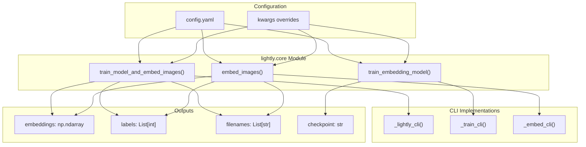
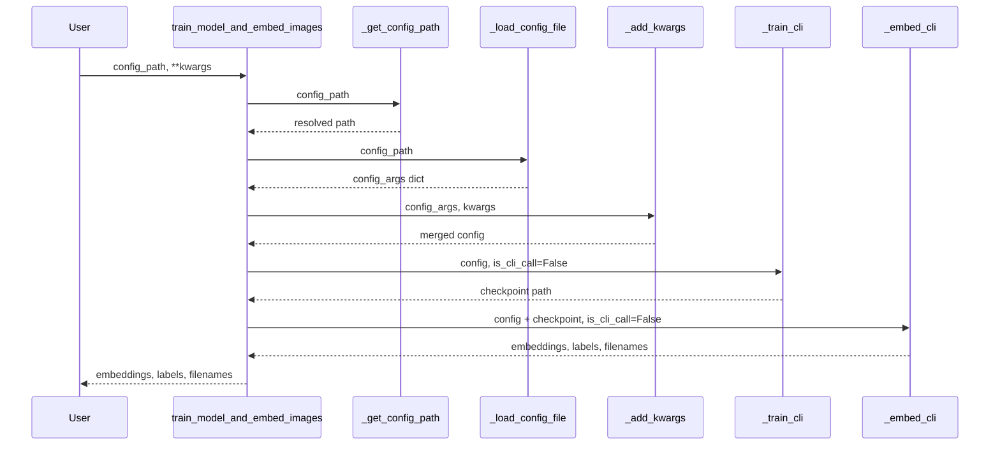
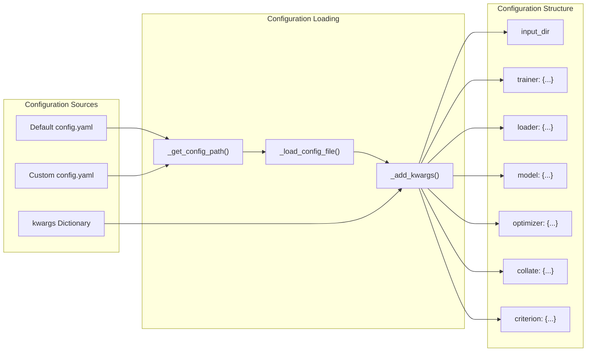
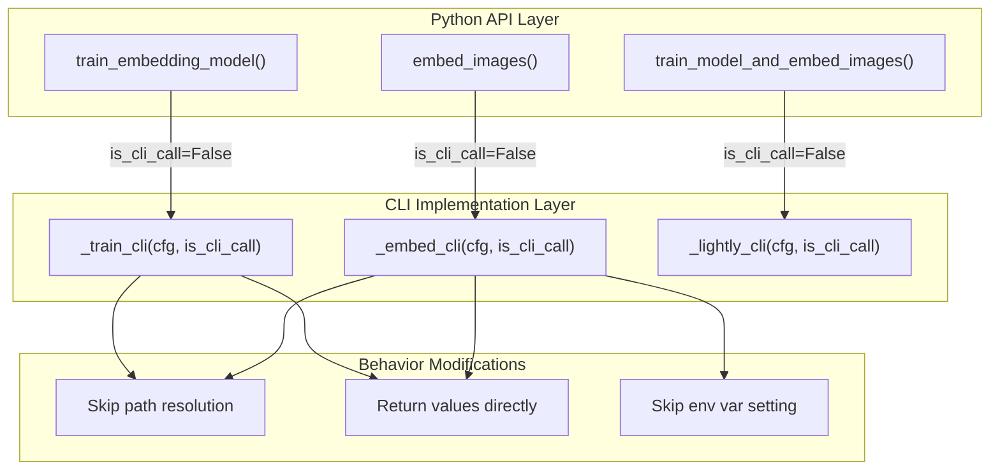
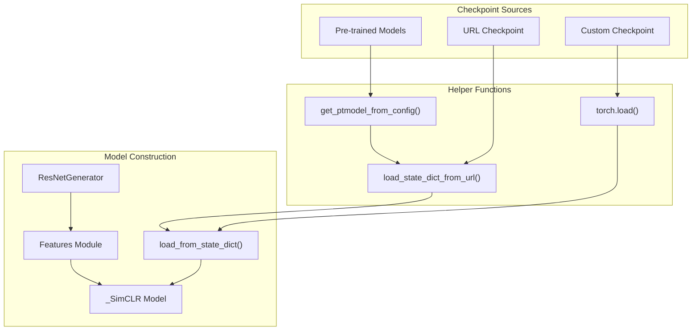

<!-- source: DeepWiki mcp.deepwiki.com · repo lightly-ai/lightly · page 5 Python API · fetched 2026-10-21 -->

# Python API

<details>
<summary>Relevant source files</summary>

The following files were used as context for generating this wiki page:

- [README.md](README.md)
- [docs/source/getting_started/advanced.rst](docs/source/getting_started/advanced.rst)
- [docs/source/getting_started/benchmarks.rst](docs/source/getting_started/benchmarks.rst)
- [docs/source/getting_started/benchmarks/cifar10_benchmark.py](docs/source/getting_started/benchmarks/cifar10_benchmark.py)
- [docs/source/getting_started/benchmarks/imagenet100_benchmark.py](docs/source/getting_started/benchmarks/imagenet100_benchmark.py)
- [docs/source/getting_started/benchmarks/imagenette_benchmark.py](docs/source/getting_started/benchmarks/imagenette_benchmark.py)
- [docs/source/getting_started/command_line_tool.rst](docs/source/getting_started/command_line_tool.rst)
- [docs/source/getting_started/images/lightly_overview.png](docs/source/getting_started/images/lightly_overview.png)
- [docs/source/getting_started/install.rst](docs/source/getting_started/install.rst)
- [docs/source/getting_started/lightly_at_a_glance.rst](docs/source/getting_started/lightly_at_a_glance.rst)
- [docs/source/getting_started/main_concepts.rst](docs/source/getting_started/main_concepts.rst)
- [docs/source/index.rst](docs/source/index.rst)
- [docs/source/lightly.models.utils.rst](docs/source/lightly.models.utils.rst)
- [docs/source/tutorials/structure_your_input.rst](docs/source/tutorials/structure_your_input.rst)
- [docs/source/tutorials_source/package/Base-RCNN-FPN.yaml](docs/source/tutorials_source/package/Base-RCNN-FPN.yaml)
- [docs/source/tutorials_source/package/tutorial_custom_augmentations.py](docs/source/tutorials_source/package/tutorial_custom_augmentations.py)
- [docs/source/tutorials_source/package/tutorial_moco_memory_bank.py](docs/source/tutorials_source/package/tutorial_moco_memory_bank.py)
- [docs/source/tutorials_source/package/tutorial_pretrain_detectron2.py](docs/source/tutorials_source/package/tutorial_pretrain_detectron2.py)
- [docs/source/tutorials_source/package/tutorial_simclr_clothing.py](docs/source/tutorials_source/package/tutorial_simclr_clothing.py)
- [docs/source/tutorials_source/package/tutorial_simsiam_esa.py](docs/source/tutorials_source/package/tutorial_simsiam_esa.py)

</details>


The Python API provides a programmatic interface to Lightly's self-supervised learning functionality through the `lightly.core` module. This API wraps the command-line interface implementations, allowing users to train models and generate embeddings directly from Python code with full control over configuration and return values.

For information about the command-line interface, see [Command-Line Interface](#4). For details on the underlying API client for platform integration, see [Platform Integration](#6).

## Overview

The Python API consists of three main functions in the `lightly.core` module that mirror the CLI commands:



**Purpose:** Bridge the gap between CLI functionality and Python integration by providing functions that accept Python data structures, handle configuration merging, and return results directly to the caller.

Sources: [lightly/core.py:1-221]()

## Core Functions

### train_model_and_embed_images

```python
def train_model_and_embed_images(
    config_path: str = None, **kwargs
) -> Tuple[np.ndarray, List[int], List[str]]
```

This function combines model training and embedding generation in a single call. It first trains a self-supervised model using the training CLI, then uses the trained checkpoint to generate embeddings for all images.

**Parameters:**
- `config_path`: Optional path to a YAML configuration file. If `None`, uses the default configuration from [lightly/cli/config/config.yaml:1-160]()
- `**kwargs`: Dictionary of configuration overrides organized by namespace (e.g., `trainer={'max_epochs': 10}`)

**Returns:**
- `embeddings`: NumPy array of shape `(n_samples, embedding_size)`
- `labels`: List of integer labels (enumerated from dataset structure)
- `filenames`: List of image filenames

**Implementation Flow:**



Sources: [lightly/core.py:78-124]()

### train_embedding_model

```python
def train_embedding_model(config_path: str = None, **kwargs) -> str
```

Trains a self-supervised model and returns the path to the saved checkpoint. This function mirrors the `lightly-ssl-train` CLI command.

**Parameters:**
- `config_path`: Optional path to a YAML configuration file
- `**kwargs`: Configuration overrides (e.g., `loader={'batch_size': 100, 'num_workers': 8}`)

**Returns:**
- `str`: Path to the saved model checkpoint file (`.ckpt`)

**Key Configuration Namespaces:**
- `trainer`: PyTorch Lightning trainer parameters (max_epochs, gpus, precision)
- `loader`: DataLoader parameters (batch_size, num_workers, shuffle)
- `model`: Model architecture parameters (name, out_dim, num_ftrs)
- `optimizer`: Optimizer parameters (lr, weight_decay)
- `collate`: Data augmentation parameters (input_size, cj_prob, etc.)

Sources: [lightly/core.py:127-171](), [lightly/cli/train_cli.py:37-153]()

### embed_images

```python
def embed_images(
    checkpoint: str, 
    config_path: str = None, 
    **kwargs
) -> Tuple[np.ndarray, List[int], List[str]]
```

Generates embeddings for images using a pre-trained model checkpoint. This function mirrors the `lightly-embed` CLI command.

**Parameters:**
- `checkpoint`: Path to the model checkpoint file (`.ckpt`)
- `config_path`: Optional path to a YAML configuration file
- `**kwargs`: Configuration overrides

**Returns:**
- `embeddings`: NumPy array of shape `(n_samples, embedding_size)`
- `labels`: List of integer labels
- `filenames`: List of image filenames

**Behavior Differences from CLI:**
- When called programmatically (`is_cli_call=False`), returns embeddings directly instead of saving to CSV
- Disables shuffling and drop_last in the DataLoader for deterministic ordering
- Uses a simple transform pipeline: Resize → ToTensor → Normalize

Sources: [lightly/core.py:174-221](), [lightly/cli/embed_cli.py:31-91]()

## Configuration System

### Configuration Architecture



Sources: [lightly/core.py:17-76]()

### Configuration Loading

The `_get_config_path()` function resolves the configuration file path:

| Input | Resolution |
|-------|-----------|
| `None` | Uses default config at `lightly/cli/config/config.yaml` |
| Custom path | Validates existence and returns the path |
| Non-existent path | Raises `ValueError` |

The `_load_config_file()` function uses PyYAML's `FullLoader` to parse the YAML file into a nested dictionary structure.

Sources: [lightly/core.py:17-53]()

### Configuration Merging

The `_add_kwargs()` function recursively merges keyword arguments into the loaded configuration:

**Merge Strategy:**
- **Scalar values**: Direct override (e.g., `input_dir='path/to/data'`)
- **Nested dictionaries**: Recursive merge (e.g., `trainer={'max_epochs': 10}` only updates `max_epochs`)
- **New keys**: Added to configuration (e.g., `+optimizer.momentum=0.9` in CLI becomes `optimizer={'momentum': 0.9}`)

**Example Configuration Merge:**

```python
# Base config
base = {
    'input_dir': '',
    'trainer': {'max_epochs': 100, 'gpus': 1},
    'loader': {'batch_size': 16}
}

# User overrides
kwargs = {
    'input_dir': '/data/images',
    'trainer': {'max_epochs': 50},  # Only updates max_epochs
    'loader': {'batch_size': 128, 'num_workers': 8}  # Updates batch_size, adds num_workers
}

# Result
result = {
    'input_dir': '/data/images',
    'trainer': {'max_epochs': 50, 'gpus': 1},  # max_epochs changed, gpus retained
    'loader': {'batch_size': 128, 'num_workers': 8}
}
```

Sources: [lightly/core.py:56-75]()

### Default Configuration Structure

The default configuration file defines the following namespaces:

| Namespace | Purpose | Key Parameters |
|-----------|---------|----------------|
| `input_dir` | Image directory path | String path |
| `output_dir` | Output directory for results | String path |
| `checkpoint` | Model checkpoint path | String path or URL |
| `model` | Model architecture | `name`, `out_dim`, `num_ftrs`, `width` |
| `trainer` | PyTorch Lightning trainer | `max_epochs`, `gpus`, `precision` |
| `loader` | DataLoader settings | `batch_size`, `num_workers`, `shuffle` |
| `optimizer` | SGD optimizer | `lr`, `weight_decay` |
| `criterion` | Loss function | `temperature`, `memory_bank_size` |
| `collate` | Data augmentation | `input_size`, `cj_prob`, `min_scale`, etc. |

Sources: [lightly/cli/config/config.yaml:1-160]()

## CLI Integration

### Bridging Mechanism

The Python API functions call internal CLI implementations with `is_cli_call=False` to modify their behavior:



**Key Behavioral Differences:**

| Aspect | CLI Mode (`is_cli_call=True`) | API Mode (`is_cli_call=False`) |
|--------|-------------------------------|--------------------------------|
| Path resolution | Applies `fix_input_path()` | Uses paths as-is |
| Return values | Saves to disk, prints paths | Returns data directly |
| Environment variables | Sets `LIGHTLY_LAST_*_PATH` | No side effects |
| Output format | CSV files for embeddings | NumPy arrays |

Sources: [lightly/cli/train_cli.py:37-153](), [lightly/cli/embed_cli.py:31-91]()

### Path Resolution

The `fix_input_path()` helper converts relative paths to absolute paths when called from CLI:

```python
def fix_input_path(path):
    """Fix broken relative paths."""
    if not os.path.isabs(path):
        path = utils.to_absolute_path(path)
    return path
```

This is skipped in API mode to allow users to pass paths relative to their Python script's working directory.

Sources: [lightly/cli/_helpers.py:29-33]()

## Usage Examples

### Example 1: Train and Embed with Default Settings

```python
import lightly

# Train a model and generate embeddings with all defaults
embeddings, labels, filenames = lightly.train_model_and_embed_images(
    input_dir='data/images'
)

print(f"Generated {len(embeddings)} embeddings of dimension {embeddings.shape[1]}")
```

Sources: [docs/source/getting_started/lightly_at_a_glance.rst:1-238]()

### Example 2: Custom Training Configuration

```python
import lightly

# Train with custom settings
checkpoint = lightly.train_embedding_model(
    input_dir='data/images',
    trainer={'max_epochs': 50, 'gpus': 2},
    loader={'batch_size': 128, 'num_workers': 8},
    model={'name': 'resnet-50', 'num_ftrs': 128}
)

print(f"Model saved to: {checkpoint}")
```

This is equivalent to the CLI command:
```bash
lightly-ssl-train input_dir=data/images trainer.max_epochs=50 trainer.gpus=2 \
    loader.batch_size=128 loader.num_workers=8 model.name=resnet-50 model.num_ftrs=128
```

Sources: [lightly/core.py:144-166]()

### Example 3: Embed with Pre-trained Model

```python
import lightly

# Use a pre-trained checkpoint to embed images
embeddings, labels, filenames = lightly.embed_images(
    checkpoint='models/checkpoint.ckpt',
    input_dir='data/images',
    collate={'input_size': 224}  # Use larger input size at inference
)

# Use embeddings for downstream tasks
from sklearn.neighbors import NearestNeighbors
nn = NearestNeighbors(n_neighbors=5)
nn.fit(embeddings)
distances, indices = nn.kneighbors([embeddings[0]])
```

Sources: [lightly/core.py:192-212]()

### Example 4: Custom Configuration File

```python
import lightly

# Load configuration from custom YAML file
checkpoint = lightly.train_embedding_model(
    config_path='configs/my_config.yaml',
    input_dir='data/images',  # Override specific parameters
    trainer={'max_epochs': 20}
)
```

Sources: [lightly/core.py:152-153]()

### Example 5: Programmatic Training Loop Integration

```python
import lightly
import numpy as np
from sklearn.decomposition import PCA

# Train model with multiple configurations
results = []
for num_ftrs in [32, 64, 128]:
    embeddings, labels, filenames = lightly.train_model_and_embed_images(
        input_dir='data/images',
        trainer={'max_epochs': 10},
        model={'num_ftrs': num_ftrs}
    )
    
    # Analyze embedding quality
    pca = PCA(n_components=2)
    reduced = pca.fit_transform(embeddings)
    variance_explained = np.sum(pca.explained_variance_ratio_)
    
    results.append({
        'num_ftrs': num_ftrs,
        'variance_explained': variance_explained
    })

print(f"Best configuration: {max(results, key=lambda x: x['variance_explained'])}")
```

Sources: [tests/core/test_Core.py:44-64]()

## Implementation Details

### Model Loading and Checkpoint Handling

The Python API delegates to CLI helper functions for model loading:



**Checkpoint Resolution Logic:**
1. If `pre_trained=True` and no checkpoint specified: Fetch from model zoo using `get_ptmodel_from_config()`
2. If checkpoint is URL: Download using `load_state_dict_from_url()`
3. If checkpoint is file path: Load directly using `torch.load()`

Sources: [lightly/cli/train_cli.py:69-106](), [lightly/cli/_helpers.py:62-93]()

### Embedding Generation Process

The `_embed_cli()` function implements the embedding pipeline:

1. **Setup:** Create dataset with resize and normalize transforms
2. **DataLoader:** Configure with `shuffle=False`, `drop_last=False` for deterministic ordering
3. **Model Loading:** Load checkpoint and create `SelfSupervisedEmbedding` wrapper
4. **Inference:** Call `encoder.embed(dataloader, device)`
5. **Return:** Either save to CSV (CLI mode) or return arrays (API mode)

**Transform Pipeline:**
```python
transform = T.Compose([
    T.Resize((input_size, input_size)),
    T.ToTensor(),
    T.Normalize(mean=[0.485, 0.456, 0.406], std=[0.229, 0.224, 0.225])
])
```

Sources: [lightly/cli/embed_cli.py:56-90]()

### Environment Variable Management

In CLI mode, the implementation sets environment variables for chaining commands:

| Variable | Purpose | Set By |
|----------|---------|--------|
| `LIGHTLY_LAST_CHECKPOINT_PATH` | Path to last trained checkpoint | `_train_cli()` |
| `LIGHTLY_LAST_EMBEDDING_PATH` | Path to last generated embeddings | `_embed_cli()` |
| `LIGHTLY_LAST_DATASET_ID` | Last created dataset ID | Platform upload |

These variables are not set in API mode (`is_cli_call=False`).

Sources: [lightly/cli/train_cli.py:149-151](), [lightly/cli/embed_cli.py:85-87](), [lightly/cli/config/config.yaml:106-109]()

### Model Architecture

The Python API uses the `_SimCLR` model wrapper defined in `lightly.cli._cli_simclr`:

```python
model = _SimCLR(
    features,  # ResNet backbone
    num_ftrs=cfg['model']['num_ftrs'],  # Feature dimension
    out_dim=cfg['model']['out_dim']      # Projection head output
)
```

The features module consists of:
- Normalization layer: `get_norm_layer(3, 0)`
- ResNet backbone: `ResNetGenerator(name, width)`
- 1x1 convolution: `Conv2d(channels, num_ftrs, 1)`
- Global average pooling: `AdaptiveAvgPool2d(1)`

Sources: [lightly/cli/train_cli.py:92-106]()

## Integration with Other Components

### Dataset Management

The Python API uses `LightlyDataset` for data loading:
- Supports image directories and video files
- Applies transforms from the collate configuration
- Returns tuples of `(sample, target, filename)`

For details on dataset functionality, see [Data Handling](#3).

Sources: [lightly/cli/train_cli.py:111-118](), [lightly/cli/embed_cli.py:64-75]()

### Training Infrastructure

Training uses PyTorch Lightning's `Trainer` with configurations from the `trainer` namespace:
- Handles multi-GPU training with DDP strategy
- Supports mixed precision training
- Creates checkpoints automatically

For benchmarking and evaluation details, see [Benchmarking](#7).

Sources: [lightly/cli/train_cli.py:122-144]()

### Loss Functions and Optimizers

The API configures:
- **Loss:** `NTXentLoss` with temperature and optional memory bank
- **Optimizer:** `torch.optim.SGD` with learning rate and weight decay

For loss function details, see [Loss Functions](#2.2).

Sources: [lightly/cli/train_cli.py:108-109]()

---

