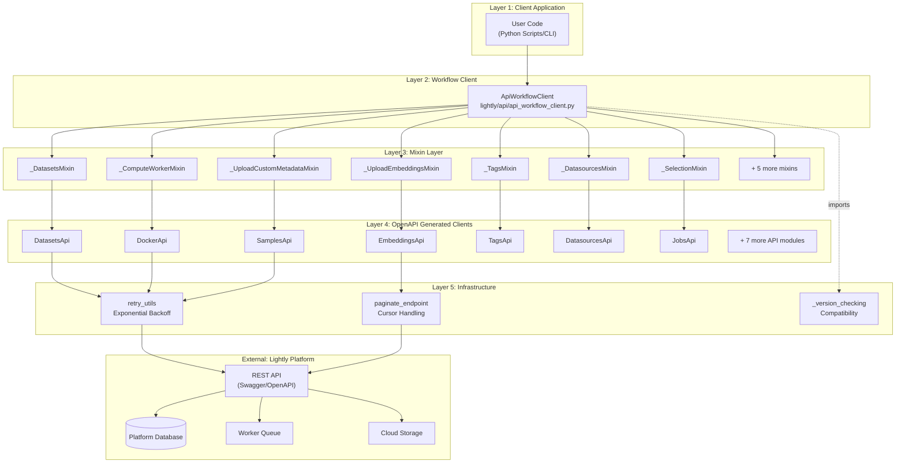
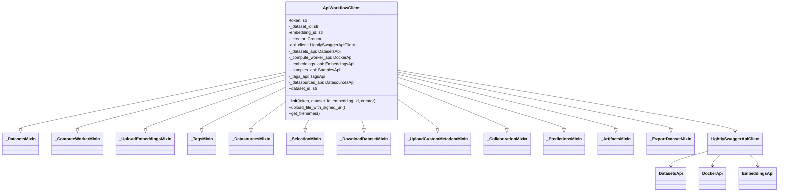
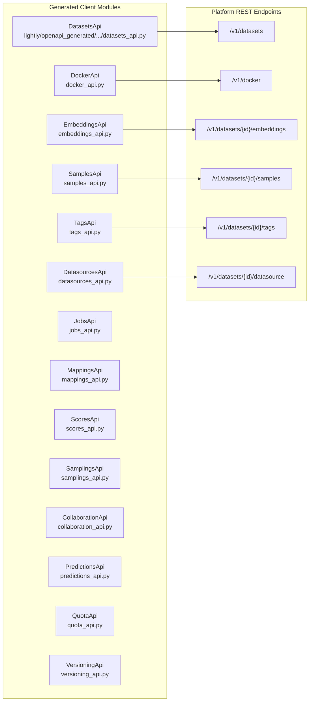
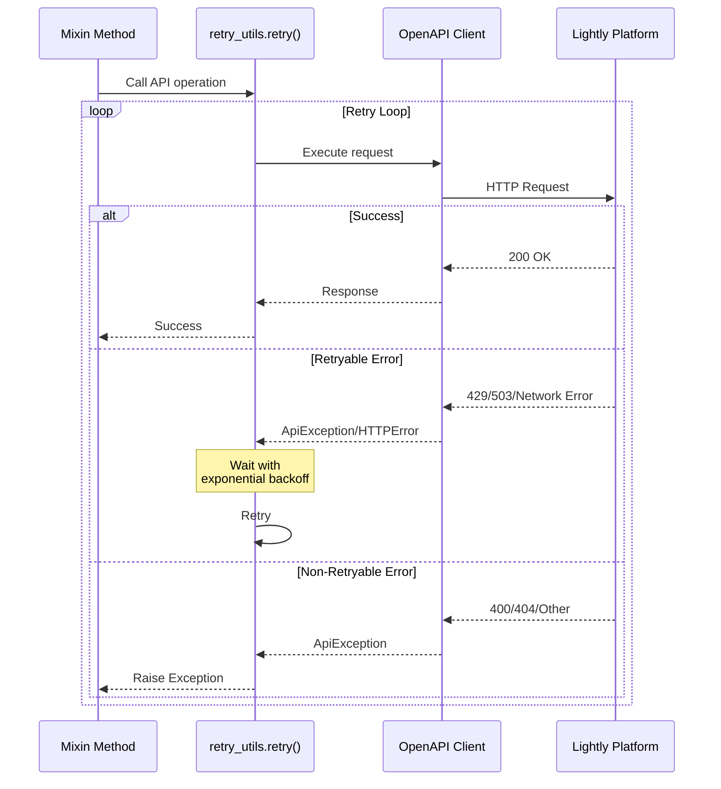
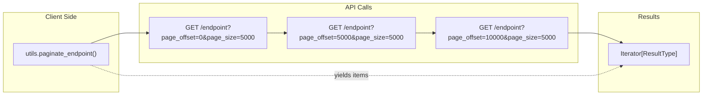
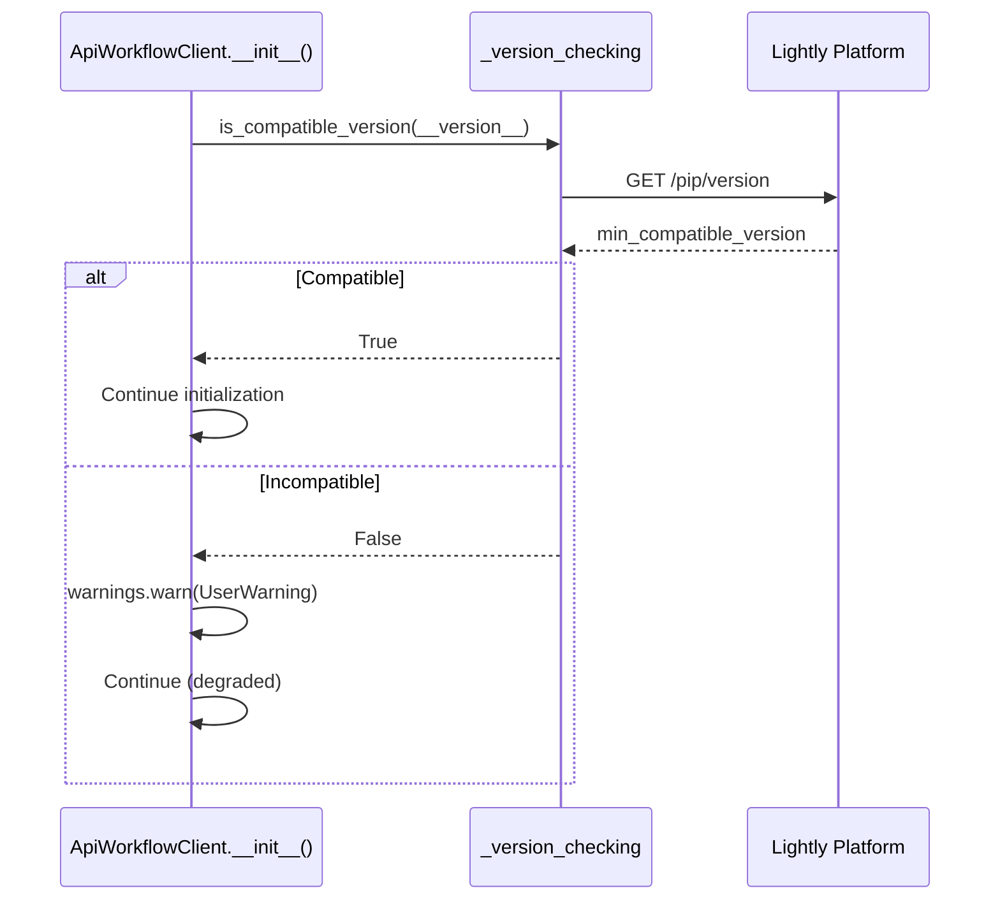
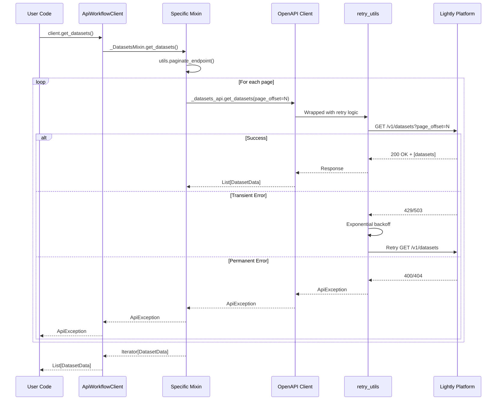
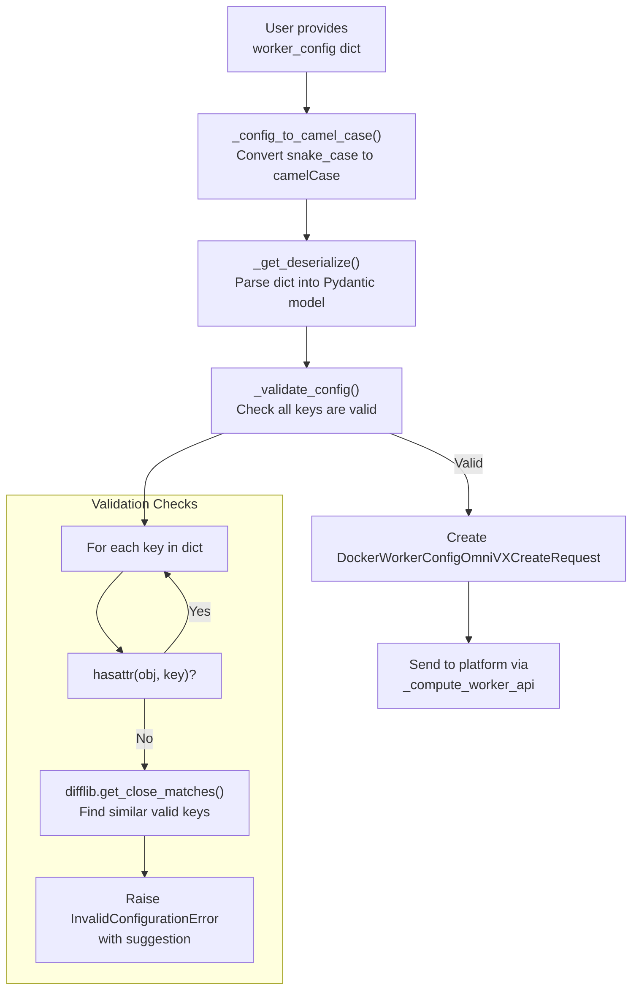

<!-- source: DeepWiki mcp.deepwiki.com · repo lightly-ai/lightly · page 6 Platform Integration · fetched 2026-10-21 -->

# Platform Integration

<details>
<summary>Relevant source files</summary>

The following files were used as context for generating this wiki page:

- [docs/source/lightly.models.rst](docs/source/lightly.models.rst)
- [lightly/__init__.py](lightly/__init__.py)
- [lightly/api/_version_checking.py](lightly/api/_version_checking.py)
- [lightly/api/api_workflow_client.py](lightly/api/api_workflow_client.py)
- [lightly/api/api_workflow_compute_worker.py](lightly/api/api_workflow_compute_worker.py)
- [lightly/api/api_workflow_datasets.py](lightly/api/api_workflow_datasets.py)
- [lightly/openapi_generated/swagger_client/__init__.py](lightly/openapi_generated/swagger_client/__init__.py)
- [lightly/openapi_generated/swagger_client/api/datasets_api.py](lightly/openapi_generated/swagger_client/api/datasets_api.py)
- [lightly/openapi_generated/swagger_client/api/datasources_api.py](lightly/openapi_generated/swagger_client/api/datasources_api.py)
- [lightly/openapi_generated/swagger_client/api/docker_api.py](lightly/openapi_generated/swagger_client/api/docker_api.py)
- [lightly/openapi_generated/swagger_client/api/embeddings_api.py](lightly/openapi_generated/swagger_client/api/embeddings_api.py)
- [lightly/openapi_generated/swagger_client/api/samples_api.py](lightly/openapi_generated/swagger_client/api/samples_api.py)
- [lightly/openapi_generated/swagger_client/api/tags_api.py](lightly/openapi_generated/swagger_client/api/tags_api.py)
- [lightly/openapi_generated/swagger_client/models/__init__.py](lightly/openapi_generated/swagger_client/models/__init__.py)
- [lightly/openapi_generated/swagger_client/models/api_error_code.py](lightly/openapi_generated/swagger_client/models/api_error_code.py)
- [lightly/openapi_generated/swagger_client/models/create_sample_with_write_urls_response.py](lightly/openapi_generated/swagger_client/models/create_sample_with_write_urls_response.py)
- [tests/api/test_version_checking.py](tests/api/test_version_checking.py)
- [tests/api_workflow/mocked_api_workflow_client.py](tests/api_workflow/mocked_api_workflow_client.py)
- [tests/api_workflow/test_api_workflow.py](tests/api_workflow/test_api_workflow.py)
- [tests/api_workflow/test_api_workflow_client.py](tests/api_workflow/test_api_workflow_client.py)
- [tests/api_workflow/test_api_workflow_compute_worker.py](tests/api_workflow/test_api_workflow_compute_worker.py)
- [tests/api_workflow/test_api_workflow_datasets.py](tests/api_workflow/test_api_workflow_datasets.py)
- [tests/conftest.py](tests/conftest.py)

</details>


The Platform Integration component provides a standardized, layered interface for communication between the Lightly framework and the Lightly Platform. This page documents the overall architecture, including the `ApiWorkflowClient`, the mixin pattern, the OpenAPI generated client layer, and the infrastructure layer (retry mechanisms, pagination, error handling). For details on specific functional areas like dataset management, compute workers, or datasources, see their respective dedicated pages (sections 6.1-6.6).

## Architecture Overview

The platform integration uses a layered architecture with four main layers:

### Layered Architecture



Sources: [lightly/api/api_workflow_client.py:52-146](), [lightly/api/api_workflow_compute_worker.py:1-729](), [tests/api_workflow/mocked_api_workflow_client.py:1-1260]()

### Layer Responsibilities

| Layer | Components | Responsibility |
|-------|-----------|----------------|
| **Client Application** | User code, CLI scripts | Entry point for all platform operations |
| **Workflow Client** | `ApiWorkflowClient` | Central coordinator, manages authentication and dataset context |
| **Mixin Layer** | 12 specialized mixins | High-level workflow methods grouped by functionality |
| **OpenAPI Generated Clients** | 14 API modules | Low-level HTTP communication with platform endpoints |
| **Infrastructure** | Retry utils, pagination, version check | Cross-cutting concerns like error handling and compatibility |

Sources: [lightly/api/api_workflow_client.py:52-66](), [lightly/openapi_generated/swagger_client/__init__.py:1-295]()

## ApiWorkflowClient

The `ApiWorkflowClient` class is the main entry point for all platform operations. It composes functionality from multiple mixins and manages the connection to the Lightly Platform.

### Class Structure



Sources: [lightly/api/api_workflow_client.py:52-146]()

### Initialization and Authentication

The `ApiWorkflowClient` requires an API token for authentication. The token can be provided directly or via the `LIGHTLY_TOKEN` environment variable.

```python
from lightly.api import ApiWorkflowClient

# Initialize with token provided directly
client = ApiWorkflowClient(token="YOUR_API_TOKEN")

# Initialize with token from environment variable LIGHTLY_TOKEN
import os
os.environ["LIGHTLY_TOKEN"] = "YOUR_API_TOKEN"
client = ApiWorkflowClient()

# Initialize with specific dataset and embedding
client = ApiWorkflowClient(
    token="YOUR_API_TOKEN",
    dataset_id="YOUR_DATASET_ID",
    embedding_id="YOUR_EMBEDDING_ID"
)
```

Sources: [lightly/api/api_workflow_client.py:90-129]()

### Constructor Parameters

| Parameter | Type | Description |
|-----------|------|-------------|
| `token` | `Optional[str]` | API token. If not provided, reads from `LIGHTLY_TOKEN` environment variable. |
| `dataset_id` | `Optional[str]` | ID of the dataset to use. If not set, defaults to the most recently modified dataset. |
| `embedding_id` | `Optional[str]` | ID of the embedding to use. If not set, defaults to the newest embedding. |
| `creator` | `str` | Creator identifier passed to API requests. Default is `Creator.USER_PIP`. |

Sources: [lightly/api/api_workflow_client.py:73-96]()

### Key Properties

| Property | Type | Description |
|----------|------|-------------|
| `dataset_id` | `str` | Current dataset ID. Auto-selected if not explicitly set. |
| `token` | `str` | API authentication token. |
| `api_client` | `LightlySwaggerApiClient` | Underlying OpenAPI client instance. |

The `dataset_id` property implements lazy loading: if not explicitly set, it queries the platform for all datasets and selects the most recently modified one.

Sources: [lightly/api/api_workflow_client.py:148-189]()

## Mixin Architecture

The `ApiWorkflowClient` uses a mixin-based composition pattern to organize functionality into cohesive modules. Each mixin provides high-level workflow methods for a specific domain.

### Mixin Composition Pattern

```mermaid
flowchart TB
    subgraph "ApiWorkflowClient Composition"
        ApiWorkflowClient["ApiWorkflowClient"]
    end
    
    subgraph "Dataset Operations"
        DatasetsMixin["_DatasetsMixin<br/>create_dataset()<br/>get_datasets()<br/>delete_dataset_by_id()"]
        TagsMixin["_TagsMixin<br/>get_tags()<br/>create_tag()<br/>delete_tag_by_tag_id()"]
        DownloadMixin["_DownloadDatasetMixin<br/>download_dataset()"]
        ExportMixin["_ExportDatasetMixin<br/>export_tag_to_*()"]
    end
    
    subgraph "Data Management"
        EmbeddingsMixin["_UploadEmbeddingsMixin<br/>upload_embeddings()"]
        MetadataMixin["_UploadCustomMetadataMixin<br/>upload_custom_metadata()"]
        SelectionMixin["_SelectionMixin<br/>selection()"]
    end
    
    subgraph "Storage Configuration"
        DatasourceMixin["_DatasourcesMixin<br/>set_*_datasource()<br/>verify_datasource()"]
        ListingMixin["_DatasourceListingMixin<br/>get_raw_samples()"]
    end
    
    subgraph "Compute Operations"
        ComputeWorkerMixin["_ComputeWorkerMixin<br/>register_compute_worker()<br/>schedule_compute_worker_run()"]
    end
    
    subgraph "Collaboration & Predictions"
        CollabMixin["_CollaborationMixin<br/>share_dataset()"]
        PredictionsMixin["_PredictionsMixin<br/>upload_predictions()"]
        ArtifactsMixin["_ArtifactsMixin<br/>download_artifacts()"]
    end
    
    ApiWorkflowClient --> DatasetsMixin
    ApiWorkflowClient --> TagsMixin
    ApiWorkflowClient --> DownloadMixin
    ApiWorkflowClient --> ExportMixin
    ApiWorkflowClient --> EmbeddingsMixin
    ApiWorkflowClient --> MetadataMixin
    ApiWorkflowClient --> SelectionMixin
    ApiWorkflowClient --> DatasourceMixin
    ApiWorkflowClient --> ListingMixin
    ApiWorkflowClient --> ComputeWorkerMixin
    ApiWorkflowClient --> CollabMixin
    ApiWorkflowClient --> PredictionsMixin
    ApiWorkflowClient --> ArtifactsMixin
```



Sources: [lightly/api/api_workflow_client.py:52-66]()

### Mixin Catalog

| Mixin | File | Key Methods | Purpose |
|-------|------|-------------|---------|
| `_DatasetsMixin` | `api_workflow_datasets.py` | `create_dataset()`, `get_datasets()`, `delete_dataset_by_id()` | Dataset CRUD operations |
| `_TagsMixin` | `api_workflow_tags.py` | `get_tags()`, `create_tag()`, `delete_tag_by_tag_id()` | Tag management |
| `_UploadEmbeddingsMixin` | `api_workflow_upload_embeddings.py` | `upload_embeddings()` | Embedding upload |
| `_UploadCustomMetadataMixin` | `api_workflow_upload_metadata.py` | `upload_custom_metadata()` | Custom metadata upload |
| `_DatasourcesMixin` | `api_workflow_datasources.py` | `set_s3_datasource()`, `verify_datasource()` | Datasource configuration |
| `_DatasourceListingMixin` | `api_workflow_datasource_listing.py` | `get_raw_samples()` | Raw sample listing from datasources |
| `_ComputeWorkerMixin` | `api_workflow_compute_worker.py` | `register_compute_worker()`, `schedule_compute_worker_run()` | Compute worker management |
| `_SelectionMixin` | `api_workflow_selection.py` | `selection()` | Sample selection |
| `_DownloadDatasetMixin` | `api_workflow_download_dataset.py` | `download_dataset()` | Dataset download |
| `_CollaborationMixin` | `api_workflow_collaboration.py` | `share_dataset()` | Collaboration features |
| `_PredictionsMixin` | `api_workflow_predictions.py` | `upload_predictions()` | Prediction upload |
| `_ArtifactsMixin` | `api_workflow_artifacts.py` | `download_artifacts()` | Artifact management |
| `_ExportDatasetMixin` | `api_workflow_export.py` | `export_tag_to_*()` | Dataset export to various formats |

Sources: [lightly/api/api_workflow_client.py:14-26](), [lightly/api/api_workflow_datasets.py:15-509](), [lightly/api/api_workflow_compute_worker.py:84-625]()

## OpenAPI Generated Client Layer

The platform integration uses auto-generated client code from the OpenAPI specification. These generated clients handle the low-level HTTP communication with the Lightly Platform REST API.

### Generated API Modules



Sources: [lightly/openapi_generated/swagger_client/__init__.py:20-37](), [lightly/api/api_workflow_client.py:131-146]()

### API Module Instantiation

The `ApiWorkflowClient` instantiates all OpenAPI client modules in its constructor:

```python
# From ApiWorkflowClient.__init__
self._collaboration_api = CollaborationApi(api_client=self.api_client)
self._compute_worker_api = DockerApi(api_client=self.api_client)
self._datasets_api = DatasetsApi(api_client=self.api_client)
self._datasources_api = DatasourcesApi(api_client=self.api_client)
self._selection_api = SamplingsApi(api_client=self.api_client)
self._jobs_api = JobsApi(api_client=self.api_client)
self._tags_api = TagsApi(api_client=self.api_client)
self._embeddings_api = EmbeddingsApi(api_client=self.api_client)
self._mappings_api = MappingsApi(api_client=self.api_client)
self._scores_api = ScoresApi(api_client=self.api_client)
self._samples_api = SamplesApi(api_client=self.api_client)
self._quota_api = QuotaApi(api_client=self.api_client)
self._metadata_configurations_api = MetaDataConfigurationsApi(api_client=self.api_client)
self._predictions_api = PredictionsApi(api_client=self.api_client)
```

Sources: [lightly/api/api_workflow_client.py:131-146]()

### Generated Models

The OpenAPI client also generates data models that represent API request and response objects:

| Model Category | Example Classes |
|----------------|-----------------|
| **Dataset Models** | `DatasetData`, `DatasetCreateRequest`, `DatasetType` |
| **Tag Models** | `TagData`, `TagCreateRequest`, `InitialTagCreateRequest` |
| **Sample Models** | `SampleData`, `SampleCreateRequest`, `SampleUpdateRequest` |
| **Embedding Models** | `DatasetEmbeddingData`, `WriteCSVUrlData` |
| **Worker Models** | `DockerRunData`, `DockerRunScheduledData`, `DockerWorkerRegistryEntryData` |
| **Configuration Models** | `DockerWorkerConfigV4`, `SelectionConfigV4` |
| **Datasource Models** | `DatasourceConfig`, `DatasourceConfigS3`, `DatasourceConfigAzure` |
| **Error Models** | `ApiErrorResponse`, `ApiErrorCode` |

Sources: [lightly/openapi_generated/swagger_client/models/__init__.py:1-270](), [lightly/openapi_generated/swagger_client/__init__.py:50-269]()

## Infrastructure Layer

The infrastructure layer provides cross-cutting functionality that supports reliable communication with the platform.

### Retry Mechanism

The platform integration includes retry logic with exponential backoff to handle transient network errors and rate limiting.

#### Retry Flow



Sources: [lightly/api/retry_utils.py:1-100]() (inferred from usage in [lightly/api/api_workflow_compute_worker.py:489-493]())

### Pagination Utilities

For endpoints that return large result sets, the platform integration uses cursor-based pagination.

#### Pagination Pattern



Example usage from `_DatasetsMixin`:
```python
# Paginate over all datasets
datasets = utils.paginate_endpoint(
    self._datasets_api.get_datasets,
    page_size=5000,
    shared=False,
)
```

Sources: [lightly/api/api_workflow_datasets.py:221-240](), [lightly/api/utils.py:1-100]() (inferred from usage)

### Version Compatibility Checking

On initialization, the client verifies compatibility with the platform API version.



Sources: [lightly/api/api_workflow_client.py:97-118](), [lightly/api/_version_checking.py:1-74]() (inferred from usage)

### Error Handling

The platform integration handles various error conditions:

| Error Type | HTTP Status | Action |
|------------|-------------|--------|
| Authentication Error | 401, 403 | Raise `ApiException` immediately |
| Not Found | 404 | Raise `ApiException` immediately |
| Rate Limiting | 429 | Retry with exponential backoff |
| Server Error | 500, 503 | Retry with exponential backoff |
| Network Error | N/A | Retry with exponential backoff |
| Invalid Configuration | 400 | Raise `InvalidConfigurationError` with suggestions |

The `ApiErrorCode` enum defines all possible error codes returned by the platform:

```python
# From ApiErrorCode enum
BAD_REQUEST = 'BAD_REQUEST'
FORBIDDEN = 'FORBIDDEN'
UNAUTHORIZED = 'UNAUTHORIZED'
NOT_FOUND = 'NOT_FOUND'
DATASET_UNKNOWN = 'DATASET_UNKNOWN'
DOCKER_WORKER_CONFIG_INVALID = 'DOCKER_WORKER_CONFIG_INVALID'
# ... and many more
```

Sources: [lightly/openapi_generated/swagger_client/models/api_error_code.py:26-111](), [lightly/api/api_workflow_compute_worker.py:38-40]()

## Communication Flow

### Typical API Request Flow



Sources: [lightly/api/api_workflow_client.py:1-296](), [lightly/api/api_workflow_datasets.py:196-284]()

### Configuration Validation Flow

When creating compute worker configurations, the client validates configuration dictionaries before sending them to the platform:



Example error message:
```
InvalidConfigurationError: Option 'batch_siz' does not exist! Did you mean 'batch_size'?
```

Sources: [lightly/api/api_workflow_compute_worker.py:681-729](), [tests/api_workflow/test_api_workflow_compute_worker.py:538-596]()

## Configuration and Environment

### Environment Variables

| Variable | Purpose | Default |
|----------|---------|---------|
| `LIGHTLY_TOKEN` | API authentication token | Required if not passed to constructor |
| `LIGHTLY_SERVER_LOCATION` | Platform API base URL | `https://api.lightly.ai` |
| `LIGHTLY_S3_SSE_KMS_KEY` | Enable S3 server-side encryption | None (disabled) |
| `LIGHTLY_DID_VERSION_CHECK` | Skip version compatibility check (internal) | False |

Sources: [lightly/api/api_workflow_client.py:48-49](), [lightly/api/api_workflow_client.py:268-286]()

### S3 Server-Side Encryption

When uploading files to S3 using signed URLs, you can enable server-side encryption:

```python
import os

# Option 1: Use AWS-managed keys
os.environ["LIGHTLY_S3_SSE_KMS_KEY"] = "True"

# Option 2: Use customer-managed KMS key
os.environ["LIGHTLY_S3_SSE_KMS_KEY"] = "arn:aws:kms:region:account:key/key-id"

# Upload file (encryption headers added automatically)
client.upload_file_with_signed_url(file_obj, signed_url)
```

The client automatically adds the appropriate headers:
- `x-amz-server-side-encryption: AES256` (for AWS-managed keys)
- `x-amz-server-side-encryption: aws:kms` (for customer KMS)
- `x-amz-server-side-encryption-aws-kms-key-id: <key-arn>` (for customer KMS)

Sources: [lightly/api/api_workflow_client.py:264-286]()

## Usage Examples

### Basic Initialization and Dataset Creation

```python
from lightly.api import ApiWorkflowClient
from lightly.openapi_generated.swagger_client.models import DatasetType

# Initialize client
client = ApiWorkflowClient(token="YOUR_API_TOKEN")

# Create a new dataset
client.create_dataset("my-dataset", dataset_type=DatasetType.IMAGES)

# Find existing dataset by name
client.set_dataset_id_by_name("my-dataset")

# Get all datasets
datasets = client.get_datasets()
```

Sources: [lightly/api/api_workflow_client.py:90-129](), [lightly/api/api_workflow_datasets.py:354-403]()

### Working with Compute Workers

```python
# Register a compute worker
worker_id = client.register_compute_worker(
    name="my-worker",
    labels=["gpu", "us-west"]
)

# Schedule a run
scheduled_run_id = client.schedule_compute_worker_run(
    selection_config={
        "n_samples": 1000,
        "strategies": [
            {
                "input": {"type": "EMBEDDINGS"},
                "strategy": {"type": "DIVERSITY"}
            }
        ]
    },
    runs_on=["gpu"]  # Only workers with "gpu" label can pick this up
)

# Monitor run status
for run_info in client.compute_worker_run_info_generator(scheduled_run_id):
    print(f"State: {run_info.state}, Message: {run_info.message}")
    if run_info.in_end_state():
        break
```

Sources: [lightly/api/api_workflow_compute_worker.py:85-596]()

### File Ordering and Reordering

The client can reorder local data to match the server's sample order:

```python
# Get server's canonical filename order
filenames_on_server = client.get_filenames()

# Your local data (possibly in different order)
local_filenames = ["img_2.jpg", "img_0.jpg", "img_1.jpg"]
local_embeddings = [emb_2, emb_0, emb_1]

# Reorder to match server
ordered_embeddings = client._order_list_by_filenames(
    filenames_for_list=local_filenames,
    list_to_order=local_embeddings
)
# Result: [emb_0, emb_1, emb_2] (matches server order)
```

Sources: [lightly/api/api_workflow_client.py:191-214]()

## Best Practices

1. **Token Management**: Store your API token securely, preferably using environment variables
2. **Error Handling**: Implement proper exception handling for API operations 
3. **Dataset Management**: Use dataset IDs consistently to ensure operations are performed on the correct dataset
4. **File Uploads**: Consider using server-side encryption for sensitive data when uploading to S3
5. **Version Compatibility**: Keep the Lightly package updated to ensure compatibility with the platform

Sources: [lightly/api/api_workflow_client.py:73-144]()

---

