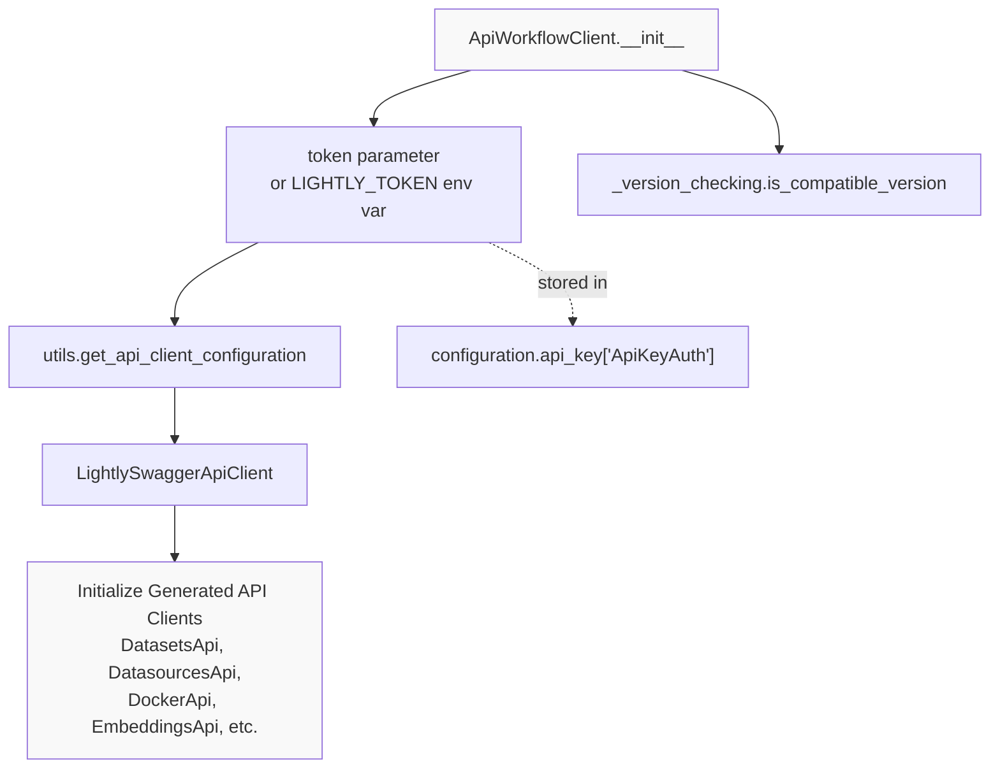
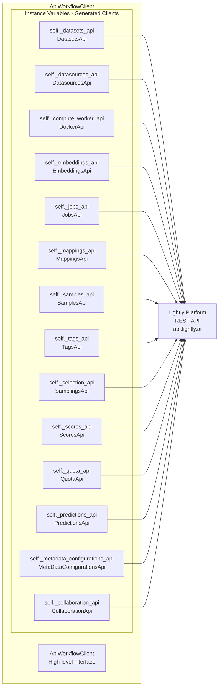
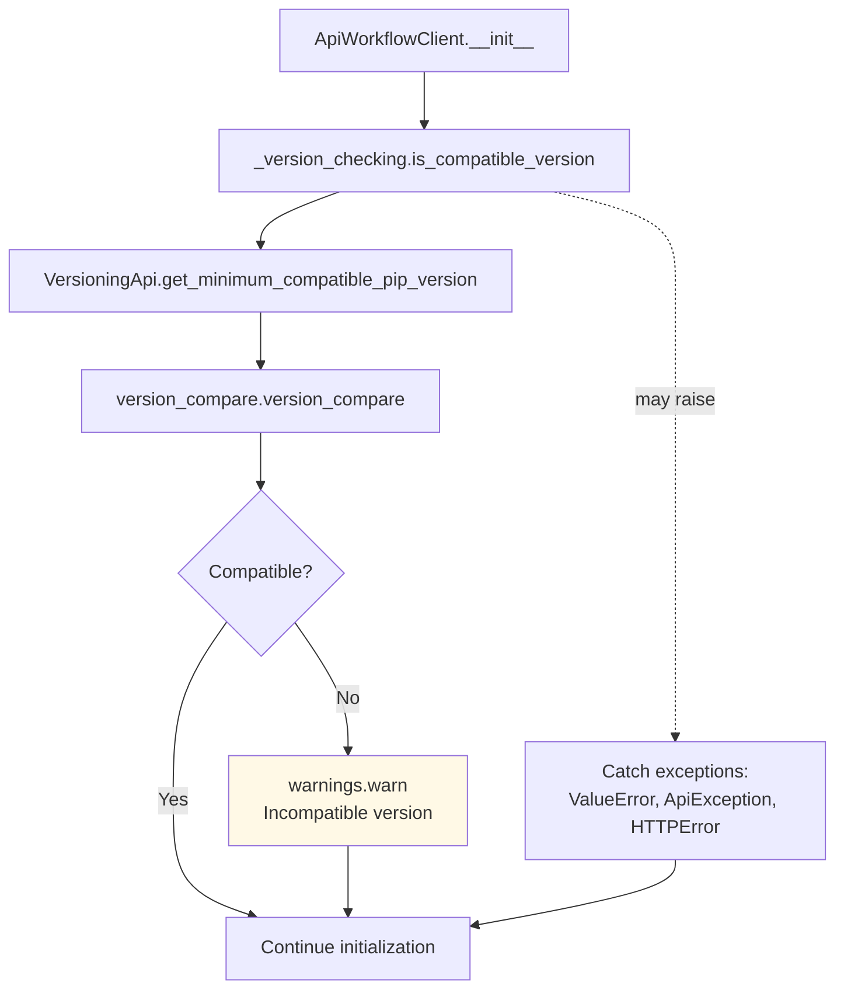
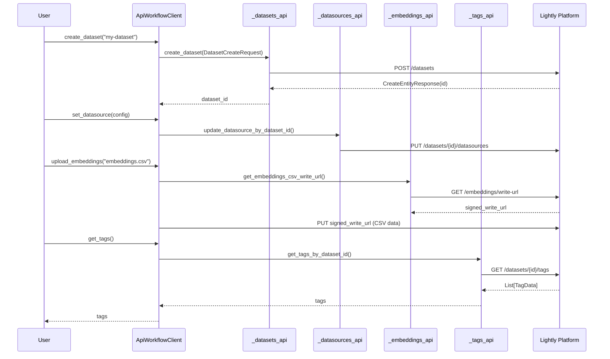

<!-- source: DeepWiki mcp.deepwiki.com · repo lightly-ai/lightly · page 6.1 API Workflow Client · fetched 2026-10-21 -->

# API Workflow Client

<details>
<summary>Relevant source files</summary>

The following files were used as context for generating this wiki page:

- [docs/source/lightly.models.rst](docs/source/lightly.models.rst)
- [lightly/__init__.py](lightly/__init__.py)
- [lightly/api/_version_checking.py](lightly/api/_version_checking.py)
- [lightly/api/api_workflow_client.py](lightly/api/api_workflow_client.py)
- [lightly/api/api_workflow_datasets.py](lightly/api/api_workflow_datasets.py)
- [tests/api/test_version_checking.py](tests/api/test_version_checking.py)
- [tests/api_workflow/mocked_api_workflow_client.py](tests/api_workflow/mocked_api_workflow_client.py)
- [tests/api_workflow/test_api_workflow.py](tests/api_workflow/test_api_workflow.py)
- [tests/api_workflow/test_api_workflow_client.py](tests/api_workflow/test_api_workflow_client.py)
- [tests/api_workflow/test_api_workflow_datasets.py](tests/api_workflow/test_api_workflow_datasets.py)
- [tests/conftest.py](tests/conftest.py)

</details>


The `ApiWorkflowClient` is the primary interface for communicating with the Lightly Platform API. It provides a unified Python interface for dataset management, datasource configuration, embedding uploads, compute worker orchestration, and data selection operations. The client uses a mixin-based architecture to organize functionality into logical domains and wraps auto-generated OpenAPI clients to provide a higher-level, workflow-oriented interface.

For information about compute worker operations specifically, see [Compute Workers](#6.2). For dataset and tag management operations, see [Dataset and Tag Management](#6.3). For datasource configuration, see [Datasources](#6.4).

## Client Initialization and Authentication

The `ApiWorkflowClient` is initialized with authentication credentials and optional context identifiers:

```python
from lightly.api import ApiWorkflowClient

# Initialize with token only
client = ApiWorkflowClient(token="YOUR_TOKEN")

# Initialize with specific dataset and embedding
client = ApiWorkflowClient(
    token="YOUR_TOKEN",
    dataset_id="dataset_xyz",
    embedding_id="embedding_xyz"
)
```

**Authentication**: The client requires a Lightly API token for authentication. The token can be provided explicitly or read from the `LIGHTLY_TOKEN` environment variable ([lightly/api/utils.py:74-80]()). The token is stored in the client configuration and passed to all API requests via the `ApiKeyAuth` authentication scheme ([lightly/api/api_workflow_client.py:120-124]()).

**Dataset Context**: The `dataset_id` parameter sets the default dataset for subsequent operations. If not provided, the client automatically selects the most recently modified dataset when a dataset ID is first needed ([lightly/api/api_workflow_client.py:149-171]()).

**Embedding Context**: The `embedding_id` parameter sets the default embedding for operations that require embeddings. Similar to dataset_id, it can be set during initialization or later ([lightly/api/api_workflow_client.py:127-128]()).

**Creator Tracking**: The optional `creator` parameter (default: `Creator.USER_PIP`) identifies the source of API operations for analytics purposes ([lightly/api/api_workflow_client.py:95-96]()).



**Initialization Flow**:

1. Retrieve token from parameter or `LIGHTLY_TOKEN` environment variable
2. Create API client configuration with token authentication
3. Perform version compatibility check (non-blocking, warns if incompatible)
4. Initialize `LightlySwaggerApiClient` with configuration
5. Set custom User-Agent header with platform information
6. Initialize all generated API clients (DatasetsApi, EmbeddingsApi, etc.)
7. Set dataset_id and embedding_id if provided

Sources: [lightly/api/api_workflow_client.py:90-147](), [lightly/api/utils.py:74-106]()

## Mixin-Based Architecture

The `ApiWorkflowClient` uses multiple inheritance from specialized mixin classes to organize functionality. Each mixin handles a specific domain of operations and maintains separation of concerns.

```mermaid
graph TB
    Client["ApiWorkflowClient"]
    
    subgraph "Functional Mixins"
        Embeddings["_UploadEmbeddingsMixin<br/>upload_embeddings()"]
        Selection["_SelectionMixin<br/>trigger_sampling()"]
        Download["_DownloadDatasetMixin<br/>download_dataset()"]
        Datasets["_DatasetsMixin<br/>create_dataset()<br/>get_datasets()"]
        Metadata["_UploadCustomMetadataMixin<br/>upload_custom_metadata()"]
        Tags["_TagsMixin<br/>create_tag()<br/>get_tags()"]
        Datasources["_DatasourcesMixin<br/>set_datasource()"]
        DatasourceListing["_DatasourceListingMixin<br/>list_datasource_samples()"]
        Worker["_ComputeWorkerMixin<br/>register_worker()<br/>schedule_run()"]
        Collab["_CollaborationMixin<br/>share_dataset()"]
        Predictions["_PredictionsMixin<br/>upload_predictions()"]
        Artifacts["_ArtifactsMixin<br/>download_artifacts()"]
        Export["_ExportDatasetMixin<br/>export_dataset()"]
    end
    
    Client -.inherits from.-> Embeddings
    Client -.inherits from.-> Selection
    Client -.inherits from.-> Download
    Client -.inherits from.-> Datasets
    Client -.inherits from.-> Metadata
    Client -.inherits from.-> Tags
    Client -.inherits from.-> Datasources
    Client -.inherits from.-> DatasourceListing
    Client -.inherits from.-> Worker
    Client -.inherits from.-> Collab
    Client -.inherits from.-> Predictions
    Client -.inherits from.-> Artifacts
    Client -.inherits from.-> Export
```



**Mixin Responsibilities**:

| Mixin | File | Primary Methods | Purpose |
|-------|------|-----------------|---------|
| `_UploadEmbeddingsMixin` | api_workflow_upload_embeddings.py | `upload_embeddings()` | Upload feature embeddings to platform |
| `_SelectionMixin` | api_workflow_selection.py | `trigger_sampling()` | Trigger data selection strategies |
| `_DownloadDatasetMixin` | api_workflow_download_dataset.py | `download_dataset()` | Download selected samples |
| `_DatasetsMixin` | api_workflow_datasets.py | `create_dataset()`, `get_datasets()` | Dataset lifecycle management |
| `_UploadCustomMetadataMixin` | api_workflow_upload_metadata.py | `upload_custom_metadata()` | Upload custom sample metadata |
| `_TagsMixin` | api_workflow_tags.py | `create_tag()`, `get_tags()` | Tag/selection management |
| `_DatasourcesMixin` | api_workflow_datasources.py | `set_datasource()` | Configure cloud storage connections |
| `_DatasourceListingMixin` | api_workflow_datasource_listing.py | `list_datasource_samples()` | List samples from datasources |
| `_ComputeWorkerMixin` | api_workflow_compute_worker.py | `register_worker()`, `schedule_run()` | Orchestrate compute workers |
| `_CollaborationMixin` | api_workflow_collaboration.py | `share_dataset()` | Dataset sharing operations |
| `_PredictionsMixin` | api_workflow_predictions.py | `upload_predictions()` | Upload model predictions |
| `_ArtifactsMixin` | api_workflow_artifacts.py | `download_artifacts()` | Download worker artifacts |
| `_ExportDatasetMixin` | api_workflow_export.py | `export_dataset()` | Export datasets in various formats |

Each mixin accesses the generated API clients initialized in the base `ApiWorkflowClient` class (e.g., `self._datasets_api`, `self._embeddings_api`).

Sources: [lightly/api/api_workflow_client.py:52-66](), [lightly/api/api_workflow_client.py:14-25]()

## Generated API Clients

The `ApiWorkflowClient` wraps multiple auto-generated API clients created from the Lightly OpenAPI specification. These generated clients handle low-level HTTP communication with the platform.



**Generated Client Initialization**: All generated API clients are instantiated in the `ApiWorkflowClient.__init__` method and stored as instance variables ([lightly/api/api_workflow_client.py:131-146]()):

- `self._datasets_api`: Dataset CRUD operations
- `self._datasources_api`: Datasource configuration
- `self._compute_worker_api`: Worker registration and run scheduling
- `self._embeddings_api`: Embedding upload/download
- `self._jobs_api`: Async job status monitoring
- `self._tags_api`: Tag/selection management
- `self._samples_api`: Sample-level operations
- `self._mappings_api`: Sample ID/filename mappings
- `self._selection_api`: Sampling/selection strategies
- `self._scores_api`: Active learning scores
- `self._quota_api`: Quota information
- `self._predictions_api`: Prediction upload/download
- `self._metadata_configurations_api`: Metadata configuration
- `self._collaboration_api`: Dataset sharing

**API Client Configuration**: All clients share the same `LightlySwaggerApiClient` instance ([lightly/api/api_workflow_client.py:121]()) which contains:
- Authentication token in `configuration.api_key["ApiKeyAuth"]`
- Custom User-Agent header with platform and Python version information
- Server location from configuration (defaults to api.lightly.ai)

Sources: [lightly/api/api_workflow_client.py:131-146](), [lightly/openapi_generated/swagger_client/api]()

## Core Properties and Concepts

### Dataset ID Management

The `dataset_id` property provides automatic dataset selection when not explicitly set:

```python
# Get dataset_id - auto-selects last modified if not set
dataset_id = client.dataset_id  

# Set dataset_id explicitly (validates existence)
client.dataset_id = "dataset_xyz"  

# Or set by name
client.set_dataset_id_by_name("my-dataset")
```

**Lazy Loading**: When `dataset_id` is accessed but not set, the client queries all accessible datasets, sorts by `last_modified_at`, and selects the most recent one ([lightly/api/api_workflow_client.py:149-171]()). A warning is issued indicating which dataset was automatically selected.

**Validation**: When setting `dataset_id` via the property setter, the client validates that the dataset exists by calling `self.dataset_exists()` ([lightly/api/api_workflow_client.py:173-189]()).

**Shared Datasets**: The `shared` parameter in dataset-related methods controls whether to include datasets shared with the user or owned by teams ([lightly/api/api_workflow_datasets.py:50-79]()):
- `shared=False`: Only datasets owned by the user
- `shared=True`: Only shared/team datasets (excludes user's own)
- `shared=None`: All accessible datasets

Sources: [lightly/api/api_workflow_client.py:148-190](), [lightly/api/api_workflow_datasets.py:15-80]()

### File Ordering and Synchronization

The client maintains filename ordering consistency between local and server representations:

**Filename Retrieval**: The `get_filenames()` method downloads the complete list of filenames from the server in canonical order ([lightly/api/api_workflow_client.py:216-234]()):

```python
filenames = client.get_filenames()  # Expensive operation for large datasets
```

**Reordering Utility**: The `_order_list_by_filenames()` method ensures local lists match server ordering ([lightly/api/api_workflow_client.py:191-214]()). This is used internally when uploading embeddings or other per-sample data to ensure correct alignment.

Sources: [lightly/api/api_workflow_client.py:191-234]()

### File Upload with Signed URLs

The `upload_file_with_signed_url()` method handles file uploads to cloud storage via pre-signed URLs:

```python
response = client.upload_file_with_signed_url(
    file=open("data.csv", "rb"),
    signed_write_url="https://...",
    headers={"custom": "header"}
)
```

**Server-Side Encryption Support**: The method automatically adds AWS S3 server-side encryption headers when the `LIGHTLY_S3_SSE_KMS_KEY` environment variable is set ([lightly/api/api_workflow_client.py:265-286]()):
- If set to `"true"`: Uses AWS-managed keys (AES256)
- If set to a KMS key ARN: Uses customer-managed KMS key

**Datasource Detection**: The method detects the destination storage type from the signed URL and only applies S3-specific headers for S3 destinations ([lightly/api/api_workflow_client.py:270-272]()).

Sources: [lightly/api/api_workflow_client.py:236-295](), [lightly/api/api_workflow_client.py:48-49]()

## Version Compatibility Checking

The client performs automatic version compatibility checking during initialization to ensure the installed `lightly` package is compatible with the Lightly Platform API.



**Check Process** ([lightly/api/api_workflow_client.py:97-118]()):

1. Call `_version_checking.is_compatible_version(__version__)` with current package version
2. Query platform API for minimum compatible version via `VersioningApi.get_minimum_compatible_pip_version()`
3. Compare current version against minimum version using semantic versioning
4. If incompatible, issue a `UserWarning` but continue initialization
5. If version check fails (network error, API error), silently continue

**Non-Blocking Design**: Version check failures are caught and ignored to prevent blocking client initialization in offline or restricted network environments ([lightly/api/api_workflow_client.py:108-118]()). The client remains functional even if version verification fails.

**Background Checking**: The package also performs a background version check on import to notify users of new releases without blocking ([lightly/__init__.py:83-92]()):

```python
# In lightly/__init__.py
if multiprocessing.current_process().name == "MainProcess":
    from lightly.api import _version_checking
    _version_checking.check_is_latest_version_in_background(
        current_version=__version__
    )
```

This spawns a daemon thread that checks for updates asynchronously.

Sources: [lightly/api/api_workflow_client.py:97-118](), [lightly/api/_version_checking.py:1-74](), [lightly/__init__.py:83-92]()

## Common Usage Patterns

### Dataset Creation and Selection

```python
from lightly.api import ApiWorkflowClient
from lightly.openapi_generated.swagger_client.models import DatasetType

# Create new dataset
client = ApiWorkflowClient(token="TOKEN")
client.create_dataset("my-dataset", dataset_type=DatasetType.IMAGES)

# Later session - connect to existing dataset
client = ApiWorkflowClient(token="TOKEN")
client.set_dataset_id_by_name("my-dataset")

# Create with unique name (auto-increment if exists)
client.create_new_dataset_with_unique_name("my-dataset")
```

**Dataset Query and Iteration** ([lightly/api/api_workflow_datasets.py:196-284]()):

```python
# Get all owned datasets
datasets = client.get_datasets(shared=False)

# Include shared/team datasets
all_datasets = client.get_datasets(shared=None)

# Iterate over datasets (memory efficient for large lists)
for dataset in client.get_datasets_iter(shared=False):
    print(dataset.name, dataset.id)

# Query by name
datasets = client.get_datasets_by_name("my-dataset", shared=False)
```

### Typical Workflow Sequence



This sequence shows a common workflow: creating a dataset, configuring its datasource, uploading embeddings for analysis, and retrieving tags (selections).

Sources: [lightly/api/api_workflow_datasets.py:354-426](), [lightly/api/api_workflow_client.py:90-147]()

## Error Handling and Validation

The client performs validation at multiple levels:

**Dataset Validation** ([lightly/api/api_workflow_datasets.py:26-48]()):
- `dataset_exists(dataset_id)`: Returns `True/False`, raises non-404 `ApiException`
- `dataset_name_exists(dataset_name)`: Checks name existence with configurable shared scope
- Setting `dataset_id` property validates existence and raises `ValueError` if not found

**Duplicate Prevention** ([lightly/api/api_workflow_datasets.py:392-398]()):
```python
# Raises ValueError if dataset already exists
client.create_dataset("existing-name")  

# Creates with incremented suffix if exists
client.create_new_dataset_with_unique_name("existing-name")  # -> "existing-name_1"
```

**Multiple Dataset Warning** ([lightly/api/api_workflow_datasets.py:339-352]()): When multiple datasets with the same name exist (due to sharing), `set_dataset_id_by_name()` issues a warning and uses the first match, suggesting to use `shared=False` to avoid ambiguity.

Sources: [lightly/api/api_workflow_datasets.py:26-509](), [lightly/openapi_generated/swagger_client/rest.py]()

## Testing Infrastructure

The client includes comprehensive mocking infrastructure for testing:

**MockedApiWorkflowClient** ([tests/api_workflow/mocked_api_workflow_client.py:1033-1900]()):
- Extends `ApiWorkflowClient` with mocked API implementations
- Replaces all generated API clients with mock versions
- Enables unit testing without network calls
- Simulates realistic API responses

**Mock API Implementations** include:
- `MockedDatasetsApi`: Dataset CRUD with in-memory storage
- `MockedEmbeddingsApi`: Simulated embedding upload/download
- `MockedTagsApi`: Tag management with predefined tags
- `MockedJobsApi`: Job status simulation with state transitions
- `MockedComputeWorkerApi`: Worker registration and run scheduling

Each mock maintains internal state to simulate realistic API behavior across multiple calls.

Sources: [tests/api_workflow/mocked_api_workflow_client.py:1-1900](), [tests/api_workflow/test_api_workflow.py:1-121]()

---

