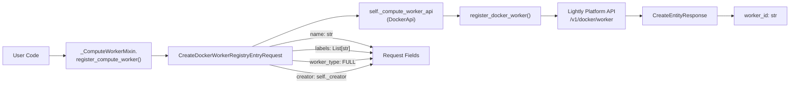
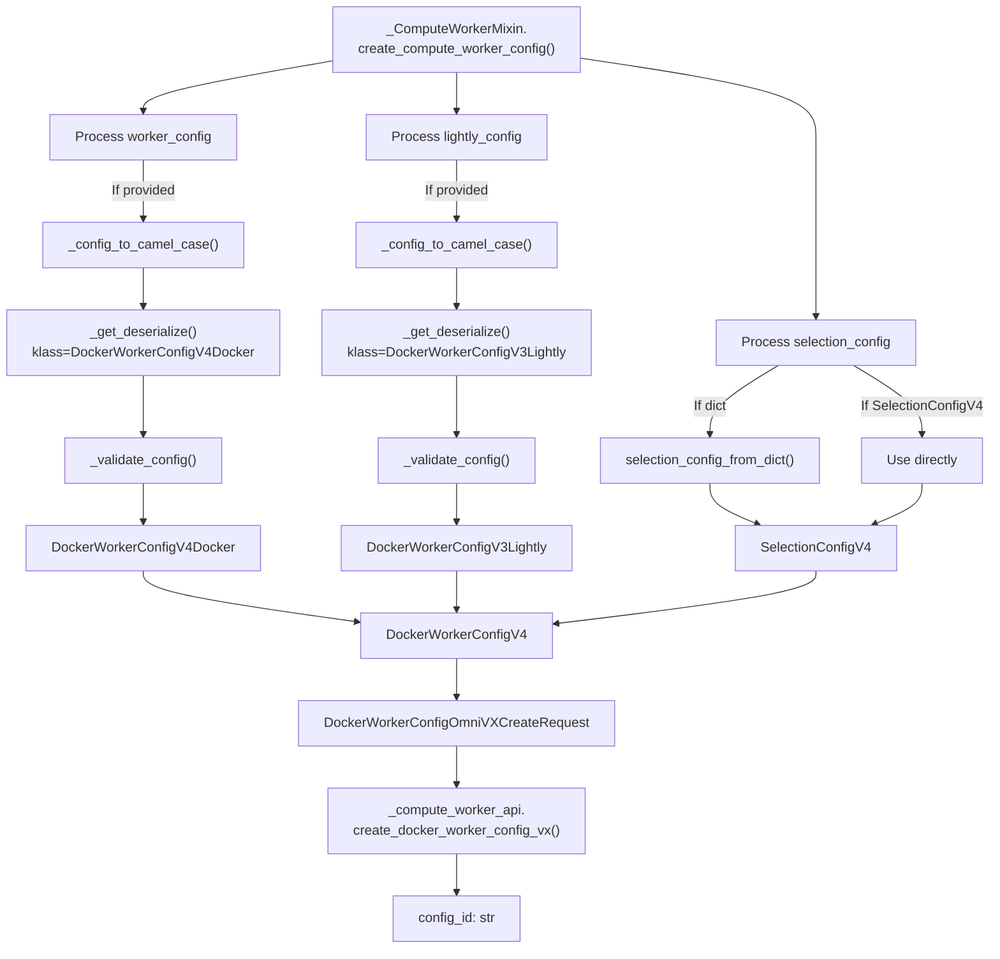
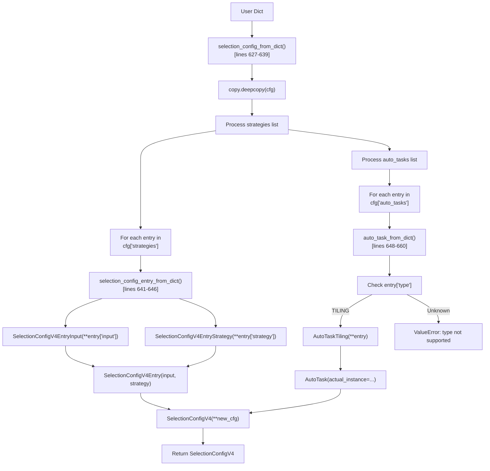
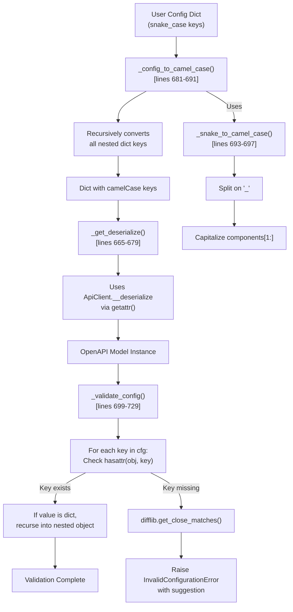
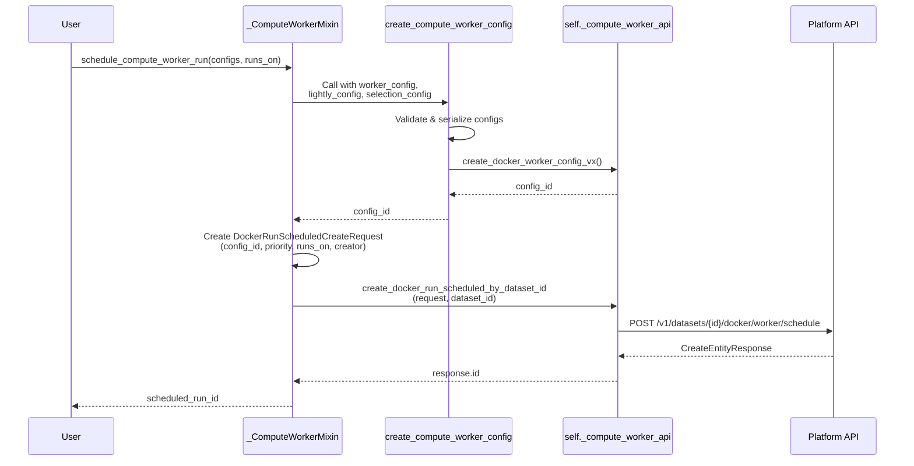
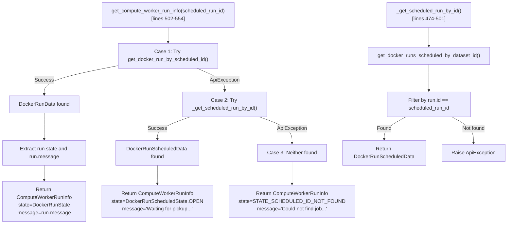
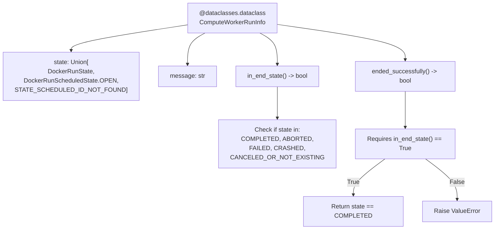
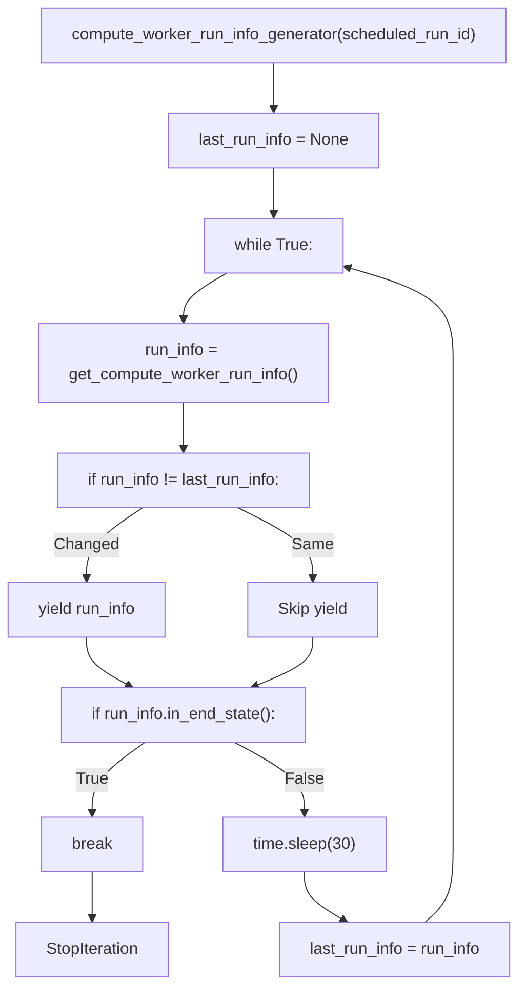
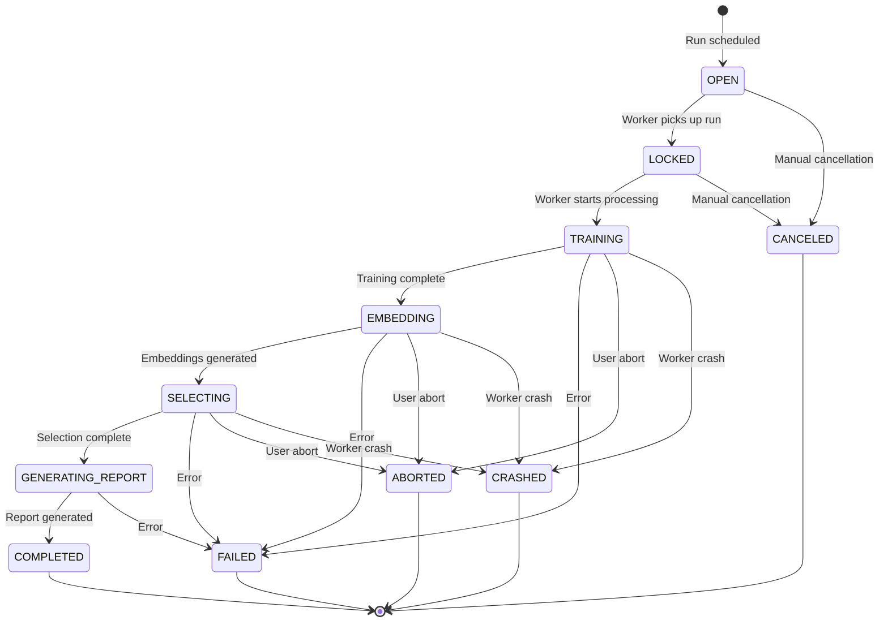
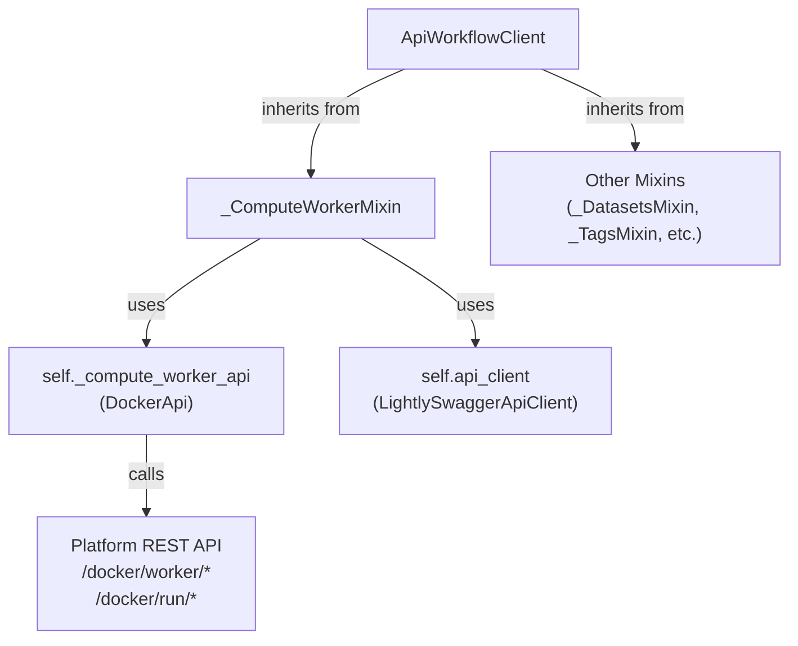

<!-- source: DeepWiki mcp.deepwiki.com · repo lightly-ai/lightly · page 6.2 Compute Workers · fetched 2026-10-21 -->

# Compute Workers

<details>
<summary>Relevant source files</summary>

The following files were used as context for generating this wiki page:

- [lightly/api/api_workflow_compute_worker.py](lightly/api/api_workflow_compute_worker.py)
- [lightly/openapi_generated/swagger_client/__init__.py](lightly/openapi_generated/swagger_client/__init__.py)
- [lightly/openapi_generated/swagger_client/api/datasets_api.py](lightly/openapi_generated/swagger_client/api/datasets_api.py)
- [lightly/openapi_generated/swagger_client/api/datasources_api.py](lightly/openapi_generated/swagger_client/api/datasources_api.py)
- [lightly/openapi_generated/swagger_client/api/docker_api.py](lightly/openapi_generated/swagger_client/api/docker_api.py)
- [lightly/openapi_generated/swagger_client/api/embeddings_api.py](lightly/openapi_generated/swagger_client/api/embeddings_api.py)
- [lightly/openapi_generated/swagger_client/api/samples_api.py](lightly/openapi_generated/swagger_client/api/samples_api.py)
- [lightly/openapi_generated/swagger_client/api/tags_api.py](lightly/openapi_generated/swagger_client/api/tags_api.py)
- [lightly/openapi_generated/swagger_client/models/__init__.py](lightly/openapi_generated/swagger_client/models/__init__.py)
- [lightly/openapi_generated/swagger_client/models/api_error_code.py](lightly/openapi_generated/swagger_client/models/api_error_code.py)
- [lightly/openapi_generated/swagger_client/models/create_sample_with_write_urls_response.py](lightly/openapi_generated/swagger_client/models/create_sample_with_write_urls_response.py)
- [tests/api_workflow/test_api_workflow_compute_worker.py](tests/api_workflow/test_api_workflow_compute_worker.py)

</details>


## Purpose and Scope

This page documents the Lightly Worker (formerly Docker Worker) integration within the `ApiWorkflowClient`, covering worker registration, configuration creation, run scheduling, status monitoring, and the complete lifecycle of worker runs. Workers are compute instances that execute data processing tasks (selection, embedding generation, active learning) on behalf of the Lightly Platform.

For information about other platform integration features, see:
- Dataset and tag management: [Dataset and Tag Management](#6.3)
- Datasource configuration: [Datasources](#6.4)
- Overall API client architecture: [API Workflow Client](#6.1)

**Sources:** [lightly/api/api_workflow_compute_worker.py:1-729]()

---

## Worker Registration and Management

### Worker Registration

Workers must be registered with the platform before they can execute runs. Registration creates a worker identity with a name and optional labels for run assignment.



**Worker Registration Flow**

The `_ComputeWorkerMixin` class provides these worker management methods:

| Method | Location | Parameters | Returns | Description |
|--------|----------|-----------|---------|-------------|
| `register_compute_worker` | [api_workflow_compute_worker.py:85-119]() | `name: str`, `labels: Optional[List[str]]` | `str` (worker ID) | Registers a new worker or returns existing worker ID if name already exists |
| `get_compute_worker_ids` | [api_workflow_compute_worker.py:121-135]() | None | `List[str]` | Fetches all registered worker IDs |
| `get_compute_workers` | [api_workflow_compute_worker.py:136-157]() | None | `List[DockerWorkerRegistryEntryData]` | Fetches detailed information about all workers |
| `delete_compute_worker` | [api_workflow_compute_worker.py:158-175]() | `worker_id: str` | `None` | Removes a registered worker |

**Sources:** [lightly/api/api_workflow_compute_worker.py:84-175]()

### Worker Labels and Assignment

Labels enable selective run assignment. Workers with matching labels can pick up scheduled runs that specify those labels via the `runs_on` parameter.

```python
# Register worker with labels
worker_id = client.register_compute_worker(
    name="gpu-worker-1",
    labels=["gpu", "high-memory"]
)

# Schedule run for specific worker labels
run_id = client.schedule_compute_worker_run(
    selection_config={...},
    runs_on=["gpu"]  # Only workers with "gpu" label can pick up this run
)
```

**Sources:** [lightly/api/api_workflow_compute_worker.py:85-119](), [lightly/api/api_workflow_compute_worker.py:258-323]()

---

## Configuration System

### Configuration Structure

Worker runs require three types of configuration, all managed by `create_compute_worker_config`:



**Configuration Processing Flow**

| Configuration | Purpose | Optional | Class | Validation |
|--------------|---------|----------|-------|-----------|
| `worker_config` | Controls worker behavior (pretagging, training) | Yes | `DockerWorkerConfigV4Docker` | Via `_validate_config` |
| `lightly_config` | Controls data loading and processing | Yes | `DockerWorkerConfigV3Lightly` | Via `_validate_config` |
| `selection_config` | Defines selection strategies and sample count | No | `SelectionConfigV4` | Via Pydantic validation |

**Sources:** [lightly/api/api_workflow_compute_worker.py:176-257]()

### Configuration Creation

The `create_compute_worker_config` method creates a configuration and returns its ID:

```python
config_id = client.create_compute_worker_config(
    worker_config={
        "training": {
            "task_name": "lightly_pretagging"
        }
    },
    lightly_config={
        "loader": {
            "batch_size": 64,
            "num_workers": 4
        }
    },
    selection_config={
        "n_samples": 20,
        "strategies": [
            {
                "input": {"type": "EMBEDDINGS"},
                "strategy": {"type": "DIVERSITY"}
            }
        ]
    }
)
```

**Sources:** [lightly/api/api_workflow_compute_worker.py:176-257]()

### Selection Configuration

The `selection_config_from_dict` function converts dictionary configurations to `SelectionConfigV4` instances:



**Selection Configuration Classes**

| Class | Location | Purpose |
|-------|----------|---------|
| `SelectionConfigV4` | [swagger_client/models]() | Top-level config with `n_samples`, `strategies`, `auto_tasks` |
| `SelectionConfigV4Entry` | [swagger_client/models]() | Single strategy with `input` and `strategy` |
| `SelectionConfigV4EntryInput` | [swagger_client/models]() | Input specification (type: EMBEDDINGS, SCORES, METADATA, etc.) |
| `SelectionConfigV4EntryStrategy` | [swagger_client/models]() | Strategy type (DIVERSITY, SIMILARITY, THRESHOLD, etc.) |
| `AutoTask` | [swagger_client/models]() | Wrapper for auto tasks (currently supports TILING) |
| `AutoTaskTiling` | [swagger_client/models]() | Tiling configuration with `num_rows`, `num_cols`, `overlap` |

**Sources:** [lightly/api/api_workflow_compute_worker.py:627-660]()

### Configuration Validation

Configuration validation occurs through three helper functions defined in `api_workflow_compute_worker.py`:



**Configuration Validation Functions**

| Function | Lines | Purpose | Key Operations |
|----------|-------|---------|----------------|
| `_snake_to_camel_case` | [693-697]() | Convert single key | `"batch_size"` → `"batchSize"` |
| `_config_to_camel_case` | [681-691]() | Convert entire dict | Recursively processes all keys |
| `_get_deserialize` | [665-679]() | Get deserializer | Returns `ApiClient.__deserialize` bound to target class |
| `_validate_config` | [699-729]() | Validate against schema | Uses `difflib` for suggestions on invalid keys |

**Sources:** [lightly/api/api_workflow_compute_worker.py:665-729]()

---

## Scheduling Runs

### Run Scheduling Process

The `schedule_compute_worker_run` method combines configuration creation with run scheduling:



**Run Scheduling Methods**

| Method | Lines | Returns | Description |
|--------|-------|---------|-------------|
| `schedule_compute_worker_run` | [258-323]() | `str` (scheduled run ID) | Creates config and schedules run in one operation |
| `create_compute_worker_config` | [176-257]() | `str` (config ID) | Creates reusable configuration |
| `get_scheduled_compute_worker_runs` | [436-473]() | `List[DockerRunScheduledData]` | Lists scheduled runs for current dataset |

**Sources:** [lightly/api/api_workflow_compute_worker.py:176-323](), [lightly/api/api_workflow_compute_worker.py:436-473]()

### Priority and Worker Assignment

Scheduled runs support priority levels and worker label matching:

```python
run_id = client.schedule_compute_worker_run(
    selection_config={...},
    priority=DockerRunScheduledPriority.HIGH,  # HIGH, MID, LOW
    runs_on=["gpu", "high-memory"]  # Worker must have ALL these labels
)
```

**Sources:** [lightly/api/api_workflow_compute_worker.py:258-323]()

---

## Monitoring Run Status

### Run Information Retrieval

The `get_compute_worker_run_info` method handles three database states:



**Run Status Methods**

| Method | Lines | Input | Returns | Description |
|--------|-------|-------|---------|-------------|
| `get_compute_worker_run_info` | [502-554]() | `scheduled_run_id: str` | `ComputeWorkerRunInfo` | Get current run status (handles 3 cases) |
| `_get_scheduled_run_by_id` | [474-501]() | `scheduled_run_id: str` | `DockerRunScheduledData` | Private: Find scheduled run by ID |
| `get_compute_worker_run` | [378-403]() | `run_id: str` | `DockerRunData` | Get run details by run ID |
| `get_compute_worker_run_from_scheduled_run` | [404-435]() | `scheduled_run_id: str` | `DockerRunData` | Get run details by scheduled run ID |
| `get_compute_worker_runs` | [349-377]() | `dataset_id: Optional[str]` | `List[DockerRunData]` | List all runs, optionally filtered by dataset |
| `get_compute_worker_runs_iter` | [324-348]() | `dataset_id: Optional[str]` | `Iterator[DockerRunData]` | Iterator version for pagination |
| `get_compute_worker_run_tags` | [598-625]() | `run_id: str` | `List[TagData]` | Get tags created by the run (version ≥2.4.2) |

**Sources:** [lightly/api/api_workflow_compute_worker.py:324-625]()

### ComputeWorkerRunInfo Dataclass

The `ComputeWorkerRunInfo` dataclass defined at [lines 42-82]() encapsulates run state:



**ComputeWorkerRunInfo Methods**

| Method | Lines | Returns | Behavior |
|--------|-------|---------|----------|
| `in_end_state()` | [58-67]() | `bool` | Returns `True` if `state` is COMPLETED, ABORTED, FAILED, CRASHED, or CANCELED_OR_NOT_EXISTING |
| `ended_successfully()` | [68-82]() | `bool` | Returns `True` if state is COMPLETED; raises `ValueError` if run still in progress |

**Constants**

- `STATE_SCHEDULED_ID_NOT_FOUND = "CANCELED_OR_NOT_EXISTING"` [line 35]() - Special state when neither DockerRun nor ScheduledRun exists

**Sources:** [lightly/api/api_workflow_compute_worker.py:35-82]()

### Continuous Monitoring

The `compute_worker_run_info_generator` method at [lines 555-597]() provides continuous status polling:



**Generator Behavior**

| Aspect | Implementation | Note |
|--------|----------------|------|
| Polling Interval | `time.sleep(30)` [line 594]() | 30 seconds minimum to prevent rate limiting |
| State Change Detection | `run_info != last_run_info` [line 586]() | Only yields when state or message changes |
| Exit Condition | `run_info.in_end_state()` [line 590]() | Stops on COMPLETED, FAILED, ABORTED, CRASHED, or NOT_FOUND |
| State Tracking | `last_run_info = run_info` [line 596]() | Remembers previous state to detect changes |

**Example Usage:**

```python
# Poll status every 30 seconds until completion
for run_info in client.compute_worker_run_info_generator(scheduled_run_id):
    print(f"State: {run_info.state}, Message: {run_info.message}")
    
# Generator automatically stops when run reaches end state
```

**Sources:** [lightly/api/api_workflow_compute_worker.py:555-597]()

---

## Run Lifecycle

### State Transitions



**Worker Run States**

### Scheduled Run States

| State | Description | End State |
|-------|-------------|-----------|
| `OPEN` | Run scheduled, waiting for worker pickup | No |
| `LOCKED` | Worker has claimed the run | No |
| `DONE` | Run processing complete (check DockerRun for actual outcome) | Yes |
| `CANCELED` | Run canceled before worker pickup | Yes |

**Sources:** [lightly/openapi_generated/swagger_client/models/docker_run_scheduled_state.py]()

### Docker Run States

| State | Description | End State | Success |
|-------|-------------|-----------|---------|
| `TRAINING` | Worker training models | No | - |
| `EMBEDDING` | Worker generating embeddings | No | - |
| `SELECTING` | Worker performing selection | No | - |
| `GENERATING_REPORT` | Worker creating report | No | - |
| `COMPLETED` | Run finished successfully | Yes | Yes |
| `FAILED` | Run failed with error | Yes | No |
| `ABORTED` | User aborted the run | Yes | No |
| `CRASHED` | Worker crashed during execution | Yes | No |

**Sources:** [lightly/api/api_workflow_compute_worker.py:42-82](), [lightly/openapi_generated/swagger_client/models/docker_run_state.py]()

### Three-State Lifecycle

The `get_compute_worker_run_info` method handles three distinct cases:

1. **DockerRun Exists**: Worker has picked up and started processing
   - Returns actual `DockerRunState` and message

2. **Only ScheduledRun Exists**: Run scheduled but not yet claimed
   - Returns `DockerRunScheduledState.OPEN`
   - Message: "Waiting for pickup by Lightly Worker..."

3. **Neither Exists**: Run canceled or never existed
   - Returns `STATE_SCHEDULED_ID_NOT_FOUND`
   - Message: "Could not find a job for the given run_id..."

**Sources:** [lightly/api/api_workflow_compute_worker.py:502-554]()

---

## Integration with ApiWorkflowClient

### Mixin Architecture

The `_ComputeWorkerMixin` class provides worker functionality to `ApiWorkflowClient`:



**Key Client Properties**

The mixin accesses shared client state:
- `self._compute_worker_api`: Instance of `DockerApi` for API calls
- `self.api_client`: Shared `ApiClient` for deserialization
- `self.dataset_id`: Current dataset context
- `self._creator`: Creator tag for audit trail (e.g., `Creator.USER_PIP`)

**Sources:** [lightly/api/api_workflow_client.py:52-147](), [lightly/api/api_workflow_compute_worker.py:84-729]()

### Complete Usage Example

```python
from lightly.api import ApiWorkflowClient

# Initialize client
client = ApiWorkflowClient(token="YOUR_TOKEN", dataset_id="YOUR_DATASET_ID")

# 1. Register worker
worker_id = client.register_compute_worker(
    name="my-worker",
    labels=["gpu"]
)

# 2. Schedule run
scheduled_run_id = client.schedule_compute_worker_run(
    worker_config={
        "pretagging": True
    },
    lightly_config={
        "loader": {
            "batch_size": 64
        }
    },
    selection_config={
        "n_samples": 100,
        "strategies": [
            {
                "input": {"type": "EMBEDDINGS"},
                "strategy": {"type": "DIVERSITY"}
            }
        ]
    },
    runs_on=["gpu"]
)

# 3. Monitor run
for run_info in client.compute_worker_run_info_generator(scheduled_run_id):
    print(f"{run_info.state}: {run_info.message}")

# 4. Check result
if run_info.ended_successfully():
    # Get tags created by the run
    tags = client.get_compute_worker_run_tags(run_id=scheduled_run_id)
    print(f"Created tags: {[tag.name for tag in tags]}")
```

**Sources:** [lightly/api/api_workflow_compute_worker.py:85-625](), [tests/api_workflow/test_api_workflow_compute_worker.py:61-201]()

---

## Error Handling

### Configuration Errors

Invalid configuration keys raise `InvalidConfigurationError` with suggestions:

```python
try:
    config_id = client.create_compute_worker_config(
        lightly_config={
            "loader": {
                "batch_siz": 64  # Typo: should be "batch_size"
            }
        }
    )
except InvalidConfigurationError as e:
    print(e)  # "Option 'batch_siz' does not exist! Did you mean 'batch_size'?"
```

**Sources:** [lightly/api/api_workflow_compute_worker.py:699-729]()

### API Errors

Run scheduling may raise `ApiException` with specific error codes:

| Status Code | Reason | Description |
|-------------|--------|-------------|
| 400 | Bad Request | Missing or invalid parameters |
| 402 | Payment Required | Insufficient plan for requested operation |
| 403 | Forbidden | Invalid token or unauthorized access |
| 404 | Not Found | Dataset or config not found |
| 422 | Unprocessable Entity | Missing or invalid file in datasource |

**Sources:** [lightly/api/api_workflow_compute_worker.py:258-323](), [tests/api_workflow/test_api_workflow_compute_worker.py:538-628]()

---

## Testing Support

### MockedComputeWorkerApi

The test infrastructure provides a mocked API for testing worker operations:

```python
class MockedComputeWorkerApi(DockerApi):
    def register_docker_worker(self, body, **kwargs):
        # Returns CreateEntityResponse with generated ID
        
    def get_docker_worker_registry_entries(self, **kwargs):
        # Returns list of registered workers
        
    def create_docker_worker_config_vx(self, body, **kwargs):
        # Returns config ID
        
    def create_docker_run_scheduled_by_dataset_id(self, request, dataset_id, **kwargs):
        # Returns scheduled run ID
        
    def get_docker_runs(self, page_size, page_offset, **kwargs):
        # Returns paginated runs
```

**Sources:** [tests/api_workflow/mocked_api_workflow_client.py:830-994]()

---

