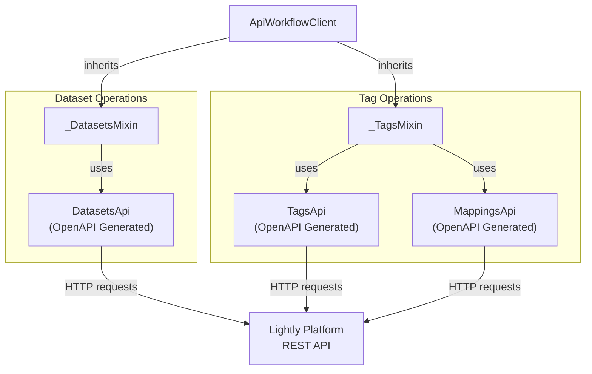
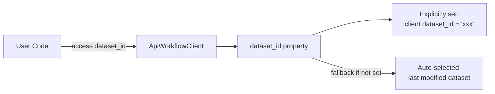
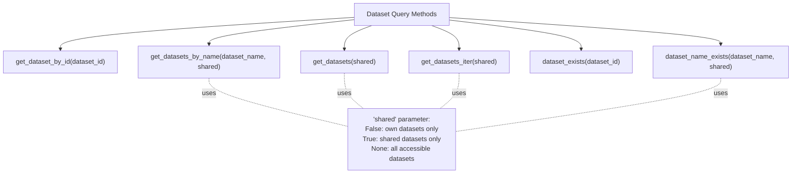
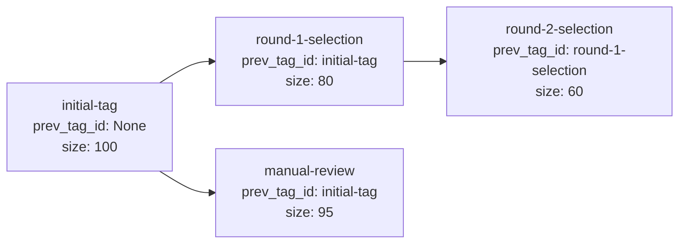
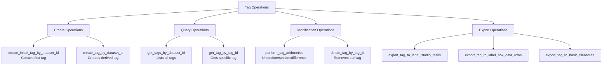
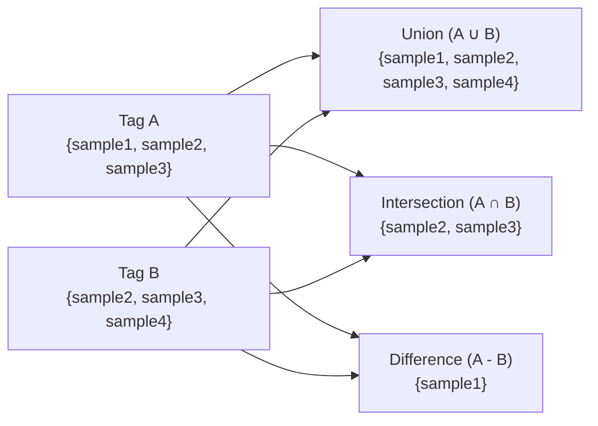
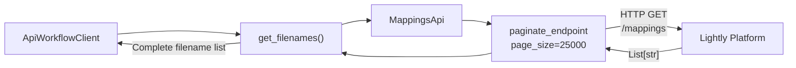
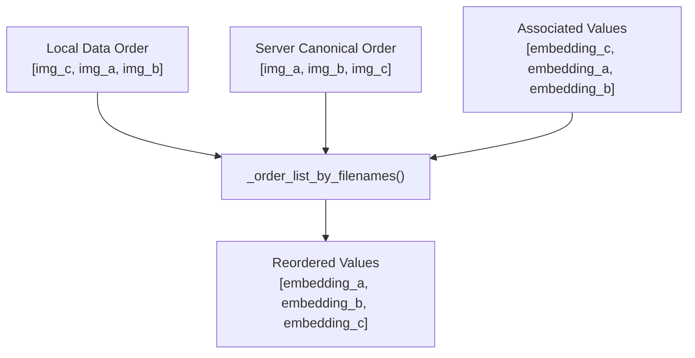
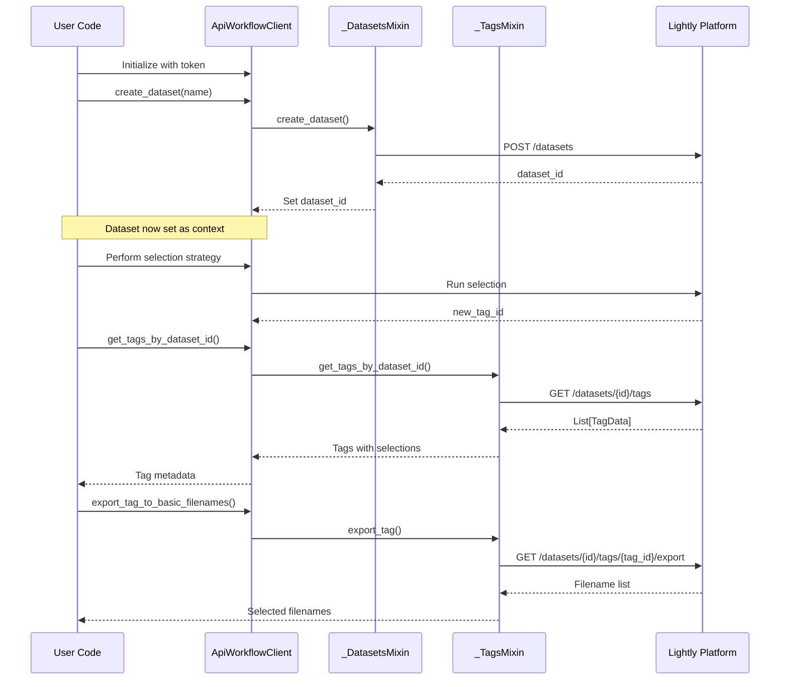

<!-- source: DeepWiki mcp.deepwiki.com · repo lightly-ai/lightly · page 6.3 Dataset and Tag Management · fetched 2026-10-21 -->

# Dataset and Tag Management

<details>
<summary>Relevant source files</summary>

The following files were used as context for generating this wiki page:

- [lightly/api/api_workflow_client.py](lightly/api/api_workflow_client.py)
- [lightly/api/api_workflow_datasets.py](lightly/api/api_workflow_datasets.py)
- [tests/api_workflow/mocked_api_workflow_client.py](tests/api_workflow/mocked_api_workflow_client.py)
- [tests/api_workflow/test_api_workflow.py](tests/api_workflow/test_api_workflow.py)
- [tests/api_workflow/test_api_workflow_datasets.py](tests/api_workflow/test_api_workflow_datasets.py)

</details>


This page documents dataset and tag management operations in the Lightly Platform through the `ApiWorkflowClient`. Datasets are containers that hold samples (images or videos), while tags represent named selections or subsets of samples within a dataset. These operations enable users to organize data, track sample selections from active learning or selection strategies, and export curated datasets for downstream tasks.

For information about configuring datasources to connect datasets to cloud storage, see [Datasources](#6.4). For uploading embeddings and running selection strategies, see [API Workflow Client](#6.1).

## Architecture Overview

The dataset and tag management functionality is implemented through a mixin-based architecture in the `ApiWorkflowClient`. The client delegates dataset operations to `_DatasetsMixin` and tag operations to `_TagsMixin`, which internally use OpenAPI-generated clients to communicate with the Lightly Platform REST API.



**Diagram: API Client Architecture for Dataset and Tag Management**

Sources: [lightly/api/api_workflow_client.py:52-66](), [lightly/api/api_workflow_client.py:131-142]()

## Dataset Management

### Dataset Data Model

A dataset in the Lightly Platform is represented by the `DatasetData` model, which contains metadata about the dataset including its ID, name, type, creation timestamp, and ownership information.

| Field | Type | Description |
|-------|------|-------------|
| `id` | `str` | Unique dataset identifier |
| `name` | `str` | Human-readable dataset name |
| `type` | `str` | Dataset type: `"Images"` or `"Videos"` |
| `created_at` | `int` | Unix timestamp of creation |
| `last_modified_at` | `int` | Unix timestamp of last modification |
| `user_id` | `str` | Owner user ID |
| `size_in_bytes` | `int` | Total size of dataset samples |
| `n_samples` | `int` | Number of samples in dataset |

Sources: [tests/api_workflow/mocked_api_workflow_client.py:525-537](), [lightly/openapi_generated/swagger_client/models]()

### Dataset Context in ApiWorkflowClient

The `ApiWorkflowClient` maintains a current dataset context through the `dataset_id` property. Once set, all subsequent operations automatically use this dataset unless explicitly overridden.



**Diagram: Dataset Context Resolution**

The `dataset_id` property implements lazy initialization. If not explicitly set, it queries all datasets and selects the most recently modified one, issuing a warning to the user.

Sources: [lightly/api/api_workflow_client.py:148-171](), [lightly/api/api_workflow_client.py:173-189]()

### Creating Datasets

#### create_dataset()

Creates a new dataset with a specified name. Raises `ValueError` if a dataset with the same name already exists.

```python
from lightly.api import ApiWorkflowClient
from lightly.openapi_generated.swagger_client.models import DatasetType

client = ApiWorkflowClient(token="YOUR_TOKEN")
client.create_dataset('my-dataset', dataset_type=DatasetType.IMAGES)
dataset_id = client.dataset_id  # Automatically set to new dataset
```

**Method signature:** [lightly/api/api_workflow_datasets.py:354-402]()

Sources: [lightly/api/api_workflow_datasets.py:354-402](), [tests/api_workflow/test_api_workflow_datasets.py:467-480]()

#### create_new_dataset_with_unique_name()

Creates a dataset with a unique name by appending a counter suffix if the base name already exists. This is useful for automated workflows that need to ensure unique dataset names without manual checking.

```python
# First call creates "experiment-1"
client.create_new_dataset_with_unique_name('experiment-1')

# Second call creates "experiment-1_1" since "experiment-1" exists
client.create_new_dataset_with_unique_name('experiment-1')
```

**Implementation details:** The method queries existing datasets with names starting with the basename, finds the highest numeric suffix, and creates a dataset with `basename_{max_suffix + 1}`.

Sources: [lightly/api/api_workflow_datasets.py:427-486](), [tests/api_workflow/test_api_workflow_datasets.py:133-149]()

### Querying Datasets

The API client provides multiple methods to query and retrieve dataset information, with support for shared datasets and team access.



**Diagram: Dataset Query Methods**

Sources: [lightly/api/api_workflow_datasets.py:81-104](), [lightly/api/api_workflow_datasets.py:106-194]()

#### Shared Dataset Access

The `shared` parameter controls which datasets are returned in query operations:

- `shared=False` (default): Returns only datasets owned by the current user
- `shared=True`: Returns datasets shared with the user and team datasets, excluding owned datasets
- `shared=None`: Returns all datasets the user has access to (owned + shared + team)

The implementation handles potential duplicates when `shared=None` by de-duplicating based on dataset IDs.

Sources: [lightly/api/api_workflow_datasets.py:196-248](), [tests/api_workflow/test_api_workflow_datasets.py:230-278]()

#### get_dataset_by_id()

Retrieves a single dataset by its unique identifier. Raises `ApiException` with status 404 if the dataset does not exist.

**Method signature:** [lightly/api/api_workflow_datasets.py:81-104]()

#### get_datasets_by_name()

Returns a list of datasets matching the specified name. Can return multiple datasets if shared access is enabled and multiple users have datasets with the same name.

**Method signature:** [lightly/api/api_workflow_datasets.py:106-194]()

Example:
```python
# Get only owned datasets
datasets = client.get_datasets_by_name('my-dataset', shared=False)

# Get all datasets with this name (owned + shared)
all_datasets = client.get_datasets_by_name('my-dataset', shared=None)
```

Sources: [lightly/api/api_workflow_datasets.py:106-194](), [tests/api_workflow/test_api_workflow_datasets.py:280-398]()

#### get_datasets() and get_datasets_iter()

Returns all datasets accessible to the user. The `get_datasets_iter()` method returns an iterator for memory-efficient processing of large dataset lists, while `get_datasets()` returns a complete list.

**Implementation note:** Both methods use pagination internally through `utils.paginate_endpoint()` to handle large result sets.

Sources: [lightly/api/api_workflow_datasets.py:196-284](), [tests/api_workflow/test_api_workflow_datasets.py:230-278]()

### Setting Dataset Context

#### set_dataset_id_by_name()

Sets the current dataset context by name rather than ID. This is useful when starting a new session and you know the dataset name but not its ID.

```python
client = ApiWorkflowClient(token="YOUR_TOKEN")
client.set_dataset_id_by_name('existing-dataset')
# Future operations now use this dataset automatically
```

If multiple datasets with the same name exist (e.g., shared datasets), the method uses the first match and emits a warning.

Sources: [lightly/api/api_workflow_datasets.py:300-352](), [tests/api_workflow/test_api_workflow_datasets.py:401-464]()

### Deleting Datasets

#### delete_dataset_by_id()

Permanently deletes a dataset from the Lightly Platform. This operation also clears the `dataset_id` property from the client instance.

**Warning:** This operation is irreversible and will delete all samples, tags, embeddings, and other data associated with the dataset.

Sources: [lightly/api/api_workflow_datasets.py:488-508](), [tests/api_workflow/test_api_workflow_datasets.py:219-227]()

### Dataset Type Property

The `dataset_type` property returns the type of the current dataset (`"Images"` or `"Videos"`). This is a read-only property that queries the platform for the current dataset's type.

Sources: [lightly/api/api_workflow_datasets.py:16-24](), [tests/api_workflow/test_api_workflow_datasets.py:211-216]()

## Tag Management

Tags represent named subsets or selections of samples within a dataset. They are the primary mechanism for tracking which samples have been selected by active learning strategies, manual curation, or automated selection algorithms.

### Tag Data Model

A tag is represented by the `TagData` model with the following key fields:

| Field | Type | Description |
|-------|------|-------------|
| `id` | `str` | Unique tag identifier |
| `dataset_id` | `str` | Parent dataset ID |
| `name` | `str` | Human-readable tag name |
| `prev_tag_id` | `str` | Previous tag ID (for tag history) |
| `bit_mask_data` | `str` | Hexadecimal bitmask of selected samples |
| `tot_size` | `int` | Number of samples in the tag |
| `created_at` | `int` | Unix timestamp of creation |

Sources: [tests/api_workflow/mocked_api_workflow_client.py:217-256]()

### Tag Hierarchy and History

Tags form a directed acyclic graph (DAG) where each tag can reference a previous tag through `prev_tag_id`. This enables tracking the evolution of sample selections over time, particularly useful in active learning loops.



**Diagram: Tag Hierarchy Example**

Sources: [tests/api_workflow/mocked_api_workflow_client.py:217-256]()

### Tag Operations via TagsApi

The `_TagsMixin` provides high-level tag management operations by wrapping the `TagsApi` OpenAPI client. Key operations include:



**Diagram: Tag Operations Through TagsApi**

Sources: [tests/api_workflow/mocked_api_workflow_client.py:188-418](), [lightly/api/api_workflow_tags.py]()

### Creating Tags

#### Initial Tag Creation

The initial tag typically includes all samples in a dataset and serves as the root of the tag hierarchy. It's created using `create_initial_tag_by_dataset_id()`.

**API Method:** [tests/api_workflow/mocked_api_workflow_client.py:189-196]()

#### Creating Derived Tags

New tags are created through selection strategies or manual operations. Each new tag references a previous tag and contains a bitmask indicating which samples are included.

**API Method:** [tests/api_workflow/mocked_api_workflow_client.py:296-310]()

Sources: [tests/api_workflow/mocked_api_workflow_client.py:189-310]()

### Querying Tags

#### get_tags_by_dataset_id()

Returns all tags for a dataset. Tags are returned as a list of `TagData` objects containing metadata and the bitmask representation of selected samples.

Example mock response structure:
```python
[
    TagData(id="tag-1", name="initial-tag", tot_size=100, prev_tag_id=None),
    TagData(id="tag-2", name="selection-1", tot_size=75, prev_tag_id="tag-1"),
    TagData(id="tag-3", name="selection-2", tot_size=50, prev_tag_id="tag-2")
]
```

**API Method:** [tests/api_workflow/mocked_api_workflow_client.py:214-270]()

#### get_tag_by_tag_id()

Retrieves detailed information about a specific tag including its bitmask, size, and ancestry.

**API Method:** [tests/api_workflow/mocked_api_workflow_client.py:198-212]()

Sources: [tests/api_workflow/mocked_api_workflow_client.py:188-270]()

### Tag Arithmetic Operations

Tag arithmetic enables creating new tag selections by combining existing tags using set operations (union, intersection, difference). The `perform_tag_arithmetics()` method accepts a `TagArithmeticsRequest` specifying the operation and operand tags.



**Diagram: Tag Arithmetic Operations**

The method can either return a bitmask result (if `new_tag_name` is not provided) or create a new persisted tag (if `new_tag_name` is provided).

Sources: [tests/api_workflow/mocked_api_workflow_client.py:272-287]()

### Tag Export Operations

Tags can be exported to various formats for integration with labeling tools and downstream workflows.

#### Export Formats

| Export Method | Format | Use Case |
|--------------|--------|----------|
| `export_tag_to_label_studio_tasks()` | Label Studio JSON | Integration with Label Studio annotation tool |
| `export_tag_to_label_box_data_rows()` | LabelBox JSON (v3) | Integration with LabelBox Classic |
| `export_tag_to_label_box_v4_data_rows()` | LabelBox JSON (v4) | Integration with LabelBox Editor |
| `export_tag_to_basic_filenames_and_read_urls()` | Filename + URL pairs | Programmatic access with read URLs |
| `export_tag_to_basic_filenames()` | Plain text filenames | Simple filename list |

All export methods support pagination through `page_offset` parameters to handle large tag selections.

Sources: [tests/api_workflow/mocked_api_workflow_client.py:320-418]()

#### Label Studio Export

Exports tag samples as Label Studio tasks with full sample metadata:

```python
[
    {
        "id": 0,
        "data": {
            "image": "https://api.lightly.ai/v1/datasets/{dataset_id}/samples/{sample_id}/readurlRedirect?type=full",
            "lightly_file_name": "image_001.jpg",
            "lightly_meta_info": {
                "id": "sample_id_0",
                "type": "IMAGE",
                "file_name": "image_001.jpg",
                "meta_data": {
                    "sharpness": 27.31,
                    "size_in_bytes": 48224,
                    ...
                }
            }
        }
    }
]
```

**API Method:** [tests/api_workflow/mocked_api_workflow_client.py:320-369]()

#### Basic Filename Export

Returns a simple newline-separated list of filenames:

```
IMG_2276_jpeg_jpg.rf.7411b1902c81bad8cdefd2cc4eb3a97b.jpg
IMG_2285_jpeg_jpg.rf.4a93d99b9f0b6cccfb27bf2f4a13b99e.jpg
IMG_2274_jpeg_jpg.rf.2f319e949748145fb22dcb52bb325a0c.jpg
```

**API Method:** [tests/api_workflow/mocked_api_workflow_client.py:408-417]()

Sources: [tests/api_workflow/mocked_api_workflow_client.py:320-418]()

### Deleting Tags

#### delete_tag_by_tag_id()

Deletes a tag from the dataset. The implementation enforces that only leaf tags (tags with no children) can be deleted, preventing orphaned tag hierarchies.

**Validation logic:**
1. Verify tag exists in dataset
2. Verify no other tags reference this tag as their `prev_tag_id`
3. Delete if validation passes

Sources: [tests/api_workflow/mocked_api_workflow_client.py:312-318]()

## Sample Filename Mapping

The `get_filenames()` method retrieves the ordered list of sample filenames from the server. This is a critical operation for maintaining sample order consistency across the platform and local operations.



**Diagram: Filename Mapping Retrieval**

**Warning:** This operation is expensive for large datasets as it downloads all filenames. The results should be cached when possible.

**Implementation:** The method uses pagination with a page size of 25,000 to handle datasets of any size. It internally calls `_mappings_api.get_sample_mappings_by_dataset_id()` with field `"fileName"`.

Sources: [lightly/api/api_workflow_client.py:216-234](), [tests/api_workflow/mocked_api_workflow_client.py:431-444]()

## Sample Ordering

The `_order_list_by_filenames()` method reorders a list of values to match the server's canonical sample order. This is essential when uploading embeddings or predictions to ensure they align with the platform's sample indices.

**Use case:** When generating embeddings locally with shuffled data loaders, this method reorders the embeddings to match the server's filename order before upload.



**Diagram: Sample Reordering Process**

The method uses `reordering.sort_items_by_keys()` utility to perform the reordering and validates that all server filenames are present in the provided filename list.

Sources: [lightly/api/api_workflow_client.py:191-214](), [tests/api_workflow/test_api_workflow.py:59-120]()

## Integration Pattern

The typical workflow for dataset and tag management follows this pattern:



**Diagram: Typical Dataset and Tag Management Workflow**

Sources: [lightly/api/api_workflow_client.py:52-146](), [lightly/api/api_workflow_datasets.py]()

---

