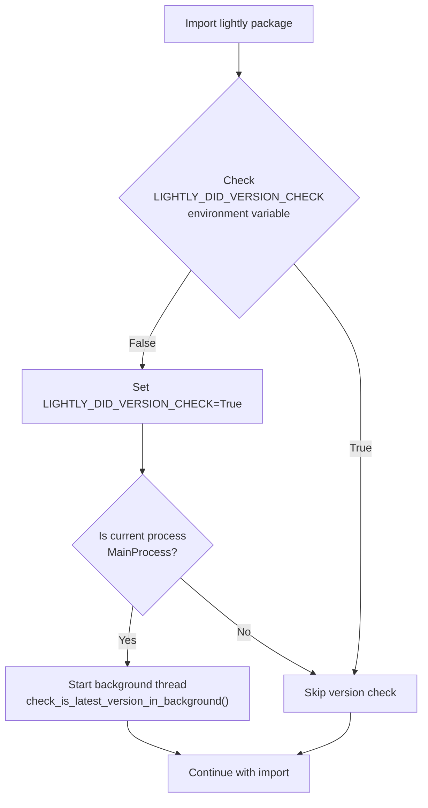
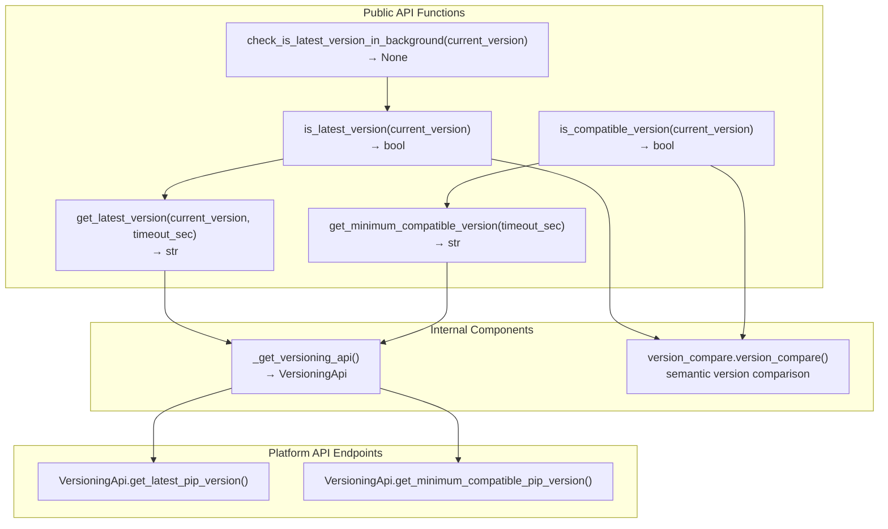
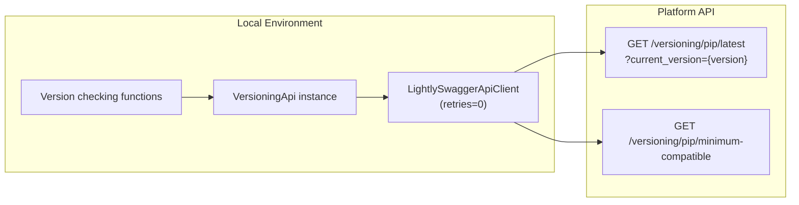
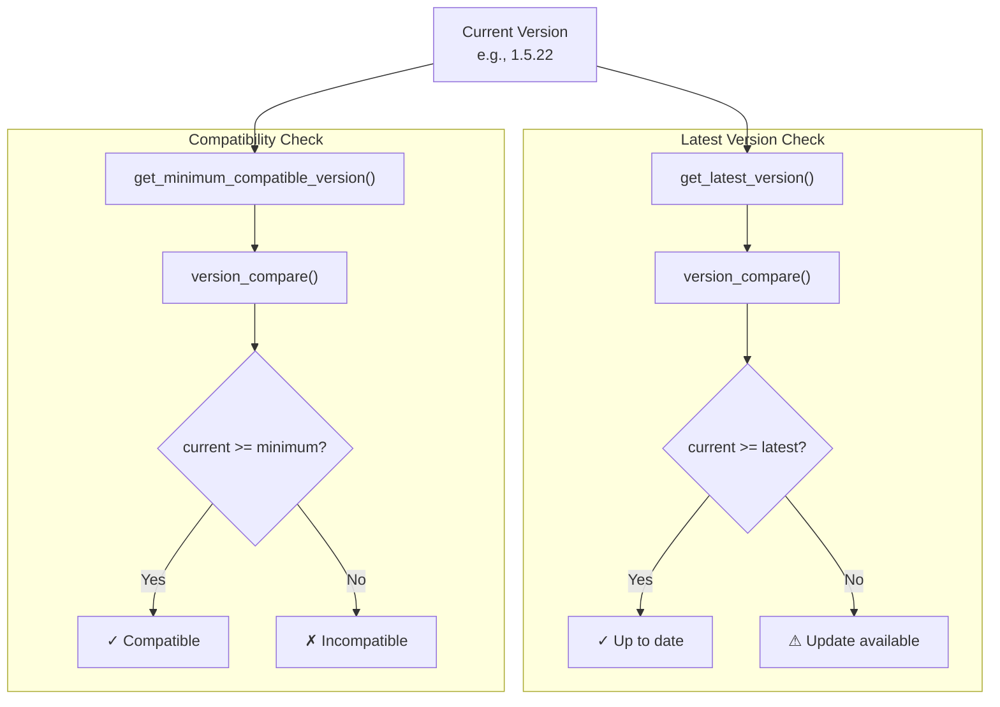
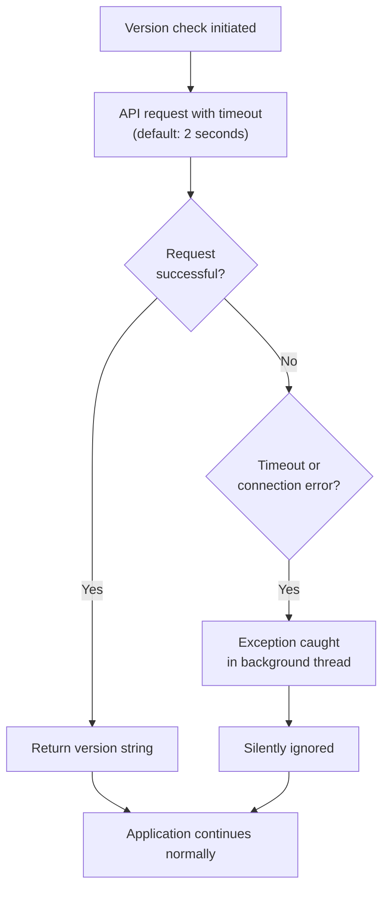

<!-- source: DeepWiki mcp.deepwiki.com · repo lightly-ai/lightly · page 6.5 Version Checking and Compatibility · fetched 2026-10-21 -->

# Version Checking and Compatibility

<details>
<summary>Relevant source files</summary>

The following files were used as context for generating this wiki page:

- [docs/source/lightly.models.rst](docs/source/lightly.models.rst)
- [lightly/__init__.py](lightly/__init__.py)
- [lightly/api/_version_checking.py](lightly/api/_version_checking.py)
- [tests/api/test_version_checking.py](tests/api/test_version_checking.py)
- [tests/api_workflow/test_api_workflow_client.py](tests/api_workflow/test_api_workflow_client.py)
- [tests/conftest.py](tests/conftest.py)

</details>


## Purpose and Scope

This document describes the automatic version checking and compatibility verification mechanisms built into the Lightly framework. When the `lightly` package is imported, it automatically verifies that the installed version is up-to-date and compatible with the Lightly Platform API. This helps ensure smooth integration between local code and cloud services.

For information about the broader platform integration architecture, see [Platform Integration](#6).

## Automatic Version Check on Import

The Lightly package performs an automatic background version check when imported. This check runs only once per Python process and executes in a separate thread to avoid blocking the main application.

### Version Check Initialization Flow



**Initialization Sequence**

The version check initialization occurs in the package's `__init__.py` module:

| Step | Component | Action |
|------|-----------|--------|
| 1 | Environment Check | Check `LIGHTLY_DID_VERSION_CHECK` variable |
| 2 | Flag Setting | Set environment variable to `"True"` |
| 3 | Process Check | Verify running in main process via `multiprocessing.current_process().name` |
| 4 | Thread Spawn | Call `check_is_latest_version_in_background()` with current version |

**Sources:** [lightly/__init__.py:83-92]()

## Version Checking Functions

The `lightly.api._version_checking` module provides programmatic access to version verification functions.



### Core Version Checking Functions

The module provides the following functions for version verification:

**`is_latest_version(current_version: str) -> bool`**

Compares the current version against the latest released version available on PyPI. Returns `True` if the current version is greater than or equal to the latest version.

**`is_compatible_version(current_version: str) -> bool`**

Verifies that the current version meets the minimum compatibility requirements for the Lightly Platform API. Returns `True` if the current version is greater than or equal to the minimum compatible version.

**`get_latest_version(current_version: str, timeout_sec: float = 2) -> str`**

Retrieves the latest version number from the Lightly Platform API. The `current_version` parameter is sent to the API for tracking purposes. The default timeout is 2 seconds.

**`get_minimum_compatible_version(timeout_sec: float = 2) -> str`**

Retrieves the minimum compatible version number from the Lightly Platform API. This represents the oldest version that can successfully interact with the current API.

**`check_is_latest_version_in_background(current_version: str) -> None`**

Spawns a daemon thread to check if the current version is the latest. Silently catches and ignores any exceptions to avoid disrupting the application. This is the function called during package import.

**Sources:** [lightly/api/_version_checking.py:12-63]()

## API Version Endpoints

The version checking system communicates with two Lightly Platform API endpoints through the generated `VersioningApi` client.



### API Client Configuration

The `_get_versioning_api()` function creates a specialized API client for version checking:

| Configuration | Value | Purpose |
|--------------|-------|---------|
| Authentication | No token required | Version check works without authentication |
| Retries | 0 | Fail fast on timeout rather than retrying |
| Timeout | 2 seconds (default) | Quick response to avoid blocking |
| Server Location | From `LIGHTLY_SERVER_LOCATION` env var | Configurable endpoint |

**Sources:** [lightly/api/_version_checking.py:65-73]()

## Version Information in API Requests

When an `ApiWorkflowClient` instance is created, the client automatically includes version and platform information in its User-Agent header.

### User-Agent Header Format

```
Lightly/{version} ({system}/{release}; {platform}; {processor};) python/{python_version}
```

**Header Components:**

| Component | Source | Example |
|-----------|--------|---------|
| `version` | `lightly.__version__` | `1.5.22` |
| `system` | `platform.system()` | `Linux`, `Darwin`, `Windows` |
| `release` | `platform.release()` | `5.15.0-58-generic` |
| `platform` | `platform.platform()` | `Linux-5.15.0-58-generic-x86_64-with-glibc2.35` |
| `processor` | `platform.processor()` | `x86_64` |
| `python_version` | `platform.python_version()` | `3.10.6` |

This information helps the Lightly Platform track client versions and diagnose compatibility issues.

**Sources:** [tests/api_workflow/test_api_workflow_client.py:86-102]()

## Disabling Version Checks

The version check can be disabled by setting the `LIGHTLY_DID_VERSION_CHECK` environment variable before importing the `lightly` package.

### Disabling in Application Code

```python
import os
os.environ["LIGHTLY_DID_VERSION_CHECK"] = "True"

import lightly  # Version check will be skipped
```

### Disabling in Tests

The test suite automatically disables version checking in the pytest configuration hook:

**Sources:** [tests/conftest.py:23-28]()

### Use Cases for Disabling

| Scenario | Reason |
|----------|--------|
| Unit Testing | Avoid network calls and speed up test execution |
| CI/CD Pipelines | Prevent timeouts in isolated build environments |
| Offline Usage | Work without internet connectivity |
| Debugging | Eliminate version check as potential source of issues |

## Compatibility Requirements

The Lightly framework uses semantic versioning to determine compatibility between the local package and the Lightly Platform API.

### Version Comparison Logic



### Version Comparison Rules

The `version_compare()` utility function performs semantic version comparison following these rules:

- Returns positive value if `current_version > compared_version`
- Returns zero if `current_version == compared_version`
- Returns negative value if `current_version < compared_version`

**Compatibility Guarantees:**

| Current Version | Minimum Compatible | Latest | Status |
|----------------|-------------------|--------|--------|
| 1.5.22 | 1.5.0 | 1.5.22 | ✓ Up-to-date and compatible |
| 1.5.22 | 1.5.0 | 1.5.25 | ⚠ Compatible but update available |
| 1.4.8 | 1.5.0 | 1.5.25 | ✗ Incompatible - must upgrade |

**Sources:** [lightly/api/_version_checking.py:12-21](), [tests/api/test_version_checking.py:20-40]()

## Error Handling and Timeouts

The version checking system is designed to fail gracefully without disrupting application functionality.

### Timeout Behavior



### Exception Handling

| Exception Type | Context | Handling |
|---------------|---------|----------|
| Connection errors | Network unavailable | Silently ignored in background check |
| Timeout errors | API unresponsive | Request aborted after timeout period |
| Invalid URL | Incorrect `LIGHTLY_SERVER_LOCATION` | Raises `MaxRetryError` |
| Any exception | Background thread | Caught and ignored to prevent crashes |

The background version check wraps all operations in a try-except block that catches and ignores any exceptions, ensuring that version checking failures never prevent the application from running.

**Sources:** [lightly/api/_version_checking.py:47-62](), [tests/api/test_version_checking.py:49-76]()

## Testing Considerations

The version checking system includes special provisions for testing environments.

### Test Mocking Strategy

The test suite uses a module-scoped fixture to mock version checking API calls:

**Mock Behavior:**

| Mocked Method | Return Value | Purpose |
|--------------|--------------|---------|
| `get_latest_pip_version()` | Current version parameter | Simulates up-to-date installation |
| `get_minimum_compatible_pip_version()` | `"1.0.0"` | Ensures all versions appear compatible |

This approach avoids actual network calls during testing while maintaining test coverage of version-dependent logic.

**Sources:** [tests/conftest.py:44-72]()

### Environment Variable Configuration

Tests can override the API server location using the `LIGHTLY_SERVER_LOCATION` environment variable:

```python
os.environ["LIGHTLY_SERVER_LOCATION"] = "https://dummy-url"
```

This allows testing of timeout behavior and error handling without requiring actual API connectivity.

**Sources:** [tests/conftest.py:31](), [tests/api/test_version_checking.py:50, 70]()

---

