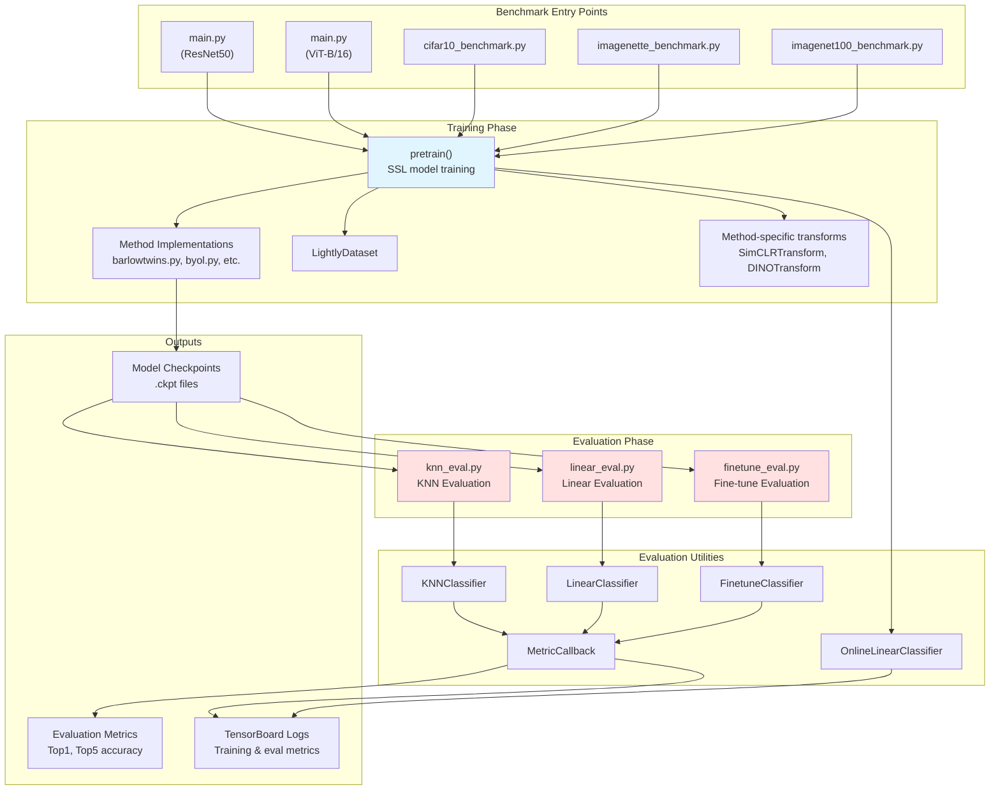

<!-- source: DeepWiki mcp.deepwiki.com · repo lightly-ai/lightly · page 7 Benchmarking · fetched 2026-10-21 -->

# Benchmarking

<details>
<summary>Relevant source files</summary>

The following files were used as context for generating this wiki page:

- [README.md](README.md)
- [benchmarks/imagenet/resnet50/finetune_eval.py](benchmarks/imagenet/resnet50/finetune_eval.py)
- [benchmarks/imagenet/resnet50/knn_eval.py](benchmarks/imagenet/resnet50/knn_eval.py)
- [benchmarks/imagenet/resnet50/linear_eval.py](benchmarks/imagenet/resnet50/linear_eval.py)
- [benchmarks/imagenet/resnet50/main.py](benchmarks/imagenet/resnet50/main.py)
- [benchmarks/imagenet/vitb16/dino.py](benchmarks/imagenet/vitb16/dino.py)
- [benchmarks/imagenet/vitb16/finetune_eval.py](benchmarks/imagenet/vitb16/finetune_eval.py)
- [benchmarks/imagenet/vitb16/knn_eval.py](benchmarks/imagenet/vitb16/knn_eval.py)
- [benchmarks/imagenet/vitb16/linear_eval.py](benchmarks/imagenet/vitb16/linear_eval.py)
- [benchmarks/imagenet/vitb16/main.py](benchmarks/imagenet/vitb16/main.py)
- [docs/source/getting_started/benchmarks.rst](docs/source/getting_started/benchmarks.rst)
- [docs/source/getting_started/benchmarks/cifar10_benchmark.py](docs/source/getting_started/benchmarks/cifar10_benchmark.py)
- [docs/source/getting_started/benchmarks/imagenet100_benchmark.py](docs/source/getting_started/benchmarks/imagenet100_benchmark.py)
- [docs/source/getting_started/benchmarks/imagenette_benchmark.py](docs/source/getting_started/benchmarks/imagenette_benchmark.py)
- [lightly/utils/benchmarking/knn_classifier.py](lightly/utils/benchmarking/knn_classifier.py)
- [tests/utils/benchmarking/test_knn_classifier.py](tests/utils/benchmarking/test_knn_classifier.py)

</details>


The Lightly framework provides a comprehensive benchmarking infrastructure for evaluating self-supervised learning (SSL) methods on standard datasets. This page documents the benchmark scripts, evaluation protocols, and supporting utilities used to measure model performance and compare SSL methods.

For information about specific SSL model implementations, see [Self-Supervised Learning Models](#2). For details on training models using the CLI or Python API, see [Command-Line Interface](#4) and [Python API](#5).

## Purpose and Scope

The benchmarking system enables:
- Standardized evaluation of SSL methods on ImageNet1k, ImageNet100, Imagenette, and CIFAR-10
- Three evaluation protocols: kNN classification, linear evaluation, and fine-tuning
- Reproducible results with documented hyperparameters and training settings
- Support for both ResNet and Vision Transformer backbones
- Distributed training and multi-GPU evaluation

## Benchmark Architecture

The benchmarking infrastructure follows a modular design with separate components for pre-training, evaluation, and metrics tracking.



**Sources:** [benchmarks/imagenet/resnet50/main.py:1-323](), [benchmarks/imagenet/vitb16/main.py:1-304](), [benchmarks/imagenet/resnet50/knn_eval.py:1-106]()

## Supported Datasets

The benchmarking infrastructure supports four standard datasets with different characteristics and use cases.

| Dataset | Classes | Train Images | Val Images | Image Size | Benchmark Script |
|---------|---------|--------------|------------|------------|------------------|
| ImageNet1k | 1000 | 1,281,167 | 50,000 | 224×224 | `benchmarks/imagenet/resnet50/main.py` |
| ImageNet100 | 100 | 130,000 | 5,000 | 224×224 | `docs/source/getting_started/benchmarks/imagenet100_benchmark.py` |
| Imagenette | 10 | 9,469 | 3,925 | 160→128 | `docs/source/getting_started/benchmarks/imagenette_benchmark.py` |
| CIFAR-10 | 10 | 50,000 | 10,000 | 32×32 | `docs/source/getting_started/benchmarks/cifar10_benchmark.py` |

**Dataset Selection Guidelines:**
- **ImageNet1k**: Standard benchmark for comparing with published SSL papers. Training takes ~4 days on 2×4090 GPUs for 100 epochs.
- **ImageNet100**: Faster alternative (20-30 hours) for development and hyperparameter tuning.
- **Imagenette**: Quick validation (3-5 hours) for testing implementations.
- **CIFAR-10**: Small-scale testing with modified ResNet-18 architecture (3×3 initial convolution, no MaxPool).

**Sources:** [docs/source/getting_started/benchmarks.rst:14-219](), [README.md:285-327]()

## Evaluation Protocols

Benchmarks use three standardized evaluation protocols to measure learned representation quality. Each protocol freezes or fine-tunes different parts of the model.

```mermaid
graph LR
    subgraph "kNN Evaluation"
        KNN_INPUT["Test Image"]
        KNN_BACKBONE["Backbone<br/>(frozen)"]
        KNN_FEATURES["Features"]
        KNN_SEARCH["k-Nearest<br/>Neighbors"]
        KNN_PRED["Prediction"]
        
        KNN_INPUT --> KNN_BACKBONE
        KNN_BACKBONE --> KNN_FEATURES
        KNN_FEATURES --> KNN_SEARCH
        KNN_SEARCH --> KNN_PRED
    end
    
    subgraph "Linear Evaluation"
        LIN_INPUT["Train Image"]
        LIN_BACKBONE["Backbone<br/>(frozen)"]
        LIN_FEATURES["Features"]
        LIN_HEAD["Linear Head<br/>(trainable)"]
        LIN_PRED["Prediction"]
        
        LIN_INPUT --> LIN_BACKBONE
        LIN_BACKBONE --> LIN_FEATURES
        LIN_FEATURES --> LIN_HEAD
        LIN_HEAD --> LIN_PRED
    end
    
    subgraph "Fine-tune Evaluation"
        FT_INPUT["Train Image"]
        FT_BACKBONE["Backbone<br/>(trainable)"]
        FT_FEATURES["Features"]
        FT_HEAD["Linear Head<br/>(trainable)"]
        FT_PRED["Prediction"]
        
        FT_INPUT --> FT_BACKBONE
        FT_BACKBONE --> FT_FEATURES
        FT_FEATURES --> FT_HEAD
        FT_HEAD --> FT_PRED
    end
    
    style KNN_BACKBONE fill:#e1f5ff
    style LIN_BACKBONE fill:#e1f5ff
    style FT_BACKBONE fill:#ffe1e1
    style LIN_HEAD fill:#ffe1e1
    style FT_HEAD fill:#ffe1e1
```



**Sources:** [benchmarks/imagenet/resnet50/knn_eval.py:17-106](), [benchmarks/imagenet/resnet50/linear_eval.py:17-119](), [benchmarks/imagenet/resnet50/finetune_eval.py:17-119]()

### kNN Evaluation

The k-Nearest Neighbors evaluation protocol provides a parameter-free assessment of representation quality. It follows InstDisc [arxiv:1805.01978] settings.

**Configuration:**
- **k (neighbors)**: 200 for ImageNet1k, 20 for ImageNet100, 200 for CIFAR-10
- **Temperature**: 0.1 for ResNet, 0.07 for ViT
- **Feature normalization**: L2 normalization applied
- **No training required**: Uses training set as memory bank

**Implementation:** The `KNNClassifier` class at [lightly/utils/benchmarking/knn_classifier.py:13-170]() implements the evaluation:

```python
# Key components of KNN evaluation
classifier = KNNClassifier(
    model=model,           # Pre-trained SSL model
    num_classes=num_classes,
    knn_k=200,            # Number of neighbors
    knn_t=0.1,            # Temperature for reweighting
)

# Two-pass evaluation:
# Pass 1: Extract features from training set
# Pass 2: Classify validation samples using kNN
trainer.validate(
    model=classifier,
    dataloaders=[train_dataloader, val_dataloader],
)
```

**Process:**
1. Extract features from all training images using frozen backbone
2. Store features in memory bank on GPU/CPU
3. For each validation image, find k nearest neighbors in feature space
4. Weight neighbors by temperature-scaled cosine similarity
5. Predict class via weighted voting

**Sources:** [benchmarks/imagenet/resnet50/knn_eval.py:17-106](), [lightly/utils/benchmarking/knn_classifier.py:13-170]()

### Linear Evaluation

Linear evaluation trains a linear classifier on top of frozen features, following SimCLR settings.

**Configuration (ResNet):**
- **Epochs**: 90
- **Optimizer**: SGD
- **Learning rate**: 0.1 (base) × batch_size / 256
- **Momentum**: 0.9
- **Weight decay**: 0.0
- **LR schedule**: Cosine annealing without warmup
- **Backbone**: Frozen

**Configuration (ViT with MAE):**
- **Epochs**: 90
- **Optimizer**: LARS
- **Learning rate**: Scaled by batch size
- **Weight decay**: 0.0
- **LR schedule**: Cosine with 10-epoch warmup
- **Additional**: BatchNorm layer before classification head

**Implementation Details:**

The `LinearClassifier` class freezes the backbone and trains only the classification head:

```python
classifier = LinearClassifier(
    model=model,
    batch_size_per_device=batch_size_per_device,
    feature_dim=model.online_classifier.feature_dim,
    num_classes=num_classes,
)
```

For MAE models, a specialized `LinearClassifierMAE` variant adds BatchNorm before the linear layer and uses LARS optimizer at [benchmarks/imagenet/vitb16/linear_eval.py:20-72]().

**Sources:** [benchmarks/imagenet/resnet50/linear_eval.py:17-119](), [benchmarks/imagenet/vitb16/linear_eval.py:74-174]()

### Fine-tuning Evaluation

Fine-tuning evaluation trains both the backbone and classification head, following SimCLR settings for ResNet and MAE settings for ViT.

**Configuration (ResNet):**
- **Epochs**: 30
- **Optimizer**: SGD
- **Learning rate**: 0.05 (base) × batch_size / 256
- **Momentum**: 0.9
- **Weight decay**: 0.0
- **LR schedule**: Cosine annealing without warmup

**Configuration (ViT with MAE):**
- **Epochs**: 100
- **Optimizer**: AdamW with layer-wise learning rate decay (0.65)
- **Base learning rate**: 5e-4
- **Weight decay**: 0.05 (varies by layer)
- **Augmentation**: RandAugment, Mixup, CutMix
- **Stochastic depth**: 0.1
- **LR schedule**: Cosine with 5-epoch warmup

**MAE-specific Features:**

The `FinetuneClassifierMAE` class at [benchmarks/imagenet/vitb16/finetune_eval.py:28-142]() implements advanced techniques:
- **Mixup and CutMix**: Data augmentation applied during training
- **Layer-wise LR decay**: Different learning rates for each ViT layer
- **Stochastic depth**: Path dropout added to ViT blocks

**Sources:** [benchmarks/imagenet/resnet50/finetune_eval.py:17-119](), [benchmarks/imagenet/vitb16/finetune_eval.py:28-269]()

## Running Benchmarks

### ImageNet Benchmarks

The main ImageNet benchmark scripts support both ResNet50 and ViT-B/16 backbones with multiple SSL methods.

**ResNet50 Benchmark:**

```bash
cd benchmarks/imagenet/resnet50
python main.py \
    --train-dir /datasets/imagenet/train \
    --val-dir /datasets/imagenet/val \
    --batch-size-per-device 128 \
    --epochs 100 \
    --devices 2 \
    --accelerator gpu \
    --methods simclr byol dino
```

**ViT-B/16 Benchmark:**

```bash
cd benchmarks/imagenet/vitb16
python main.py \
    --train-dir /datasets/imagenet/train \
    --val-dir /datasets/imagenet/val \
    --batch-size-per-device 128 \
    --epochs 100 \
    --devices 2 \
    --eval-method mae \
    --methods mae dino ibot
```

**Key Parameters:**
- `--methods`: Space-separated list of SSL methods to benchmark
- `--batch-size-per-device`: Batch size per GPU (total = devices × batch_size_per_device)
- `--epochs`: Training epochs (0 to skip pre-training and only evaluate)
- `--ckpt-path`: Path to pre-trained checkpoint for evaluation-only runs
- `--skip-knn-eval`, `--skip-linear-eval`, `--skip-finetune-eval`: Skip specific evaluation protocols
- `--strategy`: PyTorch Lightning strategy (default: `ddp_find_unused_parameters_true`)

**Available Methods:**

ResNet50: `barlowtwins`, `byol`, `dcl`, `dclw`, `dino`, `mocov2`, `simclr`, `swav`, `tico`, `vicreg`

ViT-B/16: `dino`, `dinov2`, `ibot`, `mae`, `aim`

**Sources:** [benchmarks/imagenet/resnet50/main.py:48-86](), [benchmarks/imagenet/vitb16/main.py:31-60]()

### CIFAR-10, Imagenette, and ImageNet100 Benchmarks

Smaller dataset benchmarks use standalone Python scripts with embedded configuration.

**CIFAR-10 Example:**

```python
# Edit configuration in cifar10_benchmark.py
max_epochs = 200
batch_size = 128
models = [SimCLRModel, BYOLModel, DINOModel]

# Run benchmark
python docs/source/getting_started/benchmarks/cifar10_benchmark.py
```

**Key Configuration Variables:**
- `max_epochs`: Training duration
- `batch_size`: Batch size for training
- `knn_k`, `knn_t`: kNN evaluation parameters
- `distributed`: Enable distributed training
- `sync_batchnorm`: Synchronize batch norm across GPUs
- `gather_distributed`: Gather features across GPUs for loss computation

**Sources:** [docs/source/getting_started/benchmarks/cifar10_benchmark.py:101-139](), [docs/source/getting_started/benchmarks/imagenette_benchmark.py:119-162]()

## Benchmark Workflow

The benchmark execution follows a consistent workflow across all datasets and methods.

```mermaid
flowchart TD
    START["Start Benchmark"]
    INIT["Initialize Method<br/>Load backbone, heads"]
    
    PRETRAIN_CHECK{"epochs > 0?"}
    PRETRAIN["Pre-training Phase<br/>pretrain()"]
    LOAD_CKPT["Load Checkpoint<br/>--ckpt-path"]
    
    TRAIN_DATA["Setup Training Data<br/>LightlyDataset + Transform"]
    TRAINER["PyTorch Lightning Trainer<br/>with callbacks"]
    TRAIN_LOOP["Training Loop<br/>self-supervised loss"]
    ONLINE_EVAL["Online Classification<br/>OnlineLinearClassifier"]
    SAVE_CKPT["Save Checkpoint"]
    
    KNN_CHECK{"skip_knn_eval?"}
    KNN_EVAL["kNN Evaluation<br/>knn_eval()"]
    
    LINEAR_CHECK{"skip_linear_eval?"}
    LINEAR_EVAL["Linear Evaluation<br/>linear_eval()"]
    
    FINETUNE_CHECK{"skip_finetune_eval?"}
    FINETUNE_EVAL["Fine-tune Evaluation<br/>finetune_eval()"]
    
    METRICS["Aggregate Metrics<br/>Top1, Top5"]
    REPORT["Print Results<br/>Markdown table"]
    END["End Benchmark"]
    
    START --> INIT
    INIT --> PRETRAIN_CHECK
    
    PRETRAIN_CHECK -->|Yes| PRETRAIN
    PRETRAIN_CHECK -->|No| LOAD_CKPT
    
    PRETRAIN --> TRAIN_DATA
    TRAIN_DATA --> TRAINER
    TRAINER --> TRAIN_LOOP
    TRAIN_LOOP --> ONLINE_EVAL
    ONLINE_EVAL --> SAVE_CKPT
    
    LOAD_CKPT --> KNN_CHECK
    SAVE_CKPT --> KNN_CHECK
    
    KNN_CHECK -->|No| KNN_EVAL
    KNN_CHECK -->|Yes| LINEAR_CHECK
    KNN_EVAL --> LINEAR_CHECK
    
    LINEAR_CHECK -->|No| LINEAR_EVAL
    LINEAR_CHECK -->|Yes| FINETUNE_CHECK
    LINEAR_EVAL --> FINETUNE_CHECK
    
    FINETUNE_CHECK -->|No| FINETUNE_EVAL
    FINETUNE_CHECK -->|Yes| METRICS
    FINETUNE_EVAL --> METRICS
    
    METRICS --> REPORT
    REPORT --> END
    
    style PRETRAIN fill:#e1f5ff
    style KNN_EVAL fill:#ffe1e1
    style LINEAR_EVAL fill:#ffe1e1
    style FINETUNE_EVAL fill:#ffe1e1
```



**Sources:** [benchmarks/imagenet/resnet50/main.py:88-208](), [benchmarks/imagenet/vitb16/main.py:63-188]()

## Metrics and Logging

### Metric Tracking

The `MetricCallback` class tracks metrics during training and evaluation:

```python
from lightly.utils.benchmarking import MetricCallback

metric_callback = MetricCallback()
trainer = Trainer(callbacks=[metric_callback])
trainer.fit(model, train_dataloader, val_dataloader)

# Access metrics
max_top1 = max(metric_callback.val_metrics["val_top1"])
max_top5 = max(metric_callback.val_metrics["val_top5"])
```

**Tracked Metrics:**
- `train_loss`: Self-supervised training loss
- `val_online_cls_top1`, `val_online_cls_top5`: Online classifier accuracy during pre-training
- `val_top1`, `val_top5`: Evaluation protocol accuracy (kNN, linear, fine-tune)

**Sources:** [benchmarks/imagenet/resnet50/main.py:258-286](), [lightly/utils/benchmarking/knn_classifier.py:158-164]()

### Online Classification

During pre-training, an online linear classifier tracks representation quality without interrupting training:

```python
from lightly.utils.benchmarking import OnlineLinearClassifier

self.online_classifier = OnlineLinearClassifier(
    feature_dim=384,
    num_classes=num_classes
)

# In training_step
cls_loss, cls_log = self.online_classifier.training_step(
    (features.detach(), targets), batch_idx
)
self.log_dict(cls_log)
```

This provides early feedback on model quality and helps detect training issues.

**Sources:** [benchmarks/imagenet/vitb16/dino.py:35-91]()

### TensorBoard Logging

All benchmarks log to TensorBoard for visualization:

```python
trainer = Trainer(
    logger=TensorBoardLogger(
        save_dir=str(log_dir),
        name="pretrain"  # or "knn_eval", "linear_eval", "finetune_eval"
    )
)
```

**Log Structure:**
```
benchmark_logs/
  method_name/
    2024-01-15_10-30-45/
      pretrain/
        version_0/
          events.out.tfevents.*
          checkpoints/
            epoch=99-step=500400.ckpt
      knn_eval/
        version_0/
          events.out.tfevents.*
      linear_eval/
        version_0/
          events.out.tfevents.*
      finetune_eval/
        version_0/
          events.out.tfevents.*
```

**Sources:** [benchmarks/imagenet/resnet50/main.py:270](), [benchmarks/imagenet/resnet50/knn_eval.py:84]()

## Benchmark Results Format

The benchmark scripts output results in markdown table format for easy documentation:

```python
def eval_metrics_to_markdown(metrics: Dict[str, Dict[str, float]]) -> str:
    """Convert evaluation metrics to markdown table."""
    # Example output:
    # | Eval Name | Metric Name | Value |
    # |:----------|:------------|:------|
    # | knn       | val_top1    | 67.50 |
    # | knn       | val_top5    | 89.70 |
    # | linear    | val_top1    | 73.30 |
    # | linear    | val_top5    | 91.30 |
    # | finetune  | val_top1    | 79.80 |
    # | finetune  | val_top5    | 95.00 |
```

**Sources:** [benchmarks/imagenet/resnet50/main.py:288-318](), [benchmarks/imagenet/vitb16/main.py:269-299]()

## Implementation Notes

### Distributed Training

Benchmarks support distributed training via PyTorch Lightning:

```python
trainer = Trainer(
    devices=2,                          # Number of GPUs
    accelerator="gpu",
    strategy="ddp_find_unused_parameters_true",
    sync_batchnorm=True,               # Sync BN across GPUs
)

# Loss functions support distributed gather
criterion = NTXentLoss(gather_distributed=True)
```

**Sources:** [benchmarks/imagenet/resnet50/main.py:259-274]()

### Memory Optimization

For large-scale benchmarks, several optimizations reduce memory usage:

1. **Feature dtype reduction:** kNN classifier supports `torch.float16` features
2. **Persistent workers:** Reuse dataloader workers across epochs
3. **No sanity validation:** Set `num_sanity_val_steps=0` to save memory
4. **Gradient checkpointing:** Can be enabled for ViT models

**Sources:** [lightly/utils/benchmarking/knn_classifier.py:43-46](), [benchmarks/imagenet/vitb16/main.py:255]()

### Custom Backbones

Benchmarks can be extended with custom backbones by implementing the method interface:

```python
# Method must provide:
# - model: LightningModule with forward() method
# - transform: Data augmentation transform

METHODS = {
    "custom_method": {
        "model": CustomModel,
        "transform": CustomTransform(),
    }
}
```

**Sources:** [benchmarks/imagenet/resnet50/main.py:71-85]()

---

