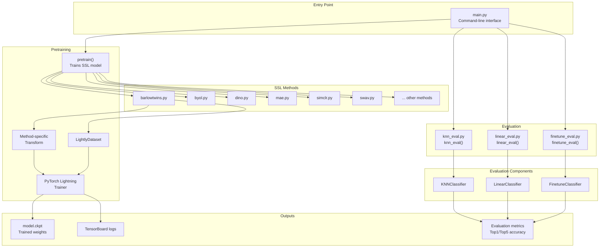
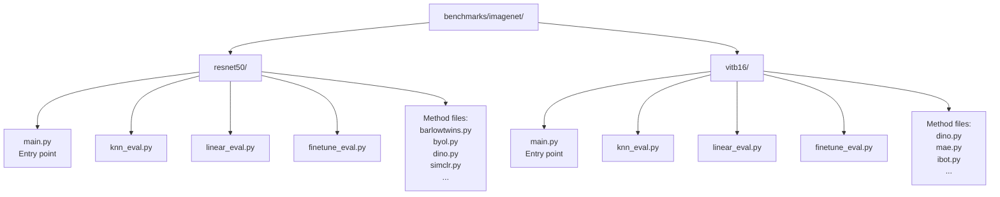
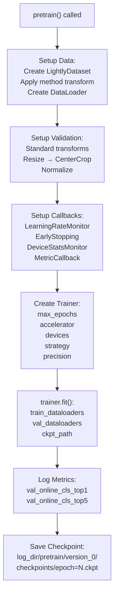
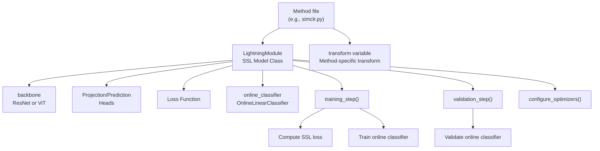

<!-- source: DeepWiki mcp.deepwiki.com · repo lightly-ai/lightly · page 7.1 ImageNet Benchmarks · fetched 2026-10-21 -->

# ImageNet Benchmarks

<details>
<summary>Relevant source files</summary>

The following files were used as context for generating this wiki page:

- [README.md](README.md)
- [benchmarks/imagenet/resnet50/finetune_eval.py](benchmarks/imagenet/resnet50/finetune_eval.py)
- [benchmarks/imagenet/resnet50/knn_eval.py](benchmarks/imagenet/resnet50/knn_eval.py)
- [benchmarks/imagenet/resnet50/linear_eval.py](benchmarks/imagenet/resnet50/linear_eval.py)
- [benchmarks/imagenet/resnet50/main.py](benchmarks/imagenet/resnet50/main.py)
- [benchmarks/imagenet/vitb16/dino.py](benchmarks/imagenet/vitb16/dino.py)
- [benchmarks/imagenet/vitb16/finetune_eval.py](benchmarks/imagenet/vitb16/finetune_eval.py)
- [benchmarks/imagenet/vitb16/knn_eval.py](benchmarks/imagenet/vitb16/knn_eval.py)
- [benchmarks/imagenet/vitb16/linear_eval.py](benchmarks/imagenet/vitb16/linear_eval.py)
- [benchmarks/imagenet/vitb16/main.py](benchmarks/imagenet/vitb16/main.py)
- [docs/source/getting_started/benchmarks.rst](docs/source/getting_started/benchmarks.rst)
- [docs/source/getting_started/benchmarks/cifar10_benchmark.py](docs/source/getting_started/benchmarks/cifar10_benchmark.py)
- [docs/source/getting_started/benchmarks/imagenet100_benchmark.py](docs/source/getting_started/benchmarks/imagenet100_benchmark.py)
- [docs/source/getting_started/benchmarks/imagenette_benchmark.py](docs/source/getting_started/benchmarks/imagenette_benchmark.py)
- [lightly/utils/benchmarking/knn_classifier.py](lightly/utils/benchmarking/knn_classifier.py)
- [tests/utils/benchmarking/test_knn_classifier.py](tests/utils/benchmarking/test_knn_classifier.py)

</details>


## Purpose and Scope

The ImageNet benchmarks provide standardized evaluation of self-supervised learning (SSL) methods on the ImageNet-1K dataset. These benchmarks measure the quality of learned representations through three evaluation protocols: k-Nearest Neighbors (kNN), linear probing, and fine-tuning. The benchmarks support both ResNet50 and Vision Transformer (ViT) backbones with multiple SSL methods.

For detailed information about the evaluation protocols themselves (kNN, linear, fine-tuning), see [Evaluation Protocols](#7.2). For benchmarks on other datasets (ImageNet100, Imagenette, CIFAR-10), see [Benchmarking](#7).

## Supported Configurations

The ImageNet benchmarks support two primary backbone architectures with different SSL methods:

| Backbone | SSL Methods Supported | Benchmark Directory |
|----------|----------------------|---------------------|
| ResNet50 | BarlowTwins, BYOL, DCL, DCLW, DINO, MoCoV2, SimCLR, SwAV, TiCo, VICReg | [benchmarks/imagenet/resnet50]() |
| ViT-B/16 | AIM, DINO, DINOv2, iBOT, MAE | [benchmarks/imagenet/vitb16]() |
| ViT-S/16 | DINO, iBOT | [benchmarks/imagenet/vitb16]() |

Sources: [benchmarks/imagenet/resnet50/main.py:71-85](), [benchmarks/imagenet/vitb16/main.py:54-60](), [README.md:297-311]()

## Benchmark Architecture

### Component Overview



Sources: [benchmarks/imagenet/resnet50/main.py:88-208](), [benchmarks/imagenet/vitb16/main.py:63-188]()

### Benchmark Workflow

```mermaid
graph LR
    START["Start Benchmark"] --> SETUP["Setup:<br/>Load dataset<br/>Initialize model<br/>Configure transform"]
    
    SETUP --> PRETRAIN_CHECK{epochs > 0?}
    
    PRETRAIN_CHECK -->|Yes| PRETRAIN["pretrain():<br/>Train SSL model<br/>for N epochs"]
    PRETRAIN_CHECK -->|No| LOAD["Load from<br/>--ckpt-path"]
    
    PRETRAIN --> SAVE["Save checkpoint<br/>to log_dir"]
    LOAD --> EVAL_START
    SAVE --> EVAL_START
    
    EVAL_START["Begin Evaluations"] --> KNN_CHECK{skip_knn_eval?}
    
    KNN_CHECK -->|No| KNN["knn_eval():<br/>K-NN accuracy<br/>k=200, t=0.1"]
    KNN_CHECK -->|Yes| LINEAR_CHECK
    
    KNN --> LINEAR_CHECK{skip_linear_eval?}
    
    LINEAR_CHECK -->|No| LINEAR["linear_eval():<br/>90 epochs<br/>Frozen backbone"]
    LINEAR_CHECK -->|Yes| FINETUNE_CHECK
    
    LINEAR --> FINETUNE_CHECK{skip_finetune_eval?}
    
    FINETUNE_CHECK -->|No| FINETUNE["finetune_eval():<br/>30 epochs<br/>All params"]
    FINETUNE_CHECK -->|Yes| REPORT
    
    FINETUNE --> REPORT["Report Results:<br/>Print markdown table<br/>with all metrics"]
    
    REPORT --> END["End"]
```



Sources: [benchmarks/imagenet/resnet50/main.py:88-208](), [benchmarks/imagenet/vitb16/main.py:63-188]()

## Directory Structure

The benchmark code is organized by backbone architecture:



Sources: [benchmarks/imagenet/resnet50/main.py:1-323](), [benchmarks/imagenet/vitb16/main.py:1-304]()

## Running Benchmarks

### Basic Usage

The benchmark scripts use command-line arguments for configuration:

**ResNet50 Benchmarks:**
```bash
python benchmarks/imagenet/resnet50/main.py \
    --train-dir /datasets/imagenet/train \
    --val-dir /datasets/imagenet/val \
    --methods simclr dino byol \
    --batch-size-per-device 128 \
    --epochs 100 \
    --devices 2 \
    --accelerator gpu
```

**ViT-B/16 Benchmarks:**
```bash
python benchmarks/imagenet/vitb16/main.py \
    --train-dir /datasets/imagenet/train \
    --val-dir /datasets/imagenet/val \
    --methods mae dino \
    --batch-size-per-device 128 \
    --epochs 100 \
    --devices 2 \
    --accelerator gpu
```

Sources: [benchmarks/imagenet/resnet50/main.py:48-70](), [benchmarks/imagenet/vitb16/main.py:31-53]()

### Command-Line Arguments

| Argument | Type | Default | Description |
|----------|------|---------|-------------|
| `--train-dir` | Path | `/datasets/imagenet/train` | ImageNet training directory |
| `--val-dir` | Path | `/datasets/imagenet/val` | ImageNet validation directory |
| `--log-dir` | Path | `benchmark_logs` | Directory for logs and checkpoints |
| `--batch-size-per-device` | int | 128 | Batch size per GPU |
| `--epochs` | int | 100 | Number of pretraining epochs |
| `--num-workers` | int | 8 | DataLoader worker processes |
| `--accelerator` | str | `gpu` | Hardware accelerator (gpu/cpu) |
| `--devices` | int | 1 | Number of devices to use |
| `--precision` | str | `16-mixed` | Training precision |
| `--methods` | str[] | All methods | SSL methods to benchmark |
| `--ckpt-path` | Path | None | Load checkpoint instead of training |
| `--skip-knn-eval` | bool | False | Skip kNN evaluation |
| `--skip-linear-eval` | bool | False | Skip linear evaluation |
| `--skip-finetune-eval` | bool | False | Skip fine-tuning evaluation |
| `--knn-k` | int | 200 | Number of nearest neighbors |
| `--knn-t` | float | 0.1 (ResNet) / 0.07 (ViT) | kNN temperature parameter |
| `--strategy` | str | `ddp_find_unused_parameters_true` | PyTorch Lightning strategy |
| `--seed` | int | None | Random seed for reproducibility |

Sources: [benchmarks/imagenet/resnet50/main.py:48-70](), [benchmarks/imagenet/vitb16/main.py:31-53]()

### Example: Training and Evaluating

To train SimCLR on ResNet50 for 100 epochs and run all evaluations:

```bash
python benchmarks/imagenet/resnet50/main.py \
    --train-dir /datasets/imagenet/train \
    --val-dir /datasets/imagenet/val \
    --methods simclr \
    --batch-size-per-device 256 \
    --epochs 100 \
    --devices 2 \
    --precision 16-mixed
```

To evaluate an existing checkpoint without retraining:

```bash
python benchmarks/imagenet/resnet50/main.py \
    --ckpt-path path/to/checkpoint.ckpt \
    --methods simclr \
    --epochs 0 \
    --devices 2
```

Sources: [benchmarks/imagenet/resnet50/main.py:132-151]()

## Pretraining Process

The `pretrain()` function orchestrates the SSL model training:



**Key Components:**

- **Dataset:** `LightlyDataset` loads images from the training directory
- **Transforms:** Method-specific transforms from `METHODS[method]["transform"]`
- **Trainer:** PyTorch Lightning `Trainer` with distributed training support
- **Callbacks:** Track metrics and monitor training progress
- **Online Classifier:** Most SSL models include an `OnlineLinearClassifier` that trains during pretraining to provide intermediate validation metrics

Sources: [benchmarks/imagenet/resnet50/main.py:210-286](), [benchmarks/imagenet/vitb16/main.py:190-267]()

## Evaluation Protocols

After pretraining, the benchmark runs three evaluation protocols. For detailed information about these protocols, see [Evaluation Protocols](#7.2).

### kNN Evaluation

The `knn_eval()` function evaluates representation quality using k-Nearest Neighbors classification:

**Key Settings:**
- **k (knn_k):** 200 neighbors
- **Temperature (knn_t):** 0.1 for ResNet50, 0.07 for ViT
- **Implementation:** `KNNClassifier` from [lightly/utils/benchmarking/knn_classifier.py]()
- **Protocol:** Based on InstDisc (Wu et al., 2018)

Sources: [benchmarks/imagenet/resnet50/knn_eval.py:17-106](), [benchmarks/imagenet/vitb16/knn_eval.py:17-106]()

### Linear Evaluation

The `linear_eval()` function trains a linear classifier on frozen features:

**Key Settings:**
- **Epochs:** 90
- **Learning Rate:** 0.1 (ResNet), varies for ViT
- **Optimizer:** SGD for ResNet, LARS for ViT with MAE
- **Protocol:** Based on SimCLR (Chen et al., 2020)

Sources: [benchmarks/imagenet/resnet50/linear_eval.py:17-119](), [benchmarks/imagenet/vitb16/linear_eval.py:74-174]()

### Fine-tuning Evaluation

The `finetune_eval()` function fine-tunes the entire model:

**Key Settings:**
- **Epochs:** 30 for ResNet, 100 for ViT
- **Learning Rate:** 0.05 (ResNet), 5e-4 (ViT with MAE)
- **Optimizer:** SGD for ResNet, AdamW for ViT
- **Additional:** Mixup/CutMix for ViT with MAE
- **Protocol:** Based on SimCLR for ResNet, MAE for ViT

Sources: [benchmarks/imagenet/resnet50/finetune_eval.py:17-119](), [benchmarks/imagenet/vitb16/finetune_eval.py:144-269]()

## SSL Method Implementations

Each SSL method is implemented in its own Python file. The structure follows this pattern:



**Example: DINO for ViT-S/16**

The DINO implementation demonstrates the typical structure:

- **Model Class:** `DINO(LightningModule)` at [benchmarks/imagenet/vitb16/dino.py:18-155]()
- **Backbone:** `MaskedVisionTransformerTIMM` wrapping `vit_small_patch16_224`
- **Heads:** `DINOProjectionHead` for both student and teacher
- **Loss:** `DINOLoss` for distillation
- **Transform:** `DINOTransform` with global and local views
- **Momentum Update:** Teacher network updated with cosine schedule
- **Online Classifier:** Evaluates features during training

Sources: [benchmarks/imagenet/vitb16/dino.py:18-172]()

## Benchmark Results and Outputs

### Output Structure

Each benchmark run creates a timestamped directory:

```
benchmark_logs/
└── {method}/
    └── {timestamp}/
        ├── pretrain/
        │   └── version_0/
        │       ├── checkpoints/
        │       │   └── epoch=99-step=500400.ckpt
        │       └── events.out.tfevents.*
        ├── knn_eval/
        │   └── version_0/
        │       └── events.out.tfevents.*
        ├── linear_eval/
        │   └── version_0/
        │       └── events.out.tfevents.*
        └── finetune_eval/
            └── version_0/
                └── events.out.tfevents.*
```

Sources: [benchmarks/imagenet/resnet50/main.py:119-122]()

### Metrics Reporting

At the end of evaluation, the benchmark prints a markdown table with results:

```
| Eval Name | Metric Name | Value  |
|:----------|:------------|:-------|
| knn       | val_top1    | 44.80  |
| knn       | val_top5    | 73.90  |
| linear    | val_top1    | 63.20  |
| linear    | val_top5    | 85.20  |
| finetune  | val_top1    | 73.90  |
| finetune  | val_top5    | 91.90  |
```

The function `eval_metrics_to_markdown()` formats these results:

Sources: [benchmarks/imagenet/resnet50/main.py:288-317](), [benchmarks/imagenet/vitb16/main.py:269-298]()

### Published Results

The official benchmark results are maintained in the repository documentation. For ResNet50 (100 epochs, batch size 256):

| Model | Linear Top1 | Finetune Top1 | kNN Top1 | Checkpoint |
|-------|-------------|---------------|----------|------------|
| SimCLR* | 63.2 | 73.9 | 44.8 | [link](https://lightly-ssl-checkpoints.s3.amazonaws.com/imagenet_resnet50_simclr_2023-06-22_09-11-13/pretrain/version_0/checkpoints/epoch%3D99-step%3D500400.ckpt) |
| DINO (Res50) | 68.2 | 72.5 | 49.9 | [link](https://lightly-ssl-checkpoints.s3.amazonaws.com/imagenet_resnet50_dino_2023-06-06_13-59-48/pretrain/version_0/checkpoints/epoch%3D99-step%3D1000900.ckpt) |
| SwAV | 67.2 | 75.4 | 49.5 | [link](https://lightly-ssl-checkpoints.s3.amazonaws.com/imagenet_resnet50_swav_2023-05-25_08-29-14/pretrain/version_0/checkpoints/epoch%3D99-step%3D500400.ckpt) |

For ViT (100 epochs, batch size 128-256):

| Model | Backbone | Linear Top1 | Finetune Top1 | kNN Top1 |
|-------|----------|-------------|---------------|----------|
| DINO | ViT-S/16 | 73.3 | 79.8 | 67.5 |
| iBOT | ViT-S/16 | 72.2 | 78.3 | 65.4 |
| MAE | ViT-B/16 | 46.0 | 81.3 | 11.2 |

*Note: SimCLR uses square root learning rate scaling instead of linear scaling for better results with smaller batch sizes.*

Sources: [README.md:297-311](), [docs/source/getting_started/benchmarks.rst:30-48]()

## Hardware Requirements

The benchmarks were conducted on systems with the following specifications:

- **GPU:** 2x NVIDIA RTX 4090 (or equivalent)
- **Training Time:** ~4 days for 100 epochs including all evaluations (~35 min/epoch)
- **Memory:** Varies by method, typically 11-17 GB for ResNet50
- **Batch Size:** 128-256 per device (effective batch size: batch_size × devices)

For distributed training, the effective batch size is multiplied by the number of devices, and the learning rate is scaled accordingly using `lr_factor = batch_size / reference_batch_size`.

Sources: [docs/source/getting_started/benchmarks.rst:20-21](), [benchmarks/imagenet/resnet50/main.py:147]()

## Advanced Configuration

### Distributed Training

The benchmarks support distributed data parallel (DDP) training via PyTorch Lightning:

```bash
python benchmarks/imagenet/resnet50/main.py \
    --devices 4 \
    --strategy ddp_find_unused_parameters_true \
    --batch-size-per-device 64  # 64 × 4 = 256 effective batch size
```

The `ddp_find_unused_parameters_true` strategy is used because some SSL methods (like DINO) have unused parameters in the computational graph during certain training steps.

Sources: [benchmarks/imagenet/resnet50/main.py:68-69]()

### Mixed Precision Training

The benchmarks use 16-bit mixed precision by default for faster training:

```bash
python benchmarks/imagenet/resnet50/main.py \
    --precision 16-mixed  # PyTorch AMP mixed precision
```

Sources: [benchmarks/imagenet/resnet50/main.py:57]()

### Model Compilation

For PyTorch 2.0+, model compilation can be enabled for additional performance:

```bash
python benchmarks/imagenet/resnet50/main.py \
    --compile-model
```

This uses `torch.compile()` to optimize the model graph.

Sources: [benchmarks/imagenet/resnet50/main.py:59](), [benchmarks/imagenet/resnet50/main.py:127-130]()

### Reproducibility

To ensure reproducible results, set a random seed:

```bash
python benchmarks/imagenet/resnet50/main.py \
    --seed 42
```

This calls `seed_everything(seed, workers=True)` to set seeds for Python, NumPy, PyTorch, and DataLoader workers.

Sources: [benchmarks/imagenet/resnet50/main.py:69](), [benchmarks/imagenet/resnet50/main.py:112]()

---

