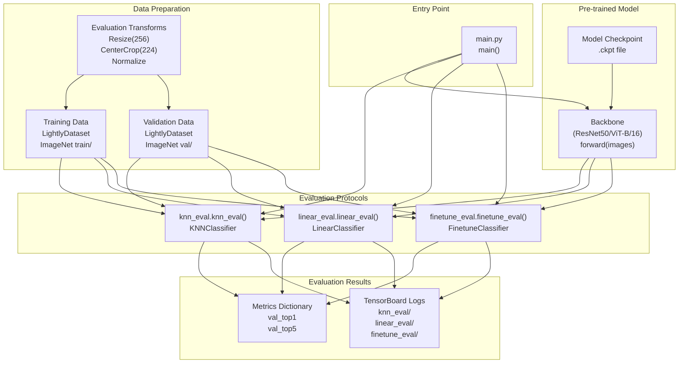
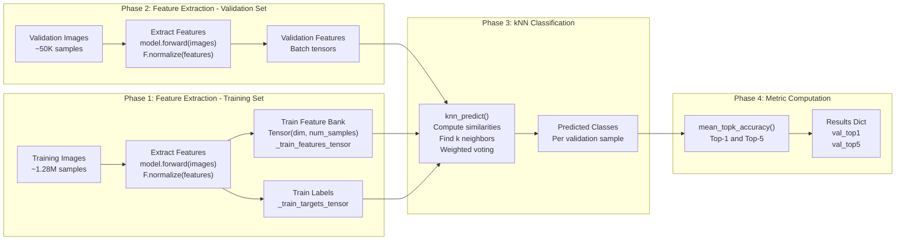
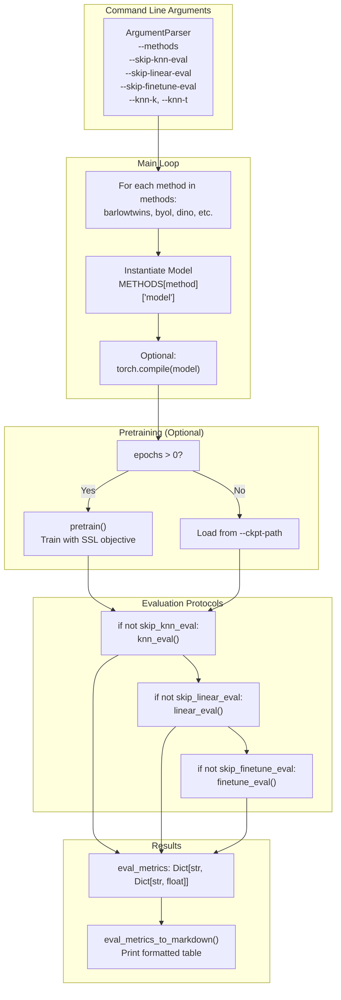

<!-- source: DeepWiki mcp.deepwiki.com · repo lightly-ai/lightly · page 7.2 Evaluation Protocols · fetched 2026-10-21 -->

# Evaluation Protocols

<details>
<summary>Relevant source files</summary>

The following files were used as context for generating this wiki page:

- [benchmarks/imagenet/resnet50/finetune_eval.py](benchmarks/imagenet/resnet50/finetune_eval.py)
- [benchmarks/imagenet/resnet50/knn_eval.py](benchmarks/imagenet/resnet50/knn_eval.py)
- [benchmarks/imagenet/resnet50/linear_eval.py](benchmarks/imagenet/resnet50/linear_eval.py)
- [benchmarks/imagenet/resnet50/main.py](benchmarks/imagenet/resnet50/main.py)
- [benchmarks/imagenet/vitb16/dino.py](benchmarks/imagenet/vitb16/dino.py)
- [benchmarks/imagenet/vitb16/finetune_eval.py](benchmarks/imagenet/vitb16/finetune_eval.py)
- [benchmarks/imagenet/vitb16/knn_eval.py](benchmarks/imagenet/vitb16/knn_eval.py)
- [benchmarks/imagenet/vitb16/linear_eval.py](benchmarks/imagenet/vitb16/linear_eval.py)
- [benchmarks/imagenet/vitb16/main.py](benchmarks/imagenet/vitb16/main.py)
- [lightly/utils/benchmarking/knn_classifier.py](lightly/utils/benchmarking/knn_classifier.py)
- [tests/utils/benchmarking/test_knn_classifier.py](tests/utils/benchmarking/test_knn_classifier.py)

</details>


This document describes the evaluation protocols used to measure the quality of self-supervised learning (SSL) representations in the Lightly framework. These protocols provide standardized methods to assess how well pre-trained models transfer to downstream classification tasks on ImageNet and other datasets.

For information about the benchmark module that integrates these protocols during training, see [Benchmark Module](#7.1). For general benchmarking infrastructure, see [Benchmarking](#7).

## Overview

The Lightly framework implements three standard evaluation protocols for assessing SSL model quality:

1. **kNN Evaluation** - k-Nearest Neighbors classification without any training
2. **Linear Evaluation** - Training a linear classifier on frozen backbone features  
3. **Fine-tuning Evaluation** - End-to-end fine-tuning of the entire model

These protocols follow established practices from influential SSL papers (InstDisc, SimCLR, MoCo, MAE) and provide comparable metrics across different SSL methods. Each protocol represents a different point on the spectrum between zero training (kNN) and full model adaptation (fine-tuning).

**Sources:** [benchmarks/imagenet/resnet50/main.py:88-208](), [benchmarks/imagenet/vitb16/main.py:63-188]()

## Evaluation Protocol Architecture



**Sources:** [benchmarks/imagenet/resnet50/main.py:88-208](), [benchmarks/imagenet/resnet50/knn_eval.py:17-106](), [benchmarks/imagenet/resnet50/linear_eval.py:17-119](), [benchmarks/imagenet/resnet50/finetune_eval.py:17-119]()

## kNN Evaluation Protocol

### Purpose and Settings

The kNN (k-Nearest Neighbors) evaluation protocol assesses representation quality without any training. It extracts features from the pre-trained backbone, builds a feature bank from the training set, and classifies validation samples by voting among their k nearest neighbors.

**Key hyperparameters follow InstDisc [0] settings:**

| Parameter | ResNet50 Value | ViT-B/16 Value | Description |
|-----------|---------------|----------------|-------------|
| `knn_k` | 200 | 200 | Number of nearest neighbors |
| `knn_t` | 0.1 | 0.07 | Temperature for similarity reweighting |
| `normalize` | True | True | L2-normalize features before comparison |
| `feature_dtype` | `torch.float32` | `torch.float32` | Data type for feature storage |

The temperature parameter `knn_t` reweights similarities using a softmax with temperature scaling, emphasizing closer neighbors more strongly.

**Sources:** [benchmarks/imagenet/resnet50/knn_eval.py:17-42](), [benchmarks/imagenet/vitb16/knn_eval.py:17-42]()

### Implementation Flow



**Sources:** [lightly/utils/benchmarking/knn_classifier.py:13-170](), [benchmarks/imagenet/resnet50/knn_eval.py:42-106]()

### KNNClassifier Implementation

The `KNNClassifier` class wraps a pre-trained model and implements the kNN protocol as a PyTorch Lightning module. It operates in two phases during validation:

**Phase 1 (dataloader_idx=0):** Extracts and accumulates features from the training set.

```python
# Feature extraction and storage
def validation_step(self, batch, batch_idx: int, dataloader_idx: int) -> None:
    images, targets = batch[0], batch[1]
    features = self(images)  # Calls forward() with normalization
    
    if dataloader_idx == 0:
        # Store training features
        self.append_train_features(features=features, targets=targets)
```

**Phase 2 (dataloader_idx=1):** Concatenates training features and performs kNN classification on validation set.

```python
    else:
        if batch_idx == 0 and dataloader_idx == 1:
            # Concatenate accumulated features from all devices
            self.concat_train_features()
        
        # Perform kNN classification
        predicted_classes = knn_predict(
            feature=features,
            feature_bank=self._train_features_tensor,
            feature_labels=self._train_targets_tensor,
            num_classes=self.num_classes,
            knn_k=self.knn_k,
            knn_t=self.knn_t,
        )
```

The `forward()` method normalizes features and converts them to the specified dtype:

```python
def forward(self, images: Tensor) -> Tensor:
    features = self.model.forward(images).flatten(start_dim=1)
    if self.normalize:
        features = F.normalize(features, dim=1)
    features = features.to(self.feature_dtype)
    return features
```

**Sources:** [lightly/utils/benchmarking/knn_classifier.py:105-165]()

### Usage Pattern

The kNN evaluation is invoked from the main benchmark script:

```python
# From benchmarks/imagenet/resnet50/main.py
if not skip_knn_eval:
    eval_metrics["knn"] = knn_eval.knn_eval(
        model=model,
        num_classes=num_classes,
        train_dir=train_dir,
        val_dir=val_dir,
        log_dir=method_dir,
        batch_size_per_device=batch_size_per_device,
        num_workers=num_workers,
        accelerator=accelerator,
        devices=devices,
        strategy=strategy,
        knn_k=knn_k,  # Default: 200
        knn_t=knn_t,  # Default: 0.1 for ResNet, 0.07 for ViT
    )
```

**Sources:** [benchmarks/imagenet/resnet50/main.py:153-169](), [benchmarks/imagenet/vitb16/main.py:131-147]()

## Linear Evaluation Protocol

### Purpose and Settings

The linear evaluation protocol measures representation quality by training a linear classifier on top of frozen backbone features. This is the most widely used evaluation method in SSL research, following SimCLR [0] conventions.

**Key hyperparameters for ResNet50:**

| Parameter | Value | Description |
|-----------|-------|-------------|
| `max_epochs` | 90 | Training epochs |
| `optimizer` | SGD | Optimizer type |
| `lr` | 0.1 | Base learning rate (scaled by batch size) |
| `momentum` | 0.9 | SGD momentum |
| `weight_decay` | 0.0 | Weight decay (disabled for classifier head) |
| `lr_schedule` | Cosine | Learning rate schedule without warmup |
| `backbone` | Frozen | Backbone parameters frozen during training |

The linear classifier is a single fully-connected layer mapping from the backbone's feature dimension to the number of classes.

**Sources:** [benchmarks/imagenet/resnet50/linear_eval.py:17-45](), [benchmarks/imagenet/vitb16/linear_eval.py:74-88]()

### Data Augmentation

Linear evaluation uses simple augmentations to prevent overfitting:

**Training transforms:**
```python
train_transform = T.Compose([
    T.RandomResizedCrop(224),
    T.RandomHorizontalFlip(),
    T.ToTensor(),
    T.Normalize(mean=IMAGENET_NORMALIZE["mean"], std=IMAGENET_NORMALIZE["std"]),
])
```

**Validation transforms:**
```python
val_transform = T.Compose([
    T.Resize(256),
    T.CenterCrop(224),
    T.ToTensor(),
    T.Normalize(mean=IMAGENET_NORMALIZE["mean"], std=IMAGENET_NORMALIZE["std"]),
])
```

**Sources:** [benchmarks/imagenet/resnet50/linear_eval.py:48-75]()

### LinearClassifier Implementation

The `LinearClassifier` class (from `lightly.utils.benchmarking`) wraps the frozen backbone with a trainable linear layer:

```python
class LinearClassifier(LightningModule):
    def __init__(
        self,
        model: Module,
        batch_size_per_device: int,
        lr: float = 0.1,
        feature_dim: int = 2048,
        num_classes: int = 1000,
        topk: Tuple[int, ...] = (1, 5),
    ) -> None:
        # model: Pre-trained backbone (frozen during training)
        # feature_dim: Output dimension of backbone features
        # classification_head: Linear(feature_dim, num_classes)
```

The training step freezes the backbone and only updates the classifier:

```python
def training_step(self, batch: Tuple[Tensor, ...], batch_idx: int) -> Tensor:
    images, targets = batch[0], batch[1]
    # Extract features with frozen backbone
    features = self.forward(images)  # No gradients to backbone
    # Train only the classification head
    predictions = self.classification_head(features)
    loss = self.criterion(predictions, targets)
    return loss
```

**Sources:** [lightly/utils/benchmarking/linear_classifier.py]() (referenced by imports)

### Usage Pattern

```python
# From benchmarks/imagenet/resnet50/main.py
if not skip_linear_eval:
    eval_metrics["linear"] = linear_eval.linear_eval(
        model=model,
        num_classes=num_classes,
        train_dir=train_dir,
        val_dir=val_dir,
        log_dir=method_dir,
        batch_size_per_device=batch_size_per_device,
        num_workers=num_workers,
        accelerator=accelerator,
        devices=devices,
        strategy=strategy,
        precision=precision,
    )
```

**Sources:** [benchmarks/imagenet/resnet50/main.py:171-186]()

## Fine-tuning Evaluation Protocol

### Purpose and Settings

The fine-tuning evaluation protocol measures representation quality by training the entire model end-to-end. This protocol allows the backbone to adapt to the downstream task, typically achieving higher accuracy than linear evaluation.

**Key hyperparameters for ResNet50 (following SimCLR):**

| Parameter | Value | Description |
|-----------|-------|-------------|
| `max_epochs` | 30 | Training epochs |
| `optimizer` | SGD | Optimizer type |
| `lr` | 0.05 | Base learning rate |
| `momentum` | 0.9 | SGD momentum |
| `weight_decay` | 0.0 | Weight decay disabled |
| `lr_schedule` | Cosine | Learning rate schedule without warmup |
| `backbone` | Trainable | All model parameters trainable |

**Sources:** [benchmarks/imagenet/resnet50/finetune_eval.py:17-45]()

### FinetuneClassifier Implementation

The `FinetuneClassifier` is similar to `LinearClassifier` but with the backbone unfrozen:

```python
class FinetuneClassifier(LightningModule):
    def __init__(
        self,
        model: Module,
        batch_size_per_device: int,
        lr: float = 0.05,
        feature_dim: int = 2048,
        num_classes: int = 1000,
        topk: Tuple[int, ...] = (1, 5),
    ) -> None:
        # All parameters of model are trainable
        # classification_head: Linear(feature_dim, num_classes)
```

The training step updates both backbone and classifier:

```python
def training_step(self, batch: Tuple[Tensor, ...], batch_idx: int) -> Tensor:
    images, targets = batch[0], batch[1]
    # Extract features (gradients flow to backbone)
    features = self.forward(images)
    predictions = self.classification_head(features)
    loss = self.criterion(predictions, targets)
    return loss  # Updates both backbone and head
```

**Sources:** [benchmarks/imagenet/resnet50/finetune_eval.py:30-119]()

### Usage Pattern

```python
# From benchmarks/imagenet/resnet50/main.py
if not skip_finetune_eval:
    eval_metrics["finetune"] = finetune_eval.finetune_eval(
        model=model,
        num_classes=num_classes,
        train_dir=train_dir,
        val_dir=val_dir,
        log_dir=method_dir,
        batch_size_per_device=batch_size_per_device,
        num_workers=num_workers,
        accelerator=accelerator,
        devices=devices,
        strategy=strategy,
        precision=precision,
    )
```

**Sources:** [benchmarks/imagenet/resnet50/main.py:188-203]()

## Architecture-Specific Adaptations

### ViT-B/16 Evaluation Methods

Vision Transformer models require different evaluation settings compared to ResNet models. The ViT benchmark scripts support two evaluation methods controlled by the `--eval-method` flag:

| Method | Based On | Linear Eval Settings | Fine-tune Settings |
|--------|----------|---------------------|-------------------|
| `"mae"` | MAE paper | LARS optimizer, 90 epochs, extra BatchNorm | AdamW, 100 epochs, layer-wise LR decay, mixup/cutmix |
| `"simclr"` | SimCLR paper | SGD optimizer, 90 epochs, standard head | SGD, 30 epochs, standard training |

**Sources:** [benchmarks/imagenet/vitb16/main.py:44](), [benchmarks/imagenet/vitb16/linear_eval.py:74-88](), [benchmarks/imagenet/vitb16/finetune_eval.py:144-158]()

### MAE-Specific Linear Evaluation

The `LinearClassifierMAE` class adds a batch normalization layer before the classification head:

```python
class LinearClassifierMAE(LinearClassifier):
    def __init__(self, ...):
        super().__init__(...)
        # MAE adds extra batch norm before classification
        self.classification_head = Sequential(
            BatchNorm1d(feature_dim, affine=False, eps=1e-6),
            Linear(feature_dim, num_classes),
        )
    
    def configure_optimizers(self):
        # Uses LARS optimizer instead of SGD
        optimizer = LARS(
            parameters,
            lr=self.get_effective_lr(),
            momentum=0.9,
            weight_decay=0.0,
        )
        # 10 epoch warmup
        scheduler = CosineWarmupScheduler(
            optimizer=optimizer,
            warmup_epochs=10,
            max_epochs=90,
        )
```

**Sources:** [benchmarks/imagenet/vitb16/linear_eval.py:20-72]()

### MAE-Specific Fine-tuning Evaluation

The `FinetuneClassifierMAE` class implements sophisticated training strategies from the MAE paper:

**Stochastic depth (path dropout):**
```python
class FinetuneClassifierMAE(FinetuneClassifier):
    def __init__(self, ...):
        super().__init__(...)
        # Add path dropout to transformer blocks
        add_stochastic_depth_to_blocks(self.model, prob=0.1)
        # Add mixup and cutmix augmentation
        self.mixup = Mixup(
            mixup_alpha=0.8,
            cutmix_alpha=1.0,
            label_smoothing=0.1,
            num_classes=num_classes,
        )
```

**Layer-wise learning rate decay:**
```python
    def configure_optimizers(self):
        layerwise_lr_decay = 0.65
        # Group parameters by layer depth
        for name, module in get_named_leaf_modules(self.model).items():
            if "encoder_layer_" in name:
                layer_index = int(name.split("encoder_layer_")[1].split(".")[0])
                # LR increases from first layer (index 0) to last layer (index 11)
                group_lr = lr * (layerwise_lr_decay ** (11 - layer_index))
            else:
                group_lr = lr
```

**AdamW optimizer with weight decay:**
```python
        optimizer = AdamW(
            param_groups,
            betas=(0.9, 0.999),
        )
        # 5 epoch warmup for 100 epoch training
        scheduler = CosineWarmupScheduler(
            optimizer=optimizer,
            warmup_epochs=5,
            max_epochs=100,
        )
```

**Sources:** [benchmarks/imagenet/vitb16/finetune_eval.py:28-142]()

### Transform Differences

MAE fine-tuning uses more aggressive data augmentation from the TIMM library:

```python
if eval_method == "mae":
    train_transform = create_transform(
        input_size=224,
        is_training=True,
        auto_augment="rand-m9-mstd0.5-inc1",  # RandAugment
        interpolation="bicubic",
        re_prob=0.25,  # Random erasing
        re_mode="pixel",
        re_count=1,
        mean=IMAGENET_NORMALIZE["mean"],
        std=IMAGENET_NORMALIZE["std"],
    )
```

**Sources:** [benchmarks/imagenet/vitb16/finetune_eval.py:170-180]()

## Evaluation Results Format

### Metrics Dictionary Structure

All evaluation functions return a dictionary with top-1 and top-5 accuracy:

```python
metrics_dict: Dict[str, float] = {
    "val_top1": 0.7234,  # Top-1 accuracy
    "val_top5": 0.9012,  # Top-5 accuracy
}
```

The main script collects metrics from all protocols:

```python
eval_metrics: Dict[str, Dict[str, float]] = {
    "knn": {
        "val_top1": 0.6523,
        "val_top5": 0.8734,
    },
    "linear": {
        "val_top1": 0.7234,
        "val_top5": 0.9012,
    },
    "finetune": {
        "val_top1": 0.7856,
        "val_top5": 0.9345,
    },
}
```

**Sources:** [benchmarks/imagenet/resnet50/main.py:152-207]()

### Markdown Results Table

The main script formats results as a markdown table:

```python
def eval_metrics_to_markdown(metrics: Dict[str, Dict[str, float]]) -> str:
    """Formats evaluation metrics as a markdown table."""
    # Creates table with columns: Eval Name | Metric Name | Value
    # Example output:
    # | knn     | val_top1 | 65.23 |
    # | knn     | val_top5 | 87.34 |
    # | linear  | val_top1 | 72.34 |
    # | linear  | val_top5 | 90.12 |
    # | finetune| val_top1 | 78.56 |
    # | finetune| val_top5 | 93.45 |
```

**Sources:** [benchmarks/imagenet/resnet50/main.py:288-318](), [benchmarks/imagenet/vitb16/main.py:269-298]()

## Execution Flow



**Sources:** [benchmarks/imagenet/resnet50/main.py:88-208](), [benchmarks/imagenet/vitb16/main.py:63-188]()

## PyTorch Lightning Integration

All evaluation protocols use PyTorch Lightning for training orchestration:

```python
# Common trainer configuration
trainer = Trainer(
    max_epochs=epochs,
    accelerator=accelerator,
    devices=devices,
    callbacks=[
        LearningRateMonitor(),
        DeviceStatsMonitor(),
        metric_callback,  # Collects metrics
    ],
    logger=TensorBoardLogger(save_dir=str(log_dir), name="protocol_name"),
    precision=precision,
    strategy=strategy,
    num_sanity_val_steps=0,  # Saves shared memory
)
```

The `MetricCallback` accumulates validation metrics across epochs:

```python
# After training
for metric in ["val_top1", "val_top5"]:
    max_value = max(metric_callback.val_metrics[metric])
    metrics_dict[metric] = max_value
```

**Sources:** [benchmarks/imagenet/resnet50/linear_eval.py:85-111](), [benchmarks/imagenet/resnet50/finetune_eval.py:85-111]()

## Command-Line Usage

The benchmark scripts provide flags to control which evaluations run:

```bash
# Run all evaluation protocols
python benchmarks/imagenet/resnet50/main.py \
    --train-dir /datasets/imagenet/train \
    --val-dir /datasets/imagenet/val \
    --methods simclr mocov2 byol \
    --epochs 100 \
    --batch-size-per-device 128 \
    --devices 4 \
    --accelerator gpu

# Skip specific protocols
python benchmarks/imagenet/resnet50/main.py \
    --skip-knn-eval \
    --skip-finetune-eval \
    --methods simclr

# Only evaluate from checkpoint (no pretraining)
python benchmarks/imagenet/resnet50/main.py \
    --epochs 0 \
    --ckpt-path ./checkpoint.ckpt \
    --methods simclr

# Customize kNN parameters
python benchmarks/imagenet/resnet50/main.py \
    --knn-k 100 \
    --knn-t 0.2
```

**Sources:** [benchmarks/imagenet/resnet50/main.py:48-69](), [benchmarks/imagenet/vitb16/main.py:31-53]()

## Evaluation Protocol Comparison

| Protocol | Training Required | Computation Cost | Typical Accuracy | Use Case |
|----------|------------------|------------------|------------------|----------|
| **kNN** | No | Low (single pass) | Lowest | Quick quality check, no GPU memory for training |
| **Linear** | Yes (90 epochs) | Medium (head only) | Medium | Standard benchmark, most comparable across papers |
| **Fine-tune** | Yes (30-100 epochs) | High (full model) | Highest | Maximum downstream performance, task adaptation |

**Linear evaluation is the standard protocol** for comparing SSL methods in research papers because it:
- Isolates the quality of learned representations from task-specific adaptations
- Provides reproducible results with standardized hyperparameters
- Balances computational cost with meaningful performance measurement

**Sources:** [benchmarks/imagenet/resnet50/main.py:1-323](), [benchmarks/imagenet/vitb16/main.py:1-304]()

---

