<!-- source: DeepWiki mcp.deepwiki.com · repo lightly-ai/lightly · page 8 Tutorials and Examples · fetched 2026-10-21 -->

# Tutorials and Examples

<details>
<summary>Relevant source files</summary>

The following files were used as context for generating this wiki page:

- [docs/source/getting_started/advanced.rst](docs/source/getting_started/advanced.rst)
- [docs/source/getting_started/command_line_tool.rst](docs/source/getting_started/command_line_tool.rst)
- [docs/source/getting_started/images/lightly_overview.png](docs/source/getting_started/images/lightly_overview.png)
- [docs/source/getting_started/install.rst](docs/source/getting_started/install.rst)
- [docs/source/getting_started/lightly_at_a_glance.rst](docs/source/getting_started/lightly_at_a_glance.rst)
- [docs/source/getting_started/main_concepts.rst](docs/source/getting_started/main_concepts.rst)
- [docs/source/index.rst](docs/source/index.rst)
- [docs/source/lightly.models.utils.rst](docs/source/lightly.models.utils.rst)
- [docs/source/tutorials/structure_your_input.rst](docs/source/tutorials/structure_your_input.rst)
- [docs/source/tutorials_source/package/Base-RCNN-FPN.yaml](docs/source/tutorials_source/package/Base-RCNN-FPN.yaml)
- [docs/source/tutorials_source/package/tutorial_custom_augmentations.py](docs/source/tutorials_source/package/tutorial_custom_augmentations.py)
- [docs/source/tutorials_source/package/tutorial_moco_memory_bank.py](docs/source/tutorials_source/package/tutorial_moco_memory_bank.py)
- [docs/source/tutorials_source/package/tutorial_pretrain_detectron2.py](docs/source/tutorials_source/package/tutorial_pretrain_detectron2.py)
- [docs/source/tutorials_source/package/tutorial_simclr_clothing.py](docs/source/tutorials_source/package/tutorial_simclr_clothing.py)
- [docs/source/tutorials_source/package/tutorial_simsiam_esa.py](docs/source/tutorials_source/package/tutorial_simsiam_esa.py)

</details>


This page provides a comprehensive guide to the hands-on tutorials and examples available in the Lightly framework. These tutorials demonstrate complete workflows for training self-supervised learning models, from basic data loading to advanced custom augmentations and integration with external frameworks like Detectron2.

For API reference documentation, see the Python API sections ([2](#2), [3](#3), [4](#4), [5](#5)). For command-line usage, see [Command-Line Interface](#4).

## Tutorial Overview

The tutorials are organized in order of increasing complexity, allowing users to build understanding progressively:

| Tutorial | Topic | Key Concepts | Dataset |
|----------|-------|--------------|---------|
| Tutorial 1 | Structure Your Input | Dataset creation, data loading, transforms | Generic images/videos |
| Tutorial 2 | Train MoCo on CIFAR-10 | Memory banks, momentum encoders, linear evaluation | CIFAR-10 |
| Tutorial 3 | Train SimCLR on Clothing | Contrastive learning, nearest neighbors | Clothing dataset |
| Tutorial 4 | Train SimSiam on Satellite Images | Siamese networks, embeddings visualization | Sentinel-2 satellite |
| Tutorial 5 | Custom Augmentations | Domain-specific transforms, 16-bit images | Medical X-rays |
| Tutorial 6 | Detectron2 Integration | Transfer learning, object detection | Freiburg Groceries |

**Sources:** [docs/source/index.rst:82-94](), [docs/source/tutorials/structure_your_input.rst:1-250]()

---

## Tutorial 1: Structure Your Input

This tutorial covers the fundamental data handling capabilities of the framework, focusing on creating datasets and dataloaders compatible with various data sources.

### Supported Data Sources and Formats

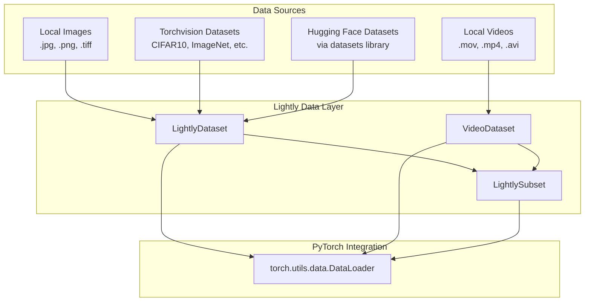

### Basic Dataset Creation

The `LightlyDataset` class provides a unified interface for image and video data:

```python
# Unlabeled images in a single directory
from lightly.data import LightlyDataset
from lightly.transforms import SimCLRTransform

transform = SimCLRTransform()
dataset = LightlyDataset(input_dir='image_dir/', transform=transform)
```

**Key class:** `lightly.data.LightlyDataset` [lightly/data/dataset.py]()

For labeled data with subdirectories per class:
```python
# Labeled images: parent_dir/class_name/image.jpg
labeled_dataset = LightlyDataset(input_dir='labeled_image_dir/', transform=transform)
```

### Video Dataset Support

Videos are supported natively without frame extraction:

```python
# Works with .mov, .mp4, .avi files
video_dataset = LightlyDataset(input_dir='video_dir/', transform=transform)
```

**Note:** Video support requires `pip install "lightly[video]"` to install PyAV dependencies.

**Sources:** [docs/source/tutorials/structure_your_input.rst:17-129](), [lightly/data/__init__.py]()

### Transform Pipeline Integration

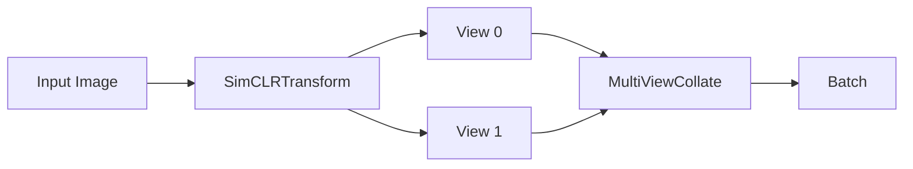

The framework supports three transform approaches:

1. **Pre-defined transforms** from `lightly.transforms` (SimCLR, DINO, MAE, etc.)
2. **Torchvision transforms** for standard augmentations
3. **Custom transforms** including Albumentations or custom implementations

Example with multiple transform libraries:

```python
import albumentations as A
import torchvision.transforms as T
from lightly.transforms import SimCLRTransform

# Torchvision
tv_transform = T.Compose([T.RandomHorizontalFlip(), T.ToTensor()])

# Albumentations
alb_transform = A.Compose([
    A.CenterCrop(height=128, width=128),
    A.Normalize(mean=(0.485, 0.456, 0.406), std=(0.229, 0.224, 0.225))
])

# Lightly
lightly_transform = SimCLRTransform()
```

**Sources:** [docs/source/tutorials/structure_your_input.rst:180-227](), [lightly/transforms/__init__.py]()

---

## Tutorial 2: Train MoCo on CIFAR-10

This tutorial demonstrates training a Momentum Contrast (MoCo) model with a memory bank on CIFAR-10, followed by linear evaluation to assess embedding quality.

### MoCo Architecture Components

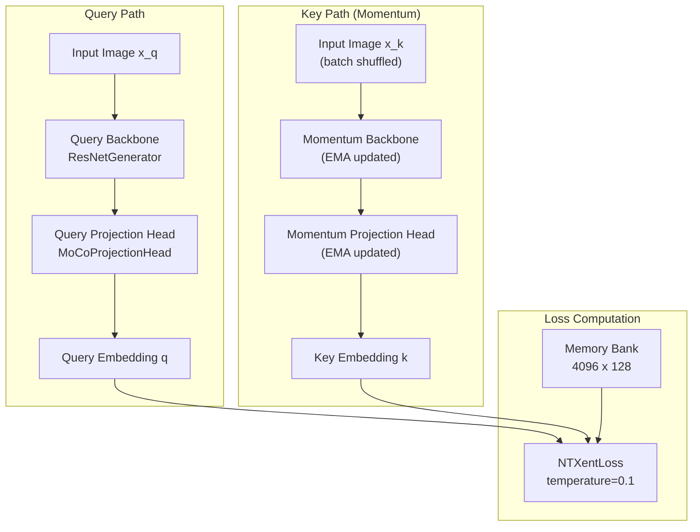

### Key Implementation Details

**MoCo Model Structure:**
- **Backbone:** `ResNetGenerator("resnet-18", 1, num_splits=8)` with split batch normalization
- **Projection head:** `MoCoProjectionHead(512, 512, 128)` 
- **Momentum encoder:** Exponential moving average (EMA) copy of backbone and head
- **Memory bank:** 4096 negative samples of dimension 128

**Code reference:** [docs/source/tutorials_source/package/tutorial_moco_memory_bank.py:221-283]()

```python
class MocoModel(pl.LightningModule):
    def __init__(self):
        super().__init__()
        # Create backbone and head
        resnet = ResNetGenerator("resnet-18", 1, num_splits=8)
        self.backbone = nn.Sequential(*list(resnet.children())[:-1], nn.AdaptiveAvgPool2d(1))
        self.projection_head = MoCoProjectionHead(512, 512, 128)
        
        # Momentum copies
        self.backbone_momentum = copy.deepcopy(self.backbone)
        self.projection_head_momentum = copy.deepcopy(self.projection_head)
        deactivate_requires_grad(self.backbone_momentum)
        deactivate_requires_grad(self.projection_head_momentum)
        
        # Loss with memory bank
        self.criterion = NTXentLoss(temperature=0.1, memory_bank_size=(4096, 128))
```

**Key functions used:**
- `update_momentum()` - Updates momentum encoder weights [lightly/models/utils/__init__.py]()
- `batch_shuffle()` / `batch_unshuffle()` - Prevents information leakage through batch norm [lightly/models/utils/__init__.py]()
- `deactivate_requires_grad()` - Freezes momentum encoder parameters [lightly/models/utils/__init__.py]()

### Training and Evaluation Workflow

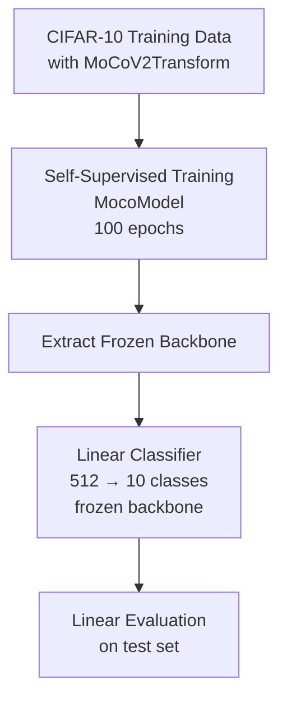

**Linear classifier implementation:** [docs/source/tutorials_source/package/tutorial_moco_memory_bank.py:292-356]()

The linear evaluation protocol trains only a linear layer on top of frozen features:
- Backbone is frozen using `deactivate_requires_grad()`
- Single linear layer: `nn.Linear(512, 10)` for 10 CIFAR-10 classes
- Trained with cross-entropy loss for 100 epochs
- Achieves ~73% test accuracy after 100 epochs, ~80% after 200 epochs

**Sources:** [docs/source/tutorials_source/package/tutorial_moco_memory_bank.py:1-404](), [docs/source/getting_started/advanced.rst:282-297]()

---

## Tutorial 3: Train SimCLR on Clothing

This tutorial trains a SimCLR model on the Freiburg Clothing dataset and demonstrates how to visualize embeddings through nearest neighbor analysis.

### SimCLR Training Pipeline

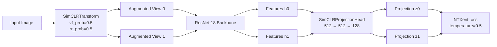

### Model Implementation

**Complete SimCLR model structure:** [docs/source/tutorials_source/package/tutorial_simclr_clothing.py:139-171]()

```python
class SimCLRModel(pl.LightningModule):
    def __init__(self):
        super().__init__()
        # ResNet backbone without classification head
        resnet = torchvision.models.resnet18()
        self.backbone = nn.Sequential(*list(resnet.children())[:-1])
        
        hidden_dim = resnet.fc.in_features  # 512 for ResNet-18
        self.projection_head = SimCLRProjectionHead(hidden_dim, hidden_dim, 128)
        self.criterion = NTXentLoss()
    
    def training_step(self, batch, batch_idx):
        (x0, x1), _, _ = batch
        z0 = self.forward(x0)
        z1 = self.forward(x1)
        loss = self.criterion(z0, z1)
        return loss
```

### Dataset-Specific Augmentations

For clothing images taken from above, custom augmentations include:
- **Vertical flip:** `vf_prob=0.5` (clothing can be upside down)
- **Random rotation:** `rr_prob=0.5` by 90 degrees (orientation invariance)
- **Color jittering:** Standard to learn structure over color

**Augmentation configuration:** [docs/source/tutorials_source/package/tutorial_simclr_clothing.py:91]()

### Embedding Visualization and Analysis

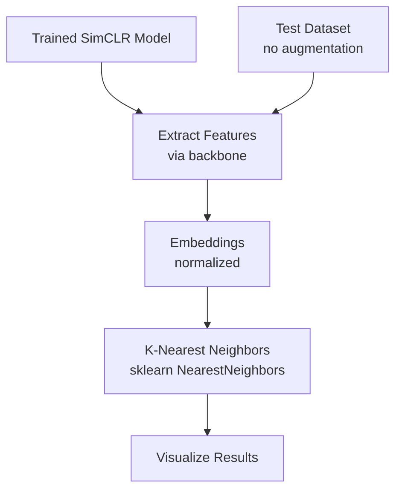

**Embedding generation function:** [docs/source/tutorials_source/package/tutorial_simclr_clothing.py:188-204]()

```python
def generate_embeddings(model, dataloader):
    embeddings = []
    filenames = []
    with torch.no_grad():
        for img, _, fnames in dataloader:
            img = img.to(model.device)
            emb = model.backbone(img).flatten(start_dim=1)
            embeddings.append(emb)
            filenames.extend(fnames)
    
    embeddings = torch.cat(embeddings, 0)
    embeddings = normalize(embeddings)  # L2 normalization
    return embeddings, filenames
```

**Color invariance experiment:** The tutorial demonstrates training with and without color augmentations to show how this affects the learned representations ([tutorial_simclr_clothing.py:259-283]()).

**Sources:** [docs/source/tutorials_source/package/tutorial_simclr_clothing.py:1-321](), [lightly/models/modules/heads.py]()

---

## Tutorial 4: Train SimSiam on Satellite Images

This tutorial demonstrates SimSiam training on ESA Sentinel-2 satellite imagery, showcasing domain-specific considerations and embedding quality assessment through collapse detection.

### SimSiam Architecture

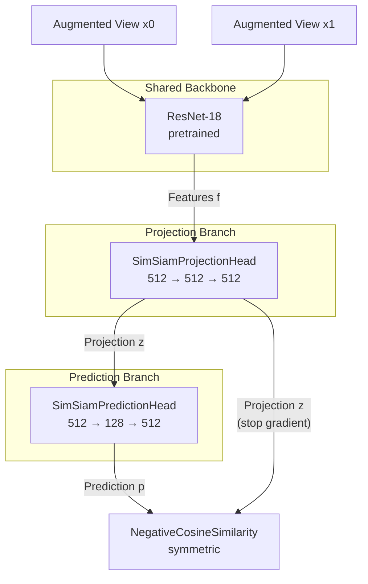

**Key architectural difference from SimCLR:** SimSiam uses a prediction head and stop-gradient operation instead of a momentum encoder.

### Domain-Specific Augmentations for Satellite Images

**Augmentation strategy:** [docs/source/tutorials_source/package/tutorial_simsiam_esa.py:92-108]()

```python
transform = SimCLRTransform(
    input_size=256,
    hf_prob=0.5,      # horizontal flip
    vf_prob=0.5,      # vertical flip (valid for satellite)
    rr_prob=0.5,      # random rotation by 90° (orientation invariant)
    min_scale=0.5,    # slight random crop (same altitude)
    cj_prob=0.2,      # weak color jitter
    cj_bright=0.1,
    cj_contrast=0.1,
    cj_hue=0.1,
    cj_sat=0.1,
)
```

**Rationale:**
- Satellite images have no canonical "up" direction → vertical flip and rotation are appropriate
- All images from same altitude → minimal scale variation
- Water color can vary slightly → weak color augmentation

### Collapse Detection

SimSiam models can suffer from representation collapse where all outputs become similar. The tutorial implements collapse detection:

**Collapse monitoring:** [docs/source/tutorials_source/package/tutorial_simsiam_esa.py:235-256]()

```python
# Inside training loop
output = p0.detach()
output = torch.nn.functional.normalize(output, dim=1)  # L2 normalize
output_std = torch.std(output, 0)  # Per-dimension std
output_std = output_std.mean()

# Collapse level: should be close to 1/sqrt(dim)
# For 512 dimensions: expected ~0.044
collapse_level = max(0.0, 1 - math.sqrt(out_dim) * avg_output_std)
```

**Expected values:**
- No collapse: `std ≈ 1/sqrt(dim)` (e.g., ~0.044 for 512-dim)
- Collapse: `std → 0`

### Training Configuration

**Model parameters:** [docs/source/tutorials_source/package/tutorial_simsiam_esa.py:155-178]()
- Backbone: ResNet-18 (pretrained for faster training)
- Projection hidden: 512, output: 512
- Prediction hidden: 128 (bottleneck architecture)
- Learning rate: `0.05 * batch_size / 256` (scaled by batch size)
- Optimizer: SGD with momentum=0.9, weight_decay=5e-4

**Sources:** [docs/source/tutorials_source/package/tutorial_simsiam_esa.py:1-449](), [lightly/models/modules/heads.py]()

---

## Tutorial 5: Custom Augmentations for X-ray Images

This tutorial addresses challenges with non-standard image formats (16-bit TIFF) and domain-specific augmentations for medical imaging.

### Custom Transform Pipeline

```mermaid
graph LR
    TIFF["16-bit TIFF Image<br/>numpy array"]
    HIST["HistogramNormalize<br/>custom transform"]
    IMG8["8-bit PIL Image"]
    GRAY["Grayscale → RGB<br/>repeat channels"]
    CROP["RandomResizedCrop"]
    FLIP["Random Flips"]
    BLUR["GaussianBlur"]
    TENSOR["ToTensor"]
    NOISE["GaussianNoise<br/>custom transform"]
    FINAL["Augmented Tensor"]
    
    TIFF --> HIST
    HIST --> IMG8
    IMG8 --> GRAY
    GRAY --> CROP
    CROP --> FLIP
    FLIP --> BLUR
    BLUR --> TENSOR
    TENSOR --> NOISE
    NOISE --> FINAL
```

### Custom Augmentation Implementations

**Histogram Normalization:** [docs/source/tutorials_source/package/tutorial_custom_augmentations.py:100-122]()

Converts 16-bit depth to 8-bit using histogram equalization:

```python
class HistogramNormalize:
    def __init__(self, number_bins: int = 256):
        self.number_bins = number_bins
    
    def __call__(self, image: np.array) -> Image:
        # Get histogram and cumulative distribution
        image_histogram, bins = np.histogram(image.flatten(), self.number_bins, density=True)
        cdf = image_histogram.cumsum()
        cdf = 255 * cdf / cdf[-1]  # Normalize to [0, 255]
        
        # Linear interpolation for new pixel values
        image_equalized = np.interp(image.flatten(), bins[:-1], cdf)
        return Image.fromarray(image_equalized.reshape(image.shape))
```

**Gaussian Noise:** [docs/source/tutorials_source/package/tutorial_custom_augmentations.py:130-144]()

Adds signal-dependent noise (SNR-based):

```python
class GaussianNoise:
    def __call__(self, sample: torch.Tensor) -> torch.Tensor:
        mu = sample.mean()
        snr = np.random.randint(low=4, high=8)
        sigma = mu / snr
        noise = torch.normal(torch.zeros(sample.shape), sigma)
        return sample + noise
```

### Dataset Integration with Custom Loader

**Custom image loader for 16-bit TIFF:** [docs/source/tutorials_source/package/tutorial_custom_augmentations.py:215-224]()

```python
def tiff_loader(f):
    """Loads a 16-bit tiff image and returns it as a numpy array."""
    with open(f, "rb") as f:
        image = Image.open(f)
        return np.array(image)

# Override default loader
dataset_train = LightlyDataset(input_dir=path_to_data, transform=transform)
dataset_train.dataset.loader = tiff_loader
```

**Why this is needed:** Default torchvision loader converts images to 8-bit RGB, which would clip all pixel values above 255 in 16-bit images.

### Complete Transform Composition

**Full augmentation pipeline:** [docs/source/tutorials_source/package/tutorial_custom_augmentations.py:159-174]()

```python
view_transform = torchvision.transforms.Compose([
    HistogramNormalize(),                          # 16-bit → 8-bit
    torchvision.transforms.Grayscale(num_output_channels=3),  # 1 → 3 channels
    torchvision.transforms.RandomResizedCrop(size=128, scale=(0.2, 1.0)),
    torchvision.transforms.RandomHorizontalFlip(p=0.5),
    torchvision.transforms.RandomVerticalFlip(p=0.5),
    torchvision.transforms.GaussianBlur(21),
    torchvision.transforms.ToTensor(),
    GaussianNoise(),                               # Applied after ToTensor
])
```

**Sources:** [docs/source/tutorials_source/package/tutorial_custom_augmentations.py:1-436](), [lightly/transforms/multi_view_transform.py]()

---

## Tutorial 6: Pre-train Detectron2 Backbone

This tutorial demonstrates integrating Lightly with Facebook's Detectron2 framework for object detection, showing how to extract, pre-train, and save a Detectron2-compatible ResNet50 backbone.

### Integration Architecture

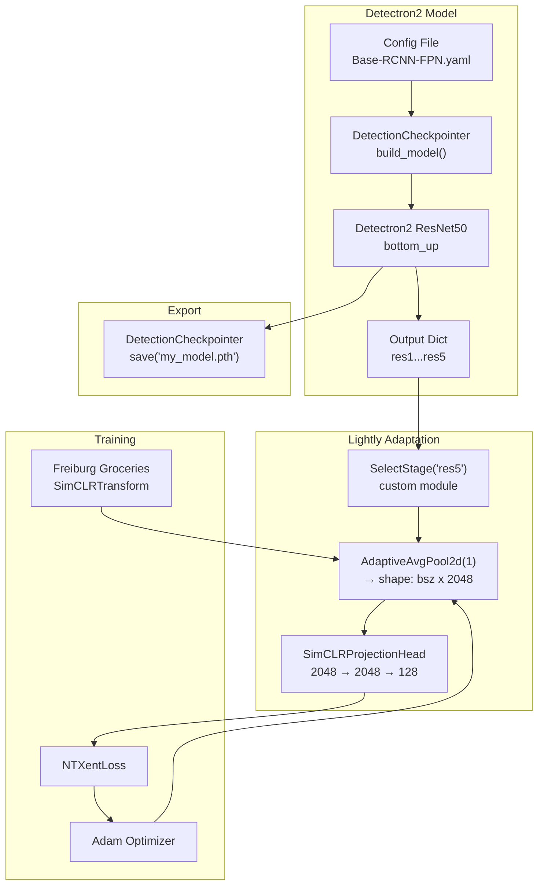

### Extracting Detectron2 Backbone

**Key challenge:** Detectron2 ResNet outputs a dictionary with keys `["res2", "res3", "res4", "res5"]` instead of a single tensor.

**Solution - Custom stage selector:** [docs/source/tutorials_source/package/tutorial_pretrain_detectron2.py:113-122]()

```python
class SelectStage(torch.nn.Module):
    """Selects features from a given stage."""
    def __init__(self, stage: str = "res5"):
        super().__init__()
        self.stage = stage
    
    def forward(self, x):
        return x[self.stage]  # Extract res5 output
```

**Backbone construction:** [docs/source/tutorials_source/package/tutorial_pretrain_detectron2.py:143-149]()

```python
detmodel = modeling.build_model(cfg)

simclr_backbone = torch.nn.Sequential(
    detmodel.backbone.bottom_up,  # Detectron2 ResNet
    SelectStage("res5"),           # Extract res5 features (bsz x 2048 x 4 x 4)
    torch.nn.AdaptiveAvgPool2d(1), # Pool to (bsz x 2048)
)
```

### Configuration Adjustments

**Required config modifications:** [docs/source/tutorials_source/package/tutorial_pretrain_detectron2.py:126-136]()

```python
cfg = config.get_cfg()
cfg.merge_from_file("Base-RCNN-FPN.yaml")

cfg.MODEL.DEVICE = "cuda"          # Set device
cfg.MODEL.WEIGHTS = ""              # Random initialization (no pre-trained weights)
cfg.INPUT.FORMAT = "RGB"            # PyTorch uses RGB, Detectron2 default is BGR
```

**Important:** The `INPUT.FORMAT = "RGB"` is critical because:
- Lightly/PyTorch transforms expect RGB
- Detectron2 defaults to BGR
- Training with wrong format causes poor performance

### Self-Supervised Pre-training

**Training loop:** [docs/source/tutorials_source/package/tutorial_pretrain_detectron2.py:204-224]()

Simple contrastive training with SimCLR:
- Uses Adam optimizer (lr=1e-4) for stability
- Projects features through `SimCLRProjectionHead(2048, 2048, 128)`
- Optimizes `NTXentLoss` on projected features
- Trains for 5 epochs (demonstration only; production would use more)

### Saving for Detectron2

**Checkpoint export:** [docs/source/tutorials_source/package/tutorial_pretrain_detectron2.py:232-240]()

```python
# Extract pre-trained backbone from sequential wrapper
detmodel.backbone.bottom_up = simclr_backbone[0]

# Save in Detectron2 format
checkpointer = DetectionCheckpointer(detmodel, save_dir="./")
checkpointer.save("my_model")
```

### Using Pre-trained Checkpoint

**Fine-tuning command:** [docs/source/tutorials_source/package/tutorial_pretrain_detectron2.py:253-259]()

```bash
python train_net.py \
    --config-file configs/COCO-InstanceSegmentation/mask_rcnn_R_50_FPN_1x.yaml \
    MODEL.WEIGHTS path/to/my_model.pth \
    MODEL.PIXEL_MEAN 123.675,116.280,103.530 \
    MODEL.PIXEL_STD 58.395,57.120,57.375 \
    INPUT.FORMAT RGB
```

**Normalization values:** These correspond to ImageNet statistics scaled to [0, 255] range because SimCLR pre-training used ImageNet normalization.

**Sources:** [docs/source/tutorials_source/package/tutorial_pretrain_detectron2.py:1-290](), [detectron2/config/__init__.py]()

---

## Model Examples Reference

Beyond the tutorials, the framework provides ready-to-use implementations of major SSL methods. These serve as reference implementations and starting points for custom models.

### Available Model Implementations

| Model | Paper | Key Features | Primary Components |
|-------|-------|--------------|-------------------|
| SimCLR | [arXiv:2002.05709](https://arxiv.org/abs/2002.05709) | Simple contrastive learning | `SimCLRProjectionHead`, `NTXentLoss` |
| MoCo | [arXiv:1911.05722](https://arxiv.org/abs/1911.05722) | Momentum encoder + memory bank | `MoCoProjectionHead`, momentum updates |
| BYOL | [arXiv:2006.07733](https://arxiv.org/abs/2006.07733) | No negative samples | `BYOLProjectionHead`, `BYOLPredictionHead` |
| SimSiam | [arXiv:2011.10566](https://arxiv.org/abs/2011.10566) | Stop-gradient, no momentum | `SimSiamProjectionHead`, `SimSiamPredictionHead` |
| DINO | [arXiv:2104.14294](https://arxiv.org/abs/2104.14294) | Self-distillation with ViT | `DINOProjectionHead`, multi-crop |
| MAE | [arXiv:2111.06377](https://arxiv.org/abs/2111.06377) | Masked autoencoding | `MaskedVisionTransformerTIMM`, masking utils |
| MSN/PMSN | [arXiv:2204.07141](https://arxiv.org/abs/2204.07141) | Masked Siamese Networks | `MSNProjectionHead`, prototype learning |
| SwaV | [arXiv:2006.09882](https://arxiv.org/abs/2006.09882) | Swapped assignments | `SwaVProjectionHead`, `SwaVPrototypes` |

**Model implementations location:** [lightly/models/]()

**Loss functions location:** [lightly/loss/]()

**Transform implementations:** [lightly/transforms/]()

### Example Usage Pattern

All models follow a similar pattern:

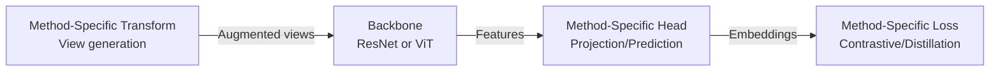

Each model example typically includes:
1. Complete model architecture definition
2. Transform pipeline configuration
3. Loss function setup
4. Training loop (PyTorch or Lightning)
5. Embedding generation code

**Access model examples:** See the `examples/models.rst` documentation section or explore implementations in [lightly/models/]().

**Sources:** [docs/source/index.rst:95-100](), [docs/source/getting_started/advanced.rst:211-219](), [lightly/models/__init__.py]()

---

## Common Patterns Across Tutorials

### Standard Training Workflow

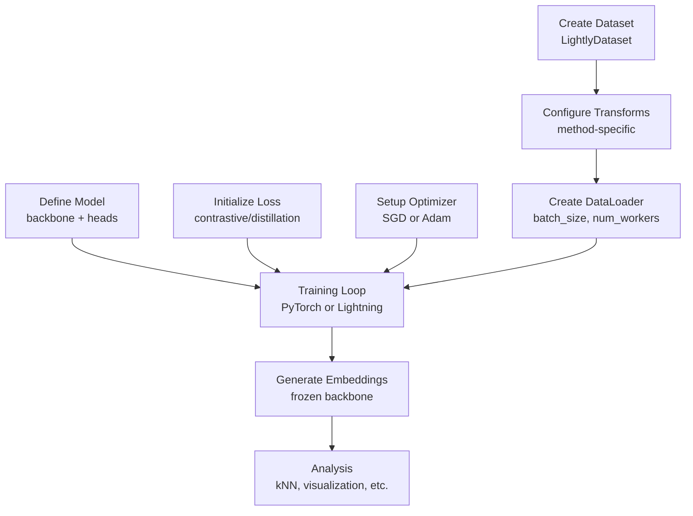

### Key Classes and Functions

**Data handling:**
- `lightly.data.LightlyDataset` - Unified dataset interface
- `lightly.data.VideoDataset` - Video frame extraction
- `lightly.transforms.*Transform` - Method-specific augmentations

**Model components:**
- `lightly.models.modules.heads.*` - Projection and prediction heads
- `lightly.models.utils.update_momentum()` - EMA updates for momentum encoders
- `lightly.models.utils.deactivate_requires_grad()` - Freeze parameters
- `lightly.models.utils.batch_shuffle()` - Prevent batch norm leakage

**Loss functions:**
- `lightly.loss.NTXentLoss` - NT-Xent contrastive loss with optional memory bank
- `lightly.loss.NegativeCosineSimilarity` - For SimSiam/BYOL
- `lightly.loss.DINOLoss` - Self-distillation loss
- `lightly.loss.MSNLoss` / `PMSNLoss` - Masked Siamese Networks

**Training frameworks:**
- Direct PyTorch training loops (Tutorial 4)
- PyTorch Lightning modules (Tutorials 2, 3, 5, 6)

**Sources:** [lightly/__init__.py](), [lightly/data/__init__.py](), [lightly/models/__init__.py](), [lightly/loss/__init__.py]()

---

## Additional Resources

### Related Documentation Pages

- **Data Handling:** [Datasets](#3.1), [Data Collation and Batching](#3.2)
- **Model Architecture:** [Model Architectures](#2.1), [Model Components and Utilities](#2.2)
- **Transforms:** [Transforms and Augmentations](#2.4)
- **CLI Usage:** [Training Commands](#4.1), [Embedding Generation](#4.2)
- **Benchmarking:** [ImageNet Benchmarks](#7.1), [Evaluation Protocols](#7.2)

### Tutorial Files

All tutorial source files are available at:
- [docs/source/tutorials/]() - RST documentation files
- [docs/source/tutorials_source/package/]() - Executable Python tutorial scripts

**Sources:** [docs/source/index.rst:1-130](), [docs/source/getting_started/lightly_at_a_glance.rst:1-238]()

---

