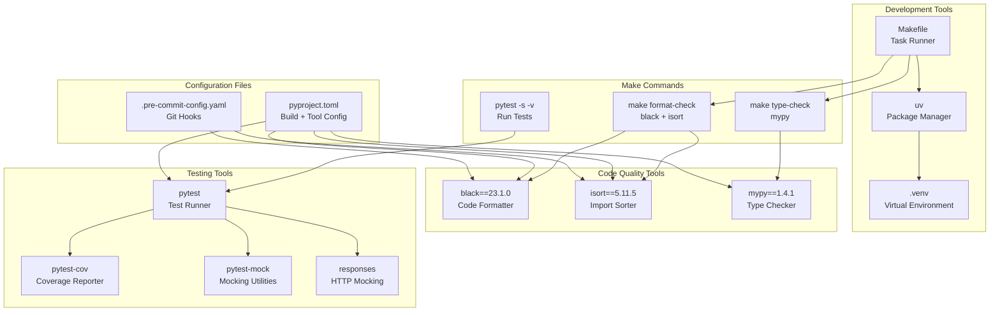
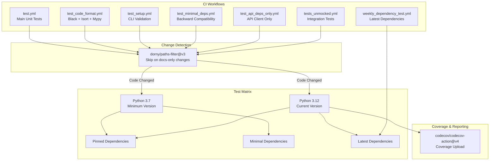
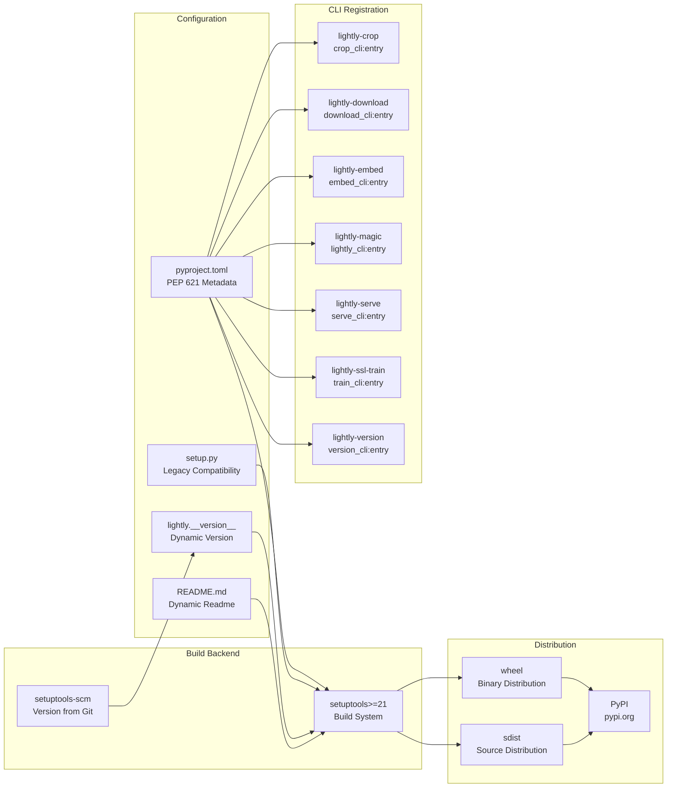

<!-- source: DeepWiki mcp.deepwiki.com · repo lightly-ai/lightly · page 9 Developer Guide · fetched 2026-10-21 -->

# Developer Guide

<details>
<summary>Relevant source files</summary>

The following files were used as context for generating this wiki page:

- [.github/workflows/check_example_nbs.yml](.github/workflows/check_example_nbs.yml)
- [.github/workflows/discord_release_notification.yml](.github/workflows/discord_release_notification.yml)
- [.github/workflows/release_pypi.yml](.github/workflows/release_pypi.yml)
- [.github/workflows/test.yml](.github/workflows/test.yml)
- [.github/workflows/test_api_deps_only.yml](.github/workflows/test_api_deps_only.yml)
- [.github/workflows/test_code_format.yml](.github/workflows/test_code_format.yml)
- [.github/workflows/test_minimal_deps.yml](.github/workflows/test_minimal_deps.yml)
- [.github/workflows/test_setup.yml](.github/workflows/test_setup.yml)
- [.github/workflows/tests_unmocked.yml](.github/workflows/tests_unmocked.yml)
- [.github/workflows/weekly_dependency_test.yml](.github/workflows/weekly_dependency_test.yml)
- [Makefile](Makefile)
- [lightly/cli/__init__.py](lightly/cli/__init__.py)
- [lightly/cli/download_cli.py](lightly/cli/download_cli.py)
- [lightly/loss/pmsn_loss.py](lightly/loss/pmsn_loss.py)
- [lightly/models/modules/ijepa_timm.py](lightly/models/modules/ijepa_timm.py)
- [lightly/models/modules/masked_autoencoder_timm.py](lightly/models/modules/masked_autoencoder_timm.py)
- [lightly/models/modules/masked_vision_transformer_timm.py](lightly/models/modules/masked_vision_transformer_timm.py)
- [pyproject.toml](pyproject.toml)
- [requirements/base.txt](requirements/base.txt)
- [setup.py](setup.py)
- [tests/cli/test_cli_download.py](tests/cli/test_cli_download.py)
- [tests/embedding/test_embedding.py](tests/embedding/test_embedding.py)
- [tests/loss/test_msn_loss.py](tests/loss/test_msn_loss.py)
- [tests/loss/test_pmsn_loss.py](tests/loss/test_pmsn_loss.py)

</details>


This document provides essential information for developers contributing to the Lightly codebase. It covers development environment setup, code organization, testing practices, and build system configuration. For detailed information about build configuration and dependency management, see [Project Configuration](#9.1). For comprehensive testing and CI/CD documentation, see [Testing and CI/CD](#9.2).

## Development Environment Setup

The Lightly project uses a modern Python development toolchain with `uv` for fast package management and virtual environment handling. The project requires Python 3.6 or higher ([pyproject.toml:10]()).

### Installing Dependencies

The project provides several dependency installation targets via the Makefile:

| Target | Purpose | Use Case |
|--------|---------|----------|
| `install-pinned` | Pinned versions for reproducibility | Standard development |
| `install-pinned-extras` | Pinned versions + dev tools | Development with testing/formatting |
| `install-minimal` | Minimal PyTorch versions | Testing backward compatibility |
| `install-minimal-extras` | Minimal + dev tools | Testing with older dependencies |
| `install-latest` | Latest available versions | Upstream compatibility testing |
| `install-api-only` | API client dependencies only | Platform integration work |

**Development Environment Setup:**

```bash
# Install uv and create virtual environment
make install-uv reset-venv

# Activate the virtual environment
source .venv/bin/activate

# Install development dependencies
make install-pinned-extras
```

The `install-pinned-extras` target installs all core dependencies plus development tools including pytest, black, isort, mypy, sphinx, and other utilities needed for testing and documentation ([pyproject.toml:60-91]()).

Sources: [pyproject.toml:1-321](), [.github/workflows/test.yml:49-53](), [.github/workflows/test_setup.yml:44-48]()

## Repository Structure

The Lightly codebase follows a modular architecture organized into functional subsystems:

```
lightly/
├── api/                    # Platform integration layer
│   ├── api_workflow_client.py
│   ├── retry_utils.py
│   └── download.py
├── cli/                    # Command-line interface
│   ├── train_cli.py
│   ├── embed_cli.py
│   └── config/
├── data/                   # Dataset and data loading
│   ├── dataset.py
│   └── collate.py
├── models/                 # SSL model architectures
│   ├── modules/
│   └── utils.py
├── loss/                   # Loss functions
├── transforms/             # Data augmentation
├── utils/                  # Utilities and helpers
│   └── benchmarking/
├── core.py                 # Python API entry points
└── openapi_generated/      # Auto-generated API client
```

**Key subsystems:**
- **Models**: SSL architectures, backbones, projection heads (see [Self-Supervised Learning Models](#2))
- **Data**: Dataset classes, data loading, transforms (see [Data Handling](#3))
- **CLI**: Command-line tools and Hydra configuration (see [Command-Line Interface](#4))
- **API**: Platform integration and workflow client (see [Platform Integration](#6))
- **Utils**: Benchmarking, helper functions, retry logic

Sources: [pyproject.toml:127-129](), repository structure

## Development Workflow

### Development Workflow Overview



Sources: [pyproject.toml:60-91](), [pyproject.toml:137-142](), [.github/workflows/test_code_format.yml:1-42]()

### Code Formatting

The project enforces consistent code style using `black` and `isort` with frozen versions to ensure consistency across development machines and CI:

```bash
# Check code format without modifying files
make format-check

# Auto-format code (if available in Makefile)
black lightly/ tests/
isort lightly/ tests/
```

**Black Configuration** ([pyproject.toml:137-138]()):
- Extends exclusion to skip `lightly/openapi_generated/.*` (auto-generated code)

**Isort Configuration** ([pyproject.toml:140-142]()):
- Profile: `black` (compatible with black formatting)
- Extends skip to exclude `lightly/openapi_generated`

Versions are pinned at:
- `black==23.1.0`
- `isort==5.11.5`

These must match the versions in `.pre-commit-config.yaml` to ensure pre-commit hooks match CI validation.

Sources: [pyproject.toml:82-84](), [pyproject.toml:137-142](), [.github/workflows/test_code_format.yml:34-37]()

### Type Checking

The project uses `mypy` with strict configuration to enforce type safety. Type checking runs on modified code during CI:

```bash
# Run type checking
make type-check
```

**Mypy Configuration** ([pyproject.toml:147-181]()):

| Setting | Value | Purpose |
|---------|-------|---------|
| `disallow_untyped_defs` | `true` | All functions must have type annotations |
| `disallow_any_generics` | `true` | Generic types must have type parameters |
| `strict_equality` | `true` | Strict equality checks |
| `warn_return_any` | `true` | Warn when returning `Any` |
| `warn_unreachable` | `true` | Detect unreachable code |

**Exclusions**: Many modules are currently excluded from type checking ([pyproject.toml:185-297]()). The project is gradually adding type annotations, with a long-term goal to remove these exclusions.

**Module-Level Overrides**:
- API, CLI, data, and models modules: `follow_imports = "skip"` ([pyproject.toml:300-309]())
- OpenAPI generated code: `ignore_errors = true` ([pyproject.toml:312-316]())

Sources: [pyproject.toml:147-316](), [.github/workflows/test_code_format.yml:38-41]()

### Running Tests Locally

The test suite uses `pytest` with several plugins for enhanced functionality:

```bash
# Activate virtual environment
source .venv/bin/activate

# Set environment variable to skip version checking
export LIGHTLY_SERVER_LOCATION="localhost:-1"

# Run all tests
python -m pytest -s -v --runslow

# Run specific test file
python -m pytest tests/api/test_download.py -v

# Run with coverage (Python 3.12)
python -m pytest --cov=./lightly --cov-report=xml --ignore=./lightly/openapi_generated/
```

**Pytest Plugins**:
- `pytest-forked`: Run tests in isolated processes ([pyproject.toml:64]())
- `pytest-xdist`: Parallel test execution ([pyproject.toml:65]())
- `pytest-mock`: Mocking utilities ([pyproject.toml:66]())
- `responses`: HTTP request mocking ([pyproject.toml:67]())

**Test Organization**:
- Unit tests in `tests/` mirror the `lightly/` structure
- Mocked API tests use `responses` library to avoid real API calls
- Unmocked integration tests in `tests/UNMOCKED_end2end_tests/` (run manually)

Sources: [pyproject.toml:63-67](), [.github/workflows/test.yml:56-68](), [tests/api/test_download.py:1-124]()

## Testing Infrastructure Overview

The CI/CD system uses GitHub Actions with multiple workflows for different testing scenarios. The testing strategy includes:



**Key Features**:

1. **Change Detection**: Uses `dorny/paths-filter` to skip expensive tests when only documentation changes ([.github/workflows/test.yml:11-26]())

2. **Test Matrix**: Tests against multiple Python versions (3.7, 3.12) and dependency configurations (pinned, minimal, latest)

3. **Coverage**: Collected only on Python 3.12 to avoid redundancy, uploaded to Codecov ([.github/workflows/test.yml:62-75]())

4. **Weekly Testing**: Scheduled runs with latest dependencies catch external breakages ([.github/workflows/weekly_dependency_test.yml:9-10]())

5. **Manual Workflows**: Integration tests against staging server run via `workflow_dispatch` ([.github/workflows/tests_unmocked.yml:2]())

For detailed information about testing strategies, mocking patterns, and CI/CD pipelines, see [Testing and CI/CD](#9.2).

Sources: [.github/workflows/test.yml:1-76](), [.github/workflows/test_code_format.yml:1-42](), [.github/workflows/weekly_dependency_test.yml:1-42]()

## Build and Distribution System

The project uses modern Python packaging with `pyproject.toml` as the single source of configuration:

### Build System Architecture



**Key Components**:

1. **Build System** ([pyproject.toml:1-6]()):
   - Uses `setuptools>=21` with `setuptools-scm` for version management
   - Follows PEP 517/518 standards

2. **Project Metadata** ([pyproject.toml:8-54]()):
   - Name: `lightly`
   - Requires Python >=3.6
   - Dynamic fields: `version`, `readme`
   - Version derived from Git tags via `setuptools-scm`

3. **CLI Scripts** ([pyproject.toml:118-126]()):
   - Seven command-line entry points registered
   - Each maps to an `entry` function in its respective CLI module

4. **Package Discovery** ([pyproject.toml:127-129]()):
   - Includes all packages matching `lightly*`
   - Package data includes `lightly/cli/config/*.yaml`

5. **Optional Dependencies** ([pyproject.toml:56-108]()):
   - `all`: Full installation with all extras
   - `dev`: Development tools (testing, formatting, type checking)
   - `minimal`: Backward compatibility testing
   - `timm`: Vision transformer models
   - `video`: Video processing support
   - `matplotlib`: Visualization support
   - `openapi`: API client dependencies

For complete build configuration details, see [Project Configuration](#9.1).

Sources: [pyproject.toml:1-136](), [setup.py:1-6](), [.github/workflows/release_pypi.yml:1-58]()

## Contributing Guidelines

### Pre-Commit Checks

Before submitting a pull request, ensure:

1. **Code is formatted**: Run `make format-check` or auto-format with `black` and `isort`
2. **Types check**: Run `make type-check` to verify mypy passes
3. **Tests pass**: Run `pytest -s -v --runslow` locally
4. **Environment variables**: Set `LIGHTLY_SERVER_LOCATION="localhost:-1"` to skip version checking during tests

### Pull Request Workflow

When you open a pull request, GitHub Actions automatically runs:

1. **Change Detection**: Determines if code changes require testing
2. **Code Format Check**: Validates black, isort, and mypy on Python 3.7 and 3.12
3. **Unit Tests**: Runs full test suite on Python 3.7 (pinned deps) and 3.12 (pinned + minimal deps)
4. **Setup Validation**: Tests CLI installation and basic commands
5. **Coverage**: Uploads coverage report to Codecov (Python 3.12 only)

### Release Process

Releases are handled via `workflow_dispatch` on [.github/workflows/release_pypi.yml:1-58]():

1. **Checkout**: Fetches latest release tag from Git
2. **Build**: Creates wheel and source distribution using `python -m build`
3. **Upload**: Publishes to PyPI using `twine`
4. **Notifications**: Sends updates to Slack (internal) and Discord (community)

The Discord notification is also triggered automatically when a GitHub release is published ([.github/workflows/discord_release_notification.yml:1-42]()).

Sources: [.github/workflows/test.yml:1-76](), [.github/workflows/test_code_format.yml:1-42](), [.github/workflows/release_pypi.yml:1-58]()

## Testing Patterns

### Mocking HTTP Requests

The test suite uses the `responses` library to mock HTTP calls to the Lightly platform:

```python
# Example from test_download.py
mock_response = MagicMock()
mock_response.raw = MagicMock()
mock_response_manager = MagicMock()
mock_response_manager.__enter__.return_value = mock_response
mock_requests_get = mocker.patch("requests.get", return_value=mock_response_manager)
```

The `download_and_write_file` function ([lightly/api/download.py:18-48]()) supports:
- URL downloads with retry logic
- Session persistence for connection pooling
- Configurable retry functions
- Timeout handling

### Multi-threaded Testing

The `download_and_write_all_files` function ([lightly/api/download.py:51-132]()) uses `ThreadPoolExecutor` for parallel downloads. Tests verify:
- Thread-safe session management
- Lock-based coordination
- Progress bar integration (via `tqdm`)
- Exception handling per file

### Environment Configuration

Tests set `LIGHTLY_SERVER_LOCATION="localhost:-1"` to disable version checking and prevent real API calls. This environment variable is checked throughout the codebase to determine if the application should attempt to contact the Lightly platform.

Sources: [tests/api/test_download.py:1-124](), [lightly/api/download.py:1-132](), [.github/workflows/test.yml:60-61]()

## Dependency Management Strategy

The project uses a tiered dependency strategy to ensure compatibility across different use cases:

| Requirements File | Purpose | Usage |
|-------------------|---------|-------|
| `requirements/base.txt` | Minimal API client deps | Platform integration only |
| `pyproject.toml` [project.dependencies] | Core framework deps | Standard installation |
| `pyproject.toml` [project.optional-dependencies.minimal] | Minimum PyTorch versions | Backward compatibility testing |
| `pyproject.toml` [project.optional-dependencies.dev] | Dev tools | Local development |

**Base Dependencies** ([requirements/base.txt:1-13]()):
- Core: `certifi`, `requests`, `urllib3`, `tqdm`
- Configuration: `hydra-core>=1.0.0`
- Data: `numpy>=1.18.1`
- Serialization: `pydantic>=1.10.5`
- Utilities: `six`, `python_dateutil`, `aenum`, `lightly_utils`

**Core Dependencies** ([pyproject.toml:38-53]()):
- Extends base with `torch`, `torchvision`, `pytorch_lightning>=1.0.4`

**Version Pinning**:
- Dev tools (`black`, `isort`, `mypy`) use exact versions to prevent formatting/type check drift
- Production dependencies use minimum version specifiers (`>=`) for flexibility
- Comment in pyproject.toml emphasizes matching pre-commit hook versions ([pyproject.toml:82]())

Sources: [requirements/base.txt:1-13](), [pyproject.toml:38-91](), [.github/workflows/test_minimal_deps.yml:35-36]()

---

