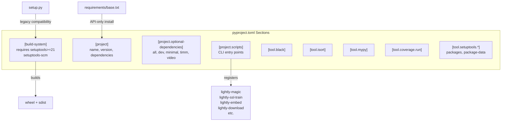
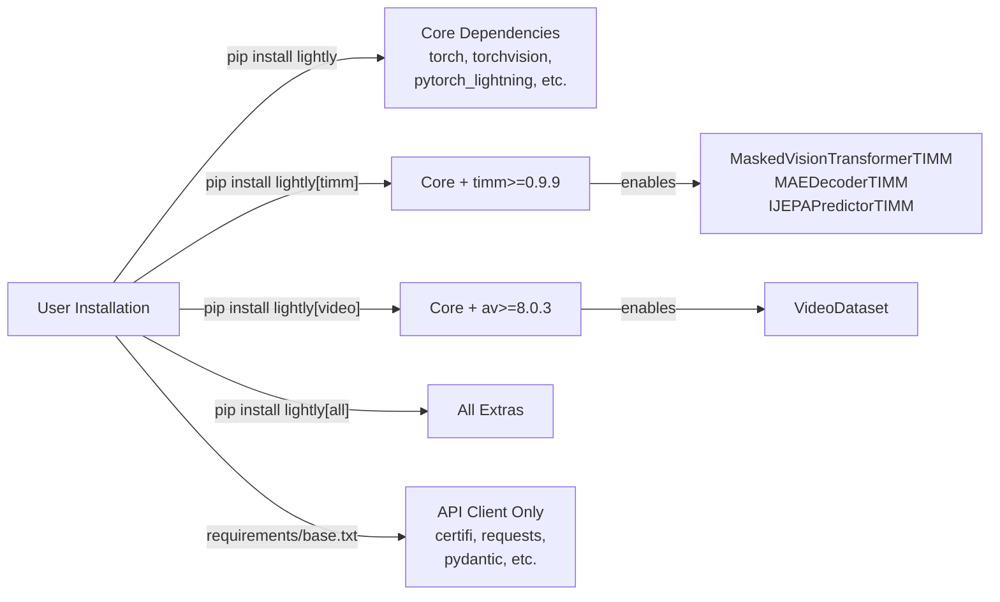
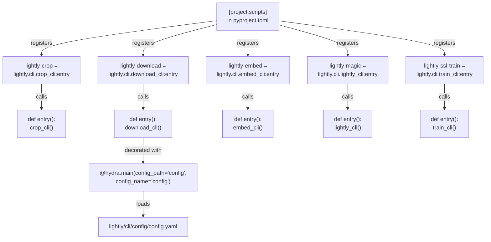
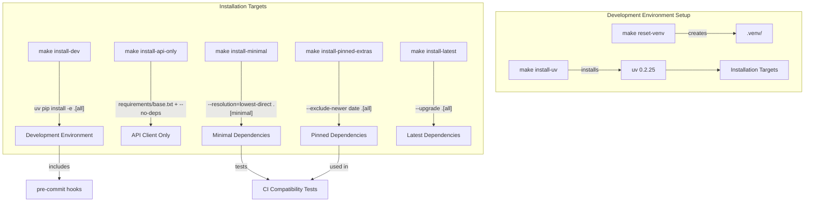
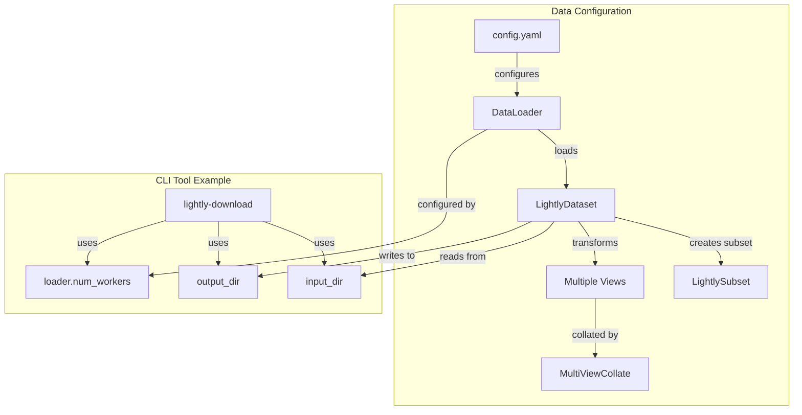

<!-- source: DeepWiki mcp.deepwiki.com · repo lightly-ai/lightly · page 9.1 Project Configuration · fetched 2026-10-21 -->

# Project Configuration

<details>
<summary>Relevant source files</summary>

The following files were used as context for generating this wiki page:

- [.github/workflows/check_example_nbs.yml](.github/workflows/check_example_nbs.yml)
- [.github/workflows/discord_release_notification.yml](.github/workflows/discord_release_notification.yml)
- [Makefile](Makefile)
- [lightly/cli/__init__.py](lightly/cli/__init__.py)
- [lightly/cli/download_cli.py](lightly/cli/download_cli.py)
- [lightly/loss/pmsn_loss.py](lightly/loss/pmsn_loss.py)
- [lightly/models/modules/ijepa_timm.py](lightly/models/modules/ijepa_timm.py)
- [lightly/models/modules/masked_autoencoder_timm.py](lightly/models/modules/masked_autoencoder_timm.py)
- [lightly/models/modules/masked_vision_transformer_timm.py](lightly/models/modules/masked_vision_transformer_timm.py)
- [pyproject.toml](pyproject.toml)
- [requirements/base.txt](requirements/base.txt)
- [setup.py](setup.py)
- [tests/cli/test_cli_download.py](tests/cli/test_cli_download.py)
- [tests/embedding/test_embedding.py](tests/embedding/test_embedding.py)
- [tests/loss/test_msn_loss.py](tests/loss/test_msn_loss.py)
- [tests/loss/test_pmsn_loss.py](tests/loss/test_pmsn_loss.py)

</details>


This document explains the build system, dependency management, and package configuration in the Lightly framework. It is intended for developers and contributors who need to understand how the project is structured, built, and packaged for distribution.

## Build System Configuration

Lightly uses modern Python packaging standards with `pyproject.toml` ([PEP 517](https://peps.python.org/pep-0517/), [PEP 518](https://peps.python.org/pep-0518/)) as the primary configuration file. The build backend is `setuptools` with `setuptools-scm` for version management.

**Build System Configuration**



The build configuration consists of:

- **`[build-system]`**: Declares `setuptools>=21` and `setuptools-scm` as build dependencies
- **`[project]`**: Package metadata, dependencies, and scripts
- **`[tool.*]`**: Tool-specific configuration (black, isort, mypy, coverage)
- **`setup.py`**: Minimal shim for backward compatibility with legacy build tools

Sources: [pyproject.toml:1-7](), [setup.py:1-7]()

### Package Metadata

The `[project]` section in `pyproject.toml` defines core package metadata:

| Field | Value | Notes |
|-------|-------|-------|
| `name` | `"lightly"` | Package name on PyPI |
| `requires-python` | `">=3.6"` | Minimum Python version |
| `authors` | `Lightly Team` | Package maintainers |
| `license` | `{file = "LICENSE.txt"}` | MIT License |
| `description` | `"A deep learning package for self-supervised learning"` | Short description |
| `classifiers` | Python 3.6-3.12, MIT License, etc. | PyPI classifiers |
| `dynamic` | `["version", "readme"]` | Version from `lightly.__version__`, README from `README.md` |

The version is dynamically determined from `lightly.__version__` using `setuptools-scm`, which derives the version from git tags.

Sources: [pyproject.toml:8-54](), [pyproject.toml:130-132]()

## Dependency Management

Lightly's dependencies are organized into core dependencies and optional extras. The core dependencies in the `[project]` section include all packages needed for self-supervised learning workflows.

### Core Dependencies

The base dependencies required for all installations:

| Package | Version Constraint | Purpose |
|---------|-------------------|---------|
| `certifi` | `>=14.05.14` | SSL certificates |
| `hydra-core` | `>=1.0.0` | CLI configuration management |
| `lightly_utils` | `~=0.0.0` | Lightly utility functions |
| `numpy` | `>=1.18.1` | Numerical operations |
| `python_dateutil` | `>=2.5.3` | Date parsing for API |
| `requests` | `>=2.27.0` | HTTP client for API |
| `six` | `>=1.10` | Python 2/3 compatibility |
| `tqdm` | `>=4.44` | Progress bars |
| `torch` | (unversioned) | PyTorch deep learning framework |
| `torchvision` | (unversioned) | PyTorch vision utilities |
| `pydantic` | `>=1.10.5` | Data validation (API models) |
| `pytorch_lightning` | `>=1.0.4` | Training framework |
| `urllib3` | `>=1.25.3` | HTTP client utilities |
| `aenum` | `>=3.1.11` | Enhanced enumerations (API) |

Note that `torch` and `torchvision` have no version constraints in `pyproject.toml` to allow flexible PyTorch installations. The `minimal` extras group specifies minimum tested versions.

These same dependencies are listed in `requirements/base.txt` for API-only installations (see "Minimal Installation" below).

Sources: [pyproject.toml:38-53](), [requirements/base.txt:1-13]()

### Optional Dependency Groups

The `[project.optional-dependencies]` section defines extras for different use cases:

| Extra | Contents | Purpose |
|-------|----------|---------|
| `all` | `lightly[dev,matplotlib,minimal,timm,video]` | All optional dependencies combined |
| `dev` | `sphinx`, `pylint`, `pytest`, `black==23.1.0`, `isort==5.11.5`, `mypy==1.4.1`, etc. | Development tools (frozen versions for consistency) |
| `minimal` | `torch>=1.10.0`, `torchvision>=0.11.0`, `pytorch_lightning>=1.6` | Minimum tested versions |
| `openapi` | `python_dateutil>=2.5.3`, `pydantic>=1.10.5`, `aenum>=3.1.11` | API client generation |
| `timm` | `timm>=0.9.9` | TIMM model support (`MaskedVisionTransformerTIMM`, `MAEDecoderTIMM`) |
| `video` | `av>=8.0.3; python_version>='3.8'` | Video dataset support (`VideoDataset`) |
| `matplotlib` | `matplotlib>=3` | Plotting utilities |

**Installation Examples**

```bash
# Full installation with all extras
pip install lightly[all]

# API client only (minimal dependencies)
pip install -r requirements/base.txt
pip install lightly --no-deps

# Development installation
pip install lightly[dev]

# Training with TIMM models
pip install lightly[timm]
```

**Dependency Relationships**



Sources: [pyproject.toml:56-108](), [requirements/base.txt:1-13]()

## CLI Entry Points

The `[project.scripts]` section registers command-line tools that are installed as executable scripts:

| Command | Entry Point | Purpose |
|---------|------------|---------|
| `lightly-crop` | `lightly.cli.crop_cli:entry` | Crop images based on YOLO labels |
| `lightly-download` | `lightly.cli.download_cli:entry` | Download tagged samples from platform |
| `lightly-embed` | `lightly.cli.embed_cli:entry` | Generate embeddings from checkpoints |
| `lightly-magic` | `lightly.cli.lightly_cli:entry` | One-command train + embed workflow |
| `lightly-serve` | `lightly.cli.serve_cli:entry` | Serve embeddings (deprecated) |
| `lightly-ssl-train` | `lightly.cli.train_cli:entry` | Train SSL models |
| `lightly-version` | `lightly.cli.version_cli:entry` | Display version information |

**Entry Point Structure**



Each CLI module defines an `entry()` function that serves as the entry point. Most CLI tools use Hydra for configuration management, loading settings from YAML files in `lightly/cli/config/`.

**Configuration Package Data**

The configuration files are included in the package distribution via the `[tool.setuptools.package-data]` section:

```
[tool.setuptools.package-data]
lightly = ["lightly/cli/config/*.yaml"]
```

Sources: [pyproject.toml:118-126](), [pyproject.toml:134-135](), [lightly/cli/__init__.py:1-14](), [lightly/cli/download_cli.py:84-135]()

## Development Tool Configuration

The `[tool.*]` sections configure development tools. These configurations are read directly by the tools when invoked.

### Code Formatting Tools

**Black Configuration**

```toml
[tool.black]
extend-exclude = "lightly/openapi_generated/.*"
```

Black formats all Python code except auto-generated OpenAPI client code in `lightly/openapi_generated/`.

**Isort Configuration**

```toml
[tool.isort]
profile = "black"
extend_skip = "lightly/openapi_generated"
```

Isort is configured to be compatible with Black's formatting and skips the same generated code directory.

**Running Format Checks**

```bash
# Format code (Makefile target)
make format

# Check formatting without modifying files
make format-check
```

Sources: [pyproject.toml:137-142](), [Makefile:37-46]()

### Type Checking Configuration

Mypy is configured with strict type checking in `[tool.mypy]`:

| Setting | Value | Purpose |
|---------|-------|---------|
| `ignore_missing_imports` | `true` | Allow imports from untyped libraries |
| `strict_equality` | `true` | Strict equality comparisons |
| `disallow_any_decorated` | `true` | Disallow `Any` in decorated functions |
| `disallow_any_generics` | `true` | Require explicit generic types |
| `disallow_untyped_defs` | `true` | All functions must have type hints |
| `disallow_incomplete_defs` | `true` | Function signatures must be complete |
| `check_untyped_defs` | `true` | Check bodies of untyped functions |
| `warn_unused_ignores` | `false` | Allow different ignores per Python version |
| `plugins` | `["numpy.typing.mypy_plugin"]` | NumPy type checking support |

**Exclusions**

The configuration excludes several modules that are in the process of being typed:

- CLI modules (`lightly/cli/*.py`)
- API workflow modules (`lightly/api/*.py`)
- Data modules (`lightly/data/*.py`)
- Deprecated models
- Test files
- Auto-generated OpenAPI code (`lightly/openapi_generated/*`)

These exclusions are defined in the `exclude` field and `[[tool.mypy.overrides]]` sections.

```bash
# Run type checking
make type-check
```

Sources: [pyproject.toml:147-316](), [Makefile:66-68]()

### Coverage Configuration

```toml
[tool.coverage.run]
omit = ["lightly/openapi_generated/*"]
```

Code coverage analysis excludes auto-generated OpenAPI client code.

Sources: [pyproject.toml:144-145]()

### Jupytext Configuration

```toml
[tool.jupytext]
notebook_metadata_filter="-all"
cell_metadata_filter="-all"
```

Jupytext is configured to strip notebook and cell metadata when converting between `.py` and `.ipynb` formats, reducing git diff noise.

Sources: [pyproject.toml:318-320]()

## Package Structure Configuration

The `[tool.setuptools.*]` sections define how the package is built and what files are included.

### Package Discovery

```toml
[tool.setuptools.packages.find]
include = ["lightly*"]
```

This configuration tells setuptools to include all packages starting with `lightly`, which includes:
- `lightly` (main package)
- `lightly.cli` (CLI modules)
- `lightly.api` (API client)
- `lightly.data` (data handling)
- `lightly.models` (SSL models)
- `lightly.loss` (loss functions)
- `lightly.transforms` (augmentations)
- `lightly.openapi_generated` (generated API client)
- All other subpackages

### Dynamic Metadata

```toml
[tool.setuptools.dynamic]
readme = {file = ["README.md"], content-type = "text/markdown"}
version = {attr = "lightly.__version__"}
```

- **README**: Loaded from `README.md` and used as the PyPI long description
- **Version**: Extracted from `lightly.__version__` attribute, which is managed by `setuptools-scm` based on git tags

### Package Data

```toml
[tool.setuptools.package-data]
lightly = ["lightly/cli/config/*.yaml"]
```

Includes Hydra configuration YAML files in the distributed package. These files are located in `lightly/cli/config/` and are needed for CLI tools to function.

Sources: [pyproject.toml:127-135]()

## Installation Targets

The Makefile provides targets for installing the package with different dependency configurations. These targets use `uv` (a fast Python package installer) for dependency management.

**Installation Targets Overview**



### Key Installation Targets

| Target | Command | Purpose |
|--------|---------|---------|
| `install-dev` | `uv pip install -e . --all-extras` | Full development installation with pre-commit hooks |
| `install-api-only` | Install from `requirements/base.txt` then `pip install . --no-deps` | API client only, no PyTorch |
| `install-minimal` | `uv pip install --resolution=lowest-direct -e .[minimal]` | Minimum tested versions |
| `install-minimal-extras` | Same with extras `[matplotlib,minimal,timm,video]` | Minimum tested versions + extras |
| `install-pinned-extras` | `--exclude-newer ${EXCLUDE_NEWER_DATE} -e . --all-extras` | Pinned to specific date for CI stability |
| `install-latest` | `--upgrade --reinstall -e . --all-extras` | Latest compatible versions |

### Dependency Resolution Strategies

**Lowest Direct Dependencies (`install-minimal`)**

The `--resolution=lowest-direct` flag installs the minimum version for direct dependencies while allowing transitive dependencies to use newer compatible versions. This is used to test backward compatibility:

```bash
# Install minimal dependencies (Python 3.7 compatible)
make reset-venv
source .venv/bin/activate
make install-minimal
```

**Pinned Dependencies (`install-pinned-extras`)**

The `--exclude-newer` flag pins dependencies to versions released before a specific date (`EXCLUDE_NEWER_DATE="2025-08-07"` in the Makefile). This keeps CI stable when new dependency versions are released:

```bash
# Install with date-pinned dependencies
make install-pinned-extras
```

**CI-Specific Targets**

The Makefile defines Python version-specific targets used in CI:

- `install-pinned-extras-3.7`: Pinned extras without video support (PyAV requires Python 3.8+)
- `install-pinned-extras-3.12`: Pinned extras with PyAV system dependencies installed

Sources: [Makefile:95-217]()

### Code Quality Targets

| Target | Commands | Purpose |
|--------|----------|---------|
| `format` | `isort $(PYTHON_DIRS)` + `black $(PYTHON_DIRS)` | Format code in-place |
| `format-check` | `isort --check-only --diff` + `black --check` | Check formatting without changes |
| `lint` | `pylint --rcfile=pylintrc lightly tests` | Static code analysis |
| `type-check` | `mypy lightly tests` | Type checking |
| `test` | `pytest tests --runslow` | Run all tests including slow ones |
| `test-fast` | `pytest tests` | Run tests except slow ones |
| `static-checks` | `format-check` + `type-check` | All static checks |
| `all-checks` | `static-checks` + `test` | Full validation |

The `PYTHON_DIRS` variable defines directories to format: `benchmarks docs examples lightly tests`.

Sources: [Makefile:34-74]()

### Build and Distribution

```bash
# Build source and wheel distributions
make dist

# Clean build artifacts
make clean
```

The `dist` target builds both source distributions (`.tar.gz`) and wheel distributions (`.whl`) using `python -m build`.

Sources: [Makefile:76-79]()

## Data Configuration

The Lightly framework includes configuration for data handling components:



Configuration parameters control:
- Input and output directories for data
- Number of workers for data loading
- Batch size and other loader parameters

Sources: [lightly/cli/download_cli.py:22-82](), [lightly/data/lightly_subset.py:1-97](), [lightly/data/multi_view_collate.py:1-87](), [tests/data/test_LightlySubset.py:1-86]()

## Summary

The Lightly project configuration provides a comprehensive system for managing dependencies, development tools, and CLI tools. The configuration is primarily defined in `pyproject.toml` and supplemented by Makefile targets for common development tasks. The Hydra configuration system is used to manage CLI parameters, allowing users to override defaults through command-line arguments.

This configuration system ensures that Lightly can be used in various environments with different dependency requirements, from minimal installations to full development setups.

---

