<!-- source: DeepWiki mcp.deepwiki.com · repo lightly-ai/lightly · page 9.2 Testing and CI/CD · fetched 2026-10-21 -->

# Testing and CI/CD

<details>
<summary>Relevant source files</summary>

The following files were used as context for generating this wiki page:

- [.github/workflows/check_example_nbs.yml](.github/workflows/check_example_nbs.yml)
- [.github/workflows/discord_release_notification.yml](.github/workflows/discord_release_notification.yml)
- [.github/workflows/release_pypi.yml](.github/workflows/release_pypi.yml)
- [.github/workflows/test.yml](.github/workflows/test.yml)
- [.github/workflows/test_api_deps_only.yml](.github/workflows/test_api_deps_only.yml)
- [.github/workflows/test_code_format.yml](.github/workflows/test_code_format.yml)
- [.github/workflows/test_minimal_deps.yml](.github/workflows/test_minimal_deps.yml)
- [.github/workflows/test_setup.yml](.github/workflows/test_setup.yml)
- [.github/workflows/tests_unmocked.yml](.github/workflows/tests_unmocked.yml)
- [.github/workflows/weekly_dependency_test.yml](.github/workflows/weekly_dependency_test.yml)
- [Makefile](Makefile)
- [lightly/loss/pmsn_loss.py](lightly/loss/pmsn_loss.py)
- [lightly/models/modules/ijepa_timm.py](lightly/models/modules/ijepa_timm.py)
- [lightly/models/modules/masked_autoencoder_timm.py](lightly/models/modules/masked_autoencoder_timm.py)
- [lightly/models/modules/masked_vision_transformer_timm.py](lightly/models/modules/masked_vision_transformer_timm.py)
- [pyproject.toml](pyproject.toml)
- [tests/loss/test_msn_loss.py](tests/loss/test_msn_loss.py)
- [tests/loss/test_pmsn_loss.py](tests/loss/test_pmsn_loss.py)

</details>


This page documents the testing infrastructure and continuous integration/continuous deployment (CI/CD) pipelines for the Lightly codebase. It covers test categories, mocking strategies, GitHub Actions workflows, dependency management approaches, and the release process.

For information about the project configuration and build system, see [Project Configuration](#9.1).

---

## Test Infrastructure Overview

The Lightly codebase employs a multi-layered testing strategy that balances comprehensive coverage with practical constraints around API quotas, execution time, and external dependencies. Tests are organized by purpose and dependency requirements.

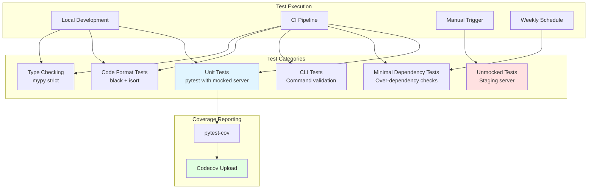

**Sources:** [.github/workflows/test.yml:1-76](), [.github/workflows/test_minimal_deps.yml:1-58](), [.github/workflows/tests_unmocked.yml:1-34]()

---

## Mocking Strategy

The test suite uses a comprehensive mocking system to simulate API interactions without hitting actual servers. This approach enables fast, reliable, and quota-free testing.

### MockedApiWorkflowClient Architecture

The `MockedApiWorkflowClient` class extends `ApiWorkflowClient` and replaces all API clients with mocked versions:

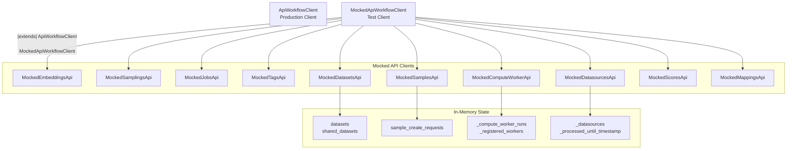

**Sources:** [tests/api_workflow/mocked_api_workflow_client.py:1033-1056]()

### Key Mocking Components

Each mocked API class maintains in-memory state and returns realistic data structures:

| Mocked Class | Purpose | Key State |
|--------------|---------|-----------|
| `MockedDatasetsApi` | Dataset CRUD operations | `datasets`, `shared_datasets` |
| `MockedSamplesApi` | Sample management | `sample_create_requests` |
| `MockedEmbeddingsApi` | Embedding operations | `embeddings` list |
| `MockedTagsApi` | Tag creation and retrieval | Generates tag data on-the-fly |
| `MockedComputeWorkerApi` | Worker registration and runs | `_compute_worker_runs`, `_registered_workers` |
| `MockedDatasourcesApi` | Datasource configuration | `_datasources`, `_processed_until_timestamp` |
| `MockedJobsApi` | Job status polling | Simulates job completion after 3 calls |
| `MockedMappingsApi` | Sample filename mappings | `sample_names` |

**Sources:** [tests/api_workflow/mocked_api_workflow_client.py:100-829]()

### Mocking File Uploads

File upload operations are mocked by replacing the `requests.put` method:

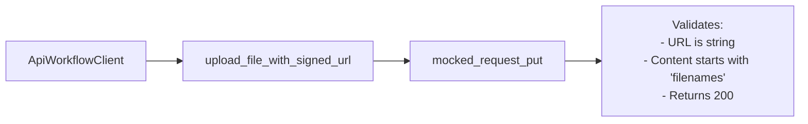

The mocked PUT request validates that data is provided correctly without performing actual network operations.

**Sources:** [tests/api_workflow/mocked_api_workflow_client.py:1001-1008](), [tests/api_workflow/mocked_api_workflow_client.py:1055]()

### Test Data Constants

Tests use predefined constants for consistency:
- `N_FILES_ON_SERVER = 100` - Number of files available in mocked server
- Generated IDs via `utils.generate_id()` for realistic ID patterns

**Sources:** [tests/api_workflow/mocked_api_workflow_client.py:97]()

---

## CI/CD Workflows

The CI/CD system uses GitHub Actions with multiple workflows for different testing purposes.

### Change Detection Strategy

All test workflows use the `dorny/paths-filter` action to skip expensive operations when only documentation changes:

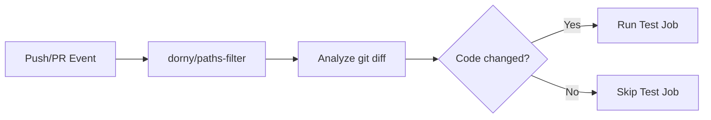

The filter excludes:
- `docs/**` - Documentation changes
- `examples/**` - Example script changes (except for CLI tests)
- `benchmarks/**` - Benchmark code changes

**Sources:** [.github/workflows/test.yml:11-27](), [.github/workflows/test_minimal_deps.yml:11-27]()

### Main Unit Test Workflow

**File:** `.github/workflows/test.yml`

**Triggers:**
- Push to `master` branch
- Pull requests
- Manual workflow dispatch

**Test Matrix:**

| Python Version | Dependencies | Coverage | Purpose |
|----------------|--------------|----------|---------|
| 3.7 | pinned-extras | No | Minimum version compatibility |
| 3.12 | pinned-extras | Yes | Current version with coverage tracking |

**Execution Flow:**

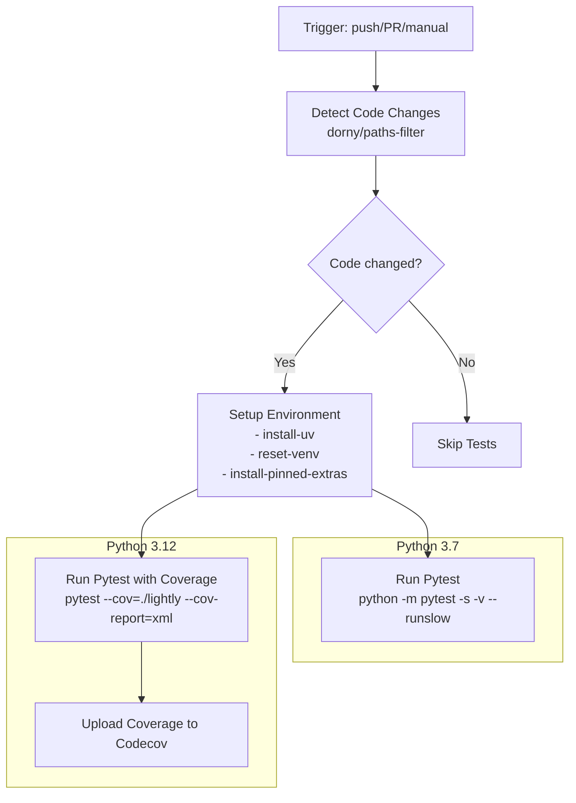

**Environment Variables:**
- `LIGHTLY_SERVER_LOCATION="localhost:-1"` - Disables real API connections

**Sources:** [.github/workflows/test.yml:1-76]()

### CLI Testing Workflow

**File:** `.github/workflows/test_setup.yml`

Tests that CLI commands are properly registered and functional:

**Commands Tested:**
- `lightly-crop --help`
- `lightly-ssl-train --help`
- `lightly-embed --help`
- `lightly-magic --help`
- `lightly-download --help`
- `lightly-version`

**Functional Test:**
Downloads a small clothing dataset and runs full training + embedding pipeline to verify end-to-end CLI functionality.

**Sources:** [.github/workflows/test_setup.yml:49-67]()

### Minimal Dependency Tests

**File:** `.github/workflows/test_minimal_deps.yml`

**Purpose:** Ensures the package doesn't have hidden dependencies and can function with minimal installs.

**Test Matrix:**

| Dependency Set | Description |
|----------------|-------------|
| `minimal` | Core package dependencies only |
| `minimal-extras` | Core + optional extras |

**Special Setup:**
- Installs `libavformat-dev` and `libavdevice-dev` for PyAV (versions < 9.0 lack FFMPEG wheels)
- Uses specific `libssh-gcrypt-4=0.9.6-2build1` to avoid 404 errors

**Sources:** [.github/workflows/test_minimal_deps.yml:1-58]()

### Unmocked Integration Tests

**File:** `.github/workflows/tests_unmocked.yml`

**Trigger:** Manual only (`workflow_dispatch`)

**Why Manual Only:**
1. Quota concerns (3000 minute limit for pip package)
2. Tests depend on unreliable staging API
3. Execution takes ~10 minutes
4. Already extensive unit test coverage

Tests run against actual Lightly staging server with real API token.

**Sources:** [.github/workflows/tests_unmocked.yml:1-34]()

### Weekly Dependency Testing

**File:** `.github/workflows/weekly_dependency_test.yml`

**Schedule:** Every Thursday at 22:00 UTC

**Purpose:** Detect upstream dependency breakages early by always installing latest versions.

**Execution:**
1. Fresh environment with Python 3.12
2. Install with `make install-latest` (no version pinning)
3. Run full test suite
4. Slack notification on pass/fail

**Notification:**
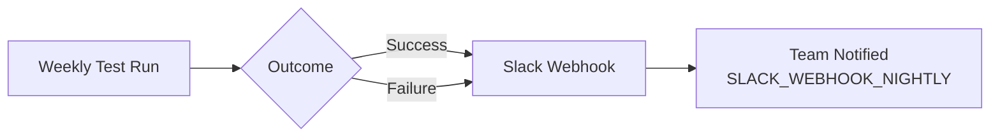

**Sources:** [.github/workflows/weekly_dependency_test.yml:1-42]()

### Code Format and Type Checking

**File:** `.github/workflows/test_code_format.yml`

**Runs on:** Python 3.7 and 3.12

**Checks:**
1. **Format Check** - `make format-check`
   - `black` for code formatting
   - `isort` for import sorting
2. **Type Check** - `make type-check`
   - `mypy` in strict mode

**Sources:** [.github/workflows/test_code_format.yml:1-42]()

### API-Only Installation Test

**File:** `.github/workflows/test_api_deps_only.yml`

**Purpose:** Verifies that API client can be used without full package dependencies.

**Test:** Imports and instantiates `ApiWorkflowClient` with minimal dependencies.

```python
from lightly.api import ApiWorkflowClient
ApiWorkflowClient(token='abc')
```

**Sources:** [.github/workflows/test_api_deps_only.yml:1-53]()

---

## Dependency Management Strategy

The project uses multiple dependency installation targets to balance reproducibility and upstream compatibility:

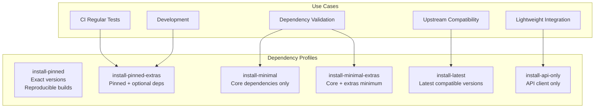

**Sources:** [.github/workflows/test.yml:52-53](), [.github/workflows/test_minimal_deps.yml:44-52](), [.github/workflows/weekly_dependency_test.yml:24-27]()

---

## Release Pipeline

The release process consists of building distribution packages, uploading to PyPI, and notifying stakeholders.

### PyPI Release Workflow

**File:** `.github/workflows/release_pypi.yml`

**Trigger:** Manual (`workflow_dispatch`)

**Process:**

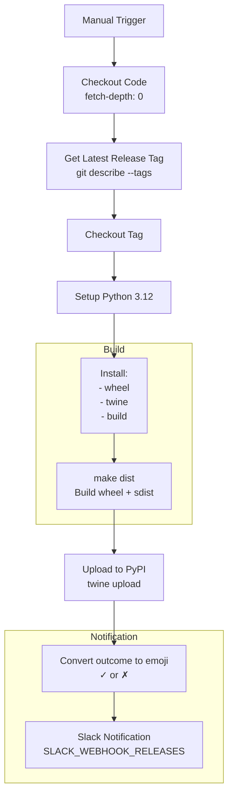

**Credentials:**
- `PYPI_USER_NAME` - PyPI username (secret)
- `PYPI_PASSWORD` - PyPI password (secret)
- `SLACK_WEBHOOK_RELEASES` - Internal team webhook (secret)

**Sources:** [.github/workflows/release_pypi.yml:1-58]()

### Community Notification

**File:** `.github/workflows/discord_release_notification.yml`

**Trigger:** Release published (GitHub release event)

**Process:**
1. Extract release metadata (name, tag, URL, body)
2. Truncate description at `<!-- STOP DISCORD MESSAGE -->` comment
3. Format as JSON for webhook
4. POST to Discord webhook

**Message Format:**
```json
{
  "username": "Lightly",
  "avatar_url": "https://avatars.githubusercontent.com/u/50146475",
  "content": "Lightly {TAG} has been released!",
  "embeds": [{
    "title": "{RELEASE_NAME}",
    "url": "{RELEASE_URL}",
    "color": 5814783,
    "description": "{TRUNCATED_BODY}"
  }]
}
```

**Sources:** [.github/workflows/discord_release_notification.yml:1-42]()

---

## Test Execution Flow

### Typical Test Execution

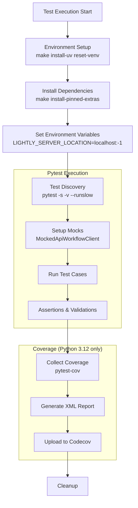

**Sources:** [.github/workflows/test.yml:49-75]()

### Example Test Pattern

Tests typically follow this structure:

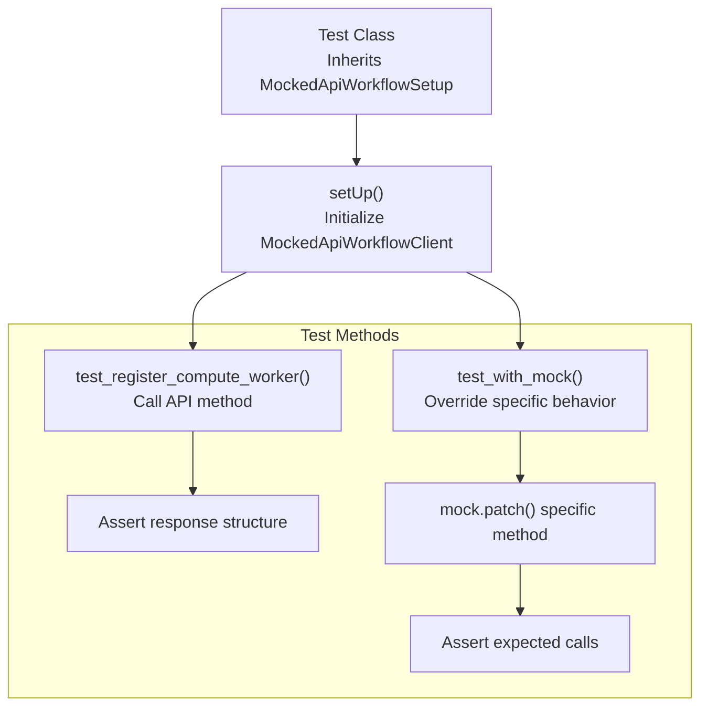

**Example Test Methods:**
- `test_register_compute_worker()` - Tests worker registration returns valid ID
- `test_create_compute_worker_config()` - Tests config creation with nested structures
- `test_schedule_compute_worker_run()` - Tests run scheduling with priorities and labels
- `test_get_compute_worker_state_and_message_OPEN()` - Tests state retrieval logic

**Sources:** [tests/api_workflow/test_api_workflow_compute_worker.py:61-77](), [tests/api_workflow/test_api_workflow_compute_worker.py:506-536]()

---

## Test Organization

### Test Directory Structure

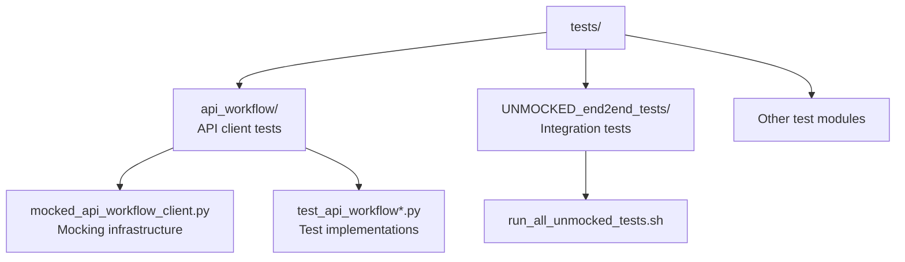

**Key Test Files:**
- `tests/api_workflow/mocked_api_workflow_client.py` - Mock implementations
- `tests/api_workflow/test_api_workflow.py` - General client tests
- `tests/api_workflow/test_api_workflow_compute_worker.py` - Worker tests
- `tests/api_workflow/test_api_workflow_datasets.py` - Dataset tests
- `tests/UNMOCKED_end2end_tests/run_all_unmocked_tests.sh` - Integration test runner

**Sources:** [tests/api_workflow/mocked_api_workflow_client.py:1-1258](), [tests/api_workflow/test_api_workflow.py:1-121](), [tests/api_workflow/test_api_workflow_datasets.py:1-509]()

---

## Configuration Validation Testing

Tests extensively validate configuration serialization and deserialization to catch schema errors early:

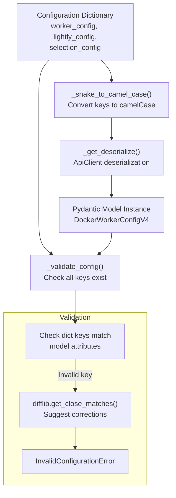

**Test Coverage:**
- Valid config creation
- Extra key detection with suggestions
- Nested config validation
- Selection config from dict conversion
- AutoTask type validation

**Sources:** [lightly/api/api_workflow_compute_worker.py:699-729](), [tests/api_workflow/test_api_workflow_compute_worker.py:215-266](), [tests/api_workflow/test_api_workflow_compute_worker.py:340-364]()

---

## Summary

The Lightly testing and CI/CD infrastructure provides comprehensive quality assurance through:

1. **Multi-layered Testing** - Unit, integration, minimal dependency, and format checks
2. **Sophisticated Mocking** - Full API mocking system for fast, reliable tests
3. **Smart Change Detection** - Skip expensive operations for documentation changes
4. **Matrix Testing** - Multiple Python versions and dependency configurations
5. **Coverage Tracking** - Code coverage monitoring with Codecov integration
6. **Automated Releases** - Streamlined PyPI publishing with stakeholder notifications
7. **Upstream Monitoring** - Weekly checks for dependency compatibility

This architecture ensures code quality while managing practical constraints around API quotas, execution time, and resource usage.