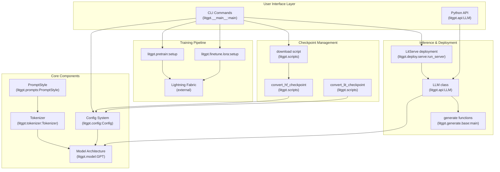
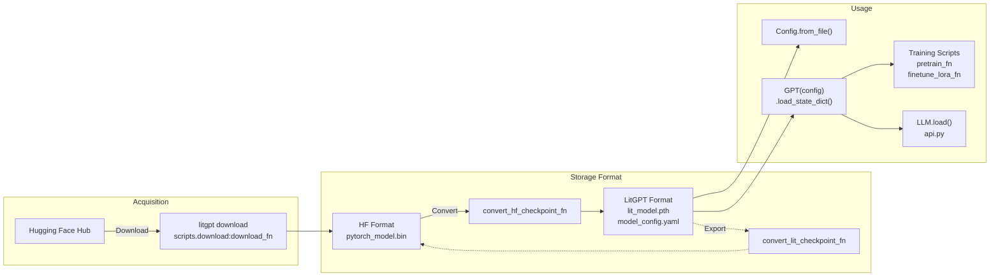

<!-- source: DeepWiki mcp.deepwiki.com · repo Lightning-AI/litgpt · page 1 Overview · fetched 2026-10-21 -->

# Overview

<details>
<summary>Relevant source files</summary>

The following files were used as context for generating this wiki page:

- [.pre-commit-config.yaml](.pre-commit-config.yaml)
- [README.md](README.md)
- [litgpt/__init__.py](litgpt/__init__.py)
- [litgpt/__main__.py](litgpt/__main__.py)
- [litgpt/config.py](litgpt/config.py)
- [litgpt/finetune/lora_legacy.py](litgpt/finetune/lora_legacy.py)
- [litgpt/scripts/validate.py](litgpt/scripts/validate.py)
- [pyproject.toml](pyproject.toml)
- [tests/test_cli.py](tests/test_cli.py)
- [tests/test_model.py](tests/test_model.py)
- [tests/test_validate.py](tests/test_validate.py)
- [tutorials/download_model_weights.md](tutorials/download_model_weights.md)

</details>


LitGPT is a hackable, production-ready implementation of state-of-the-art open-source large language models (LLMs). It provides from-scratch implementations of 20+ model architectures with optimized training, finetuning, and deployment capabilities. The codebase emphasizes transparency and control, avoiding abstraction layers in favor of explicit, modifiable code.

This page provides a high-level introduction to LitGPT's architecture, components, and capabilities. For detailed information about specific subsystems:
- Model configuration and architecture: [Core Architecture](#2)
- Training methods: [Fine-tuning](#3) and [Pretraining](#4)
- Text generation and deployment: [Inference and Generation](#6)
- Dataset handling: [Data Processing](#5)

**Sources:** [README.md:1-60](), [pyproject.toml:9-16]()

---

## Key Capabilities

LitGPT supports three primary workflows:

| Workflow | Description | Key Features |
|----------|-------------|--------------|
| **Pretraining** | Train models from scratch | Custom datasets, 3T+ token support, TinyLlama example |
| **Finetuning** | Adapt pretrained models | LoRA, QLoRA, Adapter V1/V2, full finetuning |
| **Deployment** | Serve models for inference | Python API (`LLM` class), HTTP server (LitServe), OpenAI-compatible endpoints |

Additional capabilities include:
- **Checkpoint conversion**: Bidirectional conversion between LitGPT and Hugging Face formats [litgpt/scripts/convert_hf_checkpoint.py:24-31](), [litgpt/scripts/convert_lit_checkpoint.py:25-30]().
- **Quantization**: BitsAndBytes 4-bit/8-bit, mixed precision (FP16/BF16) [litgpt/finetune/lora_legacy.py:53-58]().
- **Distributed training**: FSDP, multi-GPU/TPU support via Lightning Fabric [litgpt/finetune/lora_legacy.py:158-164]().
- **Evaluation**: Integration with lm-evaluation-harness for benchmarks [litgpt/__main__.py:53-53]().

**Sources:** [README.md:52-85](), [README.md:215-230](), [litgpt/__main__.py:33-56]()

---

## Supported Models

LitGPT includes configurations for 20+ model families from various organizations:

| Model Family | Sizes | Organization | Reference |
|--------------|-------|--------------|-----------|
| Llama 3, 3.1, 3.2, 3.3 | 1B-405B | Meta AI | [README.md:111-111]() |
| Phi (1.5, 2, 3, 4) | 1.3B-14B | Microsoft | [tutorials/download_model_weights.md:36-42]() |
| Gemma/Gemma 2/Gemma 3 | 1B-27B | Google | [README.md:113-114](), [tutorials/download_model_weights.md:18-20]() |
| Qwen2.5/Qwen3 | 0.5B-235B | Alibaba | [README.md:116-117](), [tutorials/download_model_weights.md:45-52]() |
| Mistral/Mixtral | 7B-8x22B | Mistral AI | [tutorials/download_model_weights.md:30-32]() |
| Falcon/Falcon 3 | 1B-180B | TII UAE | [README.md:132-133]() |
| R1 Distill Llama | 8B, 70B | DeepSeek AI | [README.md:118-118]() |

Full list: Use `litgpt download list` CLI command or see [tutorials/download_model_weights.md:8-61]().

**Sources:** [README.md:106-176](), [litgpt/config.py:26-117](), [tutorials/download_model_weights.md:8-61]()

---

## System Architecture

### High-Level Component Diagram



**Component Descriptions:**

- **Config System**: The `Config` dataclass [litgpt/config.py:26-117]() defines model architectures with parameters like `n_layer`, `n_embd`, and `n_head`. It includes logic for calculating `padded_vocab_size` [litgpt/config.py:127-131]() and `head_size` [litgpt/config.py:122-124]().
- **Tokenizer**: The `Tokenizer` class [litgpt/tokenizer.py:12-183]() (referenced in [litgpt/__init__.py:10]()) provides a unified interface for model-specific tokenization.
- **Model Architecture**: The `GPT` class [litgpt/model.py:39-39]() implements the transformer blocks, supporting various MLP variants [litgpt/config.py:92-92]() and attention mechanisms like MHA, GQA, and MQA [litgpt/config.py:48-68]().
- **Deployment Infrastructure**: The `serve` subcommand [litgpt/__main__.py:54-54]() uses LitServe [pyproject.toml:55-55]() to expose models via HTTP.

**Sources:** [litgpt/config.py:26-160](), [litgpt/__main__.py:33-56](), [litgpt/__init__.py:6-11]()

---

## Model Lifecycle and Data Flow



**Key Classes and Functions:**

1. **Config Loading**:
   - `Config.from_file(path)`: Loads configuration from a YAML file [litgpt/finetune/lora_legacy.py:117-128]().
   - `Config.from_name(name)`: Loads predefined configurations for known models [tests/test_model.py:148-148]().

2. **Checkpoint Validation**:
   - `validate_checkpoint()`: Compares a saved checkpoint against a model instance to ensure keys and shapes match [litgpt/scripts/validate.py:102-113](), [tests/test_validate.py:45-51]().
   - `estimate_model_memory()`: Calculates GPU memory requirements for a given `Config` [litgpt/scripts/validate.py:125-138](), [tests/test_validate.py:162-171]().

3. **Checkpoint Conversion**:
   - `convert_hf_checkpoint_fn`: Entry point for HF to LitGPT conversion [litgpt/__main__.py:24-24]().
   - `convert_lit_checkpoint_fn`: Entry point for LitGPT to HF conversion [litgpt/__main__.py:25-25]().

**Sources:** [litgpt/scripts/validate.py:23-43](), [litgpt/__main__.py:33-56](), [tests/test_validate.py:35-52]()

---

## User Interaction Patterns

LitGPT provides two primary interfaces:

### Command-Line Interface (CLI)

The CLI is the primary entry point for workflows. It is powered by `jsonargparse` [litgpt/__main__.py:6-6]() and supports subcommands for all major features:

```bash
# List available models
litgpt download list

# Download and convert model weights
litgpt download microsoft/phi-2

# Interactive chat
litgpt chat microsoft/phi-2

# Finetune with LoRA
litgpt finetune_lora microsoft/phi-2 --data Alpaca

# Serve the model
litgpt serve microsoft/phi-2
```

**Sources:** [litgpt/__main__.py:33-56](), [tests/test_cli.py:10-30](), [tutorials/download_model_weights.md:3-3]()

### Python API

The `LLM` class [litgpt/api.py:6-6]() provides a high-level programmatic interface:

```python
from litgpt import LLM

# Load model (auto-downloads if needed)
llm = LLM.load("microsoft/phi-2")

# Generate text
text = llm.generate("Fix the spelling: Every fall, the family goes to the mountains.")
print(text)
```

**Sources:** [README.md:68-76](), [litgpt/__init__.py:6-6]()

---

## Training Methods

LitGPT implements several training approaches with different parameter efficiency tradeoffs:

| Method | Subcommand | Description | Implementation |
|--------|------------|-------------|----------------|
| **LoRA** | `finetune_lora` | Low-Rank Adaptation | [litgpt/finetune/lora_legacy.py:49-108]() |
| **Adapter** | `finetune_adapter` | Attention-based adapters | [litgpt/__main__.py:39-39]() |
| **Adapter V2** | `finetune_adapter_v2` | Bias/Scale adapters | [litgpt/__main__.py:40-40]() |
| **Full** | `finetune_full` | All parameters trainable | [litgpt/__main__.py:38-38]() |

All methods leverage Lightning Fabric [litgpt/finetune/lora_legacy.py:168-175]() for distributed training and support quantization via `bitsandbytes` [litgpt/finetune/lora_legacy.py:140-150]().

**Sources:** [litgpt/__main__.py:33-56](), [litgpt/finetune/lora_legacy.py:49-81](), [pyproject.toml:43-46]()

---

## File Organization

- `litgpt/api.py`: The `LLM` high-level API [litgpt/__init__.py:6-6]().
- `litgpt/config.py`: Architecture definitions and named configs [litgpt/config.py:26-26]().
- `litgpt/model.py`: Core `GPT` model implementation [litgpt/model.py:39-39]().
- `litgpt/tokenizer.py`: Tokenizer handling [litgpt/tokenizer.py:12-12]().
- `litgpt/finetune/`: Training loop implementations for different methods.
- `litgpt/scripts/`: CLI utilities for downloading and converting checkpoints.
- `litgpt/deploy/`: Serving infrastructure using LitServe [litgpt/__main__.py:9-9]().

**Sources:** [pyproject.toml:88-96](), [litgpt/__main__.py:8-31]()

---

