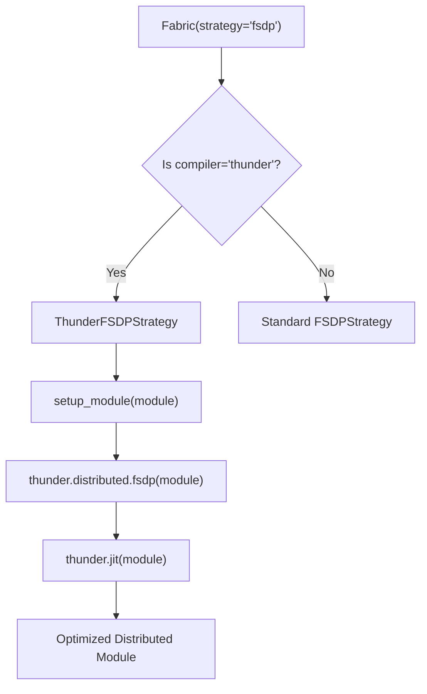
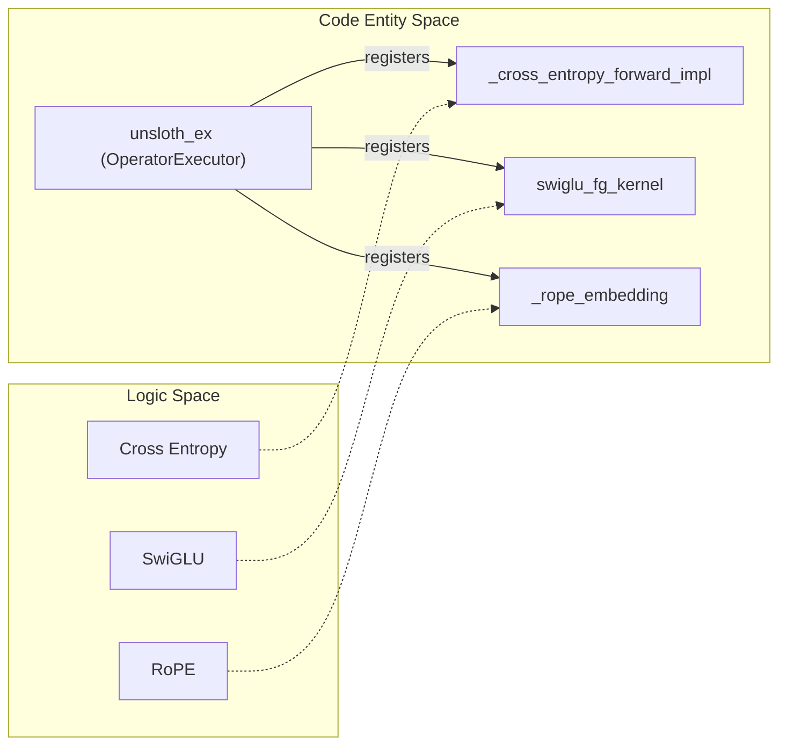

<!-- source: DeepWiki mcp.deepwiki.com · repo Lightning-AI/litgpt · page 10.1 Thunder Extension · fetched 2026-10-21 -->

# Thunder Extension

<details>
<summary>Relevant source files</summary>

The following files were used as context for generating this wiki page:

- [extensions/thunder/README.md](extensions/thunder/README.md)
- [extensions/thunder/pretrain.py](extensions/thunder/pretrain.py)
- [extensions/thunder/strategies/thunder_ddp.py](extensions/thunder/strategies/thunder_ddp.py)
- [extensions/thunder/strategies/thunder_fsdp.py](extensions/thunder/strategies/thunder_fsdp.py)
- [extensions/thunder/unsloth/executor.py](extensions/thunder/unsloth/executor.py)
- [extensions/thunder/unsloth/kernels/__init__.py](extensions/thunder/unsloth/kernels/__init__.py)
- [extensions/thunder/unsloth/kernels/cross_entropy_loss.py](extensions/thunder/unsloth/kernels/cross_entropy_loss.py)
- [extensions/thunder/unsloth/kernels/rope_embedding.py](extensions/thunder/unsloth/kernels/rope_embedding.py)
- [extensions/thunder/unsloth/kernels/swiglu.py](extensions/thunder/unsloth/kernels/swiglu.py)
- [extensions/thunder/unsloth/kernels/utils.py](extensions/thunder/unsloth/kernels/utils.py)
- [litgpt/args.py](litgpt/args.py)
- [litgpt/finetune/full.py](litgpt/finetune/full.py)
- [litgpt/pretrain.py](litgpt/pretrain.py)
- [tests/ext_thunder/test_thunder_distributed.py](tests/ext_thunder/test_thunder_distributed.py)
- [tests/ext_thunder/test_thunder_networks.py](tests/ext_thunder/test_thunder_networks.py)
- [tests/ext_thunder/test_thunder_pretrain.py](tests/ext_thunder/test_thunder_pretrain.py)
- [tests/ext_thunder/test_unsloth_executor.py](tests/ext_thunder/test_unsloth_executor.py)
- [tests/test_distributed.py](tests/test_distributed.py)

</details>


The **Thunder Extension** integrates [Lightning Thunder](https://github.com/Lightning-AI/lightning-thunder), a source-to-source compiler for PyTorch, into LitGPT. This integration enables significant performance optimizations for LLM training by generating optimized execution traces, utilizing best-in-class executors like Unsloth, and providing specialized distributed strategies for Fully Sharded Data Parallel (FSDP) and Distributed Data Parallel (DDP).

Sources: `extensions/thunder/README.md:1-7`()

## Overview of Thunder Integration

Lightning Thunder operates as a Just-In-Time (JIT) compiler that transforms PyTorch programs into optimized "traces" [extensions/thunder/README.md:32-35](). In LitGPT, this is primarily used to accelerate the pretraining workflow by wrapping the model and loss function with `thunder.jit()` [extensions/thunder/pretrain.py:162-164]().

### Key Components

| Component | Description |
| :--- | :--- |
| **JIT Compilation** | Uses `thunder.jit` to compile the `forward_and_loss` function [extensions/thunder/pretrain.py:162-164](). |
| **Custom Strategies** | Implements `ThunderFSDPStrategy` and `ThunderDDPStrategy` to handle distributed states within the Thunder ecosystem [extensions/thunder/strategies/thunder_fsdp.py:47-61](), [extensions/thunder/strategies/thunder_ddp.py:36-49](). |
| **Unsloth Kernels** | Integration of high-performance Triton kernels for RoPE, Cross Entropy, and SwiGLU via a custom `OperatorExecutor` [extensions/thunder/unsloth/executor.py:24-25](). |

Sources: `extensions/thunder/pretrain.py:160-164`(), `extensions/thunder/strategies/thunder_fsdp.py:47-61`(), `extensions/thunder/unsloth/executor.py:24-25`()

## Distributed Strategies

LitGPT provides specialized Fabric strategies to bridge Lightning's distributed orchestration with Thunder's internal transformations.

### ThunderFSDPStrategy
The `ThunderFSDPStrategy` implements Zero Redundancy Optimizer (ZeRO) stages. It supports:
*   **Sharding Strategies**: `ZERO2` (gradients/optimizer states) and `ZERO3` (parameters/gradients/optimizer states) [extensions/thunder/strategies/thunder_fsdp.py:77-83]().
*   **Bucketing**: Optimizes communication by grouping layers via `bucketing_strategy` (`NONE`, `LAYER`, or `BLOCK`) [extensions/thunder/strategies/thunder_fsdp.py:85-91]().
*   **State Dict**: Supports both `full` (rank 0 assembly) and `sharded` checkpointing [extensions/thunder/strategies/thunder_fsdp.py:93-98]().

### ThunderDDPStrategy
A replicated data-parallel strategy that applies the `thunder.distributed.ddp` transform to the module during `setup_module` [extensions/thunder/strategies/thunder_ddp.py:125-142]().

### Data Flow: Distributed Setup
The following diagram illustrates how the Thunder extension intercepts the standard Fabric setup to apply Thunder-specific transformations.

**Distributed Strategy Initialization**

Sources: `extensions/thunder/pretrain.py:135-157`(), `extensions/thunder/strategies/thunder_fsdp.py:158-180`(), `extensions/thunder/strategies/thunder_ddp.py:125-145`()

## Unsloth Kernel Executors

The extension leverages **Unsloth** kernels to replace standard PyTorch operations with highly optimized Triton-based implementations. These are registered via the `unsloth_ex` `OperatorExecutor` [extensions/thunder/unsloth/executor.py:24-25]().

### Supported Kernels

1.  **Cross Entropy Loss**: Replaces `ltorch.cross_entropy` with `unsloth_cross_entropy`. It includes a custom gradient transform `unsloth_cross_entropy_grad` for memory efficiency [extensions/thunder/unsloth/executor.py:112-137]().
2.  **SwiGLU Activation**: LitGPT's `LLaMAMLP` is monkey-patched to use a `swiglu` function that Thunder can intercept and lower to `unsloth_swiglu_forward` [extensions/thunder/unsloth/executor.py:157-220]().
3.  **RoPE (Rotary Positional Embeddings)**: Intercepts `litgpt.model.apply_rope` and replaces it with `_rope_embedding_forward_impl`, which uses a specialized Triton kernel [extensions/thunder/unsloth/executor.py:230-264](), [extensions/thunder/unsloth/kernels/rope_embedding.py:86-123]().

### Code Mapping: Unsloth Integration
This diagram maps the high-level kernel names to their specific implementation entities in the codebase.

**Unsloth Executor Entity Map**

Sources: `extensions/thunder/unsloth/executor.py:24-25`(), `extensions/thunder/unsloth/executor.py:48-50`(), `extensions/thunder/unsloth/executor.py:179-181`(), `extensions/thunder/unsloth/kernels/rope_embedding.py:32-45`()

## Optimized Pretraining Workflow

The pretraining script in the Thunder extension (`extensions/thunder/pretrain.py`) differs from the standard `litgpt/pretrain.py` by focusing on JIT compilation of the entire forward pass and loss calculation.

### Forward and Loss JIT
Instead of just JIT-compiling the model, the extension compiles a `forward_and_loss` wrapper:
```python
def forward_and_loss(model: nn.Module, input_ids: torch.Tensor, targets: torch.Tensor) -> torch.Tensor:
    logits = model(input_ids)
    # disable chunk_size to enable the unsloth cross entropy kernel
    loss = chunked_cross_entropy(logits, targets, chunk_size=0)
    return loss
```
[extensions/thunder/pretrain.py:49-53]()

This allows Thunder to optimize the boundary between the model's final layer and the loss function, enabling fusion of the final projection and the cross-entropy calculation.

### Execution Trace
When `compiler="thunder"` is used, the script initializes the `jit` with a list of executors (default: `sdpa`, `torchcompile`, `nvfuser`, `torch`) [extensions/thunder/pretrain.py:82-83](). The Unsloth executor can be added to this list to enable the Triton kernels described above.

Sources: `extensions/thunder/pretrain.py:49-53`(), `extensions/thunder/pretrain.py:82-83`(), `extensions/thunder/pretrain.py:160-164`()

## Implementation Details

### Kernel Checkers
Each Unsloth implementation includes a "checker" function (e.g., `unsloth_cross_entropy_checker`) that validates if the input tensors (device, dtype, reduction type) are compatible with the optimized kernel before applying the transform [extensions/thunder/unsloth/executor.py:69-88]().

### Backward Pass Handling
Thunder manages the backward pass by registering `grad_transform` functions. For example, `unsloth_swiglu_grad` explicitly calls `unsloth_swiglu_backward` and uses `put_grads` to populate the gradient proxies [extensions/thunder/unsloth/executor.py:207-213]().

Sources: `extensions/thunder/unsloth/executor.py:69-88`(), `extensions/thunder/unsloth/executor.py:207-213`()

---

