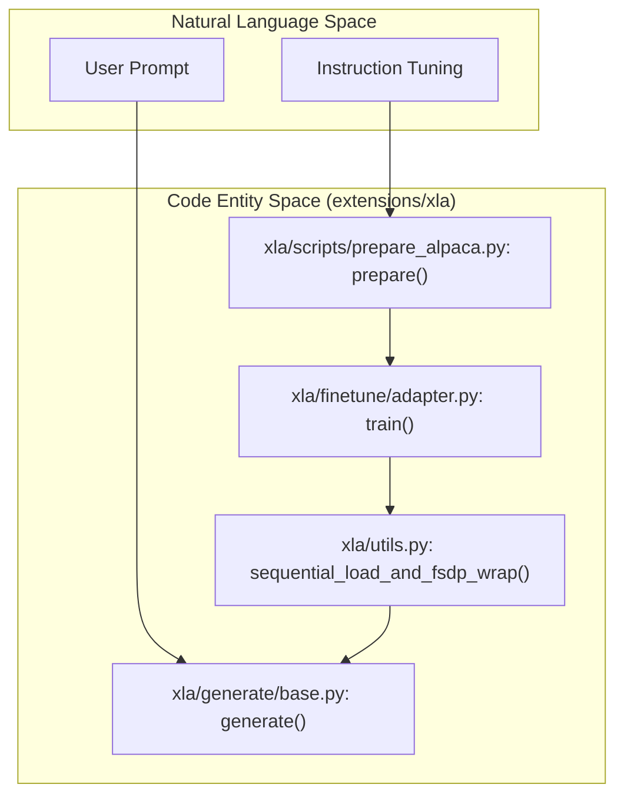
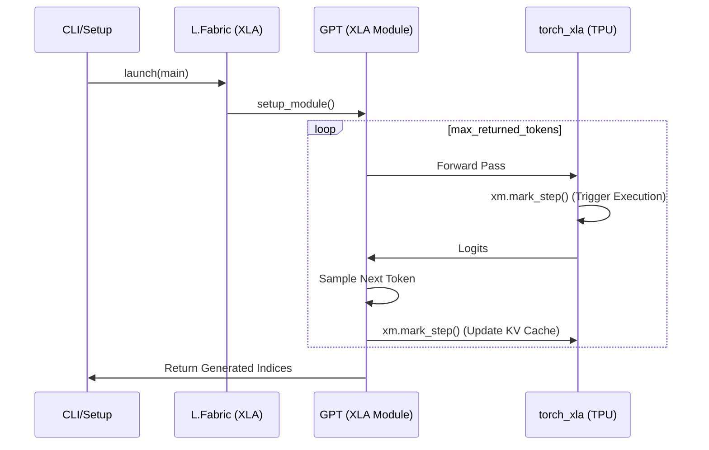

<!-- source: DeepWiki mcp.deepwiki.com · repo Lightning-AI/litgpt · page 10.2 XLA Extension · fetched 2026-10-21 -->

# XLA Extension

Relevant source files

The following files were used as context for generating this wiki page:

- [extensions/xla/README.md](extensions/xla/README.md)
- [extensions/xla/finetune/adapter.py](extensions/xla/finetune/adapter.py)
- [extensions/xla/generate/adapter.py](extensions/xla/generate/adapter.py)
- [extensions/xla/generate/base.py](extensions/xla/generate/base.py)
- [extensions/xla/scripts/prepare_alpaca.py](extensions/xla/scripts/prepare_alpaca.py)
- [extensions/xla/utils.py](extensions/xla/utils.py)

The XLA extension enables LitGPT to run on Google Cloud TPUs (Tensor Processing Units) using the PyTorch XLA backend. This extension leverages Lightning Fabric's `XLAAccelerator` and `XLAFSDPStrategy` to distribute large language models across TPU cores and pod slices. It includes specialized scripts for data preparation, fine-tuning (Adapter), and text generation optimized for the XLA graph compilation workflow.

### Architecture and Data Flow

The XLA extension bridges LitGPT's hackable model implementation with the XLA compiler. Unlike standard PyTorch, XLA requires explicit graph marking via `xm.mark_step()` to trigger execution on the TPU hardware.

#### System Entity Map
The following diagram maps high-level XLA concepts to their specific implementations within the `extensions/xla` directory.

**Sources:** [extensions/xla/generate/base.py:26-34](), [extensions/xla/finetune/adapter.py:121-129](), [extensions/xla/utils.py:35-37](), [extensions/xla/scripts/prepare_alpaca.py:18-28]()

---

### Hardware Setup and Environment

LitGPT supports TPU v4 VM instances. Because TPU VMs have distinct host and device memory characteristics (e.g., limited system RAM vs. high HBM), the environment requires specific configurations.

| Component | Recommendation / Command |
| :--- | :--- |
| **Runtime** | PjRT (default in newer XLA) |
| **Env Vars** | `PJRT_DEVICE=TPU`, `ALLOW_MULTIPLE_LIBTPU_LOAD=1` |
| **Dependencies** | `torch-nightly`, `torch_xla-nightly`, `libopenblas-dev` |
| **Provisioning** | `gcloud compute tpus tpu-vm create litgpt --version=tpu-vm-v4-base --accelerator-type=v4-8` |

**Sources:** [extensions/xla/README.md:8-13](), [extensions/xla/README.md:56-75]()

---

### XLA-Specific Generation

Generation on XLA differs from standard PyTorch due to the overhead of graph compilation. The first token generation typically takes longer (e.g., ~17 seconds for Falcon-7B) as the graph is compiled, while subsequent steps are significantly faster [extensions/xla/README.md:100-101]().

#### Execution Flow: `xla/generate/base.py`

**Key Implementation Details:**
*   **Graph Triggers:** The `generate` function calls `xm.mark_step()` before the loop and after each token selection to ensure the TPU execution is synchronized with the Python loop [extensions/xla/generate/base.py:63-84]().
*   **Memory Management:** The `max_seq_length` is explicitly set to the expected output length to limit memory usage during the generation process [extensions/xla/generate/base.py:49-53]().
*   **Inference Mode:** XLA does not support `torch.inference_mode()`; instead, `@torch.no_grad()` is used [extensions/xla/generate/base.py:24-25]().

**Sources:** [extensions/xla/generate/base.py:26-93](), [extensions/xla/generate/adapter.py:98-115]()

---

### Fine-tuning with XLA

The XLA extension currently focuses on **Adapter** fine-tuning. It utilizes `XLAFSDPStrategy` for sharding the model across TPU cores.

#### Memory Optimization: Sequential Loading
For very large models (e.g., Falcon-40B) where the full checkpoint exceeds the TPU VM's system RAM, the extension provides `sequential_load_and_fsdp_wrap`.

1.  **Meta Initialization:** The model is initialized on the `meta` device to avoid memory allocation [extensions/xla/utils.py:42-43]().
2.  **Rank-0 Loading:** Only the local rank 0 of each host loads the full checkpoint [extensions/xla/utils.py:46-48]().
3.  **Iterative Broadcasting:** Transformer blocks are broadcasted one by one to other ranks, materialized, and immediately wrapped in FSDP units [extensions/xla/utils.py:63-93]().
4.  **Dtype Conversion:** Parameters are converted to `torch.float32` as XLA FSDP primarily supports FP32 parameters [extensions/xla/utils.py:88]().

#### Training Loop
The training loop in `xla/finetune/adapter.py` incorporates:
*   **Throughput Monitoring:** Uses `ThroughputMonitor` to track TFLOPs and MFU [extensions/xla/finetune/adapter.py:156-157]().
*   **Manual Warmup:** Implements a linear learning rate warmup for the first two epochs [extensions/xla/finetune/adapter.py:162-167]().
*   **Padding:** Batches are padded to a fixed `longest_seq_length` to avoid frequent XLA graph recompilations [extensions/xla/finetune/adapter.py:131-137]().

**Sources:** [extensions/xla/finetune/adapter.py:53-73](), [extensions/xla/finetune/adapter.py:90-98](), [extensions/xla/utils.py:35-114]()

---

### Data Preparation

The `xla/scripts/prepare_alpaca.py` script formats data specifically for the XLA instruction tuning pipeline.

*   **Prompt Formatting:** It uses a standardized Alpaca template with "Instruction", "Input", and "Response" fields [extensions/xla/scripts/prepare_alpaca.py:128-142]().
*   **Tokenization:** Samples are tokenized and saved as `train.pt` and `test.pt` files containing `input_ids` and `labels` [extensions/xla/scripts/prepare_alpaca.py:98-125]().
*   **Input Masking:** Supports masking the instruction tokens in the labels so the model only learns to predict the response [extensions/xla/scripts/prepare_alpaca.py:122-123]().

**Sources:** [extensions/xla/scripts/prepare_alpaca.py:18-82](), [extensions/xla/scripts/prepare_alpaca.py:98-125]()

---

### Utilities

| Function | Purpose |
| :--- | :--- |
| `rank_print` | Ensures only rank 0 prints to stdout and forces a flush for TPU VM logging [extensions/xla/utils.py:17-23](). |
| `materialize_parameters` | Moves parameters from `meta` device to a physical device and resets them [extensions/xla/utils.py:26-33](). |
| `sequential_load_and_fsdp_wrap` | A memory-efficient loading utility for FSDP on TPU hosts [extensions/xla/utils.py:35-114](). |

**Sources:** [extensions/xla/utils.py:1-115]()

---

