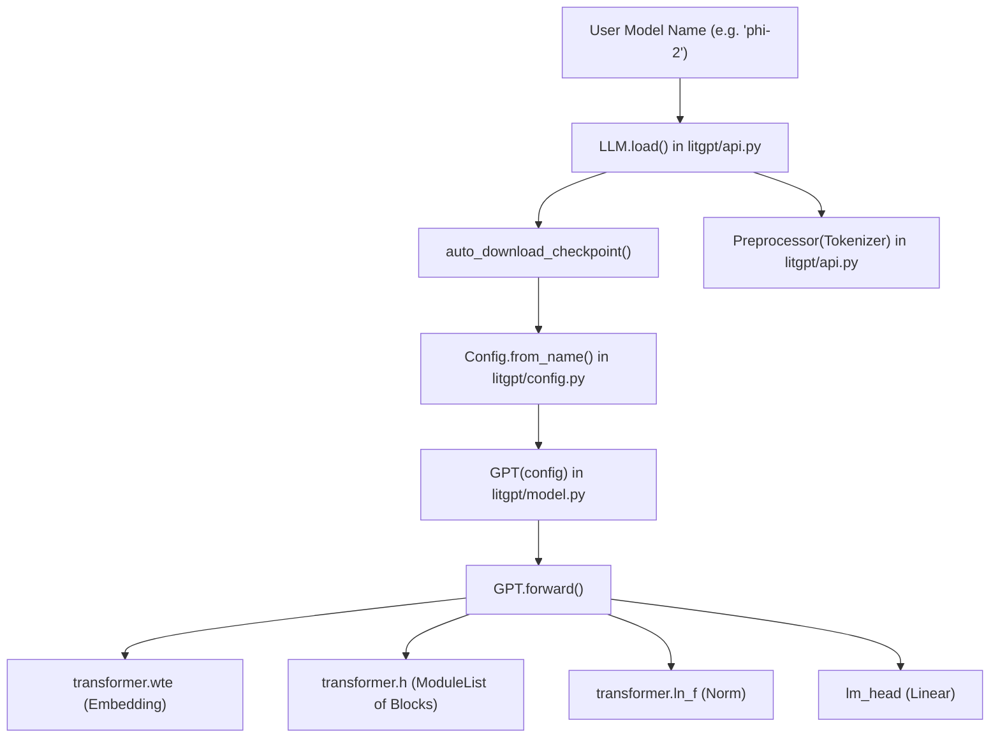
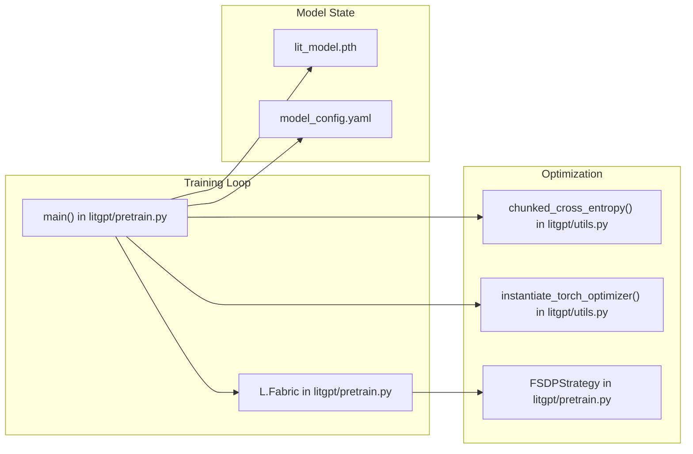

<!-- source: DeepWiki mcp.deepwiki.com · repo Lightning-AI/litgpt · page 11 Glossary · fetched 2026-10-21 -->

# Glossary

Relevant source files

The following files were used as context for generating this wiki page:

- [.pre-commit-config.yaml](.pre-commit-config.yaml)
- [README.md](README.md)
- [extensions/thunder/pretrain.py](extensions/thunder/pretrain.py)
- [litgpt/adapter.py](litgpt/adapter.py)
- [litgpt/adapter_v2.py](litgpt/adapter_v2.py)
- [litgpt/api.py](litgpt/api.py)
- [litgpt/args.py](litgpt/args.py)
- [litgpt/config.py](litgpt/config.py)
- [litgpt/finetune/adapter.py](litgpt/finetune/adapter.py)
- [litgpt/finetune/adapter_v2.py](litgpt/finetune/adapter_v2.py)
- [litgpt/finetune/full.py](litgpt/finetune/full.py)
- [litgpt/finetune/lora.py](litgpt/finetune/lora.py)
- [litgpt/lora.py](litgpt/lora.py)
- [litgpt/model.py](litgpt/model.py)
- [litgpt/pretrain.py](litgpt/pretrain.py)
- [litgpt/utils.py](litgpt/utils.py)
- [pyproject.toml](pyproject.toml)
- [tests/test_api.py](tests/test_api.py)
- [tests/test_model.py](tests/test_model.py)
- [tests/test_utils.py](tests/test_utils.py)
- [tutorials/download_model_weights.md](tutorials/download_model_weights.md)
- [tutorials/python-api.md](tutorials/python-api.md)

This glossary defines codebase-specific terms, abbreviations, and domain concepts used throughout LitGPT. It serves as a technical reference for onboarding engineers to navigate the architecture and implementation details.

## Core Concepts & Terms

### Config
The `Config` dataclass is the central source of truth for model architectures in LitGPT. It defines structural parameters such as the number of layers, embedding dimensions, and specific implementation choices for MLP and normalization layers [litgpt/config.py:26-117]().

### GPT (Model)
The `GPT` class is the core model implementation, representing a decoder-only transformer. It is designed with "no abstractions," meaning the entire transformer logic is contained within a single file for maximum hackability [litgpt/model.py:22-35]().

### LLM (API)
The `LLM` class is the high-level Python API wrapper for the `GPT` model. It provides convenient methods for loading models, generating text, and interfacing with the PyTorch Lightning `Trainer` [litgpt/api.py:38-64]().

### Fabric
LitGPT utilizes **Lightning Fabric** to manage distributed training, precision, and hardware acceleration. It allows the same code to run on CPU, GPU, or TPU with minimal changes [litgpt/finetune/lora.py:166-173]().

---

## Architecture & Implementation Terms

| Term | Definition | Code Reference |
| :--- | :--- | :--- |
| **RoPE** | Rotary Position Embeddings. Used to encode positional information into the self-attention mechanism. | [litgpt/model.py:57-62]() |
| **GQA** | Grouped-Query Attention. An optimization where multiple query heads share a single Key/Value head. | [litgpt/config.py:50-68]() |
| **MQA** | Multi-Query Attention. A specific case of GQA where all query heads share exactly one KV head. | [litgpt/config.py:49-68]() |
| **KV Cache** | A mechanism to store Key and Value tensors during inference to avoid redundant computations for previous tokens. | [litgpt/model.py:124-142]() |
| **Block** | A single Transformer layer consisting of an attention mechanism and an MLP. | [litgpt/model.py:32]() |
| **wte** | Weight Token Embedding. The layer that maps input token IDs to dense vectors. | [litgpt/model.py:31]() |
| **lm_head** | Language Model Head. The final linear layer that maps hidden states back to vocabulary logits. | [litgpt/model.py:28]() |

**Sources:** [litgpt/config.py:26-117](), [litgpt/model.py:22-155](), [litgpt/api.py:38-64]()

---

## Fine-tuning & PEFT Methods

### LoRA (Low-Rank Adaptation)
A Parameter-Efficient Fine-Tuning (PEFT) method that injects trainable low-rank matrices into existing linear layers. In LitGPT, this is implemented by marking only `lora_` parameters as trainable [litgpt/finetune/lora.py:23](), [litgpt/finetune/lora.py:182]().

### Adapter
A method that adds small bottleneck layers (adapters) to the transformer blocks.
*   **Adapter V1:** Uses attention-based adapters.
*   **Adapter V2:** Adds bias and scale parameters to linear layers and makes normalization layers trainable [litgpt/finetune/adapter_v2.py:182]().

### Quantization
Techniques to reduce memory usage by using lower-bit representations (e.g., 4-bit, 8-bit). LitGPT supports `bitsandbytes` for NF4, FP4, and Int8 quantization [litgpt/finetune/lora.py:53](), [litgpt/finetune/lora.py:141-150]().

---

## Natural Language Space to Code Entity Space

The following diagrams map conceptual LLM workflows and architectural components to their specific code implementations in LitGPT.

### Model Loading and Inference Flow
This diagram shows how a user's request for a model maps from a string identifier to the internal `GPT` and `Tokenizer` entities.

**Sources:** [litgpt/api.py:149-177](), [litgpt/model.py:22-35](), [litgpt/config.py:26-117]()

### Training and Optimization Entities
This diagram maps training concepts like "Loss Function" and "Optimization Strategy" to the classes and functions responsible for them.

**Sources:** [litgpt/pretrain.py:142-173](), [litgpt/utils.py:29](), [litgpt/utils.py:91-107]()

---

## Data & Checkpoint Jargon

*   **lit_model.pth:** The standard filename for LitGPT-formatted model weights [litgpt/utils.py:91]().
*   **model_config.yaml:** The configuration file stored alongside weights, containing the `Config` parameters [litgpt/utils.py:98]().
*   **Checkpoint Conversion:** The process of mapping weights between Hugging Face `transformers` format and the LitGPT internal format [litgpt/model.py:19]().
*   **Padded Vocab Size:** The vocabulary size adjusted to a multiple (usually 512) to optimize GPU hardware utilization [litgpt/config.py:34-35](), [litgpt/config.py:127-131]().
*   **Chunked Cross Entropy:** A memory-efficient implementation of cross-entropy loss that processes logits in chunks to avoid large memory allocations [litgpt/utils.py:129-163]().

**Sources:** [litgpt/config.py:127-131](), [litgpt/utils.py:91-107](), [litgpt/utils.py:129-163]()